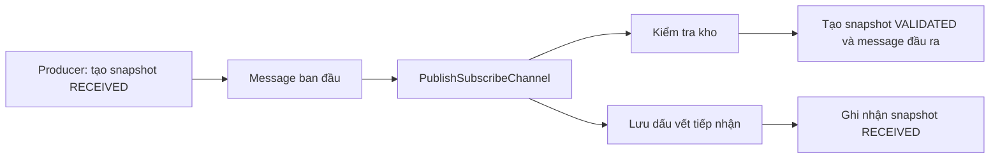

# Message immutable

Trong chương **Message** của module **SPRING_INTEGRATION_CORE**, tính bất biến là nền tảng để truyền dữ liệu giữa các endpoint mà không để một bước xử lý vô tình sửa đầu vào của bước khác. Khi thiết kế luồng qua MessageChannel, gateway và Java DSL, cần phân biệt sự bất biến của lớp bao thông điệp với sự bất biến của dữ liệu bên trong.

Bài này dùng tình huống xử lý đơn hàng để giải thích ranh giới đó, cách tạo message kế tiếp và cách giữ dữ liệu ổn định khi luồng có transformer, router, filter hoặc nhiều nhánh xử lý. Các đoạn dùng `record` yêu cầu Java 17 trở lên; ví dụ Spring sử dụng các API của `spring-integration-core` và `spring-messaging`, với phiên bản do dự án quản lý.

## 1. Mục tiêu học tập

Sau bài học, bạn có thể:

- Giải thích chính xác phần nào của một message thông thường không thể thay đổi sau khi khởi tạo.
- Nhận diện payload và giá trị header vẫn còn mutable dù đã nằm trong message.
- Dùng `MessageBuilder` để thay đổi nội dung đầu ra mà giữ nguyên message đầu vào.
- Thiết kế DTO có collection hoặc mảng mà không để lộ dữ liệu mutable.
- Phân biệt ID của message với định danh nghiệp vụ và thông tin liên kết xuyên suốt luồng.
- Viết kiểm thử thể hiện cả tính bất biến của lớp bao lẫn tính ổn định của dữ liệu nghiệp vụ.

## 2. “Immutable” bắt đầu từ lớp bao Message

API `Message<T>` cung cấp hai phương thức truy xuất cơ bản: `getPayload()` và `getHeaders()`. Interface không có phương thức `setPayload(...)` hoặc `setHeaders(...)`. Payload chứa dữ liệu cần xử lý; headers chứa metadata phục vụ truyền, định tuyến và xử lý message. Xem [API Message](https://docs.spring.io/spring-framework/docs/current/javadoc-api/org/springframework/messaging/Message.html).

Với message thông thường được tạo bằng `GenericMessage` hoặc builder mặc định, mô hình sử dụng là:

```text
Message<OrderSnapshot>
├── payload ───────────► đối tượng OrderSnapshot
└── headers ───────────► MessageHeaders
                         ├── tenantId  ──► "shop-vn"
                         ├── traceId   ──► "trace-001"
                         └── ...
```

Nếu một endpoint cần đổi payload hoặc thêm header, nó tạo message đầu ra với nội dung mong muốn. Message ban đầu vẫn đại diện cho đầu vào của endpoint đó.

Tuy nhiên, mũi tên trong hình là **tham chiếu đến đối tượng**. Giữ nguyên tham chiếu không có nghĩa đối tượng được tham chiếu tự động trở thành bất biến.

| Lớp cần xem xét | Bảo đảm khi dùng message thông thường | Trách nhiệm của ứng dụng |
| --- | --- | --- |
| Lớp bao message | Không cung cấp cách thay payload/header qua setter của message | Tạo message đầu ra khi cần thay nội dung |
| Cấu trúc `MessageHeaders` | Không thêm, xóa hoặc thay cặp key-value trực tiếp qua API Map | Dùng builder hoặc endpoint phù hợp |
| Đối tượng payload | Không tự bị đóng băng hoặc deep copy | Chọn mô hình immutable hoặc kiểm soát quyền sửa |
| Đối tượng nằm trong một header | Không tự bị đóng băng hoặc deep copy | Tránh chia sẻ giá trị mutable giữa các consumer |
| Đối tượng lồng bên trong payload/header | Không tự được bảo vệ theo toàn bộ cây dữ liệu | Xem xét cả collection, phần tử, mảng và tài nguyên bên ngoài |

Phân biệt lớp bao với dữ liệu bên trong là điểm cốt lõi của hợp đồng bất biến trong Spring Integration. Tài liệu chính thức cũng lưu ý rằng nhiều consumer có thể cùng truy cập một payload hoặc giá trị header; ứng dụng quyết định các đối tượng đó có immutable hay không. Xem [Message trong Spring Integration](https://docs.spring.io/spring-integration/reference/message.html).

## 3. Thay header bằng cách tạo message kế tiếp

### 3.1. Thao tác trực tiếp trên MessageHeaders bị từ chối

Ví dụ hoàn chỉnh sau minh họa cả thao tác sai lẫn cách tạo đầu ra:

```java
import org.springframework.integration.support.MessageBuilder;
import org.springframework.messaging.Message;

public class ImmutableMessageDemo {

    public static void main(String[] args) {
        Message<String> incoming = MessageBuilder
                .withPayload("order-001")
                .setHeader("stage", "RECEIVED")
                .build();

        try {
            incoming.getHeaders().put("stage", "VALIDATED");
        }
        catch (UnsupportedOperationException ex) {
            System.out.println("Không được sửa cấu trúc headers trực tiếp");
        }

        Message<String> outgoing = MessageBuilder
                .fromMessage(incoming)
                .setHeader("stage", "VALIDATED")
                .build();

        System.out.println(incoming.getHeaders().get("stage"));
        System.out.println(outgoing.getHeaders().get("stage"));
        System.out.println(incoming.getPayload());
        System.out.println(outgoing.getPayload());
    }
}
```

Kết quả mong đợi:

```text
Không được sửa cấu trúc headers trực tiếp
RECEIVED
VALIDATED
order-001
order-001
```

`MessageHeaders` triển khai `Map<String, Object>` để hỗ trợ tra cứu, nhưng các thao tác như `put`, `putAll`, `remove` và `clear` ném `UnsupportedOperationException`. Không suy ra khả năng sửa chỉ từ việc một kiểu dữ liệu triển khai `Map`. Xem [API MessageHeaders](https://docs.spring.io/spring-framework/docs/current/javadoc-api/org/springframework/messaging/MessageHeaders.html).

### 3.2. Builder là đối tượng phục vụ quá trình xây dựng

Trong ví dụ, `setHeader(...)` thay cấu hình của builder. Nó không phải setter trên `incoming`.

`MessageBuilder.fromMessage(incoming)` dùng payload của đầu vào và lấy các headers làm cơ sở để xây dựng kết quả. `withPayload(...)` bắt đầu từ một payload được chỉ định. Bài này dùng nhất quán `org.springframework.integration.support.MessageBuilder`; Spring Framework cũng có lớp cùng tên ở package khác. Xem [API MessageBuilder của Spring Integration](https://docs.spring.io/spring-integration/api/org/springframework/integration/support/MessageBuilder.html).

Một thói quen dễ áp dụng là tạo builder trong phạm vi một lần xử lý:

```java
public Message<?> markValidated(Message<?> incoming) {
    return MessageBuilder.fromMessage(incoming)
            .setHeader("validated", true)
            .removeHeader("validationHint")
            .build();
}
```

Không đặt builder dùng chung trong field của singleton để mọi request cùng sửa. Dữ liệu tạm phục vụ xây dựng một kết quả nên thuộc về lần xử lý tương ứng.

## 4. Message immutable vẫn có thể chứa dữ liệu mutable

### 4.1. Hai message khác nhau có thể dùng chung một payload

Đoạn sau cố ý sử dụng `ArrayList` để làm lộ vấn đề:

```java
import java.util.ArrayList;
import java.util.List;

import org.springframework.integration.support.MessageBuilder;
import org.springframework.messaging.Message;

public class SharedPayloadDemo {

    public static void main(String[] args) {
        List<String> items = new ArrayList<>(List.of("BOOK"));
        List<String> checks = new ArrayList<>(List.of("received"));

        Message<List<String>> original = MessageBuilder
                .withPayload(items)
                .setHeader("checks", checks)
                .build();

        Message<List<String>> branch = MessageBuilder
                .fromMessage(original)
                .setHeader("branch", "inventory")
                .build();

        System.out.println(original == branch);
        System.out.println(original.getPayload() == branch.getPayload());

        branch.getPayload().add("PEN");
        checks.add("inventory-checked");

        System.out.println(original.getPayload());
        System.out.println(original.getHeaders().get("checks"));
    }
}
```

Kết quả mong đợi:

```text
false
true
[BOOK, PEN]
[received, inventory-checked]
```

Diễn biến trong ví dụ:

1. Việc thêm header `branch` làm message đầu ra có metadata khác đầu vào.
2. Cả hai message vẫn trỏ đến cùng `items`.
3. Lệnh `add("PEN")` sửa chính danh sách đang làm payload của `original`.
4. Biến `checks` bên ngoài cũng còn trỏ đến đối tượng được dùng làm giá trị header.

Không có lời gọi `setPayload(...)` hay `headers.put(...)` nào trong hai thao tác sửa cuối. Lỗi xuất hiện qua đối tượng được chia sẻ.

### 4.2. Sao chép map không đồng nghĩa sao chép các giá trị

Với constructor `new GenericMessage<>(payload, headersMap)`, nội dung map đầu vào được sao chép. Vì vậy, thêm một key vào `headersMap` sau đó không tự thêm key vào message. Nhưng nếu một giá trị của map là `ArrayList`, thao tác sao chép cấu trúc map không tạo bản sao sâu của danh sách đó.

Constructor nhận trực tiếp `MessageHeaders` lại sử dụng chính instance headers được truyền vào. Cần đọc đúng overload khi đánh giá việc chia sẻ dữ liệu. Xem [API GenericMessage](https://docs.spring.io/spring-framework/docs/current/javadoc-api/org/springframework/messaging/support/GenericMessage.html).

### 4.3. Các kiểu dữ liệu cần chú ý

| Dữ liệu được đưa vào message | Tình huống dễ gây thay đổi ngoài ý muốn | Cách thiết kế trong tình huống đó |
| --- | --- | --- |
| `ArrayList` hoặc `HashMap` | Producer giữ tham chiếu và tiếp tục cập nhật | Chụp dữ liệu tại ranh giới gửi; bảo vệ cả phần tử |
| DTO có setter | Một nhánh đổi trạng thái trên DTO đầu vào | Trả về DTO mới hoặc bản sao riêng của nhánh |
| `byte[]` | Code ghi đè một phần buffer | Sao chép tại nơi nhận quyền sở hữu; không làm lộ mảng nội bộ |
| `Date` hoặc đối tượng mutable lồng nhau | Getter trả lại đối tượng còn sửa được | Chuyển sang kiểu giá trị phù hợp hoặc defensive copy |
| Entity đang được ORM quản lý | Trạng thái entity thay đổi theo transaction hoặc code khác | Chuyển dữ liệu cần truyền sang DTO snapshot |
| `File`, `Path` hoặc `InputStream` | Nội dung ngoài bộ nhớ đổi, stream bị đọc hoặc đóng | Quy định vòng đời, quyền truy cập và nội dung cần lưu giữ |

Một `Path` có thể là đối tượng giá trị ổn định trong khi nội dung file tại đường dẫn đó tiếp tục thay đổi. “Snapshot của tên tài nguyên” và “snapshot của dữ liệu tài nguyên” là hai yêu cầu khác nhau.

## 5. Thiết kế payload đơn hàng như một snapshot

### 5.1. Record chưa tự bảo vệ collection

Java mô tả `record` là kiểu mang dữ liệu bất biến nông. Component là tham chiếu đến collection thì collection đó vẫn cần được xử lý phù hợp. Compact constructor có thể kiểm tra dữ liệu và thực hiện defensive copy. Xem [API Record](https://docs.oracle.com/en/java/javase/17/docs/api/java.base/java/lang/Record.html).

Vì vậy, chỉ viết:

```java
record UnsafeOrder(String orderId, List<String> items) {
}
```

chưa đủ để đảm bảo `items` không đổi. Người tạo record vẫn có thể giữ danh sách gốc và gọi `add(...)`.

### 5.2. Mô hình snapshot cho ví dụ xuyên suốt

Đặt đoạn sau trong `OrderSnapshot.java` khi thực hành:

```java
import java.util.List;
import java.util.Objects;

public record OrderSnapshot(
        String orderId,
        List<Line> lines,
        String status) {

    public OrderSnapshot {
        orderId = Objects.requireNonNull(orderId, "orderId");
        lines = List.copyOf(Objects.requireNonNull(lines, "lines"));
        status = Objects.requireNonNull(status, "status");
    }

    public OrderSnapshot withStatus(String nextStatus) {
        return new OrderSnapshot(orderId, lines, nextStatus);
    }

    public record Line(String sku, int quantity) {

        public Line {
            sku = Objects.requireNonNull(sku, "sku");
            if (quantity <= 0) {
                throw new IllegalArgumentException("quantity phải lớn hơn 0");
            }
        }
    }
}
```

Mô hình này phù hợp với ví dụ vì:

- `orderId` và `status` là `String`.
- `Line` chỉ chứa `String` và `int`.
- `lines` được chuyển thành danh sách không cho thêm, xóa hoặc thay phần tử.
- `withStatus(...)` tạo một snapshot khác, thay vì sửa snapshot đầu vào.

`List.copyOf(...)` không chấp nhận phần tử `null` và không deep copy phần tử. Nếu `Line` được thay bằng một class có setter, cần xem xét lại mô hình. Ngoài ra, `Collections.unmodifiableList(source)` là view không cho sửa qua view nhưng vẫn có thể quan sát thay đổi của `source`; không dùng nó như một bản chụp độc lập của collection đầu vào. Xem [List và các danh sách không sửa được](https://docs.oracle.com/en/java/javase/17/docs/api/java.base/java/util/List.html).

Ví dụ sử dụng:

```java
List<OrderSnapshot.Line> draftLines = new ArrayList<>();
draftLines.add(new OrderSnapshot.Line("BOOK", 1));

OrderSnapshot received =
        new OrderSnapshot("order-001", draftLines, "RECEIVED");

draftLines.add(new OrderSnapshot.Line("PEN", 2));

OrderSnapshot validated = received.withStatus("VALIDATED");

System.out.println(received.lines().size()); // 1
System.out.println(received.status());       // RECEIVED
System.out.println(validated.status());      // VALIDATED
```

Đoạn sử dụng cần import `java.util.ArrayList` và `java.util.List`. Khi constructor chạy, phía gọi phải bảo đảm danh sách đầu vào không đang bị luồng khác sửa; defensive copy không biến một quá trình đọc dữ liệu đang tranh chấp thành snapshot nhất quán.

### 5.3. Với mảng, bảo vệ cả đầu vào lẫn đầu ra

Nếu payload cần giữ dữ liệu nhị phân, có thể đóng gói mảng trong một kiểu có hợp đồng rõ ràng:

```java
import java.util.Objects;

public final class BinarySnapshot {

    private final byte[] bytes;

    public BinarySnapshot(byte[] bytes) {
        this.bytes = Objects.requireNonNull(bytes, "bytes").clone();
    }

    public byte[] bytes() {
        return bytes.clone();
    }
}
```

Sao chép trong constructor ngăn phía gọi sửa mảng đã đưa vào. Sao chép trong getter ngăn consumer lấy mảng nội bộ để ghi đè. Chỉ sao chép ở một trong hai nơi vẫn để hở một hướng truy cập.

Đây là lựa chọn dành cho yêu cầu giữ một snapshot nhị phân. Với dữ liệu lớn hoặc streaming, cần thiết kế riêng vòng đời và quyền sở hữu để tránh sao chép quá nhiều.

## 6. Hai cách tạo message đầu ra

Các ví dụ ở mục này sử dụng `OrderSnapshot` ở mục 5, `Message` và `MessageBuilder` đã giới thiệu, cùng `java.util.List`.

### 6.1. Giữ payload, thay metadata

```java
Message<OrderSnapshot> received = MessageBuilder
        .withPayload(new OrderSnapshot(
                "order-001",
                List.of(new OrderSnapshot.Line("BOOK", 1)),
                "RECEIVED"))
        .setHeader("tenantId", "shop-vn")
        .setHeader("traceId", "trace-001")
        .build();

Message<OrderSnapshot> routed = MessageBuilder
        .fromMessage(received)
        .setHeader("route", "inventory")
        .build();
```

`routed` có header `route`, còn `received` thì không. Hai message dùng chung snapshot payload, điều này phù hợp vì mô hình dữ liệu của ví dụ không cho sửa snapshot đó.

### 6.2. Thay payload, giữ metadata cần thiết

```java
OrderSnapshot nextPayload =
        received.getPayload().withStatus("VALIDATED");

Message<OrderSnapshot> validated = MessageBuilder
        .withPayload(nextPayload)
        .copyHeaders(received.getHeaders())
        .setHeader("validatedBy", "order-validator")
        .build();
```

Sau bước này:

```text
received
  payload.status = RECEIVED
  tenantId       = shop-vn
  traceId        = trace-001

validated
  payload.status = VALIDATED
  tenantId       = shop-vn
  traceId        = trace-001
  validatedBy    = order-validator
```

Chọn `fromMessage(...)` khi muốn giữ payload; chọn `withPayload(...)` khi có payload đầu ra khác. Cả hai cách đều phải tính đến metadata cần giữ lại.

Trong luồng request-reply qua gateway, các header điều khiển như `replyChannel` hoặc `errorChannel` có thể cần được bảo toàn. Tự tạo `new GenericMessage<>(nextPayload)` mà quên metadata có thể khiến bước sau mất thông tin trả lời hoặc xử lý lỗi.

Ở ranh giới gửi sang hệ thống bên ngoài, xác định các header thuộc giao thức và chính sách truyền dữ liệu của ranh giới đó. Không dùng việc sao chép toàn bộ headers trong ví dụ nội bộ như quy tắc mặc định cho mọi outbound adapter.

### 6.3. Build không phải lệnh deep copy

Không dùng đoạn sau để yêu cầu một bản sao sâu:

```java
Message<?> candidate = MessageBuilder.fromMessage(received).build();
```

Builder có thể trả lại message gốc nếu không có thay đổi và đáp ứng điều kiện tái sử dụng của implementation. Khi có message mới, payload cũng không vì thế mà tự được clone. Tài liệu của `build()` mô tả khả năng tái sử dụng này. Xem [API BaseMessageBuilder](https://docs.spring.io/spring-integration/api/org/springframework/integration/support/BaseMessageBuilder.html#build()).

Yêu cầu “mỗi nhánh sở hữu một đối tượng mutable riêng” cần được giải quyết bằng logic sao chép hoặc chuyển đổi dữ liệu của ứng dụng.

## 7. ID của message và định danh nghiệp vụ

Một đơn hàng có thể đi qua nhiều message khác nhau. Vì vậy, không dùng ID của lớp bao để thay thế định danh của đơn hàng.

| Giá trị | Ý nghĩa trong thiết kế ví dụ |
| --- | --- |
| `MessageHeaders.ID` | Định danh kỹ thuật của message được tạo |
| `MessageHeaders.TIMESTAMP` | Thời điểm tạo message theo cơ chế của framework |
| `orderId` trong payload | Định danh đơn hàng qua các bước xử lý |
| `traceId` trong header | Giá trị ứng dụng chủ động truyền để theo dõi một luồng |
| `eventId` nếu mô hình cần | Định danh một sự kiện nghiệp vụ, theo hợp đồng do ứng dụng thiết kế |

Với builder mặc định và việc tạo message mới thông thường, `id` và `timestamp` được framework quản lý; chúng không được sao chép như header nghiệp vụ thông thường. Không tự gán lại chúng để giả lập rằng mọi bước là cùng một message. Có thể đọc thêm quy tắc header chỉ đọc trong [tài liệu Message](https://docs.spring.io/spring-integration/reference/message.html#message-headers).

Hai message được tạo rất gần nhau có thể có timestamp bằng nhau theo độ phân giải mili giây. Không viết kiểm thử bắt buộc timestamp đầu ra phải lớn hơn timestamp đầu vào.

Khi cần chống xử lý trùng, chọn khóa theo ý nghĩa nghiệp vụ, chẳng hạn một `eventId` được giữ ổn định qua retry. Một thao tác tạo lại message có thể sinh ID kỹ thuật khác mà vẫn đang xử lý cùng một sự kiện.

Header `correlationId` trong các mẫu splitter/aggregator còn có ý nghĩa nhóm thông điệp. Việc ứng dụng cần trace không phải lý do để tùy tiện ghi đè khóa correlation mà cơ chế gom nhóm đang sử dụng.

## 8. Tại sao nhiều nhánh làm vấn đề rõ hơn?

Giả sử sự kiện tiếp nhận đơn hàng được gửi đến nhánh kiểm tra kho và nhánh lưu dấu vết:



`PublishSubscribeChannel` phân phối thông điệp đến các subscriber. Khi sử dụng executor, việc xử lý có thể diễn ra bất đồng bộ. Xem [các implementation của MessageChannel](https://docs.spring.io/spring-integration/reference/channel/implementations.html#channel-publishsubscribechannel).

Thiết kế mong muốn trong ví dụ là nhánh lưu dấu vết ghi nhận đúng dữ liệu được tiếp nhận, bất kể nhánh kiểm tra kho chạy trước hay sau.

Nếu nhánh kho gọi setter trên payload dùng chung, nhánh lưu dấu vết có thể thấy trạng thái đã đổi sang `VALIDATED`. Ngay cả khi xử lý tuần tự trên một thread, kết quả vẫn có thể phụ thuộc vào thứ tự subscriber. Khi có nhiều thread, còn xuất hiện tranh chấp đọc/ghi.

Tạo một lớp bao khác cho mỗi nhánh chưa giải quyết được vấn đề nếu mọi lớp bao vẫn trỏ đến cùng đối tượng mutable. Ngược lại, nhiều nhánh có thể chia sẻ một snapshot immutable mà không cần sao chép toàn bộ dữ liệu cho từng lần đọc.

Tính bất biến giúp ổn định dữ liệu được quan sát. Nó không tự đảm bảo thứ tự hoàn thành, tính nguyên tử của ghi cơ sở dữ liệu, hay việc một tác dụng phụ chỉ xảy ra một lần. Các yêu cầu đó vẫn cần thiết kế riêng.

## 9. Áp dụng vào Java DSL

### 9.1. Transformer trả về payload mới

Ví dụ cấu hình sau dùng `OrderSnapshot` ở mục 5 và đưa kết quả vào một queue để quan sát. Đặt các class trong cùng package khi thực hành:

```java
import org.springframework.context.annotation.Bean;
import org.springframework.context.annotation.Configuration;
import org.springframework.integration.channel.QueueChannel;
import org.springframework.integration.config.EnableIntegration;
import org.springframework.integration.dsl.IntegrationFlow;

@Configuration
@EnableIntegration
public class ImmutableOrderFlowConfiguration {

    @Bean(name = "orders.output")
    public QueueChannel ordersOutput() {
        return new QueueChannel(10);
    }

    @Bean
    public IntegrationFlow immutableOrderFlow() {
        return IntegrationFlow.from("orders.input")
                .<OrderSnapshot, OrderSnapshot>transform(
                        order -> order.withStatus("VALIDATED"))
                .enrichHeaders(headers ->
                        headers.header("validatedBy", "order-validator"))
                .channel("orders.output")
                .get();
    }
}
```

`orders.input` là channel đầu vào được tham chiếu theo tên trong DSL. Sau khi cấu hình được nạp vào Spring context, gửi một `Message<OrderSnapshot>` vào channel này và đọc kết quả ở `orders.output` để quan sát luồng.

Trong ví dụ, transformer nhận payload và trả một `OrderSnapshot` khác. Header enricher bổ sung metadata cho đầu ra; không có bước nào cần sửa trực tiếp headers của message nhận vào. Java DSL dùng `IntegrationFlow` để biểu diễn các endpoint và channel; `transform(...)` biểu diễn transformer endpoint. Xem [Java DSL](https://docs.spring.io/spring-integration/reference/dsl.html) và [Transformer](https://docs.spring.io/spring-integration/reference/transformer.html).

Không áp dụng cách viết sau khi `MutableOrder` là DTO có setter:

```java
// Ví dụ cần tránh trong luồng chia sẻ đầu vào.
.transform(MutableOrder.class, order -> {
    order.setStatus("VALIDATED");
    return order;
})
```

Dù endpoint tạo lớp bao đầu ra, câu lệnh setter đã thay đổi đối tượng mà các bên khác có thể đang giữ.

### 9.2. Quan hệ với các endpoint còn lại

| Thành phần | Cách áp dụng tư duy snapshot |
| --- | --- |
| Transformer | Tính kết quả từ đầu vào rồi trả payload hoặc message đầu ra |
| Router | Đọc dữ liệu để chọn đường đi; tránh sửa payload trong lúc quyết định |
| Filter | Đọc dữ liệu để quyết định chấp nhận; tránh giấu tác dụng phụ trong predicate |
| Aggregator | Tạo kết quả gom nhóm từ các đầu vào, tránh sửa trực tiếp snapshot thành phần |
| Gateway | Chuyển dữ liệu qua ranh giới của luồng với hợp đồng payload và metadata rõ ràng |
| Luồng xử lý lỗi | Giữ dữ liệu đầu vào đủ ổn định để chẩn đoán hoặc tạo yêu cầu thử lại |

Bảng mô tả lựa chọn thiết kế cho logic ứng dụng, không khẳng định mọi endpoint đều luôn tạo message mới.

Nếu error handler chỉ giữ một tham chiếu đến payload mutable, dữ liệu log ở thời điểm sau có thể khác dữ liệu tại lúc xảy ra lỗi. Khi cần điều tra hoặc phát lại, xác định dữ liệu nào phải là snapshot và khi nào snapshot được tạo.

## 10. Kiểm thử các bảo đảm quan trọng

Ví dụ JUnit Jupiter sau dùng model `OrderSnapshot` của bài. Đây là mã minh họa để người học thực hành trong dự án đã có JUnit; nó không cần dựng Spring context để thể hiện hợp đồng dữ liệu.

```java
import java.util.ArrayList;
import java.util.List;

import org.junit.jupiter.api.Test;
import org.springframework.integration.support.MessageBuilder;
import org.springframework.messaging.Message;

import static org.junit.jupiter.api.Assertions.*;

class ImmutableOrderMessageTest {

    @Test
    void changingOutputHeadersKeepsInputUnchanged() {
        OrderSnapshot order = new OrderSnapshot(
                "order-001",
                List.of(new OrderSnapshot.Line("BOOK", 1)),
                "RECEIVED");

        Message<OrderSnapshot> input = MessageBuilder
                .withPayload(order)
                .setHeader("stage", "RECEIVED")
                .setHeader("traceId", "trace-001")
                .build();

        Message<OrderSnapshot> output = MessageBuilder
                .fromMessage(input)
                .setHeader("stage", "VALIDATED")
                .build();

        assertNotSame(input, output);
        assertSame(input.getPayload(), output.getPayload());
        assertEquals("RECEIVED", input.getHeaders().get("stage"));
        assertEquals("VALIDATED", output.getHeaders().get("stage"));
        assertEquals("trace-001", output.getHeaders().get("traceId"));

        assertThrows(
                UnsupportedOperationException.class,
                () -> input.getHeaders().put("stage", "BROKEN"));
    }

    @Test
    void orderSnapshotDoesNotExposeTheOriginalList() {
        List<OrderSnapshot.Line> draft = new ArrayList<>();
        draft.add(new OrderSnapshot.Line("BOOK", 1));

        OrderSnapshot input =
                new OrderSnapshot("order-001", draft, "RECEIVED");

        draft.add(new OrderSnapshot.Line("PEN", 2));

        OrderSnapshot output = input.withStatus("VALIDATED");

        assertEquals(1, input.lines().size());
        assertEquals("RECEIVED", input.status());
        assertEquals("VALIDATED", output.status());
        assertEquals(input.lines(), output.lines());

        assertThrows(
                UnsupportedOperationException.class,
                () -> input.lines().add(new OrderSnapshot.Line("ERASER", 1)));
    }
}
```

Hai kiểm thử trả lời hai câu hỏi khác nhau: lớp bao có giữ đầu vào ổn định khi thay metadata không, và model payload có thoát khỏi sự thay đổi của collection nguồn không.

Với flow thực tế, có thể bổ sung kiểm thử gửi message qua `orders.input`, nhận tại `orders.output` với timeout hữu hạn, rồi kiểm tra payload và metadata nghiệp vụ. Với nhánh song song, dùng cơ chế đồng bộ kiểm thử khi cần điều khiển thứ tự; tránh dựa vào `Thread.sleep(...)` để chứng minh không có dữ liệu dùng chung ngoài ý muốn.

## 11. Giới hạn và lựa chọn thực tế

### 11.1. Interface Message không khóa mọi implementation

Không nên diễn giải “Message immutable” thành một bảo đảm của ngôn ngữ Java đối với mọi class triển khai `Message`.

Spring Integration có `MutableMessage` phục vụ trường hợp đặc biệt, trong đó message hoặc headers có thể được thay đổi sau khi tạo. Loại này đòi hỏi kiểm soát nghiêm việc chia sẻ với component, thread hoặc kho lưu message trong bộ nhớ. Với luồng thông thường của bài, dùng message immutable mặc định. Xem [API MutableMessage](https://docs.spring.io/spring-integration/api/org/springframework/integration/support/MutableMessage.html).

Tương tự, các API accessor hoặc implementation tùy biến phục vụ hạ tầng không phải lý do để code nghiệp vụ phá hợp đồng mà các endpoint khác đang dựa vào.

### 11.2. Không cần deep copy mọi thứ ở mọi bước

Một chiến lược cho luồng đơn hàng là:

1. Tại ranh giới nhận dữ liệu, chuyển dữ liệu còn mutable sang snapshot phù hợp.
2. Cho các bước chỉ đọc chia sẻ snapshot đó.
3. Khi trạng thái nghiệp vụ đổi, tạo một snapshot đầu ra.
4. Khi phải gọi thư viện yêu cầu dữ liệu mutable, tạo dữ liệu riêng cho lần gọi ấy.
5. Trước khi phát kết quả sang các consumer khác, thiết lập lại hợp đồng sở hữu dữ liệu.

Cách này tập trung việc sao chép vào nơi có ý nghĩa. Tạo message mới để thêm một header nhỏ không đòi hỏi clone toàn bộ một payload lớn đã immutable.

Nếu dữ liệu không thể sao chép thuận tiện, chẳng hạn stream chỉ đọc một lần, thiết kế phải chỉ rõ consumer nào sở hữu việc đọc và đóng stream. Không coi khả năng đặt stream vào message là bảo đảm rằng nhiều nhánh đều đọc độc lập được.

## 12. Các nhầm lẫn cần tránh

| Nhầm lẫn | Điều cần kiểm tra lại |
| --- | --- |
| “Không có setter nên dữ liệu bên trong chắc chắn không đổi” | Getter có làm lộ đối tượng mutable hay không |
| “Header map không sửa được nên mọi giá trị header đều an toàn” | Giá trị có phải list, map hoặc DTO còn setter không |
| “`fromMessage` là clone toàn bộ message” | Payload và các giá trị header có còn chia sẻ tham chiếu không |
| “`record` tự tạo deep immutability” | Các component có collection, mảng hoặc đối tượng mutable không |
| “Mỗi subscriber có lớp bao riêng là đủ” | Các lớp bao có cùng trỏ đến một dữ liệu mutable không |
| “Mỗi endpoint luôn phải tạo message mới” | Endpoint có thực sự thay nội dung hay chỉ chuyển tiếp/đọc dữ liệu |
| “ID message chính là ID đơn hàng” | Định danh kỹ thuật có bị dùng nhầm làm khóa nghiệp vụ không |
| “Bất biến giải quyết mọi vấn đề nhiều thread” | Trạng thái ngoài message và các tác dụng phụ đã được kiểm soát chưa |

Khi thiết kế một bước xử lý, hãy xác định rõ đầu vào mà bước đó được đọc, dữ liệu tạm mà nó sở hữu, và kết quả mới mà nó phát ra. Với Spring Integration, giữ lớp bao bất biến là điểm bắt đầu; giữ payload và metadata ổn định theo đúng hợp đồng nghiệp vụ mới giúp các luồng tích hợp có thể dự đoán và kiểm thử được.
