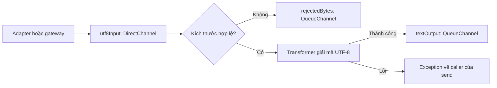

# Message với byte array

Trong Spring Integration Core, `Message<byte[]>` biểu diễn một thông điệp có payload là mảng byte. Kiểu dữ liệu này thường xuất hiện ở ranh giới tích hợp: dữ liệu đọc từ tệp, nội dung nhận từ một hệ thống khác, tài liệu nhị phân hoặc văn bản chưa được giải mã. Channel vận chuyển message, còn endpoint quyết định kiểm tra, chuyển đổi hoặc xử lý các byte đó như thế nào.

Bài này thuộc chương **Message**, tập trung vào cách tạo và sử dụng `Message<byte[]>` trong luồng Spring Integration. Sau khi học, bạn có thể:

- Tạo message chứa byte array và khai báo metadata cần thiết bằng header.
- Phân biệt byte với văn bản, chọn charset rõ ràng và xử lý dữ liệu mã hóa không hợp lệ.
- Tránh sửa đổi ngoài ý muốn khi nhiều thành phần cùng giữ tham chiếu đến một mảng.
- Xây dựng và kiểm thử luồng Java DSL gồm channel, filter và transformer cho dữ liệu byte.

## 1. Mảng byte mô tả cách lưu dữ liệu, chưa mô tả ý nghĩa dữ liệu

`Message<T>` có hai phần chính: payload kiểu `T` và tập header. Với `Message<byte[]>`, `T` là kiểu mảng nguyên thủy `byte[]`; mỗi phần tử lưu một byte. Header bổ sung thông tin như loại nội dung, nguồn gửi hoặc mã yêu cầu. Đây là mô hình payload và metadata của [Message trong Spring Integration](https://docs.spring.io/spring-integration/reference/message.html).

Ví dụ, hai message đều có payload `byte[]` nhưng mang ý nghĩa khác nhau:

| Payload thực tế | Thông tin cần biết | Cách xử lý phù hợp |
| --- | --- | --- |
| Văn bản tiếng Việt được mã hóa UTF-8 | Charset và loại văn bản | Giải mã thành `String` trước khi xử lý nội dung |
| Nội dung JSON UTF-8 | Charset, định dạng JSON, hợp đồng dữ liệu | Giải mã và parse bằng bộ xử lý JSON phù hợp |
| Ảnh PNG | Loại nội dung hoặc định dạng tệp | Giữ byte hoặc chuyển cho thư viện đọc ảnh |
| Dữ liệu GZIP | Thuật toán nén và định dạng sau giải nén | Giải nén trước, sau đó mới diễn giải nội dung |
| Bản tin nhị phân riêng của đối tác | Cấu trúc trường, độ dài, byte order | Đọc theo đặc tả giao thức |

Khai báo `Message<byte[]>` không chứng minh dữ liệu bên trong là UTF-8, JSON, ảnh hay dữ liệu đã được Java serialize. Những điều đó phải nằm trong hợp đồng giữa producer và consumer.

Các kiểu sau cũng không đồng nghĩa với nhau:

| Kiểu payload | Đặc điểm |
| --- | --- |
| `byte[]` | Một mảng byte nguyên thủy đang có sẵn trong bộ nhớ |
| `Byte[]` | Mảng các đối tượng wrapper; có thể chứa phần tử `null` |
| `String` | Văn bản đã được biểu diễn dưới dạng ký tự Java |
| `ByteBuffer` | Bộ đệm có trạng thái như position và limit |
| `InputStream` | Nguồn dữ liệu phải đọc, có vòng đời và trạng thái tiêu thụ |

Consumer nhận `byte[]` cần được thiết kế theo kiểu đó. Khi chuyển từ một kiểu khác, nên dùng bước chuyển đổi rõ ràng thay vì giả định channel tự đọc stream, unwrap `Byte[]` hoặc giải mã văn bản.

## 2. Tạo `Message<byte[]>` và đặt header

### 2.1. Tạo message tối thiểu

`GenericMessage` phù hợp khi chỉ cần bọc một payload:

```java
import java.nio.charset.StandardCharsets;

import org.springframework.messaging.Message;
import org.springframework.messaging.support.GenericMessage;

byte[] body = "Đơn hàng mới".getBytes(StandardCharsets.UTF_8);
Message<byte[]> message = new GenericMessage<>(body);

int byteCount = message.getPayload().length;
```

Các đoạn mã ngắn trong bài có thể đặt trong một phương thức Java. Hai lớp hoàn chỉnh ở phần Java DSL và kiểm thử được trình bày riêng bên dưới.

Payload của `GenericMessage` phải khác `null`. Mảng rỗng `new byte[0]` vẫn là một payload hợp lệ về mặt cấu trúc; ứng dụng quyết định có chấp nhận nó hay không. Hợp đồng constructor được mô tả trong [Javadoc của GenericMessage](https://docs.spring.io/spring-framework/docs/current/javadoc-api/org/springframework/messaging/support/GenericMessage.html).

### 2.2. Dùng builder khi có metadata

```java
import java.nio.charset.StandardCharsets;

import org.springframework.messaging.Message;
import org.springframework.messaging.MessageHeaders;
import org.springframework.messaging.support.MessageBuilder;

byte[] receivedBytes = "Đơn hàng mới".getBytes(StandardCharsets.UTF_8);

Message<byte[]> message = MessageBuilder
        .withPayload(receivedBytes.clone())
        .setHeader(MessageHeaders.CONTENT_TYPE, "text/plain;charset=UTF-8")
        .setHeader("sourceSystem", "order-service")
        .setHeader("requestId", "REQ-2026-001")
        .build();

String requestId = message.getHeaders().get("requestId", String.class);
Object contentType = message.getHeaders().get(MessageHeaders.CONTENT_TYPE);
```

Ở đây, `contentType` được đặt bằng chuỗi để ví dụ đơn giản và nhất quán. Trong một ứng dụng khác, giá trị header này có thể là một đối tượng biểu diễn MIME type; consumer cần tuân theo hợp đồng kiểu của header, tránh ép mọi giá trị thành `String` một cách tùy ý.

`requestId` và `sourceSystem` là header do ứng dụng quy ước. Đặt header không thực hiện chuyển đổi payload: chuỗi `text/plain;charset=UTF-8` chỉ công bố cách bên gửi diễn giải dữ liệu. Transformer vẫn phải thực sự giải mã mảng byte.

`MessageHeaders.ID` nhận diện một message instance, không phải checksum của payload hoặc khóa nghiệp vụ bền vững. Khi cần theo dõi một yêu cầu qua nhiều lần biến đổi, dùng mã nghiệp vụ hay `requestId` do ứng dụng quản lý.

## 3. Message bất biến về cấu trúc, mảng byte vẫn có thể bị sửa

Không có phương thức `setPayload()` trên `Message`, nhưng đối tượng được tham chiếu bởi payload vẫn có thể mutable. Với mảng byte, thay đổi phần tử mảng sẽ thay đổi dữ liệu mà consumer nhìn thấy:

```java
byte[] shared = new byte[] {65, 66}; // Hai byte ASCII: A, B.
Message<byte[]> message = new GenericMessage<>(shared);

shared[0] = 90; // Đổi A thành Z.

System.out.println(message.getPayload()[0]); // 90
System.out.println(message.getPayload() == shared); // true
```

Đây là việc thay đổi nội dung của cùng một mảng, không phải thay payload reference của message. [Tài liệu Message](https://docs.spring.io/spring-integration/reference/message.html) phân biệt rõ tính bất biến của cấu trúc message với tính mutable của payload và giá trị header.

### 3.1. Sao chép ở ranh giới sở hữu dữ liệu

Nếu phía gọi có thể tái sử dụng hoặc sửa buffer sau khi gửi, hãy tạo bản sao trước khi bọc message:

```java
Message<byte[]> snapshot = MessageBuilder
        .withPayload(shared.clone())
        .setHeader("requestId", "REQ-SNAPSHOT")
        .build();

shared[0] = 88;
// snapshot vẫn giữ nội dung ở thời điểm clone(), nếu không ai sửa payload của nó.
```

`clone()` đủ để sao chép toàn bộ nội dung của `byte[]` vì phần tử là giá trị nguyên thủy. Tuy nhiên, consumer vẫn có thể gọi `snapshot.getPayload()[0] = ...`. Bản sao tạo sự độc lập với mảng nguồn; quy ước không sửa payload sau khi bàn giao vẫn cần được thực hiện.

Nếu phải biến đổi một mảng trong endpoint, tạo mảng kết quả thay vì sửa trực tiếp mảng đầu vào:

```java
byte[] changed = message.getPayload().clone();
changed[0] = 67;

Message<byte[]> result = MessageBuilder
        .withPayload(changed)
        .copyHeaders(message.getHeaders())
        .setHeader("processingStep", "replace-first-byte")
        .build();
```

Ví dụ này giả định payload không rỗng. Mã xử lý thực tế phải kiểm tra điều kiện đó trước khi truy cập phần tử đầu tiên.

### 3.2. Copy message không có nghĩa là deep copy payload

`MessageBuilder.fromMessage(message)` phục vụ việc dựng message dựa trên message hiện có. Không nên xem lời gọi này là yêu cầu tự động clone mảng byte. Tương tự, việc copy header không deep copy các đối tượng mutable được lưu trong header.

Quy tắc làm việc hữu ích là: producer bàn giao dữ liệu ổn định; endpoint đọc dữ liệu đầu vào; endpoint cần thay đổi thì tạo dữ liệu đầu ra mới. Quy tắc này đặc biệt cần thiết khi có xử lý bất đồng bộ hoặc nhiều nhánh cùng nhận dữ liệu. Ngay cả một luồng đồng bộ cũng có thể bị ảnh hưởng nếu endpoint sửa mảng rồi endpoint sau hoặc logic retry dùng lại mảng đó.

## 4. Chuyển đổi giữa byte và văn bản bằng charset rõ ràng

### 4.1. Encoding và decoding là hai hướng khác nhau

```java
String original = "Chào";

// Encoding: văn bản -> byte.
byte[] encoded = original.getBytes(StandardCharsets.UTF_8);

// Decoding: byte -> văn bản.
String decoded = new String(encoded, StandardCharsets.UTF_8);

System.out.println(original.length()); // 4 đơn vị mã UTF-16 trong ví dụ này.
System.out.println(encoded.length);    // 5 byte UTF-8.
System.out.println(decoded);           // Chào
```

Độ dài `String` và số byte sau encoding đo hai thứ khác nhau. `String.length()` tính đơn vị mã UTF-16; nó cũng không phải lúc nào bằng số ký tự người dùng nhìn thấy. Khi giới hạn kích thước bản tin nhị phân, kiểm tra `payload.length`. Ý nghĩa các API này được mô tả trong [Javadoc của String](https://docs.oracle.com/en/java/javase/21/docs/api/java.base/java/lang/String.html).

Hãy dùng overload có `Charset` hoặc tên charset thay vì dựa vào charset mặc định. Đối tác gửi UTF-8 thì bên nhận giải mã UTF-8; việc chọn charset theo máy chạy ứng dụng không thể thay thế hợp đồng này.

### 4.2. Những phép chuyển đổi thường bị nhầm

```java
byte[] bytes = "Chào".getBytes(StandardCharsets.UTF_8);

String wrong = bytes.toString();
// Dạng như [B@..., không phải nội dung văn bản.

String right = new String(bytes, StandardCharsets.UTF_8);
```

`Arrays.toString(bytes)` giúp xem các giá trị số trong mảng, không giải mã văn bản. Base64 lại là một biểu diễn văn bản có thể khôi phục byte gốc, dùng khi nơi nhận yêu cầu dữ liệu nhị phân đi qua trường văn bản:

```java
import java.util.Base64;

String base64 = Base64.getEncoder().encodeToString(bytes);
byte[] restored = Base64.getDecoder().decode(base64);
```

Base64 không xác định charset của nội dung ban đầu, không parse JSON và không mã hóa bảo mật. Đừng thêm bước Base64 khi hai bên đã truyền trực tiếp byte được; nó làm tăng kích thước và tạo thêm công việc chuyển đổi.

### 4.3. Chọn chính sách khi byte không hợp lệ

`new String(bytes, StandardCharsets.UTF_8)` thay các chuỗi byte không hợp lệ bằng ký tự thay thế theo hành vi của constructor này. Vì vậy, tạo được `String` chưa chứng minh dữ liệu đầu vào là UTF-8 hợp lệ. Xem hợp đồng constructor nhận `Charset` trong [Javadoc của String](https://docs.oracle.com/en/java/javase/21/docs/api/java.base/java/lang/String.html).

Nếu không được phép chấp nhận dữ liệu hỏng, dùng `CharsetDecoder` với `CodingErrorAction.REPORT`. Phần Java DSL bên dưới triển khai lựa chọn này. Decoder được tạo cho từng lần chuyển đổi vì `CharsetDecoder` không an toàn khi dùng đồng thời trên nhiều thread, theo [Javadoc của CharsetDecoder](https://docs.oracle.com/en/java/javase/21/docs/api/java.base/java/nio/charset/CharsetDecoder.html).

Spring Integration cũng có `ObjectToStringTransformer`: với payload `byte[]`, transformer này giải mã nội dung theo charset được cấu hình. Có thể dùng `new ObjectToStringTransformer("UTF-8")` trong `.transform(...)` khi hành vi chuyển đổi đó phù hợp. Transformer có sẵn này không thay thế yêu cầu kiểm tra UTF-8 nghiêm ngặt của ví dụ bên dưới. Xem [ObjectToStringTransformer](https://docs.spring.io/spring-integration/api/org/springframework/integration/transformer/ObjectToStringTransformer.html).

## 5. Luồng Java DSL: nhận byte, lọc kích thước, giải mã UTF-8

### 5.1. Hợp đồng của luồng ví dụ

Giả sử một adapter hoặc gateway đưa văn bản UTF-8 vào channel `utf8Input`. Luồng có hợp đồng:

- Payload đầu vào là `byte[]`, chứa toàn bộ một bản tin văn bản UTF-8.
- Độ dài được chấp nhận từ 1 đến 65.536 byte, tức tối đa 64 KiB.
- Mảng rỗng hoặc quá lớn đi vào `rejectedBytes` và vẫn giữ kiểu payload `byte[]`.
- Dữ liệu đúng kích thước nhưng sai UTF-8 gây lỗi giải mã.
- Dữ liệu hợp lệ được chuyển thành payload `String` và đưa vào `textOutput`.



Đây là luồng cho văn bản UTF-8 đã được thỏa thuận. Nó không tự nhận diện ảnh, dữ liệu nén hoặc charset của đối tác. Nếu nhiều định dạng dùng chung đầu vào, cần phân loại chúng trước bước giải mã.

### 5.2. Cấu hình hoàn chỉnh

Ví dụ sử dụng API Java DSL của Spring Integration 6 trở lên. Cần các thư viện `spring-integration-core` và `spring-context`; chọn JDK cùng phiên bản Spring tương thích với dự án. Khi dùng Spring Boot, quản lý phiên bản thư viện theo BOM của Boot thay vì ghép tùy ý các phiên bản Spring.

Đặt lớp cấu hình minh họa trong `example/integration/ByteMessageConfiguration.java`:

```java
package example.integration;

import java.nio.ByteBuffer;
import java.nio.charset.CharacterCodingException;
import java.nio.charset.CodingErrorAction;
import java.nio.charset.StandardCharsets;

import org.springframework.context.annotation.Bean;
import org.springframework.context.annotation.Configuration;
import org.springframework.integration.channel.DirectChannel;
import org.springframework.integration.channel.QueueChannel;
import org.springframework.integration.config.EnableIntegration;
import org.springframework.integration.dsl.IntegrationFlow;

@Configuration
@EnableIntegration
public class ByteMessageConfiguration {

    static final int MAX_BYTES = 64 * 1024;

    @Bean
    public DirectChannel utf8Input() {
        return new DirectChannel();
    }

    @Bean
    public QueueChannel textOutput() {
        return new QueueChannel(10);
    }

    @Bean
    public QueueChannel rejectedBytes() {
        return new QueueChannel(10);
    }

    @Bean
    public IntegrationFlow utf8TextFlow() {
        return IntegrationFlow.from("utf8Input")
                .filter(byte[].class,
                        bytes -> bytes.length > 0
                                && bytes.length <= MAX_BYTES,
                        endpoint -> endpoint.discardChannel("rejectedBytes"))
                .transform(byte[].class,
                        ByteMessageConfiguration::decodeUtf8)
                .channel("textOutput")
                .get();
    }

    private static String decodeUtf8(byte[] bytes) {
        try {
            return StandardCharsets.UTF_8.newDecoder()
                    .onMalformedInput(CodingErrorAction.REPORT)
                    .onUnmappableCharacter(CodingErrorAction.REPORT)
                    .decode(ByteBuffer.wrap(bytes))
                    .toString();
        }
        catch (CharacterCodingException ex) {
            throw new IllegalArgumentException(
                    "Payload không phải văn bản UTF-8 hợp lệ", ex);
        }
    }
}
```

`@EnableIntegration` khởi tạo hạ tầng cần thiết khi dùng cấu hình Spring thuần. Hai `QueueChannel` được giới hạn 10 message để ví dụ không tích lũy vô hạn. Trong bài này, mã gọi hoặc kiểm thử đọc trực tiếp từ chúng; chưa có endpoint nền tiêu thụ hai queue.

### 5.3. Hiểu từng bước thay đổi message

| Bước | Payload nhận vào | Kết quả |
| --- | --- | --- |
| `utf8Input` | `byte[]` | Chuyển message đến consumer trong thread gửi |
| Filter kích thước | `byte[]` | Cho đi tiếp hoặc chuyển message gốc vào discard channel |
| Transformer UTF-8 | `byte[]` | Tạo kết quả payload `String` hoặc ném exception |
| `textOutput` | `String` | Giữ message kết quả để bên nhận lấy ra |

Các overload có đối số `byte[].class` thể hiện kiểu payload mà lambda xử lý. Nếu muốn xử lý toàn bộ message để đọc header, cần chọn overload dành cho `Message`, thay vì giả định tham số lambda mặc định là message. Cách Java DSL liên kết lambda và endpoint được giải thích trong [DSL Basics](https://docs.spring.io/spring-integration/reference/dsl/java-basics.html).

Transformer trả về `String`, nên Spring Integration dựng message đầu ra và chuyển tiếp các header ứng dụng theo cơ chế transformer. Ví dụ này dựa vào đó để giữ `requestId`. Nếu tự trả về một `Message` khác, cần chủ động quyết định header của message đó theo [quy tắc transformer](https://docs.spring.io/spring-integration/reference/transformer.html).

Khi payload thay đổi, kiểm tra cả ý nghĩa metadata. Header như độ dài byte của payload hiện tại hoặc checksum payload có thể không còn đúng sau chuyển đổi. Nếu cần giữ độ dài ban đầu, đặt tên thể hiện đó là số byte đầu vào, chẳng hạn `originalByteLength`, thay vì một tên dễ bị hiểu là độ dài dữ liệu hiện tại.

### 5.4. Gửi message và đọc kết quả

Đoạn sau minh họa mã bên gọi khi đã có Spring context chứa cấu hình trên:

```java
MessageChannel input = context.getBean("utf8Input", MessageChannel.class);
QueueChannel output = context.getBean("textOutput", QueueChannel.class);

Message<byte[]> request = MessageBuilder
        .withPayload("Xin chào từ Spring Integration"
                .getBytes(StandardCharsets.UTF_8))
        .setHeader(MessageHeaders.CONTENT_TYPE, "text/plain;charset=UTF-8")
        .setHeader("requestId", "REQ-001")
        .build();

input.send(request);

Message<?> response = output.receive(1_000);
if (response == null) {
    throw new IllegalStateException("Không có kết quả trong thời hạn chờ");
}

String text = (String) response.getPayload();
String requestId = response.getHeaders().get("requestId", String.class);
```

`MessageChannel` nằm trong `org.springframework.messaging`; các import còn lại tương ứng với ví dụ builder và cấu hình ở trên. Lớp kiểm thử ở phần sau thể hiện đầy đủ cách khởi tạo context.

Luồng đang đưa kết quả vào queue cố định, vì vậy `response` ở đây được lấy thủ công. Nếu thay bằng gateway request/reply trả về `String`, cần thiết kế đường reply phù hợp với gateway; không mặc nhiên chờ gateway nhận được dữ liệu từ queue cố định này. Một gateway trả về `void` có thể đóng vai trò cổng gửi một chiều, nhưng ứng dụng vẫn phải tiêu thụ các queue kết quả.

## 6. Phân biệt bị từ chối, lỗi giải mã và lỗi vận chuyển

### 6.1. Filter từ chối không đồng nghĩa transformer thất bại

Filter trong ví dụ chỉ kiểm tra kích thước. Khi điều kiện sai, `discardChannel("rejectedBytes")` nhận message bị từ chối. Đây là nhánh xử lý dữ liệu không đạt quy tắc, không phải `ErrorMessage`.

Nếu cần coi việc từ chối là exception, có thể cấu hình `throwExceptionOnRejection(true)` theo chính sách của luồng. Hãy xác định rõ caller sẽ nhận lỗi hay có consumer tiếp nhận dữ liệu bị từ chối. Các lựa chọn này được mô tả trong [Filter](https://docs.spring.io/spring-integration/reference/filter.html).

### 6.2. `DirectChannel` giữ lỗi trong đường gọi đồng bộ

`utf8Input` là `DirectChannel`, các bước trước queue đầu ra chạy trong thread gọi `send()`. Lỗi giải mã có thể được framework bọc trong `MessagingException` rồi truyền về caller. Header `errorChannel` không tự biến mọi exception của một lời gọi `send()` đồng bộ thành một bản tin lỗi gửi đi.

Khi dùng `ExecutorChannel` hoặc consumer được poll từ queue, lỗi xảy ra ở thread xử lý và cần cơ chế error handling tương ứng. Trong cơ chế công bố lỗi của framework, payload của `ErrorMessage` là `Throwable`, không phải mảng byte. Chi tiết sự khác biệt giữa xử lý đồng bộ và bất đồng bộ nằm trong [Error Handling](https://docs.spring.io/spring-integration/reference/error-handling.html).

| Tình huống trong ví dụ | Nơi quan sát |
| --- | --- |
| Mảng rỗng | `rejectedBytes` |
| Mảng dài hơn 64 KiB | `rejectedBytes` |
| Chuỗi byte sai UTF-8, nhưng kích thước hợp lệ | Exception tại caller của `input.send(...)` |
| Byte UTF-8 hợp lệ | Message có payload `String` tại `textOutput` |
| Queue đầu ra hoặc discard queue đầy | Việc gửi có thể phải chờ theo cấu hình timeout của bước gửi |

`send()` trả về `true` không phải chứng nhận thành công nghiệp vụ. Với filter, một message đã được tiếp nhận và chuyển sang discard channel vẫn có thể khiến lời gọi gửi thành công. Với queue, gửi thành công có thể chỉ có nghĩa message đã được xếp hàng.

Lỗi UTF-8 và lỗi vượt kích thước mang tính dữ liệu. Gửi lại nguyên các byte đó thường cho cùng kết quả; retry chỉ có ích khi nguyên nhân có thể thay đổi, chẳng hạn tài nguyên bên ngoài tạm thời không sẵn sàng.

## 7. Kiểm thử hành vi của luồng byte array

Các kiểm thử sau dùng JUnit 5, cấu hình Spring thuần và các queue trong cùng tiến trình. Thêm `junit-jupiter` vào phạm vi test; không cần broker, tệp ngoài hay `Thread.sleep()` cho luồng đồng bộ này.

Đặt lớp minh họa cùng package với cấu hình, tại `example/integration/ByteMessageFlowTest.java` trong nguồn test:

```java
package example.integration;

import java.nio.charset.CharacterCodingException;
import java.nio.charset.StandardCharsets;

import org.junit.jupiter.api.AfterEach;
import org.junit.jupiter.api.BeforeEach;
import org.junit.jupiter.api.Test;
import org.springframework.context.annotation.AnnotationConfigApplicationContext;
import org.springframework.integration.channel.QueueChannel;
import org.springframework.messaging.Message;
import org.springframework.messaging.MessageChannel;
import org.springframework.messaging.MessageHeaders;
import org.springframework.messaging.MessagingException;
import org.springframework.messaging.support.GenericMessage;
import org.springframework.messaging.support.MessageBuilder;

import static org.junit.jupiter.api.Assertions.*;

class ByteMessageFlowTest {

    private AnnotationConfigApplicationContext context;
    private MessageChannel input;
    private QueueChannel output;
    private QueueChannel rejected;

    @BeforeEach
    void setUp() {
        context = new AnnotationConfigApplicationContext(
                ByteMessageConfiguration.class);
        input = context.getBean("utf8Input", MessageChannel.class);
        output = context.getBean("textOutput", QueueChannel.class);
        rejected = context.getBean("rejectedBytes", QueueChannel.class);
    }

    @AfterEach
    void tearDown() {
        if (context != null) {
            context.close();
        }
    }

    @Test
    void decodesVietnameseTextAndPreservesApplicationHeaders() {
        String expected = "Đơn hàng đã được tiếp nhận";
        Message<byte[]> request = MessageBuilder
                .withPayload(expected.getBytes(StandardCharsets.UTF_8))
                .setHeader(MessageHeaders.CONTENT_TYPE,
                        "text/plain;charset=UTF-8")
                .setHeader("requestId", "REQ-001")
                .build();

        assertTrue(input.send(request));

        Message<?> result = output.receive(0);
        assertNotNull(result);
        assertInstanceOf(String.class, result.getPayload());
        assertEquals(expected, result.getPayload());
        assertEquals("REQ-001", result.getHeaders().get("requestId"));
        assertEquals("text/plain;charset=UTF-8",
                result.getHeaders().get(MessageHeaders.CONTENT_TYPE));
        assertNull(rejected.receive(0));
    }

    @Test
    void routesEmptyAndOversizedArraysToDiscardChannel() {
        byte[][] invalidSizes = {
                new byte[0],
                new byte[ByteMessageConfiguration.MAX_BYTES + 1]
        };

        for (byte[] bytes : invalidSizes) {
            assertTrue(input.send(new GenericMessage<>(bytes)));

            Message<?> discarded = rejected.receive(0);
            assertNotNull(discarded);
            assertInstanceOf(byte[].class, discarded.getPayload());
            assertArrayEquals(bytes, (byte[]) discarded.getPayload());
            assertNull(output.receive(0));
        }
    }

    @Test
    void reportsMalformedUtf8ToSynchronousCaller() {
        byte[] malformed = {(byte) 0xC3, (byte) 0x28};

        MessagingException failure = assertThrows(
                MessagingException.class,
                () -> input.send(new GenericMessage<>(malformed)));

        assertInstanceOf(CharacterCodingException.class, rootCause(failure));
        assertNull(output.receive(0));
        assertNull(rejected.receive(0));
    }

    @Test
    void boundaryCopyProtectsMessageFromSourceBufferChanges() {
        String expected = "Chào";
        byte[] source = expected.getBytes(StandardCharsets.UTF_8);
        Message<byte[]> snapshot = MessageBuilder
                .withPayload(source.clone())
                .build();

        source[0] = (byte) 'X';

        assertNotSame(source, snapshot.getPayload());
        assertTrue(input.send(snapshot));

        Message<?> result = output.receive(0);
        assertNotNull(result);
        assertEquals(expected, result.getPayload());
    }

    private static Throwable rootCause(Throwable failure) {
        Throwable current = failure;
        while (current.getCause() != null) {
            current = current.getCause();
        }
        return current;
    }
}
```

Các test kiểm tra bốn yêu cầu khác nhau: văn bản tiếng Việt được giữ đúng; quy tắc kích thước có đường discard; dữ liệu mã hóa hỏng gây lỗi; và bản sao tại ranh giới độc lập với buffer nguồn. Dùng `assertArrayEquals` khi so sánh nội dung mảng, vì `equals()` trực tiếp trên mảng không so sánh từng byte.

`receive(0)` là lấy message mà không chờ. Điều này phù hợp vì các bước xử lý trong ví dụ đã hoàn tất đồng bộ trước khi `send()` trả về thành công. Nếu đổi topology sang xử lý bất đồng bộ, cần chờ có giới hạn thời gian hoặc cơ chế đồng bộ kiểm thử phù hợp; không giữ giả định message đã có sẵn trong queue.

## 8. Dữ liệu nhị phân cần các bước xử lý đúng thứ tự

Luồng giải mã UTF-8 ở trên chỉ là một trường hợp của `Message<byte[]>`. Trong một luồng tổng quát, có thể dùng router để chọn consumer theo loại nội dung đã được xác thực hoặc theo giao thức của nguồn gửi:

| Hợp đồng dữ liệu | Chuỗi xử lý gợi ý |
| --- | --- |
| Văn bản UTF-8 | Kiểm tra kích thước → giải mã UTF-8 → xử lý văn bản |
| JSON UTF-8 | Kiểm tra kích thước → giải mã/parse JSON theo cấu hình → kiểm tra dữ liệu nghiệp vụ |
| Văn bản UTF-8 được GZIP | Kiểm tra đầu vào → giải nén có giới hạn đầu ra → giải mã UTF-8 |
| Ảnh hoặc PDF | Kiểm tra kích thước và định dạng → giữ byte hoặc giao cho thư viện phù hợp |
| Dữ liệu nhị phân có cấu trúc | Kiểm tra framing → parse theo giao thức → tạo đối tượng nghiệp vụ |

Header do bên gửi cung cấp là lời khai về dữ liệu; nếu độ tin cậy của nguồn chưa đủ, consumer cần kiểm tra nội dung theo định dạng tương ứng. Kiểm tra kích thước dữ liệu nén cũng chưa giới hạn được kích thước sau giải nén, nên hai giai đoạn cần giới hạn riêng.

Nếu một hệ thống dùng Java serialization, quá trình đó khác với `String.getBytes(...)`. Spring Integration có các transformer cho serialization, nhưng phải lựa chọn theo hợp đồng định dạng và nguồn dữ liệu; không tự đưa một byte array bất kỳ vào Java object deserialization. Việc khôi phục đối tượng Java còn đòi hỏi ràng buộc lớp được phép và nguồn dữ liệu đáng tin cậy. Xem các nhóm chuyển đổi tại [Transformer](https://docs.spring.io/spring-integration/reference/transformer.html).

## 9. Kích thước, queue và ranh giới bản tin

### 9.1. `byte[]` giữ toàn bộ payload trong bộ nhớ

Một message chứa `byte[]` thường giữ toàn bộ mảng trong heap. Clone mảng, giải mã ra `String` và các bước chuyển đổi khác có thể tạo thêm bản sao cùng tồn tại trong một thời gian.

Ví dụ, queue giữ 200 message, mỗi payload 5 MiB, đã giữ khoảng 1.000 MiB chỉ tính mảng byte. Con số này chưa tính header, đối tượng Java và dữ liệu trung gian. Vì vậy, cần cân nhắc đồng thời giới hạn byte trên mỗi message, capacity của queue và tốc độ consumer.

Filter kích thước bên trong flow chỉ kiểm soát dữ liệu được xử lý tiếp; lúc filter chạy, mảng byte đã được tạo rồi. Muốn giới hạn bộ nhớ ở đầu vào, cần áp dụng giới hạn đọc hoặc kích thước bản tin tại adapter/giao thức trước khi gom dữ liệu thành một mảng lớn. Với dữ liệu lớn, có thể truyền tham chiếu tài nguyên hoặc dùng cách đọc theo luồng nếu endpoint hỗ trợ và vòng đời tài nguyên được quản lý rõ ràng.

Hai queue trong ví dụ là bộ đệm minh họa. Nếu không có bên đọc và queue đầy, luồng có thể bị giữ lại ở bước gửi. Khi đưa vào ứng dụng, cần có consumer, timeout và chính sách khi quá tải phù hợp với yêu cầu xử lý.

### 9.2. Một lần đọc byte chưa chắc là một bản tin hoàn chỉnh

Với giao thức dạng luồng, ranh giới một lần đọc không nhất thiết trùng ranh giới message nghiệp vụ. Cần framing, chẳng hạn quy tắc độ dài hoặc delimiter có escaping, trước khi tạo một message hoàn chỉnh để giải mã.

Ký tự UTF-8 có thể chiếm nhiều byte. Nếu tùy ý cắt mảng rồi giải mã riêng từng mảnh, một ký tự có thể bị chia đôi. Khi bắt buộc xử lý theo chunk, cần decoder có trạng thái theo đúng luồng dữ liệu hoặc ghép đủ byte trước khi giải mã.

Aggregator giúp gom các message có liên quan, nhưng việc gom nhóm không tự giải quyết thứ tự byte, mảnh trùng hoặc mảnh thiếu. Muốn tái tạo bản tin từ nhiều message, phải định nghĩa correlation, số thứ tự, điều kiện đủ mảnh, timeout và cách nối payload. Chỉ nên thực hiện bước này khi giao thức thực sự chia một bản tin thành nhiều phần.

### 9.3. Quan sát luồng bằng metadata phù hợp

Log hữu ích cho message nhị phân thường gồm `requestId`, loại nội dung, số byte và tên bước xử lý. Dùng `payload.toString()` sẽ không cho biết văn bản bên trong; ghi toàn bộ payload lại có thể làm log rất lớn hoặc chứa dữ liệu không cần thiết cho việc chẩn đoán.

Khi cần xác định hai payload có nội dung giống nhau, có thể tính checksum/hash theo quy ước của ứng dụng. Đó là công cụ nhận diện nội dung, không tự bảo đảm nguồn gốc hay tính xác thực của thông điệp.

## 10. Lỗi thường gặp và cách xử lý

| Biểu hiện | Nguyên nhân thường gặp | Cách xử lý |
| --- | --- | --- |
| Log xuất hiện dạng `[B@...` | Gọi `toString()` trên `byte[]` | Giải mã khi biết chắc đó là văn bản; với nhị phân, log metadata hoặc biểu diễn phù hợp |
| Văn bản tiếng Việt bị sai | Producer và consumer dùng charset khác nhau | Chốt charset trong hợp đồng và chỉ rõ khi encode/decode |
| Xuất hiện ký tự thay thế nhưng không có exception | Đang dùng cách giải mã thay byte hỏng bằng ký tự thay thế | Dùng decoder với `REPORT` nếu yêu cầu từ chối dữ liệu hỏng |
| Dữ liệu thay đổi sau khi đã tạo message | Cùng một mảng bị producer hoặc endpoint sửa | Copy tại ranh giới và không sửa payload đã bàn giao |
| Filter từ chối nhưng caller vẫn thấy `send()` thành công | Nhầm việc chuyển message với kết quả nghiệp vụ | Quan sát discard channel hoặc cấu hình chính sách exception rõ ràng |
| Header nói UTF-8 nhưng nội dung không đọc được | Header không kiểm chứng hay chuyển đổi dữ liệu | Kiểm tra bytes thực tế và hợp đồng nguồn gửi |
| Bộ nhớ tăng khi có nhiều message | Payload lớn, queue tích lũy hoặc quá nhiều bản sao | Giới hạn đầu vào, queue và điều tiết tốc độ xử lý |
| Chunk riêng lẻ không giải mã được | Cắt giữa chuỗi byte của một ký tự hoặc chưa hoàn tất framing | Hoàn thiện bản tin hoặc dùng decoder có trạng thái đúng cách |

Điểm cần giữ xuyên suốt khi thiết kế là hợp đồng dữ liệu: `Message<byte[]>` cho biết payload đang được giữ dưới dạng byte; header và giao thức xác định cách hiểu; transformer hiện thực chuyển đổi; channel và cơ chế xử lý lỗi quyết định dữ liệu cùng lỗi được chuyển đến đâu. Khi hợp đồng đó rõ ràng, việc kết hợp gateway, router, filter hoặc aggregator vào các luồng tích hợp lớn hơn sẽ nhất quán hơn.
