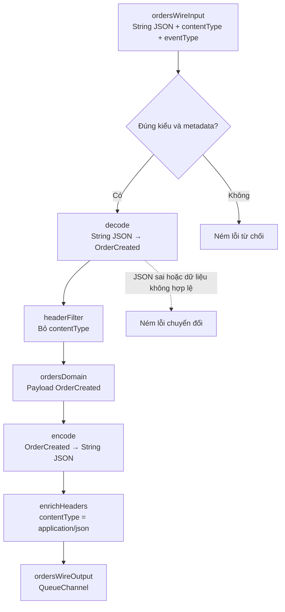

# Message type và content type

Trong Spring Integration, kiểu Java của payload, định dạng biểu diễn dữ liệu và ý nghĩa nghiệp vụ của thông điệp là những thông tin khác nhau. Phân biệt chúng giúp bạn chọn đúng transformer, cấu hình channel, định tuyến và tìm nguyên nhân lỗi chuyển đổi.

Bài thuộc chương **Message** của module **SPRING_INTEGRATION_CORE**, tập trung vào hợp đồng dữ liệu giữa `Message`, `MessageChannel` và endpoint. Các ví dụ dùng Java 17+, Spring Integration 6.5.x, Spring Messaging 6.2.x và Jackson 2; đây là mốc API cho ví dụ, không phải yêu cầu nâng cấp dự án.

## 1. Vấn đề thực tế: cùng là String nhưng không cùng định dạng

Một luồng nhận đơn hàng có thể nhận ba payload:

```text
{"orderId":"DH-101","total":150000}
<order><orderId>DH-101</orderId><total>150000</total></order>
Đơn hàng DH-101 có tổng tiền 150000
```

Cả ba đều có thể được lưu trong `String`. Tuy nhiên, một JSON parser chỉ xử lý được biểu diễn JSON phù hợp. Nếu chỉ nhìn `payload.getClass()`, endpoint chưa biết nên dùng JSON parser, XML parser hay xử lý văn bản.

Ngược lại, cùng một JSON có thể nằm trong `String` hoặc `byte[]`. Hai payload khác kiểu Java nhưng có thể biểu diễn cùng nội dung JSON.

Sau bài này, bạn cần làm được ba việc:

- Xác định chính xác đang nói về kiểu payload, MIME type hay loại thông điệp nghiệp vụ.
- Chọn điểm chuyển đổi dữ liệu và giữ header nhất quán với payload ở mỗi chặng.
- Thiết kế luồng Java DSL có hợp đồng đầu vào, bước giải mã và cách báo lỗi rõ ràng.

## 2. Bốn lớp thông tin cần phân biệt

| Lớp thông tin | Câu hỏi được trả lời | Ví dụ |
| --- | --- | --- |
| Vỏ thông điệp | Đối tượng nào mang payload và headers? | `Message<T>`, `GenericMessage<T>`, `ErrorMessage` |
| Kiểu payload Java | Trong bộ nhớ đang có đối tượng gì? | `String`, `byte[]`, `OrderCreated` |
| Content type | Nội dung được biểu diễn hoặc trao đổi theo định dạng nào? | `application/json`, `application/xml`, `text/plain` |
| Loại thông điệp nghiệp vụ | Thông điệp có ý nghĩa gì với hệ thống? | `order.created`, `order.cancelled`, `payment.requested` |

Cụm từ **message type** cần được giải thích theo ngữ cảnh. Trong mã Java, người viết có thể đang nói về `Message<OrderCreated>` hoặc kiểu payload. Trong hợp đồng giữa các dịch vụ, họ có thể đang nói về một command hay event. Không nên dùng một header mơ hồ tên `type` để thay thế tất cả các lớp thông tin trên.

### 2.1. Message<T> không đồng nghĩa với một định dạng truyền tải

`Message<T>` cung cấp payload và tập headers. Kiểu tham số `T` giúp khai báo hợp đồng Java; nó không phải một chỉ thị serialize.

```java
import org.springframework.messaging.Message;
import org.springframework.messaging.support.MessageBuilder;

record OrderCreated(String orderId) {}

Message<OrderCreated> message =
        MessageBuilder.withPayload(new OrderCreated("DH-101")).build();

Class<?> payloadType = message.getPayload().getClass();
// payloadType là OrderCreated.class.
```

Đối tượng trên chưa trở thành JSON. Tương tự, `GenericMessage<String>` không có nghĩa là văn bản thuần: chuỗi bên trong có thể là JSON, XML hoặc một định dạng khác. Cấu trúc `Message` và vai trò của payload được mô tả trong [Spring Integration — Message](https://docs.spring.io/spring-integration/reference/6.5/message.html).

`ErrorMessage` là trường hợp vỏ thông điệp chuyên cho lỗi, với payload là `Throwable`. Không xác định một thông điệp lỗi bằng cách gắn `contentType=error`.

### 2.2. Generic không thay thế việc biết kiểu đích khi deserialize

Ở thời điểm chạy, `ArrayList<OrderCreated>` và `ArrayList<String>` đều có thể hiện ra dưới cùng một lớp `ArrayList`. Vì vậy, chỉ truyền `List.class` cho JSON mapper không đủ để mô tả kiểu phần tử.

Với Jackson 2, có thể truyền thông tin kiểu đầy đủ:

```java
import com.fasterxml.jackson.core.type.TypeReference;
import com.fasterxml.jackson.databind.ObjectMapper;
import java.util.List;

ObjectMapper mapper = new ObjectMapper();

List<OrderCreated> orders = mapper.readValue(
        "[{\"orderId\":\"DH-101\"}]",
        new TypeReference<List<OrderCreated>>() {}
);
```

Đây là thông tin về mô hình đối tượng đích. MIME type `application/json` không thể cho biết cần tạo `OrderCreated`, `Customer` hay `List<OrderCreated>`.

## 3. Content type là metadata về định dạng

### 3.1. Header chuẩn bên trong Spring Messaging

Trong `Message`, sử dụng hằng số:

```java
MessageHeaders.CONTENT_TYPE
```

Giá trị tên header này là `contentType`. Nó khác cách viết `Content-Type` của HTTP. Khi qua adapter, việc ánh xạ giữa header nội bộ và header của giao thức phụ thuộc adapter và header mapper; không tự đặt thêm một key `Content-Type` trong message nội bộ rồi giả định mọi converter sẽ đọc nó. Hằng số được định nghĩa tại [MessageHeaders](https://docs.spring.io/spring-framework/docs/6.2.x/javadoc-api/org/springframework/messaging/MessageHeaders.html).

Ví dụ tạo thông điệp JSON:

```java
import org.springframework.messaging.Message;
import org.springframework.messaging.MessageHeaders;
import org.springframework.messaging.support.MessageBuilder;
import org.springframework.util.MimeTypeUtils;

Message<String> jsonMessage = MessageBuilder
        .withPayload("{\"orderId\":\"DH-101\",\"total\":150000}")
        .setHeader(MessageHeaders.CONTENT_TYPE, MimeTypeUtils.APPLICATION_JSON)
        .setHeader("eventType", "order.created")
        .setHeader("schemaVersion", "1")
        .build();
```

Ở đây:

- Payload thực tế là `String`.
- `contentType` mô tả JSON.
- `eventType` là header do ứng dụng quy ước để mô tả nghiệp vụ.
- `schemaVersion` là header do ứng dụng quy ước để chọn phiên bản hợp đồng.

Hai header cuối không phải cơ chế chuẩn của Spring Integration tự sinh ra trong ví dụ.

### 3.2. Giá trị header có thể là MimeType hoặc String

Không nên ép kiểu trực tiếp:

```java
// Không an toàn nếu producer đã đặt header bằng String.
MimeType type = (MimeType) message.getHeaders().get(MessageHeaders.CONTENT_TYPE);
```

Dùng resolver để xử lý cả hai biểu diễn:

```java
import org.springframework.messaging.converter.DefaultContentTypeResolver;
import org.springframework.util.MimeType;

DefaultContentTypeResolver resolver = new DefaultContentTypeResolver();
MimeType type = resolver.resolve(jsonMessage.getHeaders());
```

`DefaultContentTypeResolver` đọc `MimeType` hoặc chuỗi parse được thành `MimeType`. Nếu không có header và chưa cấu hình giá trị mặc định, kết quả là `null`. Chuỗi MIME sai cú pháp có thể gây ngoại lệ khi phân tích. Xem [DefaultContentTypeResolver](https://docs.spring.io/spring-framework/docs/6.2.x/javadoc-api/org/springframework/messaging/converter/DefaultContentTypeResolver.html).

Không so sánh bằng biểu thức sau:

```java
"application/json".equals(
        message.getHeaders().get(MessageHeaders.CONTENT_TYPE)
)
```

Biểu thức có thể trả về `false` nếu header là đối tượng `MimeType`. Nó cũng không diễn đạt chính sách xử lý MIME parameters. Hãy resolve trước rồi so sánh type/subtype hoặc dùng phép so khớp MIME phù hợp hợp đồng.

### 3.3. Một số cặp payload và content type thường gặp

| Payload Java | Content type | Điều cần biết |
| --- | --- | --- |
| `String` chứa JSON | `application/json` | Cần JSON parser để tạo đối tượng nghiệp vụ |
| `byte[]` chứa JSON | `application/json` | Cần xử lý biểu diễn byte và parse JSON |
| `String` chứa XML | `application/xml` | Không thể dùng JSON parser |
| `String` chứa văn bản | `text/plain` | Có thể xử lý trực tiếp như văn bản |
| `byte[]` chứa ảnh PNG | `image/png` | Không giải mã bằng bộ chuyển đổi văn bản |
| `OrderCreated` | Không đặt trong hợp đồng nội bộ của bài | Đã là mô hình Java, chưa serialize thành JSON |

Một hệ thống có thể giữ `application/json` trên một POJO để yêu cầu converter ở chặng sau serialize ra JSON. Khi chọn cách này, cần ghi rõ đó là định dạng trao đổi dự kiến. Sự hiện diện của header không chứng minh đối tượng trong bộ nhớ đã là chuỗi hay byte JSON.

Bài này chọn hợp đồng dễ quan sát: **JSON ở biên dùng content type JSON; mô hình Java nội bộ bỏ header mô tả biểu diễn JSON; đầu ra serialize xong mới đặt lại header**.

## 4. Gắn header không chuyển đổi payload

Đây là ví dụ sai nếu mong muốn tạo JSON:

```java
Message<OrderCreated> mislabeled = MessageBuilder
        .withPayload(new OrderCreated("DH-101"))
        .setHeader(MessageHeaders.CONTENT_TYPE, MimeTypeUtils.APPLICATION_JSON)
        .build();

// Payload vẫn là OrderCreated, chưa có bước serialize.
```

Tương tự, đổi header của chuỗi XML thành `application/json` không làm nội dung XML trở thành JSON. Consumer chỉ nhận được một lời khai sai về dữ liệu.

Cần phân biệt các thao tác:

| Thao tác | Có đổi nội dung payload không? | Công cụ điển hình |
| --- | --- | --- |
| Bổ sung hoặc thay content type | Không | `MessageBuilder`, header enricher |
| Chuyển DTO thành JSON | Có | JSON transformer, JSON message converter |
| Chuyển JSON thành DTO | Có | JSON transformer, JSON message converter |
| Chọn nhánh xử lý | Không tự chuyển đổi | Router |
| Chấp nhận hoặc từ chối thông điệp | Không tự chuyển đổi | Filter |
| Giới hạn kiểu payload của channel | Có thể yêu cầu chuyển đổi khi không khớp | Datatype channel cùng converter đã cấu hình |

Không dùng `toString()` của một record hoặc POJO như một JSON serializer. Chuỗi dạng `OrderCreated[orderId=DH-101]` không phải JSON.

## 5. Content type, charset và byte[]

`String` là dữ liệu ký tự trong Java. Charset tham gia khi chuyển giữa dữ liệu ký tự và byte:

```java
import java.nio.charset.StandardCharsets;

String json = "{\"customerName\":\"Nguyễn An\"}";
byte[] wire = json.getBytes(StandardCharsets.UTF_8);
String decoded = new String(wire, StandardCharsets.UTF_8);
```

Header không sửa được lỗi giải mã đã xảy ra. Nếu adapter đã đọc byte bằng charset sai, việc đặt lại `contentType` về sau không khôi phục được tên tiếng Việt ban đầu.

Với văn bản thuần, `text/plain;charset=UTF-8` có thể mô tả cách mã hóa ký tự. Với JSON trao đổi giữa các hệ thống, RFC 8259 yêu cầu UTF-8 và không định nghĩa tham số charset cho media type `application/json`; hợp đồng nên nói rõ dùng UTF-8 ở biên. Xem [RFC 8259, mục 8.1 và 11](https://www.rfc-editor.org/rfc/rfc8259.html).

Một JSON parser đọc trực tiếp `byte[]` có thể có quy tắc nhận diện encoding riêng. Không suy luận rằng mọi parser đều giải mã theo charset được ghi trong header.

Nếu hợp đồng yêu cầu báo lỗi khi gặp byte UTF-8 không hợp lệ, có thể dùng decoder ở chế độ báo lỗi trước bước parse:

```java
import java.nio.ByteBuffer;
import java.nio.charset.CodingErrorAction;
import java.nio.charset.StandardCharsets;

String jsonText = StandardCharsets.UTF_8.newDecoder()
        .onMalformedInput(CodingErrorAction.REPORT)
        .onUnmappableCharacter(CodingErrorAction.REPORT)
        .decode(ByteBuffer.wrap(wire))
        .toString();
```

Đoạn này có thể ném `CharacterCodingException`; endpoint cần đưa lỗi đó vào chính sách xử lý lỗi của luồng. Nếu dữ liệu được nén, bước giải nén cũng phải diễn ra trước khi giải mã và parse; `contentType` không thay thế thao tác giải nén.

## 6. Chuyển đổi diễn ra ở đâu?

### 6.1. Converter là cơ chế, transformer là một bước trong luồng

`MessageConverter` có hai hướng chính:

```java
Object fromMessage(Message<?> message, Class<?> targetClass);

Message<?> toMessage(Object payload, MessageHeaders headers);
```

Converter có thể xét cả kiểu đích và content type. Kết quả `null` thường biểu thị converter không hỗ trợ trường hợp đó, để một composite converter thử lựa chọn tiếp theo. Lỗi dữ liệu trong một phép chuyển đổi được hỗ trợ vẫn có thể gây ngoại lệ. Xem [MessageConverter](https://docs.spring.io/spring-framework/docs/6.2.x/javadoc-api/org/springframework/messaging/converter/MessageConverter.html).

Transformer là endpoint biểu diễn việc thay đổi dữ liệu trong flow. Có thể dùng transformer chuẩn của Spring Integration hoặc một phương thức Java gọi mapper/converter. Việc khai báo riêng bước này giúp thấy được ranh giới giữa dữ liệu trao đổi và mô hình nghiệp vụ.

### 6.2. Không phải converter nào cũng đọc content type

`org.springframework.messaging.converter.SimpleMessageConverter` chủ yếu bọc hoặc mở payload khi kiểu đã phù hợp và bỏ qua content type. Nó không tự parse JSON thành DTO. Không nhầm lớp này với converter có tên tương tự trong thư viện của một giao thức khác. Xem [SimpleMessageConverter](https://docs.spring.io/spring-framework/docs/6.2.x/javadoc-api/org/springframework/messaging/converter/SimpleMessageConverter.html).

Với Jackson 2, có thể sử dụng:

```java
import org.springframework.messaging.converter.MappingJackson2MessageConverter;

MappingJackson2MessageConverter converter =
        new MappingJackson2MessageConverter();

// Yêu cầu resolve được content type được hỗ trợ.
converter.setStrictContentTypeMatch(true);

Object converted = converter.fromMessage(jsonMessage, OrderCreated.class);
if (!(converted instanceof OrderCreated order)) {
    throw new IllegalArgumentException("Không có phép chuyển đổi phù hợp");
}

// order là đối tượng Java, không còn là chuỗi JSON.
```

`MappingJackson2MessageConverter` là converter dựa trên Jackson 2. `setStrictContentTypeMatch(true)` điều khiển yêu cầu khớp content type; nó không thay thế kiểm tra schema hoặc điều kiện nghiệp vụ. Xem [MappingJackson2MessageConverter](https://docs.spring.io/spring-framework/docs/6.2.x/javadoc-api/org/springframework/messaging/converter/MappingJackson2MessageConverter.html) và [AbstractMessageConverter](https://docs.spring.io/spring-framework/docs/6.2.x/javadoc-api/org/springframework/messaging/converter/AbstractMessageConverter.html).

Nếu cần đầu ra dạng `String` thay vì `byte[]`, hãy cấu hình rõ `setSerializedPayloadClass(String.class)` cho converter hỗ trợ lựa chọn này; không suy luận kiểu payload đầu ra từ MIME type.

### 6.3. Endpoint có thể thực hiện chuyển đổi tham số

Một endpoint nhận `OrderCreated` có thể được hạ tầng chuyển đổi từ JSON khi argument resolver, converter và classpath phù hợp. Spring Integration 6.5 có `ConfigurableCompositeMessageConverter` cho việc này, bao gồm converter Jackson 2 khi có Jackson trên classpath.

Do đó, không nên khẳng định rằng Spring Integration luôn tự đổi JSON hoặc hoàn toàn không bao giờ đổi. Cần xác định **thành phần nào đang gọi converter**, converter nào được đăng ký và kiểu đích là gì.

Chuyển đổi theo content type qua cơ chế này không áp dụng cho lời gọi phương thức bằng SpEL; ở đó có cơ chế chuyển đổi kiểu Java riêng. Một gateway khai báo kiểu Java cũng chưa đủ để mô tả toàn bộ hợp đồng JSON ở mọi ranh giới. Xem [Message Endpoints — Content Type Conversion](https://docs.spring.io/spring-integration/reference/6.5/endpoint.html#content-type-conversion).

### 6.4. Datatype channel kiểm tra kiểu Java

Một channel có thể gọi `setDatatypes(OrderCreated.class)` để giới hạn kiểu payload. Đây là kiểm tra kiểu Java có thể gán được, không phải kiểm tra MIME hay JSON schema.

Khi payload không khớp, channel có thể thử converter theo cấu hình. Converter mặc định của datatype channel liên quan đến `integrationConversionService`; không giả định nó sẽ tự parse JSON chỉ vì có header `application/json`. Xem [Configuring Message Channels — Datatype Channel Configuration](https://docs.spring.io/spring-integration/reference/6.5/channel/configuration.html).

Trong ví dụ tiếp theo, JSON được parse trước khi gửi tới channel kiểu `OrderCreated`. Nhờ vậy channel thể hiện hợp đồng nội bộ thay vì che giấu bước parse.

## 7. Ví dụ Java DSL: từ JSON sang mô hình nội bộ rồi trở lại JSON

### 7.1. Hợp đồng của ví dụ

Ứng dụng nhận sự kiện tạo đơn hàng với các điều kiện:

| Thành phần | Giá trị được chấp nhận |
| --- | --- |
| Payload đầu vào | `String` chứa một đối tượng JSON |
| MIME type | Type/subtype là `application/json` |
| `eventType` | Chuỗi `order.created` |
| `schemaVersion` | Chuỗi `1` |
| Dữ liệu nghiệp vụ | `orderId` không rỗng, `total` không âm |
| Payload nội bộ | `OrderCreated` |
| Payload đầu ra | `String` JSON với `contentType=application/json` |

Ví dụ cố ý không nhận `byte[]`, JSON array hoặc vendor media type như `application/vnd.example.order+json`. Nếu hợp đồng thật cho phép những dạng đó, cần bổ sung chính sách tiếp nhận và converter tương ứng.

Filter kiểm tra lớp payload và metadata. JSON parser cùng constructor của record kiểm tra nội dung. Hai việc này không thay thế nhau.



### 7.2. Cấu hình hoàn chỉnh

Ví dụ dưới đây độc lập với record một trường ở các đoạn minh họa trước. Đặt trong `OrderTypeFlow.java` khi thực hành. Classpath cần `spring-integration-core`, `spring-context` và `jackson-databind` cùng các dependency chuyển tiếp; quản lý phiên bản tương thích theo BOM của ứng dụng.

```java
package example.integration;

import java.math.BigDecimal;

import com.fasterxml.jackson.core.JsonProcessingException;
import com.fasterxml.jackson.databind.DeserializationFeature;
import com.fasterxml.jackson.databind.ObjectMapper;

import org.springframework.context.annotation.Bean;
import org.springframework.context.annotation.Configuration;
import org.springframework.integration.channel.DirectChannel;
import org.springframework.integration.channel.QueueChannel;
import org.springframework.integration.config.EnableIntegration;
import org.springframework.integration.dsl.IntegrationFlow;
import org.springframework.messaging.Message;
import org.springframework.messaging.MessageHeaders;
import org.springframework.messaging.converter.DefaultContentTypeResolver;
import org.springframework.messaging.converter.MessageConversionException;
import org.springframework.util.MimeType;
import org.springframework.util.MimeTypeUtils;

@Configuration
@EnableIntegration
public class OrderTypeFlow {

    public static final String EVENT_TYPE = "eventType";
    public static final String SCHEMA_VERSION = "schemaVersion";

    @Bean
    public DirectChannel ordersWireInput() {
        // Không đặt datatype để filter quan sát được payload gốc.
        return new DirectChannel();
    }

    @Bean
    public DirectChannel ordersDomain() {
        DirectChannel channel = new DirectChannel();
        channel.setDatatypes(OrderCreated.class);
        return channel;
    }

    @Bean
    public QueueChannel ordersWireOutput() {
        return new QueueChannel();
    }

    @Bean
    public OrderJsonCodec orderJsonCodec() {
        ObjectMapper mapper = new ObjectMapper()
                .enable(DeserializationFeature.FAIL_ON_TRAILING_TOKENS);
        return new OrderJsonCodec(mapper);
    }

    @Bean
    public IntegrationFlow decodeOrders(OrderJsonCodec codec) {
        return IntegrationFlow.from("ordersWireInput")
                .filter(codec, "supports",
                        spec -> spec.throwExceptionOnRejection(true))
                .transform(codec, "decode")
                .headerFilter(MessageHeaders.CONTENT_TYPE)
                .channel("ordersDomain")
                .get();
    }

    @Bean
    public IntegrationFlow encodeOrders(OrderJsonCodec codec) {
        return IntegrationFlow.from("ordersDomain")
                .transform(codec, "encode")
                .enrichHeaders(headers -> headers.header(
                        MessageHeaders.CONTENT_TYPE,
                        MimeTypeUtils.APPLICATION_JSON,
                        true))
                .channel("ordersWireOutput")
                .get();
    }

    public record OrderCreated(String orderId, BigDecimal total) {
        public OrderCreated {
            if (orderId == null || orderId.isBlank()) {
                throw new IllegalArgumentException("orderId không được rỗng");
            }
            if (total == null || total.signum() < 0) {
                throw new IllegalArgumentException(
                        "total phải có giá trị và không âm");
            }
        }
    }

    public static final class OrderJsonCodec {

        private final ObjectMapper mapper;
        private final DefaultContentTypeResolver resolver =
                new DefaultContentTypeResolver();

        public OrderJsonCodec(ObjectMapper mapper) {
            this.mapper = mapper;
        }

        public boolean supports(Message<?> message) {
            if (!(message.getPayload() instanceof String)) {
                return false;
            }
            if (!"order.created".equals(
                    message.getHeaders().get(EVENT_TYPE))) {
                return false;
            }
            if (!"1".equals(
                    message.getHeaders().get(SCHEMA_VERSION))) {
                return false;
            }

            try {
                MimeType mime = resolver.resolve(message.getHeaders());
                return mime != null
                        && "application".equalsIgnoreCase(mime.getType())
                        && "json".equalsIgnoreCase(mime.getSubtype());
            }
            catch (IllegalArgumentException invalidMimeType) {
                return false;
            }
        }

        public OrderCreated decode(Message<?> message) {
            if (!supports(message)) {
                throw new MessageConversionException(
                        message, "Thông điệp không đúng hợp đồng đầu vào");
            }

            try {
                OrderCreated order = mapper.readValue(
                        (String) message.getPayload(),
                        OrderCreated.class);

                if (order == null) {
                    throw new MessageConversionException(
                            message, "JSON phải chứa đối tượng OrderCreated");
                }
                return order;
            }
            catch (JsonProcessingException failure) {
                throw new MessageConversionException(
                        message,
                        "Không giải mã được OrderCreated từ JSON",
                        failure);
            }
        }

        public String encode(Message<OrderCreated> message) {
            try {
                return mapper.writeValueAsString(message.getPayload());
            }
            catch (JsonProcessingException failure) {
                throw new MessageConversionException(
                        message,
                        "Không mã hóa được OrderCreated thành JSON",
                        failure);
            }
        }
    }
}
```

`decode(Message<?> message)` nhận toàn bộ message và tự parse payload; ví dụ không dựa vào việc tự động chuyển đổi tham số JSON thành DTO. Cấu hình `FAIL_ON_TRAILING_TOKENS` yêu cầu không có một giá trị JSON thứ hai đi sau đối tượng đầu tiên.

Hai flow nối với nhau qua `ordersDomain`. Ví dụ thực hiện một vòng chuyển đổi để quan sát hợp đồng dữ liệu. Trong ứng dụng thật, có thể đặt xử lý nghiệp vụ giữa giải mã và mã hóa.

### 7.3. Vì sao có headerFilter và overwrite?

Khi transformer chỉ trả về payload, nhiều headers của message đầu vào được truyền tiếp. Vì vậy, sau `decode`, header mô tả JSON vẫn có thể còn tồn tại mặc dù payload đã là record.

`.headerFilter(MessageHeaders.CONTENT_TYPE)` xóa header tại ranh giới chuyển sang mô hình Java theo hợp đồng của bài. Ở chiều ra, header enricher dùng `true` để cho phép ghi đè giá trị cũ bằng định dạng thật vừa tạo ra.

Không cố sửa map bằng `message.getHeaders().put(...)`: headers của message thông thường là cấu trúc chỉ đọc. Cũng không coi việc bỏ một header trong một message tự dựng là đủ ở mọi endpoint; cần xét quy tắc truyền headers của endpoint. Các khả năng trả về payload, trả về `Message` và header filter được trình bày tại [Spring Integration — Transformer](https://docs.spring.io/spring-integration/reference/6.5/transformer.html).

Các header ứng dụng `eventType` và `schemaVersion` được giữ lại trong vòng chuyển đổi vì dữ liệu vẫn là cùng loại sự kiện. Nếu bước nghiệp vụ tạo ra một sự kiện mới, phải cập nhật loại và phiên bản tương ứng.

### 7.4. Gửi và nhận thử trong một context độc lập

Đây là đoạn thực hành để chạy với cấu hình trên, không phải kết quả đã thực thi:

```java
import org.springframework.context.annotation.AnnotationConfigApplicationContext;
import org.springframework.messaging.Message;
import org.springframework.messaging.MessageChannel;
import org.springframework.messaging.MessageHeaders;
import org.springframework.messaging.PollableChannel;
import org.springframework.messaging.converter.DefaultContentTypeResolver;
import org.springframework.messaging.support.MessageBuilder;
import org.springframework.util.MimeTypeUtils;

try (var context =
        new AnnotationConfigApplicationContext(OrderTypeFlow.class)) {

    MessageChannel input =
            context.getBean("ordersWireInput", MessageChannel.class);
    PollableChannel output =
            context.getBean("ordersWireOutput", PollableChannel.class);

    Message<String> request = MessageBuilder
            .withPayload("{\"orderId\":\"DH-101\",\"total\":150000}")
            .setHeader(MessageHeaders.CONTENT_TYPE, "application/json")
            .setHeader(OrderTypeFlow.EVENT_TYPE, "order.created")
            .setHeader(OrderTypeFlow.SCHEMA_VERSION, "1")
            .build();

    input.send(request);
    Message<?> result = output.receive(1000);

    if (result == null || !(result.getPayload() instanceof String)) {
        throw new IllegalStateException("Thiếu đầu ra JSON dạng String");
    }

    var mime = new DefaultContentTypeResolver()
            .resolve(result.getHeaders());

    if (!MimeTypeUtils.APPLICATION_JSON.equals(mime)) {
        throw new IllegalStateException("Content type đầu ra không đúng");
    }

    System.out.println(result.getPayload());
}
```

Đặt đoạn thực hành trong một phương thức Java và cùng package với `OrderTypeFlow`, hoặc import cấu hình từ package tương ứng. `QueueChannel` ở cuối chỉ giữ kết quả cho `receive`; ví dụ không khai báo consumer polling ở đó nên không cần poller.

Không kiểm tra JSON bằng cách buộc chuỗi đầu ra giống hệt chuỗi đầu vào: khoảng trắng, cách biểu diễn số hoặc thứ tự thuộc tính có thể thay đổi. Khi viết kiểm thử, nên parse đầu ra rồi so sánh giá trị nghiệp vụ và kiểm tra riêng các headers.

## 8. Chọn đúng tiêu chí định tuyến

Một router có thể dựa vào nhiều tiêu chí, nhưng mỗi tiêu chí giải quyết một nhu cầu khác nhau:

| Nhu cầu | Tiêu chí phù hợp | Ví dụ |
| --- | --- | --- |
| Chọn parser cho dữ liệu trao đổi | Content type đã chuẩn hóa | JSON sang JSON parser, XML sang XML parser |
| Chọn handler sau giải mã | Kiểu payload Java | `OrderCreated` sang xử lý đơn hàng |
| Chọn quy trình nghiệp vụ trước giải mã | Loại sự kiện cùng phiên bản hợp đồng | `order.created` khác `order.cancelled` |
| Phân loại theo giá trị dữ liệu | Thuộc tính nghiệp vụ | Đơn hàng có tổng tiền lớn sang nhánh duyệt |

`PayloadTypeRouter` định tuyến theo kiểu payload; `HeaderValueRouter` có thể định tuyến theo giá trị header được chọn. Hai router này không có cùng ý nghĩa. Xem [Router Implementations](https://docs.spring.io/spring-integration/reference/6.5/router/implementations.html).

Nếu cả JSON và XML đang là `String`, định tuyến theo `String.class` không tách được chúng. Nếu `OrderCreated` và `OrderCancelled` đều dùng JSON, định tuyến theo `application/json` cũng không tách được hai nghiệp vụ.

Khi định tuyến theo content type, nên resolve thành `MimeType` rồi ánh xạ về một khóa định dạng do ứng dụng kiểm soát. So khớp trực tiếp nguyên chuỗi có thể tạo các nhánh ngoài ý muốn do MIME parameters.

Ví dụ quy tắc chọn kiểu đích khi giải mã:

```text
application/json + order.created + schemaVersion=1
    -> OrderCreatedV1

application/json + order.cancelled + schemaVersion=1
    -> OrderCancelledV1
```

Đây là một registry hợp đồng do ứng dụng thiết kế, không phải tính năng tự suy luận từ `contentType`.

## 9. Content type không thay thế schema và phiên bản

Thông điệp sau có thể là JSON đúng cú pháp:

```json
{"customerId":"KH-01","active":true}
```

Tuy vậy, nó không phù hợp với mô hình `OrderCreated` của ví dụ. Vì vậy cần phân biệt:

1. **Đúng metadata:** khai báo định dạng và loại thông điệp được hỗ trợ.
2. **Đúng cú pháp:** parser đọc được JSON.
3. **Đúng cấu trúc:** ánh xạ được các trường theo mô hình và chính sách mapper.
4. **Đúng nghiệp vụ:** các giá trị thỏa mãn điều kiện của quy trình.

`application/json` chỉ mô tả định dạng. Một payload có content type JSON vẫn có thể là object, array, chuỗi, số hoặc `null`; hợp đồng của endpoint phải nói rõ dạng nào được phép.

Các hệ thống có thể dùng media type chuyên biệt như `application/vnd.example.order+json` để bổ sung ý nghĩa. Nhưng hậu tố `+json` không tự xác định lớp Java và cũng không bảo đảm mọi converter hiện có chấp nhận media type đó. Cần thống nhất các định dạng được hỗ trợ và kiểm tra cấu hình converter.

Spring Integration có các JSON transformer dựng sẵn, được tạo qua `Transformers.fromJson(...)` hoặc `Transformers.toJson(...)`. Chúng phù hợp khi muốn khai báo bước chuyển đổi trực tiếp trong DSL. Xem [Java DSL — Transformers](https://docs.spring.io/spring-integration/reference/6.5/dsl/java-transformers.html).

Khi dùng JSON transformer có hỗ trợ metadata kiểu như `JsonHeaders.TYPE_ID` hoặc `JsonHeaders.RESOLVABLE_TYPE`, hãy phân biệt chúng với content type. Metadata kiểu có thể tham gia chọn mô hình Java theo cấu hình transformer; xem [JsonToObjectTransformer](https://docs.spring.io/spring-integration/docs/6.5.0/api/org/springframework/integration/json/JsonToObjectTransformer.html). Tại biên dịch vụ, nên ánh xạ mã loại nghiệp vụ được cho phép sang DTO đã biết thay vì dùng tên lớp bất kỳ do bên gửi cung cấp.

Ví dụ trong bài dùng trực tiếp `mapper.readValue(..., OrderCreated.class)`, nên kiểu đích được chỉ định rõ tại bước decode. Nếu mở rộng hỗ trợ nhiều sự kiện, thay lớp cố định bằng registry có các mục được khai báo trước.

## 10. Phân loại lỗi và cách chúng đi qua luồng

### 10.1. Lỗi nào xuất hiện ở bước nào?

| Tình huống | Điểm phát hiện trong ví dụ | Hành vi dự kiến |
| --- | --- | --- |
| Thiếu content type | Filter `supports` | Từ chối trước khi parse |
| MIME sai cú pháp | Resolver trong filter | Filter trả `false`, endpoint ném lỗi từ chối |
| Content type XML nhưng body là JSON | Filter | Từ chối theo hợp đồng đã khai báo |
| Content type JSON nhưng body là XML | JSON parser | Lỗi chuyển đổi |
| `byte[]` JSON gửi vào hợp đồng nhận String | Filter | Từ chối do kiểu payload |
| Sai `eventType` hoặc phiên bản | Filter | Từ chối do loại hợp đồng |
| JSON đúng nhưng `total` âm | Constructor khi deserialize | Lỗi ánh xạ, được bọc thành lỗi chuyển đổi |
| Payload JSON là `null` | Kiểm tra sau `readValue` | Lỗi chuyển đổi |
| Hai đối tượng JSON nối nhau | JSON parser với cấu hình trailing tokens | Lỗi chuyển đổi |

Một header đúng chỉ giúp chọn cách xử lý. Parser và bước kiểm tra dữ liệu mới xác định được nội dung có thực sự phù hợp hay không.

Ví dụ chọn `throwExceptionOnRejection(true)` để bên gọi nhìn thấy đầu vào bị từ chối. Nếu thiết kế muốn thu gom dữ liệu bị loại, có thể cấu hình discard channel và một consumer xử lý riêng. Cần quyết định rõ hành vi từ chối; không mặc định rằng mọi filter đều ném lỗi. Xem [Spring Integration — Filter](https://docs.spring.io/spring-integration/reference/6.5/filter.html).

### 10.2. DirectChannel không tự gửi mọi lỗi tới errorChannel

Trong cấu hình minh họa, hai flow xử lý trên thread gửi thông điệp qua các `DirectChannel`. Lỗi phát sinh trước khi đưa kết quả vào queue cuối được ném về lời gọi `input.send(request)`.

Việc tồn tại bean hoặc header `errorChannel` không tự biến mọi lỗi đồng bộ thành thông điệp lỗi. Với xử lý bất đồng bộ bằng executor hoặc consumer có poller, cần xem cơ chế error handler của thành phần đang chạy tác vụ. Gateway cũng có chính sách xử lý lỗi riêng. Xem [Spring Integration — Error Handling](https://docs.spring.io/spring-integration/reference/6.5/error-handling.html).

Khi đã tạo `ErrorMessage`, payload lỗi thường là `MessagingException` có thể giữ `failedMessage`. Thông tin này giúp biết thông điệp thất bại ở chặng nào, đặc biệt khi payload đã thay đổi qua transformer. Xem [ErrorMessage](https://docs.spring.io/spring-framework/docs/6.2.x/javadoc-api/org/springframework/messaging/support/ErrorMessage.html).

Không retry vô hạn cùng một JSON sai cú pháp hoặc cùng phiên bản chưa được hỗ trợ. Những lỗi đó cần sửa dữ liệu hoặc hợp đồng. Retry chỉ có ích khi nguyên nhân có khả năng thay đổi, chẳng hạn tài nguyên đích tạm thời không sẵn sàng.

## 11. Quan sát và kiểm chứng hợp đồng dữ liệu

Khi luồng gặp lỗi, thu thập thông tin tại đúng ranh giới chuyển đổi:

- Lớp payload thực tế, chẳng hạn `java.lang.String` hay `byte[]`.
- Giá trị `contentType` sau khi resolve và trường hợp thiếu header.
- Loại nghiệp vụ, phiên bản hợp đồng và kiểu Java đích.
- Tên endpoint hoặc channel phát hiện lỗi và nguyên nhân gốc.
- Mã tương quan nghiệp vụ nếu cần nối các chặng xử lý.

Không chỉ log `message.getClass()`: giá trị `GenericMessage` không cho biết payload có phải JSON hay DTO. Với dữ liệu nhạy cảm, có thể log kiểu, độ dài và mã tương quan thay vì toàn bộ nội dung.

Một bộ kiểm thử hợp đồng cho ví dụ nên bao gồm các trường hợp sau:

| Dữ liệu thử | Kết quả cần kiểm tra |
| --- | --- |
| JSON hợp lệ, header MIME dạng String | Có đầu ra String JSON và đúng dữ liệu đơn hàng |
| JSON hợp lệ, header MIME dạng MimeType | Hành vi tương đương dạng String |
| Thiếu hoặc sai content type | Bị từ chối, không có đầu ra thành công |
| JSON đúng MIME nhưng sai cú pháp | Ném lỗi chuyển đổi và giữ nguyên nhân gốc |
| JSON thiếu orderId hoặc total âm | Không tạo ra đối tượng nghiệp vụ hợp lệ |
| JSON array hoặc null | Không được coi là một OrderCreated |
| Sai loại sự kiện hoặc schemaVersion | Bị từ chối theo hợp đồng |
| Tại ordersDomain sau header filter | Payload là OrderCreated, không còn contentType |
| Tại ordersWireOutput | Payload là String, contentType là application/json |

Để kiểm tra riêng ranh giới nội bộ, có thể tách kiểm thử flow giải mã và thay consumer phía sau bằng một channel thu kết quả. Không cần thay đổi tiêu chí kiểm thử chỉ để phụ thuộc vào cách JSON serializer sắp xếp thuộc tính.

Khi phát hiện sai lệch, xử lý theo thứ tự: xác định kiểu payload đang có, kiểm tra metadata, xác định converter thực sự được gọi, rồi đối chiếu mô hình đích và dữ liệu. Thứ tự này giúp phân biệt rõ lỗi gắn nhãn, lỗi chuyển đổi và lỗi hợp đồng nghiệp vụ.
