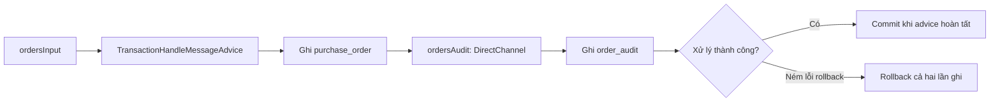

# TransactionInterceptor trong Spring Integration

## 1. Mục tiêu và tình huống sử dụng

Trong chương **Transaction support** của module **SPRING_INTEGRATION_CORE**, bài này giải thích cách đặt ranh giới giao dịch trong một luồng thông điệp bằng `TransactionInterceptor`. Trọng tâm là biết thao tác nào được commit cùng nhau, lỗi nào có thể làm rollback và điều gì xảy ra khi thông điệp được chuyển sang luồng thực thi khác.

Sau bài học, bạn có thể:

- Phân biệt interceptor, transaction manager và tài nguyên tham gia giao dịch.
- Cấu hình transaction advice cho endpoint và poller bằng Java DSL.
- Chọn phạm vi một handler hoặc phần luồng đồng bộ phía sau handler.
- Dự đoán ảnh hưởng của propagation, exception, error handling và retry.
- Viết kiểm thử quan sát dữ liệu sau commit hoặc rollback.

Tình huống xuyên suốt: nhận `OrderCommand`, ghi bảng `purchase_order`, sau đó ghi bảng `order_audit`. Quy tắc nghiệp vụ yêu cầu hai bản ghi cùng tồn tại hoặc cùng không tồn tại nếu bước xử lý audit thất bại.

Các ví dụ dùng API Spring Integration 6.x, Java 17 trở lên và JDBC đồng bộ. Phần tài liệu tham khảo về Spring Integration được đối chiếu theo nhánh 6.5. Dùng bộ phiên bản tương thích do dự án hoặc Spring Boot quản lý; không trộn tùy ý phiên bản Spring Framework và Spring Integration.

## 2. TransactionInterceptor thực sự làm gì?

`org.springframework.transaction.interceptor.TransactionInterceptor` thuộc **Spring Framework**. Đây là AOP `MethodInterceptor`, đưa lời gọi được chặn vào cơ chế quản lý giao dịch của Spring. Spring Integration cung cấp những vị trí gắn advice để sử dụng cơ chế đó trong messaging endpoint và poller. [Javadoc TransactionInterceptor](https://docs.spring.io/spring-framework/docs/6.2.x/javadoc-api/org/springframework/transaction/interceptor/TransactionInterceptor.html).

Ba vai trò cần tách biệt:

| Thành phần | Vai trò trong ví dụ đơn hàng |
|---|---|
| `TransactionInterceptor` | Bao quanh lời gọi, áp dụng thuộc tính và quy tắc hoàn tất giao dịch |
| `PlatformTransactionManager` | Quản lý giao dịch thực trên tài nguyên JDBC |
| `TransactionAttribute` | Mô tả propagation, isolation, timeout, read-only và rollback rule |
| `JdbcTemplate` và `DataSource` | Thực hiện truy cập dữ liệu có khả năng tham gia giao dịch đó |

Mã giả dưới đây minh họa **ý tưởng**, không phải cách tự cài đặt interceptor:

```text
đọc thuộc tính giao dịch của lời gọi
lấy transaction manager phù hợp
bắt đầu hoặc tham gia giao dịch theo propagation
try:
    thực hiện lời gọi được bao quanh
    yêu cầu hoàn tất thành công
catch lỗi:
    quyết định rollback theo loại lỗi và rollback rule
    ném lỗi về bên gọi
finally:
    khôi phục ngữ cảnh của bên gọi
```

“Hoàn tất thành công” chưa chắc là commit vật lý tại vị trí này: interceptor có thể đang tham gia giao dịch bên ngoài. Quyền commit cuối cùng khi đó thuộc ranh giới bên ngoài.

### 2.1. Cùng thread vẫn cần cùng tài nguyên giao dịch

`DataSourceTransactionManager` quản lý một JDBC `DataSource`, gắn connection giao dịch với thread hiện tại. `JdbcTemplate` dùng cơ chế lấy connection của Spring để tham gia. Vì vậy transaction manager và `JdbcTemplate` trong bài phải sử dụng cùng `DataSource`. Tự lấy connection từ một nguồn khác có thể khiến câu SQL chạy ngoài giao dịch dự kiến. [Javadoc DataSourceTransactionManager](https://docs.spring.io/spring-framework/docs/6.2.x/javadoc-api/org/springframework/jdbc/datasource/DataSourceTransactionManager.html).

Không thể suy ra rằng một interceptor JDBC sẽ rollback cả database, lệnh HTTP và thao tác gửi email. Phạm vi lời gọi được bao quanh và tập tài nguyên có thể rollback là hai vấn đề riêng.

## 3. Ba vị trí đặt ranh giới giao dịch

Một message flow có thể nhận thông điệp từ code gọi gateway, từ `MessageChannel.send(...)`, từ adapter hoặc từ poller. Với luồng do ứng dụng chủ động gọi, có thể đặt giao dịch tại service bên ngoài bằng cơ chế Spring thông thường. Với poller, cần đặt transaction advice tại tác vụ polling nếu muốn bao cả thao tác nhận. [Transaction support trong message flow](https://docs.spring.io/spring-integration/reference/6.5/transactions.html#transactions-understanding).

| Vị trí bắt đầu | Phạm vi cần suy luận | Khi phù hợp |
|---|---|---|
| Service bên ngoài gọi gateway/channel | Từ lúc service bắt đầu giao dịch đến khi lời gọi service kết thúc | Ranh giới use case đã nằm ở tầng ứng dụng |
| Advice tại endpoint | Lời gọi của endpoint được advice bao quanh | Cần bắt đầu giao dịch tại một bước cụ thể trong flow |
| Advice tại poller | Thao tác polling và xử lý đồng bộ được bao quanh | Cần đưa `receive()` của tài nguyên giao dịch vào cùng đơn vị công việc |

Chỉ khai báo một bean `TransactionInterceptor` chưa làm endpoint transactional. Cần gắn bean đó vào điểm thực thi phù hợp. Tương tự, chỉ thêm `@EnableTransactionManagement` không tự động tạo transaction advice cho mọi poller.

## 4. Phân biệt advice cho một handler và advice cho phần luồng phía sau

Đây là khác biệt quan trọng nhất khi dùng `TransactionInterceptor` với Spring Integration.

### 4.1. TransactionInterceptor thông thường

Đối với handler sinh reply thuộc họ `AbstractReplyProducingMessageHandler`, request-handler advice thông thường bao quanh `handleRequestMessage()`. Việc gửi reply sang bước kế tiếp diễn ra bên ngoài phạm vi lời gọi nội bộ đó.

Ví dụ sau mang tính cấu hình rút gọn; `transactionManager` là bean đã được inject:

```java
TransactionInterceptor handlerTx = new TransactionInterceptorBuilder()
        .transactionManager(transactionManager)
        .propagation(Propagation.REQUIRED)
        .build();
```

Nếu không có giao dịch bên ngoài, handler có thể đã commit trước khi bước xử lý reply bắt đầu. Không được kết luận rằng chỉ cần các channel là `DirectChannel` thì advice thông thường tại handler đầu tiên luôn bao trùm tất cả các bước sau.

### 4.2. TransactionHandleMessageAdvice

`TransactionHandleMessageAdvice` là biến thể của `TransactionInterceptor` triển khai `HandleMessageAdvice`. Nó bao quanh `handleMessage()`, gồm cả việc chuyển reply tới phần luồng đồng bộ phía sau. Có thể tạo biến thể này bằng constructor `TransactionInterceptorBuilder(true)`. Giá trị `true` chọn **phạm vi advice**, không phải công tắc bật hoặc tắt giao dịch. [Transaction support cho handler](https://docs.spring.io/spring-integration/reference/6.5/handler-advice/tx-handle-message.html).

```java
TransactionInterceptor flowTx = new TransactionInterceptorBuilder(true)
        .transactionManager(transactionManager)
        .propagation(Propagation.REQUIRED)
        .build();
```

Kiểu khai báo của cả hai biến đều là `TransactionInterceptor`, nhưng loại đối tượng tạo ra khác nhau. Khi đọc cấu hình cần kiểm tra constructor builder, không chỉ nhìn kiểu trả về của phương thức `@Bean`.

Sơ đồ so sánh, với giả định không có giao dịch bên ngoài:

```text
Advice thông thường tại handler A:
  BEGIN -> A.handleRequestMessage() -> COMMIT
                                       |
                                       +-> gửi reply -> handler B

TransactionHandleMessageAdvice tại handler A:
  BEGIN -> A.handleMessage()
             -> A.handleRequestMessage()
             -> gửi reply qua DirectChannel
             -> handler B
         <- quay về A
  COMMIT hoặc ROLLBACK
```

Nếu giao dịch bên ngoài đã bao quanh cả lời gọi `send()`, các bước đồng bộ vẫn có thể cùng tham gia giao dịch ấy dù advice nội bộ chỉ bao handler A. Phải xét toàn bộ call stack thay vì nhìn một cấu hình đơn lẻ.

### 4.3. Bảng so sánh phạm vi

| Cấu hình | Điểm được bao quanh | Hệ quả cần nhớ |
|---|---|---|
| Builder không truyền `true`, gắn vào reply-producing handler | Lời gọi xử lý request nội bộ | Không tự mở rộng ranh giới mới sang bước xử lý reply |
| Builder truyền `true`, gắn vào handler | `handleMessage()` | Bao cả phần xử lý phía sau còn nằm trong lời gọi đồng bộ |
| Interceptor tại poller | Tác vụ polling được advice | Có thể bao thao tác nhận trước khi gọi handler |

Với handler không sinh reply, vị trí gắn advice có thể là `handleMessage()` ngay từ đầu. Không áp dụng máy móc kết luận về `handleRequestMessage()` cho mọi implementation. [Cơ chế Handling Message Advice](https://docs.spring.io/spring-integration/reference/6.5/handler-advice/handle-message.html).

## 5. Channel quyết định giao dịch đi xa đến đâu

`DirectChannel` gọi handler trên thread của bên gửi. Nhờ đó lời gọi downstream có thể nằm trong cùng call stack giao dịch. Bản thân channel không tạo giao dịch và cũng không biến payload thành tài nguyên có khả năng rollback. [DirectChannel và transaction](https://docs.spring.io/spring-integration/reference/channel/implementations.html#channel-implementations-directchannel).



Đổi `ordersAudit` thành `ExecutorChannel` làm handler audit chạy qua executor; không có bảo đảm rằng transaction context JDBC của thread gửi được truyền sang thread nhận. Trường hợp executor đôi khi chạy trên thread gọi do chính sách từ chối cũng không tạo ra một thiết kế giao dịch đáng tin cậy. [ExecutorChannel](https://docs.spring.io/spring-integration/reference/6.5/channel/implementations.html#channel-implementations-executorchannel).

Với `QueueChannel`, thao tác `send()` đưa message vào hàng đợi. Consumer chạy sau không còn thuộc lời gọi xử lý hiện tại. Giao dịch bên gửi chỉ hoàn tất khi interceptor quay về; nó không nhất thiết commit ngay tại câu lệnh enqueue. Tuy nhiên lỗi phát sinh về sau ở consumer không tự làm rollback giao dịch đã hoàn tất bên gửi.

Các ranh giới tương tự xuất hiện khi tự tạo thread, dùng `@Async` hoặc chuyển việc sang một tác vụ chạy sau. Header chứa ID message hay correlation ID giúp theo dõi nghiệp vụ, không mang theo JDBC transaction context.

## 6. Ví dụ Java DSL: đơn hàng và audit cùng giao dịch

### 6.1. Chuẩn bị phụ thuộc và bảng dữ liệu

Ví dụ cần `spring-integration-core`, `spring-jdbc` và transaction infrastructure của Spring. Khi dùng Spring Boot, có thể dùng `spring-boot-starter-integration` cùng `spring-boot-starter-jdbc`; cấu hình JDBC driver và `DataSource` phù hợp. Bộ kiểm thử ở phần sau dùng thêm H2, JUnit Jupiter và `spring-test`.

Ứng dụng cần cung cấp `DataSource` và một `JdbcTemplate` sử dụng `DataSource` đó. Trong ứng dụng Boot có JDBC auto-configuration phù hợp, hai bean này thường được tạo từ cấu hình datasource. Ví dụ bên dưới chủ động khai báo transaction manager để thể hiện rõ tài nguyên được quản lý.

Schema tối thiểu:

```sql
create table purchase_order (
    order_id varchar(64) primary key,
    quantity integer not null
);

create table order_audit (
    order_id varchar(64) primary key,
    event_type varchar(64) not null
);
```

Hai bảng cố ý đơn giản hóa nghiệp vụ để quan sát rollback. Trong ứng dụng thực, migration và các ràng buộc dữ liệu cần phản ánh mô hình của hệ thống.

### 6.2. Cấu hình đầy đủ của flow

Đặt các class ví dụ trong package `example.integration`. `failAfterAudit` chỉ là cờ tạo lỗi phục vụ học tập.

```java
package example.integration;

import javax.sql.DataSource;

import org.springframework.beans.factory.annotation.Qualifier;
import org.springframework.context.annotation.Bean;
import org.springframework.context.annotation.Configuration;
import org.springframework.integration.channel.DirectChannel;
import org.springframework.integration.config.EnableIntegration;
import org.springframework.integration.dsl.IntegrationFlow;
import org.springframework.integration.transaction.TransactionInterceptorBuilder;
import org.springframework.jdbc.core.JdbcTemplate;
import org.springframework.jdbc.datasource.DataSourceTransactionManager;
import org.springframework.transaction.PlatformTransactionManager;
import org.springframework.transaction.annotation.Isolation;
import org.springframework.transaction.annotation.Propagation;
import org.springframework.transaction.interceptor.TransactionInterceptor;

@Configuration(proxyBeanMethods = false)
@EnableIntegration
public class OrderFlowConfiguration {

    public record OrderCommand(
            String orderId,
            int quantity,
            boolean failAfterAudit) {
    }

    @Bean
    PlatformTransactionManager orderTransactionManager(DataSource dataSource) {
        return new DataSourceTransactionManager(dataSource);
    }

    @Bean
    TransactionInterceptor orderFlowTx(
            @Qualifier("orderTransactionManager")
            PlatformTransactionManager transactionManager) {

        return new TransactionInterceptorBuilder(true)
                .transactionManager(transactionManager)
                .propagation(Propagation.REQUIRED)
                .isolation(Isolation.READ_COMMITTED)
                .timeout(10)
                .readOnly(false)
                .build();
    }

    @Bean
    DirectChannel ordersInput() {
        return new DirectChannel();
    }

    @Bean
    DirectChannel ordersAudit() {
        return new DirectChannel();
    }

    @Bean
    IntegrationFlow orderFlow(
            JdbcTemplate jdbc,
            @Qualifier("orderFlowTx") TransactionInterceptor transactionAdvice) {

        return IntegrationFlow.from("ordersInput")
                .handle(OrderCommand.class, (order, headers) -> {
                    if (order.quantity() <= 0) {
                        throw new IllegalArgumentException(
                                "quantity must be positive");
                    }

                    jdbc.update(
                            "insert into purchase_order(order_id, quantity) "
                                    + "values (?, ?)",
                            order.orderId(), order.quantity());

                    return order;
                }, endpoint -> endpoint.advice(transactionAdvice))
                .channel("ordersAudit")
                .handle(OrderCommand.class, (order, headers) -> {
                    jdbc.update(
                            "insert into order_audit(order_id, event_type) "
                                    + "values (?, ?)",
                            order.orderId(), "ORDER_ACCEPTED");

                    if (order.failAfterAudit()) {
                        throw new IllegalStateException(
                                "Simulated failure after audit insert");
                    }

                    return order.orderId();
                })
                .get();
    }
}
```

Flow này được gắn advice tường minh bằng `.advice(transactionAdvice)` nên không cần `@EnableTransactionManagement` chỉ để làm cho advice đó hoạt động. Nếu thêm service dùng `@Transactional`, ứng dụng cần có cơ chế xử lý annotation tương ứng.

### 6.3. Gửi Message và lấy reply

Đoạn dưới chạy trong code ứng dụng đã có tham chiếu tới bean `ordersInput`:

```java
import example.integration.OrderFlowConfiguration.OrderCommand;
import org.springframework.integration.channel.QueueChannel;
import org.springframework.integration.support.MessageBuilder;
import org.springframework.messaging.Message;

QueueChannel replies = new QueueChannel(1);

Message<OrderCommand> request = MessageBuilder
        .withPayload(new OrderCommand("ORD-1001", 2, false))
        .setReplyChannel(replies)
        .build();

ordersInput.send(request);
Message<?> reply = replies.receive(0);
```

Phải cung cấp `replyChannel` trong cách gọi này vì handler cuối trả về `orderId`. Không có output channel hoặc reply channel thì việc gửi reply có thể thất bại, tạo ra lỗi không liên quan đến kịch bản nghiệp vụ đang muốn thử.

`QueueChannel` ở đây chỉ thu kết quả cuối để code gọi đọc sau khi `send()` trả về. Nó không nằm giữa hai thao tác ghi database. Việc enqueue reply vẫn xảy ra trước khi interceptor hoàn tất commit; một reply trong bộ nhớ không phải chứng nhận rằng commit chắc chắn thành công. Trong thử nghiệm này, hãy đánh giá thành công sau khi `send()` trở về bình thường và kiểm tra dữ liệu đã lưu.

### 6.4. Diễn tiến của hai kịch bản

Khi không có transaction bên ngoài và `failAfterAudit=false`:

1. Advice bắt đầu giao dịch JDBC.
2. Handler đầu ghi đơn hàng, trả lại `OrderCommand`.
3. `ordersAudit` gọi handler thứ hai ngay trên thread hiện tại.
4. Handler thứ hai ghi audit và gửi reply.
5. Call stack quay về advice; transaction manager commit.

Khi `failAfterAudit=true`, exception phát sinh **sau khi cả hai câu INSERT đã chạy**. Lỗi quay ngược qua lời gọi đồng bộ tới advice, dẫn tới rollback cả hai lần ghi. Đây là kịch bản mạnh hơn việc ném lỗi trước câu SQL đầu tiên, vì nó chứng minh dữ liệu đã ghi trong giao dịch bị hoàn tác.

Nếu thay builder bằng `new TransactionInterceptorBuilder()` và không có giao dịch bên ngoài, lần ghi đơn hàng có thể commit trước khi audit được xử lý. Kết quả lúc lỗi không còn đáp ứng yêu cầu cùng tồn tại hoặc cùng không tồn tại.

## 7. Chọn thuộc tính giao dịch

### 7.1. Propagation

| Propagation | Ý nghĩa chính | Hệ quả khi thiết kế flow |
|---|---|---|
| `REQUIRED` | Tham gia giao dịch hiện có; tạo mới khi chưa có | Phù hợp khi các bước cùng một đơn vị nghiệp vụ |
| `REQUIRES_NEW` | Tạo giao dịch độc lập, tạm ngưng giao dịch ngoài nếu có | Bước trong có thể commit dù bước ngoài rollback |
| `MANDATORY` | Yêu cầu giao dịch đã tồn tại | Phát hiện lời gọi sai ranh giới mong muốn |
| `SUPPORTS` | Tham gia nếu có; không bắt buộc tạo giao dịch | Không đủ để bảo đảm hai lần ghi luôn cùng giao dịch |

Trong ví dụ đơn hàng, đổi audit sang `REQUIRES_NEW` sẽ làm thay đổi yêu cầu nguyên tử. Nếu audit commit độc lập rồi bước ngoài thất bại, audit vẫn có thể tồn tại. Nếu transaction mới cần thêm connection trong khi transaction ngoài vẫn giữ connection, phải tính cả nhu cầu connection pool.

Với `REQUIRED`, một bước trong đánh dấu rollback-only có thể khiến bước ngoài nhận `UnexpectedRollbackException` khi cố commit, dù lỗi ban đầu đã bị bắt ở giữa. Bắt exception không xóa trạng thái rollback-only. [Transaction propagation](https://docs.spring.io/spring-framework/reference/data-access/transaction/declarative/tx-propagation.html).

### 7.2. Isolation, timeout và read-only

Ví dụ đặt `READ_COMMITTED` để diễn đạt rõ lựa chọn isolation. Lựa chọn thực tế phụ thuộc database, mức tranh chấp và điều kiện nghiệp vụ; nó không thay thế unique constraint hoặc chiến lược xử lý cập nhật đồng thời.

`timeout(10)` biểu diễn timeout giao dịch theo **giây**, khác với các API channel timeout thường dùng mili giây. Timeout giao dịch không phải một bộ hẹn giờ có thể cưỡng bức dừng mọi lời gọi HTTP, mọi vòng lặp hoặc mọi thread. Khả năng thực thi timeout phụ thuộc transaction manager và thao tác tài nguyên.

`readOnly(true)` là thuộc tính phục vụ giao dịch đọc và tối ưu theo tài nguyên; không dùng nó như cơ chế phân quyền cấm ghi. Flow đơn hàng có INSERT nên dùng `readOnly(false)`.

Các thuộc tính như isolation và timeout phải được xét cùng propagation. Khi tham gia transaction đã tồn tại, không thể mặc nhiên coi giá trị khai báo bên trong sẽ tạo ra isolation hoặc deadline mới. [Javadoc TransactionDefinition](https://docs.spring.io/spring-framework/docs/6.2.x/javadoc-api/org/springframework/transaction/TransactionDefinition.html).

## 8. Rollback rule và exception trong messaging

Với thuộc tính giao dịch mặc định của Spring, `RuntimeException` và `Error` gây rollback; checked exception thông thường không tự gây rollback. Có thể cấu hình rollback rule rõ ràng. [Quy tắc rollback mặc định](https://docs.spring.io/spring-framework/reference/data-access/transaction/declarative/rolling-back.html).

Tuy nhiên trong message flow, exception nghiệp vụ có thể được bọc thành `MessageHandlingException` hoặc một `MessagingException` khác. Quyết định rollback áp dụng cho exception mà transaction advice thực sự nhận được. Vì thế không nên đọc một phương thức `throws IOException` rồi khẳng định flow chắc chắn commit chỉ vì `IOException` là checked exception.

### 8.1. Cấu hình TransactionAttribute tường minh

Nếu muốn rollback mọi `Exception` mà advice quan sát, có thể thay bean `orderFlowTx` bằng cấu hình sau:

```java
@Bean
TransactionInterceptor orderFlowTx(
        @Qualifier("orderTransactionManager")
        PlatformTransactionManager transactionManager) {

    RuleBasedTransactionAttribute attributes =
            new RuleBasedTransactionAttribute();
    attributes.setPropagationBehavior(
            TransactionDefinition.PROPAGATION_REQUIRED);
    attributes.setIsolationLevel(
            TransactionDefinition.ISOLATION_READ_COMMITTED);
    attributes.setTimeout(10);
    attributes.setReadOnly(false);
    attributes.getRollbackRules().add(
            new RollbackRuleAttribute(Exception.class));

    return new TransactionInterceptorBuilder(true)
            .transactionManager(transactionManager)
            .transactionAttribute(attributes)
            .build();
}
```

Các import bổ sung:

```java
import org.springframework.transaction.TransactionDefinition;
import org.springframework.transaction.interceptor.RollbackRuleAttribute;
import org.springframework.transaction.interceptor.RuleBasedTransactionAttribute;
```

`RuleBasedTransactionAttribute` xét các rule theo loại exception và độ gần trong cây kế thừa. Rule nhắm vào exception nghiệp vụ không tự động có nghĩa là tìm exception đó trong toàn bộ chuỗi `cause`. Nếu cần ngoại lệ không rollback cho một lỗi cụ thể, phải kiểm tra đúng exception tại ranh giới advice. [Javadoc RuleBasedTransactionAttribute](https://docs.spring.io/spring-framework/docs/6.2.x/javadoc-api/org/springframework/transaction/interceptor/RuleBasedTransactionAttribute.html).

Khi đã truyền `.transactionAttribute(attributes)`, builder sử dụng đối tượng thuộc tính đó; các cấu hình thuộc tính riêng lẻ của builder không phải một lớp bổ sung để ghi đè lên nó. Đặt toàn bộ policy vào `attributes` để tránh cấu hình gây hiểu nhầm. [Javadoc TransactionInterceptorBuilder](https://docs.spring.io/spring-integration/api/org/springframework/integration/transaction/TransactionInterceptorBuilder.html).

### 8.2. Nuốt lỗi làm thay đổi kết quả giao dịch

Ví dụ dễ sai:

```java
try {
    writeAudit(order);
}
catch (RuntimeException ex) {
    log.warn("Audit failed for {}", order.orderId(), ex);
}
return order.orderId();
```

Nếu không còn exception thoát ra và chưa có thành phần nào đánh dấu rollback-only, advice có thể hoàn tất thành công. Việc ghi log không yêu cầu rollback. Khi audit là điều kiện bắt buộc của đơn hàng, lỗi phải tới được ranh giới quyết định giao dịch hoặc phải có cơ chế đánh dấu rollback phù hợp.

## 9. Đặt TransactionInterceptor tại poller

### 9.1. Vì sao advice tại handler có thể quá muộn?

Poller gọi `receive()` trước khi chuyển message cho handler. Nếu `receive()` tác động lên tài nguyên transactional, ranh giới bắt đầu ở handler sẽ không bao phủ phần nhận trước đó. Đặt transaction advice tại poller cho phép thao tác nhận cùng tham gia đơn vị công việc. [Poller transaction support](https://docs.spring.io/spring-integration/reference/6.5/transactions.html#transactions-poller).

Ví dụ bổ sung dưới đây là **consumer khác**, không thay flow đồng bộ ở phần 6. Nó nhận từ hàng đợi trong bộ nhớ và ghi đơn hàng:

```java
import java.time.Duration;

import org.springframework.integration.channel.QueueChannel;
import org.springframework.integration.dsl.Pollers;

@Bean
QueueChannel queuedOrders() {
    return new QueueChannel(100);
}

@Bean
IntegrationFlow queuedOrderFlow(
        JdbcTemplate jdbc,
        @Qualifier("orderTransactionManager")
        PlatformTransactionManager transactionManager) {

    return IntegrationFlow.from("queuedOrders")
            .handle(OrderCommand.class, (order, headers) -> {
                jdbc.update(
                        "insert into purchase_order(order_id, quantity) "
                                + "values (?, ?)",
                        order.orderId(), order.quantity());

                if (order.failAfterAudit()) {
                    throw new IllegalStateException("Simulated polling failure");
                }

                return null;
            }, endpoint -> endpoint.poller(
                    Pollers.fixedDelay(Duration.ofSeconds(1))
                            .maxMessagesPerPoll(1)
                            .transactional(transactionManager)))
            .get();
}
```

Có thể đưa các phương thức `@Bean` này vào `OrderFlowConfiguration` để sử dụng lại kiểu `OrderCommand` và các import sẵn có. Đoạn consumer cố ý trả về `null` vì không có hợp đồng request-reply ở đây.

`.transactional(transactionManager)` của **poller** tạo transaction advice cho tác vụ polling. Nếu đã có một interceptor với policy tùy chỉnh, API cũng có overload nhận `TransactionInterceptor`. Đừng nhầm với `.advice(...)` hoặc `.transactional(...)` trên cấu hình **endpoint**, vì vị trí bao quanh khác nhau. [Javadoc PollerSpec](https://docs.spring.io/spring-integration/api/org/springframework/integration/dsl/PollerSpec.html).

### 9.2. Rollback database không đồng nghĩa tự đưa message về hàng đợi

`queuedOrders` ở ví dụ là `QueueChannel` trong bộ nhớ. Nếu handler ném lỗi, INSERT có thể rollback, nhưng thao tác lấy message khỏi queue thông thường không tự được hoàn tác bởi JDBC transaction manager.

Muốn nhận lại message sau lỗi, cần một cơ chế có hỗ trợ tương ứng, chẳng hạn channel dựa trên transactional message store cùng tham gia đúng tài nguyên hoặc message broker được cấu hình nhận giao dịch và redelivery. Mỗi lựa chọn có điều kiện riêng; thêm transaction advice không tự cung cấp các điều kiện đó.

`maxMessagesPerPoll(1)` giữ ví dụ ở một message cho mỗi lần tác vụ chạy. Không diễn giải tham số giới hạn số message như một lời cam kết rằng một lô nghiệp vụ bất kỳ sẽ commit nguyên tử.

Poller cũng không đồng nghĩa với mọi inbound adapter. Adapter nhận message theo cơ chế listener của broker có ranh giới giao dịch do listener/container và cấu hình adapter quyết định. [Vai trò của PollingConsumer và SourcePollingChannelAdapter](https://docs.spring.io/spring-integration/reference/6.5/polling-consumer.html).

## 10. Error channel không thay thế rollback policy

Với luồng đồng bộ được gọi trực tiếp bằng `MessageChannel.send()` hoặc `MessagingTemplate`, exception được ném về bên gọi. Trong ví dụ phần 6, đường lỗi này cho phép lỗi từ bước audit quay về transaction advice.

Với xử lý bất đồng bộ hoặc tác vụ polling, lỗi thường được đưa ra bằng `ErrorMessage` tới error channel thích hợp. Error channel giúp quan sát hoặc tổ chức xử lý lỗi; nó không tự cấu hình lại propagation hay phạm vi transaction advice. [Error handling trong Spring Integration](https://docs.spring.io/spring-integration/reference/6.5/error-handling.html).

Khi phân tích một flow có error handler hoặc recovery advice, lần theo ba câu hỏi:

1. Exception có đi qua transaction interceptor trước khi bị chuyển thành message lỗi không?
2. Recovery có trả kết quả bình thường khi transaction vẫn đang mở không?
3. Error handler đang xử lý cùng giao dịch, sau rollback hay trong một giao dịch mới?

Nếu recovery nằm bên trong giao dịch và biến lỗi thành kết quả bình thường, transaction advice có thể không còn thấy lỗi để rollback. Nếu transaction đã rollback rồi mới xuất bản lỗi, việc xử lý `ErrorMessage` không đảo ngược được kết quả rollback ấy.

Không đặt kỳ vọng rằng thêm header `errorChannel` vào mọi request đồng bộ sẽ tự động thay thế cơ chế ném exception của `send()`.

## 11. Kết hợp retry với transaction advice

Khi database báo lỗi tạm thời, có thể cần retry. Điều phải quyết định trước là **retry phần nào** và **mỗi lần thử dùng giao dịch nào**.

Hai cách bao quanh có ý nghĩa khác nhau:

```text
Retry ở ngoài transaction:
  lần 1 -> bắt đầu T1 -> xử lý -> lỗi -> rollback T1
  lần 2 -> bắt đầu T2 -> xử lý -> thành công -> commit T2

Transaction ở ngoài retry:
  bắt đầu T1
    thử lần 1 -> lỗi
    thử lần 2 -> vẫn trong T1
  hoàn tất T1, có thể đã bị đánh dấu rollback-only
```

Sơ đồ đầu giả định không có transaction ngoài buộc các lần thử tham gia lại cùng một giao dịch. Chỉ xếp retry ở ngoài một advice `REQUIRED` không bảo đảm giao dịch mới nếu caller vẫn đang giữ transaction.

`RequestHandlerRetryAdvice` phục vụ retry tại request handler; không mặc nhiên retry toàn bộ phần downstream. Các advice loại `HandleMessageAdvice` còn được áp dụng ở lớp lời gọi khác với request-handler advice, nên không thể xác định thứ tự thực thi chỉ bằng vị trí hai bean trong danh sách. Cần kiểm tra phạm vi interception thực tế. [Retry advice](https://docs.spring.io/spring-integration/reference/6.5/handler-advice/classes.html#retry-advice), [vị trí áp dụng HandleMessageAdvice](https://docs.spring.io/spring-integration/reference/6.5/handler-advice/handle-message.html).

Với luồng đơn hàng, quyết định thiết kế có thể là retry toàn bộ đơn vị “ghi đơn hàng và audit” từ bên ngoài ranh giới giao dịch. Khi đó, kiểm tra thêm rằng lỗi tạm thời không để lại bản ghi, còn lần thành công chỉ tạo một kết quả hợp lệ. Với side effect không thể rollback, cần idempotency trước khi cho phép lặp lại.

## 12. Kiểm thử commit và rollback bằng dữ liệu thực

Một test chỉ kiểm tra “đã ném exception” chưa chứng minh database rollback. Cần quan sát dữ liệu sau khi ranh giới giao dịch kết thúc.

Ví dụ sau dùng H2 trong bộ nhớ và Spring Test. Không gắn `@Transactional` lên test: transaction của test có thể bao ngoài flow và che mất việc transaction của flow bắt đầu hoặc kết thúc sai vị trí. Đây là mã kiểm thử để người học chạy trong dự án có phụ thuộc đã nêu; kết quả bên dưới là kỳ vọng của ví dụ.

```java
package example.integration;

import javax.sql.DataSource;

import example.integration.OrderFlowConfiguration.OrderCommand;
import org.junit.jupiter.api.BeforeEach;
import org.junit.jupiter.api.Test;
import org.springframework.beans.factory.annotation.Autowired;
import org.springframework.beans.factory.annotation.Qualifier;
import org.springframework.context.annotation.Bean;
import org.springframework.context.annotation.Configuration;
import org.springframework.integration.channel.DirectChannel;
import org.springframework.integration.channel.QueueChannel;
import org.springframework.integration.support.MessageBuilder;
import org.springframework.jdbc.core.JdbcTemplate;
import org.springframework.jdbc.datasource.embedded.EmbeddedDatabaseBuilder;
import org.springframework.jdbc.datasource.embedded.EmbeddedDatabaseType;
import org.springframework.messaging.Message;
import org.springframework.messaging.MessagingException;
import org.springframework.test.context.junit.jupiter.SpringJUnitConfig;

import static org.junit.jupiter.api.Assertions.assertEquals;
import static org.junit.jupiter.api.Assertions.assertNotNull;
import static org.junit.jupiter.api.Assertions.assertNull;
import static org.junit.jupiter.api.Assertions.assertThrows;
import static org.junit.jupiter.api.Assertions.assertTrue;

@SpringJUnitConfig(classes = {
        OrderFlowConfiguration.class,
        OrderFlowTransactionTest.DatabaseConfiguration.class
})
class OrderFlowTransactionTest {

    @Configuration(proxyBeanMethods = false)
    static class DatabaseConfiguration {

        @Bean(destroyMethod = "shutdown")
        org.springframework.jdbc.datasource.embedded.EmbeddedDatabase dataSource() {
            return new EmbeddedDatabaseBuilder()
                    .generateUniqueName(true)
                    .setType(EmbeddedDatabaseType.H2)
                    .build();
        }

        @Bean
        JdbcTemplate jdbcTemplate(DataSource dataSource) {
            return new JdbcTemplate(dataSource);
        }
    }

    @Autowired
    @Qualifier("ordersInput")
    DirectChannel ordersInput;

    @Autowired
    JdbcTemplate jdbc;

    @BeforeEach
    void prepareDatabase() {
        jdbc.execute("create table if not exists purchase_order ("
                + "order_id varchar(64) primary key, quantity integer not null)");
        jdbc.execute("create table if not exists order_audit ("
                + "order_id varchar(64) primary key, event_type varchar(64) not null)");
        jdbc.update("delete from order_audit");
        jdbc.update("delete from purchase_order");
    }

    @Test
    void commitsOrderAndAuditTogether() {
        QueueChannel replies = new QueueChannel(1);

        assertTrue(ordersInput.send(request(
                new OrderCommand("ORD-OK", 3, false), replies)));

        Message<?> reply = replies.receive(0);
        assertNotNull(reply);
        assertEquals("ORD-OK", reply.getPayload());
        assertEquals(1, countOrders("ORD-OK"));
        assertEquals(1, countAudits("ORD-OK"));
    }

    @Test
    void rollsBackBothWritesWhenDownstreamFails() {
        QueueChannel replies = new QueueChannel(1);

        assertThrows(MessagingException.class, () -> ordersInput.send(request(
                new OrderCommand("ORD-FAIL", 3, true), replies)));

        assertEquals(0, countOrders("ORD-FAIL"));
        assertEquals(0, countAudits("ORD-FAIL"));
        assertNull(replies.receive(0));
    }

    private Message<OrderCommand> request(
            OrderCommand command, QueueChannel replies) {
        return MessageBuilder.withPayload(command)
                .setReplyChannel(replies)
                .build();
    }

    private int countOrders(String orderId) {
        return jdbc.queryForObject(
                "select count(*) from purchase_order where order_id = ?",
                Integer.class, orderId);
    }

    private int countAudits(String orderId) {
        return jdbc.queryForObject(
                "select count(*) from order_audit where order_id = ?",
                Integer.class, orderId);
    }
}
```

Kỳ vọng:

| Kịch bản | Số bản ghi đơn hàng | Số bản ghi audit | Kết quả bên gọi |
|---|---:|---:|---|
| Thành công | 1 | 1 | `send()` trở về bình thường, nhận được reply |
| Lỗi sau INSERT audit | 0 | 0 | Nhận `MessagingException`, không có reply thành công |

Test rollback dùng `MessagingException` vì lỗi từ handler có thể được framework bọc lại. Khi chẩn đoán nguyên nhân, đọc tiếp chuỗi `cause` để tìm `IllegalStateException` được tạo chủ động.

Một thử nghiệm giúp hiểu phạm vi: thay duy nhất constructor builder trong cấu hình thành không tham số rồi chạy lại test rollback. Nếu không có transaction ngoài, test có thể phát hiện đơn hàng còn lại sau lỗi downstream. Không sửa assertion để chấp nhận dữ liệu sai; hãy giải thích tại sao ranh giới giao dịch đã thay đổi.

Với phiên bản dùng `ExecutorChannel` hoặc poller, cần chờ một tín hiệu hoàn tất có giới hạn thời gian trước khi kiểm tra database. Không dùng kết quả ngay sau enqueue như bằng chứng consumer đã chạy xong.

## 13. Side effect ngoài JDBC và thiết kế sau commit

Giả sử bổ sung một bước gửi HTTP sau khi ghi audit. Có thể xảy ra chuỗi sự kiện:

```text
ghi đơn hàng trong transaction
gọi HTTP thành công, hệ thống ngoài đã xử lý
giao dịch JDBC gặp lỗi khi commit
database rollback, hệ thống ngoài vẫn giữ kết quả HTTP
```

Đây là suy luận từ việc HTTP không thuộc tài nguyên JDBC do manager trong ví dụ quản lý. Mở rộng lời gọi được bao quanh bằng `TransactionHandleMessageAdvice` không cung cấp thao tác hoàn tác cho hệ thống ngoài.

Hai hướng thiết kế cần lựa chọn theo yêu cầu:

- Nếu chỉ cần thực hiện một hành động sau kết quả giao dịch, dùng transaction synchronization phù hợp và thiết kế cách xử lý khi hành động sau commit thất bại.
- Nếu cần lưu bền ý định phát sự kiện, ghi thêm bản ghi outbox trong cùng giao dịch database, rồi dùng tiến trình khác gửi và retry. Consumer cần xử lý trùng dựa trên ID nghiệp vụ hoặc ID sự kiện.

Đề xuất outbox ở đây là một phương án thiết kế cho tình huống ví dụ, không phải hành vi tự có của `TransactionInterceptor`. Callback sau commit cũng không thể rollback dữ liệu đã commit nếu việc gửi thông báo thất bại. Khi chưa có tài nguyên giao dịch thực, `PseudoTransactionManager` chỉ hỗ trợ vòng đời synchronization; nó không tạo khả năng rollback database, file hay HTTP. [Transaction synchronization và pseudo transactions](https://docs.spring.io/spring-integration/reference/6.5/transactions.html#transaction-synchronization).

## 14. Chẩn đoán các lỗi thường gặp

| Hiện tượng | Điều cần kiểm tra trước | Cách xử lý phù hợp |
|---|---|---|
| Đã có bean interceptor nhưng database vẫn ghi từng câu | Advice có thật sự được gắn vào endpoint/poller không? | Đặt advice ở đúng ranh giới thực thi |
| Audit lỗi nhưng đơn hàng vẫn còn | Builder tạo advice nào? Có transaction ngoài không? | Dùng phạm vi `handleMessage()` hoặc service transaction bao use case |
| Thay channel rồi rollback không còn như trước | Có enqueue hoặc chuyển thread giữa hai lần ghi không? | Thiết kế giao dịch từng chặng và cơ chế giao nhận bền |
| INSERT không nằm trong giao dịch dự kiến | JDBC dùng đúng datasource/connection không? | Đồng bộ manager và cách truy cập tài nguyên |
| Bắt lỗi rồi vẫn nhận lỗi lúc commit | Bước trong đã đánh dấu rollback-only chưa? | Làm rõ policy giữa các transaction scope |
| Database rollback nhưng message không được nhận lại | Queue có hỗ trợ giao dịch/redelivery không? | Cấu hình transactional store hoặc broker phù hợp |
| Retry nhiều lần nhưng chỉ có một giao dịch lỗi | Retry và transaction thực tế bao quanh theo thứ tự nào? | Đặt lần thử bên ngoài ranh giới giao dịch cần tạo lại |
| Test luôn xanh nhưng chạy thật còn dữ liệu dở dang | Test có transaction ngoài hoặc chỉ kiểm tra exception không? | Kiểm tra database sau khi transaction của flow kết thúc |

Trong lúc chẩn đoán cục bộ, có thể bật log transaction của Spring và log manager đang dùng. Ghi lại `orderId`, tên thread, endpoint bắt đầu advice và exception gốc. Những thông tin này giúp phân biệt “handler đã chạy” với “giao dịch đã commit”.

## 15. Cách áp dụng vào flow có transformer, router, filter và aggregator

Transaction advice không thay đổi ý nghĩa nghiệp vụ của các endpoint. Khi mở rộng flow, cần kiểm tra đường đi thật của message:

- **Transformer** trả payload mới nhưng vẫn có thể tiếp tục đồng bộ. Vị trí bắt đầu advice quyết định việc chuyển reply có nằm trong ranh giới không.
- **Router** chọn nhánh; từng nhánh phải được xét theo channel và tài nguyên của chính nó. Một nhánh chạy qua executor không kế thừa mặc nhiên giao dịch JDBC của nhánh đồng bộ.
- **Filter** từ chối message có thể là kết quả xử lý bình thường. Nếu yêu cầu nghiệp vụ là từ chối phải rollback các lần ghi trước, cần một cơ chế báo thất bại rõ ràng; không suy ra rollback chỉ vì message bị loại.
- **Aggregator** có thể chờ nhiều message tới ở nhiều thời điểm. Không giữ một giao dịch JDBC mở để bao toàn bộ thời gian hình thành nhóm. Thiết kế riêng việc lưu trạng thái nhóm và giao dịch khi xử lý/phát kết quả.
- **Gateway** giúp biểu diễn hợp đồng request-reply. Nếu service bên ngoài đặt transaction rồi gọi gateway đồng bộ, cần tính cả giao dịch ngoài khi đánh giá endpoint advice `REQUIRED`.

Khi thiết kế, hãy đánh dấu điểm bắt đầu giao dịch trên sơ đồ flow, đánh dấu mỗi chỗ enqueue hoặc chuyển thread, rồi liệt kê tài nguyên mà transaction manager thật sự quản lý. Cuối cùng đặt lỗi chủ động sau lần ghi cuối và quan sát dữ liệu sau khi lời gọi kết thúc. Ba thao tác này giúp kiểm tra được ranh giới mong muốn thay vì suy luận từ tên endpoint.
