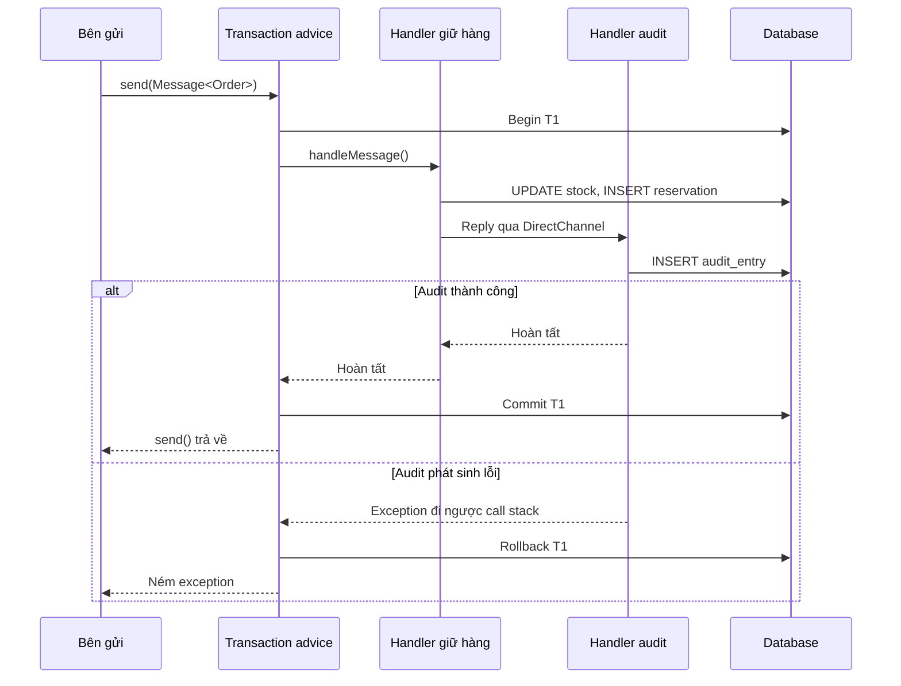

# Transaction advice

## 1. Mục tiêu và bối cảnh

Trong module **SPRING_INTEGRATION_CORE**, transaction advice giúp đặt ranh giới giao dịch vào đúng endpoint của luồng thông điệp. Bài này thuộc chương **Transaction support**, tập trung vào cách kết hợp `Message`, `MessageChannel`, service activator và Java DSL để quyết định những thao tác nào cùng commit hoặc rollback.

Sau bài học, bạn có thể:

- Phân biệt advice quanh phần xử lý của một handler với advice bao quanh cả lời gọi `handleMessage()`.
- Chọn transaction manager theo tài nguyên mà luồng sử dụng.
- Cấu hình transaction advice bằng Java DSL và thuộc tính `adviceChain`.
- Giải thích ảnh hưởng của channel, propagation, xử lý lỗi và retry đến giao dịch.
- Kiểm thử trạng thái dữ liệu sau khi luồng thành công hoặc thất bại ở endpoint phía sau.

Ví dụ sử dụng mô hình xử lý đồng bộ, JDBC và các API có trong Spring Integration 6.x. Dùng BOM của phiên bản Spring Boot/Spring Integration mà dự án chọn để quản lý dependency; không ghép tùy ý các phiên bản Spring Framework, Spring Integration và thư viện kiểm thử.

Để chạy ví dụ, cần Java hỗ trợ `record`, các thư viện `spring-integration-core`, `spring-jdbc`, `spring-tx`; khi kiểm thử cần thêm `spring-test`, JUnit Jupiter và H2. Ứng dụng thực tế phải cung cấp `DataSource`; phần kiểm thử bên dưới cung cấp một cơ sở dữ liệu H2 riêng.

## 2. Vấn đề: cùng một luồng chưa chắc cùng một giao dịch

Giả sử luồng nhận yêu cầu giữ hàng:

```text
Message<Order>
    -> giữ tồn kho và ghi reservation
    -> ghi audit của lần giữ hàng
    -> kết thúc
```

Nếu bước audit thất bại, yêu cầu nghiệp vụ là hoàn tác cả việc trừ tồn kho và bản ghi reservation. Việc nối hai service activator bằng channel chỉ mô tả đường đi của thông điệp. Ranh giới giao dịch còn phụ thuộc nơi bắt đầu transaction, loại advice, cách chuyển giao giữa các endpoint và tài nguyên tham gia.

**Transaction advice** là AOP advice dùng cơ chế giao dịch của Spring để bao quanh một lời gọi: lấy hoặc tạo transaction theo propagation, thực thi lời gọi, rồi quyết định commit/rollback. Nếu chỉ tham gia transaction đã tồn tại, việc hoàn tất transaction vật lý vẫn thuộc phạm vi bên ngoài. Spring Integration cung cấp các điểm gắn advice; framework không thay thế transaction manager của Spring. [Tham khảo mô hình giao dịch trong message flow](https://docs.spring.io/spring-integration/reference/transactions.html).

Các vai trò cần tách biệt:

| Thành phần | Trách nhiệm |
| --- | --- |
| `Message<Order>` | Mang yêu cầu xử lý và header định tuyến/phản hồi |
| `DirectChannel` | Chuyển thông điệp đến subscriber trên thread gửi |
| Service activator | Gọi phương thức nghiệp vụ và có thể tạo reply |
| Transaction advice | Chọn phạm vi lời gọi được bao bằng giao dịch |
| `PlatformTransactionManager` | Quản lý begin, commit, rollback trên tài nguyên tương ứng |
| `JdbcTemplate` | Thực thi SQL bằng cơ chế lấy connection có nhận biết transaction của Spring |

Message header không phải nơi chứa một JDBC transaction để chuyển tùy ý giữa các thread.

## 3. Hai loại advice với phạm vi khác nhau

### 3.1. `TransactionInterceptor` thông thường

Với handler tạo reply kế thừa `AbstractReplyProducingMessageHandler`, advice thông thường trong request handler advice chain bao quanh phần `handleRequestMessage()`. Phần gửi reply sang endpoint kế tiếp diễn ra sau phạm vi đó. Nếu advice tự mở transaction, transaction có thể đã commit trước khi endpoint tiếp theo chạy. [Tài liệu transaction advice của Spring Integration](https://docs.spring.io/spring-integration/reference/handler-advice/tx-handle-message.html).

Mô hình khi không có transaction bên ngoài:

```text
handleMessage()
    begin T1
        handleRequestMessage(): giữ hàng
    commit T1
    gửi reply qua DirectChannel
        endpoint audit: phát sinh lỗi
```

Lỗi audit không thể hoàn tác T1 đã commit.

Nếu đã có transaction bên ngoài và advice dùng `REQUIRED`, kết quả còn phụ thuộc ranh giới bên ngoài đó. Vì vậy, không thể suy ra mọi cấu hình dùng interceptor thông thường đều khiến downstream ở ngoài transaction.

### 3.2. `TransactionHandleMessageAdvice`

`TransactionHandleMessageAdvice` là phần mở rộng của `TransactionInterceptor`, đánh dấu advice cần áp dụng lên `MessageHandler.handleMessage()`. Với handler tạo reply, phạm vi này bao gồm cả việc gửi reply và các lời gọi downstream đồng bộ còn nằm trên call stack. [API của TransactionHandleMessageAdvice](https://docs.spring.io/spring-integration/docs/current/api/org/springframework/integration/transaction/TransactionHandleMessageAdvice.html).

```text
begin T1
    handleMessage()
        handleRequestMessage(): giữ hàng
        gửi reply qua DirectChannel
            endpoint audit: ghi audit
commit T1
```

Nếu endpoint audit ném exception đủ điều kiện rollback và exception quay về advice trước khi T1 hoàn tất, các thay đổi JDBC cùng tham gia T1 được rollback.



Phạm vi downstream ở đây có giới hạn: advice không tự truyền transaction sang thread khác, không quay ngược bao các endpoint đã chạy trước nó, và không tự đưa HTTP, email hay mọi database vào cùng giao dịch.

## 4. Tài nguyên và channel quyết định khả năng rollback

### 4.1. Dùng đúng transaction manager

Trong ví dụ JDBC, `DataSourceTransactionManager` quản lý một `DataSource` và gắn connection giao dịch với thread hiện tại. `JdbcTemplate` tự dùng cơ chế lấy connection phù hợp của Spring. Hai handler dùng cùng `JdbcTemplate` trong cùng thread sẽ có thể cùng tham gia transaction này. [API DataSourceTransactionManager](https://docs.spring.io/spring-framework/docs/current/javadoc-api/org/springframework/jdbc/datasource/DataSourceTransactionManager.html).

| Tài nguyên chính | Lựa chọn thường gặp | Điều cần xác định |
| --- | --- | --- |
| JDBC trên một `DataSource` | `DataSourceTransactionManager` hoặc `JdbcTransactionManager` | DAO có dùng cùng tài nguyên và connection có nhận biết transaction không? |
| JPA | `JpaTransactionManager` | EntityManager có thuộc persistence unit được quản lý không? |
| JMS | `JmsTransactionManager` hoặc cấu hình transaction của listener | Phạm vi tiêu thụ/gửi message nào thực sự tham gia? |
| Nhiều tài nguyên cần commit nguyên tử | JTA/XA nếu hạ tầng hỗ trợ | Mọi tài nguyên liên quan có được enlist vào giao dịch phân tán không? |

Không dùng một local JDBC transaction manager rồi coi việc ghi database và gửi broker là một lần commit nguyên tử. Khi không dùng giao dịch phân tán, hãy xác định cách phục hồi giữa các bước, chẳng hạn outbox kết hợp consumer idempotent.

Nếu có nhiều transaction manager trong application context, nên chỉ rõ manager cho advice bằng dependency injection thay vì để việc chọn manager trở nên ngầm định.

### 4.2. Channel và ranh giới thực thi

| Cách chuyển tiếp | Tác động với transaction imperative đang chạy |
| --- | --- |
| `DirectChannel` | Handler subscriber chạy trên thread gửi; có thể tiếp tục dùng transaction hiện tại |
| `PublishSubscribeChannel` không có executor | Các subscriber được gọi đồng bộ; còn phải xét cách phát tán lỗi và tài nguyên của từng nhánh |
| `ExecutorChannel` | Có thể chuyển xử lý sang thread executor; không có bảo đảm kế thừa transaction của bên gửi |
| `QueueChannel` | Enqueue và xử lý bởi consumer là hai lời gọi tách biệt; không giả định transaction của producer bao luôn consumer |
| Remote gateway hoặc lời gọi HTTP | Không tự mang theo local JDBC transaction sang hệ thống khác |

Các loại channel có đặc tính gửi, lưu đệm và phân phối riêng. Đặc biệt, thành công của `QueueChannel.send()` cho biết message đã được nhận vào queue theo hợp đồng channel, chưa xác nhận xử lý nghiệp vụ phía consumer hoàn tất. [Các implementation của MessageChannel](https://docs.spring.io/spring-integration/reference/channel/implementations.html).

Với queue trong bộ nhớ, rollback JDBC cũng không tự xóa message đã enqueue hoặc đưa message đã receive trở lại queue. Nếu queue sử dụng một message store có hỗ trợ giao dịch, cần kiểm tra riêng sự tham gia của store và transaction manager.

## 5. Ví dụ đầy đủ: giữ hàng và ghi audit cùng transaction

### 5.1. Cấu hình Java DSL

Đặt lớp sau trong package `com.example.integration`. Hai thao tác nghiệp vụ dùng cùng `JdbcTemplate`; channel nối giữa hai flow là `DirectChannel`.

```java
package com.example.integration;

import javax.sql.DataSource;

import org.springframework.beans.factory.annotation.Qualifier;
import org.springframework.context.annotation.Bean;
import org.springframework.context.annotation.Configuration;
import org.springframework.integration.channel.DirectChannel;
import org.springframework.integration.config.EnableIntegration;
import org.springframework.integration.dsl.IntegrationFlow;
import org.springframework.integration.transaction.TransactionInterceptorBuilder;
import org.springframework.jdbc.core.JdbcTemplate;
import org.springframework.jdbc.datasource.DataSourceTransactionManager;
import org.springframework.transaction.PlatformTransactionManager;
import org.springframework.transaction.annotation.Isolation;
import org.springframework.transaction.annotation.Propagation;
import org.springframework.transaction.interceptor.TransactionInterceptor;

@Configuration(proxyBeanMethods = false)
@EnableIntegration
public class OrderTxConfig {

    public record Order(long orderId, String sku, int units,
                        boolean failAudit) {

        public Order {
            if (orderId <= 0 || sku == null || sku.isBlank() || units <= 0) {
                throw new IllegalArgumentException("Invalid order");
            }
        }
    }

    @Bean
    JdbcTemplate jdbcTemplate(DataSource dataSource) {
        return new JdbcTemplate(dataSource);
    }

    @Bean
    PlatformTransactionManager orderTransactionManager(DataSource dataSource) {
        return new DataSourceTransactionManager(dataSource);
    }

    @Bean
    TransactionInterceptor orderTxAdvice(
            @Qualifier("orderTransactionManager")
            PlatformTransactionManager transactionManager) {

        return new TransactionInterceptorBuilder(true)
                .transactionManager(transactionManager)
                .propagation(Propagation.REQUIRED)
                .isolation(Isolation.READ_COMMITTED)
                .timeout(10)
                .build();
    }

    @Bean
    DirectChannel ordersIn() {
        return new DirectChannel();
    }

    @Bean
    DirectChannel afterReserve() {
        return new DirectChannel();
    }

    @Bean
    ReservationService reservationService(JdbcTemplate jdbc) {
        return new ReservationService(jdbc);
    }

    @Bean
    AuditService auditService(JdbcTemplate jdbc) {
        return new AuditService(jdbc);
    }

    @Bean
    IntegrationFlow reserveFlow(
            ReservationService reservationService,
            @Qualifier("orderTxAdvice") TransactionInterceptor advice) {

        return IntegrationFlow.from("ordersIn")
                .handle(reservationService, "reserve",
                        endpoint -> endpoint.advice(advice))
                .channel("afterReserve")
                .get();
    }

    @Bean
    IntegrationFlow auditFlow(AuditService auditService) {
        return IntegrationFlow.from("afterReserve")
                .handle(auditService, "append")
                .get();
    }

    public static class ReservationService {

        private final JdbcTemplate jdbc;

        public ReservationService(JdbcTemplate jdbc) {
            this.jdbc = jdbc;
        }

        public Order reserve(Order order) {
            int changed = jdbc.update(
                    """
                    update stock
                       set available = available - ?
                     where sku = ? and available >= ?
                    """,
                    order.units(), order.sku(), order.units());

            if (changed != 1) {
                throw new IllegalStateException("Insufficient stock");
            }

            jdbc.update(
                    """
                    insert into reservation(order_id, sku, units)
                    values (?, ?, ?)
                    """,
                    order.orderId(), order.sku(), order.units());

            return order;
        }
    }

    public static class AuditService {

        private final JdbcTemplate jdbc;

        public AuditService(JdbcTemplate jdbc) {
            this.jdbc = jdbc;
        }

        public void append(Order order) {
            jdbc.update(
                    "insert into audit_entry(order_id, event_type) values (?, ?)",
                    order.orderId(), "RESERVED");

            if (order.failAudit()) {
                throw new IllegalStateException("Simulated audit failure");
            }
        }
    }
}
```

Tham số `true` của `TransactionInterceptorBuilder` yêu cầu tạo `TransactionHandleMessageAdvice`, dù kiểu trả về của phương thức `build()` là `TransactionInterceptor`. Builder cũng cho phép chỉ rõ manager và các thuộc tính transaction. [API TransactionInterceptorBuilder](https://docs.spring.io/spring-integration/api/org/springframework/integration/transaction/TransactionInterceptorBuilder.html).

Trong ví dụ:

1. `ordersIn.send(message)` gọi handler giữ hàng trên thread gửi.
2. Advice mở T1 nếu thread chưa có transaction tương thích.
3. Phương thức `reserve()` cập nhật tồn kho và tạo reservation.
4. Handler gửi reply qua `afterReserve`, gọi `append()` ngay trên call stack đó.
5. Nếu audit thành công, advice hoàn tất T1; nếu audit lỗi, exception quay về advice và kích hoạt rollback.
6. `append()` trả về `void`, nên nhánh này kết thúc mà không cần một reply channel cuối luồng.

Hai bean `IntegrationFlow` vẫn có thể nằm trong một transaction: việc tách khai báo flow không tự tạo ranh giới giao dịch mới.

### 5.2. Biến thể DSL ngắn gọn

Khi chỉ cần các thuộc tính mặc định, có thể thay cấu hình endpoint ở `reserveFlow` bằng:

```java
.handle(reservationService, "reserve",
        endpoint -> endpoint.transactional(transactionManager, true))
```

Trong đoạn này, `transactionManager` phải là manager được inject vào phương thức khai báo flow. Đây là phương án thay thế cho `endpoint.advice(advice)`, không cần gắn cả hai để quản lý cùng một phạm vi.

Đối số boolean chọn loại advice: `false` là interceptor thông thường, `true` là `TransactionHandleMessageAdvice`. Overload `.transactional()` không truyền boolean dùng interceptor thông thường; không mặc định coi nó bao trọn downstream. [API ConsumerEndpointSpec](https://docs.spring.io/spring-integration/api/org/springframework/integration/dsl/ConsumerEndpointSpec.html).

### 5.3. Biến thể dùng annotation

Nếu endpoint được khai báo bằng annotation thay vì DSL, có thể tham chiếu bean advice qua tên:

```java
@ServiceActivator(
        inputChannel = "ordersIn",
        outputChannel = "afterReserve",
        adviceChain = "orderTxAdvice")
public Order reserve(Order order) {
    return reservationService.reserve(order);
}
```

Đoạn minh họa giả định `Order`, `reservationService` đã được khai báo/inject và import `org.springframework.integration.annotation.ServiceActivator`. Bean chứa phương thức phải được Spring quản lý và messaging annotation phải được xử lý.

Chỉ chọn một cách đăng ký endpoint giữ hàng. Nếu đồng thời giữ `reserveFlow` và thêm endpoint annotation vào cùng `ordersIn`, bạn đã tạo thêm subscriber cho `DirectChannel`; đó không phải cách thêm một lớp transaction cho cùng endpoint.

## 6. Kiểm thử commit và rollback bằng dữ liệu thật

Mock transaction manager có thể xác nhận lời gọi commit/rollback, nhưng chưa chứng minh các câu SQL của hai handler cùng tham gia một transaction. Với yêu cầu của ví dụ, kiểm tra dữ liệu sau khi `send()` kết thúc sẽ phản ánh trực tiếp kết quả nghiệp vụ.

Đặt lớp kiểm thử sau trong cùng package với `OrderTxConfig`. Không thêm `@Transactional` lên test: transaction do test mở có thể che khuất lỗi đặt advice sai phạm vi.

```java
package com.example.integration;

import javax.sql.DataSource;

import org.junit.jupiter.api.BeforeEach;
import org.junit.jupiter.api.Test;
import org.springframework.beans.factory.annotation.Autowired;
import org.springframework.beans.factory.annotation.Qualifier;
import org.springframework.context.annotation.Bean;
import org.springframework.context.annotation.Configuration;
import org.springframework.jdbc.core.JdbcTemplate;
import org.springframework.jdbc.datasource.embedded.EmbeddedDatabaseBuilder;
import org.springframework.jdbc.datasource.embedded.EmbeddedDatabaseType;
import org.springframework.messaging.MessageChannel;
import org.springframework.messaging.MessageHandlingException;
import org.springframework.messaging.support.MessageBuilder;
import org.springframework.test.context.junit.jupiter.SpringJUnitConfig;

import static org.junit.jupiter.api.Assertions.assertEquals;
import static org.junit.jupiter.api.Assertions.assertThrows;
import static org.junit.jupiter.api.Assertions.assertTrue;

@SpringJUnitConfig(classes = {
        OrderTxConfig.class,
        OrderTxAdviceTest.DatabaseConfig.class
})
class OrderTxAdviceTest {

    @Configuration(proxyBeanMethods = false)
    static class DatabaseConfig {

        @Bean(destroyMethod = "shutdown")
        DataSource dataSource() {
            return new EmbeddedDatabaseBuilder()
                    .generateUniqueName(true)
                    .setType(EmbeddedDatabaseType.H2)
                    .build();
        }
    }

    @Autowired
    @Qualifier("ordersIn")
    MessageChannel ordersIn;

    @Autowired
    JdbcTemplate jdbc;

    @BeforeEach
    void resetData() {
        jdbc.execute("""
                create table if not exists stock (
                    sku varchar(40) primary key,
                    available integer not null
                )
                """);
        jdbc.execute("""
                create table if not exists reservation (
                    order_id bigint primary key,
                    sku varchar(40) not null,
                    units integer not null
                )
                """);
        jdbc.execute("""
                create table if not exists audit_entry (
                    order_id bigint primary key,
                    event_type varchar(40) not null
                )
                """);

        jdbc.update("delete from audit_entry");
        jdbc.update("delete from reservation");
        jdbc.update("delete from stock");
        jdbc.update("insert into stock(sku, available) values (?, ?)",
                "BOOK-01", 10);
    }

    @Test
    void commitsBothHandlers() {
        var order = new OrderTxConfig.Order(101L, "BOOK-01", 3, false);

        assertTrue(ordersIn.send(MessageBuilder.withPayload(order).build()));

        assertEquals(7, available());
        assertEquals(1, countReservations());
        assertEquals(1, countAuditEntries());
    }

    @Test
    void rollsBackWhenDownstreamFails() {
        var order = new OrderTxConfig.Order(102L, "BOOK-01", 3, true);

        MessageHandlingException exception = assertThrows(
                MessageHandlingException.class,
                () -> ordersIn.send(MessageBuilder.withPayload(order).build()));

        assertTrue(exception.getCause() instanceof IllegalStateException);
        assertEquals(10, available());
        assertEquals(0, countReservations());
        assertEquals(0, countAuditEntries());
    }

    private int available() {
        return jdbc.queryForObject(
                "select available from stock where sku = ?",
                Integer.class, "BOOK-01");
    }

    private int countReservations() {
        return jdbc.queryForObject(
                "select count(*) from reservation", Integer.class);
    }

    private int countAuditEntries() {
        return jdbc.queryForObject(
                "select count(*) from audit_entry", Integer.class);
    }
}
```

Kết quả mong đợi khi ban đầu tồn kho là 10:

| Trường hợp | Tồn kho sau xử lý | Reservation | Audit |
| --- | ---: | ---: | ---: |
| Giữ 3 sản phẩm, audit thành công | 7 | 1 | 1 |
| Giữ 3 sản phẩm, audit ném lỗi | 10 | 0 | 0 |

Điểm quan trọng là audit cố ý ghi một dòng **trước** khi ném lỗi. Trạng thái cuối cùng bằng 0 chứng minh cả lần ghi đó cũng được hoàn tác.

Bài thực hành đối chứng: đổi `new TransactionInterceptorBuilder(true)` thành `new TransactionInterceptorBuilder(false)` rồi chạy lại test lỗi, trong điều kiện không có transaction bên ngoài. Với H2 và cấu hình này, dự kiến tồn kho còn 7, reservation bằng 1 và audit bằng 1: reservation đã commit trước khi gửi reply, còn lệnh insert audit chạy bằng connection auto-commit. Test kỳ vọng rollback sẽ thất bại và làm lộ khác biệt phạm vi advice.

Đây là mã kiểm thử để người học chạy trong dự án có dependency tương ứng; kết quả dự kiến không phải tuyên bố rằng các đoạn mã đã được thực thi trong tài liệu.

## 7. Propagation và thời điểm commit thực sự

`REQUIRED` là lựa chọn phù hợp cho ví dụ vì cần gom thao tác vào một đơn vị công việc. Khi đã có transaction bên ngoài, phạm vi bên trong thường tham gia cùng transaction vật lý; việc ra khỏi advice không đồng nghĩa database đã commit. `REQUIRES_NEW` tạo transaction vật lý độc lập và có thể cần thêm connection trong lúc transaction ngoài vẫn giữ tài nguyên. [Spring Framework: Transaction Propagation](https://docs.spring.io/spring-framework/reference/data-access/transaction/declarative/tx-propagation.html).

| Propagation | Câu hỏi thiết kế cần trả lời |
| --- | --- |
| `REQUIRED` | Những thao tác này có cần cùng thành công với công việc bên ngoài không? |
| `REQUIRES_NEW` | Có chấp nhận dữ liệu bên trong commit dù công việc ngoài rollback không? |
| `MANDATORY` | Endpoint này có bắt buộc được gọi khi đã có transaction không? |
| `SUPPORTS` | Chạy không có transaction có vẫn hợp lệ không? |
| `NOT_SUPPORTED` | Có chủ ý tách thao tác này khỏi transaction hiện tại không? |
| `NESTED` | Manager và driver có hỗ trợ savepoint để rollback cục bộ không? |

Nếu muốn audit luôn tồn tại dù giữ hàng thất bại, đó là yêu cầu khác với ví dụ. Có thể thiết kế một transaction audit độc lập, nhưng cần chấp nhận và mô tả rõ trạng thái audit về một thao tác đã rollback.

Các thuộc tính khác cũng cần được hiểu theo tài nguyên:

- `isolation` điều khiển mức cô lập mà transaction manager/database hỗ trợ; không thay thế unique constraint hay cập nhật có điều kiện.
- `timeout` của transaction không phải thời hạn tổng cho mọi lời gọi mạng trong flow.
- `readOnly` không nên được xem là một cơ chế phân quyền cấm ghi dữ liệu.

Khi một advice tham gia transaction đã tồn tại, thuộc tính của transaction ngoài có thể quyết định hiệu lực thực tế. Hãy kiểm tra cấu hình manager thay vì chỉ nhìn thuộc tính trên endpoint con.

## 8. Quy tắc rollback và exception mà advice nhìn thấy

Với cấu hình mặc định của interceptor trong ví dụ, `RuntimeException` và `Error` dẫn đến rollback; checked exception không mặc định có cùng hành vi. Quyết định dựa trên exception thoát ra khỏi phạm vi được advice bao quanh. [Spring Framework: Rolling Back a Declarative Transaction](https://docs.spring.io/spring-framework/reference/data-access/transaction/declarative/rolling-back.html).

Có hai điểm dễ nhầm:

1. Handler có thể bị Spring Integration bọc lỗi thành một `MessagingException` thuộc nhóm runtime. Khi đó checked exception ban đầu không còn là loại exception trực tiếp mà interceptor quan sát.
2. Bắt exception rồi trả về bình thường có thể khiến advice thấy một lần thực thi thành công. Tuy nhiên, nếu một thành phần đã đánh dấu transaction là rollback-only, việc bắt exception cũng không làm transaction trở lại trạng thái có thể commit.

Khi cần quy tắc rõ ràng cho advice, có thể cung cấp `RuleBasedTransactionAttribute`. Ví dụ sau yêu cầu rollback với mọi `Exception` đi đến interceptor:

```java
import java.util.List;

import org.springframework.integration.transaction.TransactionInterceptorBuilder;
import org.springframework.transaction.PlatformTransactionManager;
import org.springframework.transaction.TransactionDefinition;
import org.springframework.transaction.interceptor.RollbackRuleAttribute;
import org.springframework.transaction.interceptor.RuleBasedTransactionAttribute;
import org.springframework.transaction.interceptor.TransactionInterceptor;

TransactionInterceptor rollbackOnException(
        PlatformTransactionManager transactionManager) {

    var attributes = new RuleBasedTransactionAttribute();
    attributes.setPropagationBehavior(
            TransactionDefinition.PROPAGATION_REQUIRED);
    attributes.setTimeout(10);
    attributes.setRollbackRules(
            List.of(new RollbackRuleAttribute(Exception.class)));

    return new TransactionInterceptorBuilder(true)
            .transactionManager(transactionManager)
            .transactionAttribute(attributes)
            .build();
}
```

`RuleBasedTransactionAttribute` hỗ trợ quy tắc rollback và không rollback theo kiểu exception. [API RuleBasedTransactionAttribute](https://docs.spring.io/spring-framework/docs/current/javadoc-api/org/springframework/transaction/interceptor/RuleBasedTransactionAttribute.html).

Khi đã cung cấp một `TransactionAttribute` hoàn chỉnh cho builder, đặt propagation, isolation, timeout và rollback rules trên chính đối tượng đó. Không trộn với các setter tương ứng của builder rồi kỳ vọng hai nguồn cấu hình được cộng dồn.

Một thông điệp có payload `"FAILED"` chỉ là dữ liệu nếu không có cơ chế khác đánh dấu thất bại. Tương tự, filter loại bỏ message theo cấu hình thông thường có thể là kết thúc hợp lệ, không tự mang nghĩa rollback.

## 9. Transaction advice ở endpoint khác với transaction của poller

Giả sử nguồn vào là queue và endpoint phải `receive()` message trước khi gọi handler:

```text
poller -> receive() -> handler -> downstream
```

Advice đặt trên handler bắt đầu sau khi message đã được lấy ra. Nó không tự bao phủ lần `receive()` trước đó. Nếu yêu cầu là rollback cả việc nhận từ một nguồn có hỗ trợ transaction, phải đặt ranh giới giao dịch phù hợp ở poller hoặc ở cơ chế tiêu thụ của adapter/listener. [Poller Transaction Support](https://docs.spring.io/spring-integration/reference/transactions.html#transaction-poller).

Ví dụ cấu hình bổ sung cho một polling consumer:

```java
@Bean
IntegrationFlow queuedReserveFlow(
        ReservationService reservationService,
        @Qualifier("orderTransactionManager")
        PlatformTransactionManager transactionManager) {

    return IntegrationFlow.from("transactionalOrdersQueue")
            .handle(reservationService, "reserve",
                    endpoint -> endpoint.poller(
                            Pollers.fixedDelay(1000)
                                    .maxMessagesPerPoll(1)
                                    .transactional(transactionManager)))
            .channel("afterReserve")
            .get();
}
```

Đoạn này cần import `org.springframework.integration.dsl.Pollers`, các kiểu nghiệp vụ từ ví dụ trước và khai báo bean `transactionalOrdersQueue` thuộc kiểu `PollableChannel`. Nó minh họa **vị trí** đặt transaction; khả năng nhận lại message sau rollback vẫn phụ thuộc nguồn queue/message store.

`.transactional(transactionManager)` nằm trên `PollerSpec` bao quanh polling task, khác vị trí với `.transactional(transactionManager, true)` nằm trên cấu hình handler. [API PollerSpec](https://docs.spring.io/spring-integration/api/org/springframework/integration/dsl/PollerSpec.html).

Không suy ra `maxMessagesPerPoll(1)` là chính sách retry hay dead-letter. Thuộc tính này giới hạn số message poller xử lý trong một lần chạy, còn redelivery phải được thiết kế theo nguồn thông điệp.

## 10. Xử lý lỗi mà vẫn giữ đúng giao dịch

Với `DirectChannel` trong ví dụ, exception đi ngược về bên gọi `send()`. Khi chuyển sang xử lý bất đồng bộ, Spring Integration có cơ chế biểu diễn lỗi bằng `ErrorMessage` và chuyển đến error channel phù hợp; điều này không tự nối lại local transaction của producer. [Spring Integration: Error Handling](https://docs.spring.io/spring-integration/reference/error-handling.html).

Cần xác định thứ tự giữa hai việc:

```text
Phát hiện lỗi
    -> exception ra khỏi transaction advice
    -> rollback hoàn tất
    -> xử lý thông báo lỗi ở phạm vi bên ngoài
```

Nếu một advice hoặc handler nằm **bên trong** ranh giới giao dịch bắt lỗi và trả về bình thường, transaction advice phía ngoài có thể không còn thấy lỗi để áp dụng rollback rule. Vì vậy, chính sách “lưu lỗi rồi tiếp tục” phải đi cùng quyết định rõ ràng: dữ liệu nghiệp vụ được commit, rollback hay đã bị đánh dấu rollback-only.

Ví dụ lỗi thiết kế trong service:

```java
try {
    jdbc.update("insert into audit_entry(order_id, event_type) values (?, ?)",
            order.orderId(), "RESERVED");
    externalAction.run();
}
catch (RuntimeException exception) {
    logger.warn("Processing failed", exception);
    // Không ném lại lỗi: bên bao ngoài có thể thấy xử lý đã thành công.
}
```

Đây là mã minh họa với `jdbc`, `order`, `externalAction`, `logger` được cung cấp từ service. Nếu yêu cầu là rollback khi `externalAction` thất bại, cần để lỗi thoát ra hoặc có chủ đích đánh dấu rollback-only. Việc rollback JDBC vẫn không hoàn tác tác dụng bên ngoài mà `externalAction` có thể đã tạo.

## 11. Kết hợp retry và nhiều advice

Retry phải trả lời hai câu hỏi riêng: lặp lại phần việc nào, và mỗi lần thử dùng transaction nào?

```text
Retry bao ngoài transaction:
    lần 1 -> T1 -> lỗi -> rollback
    lần 2 -> T2 -> thành công -> commit

Transaction bao ngoài retry:
    T1 -> lần 1 lỗi -> lần 2 thử tiếp -> T1 hoàn tất
```

Với mẫu đầu, mỗi lần thử chỉ có transaction độc lập khi không bị nhập lại vào một transaction ngoài đang tồn tại, hoặc khi dùng propagation phù hợp. Với mẫu thứ hai, lần thử trước có thể đã làm T1 thành rollback-only hoặc làm persistence context không còn thích hợp để tiếp tục.

`RequestHandlerRetryAdvice` mặc định nhắm vào thao tác của handler. Cơ chế stateful retry có thể dựa vào việc bên gọi gửi lại thông điệp; nó không đồng nghĩa một `QueueChannel` bất kỳ sẽ tự redeliver. Cấu hình retry cần khớp phiên bản thư viện của dự án. [Retry advice trong Spring Integration 6.5](https://docs.spring.io/spring-integration/reference/6.5/handler-advice/classes.html).

Đặc biệt, không chỉ nhìn thứ tự `endpoint.advice(retryAdvice, txAdvice)` rồi kết luận retry đang bao toàn bộ transaction của downstream. Với handler tạo reply, advice triển khai `HandleMessageAdvice` được áp dụng ở mức `handleMessage()`, còn request advice thông thường ở mức `handleRequestMessage()`; thứ tự giữa hai mức không được giữ như một chuỗi đơn giản. [Handling Message Advice](https://docs.spring.io/spring-integration/reference/handler-advice/handle-message.html).

Nếu nghiệp vụ cần retry nguyên đơn vị giữ hàng và audit, một cách dễ xác định phạm vi là tổ chức vòng retry ở bên ngoài lời gọi vào flow đồng bộ, để mỗi lần gọi flow bắt đầu/hoàn tất transaction trước lần thử tiếp theo. Cần thêm chính sách phân loại lỗi, giới hạn số lần thử và chống xử lý trùng; lỗi hết hàng không nên được retry giống lỗi kết nối tạm thời.

## 12. Áp dụng với các thành phần cốt lõi khác

Transaction advice là một công cụ đặt ranh giới, không thay thế ngữ nghĩa của từng Enterprise Integration Pattern:

| Thành phần | Câu hỏi khi nằm trong phạm vi giao dịch |
| --- | --- |
| Transformer | Có chỉ biến đổi payload hay còn ghi dữ liệu? Trạng thái Java đã thay đổi không tự được hoàn tác bởi JDBC rollback |
| Router | Nhánh được chọn có còn đồng bộ và dùng tài nguyên thuộc transaction hiện tại không? |
| Filter | Message bị loại là xử lý hợp lệ hay cần ném lỗi để yêu cầu rollback? |
| Aggregator | Việc thêm message vào group và việc release group có xảy ra cùng lời gọi không? Store và thời điểm release có tham gia transaction không? |
| Gateway | Lời gọi có đồng bộ, có transaction bao ngoài và có chuyển lỗi thành reply hay không? |
| Outbound adapter | Tác dụng ở hệ thống đích có nằm trong giao dịch được manager quản lý không? |

Ví dụ, một aggregator có thể nhận nhiều message ở những thời điểm khác nhau rồi mới release kết quả. Không thể kéo một transaction JDBC mở suốt thời gian chờ group chỉ bằng cách gắn advice vào một endpoint.

Với gửi sự kiện sau khi lưu đơn hàng, có thể dùng một transaction JDBC ghi đồng thời dữ liệu nghiệp vụ và bản ghi outbox. Một tiến trình riêng đọc outbox để phát sự kiện; consumer dùng khóa nghiệp vụ để chống xử lý trùng. Đây là lựa chọn thiết kế khi cần tách công việc dài hoặc tác dụng từ xa khỏi transaction ngắn của database.

## 13. Chẩn đoán theo ranh giới thực tế

| Hiện tượng | Điều nên kiểm tra |
| --- | --- |
| Downstream lỗi nhưng dữ liệu upstream vẫn còn | Advice có dùng `TransactionHandleMessageAdvice` không? Transaction có commit trước lúc gửi reply không? |
| Chỉ một bảng được rollback | Hai DAO có dùng cùng tài nguyên được manager quản lý không? Có connection tự tạo ngoài cơ chế Spring không? |
| Đổi sang executor rồi rollback không còn như trước | Thread xử lý có đổi không? Consumer có transaction riêng không? |
| Ghi log lỗi nhưng transaction vẫn commit | Exception có bị bắt và chuyển thành kết quả bình thường trước khi tới advice không? |
| Gặp `UnexpectedRollbackException` | Một phạm vi tham gia có đánh dấu rollback-only rồi lỗi bị bắt ở bên ngoài không? |
| Database rollback nhưng message không trở lại queue | Nguồn nhận/message store có thực sự hỗ trợ và tham gia transaction không? |
| Test luôn rollback dù cấu hình advice sai | Test có đang mở transaction bằng `@Transactional` và che khuất ranh giới của endpoint không? |

Để quan sát khi thực hành, ghi nhận thread và transaction tại đầu hai service:

```java
Thread.currentThread().getName();

TransactionSynchronizationManager.isActualTransactionActive();
```

Cần import `org.springframework.transaction.support.TransactionSynchronizationManager`. Giá trị `true` là một dấu hiệu chẩn đoán; nó chưa chứng minh hai thao tác dùng cùng transaction vật lý hoặc đúng `DataSource`. Kết hợp thông tin này với log của transaction manager và trạng thái dữ liệu sau xử lý.

Có thể mở rộng ví dụ bằng ba thay đổi độc lập: thay `DirectChannel` trung gian bằng cơ chế bất đồng bộ có consumer phù hợp; thêm một caller mở transaction `REQUIRED` bên ngoài; hoặc thiết kế audit dùng transaction riêng. Trước mỗi thay đổi, viết ra dữ liệu nào được phép tồn tại sau lỗi rồi dùng assertion để kiểm chứng ranh giới đã chọn.
