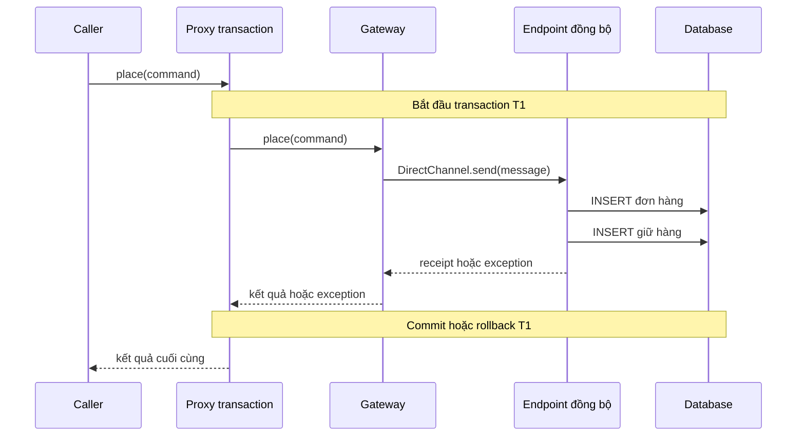

# Transaction boundary của flow

## 1. Mục tiêu và phạm vi

Trong module **SPRING_INTEGRATION_CORE**, bài này thuộc chương **Transaction support**, tập trung vào cách xác định phạm vi commit và rollback của một luồng thông điệp. Từ nền tảng `Message`, `MessageChannel`, endpoint, gateway và Java DSL, người học cần phân biệt được một flow nghiệp vụ với một transaction thực sự.

Sau bài học, bạn có thể:

- Chỉ ra vị trí bắt đầu và kết thúc transaction trên sơ đồ flow.
- Giải thích vì sao đổi `DirectChannel` thành `ExecutorChannel` hoặc `QueueChannel` có thể làm thay đổi tính nhất quán.
- Chọn nơi đặt transaction: facade gọi gateway, poller hoặc advice của endpoint.
- Dự đoán ảnh hưởng của transformer, router, filter, aggregator và error flow đến kết quả xử lý.
- Thiết kế tình huống kiểm chứng bằng dữ liệu đã commit, thay vì chỉ nhìn thông báo gửi thành công.

Bài sử dụng mô hình **imperative**, với transaction JDBC do `PlatformTransactionManager` quản lý. Các ví dụ dùng Java 17 trở lên và Java DSL theo kiểu API Spring Integration 6/7. Với reactive flow, transaction context được quản lý theo cơ chế reactive; không áp dụng máy móc lập luận dựa trên thread của bài này.

## 2. Transaction boundary là phạm vi thực thi và tài nguyên

Giả sử một yêu cầu tạo đơn hàng đi qua:

```text
gateway → orderInput → ghi đơn hàng → reservationInput → ghi giữ hàng
```

Yêu cầu nghiệp vụ là: nếu giữ hàng thất bại, bản ghi đơn hàng cũng phải được hoàn tác.

Một transaction boundary phải trả lời được bốn câu hỏi:

| Câu hỏi | Ví dụ cụ thể |
| --- | --- |
| Ai mở transaction? | Proxy của `OrderFacade.place()` |
| Công việc nào chạy trong phạm vi đó? | Gọi gateway, ghi đơn hàng, ghi giữ hàng |
| Tài nguyên nào tham gia? | Connection JDBC từ DataSource mà transaction manager quản lý |
| Ai quyết định hoàn tất? | Transaction interceptor khi phương thức facade hoàn tất |

Trong transaction imperative của Spring, context gắn với thread thực thi. Flow đồng bộ có thể tiếp tục sử dụng context đang có; chuyển công việc sang thread khác sẽ không tự chuyển transaction theo. Spring Integration cung cấp các điểm nối với transaction infrastructure của Spring, bao gồm poller và advice. [Spring Integration: Transaction Support](https://docs.spring.io/spring-integration/reference/transactions.html)

Cần phân biệt **ranh giới logic của flow** và **ranh giới transaction**. Một sơ đồ có mười endpoint có thể nằm trong một transaction, nhiều transaction độc lập hoặc không có transaction nào. Số lượng endpoint không quyết định điều này.

Ngay cả khi tất cả endpoint chạy trên cùng thread, vẫn phải kiểm tra:

1. Transaction đã được mở và chưa hoàn tất.
2. Mã truy cập dữ liệu sử dụng tài nguyên tham gia đúng transaction manager.
3. Cấu hình propagation không cố ý tách phạm vi.
4. Lỗi được truyền đến nơi quyết định rollback theo quy tắc đã cấu hình.

Ví dụ, một lời gọi HTTP gửi yêu cầu thanh toán vẫn là tác động ngoài phạm vi rollback JDBC. Việc lời gọi đó xảy ra trên cùng thread với thao tác SQL không biến hệ thống thanh toán thành một phần của transaction database.

## 3. Theo dõi thread qua các loại channel

`DirectChannel` gọi handler trên thread của bên gửi. `ExecutorChannel` giao việc cho executor nên không cung cấp bảo đảm chia sẻ transaction giữa sender và handler. `QueueChannel` lưu message để phía nhận lấy sau; thao tác gửi thành công chỉ xác nhận việc đưa message vào queue. [Spring Integration: Configuring Message Channels](https://docs.spring.io/spring-integration/reference/channel/configuration.html), [Message Channel Implementations](https://docs.spring.io/spring-integration/reference/channel/implementations.html)

| Cấu hình | Điều cần xem khi xác định boundary |
| --- | --- |
| `DirectChannel` | Handler được gọi trong call stack hiện tại; kiểm tra transaction của caller |
| `ExecutorChannel` | Xác định transaction riêng cho công việc của worker |
| `QueueChannel` thông thường | Tách transaction của producer và transaction của consumer |
| `PublishSubscribeChannel` không executor | Các subscriber thường được gọi đồng bộ; xem thêm cấu hình dispatch và lỗi |
| `PublishSubscribeChannel` có executor | Không coi tất cả nhánh là một transaction chung |
| `RendezvousChannel` | Sender chờ handoff; sự chờ đợi không chứng minh hai bên chung transaction |

Một executor có thể có chế độ chạy tác vụ ngay trên caller trong một số tình huống. Vì vậy, quan sát một lần thấy cùng tên thread không đủ để kết luận rằng thiết kế bất đồng bộ có bảo đảm transaction xuyên suốt.

### 3.1. Flow đồng bộ



Gateway trả về cho facade chưa phải là thời điểm transaction của facade hoàn tất. Transaction interceptor vẫn phải xử lý kết thúc phạm vi; lỗi commit cũng có thể xuất hiện sau khi phần thân phương thức đã trả về.

### 3.2. Flow có handoff bất đồng bộ

```text
Thread A:
  BEGIN T1
    ghi đơn hàng
    ExecutorChannel.send(message) → executor nhận tác vụ
    facade tiếp tục công việc còn lại
  COMMIT T1

Thread B:
  xử lý message
    giữ hàng thất bại
    báo lỗi của worker
```

Điểm handoff là nơi công việc phía sau không còn được bao phủ bởi transaction của sender. **Không có nghĩa transaction T1 lập tức commit ngay trong lời gọi `send()`**: T1 vẫn kết thúc ở phạm vi đã mở nó. Hai thread có thể chạy xen kẽ, nên worker thậm chí có thể gặp lỗi trước khi T1 commit mà vẫn không chia sẻ T1.

Muốn rollback thao tác của worker, phải mở hoặc tham gia transaction hợp lệ trên phía worker. Transaction đó không tự hoàn tác một transaction của producer đã commit.

## 4. Ví dụ: đặt transaction bên ngoài gateway đồng bộ

Ví dụ sau mô phỏng ghi đơn hàng và giữ hàng vào cùng một database. Chính facade là nơi mở transaction, và toàn bộ flow được gọi đồng bộ trước khi facade hoàn tất.

### 4.1. Điều kiện chạy

Ứng dụng cần:

- `spring-integration-core`, `spring-jdbc`, `spring-tx` và driver database phù hợp.
- Một `DataSource` đã được cấu hình.
- Hai bảng dưới đây đã được tạo.
- Các kiểu Java đặt trong cùng package `demo.tx`, mỗi kiểu public nằm trong file riêng.

Các lớp cấu hình được đưa vào Spring context bằng cơ chế cấu hình của ứng dụng. Ví dụ chủ động khai báo transaction manager và `JdbcTemplate` dùng cùng DataSource.

```sql
CREATE TABLE demo_order (
    order_id VARCHAR(64) PRIMARY KEY,
    quantity INTEGER NOT NULL
);

CREATE TABLE demo_reservation (
    order_id VARCHAR(64) PRIMARY KEY,
    quantity INTEGER NOT NULL,
    FOREIGN KEY (order_id) REFERENCES demo_order(order_id)
);
```

### 4.2. Dữ liệu và gateway

```java
package demo.tx;

public record OrderCommand(String orderId, int quantity) {
    public OrderCommand {
        if (orderId == null || orderId.isBlank() || quantity <= 0) {
            throw new IllegalArgumentException("Thông tin đơn hàng không hợp lệ");
        }
    }
}
```

```java
package demo.tx;

public record OrderReceipt(String orderId, String status) {
}
```

```java
package demo.tx;

import org.springframework.integration.annotation.MessagingGateway;

@MessagingGateway(defaultRequestChannel = "orderInput")
public interface OrderGateway {
    OrderReceipt place(OrderCommand command);
}
```

Gateway tạo message từ lời gọi Java. Ví dụ không cấu hình error flow chuyển exception thành một kết quả bình thường.

### 4.3. Facade giữ phạm vi nghiệp vụ

```java
package demo.tx;

import org.springframework.transaction.annotation.Transactional;

public class OrderFacade {

    private final OrderGateway gateway;

    public OrderFacade(OrderGateway gateway) {
        this.gateway = gateway;
    }

    @Transactional(transactionManager = "orderTxManager")
    public OrderReceipt place(OrderCommand command) {
        return gateway.place(command);
    }
}
```

Caller phải gọi bean `OrderFacade` do Spring quản lý. Nếu tạo đối tượng bằng `new` bên ngoài container hoặc tự gọi phương thức qua `this` trong chế độ proxy mặc định, annotation có thể không được interceptor thực thi. [Spring Framework: Using @Transactional](https://docs.spring.io/spring-framework/reference/data-access/transaction/declarative/annotations.html)

### 4.4. Cấu hình Java DSL

```java
package demo.tx;

import javax.sql.DataSource;

import org.springframework.beans.factory.annotation.Qualifier;
import org.springframework.context.annotation.Bean;
import org.springframework.context.annotation.Configuration;
import org.springframework.integration.annotation.IntegrationComponentScan;
import org.springframework.integration.channel.DirectChannel;
import org.springframework.integration.config.EnableIntegration;
import org.springframework.integration.dsl.IntegrationFlow;
import org.springframework.jdbc.core.JdbcTemplate;
import org.springframework.jdbc.datasource.DataSourceTransactionManager;
import org.springframework.transaction.PlatformTransactionManager;
import org.springframework.transaction.annotation.EnableTransactionManagement;

@Configuration
@EnableIntegration
@EnableTransactionManagement
@IntegrationComponentScan(basePackageClasses = OrderGateway.class)
public class OrderFlowConfig {

    @Bean
    public PlatformTransactionManager orderTxManager(DataSource dataSource) {
        return new DataSourceTransactionManager(dataSource);
    }

    @Bean
    public JdbcTemplate orderJdbc(DataSource dataSource) {
        return new JdbcTemplate(dataSource);
    }

    @Bean
    public DirectChannel orderInput() {
        return new DirectChannel();
    }

    @Bean
    public DirectChannel reservationInput() {
        return new DirectChannel();
    }

    @Bean
    public OrderFacade orderFacade(OrderGateway gateway) {
        return new OrderFacade(gateway);
    }

    @Bean
    public IntegrationFlow orderFlow(
            @Qualifier("orderInput") DirectChannel orderInput,
            @Qualifier("reservationInput") DirectChannel reservationInput,
            JdbcTemplate orderJdbc) {

        return IntegrationFlow.from(orderInput)
                .handle(OrderCommand.class, (command, headers) -> {
                    orderJdbc.update(
                            "INSERT INTO demo_order(order_id, quantity) VALUES (?, ?)",
                            command.orderId(), command.quantity());
                    return command;
                })
                .channel(reservationInput)
                .handle(OrderCommand.class, (command, headers) -> {
                    // Giả lập quy tắc giữ hàng để quan sát rollback.
                    if (command.quantity() > 100) {
                        throw new IllegalStateException("Không đủ hàng để giữ");
                    }

                    orderJdbc.update(
                            "INSERT INTO demo_reservation(order_id, quantity) VALUES (?, ?)",
                            command.orderId(), command.quantity());

                    return new OrderReceipt(command.orderId(), "RESERVED");
                })
                .get();
    }
}
```

`@IntegrationComponentScan` đăng ký gateway interface. `@EnableTransactionManagement` kích hoạt xử lý annotation trên facade bean.

Với ứng dụng có nhiều DataSource hoặc nhiều `JdbcTemplate`, bổ sung qualifier tương ứng ở các điểm inject để chọn đúng tài nguyên.

### 4.5. Dự đoán kết quả

| Lời gọi qua facade bean | Kết quả bên ngoài proxy | Dữ liệu sau khi transaction kết thúc |
| --- | --- | --- |
| `place(new OrderCommand("O-101", 2))` | Nhận receipt `RESERVED` | Có đơn hàng và bản ghi giữ hàng |
| `place(new OrderCommand("O-102", 150))` | Nhận exception | Không có đơn `O-102`; không có giữ hàng |
| Gọi với `orderId` đã tồn tại | Nhận lỗi truy cập dữ liệu | Transaction của lần gọi mới thất bại; dữ liệu cũ vẫn còn |

Ở trường hợp `O-102`, câu lệnh INSERT đầu tiên đã chạy, nhưng chưa commit. Exception từ bước giữ hàng truyền ngược qua các channel, gateway và facade tới transaction interceptor.

Mặc định, lỗi `RuntimeException` và `Error` kích hoạt rollback; checked exception cần quy tắc phù hợp. Đánh giá theo exception thực sự tới interceptor, vì lỗi từ handler có thể được framework bọc trong messaging exception. [Spring Framework: Rolling Back a Declarative Transaction](https://docs.spring.io/spring-framework/reference/data-access/transaction/declarative/rolling-back.html)

Đây là mô phỏng nguyên tử của hai thao tác ghi. Nó chưa mô hình hóa cạnh tranh tồn kho, chống xử lý trùng hay gọi hệ thống thanh toán.

## 5. Đặt @Transactional trên handler có bao phủ phần phía sau không?

Giả sử flow là:

```text
DirectChannel
  → createOrder() có @Transactional
  → handler giữ hàng
  → trả kết quả
```

Nếu chưa có transaction bên ngoài, proxy có thể mở T1 khi vào `createOrder()`, rồi commit T1 khi phương thức đó kết thúc. Sau đó endpoint mới gửi kết quả đến handler giữ hàng. Lỗi ở bước giữ hàng đến quá muộn để rollback T1.

Ngược lại, ở ví dụ facade, `createOrder()` nếu dùng propagation `REQUIRED` sẽ tham gia transaction đã được facade mở; phạm vi ngoài vẫn còn hiệu lực khi các endpoint tiếp theo chạy.

Vấn đề tương tự xuất hiện với advice của reply-producing handler: một `TransactionInterceptor` thông thường trong request handler advice chain có thể chỉ bao quanh phần xử lý request nội bộ. `TransactionHandleMessageAdvice` bao quanh `handleMessage()`, gồm cả việc chuyển tiếp kết quả tới phần downstream đồng bộ. [Spring Integration: Transaction Support for Message Handlers](https://docs.spring.io/spring-integration/reference/handler-advice/tx-handle-message.html)

### 5.1. Mở transaction từ một endpoint bằng advice phù hợp

Đây là **phương án thay thế** cho transaction tại facade. Đoạn khai báo advice có thể đặt trong lớp cấu hình:

```java
@Bean
public TransactionInterceptor flowTransactionAdvice(
        @Qualifier("orderTxManager") PlatformTransactionManager txManager) {

    return new TransactionInterceptorBuilder(true)
            .transactionManager(txManager)
            .propagation(Propagation.REQUIRED)
            .build();
}
```

Các import bổ sung:

```java
import org.springframework.integration.transaction.TransactionInterceptorBuilder;
import org.springframework.transaction.annotation.Propagation;
import org.springframework.transaction.interceptor.TransactionInterceptor;
```

Áp dụng advice này vào endpoint đầu tiên cần làm điểm bắt đầu. Ví dụ dưới đây là một flow độc lập, tái sử dụng các kiểu dữ liệu, bảng và bean `orderJdbc` ở trên:

```java
@Bean
public IntegrationFlow advisedOrderFlow(
        JdbcTemplate orderJdbc,
        @Qualifier("flowTransactionAdvice") TransactionInterceptor txAdvice) {

    return IntegrationFlow.from("advisedOrderInput")
            .handle(OrderCommand.class, (command, headers) -> {
                orderJdbc.update(
                        "INSERT INTO demo_order(order_id, quantity) VALUES (?, ?)",
                        command.orderId(), command.quantity());
                return command;
            }, endpoint -> endpoint.advice(txAdvice))
            .handle(OrderCommand.class, (command, headers) -> {
                if (command.quantity() > 100) {
                    throw new IllegalStateException("Không đủ hàng để giữ");
                }
                orderJdbc.update(
                        "INSERT INTO demo_reservation(order_id, quantity) VALUES (?, ?)",
                        command.orderId(), command.quantity());
                return new OrderReceipt(command.orderId(), "RESERVED");
            })
            .get();
}
```

Flow này cần được gọi theo request/reply, chẳng hạn bằng gateway có `defaultRequestChannel = "advisedOrderInput"`. Không gửi trực tiếp rồi bỏ qua cơ chế nhận reply khi handler cuối có trả kết quả.

Tham số `true` của builder tạo loại advice dành cho `handleMessage`. Nó không khiến transaction xuyên qua executor hay queue. Cấu hình transaction manager tường minh cũng tránh chọn nhầm manager khi ứng dụng có nhiều bean. [TransactionInterceptorBuilder API](https://docs.spring.io/spring-integration/api/org/springframework/integration/transaction/TransactionInterceptorBuilder.html), [TransactionHandleMessageAdvice API](https://docs.spring.io/spring-integration/docs/current/api/org/springframework/integration/transaction/TransactionHandleMessageAdvice.html)

Khi lựa chọn giữa facade và endpoint advice, hãy chọn điểm bắt đầu diễn đạt đúng đơn vị nghiệp vụ và có thể quan sát rõ. Không cần mở thêm transaction mới ở mọi endpoint chỉ vì có thể cấu hình advice.

## 6. Poller: đưa cả thao tác nhận message vào boundary

Với một consumer đọc từ queue, có hai thao tác khác nhau:

```text
receive message → xử lý message
```

Nếu chỉ mở transaction trong phương thức xử lý, `receive()` đã xảy ra trước đó. Khi nguồn nhận có hỗ trợ transaction, poller transaction cho phép việc nhận và xử lý đồng bộ nằm trong cùng đơn vị công việc. [Spring Integration: Message Endpoints — Transaction Support](https://docs.spring.io/spring-integration/reference/endpoint.html#transaction-support)

### 6.1. Ví dụ poller có transaction

Đặt các bean sau trong lớp cấu hình. Chúng tái sử dụng `OrderCommand`, `orderJdbc`, `orderTxManager` và hai bảng của ví dụ trước:

```java
@Bean
public QueueChannel queuedOrders() {
    return new QueueChannel(100);
}

@Bean
public IntegrationFlow queuedOrderFlow(
        QueueChannel queuedOrders,
        JdbcTemplate orderJdbc,
        @Qualifier("orderTxManager") PlatformTransactionManager txManager) {

    return IntegrationFlow.from(queuedOrders)
            .handle(message -> {
                OrderCommand command = (OrderCommand) message.getPayload();

                orderJdbc.update(
                        "INSERT INTO demo_order(order_id, quantity) VALUES (?, ?)",
                        command.orderId(), command.quantity());

                if (command.quantity() > 100) {
                    throw new IllegalStateException("Không đủ hàng để giữ");
                }

                orderJdbc.update(
                        "INSERT INTO demo_reservation(order_id, quantity) VALUES (?, ?)",
                        command.orderId(), command.quantity());
            }, endpoint -> endpoint.poller(
                    Pollers.fixedDelay(Duration.ofMillis(500))
                            .maxMessagesPerPoll(1)
                            .receiveTimeout(0)
                            .transactional(txManager)))
            .get();
}
```

Import bổ sung:

```java
import java.time.Duration;
import org.springframework.integration.channel.QueueChannel;
import org.springframework.integration.dsl.Pollers;
```

Handler dùng ở đây là consumer một chiều, không tạo reply. Poller mở transaction trên thread xử lý poll; lỗi trong handler làm transaction JDBC thất bại.

`transactional(txManager)` gắn transaction advice vào polling task. `maxMessagesPerPoll(1)` làm ví dụ dễ quan sát, còn `receiveTimeout(0)` không chờ khi queue rỗng. Số message tối đa trong một lượt lịch không phải là lời khai báo một transaction batch nghiệp vụ. [PollerSpec API](https://docs.spring.io/spring-integration/api/org/springframework/integration/dsl/PollerSpec.html)

### 6.2. Giới hạn quan trọng của ví dụ

`new QueueChannel(100)` sử dụng queue trong bộ nhớ. Sau khi poller lấy message ra, rollback database **không tự đưa message trở lại queue**.

Với message `OrderCommand("O-201", 150)`, kết quả dự kiến là:

1. Message được lấy khỏi queue.
2. INSERT đơn hàng chạy trong transaction của poller.
3. Handler ném exception.
4. INSERT bị rollback.
5. Message không tự xuất hiện lại trong queue chỉ vì có `.transactional(txManager)`.

Đây là lý do cần đánh giá riêng khả năng rollback **dữ liệu nghiệp vụ** và khả năng khôi phục **message đã nhận**. Muốn redelivery, nguồn lưu trữ và thao tác nhận phải hỗ trợ cơ chế phù hợp.

## 7. Queue bền vững: nối các transaction cục bộ

Khi cần handoff bền vững, một phương án là queue backed by JDBC với `JdbcChannelMessageStore`. Cần schema của Spring Integration, query provider đúng database và transaction manager quản lý DataSource tương ứng. Chỉ thêm một bean message store mà queue chưa sử dụng nó sẽ không thay đổi tính chất của queue. [Spring Integration: JDBC Message Store](https://docs.spring.io/spring-integration/reference/jdbc/message-store.html)

Mô hình mong muốn khi message store và bảng nghiệp vụ cùng tham gia một transaction JDBC:

```text
Producer — transaction T1:
  ghi dữ liệu tiếp nhận
  thêm message vào JDBC-backed queue
  COMMIT T1

Consumer — transaction T2 của poller:
  nhận/xóa message từ JDBC-backed queue
  ghi dữ liệu xử lý
  COMMIT T2 hoặc ROLLBACK T2
```

Đây vẫn là **hai transaction**. Nếu T2 rollback, thao tác lấy message có thể được rollback cùng dữ liệu xử lý khi cấu hình và cơ chế store đáp ứng điều đó. T1 đã commit không bị hoàn tác theo.

Với thiết kế này, cần xác định:

- DataSource dùng bởi message store có đúng tài nguyên mà transaction manager của poller quản lý không.
- Việc lấy message có thực sự diễn ra bên trong transaction không.
- Cơ chế serialization có hỗ trợ payload và header cần lưu không.
- Khi xử lý thất bại nhiều lần, message được thử lại hay chuyển sang kênh xử lý lỗi nào.
- Tác động từ message trùng được kiểm soát bằng khóa nghiệp vụ hoặc thao tác idempotent ra sao.

Nếu database và broker là hai tài nguyên riêng, một local JDBC transaction không tự tạo tính nguyên tử cho cả hai. Một lựa chọn kiến trúc là transactional outbox: ghi dữ liệu nghiệp vụ và bản ghi sự kiện trong cùng database transaction, sau đó tiến trình khác chuyển sự kiện đi. Tiến trình chuyển có thể gửi lại khi gặp sự cố, nên phía nhận vẫn cần xử lý trùng phù hợp. [Spring: Outbox Pattern Strategies](https://spring.io/blog/2023/10/24/a-use-case-for-transactions-adapting-to-transactional-outbox-pattern/)

Ví dụ trạng thái nghiệp vụ nên thể hiện hai giai đoạn rõ ràng: `ACCEPTED` sau T1 và `RESERVED` sau T2. Không trả về `RESERVED` chỉ dựa trên việc producer đã đưa message vào queue.

## 8. Propagation và transaction manager thay đổi boundary

Hai endpoint chạy cùng thread vẫn có thể thuộc các phạm vi khác nhau do propagation:

| Propagation | Ảnh hưởng khi đi qua phương thức được intercept |
| --- | --- |
| `REQUIRED` | Tham gia transaction tương ứng đang có; nếu chưa có thì mở transaction |
| `REQUIRES_NEW` | Tạm ngưng transaction ngoài và thực thi trong transaction vật lý độc lập |
| `NOT_SUPPORTED` | Thực thi ngoài transaction, tạm ngưng transaction đang có nếu được hỗ trợ |
| `NESTED` | Thường sử dụng savepoint khi transaction manager và tài nguyên hỗ trợ |

`REQUIRES_NEW` không phải cách “truyền transaction sang thread khác”. Nó tạo phạm vi độc lập tại nơi lời gọi được xử lý. Transaction trong có thể commit rồi transaction ngoài rollback. Với `REQUIRED`, trạng thái rollback-only của phạm vi trong có thể khiến phạm vi ngoài kết thúc bằng `UnexpectedRollbackException`. [Spring Framework: Transaction Propagation](https://docs.spring.io/spring-framework/reference/data-access/transaction/declarative/tx-propagation.html)

Ví dụ yêu cầu audit cần được làm rõ trước khi chọn propagation:

```text
T1:
  ghi đơn hàng
  gọi AuditService qua proxy:
    T2 với REQUIRES_NEW:
      ghi "đã thử tạo đơn"
      COMMIT T2
  giữ hàng thất bại
  ROLLBACK T1
```

Bản ghi “đã thử tạo đơn” còn tồn tại là hợp lý nếu audit cần lưu dấu vết lần thử. Nếu nội dung audit là “đơn hàng đã tạo thành công”, cùng cấu hình này sẽ ghi nhận sai trạng thái nghiệp vụ.

Cũng phải đọc tên transaction manager. Ví dụ một endpoint dùng manager của DataSource A, endpoint khác ghi DataSource B: giữ cùng thread không đủ để kết luận hai database được commit nguyên tử. Phạm vi bảo đảm phụ thuộc vào tài nguyên thực sự được quản lý.

## 9. Exception, errorChannel và quyết định rollback

### 9.1. Phân biệt lỗi đồng bộ và thông báo lỗi bất đồng bộ

Trong call stack đồng bộ, exception có thể truyền ngược tới caller. Với xử lý bất đồng bộ, framework có thể xuất bản `ErrorMessage` đến error channel theo cấu hình. Việc nhận được một error message không có nghĩa transaction của producer vẫn còn mở. [Spring Integration: Error Handling](https://docs.spring.io/spring-integration/reference/error-handling.html)

Ví dụ: producer đã commit trạng thái `ACCEPTED`, worker lỗi khi giữ hàng. Error flow có thể cập nhật đơn thành `RESERVATION_FAILED` trong transaction khác. Đó là chuyển trạng thái nghiệp vụ sau thất bại, không phải rollback T1.

### 9.2. Biến exception thành reply sẽ thay đổi điều caller quan sát

Một gateway có thể chuyển lỗi sang error flow và nhận về reply nghiệp vụ. Khi reply đó là đối tượng bình thường, facade có thể kết thúc bình thường, dù một bước xử lý đã lỗi. [Spring Integration: Messaging Gateways — Error Handling](https://docs.spring.io/spring-integration/reference/gateway.html#gateway-error-handling)

Vì vậy cần xác định hợp đồng:

| Ý nghĩa của lỗi | Hành vi cần thiết |
| --- | --- |
| Đơn vị ghi dữ liệu phải bị hủy | Để exception phù hợp tới transaction interceptor hoặc đánh dấu rollback-only có chủ đích |
| Yêu cầu bị từ chối nhưng việc ghi nhận từ chối phải được lưu | Trả kết quả từ chối và thiết kế transaction lưu trạng thái đó |
| Producer đã commit, consumer xử lý thất bại | Dùng retry, trạng thái thất bại hoặc bù trừ theo thiết kế |

Không thể giả định rằng mọi lời gọi trả về bình thường đều chắc chắn commit: một participant có thể đã đánh dấu rollback-only, hoặc commit có thể thất bại. Ngược lại, chỉ log lỗi rồi trả về bình thường không tự yêu cầu rollback.

### 9.3. Retry phải được đặt đúng phạm vi

Hãy so sánh hai cấu trúc:

```text
A. Retry bên ngoài transaction:
   thử lần 1 → BEGIN T1 → lỗi → ROLLBACK T1
   thử lần 2 → BEGIN T2 → thành công → COMMIT T2

B. Transaction bên ngoài retry:
   BEGIN T1
     thử lần 1 → lỗi
     thử lần 2 → tiếp tục trong T1
   kết thúc T1
```

Cấu trúc B có thể tiếp tục trong transaction đã rollback-only hoặc đang giữ tài nguyên sau lỗi. Ngoài thứ tự advice, còn phải xác định advice bao quanh một handler, cả `handleMessage()` hay một lần poll. Recovery callback trả kết quả bình thường cũng có thể làm thay đổi đường đi của exception. [Spring Integration: Provided Advice Classes — Retry Advice](https://docs.spring.io/spring-integration/reference/handler-advice/classes.html#retry-advice)

Trước khi bật retry cho ví dụ đơn hàng, hãy xác định cách nhận biết đơn đã xử lý và cách xử lý trường hợp reply bị mất sau khi dữ liệu đã commit. Khóa chính ngăn tạo hai hàng trùng mã, nhưng ứng dụng vẫn cần diễn giải lần gửi lại thành kết quả nghiệp vụ thích hợp.

## 10. Transformer, router, filter và aggregator nằm ở đâu trong boundary?

| Thành phần | Điều cần phân tích |
| --- | --- |
| Transformer | Việc đổi payload không tự mở transaction; tác động ghi dữ liệu bên trong vẫn cần phạm vi hợp lệ |
| Router | Theo dõi channel của từng nhánh; một nhánh có executor có thể tách khỏi transaction của caller |
| Filter | Message bị loại có thể là kết thúc bình thường; cần cấu hình hành vi rejection theo yêu cầu nghiệp vụ |
| Aggregator | Phân biệt transaction nhận từng message với lần release cả group |
| Service activator | Xác định transaction bao quanh phương thức service hay cả việc gửi reply downstream |
| Gateway | Xác định request đồng bộ hay bất đồng bộ và cách chuyển lỗi thành exception hoặc reply |

Một ví dụ filter dễ gây hiểu nhầm:

```text
BEGIN T1
  ghi đơn hàng
  filter đánh giá false và kết thúc xử lý bình thường
COMMIT T1
```

Nếu nghiệp vụ yêu cầu loại message đồng nghĩa hủy đơn, cần thể hiện điều đó bằng hợp đồng lỗi hoặc trạng thái rõ ràng. Không dùng hình dáng sơ đồ để suy ra rollback.

Aggregator lưu các message theo group và release khi điều kiện đạt. Những message đến ở các thời điểm khác nhau không tự được ghép thành một transaction kéo dài từ message đầu tiên. Hãy kiểm tra loại message store và đường thực thi release; release do timeout có thể thuộc một lần thực thi khác với lúc nhận message. [Spring Integration: Aggregator](https://docs.spring.io/spring-integration/reference/aggregator.html)

Ví dụ group có ba dòng đơn hàng:

```text
message 1 → lưu group trong T1 → COMMIT
message 2 → lưu group trong T2 → COMMIT
message 3 → lưu group và release trong phạm vi hiện tại
```

Nếu xử lý sau release thất bại, không thể suy ra T1 và T2 đã commit sẽ bị rollback. Cần thiết kế khả năng khôi phục group, gửi lại và chống tạo tác động nghiệp vụ lặp.

## 11. Tác động ngoài database và callback sau commit

Một flow có thể vừa ghi JDBC vừa di chuyển file, gửi email hoặc gọi API. Chia sẻ cùng thread không cung cấp khả năng hoàn tác cho các tác động đó.

Callback sau commit hữu ích để chỉ thực hiện một hành động khi database đã thành công. Tuy nhiên, nếu callback thất bại thì database đã commit không quay lại trạng thái cũ. Transaction synchronization chỉ phối hợp thời điểm thực hiện; nó không biến tài nguyên không hỗ trợ transaction thành tài nguyên transactional. [Spring Integration: Transaction Synchronization](https://docs.spring.io/spring-integration/reference/transactions.html#transaction-synchronization)

Tình huống cần dự kiến:

```text
COMMIT đơn hàng thành công
  → tiến trình dừng trước khi gửi email
  → đơn đã tồn tại nhưng chưa có email
```

Nếu hành động bắt buộc phải được thực hiện lại sau sự cố, hãy lưu ý định thực hiện vào một nơi bền vững trong transaction phù hợp. Một callback đơn thuần không thay thế cơ chế lưu công việc và khôi phục.

Tương tự, một `PseudoTransactionManager` dùng để kích hoạt callback theo kết quả xử lý không cung cấp khả năng rollback dữ liệu JDBC như transaction manager thực sự.

## 12. Thực hành kiểm chứng boundary

Phần này mô tả các tình huống người học có thể thực hiện trên ví dụ; không mặc định rằng mọi cấu hình đã được kiểm thử sẵn.

### 12.1. Ma trận quan sát

| Thay đổi hoặc thao tác | Quan sát cần thu thập | Kết quả mong đợi |
| --- | --- | --- |
| Facade + direct channel, quantity = 2 | Kết quả caller và hai bảng | Có cả hai bản ghi |
| Facade + direct channel, quantity = 150 | Exception và truy vấn bằng kết nối sau khi caller kết thúc | Không có đơn mới |
| Gọi gateway trực tiếp khi không có transaction ngoài | Dữ liệu sau lỗi ở bước giữ hàng | INSERT đầu có thể đã autocommit |
| Đổi một channel giữa hai bước thành executor | Thread, thời điểm commit, dữ liệu sau lỗi worker | Không còn bảo đảm rollback chung |
| Poller transactional + queue bộ nhớ | Database và message còn trong queue | Database rollback; message không tự trở lại |
| Poller + store transactional phù hợp | Thao tác nhận và SQL sau rollback | Message có thể nhận lại theo cơ chế của store |
| Chỉ mở transaction tại bước ghi đầu tiên | Mốc hoàn tất phương thức service và lỗi downstream | Bước đầu có thể đã commit |
| Advice `handleMessage` + downstream đồng bộ | Lỗi downstream và dữ liệu | Cùng rollback trong phạm vi advice |

Khi thử cấu hình executor, nên dùng một cơ chế phối hợp có kiểm soát như latch để tách rõ “producer đã hoàn tất transaction” và “worker bắt đầu xử lý”. Một khoảng sleep tùy ý khiến kết quả phụ thuộc tốc độ máy.

### 12.2. Ghi log để tìm điểm tách

Có thể bổ sung helper sau vào mã thực hành:

```java
import org.springframework.transaction.support.TransactionSynchronizationManager;

static void traceBoundary(String step) {
    System.out.printf(
            "step=%s thread=%s txActive=%s txName=%s%n",
            step,
            Thread.currentThread().getName(),
            TransactionSynchronizationManager.isActualTransactionActive(),
            TransactionSynchronizationManager.getCurrentTransactionName());
}
```

Đặt lời gọi trước gateway, trong từng handler và trên worker. Gắn thêm `orderId` hoặc correlation ID trong logging của ứng dụng để nối các bản ghi của cùng yêu cầu.

`txActive=true` cho biết có transaction thực đang hoạt động trên thread tại điểm quan sát; nó chưa chứng minh mọi tài nguyên đều được enlist và cũng chưa chứng minh hai điểm thuộc cùng transaction vật lý. Không dùng tên transaction như một định danh duy nhất.

### 12.3. Đánh giá dữ liệu sau khi phạm vi hoàn tất

Không để transaction tự động của bài kiểm thử che mất boundary cần quan sát:

- Gọi facade đã được proxy rồi đọc lại dữ liệu sau khi lời gọi kết thúc.
- Với flow bất đồng bộ, chờ điều kiện hoàn tất xác định và đọc bằng một transaction/kết nối phù hợp.
- Quan sát cả trạng thái database lẫn trạng thái message.
- Phân biệt “không thấy hàng vì chưa commit” với “hàng đã được rollback”.
- Khi kiểm tra retry, đếm tác động nghiệp vụ bằng khóa ổn định, không chỉ đếm log.

Nếu cần chủ động điều khiển phạm vi thực hành, có thể dùng `TransactionTemplate` để bao quanh lời gọi gateway đồng bộ. Đây là lựa chọn programmatic cho transaction imperative. [Spring Framework: Programmatic Transaction Management](https://docs.spring.io/spring-framework/reference/data-access/transaction/programmatic.html)

Không đặt `@Transactional` lên phương thức trả về bean `IntegrationFlow` với kỳ vọng mọi message tương lai đều có transaction. Phương thức đó thực thi lúc tạo cấu hình, còn việc xử lý từng message diễn ra về sau.

## 13. Cách xác định boundary trước khi triển khai flow

Với mỗi luồng mới, hãy viết một hợp đồng cụ thể, chẳng hạn:

> Sau khi API trả về RESERVED, database phải có cả đơn hàng và bản ghi giữ hàng. Nếu giữ hàng thất bại trong luồng đồng bộ, không được có đơn hàng mới.

Sau đó đánh dấu lần lượt:

1. **Điểm bắt đầu:** lời gọi qua proxy facade, transaction advice, poller hoặc listener được cấu hình transaction.
2. **Thread thực thi:** chỗ nào cùng call stack, chỗ nào handoff, chỗ nào có callback về sau.
3. **Tài nguyên:** database, message store, broker, file và API ngoài; manager nào quản lý phần nào.
4. **Đường lỗi:** exception đi đến interceptor hay bị recovery/error flow biến thành kết quả bình thường.
5. **Điểm hoàn tất:** nơi caller nhận kết quả sau commit, hoặc nơi producer mới xác nhận tiếp nhận.
6. **Phục hồi:** message được nhận lại từ đâu, tác động nào có thể trùng, tác động nào cần bù trừ.

Một bản mô tả boundary tốt có thể đọc thành câu: “Facade mở transaction JDBC T1; hai handler chạy đồng bộ, ghi cùng DataSource; lỗi giữ hàng truyền ra ngoài proxy nên cả lần tạo đơn bị rollback”. Với flow bất đồng bộ, hãy mô tả T1 và T2 riêng, cùng trạng thái nghiệp vụ nối giữa chúng.
