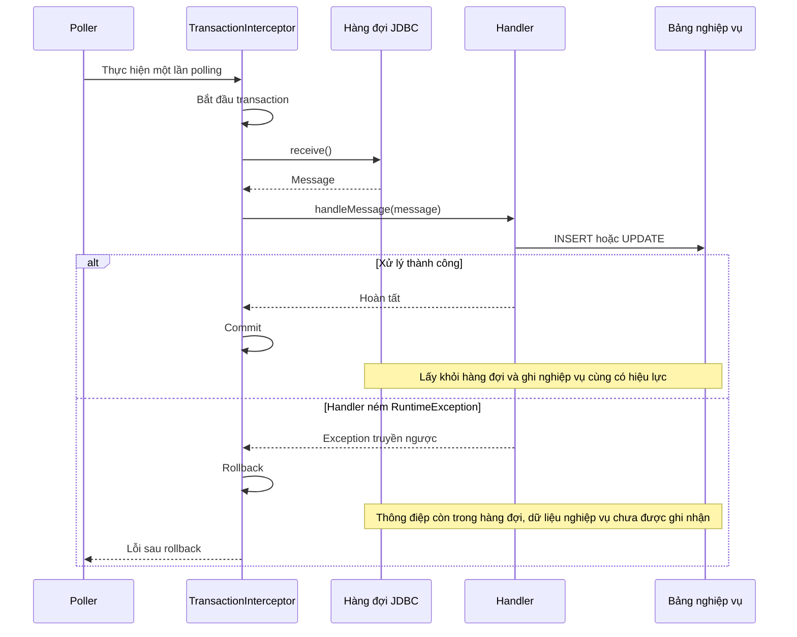

# Transaction trên poller

Transaction trên poller cho phép bắt đầu giao dịch **trước khi nhận thông điệp** và kết thúc sau khi xử lý đồng bộ hoàn tất. Nhờ đó, thao tác nhận từ một tài nguyên có hỗ trợ transaction có thể cùng commit hoặc rollback với các cập nhật nghiệp vụ tham gia giao dịch.

Trong Spring Integration Core, cơ chế này nối các khái niệm `Message`, `MessageChannel`, endpoint và Java DSL với yêu cầu nhất quán dữ liệu. Khai báo poller là transactional chỉ thiết lập ranh giới giao dịch; mức bảo đảm thực tế còn phụ thuộc vào transaction manager, tài nguyên và cách luồng chuyển giữa các thread.

## 1. Bài toán: đã lấy thông điệp nhưng nghiệp vụ thất bại

Giả sử một hàng đợi chứa yêu cầu `ORDER-1001`. Poller lấy yêu cầu, ghi bản ghi tiếp nhận vào database, rồi gọi bước kiểm tra nghiệp vụ. Bước cuối phát sinh lỗi.

Có hai thay đổi cần xem xét riêng:

1. Thông điệp đã bị lấy khỏi hàng đợi.
2. Bản ghi nghiệp vụ đã được ghi vào database.

Nếu chỉ đặt `@Transactional` trên phương thức xử lý nghiệp vụ, giao dịch thường bắt đầu sau khi poller đã nhận thông điệp. Database có thể rollback nhưng thao tác nhận trước đó chưa chắc nằm trong cùng giao dịch. Nếu nguồn là hàng đợi trong bộ nhớ, thông điệp đã bị lấy ra sẽ không tự quay lại.

Ranh giới mong muốn là:

```text
BEGIN
  receive() từ hàng đợi có hỗ trợ transaction
  xử lý thông điệp trên cùng thread
  ghi dữ liệu qua tài nguyên tham gia giao dịch
COMMIT khi thành công
ROLLBACK khi lỗi phù hợp quy tắc rollback đi ra ngoài
```

Spring Integration cung cấp transaction advice trên poller để bao quanh chính thao tác nhận và chuyển tiếp. Đây là lý do cấu hình transaction ở poller có ý nghĩa khác với chỉ bao quanh một service ở cuối luồng. [Tham khảo Poller Transaction Support](https://docs.spring.io/spring-integration/reference/transactions.html#poller-transaction-support).

## 2. Poller nằm ở đâu trong luồng?

Hai loại endpoint thường gặp đều có thể dùng poller:

| Endpoint | Poller gọi nhận từ đâu? | Ví dụ |
| --- | --- | --- |
| `SourcePollingChannelAdapter` | Một `MessageSource` | Đọc bản ghi bằng JDBC inbound adapter, quét file bằng file inbound adapter |
| `PollingConsumer` | Một `PollableChannel` | Service activator nhận từ `QueueChannel` |

Một `DirectChannel` chuyển thông điệp trực tiếp cho subscriber; service activator nhận từ loại channel này không cần poller. Với `QueueChannel`, endpoint tiêu thụ cần poller riêng hoặc poller mặc định phù hợp. [Tham khảo Message Endpoints](https://docs.spring.io/spring-integration/reference/endpoint.html).

Cần phân biệt ba đơn vị:

- **Lần kích hoạt theo lịch:** trigger cho phép tác vụ polling chạy.
- **Lần receive-and-forward:** nhận một `Message` rồi xử lý/chuyển tiếp đồng bộ.
- **Batch nghiệp vụ:** có thể là một payload chứa danh sách nhiều phần tử trong chính một `Message`.

Trong luồng imperative thông thường, advice của poller bao quanh mỗi lần receive-and-forward. Ví dụ với `maxMessagesPerPoll(3)`, `REQUIRED` và không có giao dịch bên ngoài, có thể có chuỗi:

```text
Một lần kích hoạt:
  transaction A: nhận M1 -> xử lý M1 -> commit
  transaction B: nhận M2 -> xử lý M2 -> commit
  transaction C: nhận M3 -> lỗi -> rollback
```

Rollback của C không hoàn tác các commit của A và B. `maxMessagesPerPoll` giới hạn số lần polling trong một chu kỳ, không định nghĩa một giao dịch nguyên tử cho cả chu kỳ. Ngược lại, nếu một lần nhận trả về một `Message<List<Order>>`, xử lý danh sách đó có thể vẫn thuộc cùng một lần receive-and-forward. Cách đặt advice bên trong vòng lặp có thể xem trong [mã nguồn AbstractPollingEndpoint 6.5.10](https://github.com/spring-projects/spring-integration/blob/v6.5.10/spring-integration-core/src/main/java/org/springframework/integration/endpoint/AbstractPollingEndpoint.java).

## 3. Vòng đời giao dịch

Sơ đồ sau giả định hàng đợi JDBC và bảng nghiệp vụ dùng cùng một `DataSource`, cùng transaction manager, xử lý đồng bộ và lỗi runtime được truyền ra ngoài:



Điều kiện quyết định không phải số lượng endpoint. Hãy lần theo đường thực thi từ `receive()` đến điểm kết thúc: tài nguyên nào tham gia, thread nào xử lý và exception có quay về transaction advice hay không.

## 4. Thực hành Java DSL với hàng đợi JDBC

### 4.1. Mục tiêu và điều kiện chạy ví dụ

Ví dụ dùng API của Spring Integration 6.5.x, Java 17 trở lên và Spring Framework tương thích. Khi đặt trong dự án Spring Boot, dùng bộ phiên bản do BOM của dự án quản lý, tránh ghép tùy ý các phiên bản Spring.

Các dependency cần có trong classpath:

| Dependency | Vai trò |
| --- | --- |
| `org.springframework.integration:spring-integration-core` | Channel, endpoint, Java DSL |
| `org.springframework.integration:spring-integration-jdbc` | `JdbcChannelMessageStore` và schema mẫu |
| `org.springframework:spring-jdbc` | `JdbcTemplate`, database nhúng, JDBC transaction manager |
| `com.h2database:h2` | Database cho bài thực hành |
| `org.junit.jupiter:junit-jupiter` | Đoạn kiểm thử bên dưới |
| `org.awaitility:awaitility` | Đợi điều kiện bất đồng bộ trong kiểm thử |

Ví dụ tạo database H2 trong bộ nhớ. Store dùng JDBC nên có thể tham gia rollback, nhưng database này không giữ dữ liệu sau khi bị hủy. Muốn kiểm chứng khả năng khôi phục sau khi tiến trình dừng, cần database lưu bền và không khởi tạo lại schema ở mỗi lần chạy.

`JdbcChannelMessageStore` cần query provider khớp database và các bảng cần thiết trước khi endpoint khởi động. [Tham khảo JDBC Message Store](https://docs.spring.io/spring-integration/reference/jdbc/message-store.html).

### 4.2. Cấu hình hoàn chỉnh

Đặt cấu hình dưới đây trong package thực hành của ứng dụng. `orderInbox` là hàng đợi nhận yêu cầu; `pollerErrors` chỉ dùng thu lỗi khi thử nghiệm. Worker được đặt `autoStartup(false)` để bài kiểm thử chủ động điều khiển thời điểm chạy.

```java
import javax.sql.DataSource;
import java.time.Duration;
import java.util.concurrent.atomic.AtomicBoolean;

import org.springframework.beans.factory.annotation.Qualifier;
import org.springframework.context.annotation.Bean;
import org.springframework.context.annotation.Configuration;
import org.springframework.integration.channel.QueueChannel;
import org.springframework.integration.config.EnableIntegration;
import org.springframework.integration.dsl.IntegrationFlow;
import org.springframework.integration.dsl.Pollers;
import org.springframework.integration.jdbc.store.JdbcChannelMessageStore;
import org.springframework.integration.jdbc.store.channel.H2ChannelMessageStoreQueryProvider;
import org.springframework.integration.store.MessageGroupQueue;
import org.springframework.jdbc.core.JdbcTemplate;
import org.springframework.jdbc.datasource.DataSourceTransactionManager;
import org.springframework.jdbc.datasource.embedded.EmbeddedDatabase;
import org.springframework.jdbc.datasource.embedded.EmbeddedDatabaseBuilder;
import org.springframework.jdbc.datasource.embedded.EmbeddedDatabaseType;
import org.springframework.transaction.PlatformTransactionManager;
import org.springframework.transaction.support.TransactionSynchronizationManager;

@Configuration
@EnableIntegration
public class PollerTransactionConfig {

    @Bean(destroyMethod = "shutdown")
    public EmbeddedDatabase dataSource() {
        EmbeddedDatabase database = new EmbeddedDatabaseBuilder()
                .generateUniqueName(true)
                .setType(EmbeddedDatabaseType.H2)
                .addScript("classpath:org/springframework/integration/jdbc/schema-h2.sql")
                .build();

        new JdbcTemplate(database).execute("""
                create table order_audit (
                    order_id varchar(64) primary key
                )
                """);
        return database;
    }

    @Bean
    public JdbcTemplate jdbcTemplate(DataSource dataSource) {
        return new JdbcTemplate(dataSource);
    }

    @Bean
    public PlatformTransactionManager transactionManager(DataSource dataSource) {
        return new DataSourceTransactionManager(dataSource);
    }

    @Bean
    public JdbcChannelMessageStore orderStore(DataSource dataSource) {
        JdbcChannelMessageStore store = new JdbcChannelMessageStore(dataSource);
        store.setChannelMessageStoreQueryProvider(
                new H2ChannelMessageStoreQueryProvider());
        store.setRegion("poller-tx-lab");
        return store;
    }

    @Bean
    public QueueChannel orderInbox(JdbcChannelMessageStore orderStore) {
        return new QueueChannel(new MessageGroupQueue(orderStore, "orders"));
    }

    @Bean
    public QueueChannel pollerErrors() {
        return new QueueChannel(100);
    }

    @Bean
    public LabOrderHandler orderHandler(JdbcTemplate jdbcTemplate) {
        return new LabOrderHandler(jdbcTemplate);
    }

    @Bean
    public IntegrationFlow orderFlow(
            @Qualifier("orderInbox") QueueChannel orderInbox,
            LabOrderHandler orderHandler,
            PlatformTransactionManager transactionManager) {

        return IntegrationFlow.from(orderInbox)
                .handle(orderHandler, "accept", endpoint -> endpoint
                        .id("orderWorker")
                        .autoStartup(false)
                        .poller(Pollers.fixedDelay(Duration.ofSeconds(1))
                                .maxMessagesPerPoll(1)
                                .receiveTimeout(0)
                                .transactional(transactionManager)
                                .errorChannel("pollerErrors")))
                .get();
    }

    public static class LabOrderHandler {

        private final JdbcTemplate jdbcTemplate;
        private final AtomicBoolean fail = new AtomicBoolean(true);

        public LabOrderHandler(JdbcTemplate jdbcTemplate) {
            this.jdbcTemplate = jdbcTemplate;
        }

        public void setFail(boolean value) {
            this.fail.set(value);
        }

        public void accept(String orderId) {
            if (!TransactionSynchronizationManager.isActualTransactionActive()) {
                throw new IllegalStateException("Handler cần một transaction đang hoạt động");
            }

            jdbcTemplate.update(
                    "insert into order_audit(order_id) values (?)", orderId);

            if (fail.get()) {
                throw new IllegalStateException("Lỗi giả lập sau khi INSERT");
            }
        }
    }
}
```

`QueueChannel` ở đây nhận một `MessageGroupQueue` được backing bởi store JDBC. Tên bean `orderInbox` và group ID `orders` phục vụ hai mục đích khác nhau: tên bean dùng để nối cấu hình; group ID xác định nhóm thông điệp trong store. Nếu cần đọc lại một hàng đợi lưu bền sau khi khởi động lại, group ID và vùng dữ liệu phải được giữ phù hợp. [Tham khảo MessageGroupQueue](https://github.com/spring-projects/spring-integration/blob/v6.5.10/spring-integration-core/src/main/java/org/springframework/integration/store/MessageGroupQueue.java).

Script `org/springframework/integration/jdbc/schema-h2.sql` nằm trong JAR JDBC của Spring Integration và có bảng `INT_CHANNEL_MESSAGE`. Không cần tự đoán cấu trúc bảng trong bài thực hành. Trong triển khai thật, quản lý schema bằng công cụ migration của dự án. [Schema H2 của Spring Integration 6.5.10](https://github.com/spring-projects/spring-integration/blob/v6.5.10/spring-integration-jdbc/src/main/resources/org/springframework/integration/jdbc/schema-h2.sql).

### 4.3. Đọc cấu hình theo hành vi

Khi gọi `orderInbox.send(new GenericMessage<>("ORDER-1001"))`, yêu cầu được ghi vào store. Trong ví dụ, thao tác gửi diễn ra ngoài transaction của consumer; transaction poller bắt đầu ở lần lấy yêu cầu sau đó.

Các cấu hình quan trọng có ý nghĩa như sau:

- `.transactional(transactionManager)` thêm transaction advice vào polling task. Không cần `@Transactional` trên handler để bắt đầu transaction trong ví dụ này.
- `JdbcTemplate`, store và `DataSourceTransactionManager` dùng cùng đối tượng `DataSource`, cho phép thao tác nhận và ghi nghiệp vụ dùng kết nối được Spring quản lý trong cùng transaction.
- `.maxMessagesPerPoll(1)` giúp quan sát từng lần nhận rõ ràng.
- `.receiveTimeout(0)` yêu cầu nhận không chờ khi channel rỗng; khoảng chờ này khác khoảng nghỉ giữa các chu kỳ.
- Handler trả về `void` và là endpoint cuối, nên không cần cấu hình reply channel.
- `setFail(true)` làm lỗi xuất hiện sau lệnh `INSERT`, nhờ đó có thể quan sát việc hoàn tác cả hai thay đổi.

`Pollers` tạo đặc tả poller cho endpoint, còn `transactional(...)`, `receiveTimeout(...)` và `errorChannel(...)` cấu hình các phần khác nhau của polling task. [Tham khảo Pollers DSL](https://docs.spring.io/spring-integration/reference/dsl/java-pollers.html) và [PollerSpec 6.5.10](https://github.com/spring-projects/spring-integration/blob/v6.5.10/spring-integration-core/src/main/java/org/springframework/integration/dsl/PollerSpec.java).

## 5. Kiểm thử rollback và xử lý lại

Đoạn JUnit sau kiểm tra tác động quan sát được: sau lỗi, database chưa có bản ghi và hàng đợi vẫn còn yêu cầu; khi tắt lỗi, cùng yêu cầu đó được xử lý thành công.

```java
import java.time.Duration;

import org.junit.jupiter.api.Test;
import org.springframework.context.Lifecycle;
import org.springframework.context.annotation.AnnotationConfigApplicationContext;
import org.springframework.integration.channel.QueueChannel;
import org.springframework.jdbc.core.JdbcTemplate;
import org.springframework.messaging.Message;
import org.springframework.messaging.support.ErrorMessage;
import org.springframework.messaging.support.GenericMessage;

import static org.awaitility.Awaitility.await;
import static org.junit.jupiter.api.Assertions.assertEquals;
import static org.junit.jupiter.api.Assertions.assertInstanceOf;
import static org.junit.jupiter.api.Assertions.assertNotNull;
import static org.junit.jupiter.api.Assertions.assertTrue;

class PollerTransactionTest {

    @Test
    void rollbackKeepsMessageAndLaterPollCanCommit() {
        try (var context = new AnnotationConfigApplicationContext(
                PollerTransactionConfig.class)) {

            QueueChannel inbox = context.getBean("orderInbox", QueueChannel.class);
            QueueChannel errors = context.getBean("pollerErrors", QueueChannel.class);
            JdbcTemplate jdbc = context.getBean(JdbcTemplate.class);
            var handler = context.getBean(
                    PollerTransactionConfig.LabOrderHandler.class);
            Lifecycle worker = context.getBean("orderWorker", Lifecycle.class);

            assertTrue(inbox.send(new GenericMessage<>("ORDER-1001")));
            assertEquals(1, inbox.getQueueSize());

            try {
                worker.start();
                Message<?> error = errors.receive(5_000);
                worker.stop();

                assertNotNull(error);
                assertInstanceOf(ErrorMessage.class, error);
                assertEquals(0, jdbc.queryForObject(
                        "select count(*) from order_audit", Integer.class));
                assertEquals(1, inbox.getQueueSize());

                handler.setFail(false);
                worker.start();

                await().atMost(Duration.ofSeconds(5)).untilAsserted(() -> {
                    assertEquals(1, jdbc.queryForObject(
                            "select count(*) from order_audit", Integer.class));
                    assertEquals(0, inbox.getQueueSize());
                });
            }
            finally {
                worker.stop();
            }
        }
    }
}
```

Không đặt `@Transactional` trên phương thức kiểm thử rồi giả định poller tham gia transaction của test: worker chạy trên thread khác. Bài kiểm thử cũng cần đợi điều kiện hoàn tất thay vì chỉ đợi đến lúc gọi `send()` trả về.

Hai snapshot chính cần đạt:

| Thời điểm | Số yêu cầu trong hàng đợi | Số bản ghi `order_audit` |
| --- | ---: | ---: |
| Sau khi gửi, worker chưa chạy | 1 | 0 |
| Sau khi nhận lỗi, worker đã dừng | 1 | 0 |
| Sau lần xử lý thành công | 0 | 1 |

Có thể mở rộng thực hành bằng cách thay riêng bean `orderInbox` thành `new QueueChannel()` rồi chạy lại ca lỗi. Dự kiến database vẫn rollback nhưng hàng đợi có kích thước 0, làm assertion giữ lại thông điệp thất bại. Đây là một phép thử giúp phân biệt cấu hình transaction với khả năng rollback của nguồn nhận.

## 6. Chọn transaction manager theo tài nguyên

Transaction manager quyết định tài nguyên nào được quản lý. Việc một handler đang có transaction không tự làm mọi thư viện hoặc kết nối bên trong handler tham gia transaction đó.

| Cấu hình tài nguyên | Hành vi cần đánh giá |
| --- | --- |
| Hàng đợi JDBC và bảng nghiệp vụ dùng cùng `DataSource` được JDBC transaction manager quản lý | Có thể nhận và cập nhật trong cùng local transaction như ví dụ |
| `QueueChannel` mặc định trong bộ nhớ và database JDBC | Có thể rollback database; hàng đợi mặc định không tự hoàn tác thao tác lấy |
| JMS được `JmsTransactionManager` quản lý và ghi JDBC riêng | Không có bảo đảm commit nguyên tử cho cả JMS và JDBC chỉ từ transaction JMS |
| Hai database dùng hai local transaction manager độc lập | Hai commit độc lập; không hình thành một transaction phân tán tự động |
| Đọc file rồi gọi HTTP | Không có cơ chế rollback phổ quát để hoàn tác việc đọc file hay tác động phía HTTP |

Tài nguyên có lưu bền và tài nguyên có thể tham gia transaction là hai thuộc tính cần kiểm tra riêng. Một store lưu được dữ liệu sau restart chưa đủ để kết luận thao tác nhận đã tham gia đúng transaction đang chạy.

Nếu cần nguyên tử trên nhiều tài nguyên, phải đánh giá cơ chế điều phối hỗ trợ chúng, chẳng hạn JTA/XA khi hạ tầng và tài nguyên phù hợp. Với tương tác dịch vụ ngoài, thường cần thiết kế outbox, idempotency hoặc bù trừ ở mức nghiệp vụ. Bảng trên là cách phân tích phạm vi bảo đảm của ví dụ, không phải cam kết chung cho mọi adapter.

## 7. Ranh giới thread và các thành phần trong flow

### 7.1. Luồng đồng bộ

Một đường xử lý như sau có thể tiếp tục dùng transaction của poller nếu các endpoint không đổi thread hoặc chủ động thay đổi transaction:

```text
JDBC queue
  -> transactional poller
  -> transformer
  -> DirectChannel
  -> router
  -> service activator
  -> JDBC update
```

Transformer hoặc router không tự tạo thêm transaction chỉ vì là một endpoint. Điều cần theo dõi là lời gọi có tiếp tục trên thread mang transaction và tài nguyên có tham gia đúng giao dịch hay không.

### 7.2. Bàn giao bất đồng bộ

Xét luồng khác:

```text
transaction A trên thread polling:
  receive -> ExecutorChannel.send() -> bàn giao thành công -> commit A

thread executor:
  handler -> lỗi
```

Exception trên thread executor không tự quay về transaction A đã hoàn tất. Một `QueueChannel` trung gian cũng tách lần gửi của producer khỏi lần nhận của consumer tiếp theo. Nếu mỗi phía có transaction thì đó là các transaction cần được phân tích riêng.

Với hàng đợi trung gian có store transactional, có thể commit việc chuyển giao bền vững ở transaction A rồi tiêu thụ ở transaction B. Điều đó giúp khôi phục từng chặng, nhưng không gộp hai chặng thành một giao dịch duy nhất. [Tham khảo Transaction Boundaries](https://docs.spring.io/spring-integration/reference/transactions.html#transaction-boundaries).

Không nhầm `poller.taskExecutor(...)` với một `ExecutorChannel` đặt giữa flow. Task executor của poller có thể chạy toàn bộ polling task được advice trên worker thread; transaction bắt đầu tại đó. Transaction của scheduler hoặc thread gọi `send()` không vì thế được truyền sang worker.

### 7.3. Filter, aggregator và gateway

Những thành phần đã học trước đó cũng cần được đọc theo ngữ nghĩa transaction:

| Thành phần | Điểm cần quan sát |
| --- | --- |
| Filter bỏ thông điệp bình thường | Việc không đi tiếp không đồng nghĩa có exception; thao tác nhận có thể được commit |
| Router chuyển nhánh đồng bộ | Nhánh xử lý có thể nằm trong transaction hiện tại nếu giữ cùng thread |
| Aggregator giữ thông điệp chờ nhóm hoàn tất | Các lần polling khác nhau không tự dùng chung một transaction chỉ vì cùng correlation ID |
| Gateway trong luồng | Cần xét đường request/reply và cách chuyển lỗi; một lỗi được đổi thành kết quả bình thường có thể không còn làm transaction ngoài rollback |

Ví dụ, filter loại một yêu cầu hết hạn có thể là kết quả nghiệp vụ hợp lệ và cần commit việc tiêu thụ. Nếu mong yêu cầu được thử lại, phải thiết kế nhánh lỗi/điều kiện rollback rõ ràng.

## 8. Thuộc tính transaction và timeout

Các mặc định của transaction advice phù hợp cho nhiều trường hợp, nhưng cần hiểu chúng trước khi tinh chỉnh:

| Thuộc tính | Ý nghĩa trong poller |
| --- | --- |
| `REQUIRED` | Tham gia transaction hiện có hoặc tạo mới; poller chạy nền thông thường không có transaction từ người gửi |
| Isolation | Phụ thuộc database và transaction manager; `DEFAULT` dùng mức mặc định của tài nguyên |
| Timeout | Giới hạn giao dịch theo hỗ trợ của manager/tài nguyên; giá trị timeout transaction dùng đơn vị giây |
| `readOnly` | Gợi ý/chế độ cho tài nguyên hỗ trợ; flow có xóa khỏi hàng đợi JDBC hoặc ghi nghiệp vụ cần được cấu hình phù hợp cho thao tác ghi |
| Quy tắc rollback | Quyết định loại exception nào khiến transaction rollback |

Có thể thay `.transactional(transactionManager)` trong ví dụ bằng một `TransactionInterceptor` có cấu hình cụ thể:

```java
import org.springframework.integration.transaction.TransactionInterceptorBuilder;
import org.springframework.transaction.annotation.Isolation;
import org.springframework.transaction.annotation.Propagation;
import org.springframework.transaction.interceptor.TransactionInterceptor;

// transactionManager là bean đã được inject.
TransactionInterceptor txAdvice = new TransactionInterceptorBuilder()
        .transactionManager(transactionManager)
        .propagation(Propagation.REQUIRED)
        .isolation(Isolation.DEFAULT)
        .timeout(10)
        .readOnly(false)
        .build();

// Trong phần cấu hình poller, dùng .transactional(txAdvice)
// thay cho .transactional(transactionManager).
```

Không cần thêm cả hai cách cấu hình vào cùng poller. Builder tạo transaction advice dựa trên các thuộc tính Spring quen thuộc. [Tham khảo TransactionInterceptorBuilder 6.5.10](https://github.com/spring-projects/spring-integration/blob/v6.5.10/spring-integration-core/src/main/java/org/springframework/integration/transaction/TransactionInterceptorBuilder.java).

`receiveTimeout(500)` là thời gian chờ nhận theo mili giây, `fixedDelay(Duration.ofSeconds(1))` là lịch polling và `timeout(10)` ở transaction advice là timeout giao dịch theo giây. Timeout transaction không phải một cơ chế tự động ngắt mọi đoạn code Java hay mọi HTTP request; các lời gọi ngoài vẫn cần timeout riêng theo client và tài nguyên.

Nếu một service bên trong dùng `REQUIRES_NEW`, nó có thể commit giao dịch riêng dù transaction poller sau đó rollback. Kết quả có thể là yêu cầu còn trong hàng đợi nhưng bản ghi do service ấy tạo đã tồn tại. Chỉ dùng cấu hình đó khi hiểu tác động của commit độc lập và khả năng chạy lại. [Tham khảo Transaction Propagation](https://docs.spring.io/spring-framework/reference/data-access/transaction/declarative/tx-propagation.html).

## 9. Exception, rollback và error channel

### 9.1. Exception phải tới được transaction advice

Với transaction advice mặc định của ví dụ, `RuntimeException` và `Error` dẫn tới rollback. Checked exception không tự có cùng quy tắc ở tầng transaction. Trong messaging, exception nghiệp vụ còn có thể được endpoint bọc thành `MessagingException`, là runtime exception; cần xét exception thực sự đi ra khỏi polling task thay vì chỉ nhìn chữ ký phương thức nghiệp vụ. [Tham khảo quy tắc rollback của Spring Framework](https://docs.spring.io/spring-framework/reference/data-access/transaction/declarative/rolling-back.html).

Đoạn code sau tạo kết quả khác mong muốn nếu chưa có ai đánh dấu rollback-only:

```java
public void accept(String orderId) {
    try {
        jdbcTemplate.update(
                "insert into order_audit(order_id) values (?)", orderId);
        validateOrder(orderId);
    }
    catch (RuntimeException exception) {
        logger.warn("Không xử lý được đơn {}", orderId, exception);
        // Phương thức kết thúc bình thường tại đây.
    }
}
```

Transaction advice có thể nhìn thấy một lần xử lý thành công và commit, dù log có lỗi. Nếu chính sách là rollback, hãy để exception thích hợp truyền ra, hoặc dùng cơ chế rollback-only có chủ đích. Nếu muốn ghi nhận thất bại và tiêu thụ thông điệp, hãy thiết kế đó thành một kết quả nghiệp vụ rõ ràng.

### 9.2. Error channel phục vụ đường xử lý lỗi

Trong cấu hình mẫu, exception đi qua transaction interceptor, transaction rollback rồi error handler của polling task gửi `ErrorMessage` tới `pollerErrors`. Việc nhận được `ErrorMessage` không chứng minh mọi tài nguyên đều rollback; kiểm thử vẫn cần kiểm tra trạng thái queue và database.

Error channel cũng không tự tạo retry, không tự chuyển thông điệp gốc sang dead-letter queue và không tham gia ngược vào transaction đã rollback. Với luồng bất đồng bộ, lỗi được báo qua thông điệp thay vì ném ngược về thread đã gửi ban đầu. [Tham khảo Error Handling](https://docs.spring.io/spring-integration/reference/error-handling.html).

Ở bài thực hành, `pollerErrors` là queue để test chủ động đọc. Trong ứng dụng vận hành, cần consumer xử lý lỗi và chính sách khi error channel đầy; nếu chỉ để lỗi tích tụ, worker có thể bị cản trở bởi chính đường báo lỗi.

## 10. Retry và thông điệp luôn thất bại

Rollback chỉ quyết định hoàn tác tài nguyên tham gia. Trong ví dụ, yêu cầu được thấy lại ở lần polling sau vì thao tác lấy khỏi JDBC queue đã rollback; đó chưa phải chính sách retry có giới hạn.

Một yêu cầu sai dữ liệu vĩnh viễn có thể bị lấy, lỗi rồi quay lại nhiều lần. Cần quyết định số lần thử, thời gian đợi và cách tách nó khỏi luồng xử lý chính.

Thứ tự advice ảnh hưởng trực tiếp tới phạm vi thử lại:

```text
Retry ở ngoài transaction:
  lần thử 1 -> BEGIN -> receive + handle -> ROLLBACK
  lần thử 2 -> BEGIN -> receive + handle -> COMMIT
```

Mô hình trên cần nguồn nhận có khả năng khôi phục sau rollback. Nếu retry chỉ bao quanh handler, mọi lần thử có thể vẫn nằm trong transaction đã mở ở poller. Một lần thất bại đi qua service transactional bên trong có thể đánh dấu giao dịch rollback-only, khiến lần thử sau trả về thành công vẫn không commit được.

`RequestHandlerRetryAdvice` được thiết kế cho advice của message handler; không gắn nó vào poller rồi giả định nó sẽ retry `receive()`. Nếu cần retry toàn polling task, chọn interceptor phù hợp với lời gọi polling và kiểm tra rõ thứ tự advice. Phần này mô tả cách phân tích phạm vi retry, không yêu cầu thêm retry vào cấu hình thực hành.

Với thông điệp hết số lần thử, một thiết kế quarantine có thể thực hiện trong transaction xử lý cuối: lấy khỏi nguồn, ghi thông điệp và lý do vào nơi cách ly có tham gia cùng transaction, rồi hoàn tất thành công. Các chi tiết phụ thuộc tài nguyên và chính sách nghiệp vụ.

Chỉ sao chép thông điệp lỗi từ error channel sau rollback sang một queue khác chưa xóa được bản gốc trong nguồn. Lần polling sau có thể nhận lại nó. Tương tự, bộ đếm số lần thử nằm trong chính transaction bị rollback có thể bị hoàn tác cùng giao dịch và không bao giờ tăng bền vững.

## 11. Synchronization và tác động ngoài database

Một flow có thể cần đổi tên file sau commit hoặc gửi thông báo sau khi dữ liệu được ghi nhận. Spring Integration hỗ trợ transaction synchronization với các mốc `beforeCommit`, `afterCommit` và `afterRollback`.

Cần giữ rõ hai loại bảo đảm:

- Callback được gọi theo kết quả giao dịch.
- Tác động bên ngoài có thể được hoàn tác nguyên tử cùng giao dịch.

Synchronization cung cấp khả năng thứ nhất. Ví dụ, callback đổi tên file sau commit có thể thất bại khi database đã commit; callback không thể quay ngược commit ấy. `PseudoTransactionManager` hỗ trợ các callback cho flow không có tài nguyên transaction thật, nhưng không biến file hoặc HTTP thành tài nguyên ACID. [Tham khảo Transaction Synchronization và Pseudo Transactions](https://docs.spring.io/spring-integration/reference/transactions.html#transaction-synchronization).

Nếu việc phát sự kiện phải sống sót qua sự cố giữa lúc commit database và lúc gửi HTTP, có thể ghi một outbox record cùng transaction nghiệp vụ rồi để một flow khác phát đi. Flow phát cần hỗ trợ thử lại; phía nhận cần khóa idempotency theo nghiệp vụ khi có thể nhận trùng.

Khóa chính `order_audit.order_id` trong ví dụ chỉ giúp phát hiện yêu cầu trùng. Nó chưa tự tạo một chính sách idempotency hoàn chỉnh: nếu mọi lần trùng đều bị coi là lỗi cần rollback, thông điệp trùng có thể tiếp tục quay lại mãi.

## 12. Những tình huống cần tự kiểm chứng

Ngoài ca rollback trong ví dụ, các ca sau giúp đánh giá thiết kế của một flow cụ thể:

| Tình huống | Kết quả cần quan sát |
| --- | --- |
| Handler thành công | Queue được tiêu thụ và dữ liệu nghiệp vụ được commit |
| Handler lỗi sau khi ghi JDBC | Với cấu hình mẫu, queue còn yêu cầu và bảng nghiệp vụ không có bản ghi mới |
| Thay bằng queue trong bộ nhớ | Ghi JDBC được rollback nhưng thông điệp không tự được trả lại queue |
| Bắt lỗi rồi trả về bình thường | Có thể commit nếu giao dịch chưa bị đánh dấu rollback-only |
| Thêm `ExecutorChannel` trước bước lỗi | Lỗi ở thread sau không tự rollback transaction đã bàn giao thành công |
| Đặt `maxMessagesPerPoll(3)` và làm thông điệp thứ ba lỗi | Các transaction đã commit của thông điệp trước vẫn giữ kết quả |
| Chuyển sang database lưu bền, dừng tiến trình trước commit | Kiểm tra khôi phục theo transaction và cấu hình database thực tế |
| Gửi cùng một mã đơn lần nữa | Quan sát chính sách idempotency và xử lý yêu cầu trùng |

Khi chẩn đoán, ghi nhận ID thông điệp hoặc mã nghiệp vụ, tên thread, thời điểm bắt đầu/kết thúc xử lý và exception đầy đủ. Có thể bật log `org.springframework.transaction` ở mức phù hợp để quan sát transaction; dòng log từ handler chưa đủ xác nhận commit đã hoàn tất.

## 13. Ghi nhớ khi thiết kế

Trước khi kết luận một poller bảo đảm nhất quán, cần trả lời được bốn câu hỏi:

1. `receive()` có nằm trong transaction advice không?
2. Nguồn nhận và các thao tác ghi có tham gia đúng transaction manager không?
3. Đường xử lý còn đồng bộ cho tới điểm cần commit không?
4. Lỗi có tới được transaction advice và thỏa quy tắc rollback không?

Đặt đúng ranh giới giúp một lần nhận và xử lý thành một đơn vị nhất quán đối với tài nguyên tham gia. Khả năng phục hồi sau rollback, sau restart và khi gọi hệ thống ngoài vẫn cần được kiểm chứng bằng các tình huống tương ứng.
