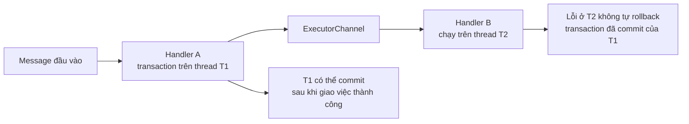

# Transaction trên handler

## 1. Mục tiêu và phạm vi

Trong chương **Transaction support** của module **SPRING_INTEGRATION_CORE**, bài này trình bày cách đặt ranh giới giao dịch tại một handler trong luồng Spring Integration. Nội dung gắn các thành phần Message, MessageChannel, endpoint, gateway và Java DSL với một yêu cầu thực tế: khi xử lý thông điệp thất bại, những thay đổi dữ liệu nào phải được hoàn tác?

Sau bài học, bạn có thể:

- Gắn transaction advice vào service activator hoặc endpoint hỗ trợ advice.
- Phân biệt giao dịch chỉ bao quanh xử lý yêu cầu với giao dịch bao quanh cả phần downstream đồng bộ.
- Dự đoán tác động của propagation, ngoại lệ và việc chuyển thread.
- Chọn vị trí transaction phù hợp khi luồng có router, filter, aggregator hoặc kết nối hệ thống ngoài.
- Thiết kế kiểm thử dựa trên dữ liệu đã commit thay vì chỉ dựa trên việc có exception.

Các ví dụ sử dụng mô hình **imperative**, JDBC và Java DSL với `IntegrationFlow`. Cấu hình chính sử dụng API có trong Spring Integration 6.x; dự án cần dùng các phiên bản Spring tương thích do dependency management của mình quản lý. Ví dụ dùng Java record nên cần Java 17 trở lên trong môi trường Spring Integration 6.x. Không áp dụng nguyên xi mô hình giao dịch gắn với thread này cho luồng reactive.

## 2. Bài toán: handler thành công nhưng toàn luồng thất bại

Xét luồng tạo đơn hàng:

```text
Message<OrderCommand>
    -> DirectChannel
    -> handler A: ghi bảng orders
    -> DirectChannel
    -> handler B: ghi bảng order_audit rồi có thể ném lỗi
    -> kết thúc
```

Có ít nhất hai yêu cầu nghiệp vụ khác nhau:

| Yêu cầu | Ranh giới cần thiết |
|---|---|
| Lưu đơn hàng là một bước độc lập; lỗi ở bước sau được xử lý riêng | Transaction cho phần xử lý của handler A |
| Đơn hàng và bản ghi audit phải cùng thành công | Transaction bao quanh A và B trên cùng chuỗi xử lý đồng bộ |
| Nhận thông điệp từ nguồn giao dịch và cập nhật dữ liệu phải cùng được xác nhận | Cần xét cả transaction ở inbound/poller và khả năng phối hợp tài nguyên |

Câu hỏi “handler đã có transaction chưa?” chưa đủ. Cần chỉ ra **transaction bắt đầu ở đâu, bao quanh thao tác nào, và ai quyết định commit cuối cùng**.

Một `Message` có header nghiệp vụ như `orderId` hoặc `correlationId` không mang theo transaction JDBC. Transaction advice cũng không tự làm cho mọi tác dụng phụ của luồng trở nên có thể rollback.

## 3. Hai phạm vi advice cần phân biệt

### 3.1. TransactionInterceptor thông thường

Với handler có trả lời thuộc họ `AbstractReplyProducingMessageHandler`, request handler advice thông thường bọc phần xử lý yêu cầu nội bộ. Về ý tưởng:

```text
handleMessage(message)
    |
    +-- transaction advice
    |      begin hoặc tham gia transaction
    |      handleRequestMessage(message)
    |      commit/rollback nếu advice sở hữu transaction
    |
    +-- gửi reply sang output channel
           gọi các handler downstream đồng bộ
```

Nếu không có transaction bên ngoài và propagation là `REQUIRED`, transaction mới do advice tạo có thể đã commit khi handler downstream bắt đầu chạy.

### 3.2. TransactionHandleMessageAdvice

`TransactionHandleMessageAdvice` bọc `handleMessage()`. Với handler có trả lời, phạm vi này chứa cả việc gửi kết quả sang output channel. Các handler downstream được gọi đồng bộ trước khi `handleMessage()` trả về có thể cùng tham gia giao dịch.

```text
transaction advice
    begin hoặc tham gia transaction
    handleMessage(message)
        handleRequestMessage(message)
        gửi reply
            handler downstream đồng bộ
    commit/rollback nếu advice sở hữu transaction
```

Builder `new TransactionInterceptorBuilder(true)` tạo loại advice này; `false` tạo `TransactionInterceptor` thông thường. Xem [Transaction Support cho handler](https://docs.spring.io/spring-integration/reference/handler-advice/tx-handle-message.html).

### 3.3. Các điều kiện của phép so sánh

Hai sơ đồ trên giả định advice đang tạo transaction mới. Nếu advice tham gia transaction có sẵn, việc kết thúc lời gọi advice chưa đồng nghĩa với commit vật lý.

| Tình huống | Hệ quả |
|---|---|
| Advice thường, không có transaction ngoài | Transaction mới kết thúc trước phần gửi reply downstream |
| Advice thường với `REQUIRED`, transaction ngoài còn hoạt động | Downstream cùng thread vẫn có thể nằm trong transaction ngoài |
| `TransactionHandleMessageAdvice`, downstream đồng bộ | Phạm vi advice chứa cả quá trình xử lý downstream trước khi trả về |
| Chuyển sang thread khác | Transaction imperative hiện tại không tự đi theo message |
| Handler không có cơ chế tạo reply | Advice thông thường áp dụng vào `handleMessage()`; không nên suy ra có một pha gửi reply giống các sơ đồ trên |

Đặc điểm advice của từng loại handler được mô tả trong [Handling Message Advice](https://docs.spring.io/spring-integration/reference/handler-advice/handle-message.html).

## 4. Ví dụ hoàn chỉnh: hai flow với hai phạm vi transaction

### 4.1. Chuẩn bị

Ví dụ bên dưới có hai kênh đầu vào:

- `localOrders`: advice thường tại handler ghi đơn.
- `atomicOrders`: advice bao quanh `handleMessage()` tại cùng vị trí.

Mỗi message mang một `OrderCommand`. Cờ `failAfterAudit` chỉ dùng để mô phỏng lỗi sau khi câu lệnh ghi audit đã chạy.

Để đưa ví dụ vào một dự án thử nghiệm, cần các dependency tương thích:

| Artifact | Mục đích |
|---|---|
| `org.springframework.integration:spring-integration-core` | Endpoint, channel, advice và Java DSL |
| `org.springframework:spring-jdbc` | `JdbcTemplate`, transaction manager JDBC, embedded database builder |
| `com.h2database:h2` | Database nhúng phục vụ ví dụ |
| `org.junit.jupiter:junit-jupiter` | Các kiểm thử ở phần sau |

`spring-tx` được sử dụng thông qua hạ tầng transaction của Spring; khai báo trực tiếp nếu quy ước dependency của dự án yêu cầu. Không cần module JDBC adapter của Spring Integration vì handler trong ví dụ gọi `JdbcTemplate` trực tiếp.

### 4.2. Payload và nghiệp vụ

Đặt các lớp sau trong cùng package, ví dụ `example.integration.tx`.

```java
package example.integration.tx;

public record OrderCommand(String orderId, boolean failAfterAudit) {
}
```

```java
package example.integration.tx;

import org.springframework.jdbc.core.JdbcTemplate;

public class OrderWriter {

    private final JdbcTemplate jdbc;

    public OrderWriter(JdbcTemplate jdbc) {
        this.jdbc = jdbc;
    }

    public OrderCommand insertOrder(OrderCommand command) {
        jdbc.update(
                "insert into orders(order_id) values (?)",
                command.orderId());
        return command;
    }

    public OrderCommand insertAudit(OrderCommand command) {
        jdbc.update(
                "insert into order_audit(order_id) values (?)",
                command.orderId());

        if (command.failAfterAudit()) {
            throw new IllegalStateException("Lỗi mô phỏng sau khi ghi audit");
        }

        return command;
    }
}
```

Cả hai phương thức trả lại payload để service activator chuyển message tới bước tiếp theo. Riêng việc trả payload không xác nhận transaction đã commit.

### 4.3. Database, transaction manager và flow

```java
package example.integration.tx;

import javax.sql.DataSource;

import org.springframework.beans.factory.annotation.Qualifier;
import org.springframework.context.annotation.Bean;
import org.springframework.context.annotation.Configuration;
import org.springframework.integration.channel.DirectChannel;
import org.springframework.integration.config.EnableIntegration;
import org.springframework.integration.dsl.IntegrationFlow;
import org.springframework.integration.transaction.TransactionInterceptorBuilder;
import org.springframework.jdbc.core.JdbcTemplate;
import org.springframework.jdbc.datasource.DataSourceTransactionManager;
import org.springframework.jdbc.datasource.embedded.EmbeddedDatabase;
import org.springframework.jdbc.datasource.embedded.EmbeddedDatabaseBuilder;
import org.springframework.jdbc.datasource.embedded.EmbeddedDatabaseType;
import org.springframework.messaging.MessageChannel;
import org.springframework.transaction.PlatformTransactionManager;
import org.springframework.transaction.annotation.Propagation;
import org.springframework.transaction.interceptor.TransactionInterceptor;

@Configuration
@EnableIntegration
public class HandlerTransactionConfig {

    @Bean(destroyMethod = "shutdown")
    public EmbeddedDatabase dataSource() {
        return new EmbeddedDatabaseBuilder()
                .generateUniqueName(true)
                .setType(EmbeddedDatabaseType.H2)
                .build();
    }

    @Bean
    public JdbcTemplate jdbcTemplate(DataSource dataSource) {
        JdbcTemplate jdbc = new JdbcTemplate(dataSource);
        jdbc.execute("""
                create table orders (
                    order_id varchar(64) primary key
                )
                """);
        jdbc.execute("""
                create table order_audit (
                    order_id varchar(64) primary key
                )
                """);
        return jdbc;
    }

    @Bean
    public PlatformTransactionManager orderTxManager(DataSource dataSource) {
        return new DataSourceTransactionManager(dataSource);
    }

    @Bean
    public OrderWriter orderWriter(JdbcTemplate jdbcTemplate) {
        return new OrderWriter(jdbcTemplate);
    }

    @Bean
    public TransactionInterceptor requestOnlyTx(
            @Qualifier("orderTxManager") PlatformTransactionManager manager) {

        return new TransactionInterceptorBuilder(false)
                .transactionManager(manager)
                .propagation(Propagation.REQUIRED)
                .build();
    }

    @Bean
    public TransactionInterceptor downstreamTx(
            @Qualifier("orderTxManager") PlatformTransactionManager manager) {

        return new TransactionInterceptorBuilder(true)
                .transactionManager(manager)
                .propagation(Propagation.REQUIRED)
                .build();
    }

    @Bean
    public MessageChannel localOrders() {
        return new DirectChannel();
    }

    @Bean
    public MessageChannel atomicOrders() {
        return new DirectChannel();
    }

    @Bean
    public IntegrationFlow localOrderFlow(
            @Qualifier("localOrders") MessageChannel input,
            OrderWriter writer,
            @Qualifier("requestOnlyTx") TransactionInterceptor txAdvice) {

        return IntegrationFlow.from(input)
                .handle(writer, "insertOrder",
                        endpoint -> endpoint
                                .id("insertOrderLocally")
                                .advice(txAdvice))
                .handle(writer, "insertAudit")
                .channel("nullChannel")
                .get();
    }

    @Bean
    public IntegrationFlow atomicOrderFlow(
            @Qualifier("atomicOrders") MessageChannel input,
            OrderWriter writer,
            @Qualifier("downstreamTx") TransactionInterceptor txAdvice) {

        return IntegrationFlow.from(input)
                .handle(writer, "insertOrder",
                        endpoint -> endpoint
                                .id("insertOrderAtomically")
                                .advice(txAdvice))
                .handle(writer, "insertAudit")
                .channel("nullChannel")
                .get();
    }
}
```

Các kênh nối ngầm giữa các bước DSL ở đây là kênh trực tiếp, không có executor hay queue xen giữa. Mỗi kênh đầu vào chỉ có một flow đăng ký.

`nullChannel` nhận kết quả cuối cùng để ví dụ có điểm kết thúc rõ ràng. Ví dụ không dùng reply qua queue làm bằng chứng commit; kiểm thử sẽ chờ lời gọi đồng bộ kết thúc rồi đọc database.

Việc tạo schema ngay trong bean chỉ phục vụ phòng thực hành. Ứng dụng thật nên có quy trình quản lý schema riêng.

### 4.4. Vì sao hai câu lệnh SQL tham gia cùng transaction?

`DataSourceTransactionManager` quản lý một `DataSource`. `JdbcTemplate` truy cập connection theo cơ chế nhận biết transaction của Spring nên dùng được connection gắn với thread hiện tại. Trong ví dụ, cả hai handler dùng cùng `JdbcTemplate` và cùng `DataSource` mà manager quản lý. Xem [Controlling Database Connections](https://docs.spring.io/spring-framework/reference/data-access/jdbc/connections.html).

Nếu thay handler B bằng code tự lấy connection không tham gia cơ chế đó, hoặc dùng một datasource khác, tên flow `atomicOrderFlow` không còn đủ để khẳng định cả hai lần ghi cùng rollback.

### 4.5. Kết quả dự kiến khi không có transaction ngoài

Mỗi dòng dưới đây giả định database ban đầu chưa có bản ghi tương ứng và connection ngoài transaction dùng auto-commit như database nhúng trong ví dụ.

| Kênh | `failAfterAudit` | Kết quả lời gọi | Số dòng `orders` | Số dòng `order_audit` |
|---|---:|---|---:|---:|
| `localOrders` | `false` | Thành công | 1 | 1 |
| `localOrders` | `true` | Ném exception | 1 | 1 |
| `atomicOrders` | `false` | Thành công | 1 | 1 |
| `atomicOrders` | `true` | Ném exception | 0 | 0 |

Ở `localOrders` khi có lỗi:

1. Advice mở transaction cho `insertOrder`.
2. Câu lệnh ghi đơn hàng thực hiện thành công.
3. Transaction commit trước khi kết quả được gửi tới handler B.
4. `insertAudit` chạy ngoài transaction đó; câu lệnh insert được auto-commit.
5. Exception xuất hiện sau câu lệnh insert không thể hoàn tác hai thay đổi đã commit.

Ở `atomicOrders` khi có lỗi:

1. Advice mở transaction trước khi gọi handler A.
2. A ghi đơn rồi gửi kết quả đồng bộ cho B.
3. B ghi audit bằng connection đang tham gia transaction.
4. Exception từ B đi ngược lên advice.
5. Advice rollback; cả hai lần ghi đều bị hoàn tác.

Đây là hệ quả của vị trí bao quanh lời gọi và cấu hình tài nguyên trong ví dụ. Không suy rộng thành quy tắc rằng mọi downstream của mọi handler đều tự động transactional.

## 5. Các cách khai báo transaction trên handler

### 5.1. Java DSL: transactional và advice

Có thể truyền interceptor đã cấu hình vào endpoint:

```java
.handle(writer, "insertOrder",
        endpoint -> endpoint.transactional(txAdvice))
```

Hoặc sử dụng dạng rút gọn với manager cụ thể:

```java
// Advice thường: phạm vi xử lý yêu cầu của handler có trả lời.
.handle(writer, "insertOrder",
        endpoint -> endpoint.transactional(orderTxManager))

// Advice bọc handleMessage(): gồm cả downstream đồng bộ.
.handle(writer, "insertOrder",
        endpoint -> endpoint.transactional(orderTxManager, true))
```

Hai đoạn là **phương án thay thế**, không ghép cả hai để bọc một handler hai lần.

`transactional(true)` cũng tồn tại và cần cơ chế tìm transaction manager phù hợp. Truyền manager tường minh giúp tránh nhập nhằng khi ứng dụng có nhiều manager. Các overload được mô tả trong [ConsumerEndpointSpec](https://docs.spring.io/spring-integration/api/org/springframework/integration/dsl/ConsumerEndpointSpec.html).

Dùng builder khi cần đặt propagation, isolation, timeout hoặc rollback rule cụ thể. Nếu truyền `transactionAttribute(...)`, các thuộc tính riêng lẻ của builder bị bỏ qua; hãy cấu hình đầy đủ trên đối tượng attribute. Xem [TransactionInterceptorBuilder](https://docs.spring.io/spring-integration/api/org/springframework/integration/transaction/TransactionInterceptorBuilder.html).

### 5.2. Annotation: adviceChain

Với cấu hình endpoint bằng annotation, có thể tham chiếu tên bean advice:

```java
@ServiceActivator(
        inputChannel = "orders.in",
        outputChannel = "orders.saved",
        adviceChain = "downstreamTx")
public OrderCommand save(OrderCommand command) {
    return writer.insertOrder(command);
}
```

Đoạn này minh họa một cấu hình thay thế: phương thức thuộc bean được Spring quản lý, `writer` được inject, các channel và bean `downstreamTx` phải được khai báo. Không đăng ký đồng thời endpoint này và flow chính trên cùng một kênh để kiểm thử so sánh.

`adviceChain` thuộc `org.springframework.integration.annotation.ServiceActivator`. Phạm vi phụ thuộc vào **loại advice** mà bean trỏ tới; tên `downstreamTx` tự nó không tạo ra hành vi đặc biệt.

### 5.3. @Transactional trên service nghiệp vụ

Một lựa chọn khác là đặt transaction ở service:

```java
public class OrderApplicationService {

    private final OrderWriter writer;

    public OrderApplicationService(OrderWriter writer) {
        this.writer = writer;
    }

    @Transactional(transactionManager = "orderTxManager")
    public OrderCommand saveOrderAndAudit(OrderCommand command) {
        writer.insertOrder(command);
        writer.insertAudit(command);
        return command;
    }
}
```

Phương án này cần service là Spring bean, bật hạ tầng annotation transaction bằng `@EnableTransactionManagement` hoặc cấu hình tương đương, và lời gọi đi qua proxy.

Nếu endpoint chỉ gọi `saveOrderAndAudit`, hai lần ghi thuộc transaction của phương thức. Handler nằm sau khi phương thức đã trả về không tự được đưa vào transaction mới do phương thức này mở.

Trong chế độ proxy, `this.saveOrderAndAudit(...)` trong cùng bean bỏ qua proxy nên không kích hoạt annotation như một lời gọi từ bean khác. Xem [Using @Transactional](https://docs.spring.io/spring-framework/reference/data-access/transaction/declarative/annotations.html).

Việc gắn trực tiếp `TransactionInterceptor` vào endpoint như ví dụ chính không cần `@EnableTransactionManagement` chỉ để advice đó hoạt động. Hai cách sử dụng cùng hạ tầng transaction nhưng điểm cấu hình khác nhau.

## 6. Propagation và người sở hữu lần commit

### 6.1. REQUIRED: tạo mới hoặc tham gia

`REQUIRED` thích hợp khi các bước cần cùng một transaction. Trong ví dụ chính:

- Nếu caller chưa có transaction, advice tạo mới.
- Nếu caller đã mở transaction tương thích trên cùng thread và manager, advice tham gia.
- Khi tham gia, advice không tự commit vật lý ngay khi handler trả về.

Do đó, nếu caller dùng `TransactionTemplate` bao quanh toàn bộ `send()` tới `localOrders`, handler B vẫn có thể chạy trong transaction ngoài, dù advice của handler A chỉ bọc xử lý yêu cầu.

```java
TransactionTemplate template = new TransactionTemplate(orderTxManager);

template.executeWithoutResult(status -> {
    localOrders.send(MessageBuilder
            .withPayload(new OrderCommand("ORDER-OUTER", true))
            .build());
});
```

Trong cấu hình ví dụ, lỗi từ B thoát khỏi callback làm transaction ngoài rollback cả hai lần ghi.

### 6.2. REQUIRES_NEW và NESTED

| Propagation | Ý nghĩa với transaction ngoài | Cách dùng cần cân nhắc |
|---|---|---|
| `REQUIRED` | Tham gia transaction hiện tại hoặc tạo mới | Các cập nhật phải cùng thành công |
| `REQUIRES_NEW` | Tạm ngưng transaction ngoài, dùng transaction vật lý độc lập | Dữ liệu thực sự cần commit độc lập |
| `NESTED` | Có thể dùng savepoint trong cùng transaction vật lý nếu manager hỗ trợ | Hoàn tác một phần công việc JDBC |
| `MANDATORY` | Yêu cầu đã có transaction | Bắt lỗi khi endpoint bị gọi ngoài ranh giới bắt buộc |

`REQUIRES_NEW` không phải cách mặc định để “transaction chắc chắn hơn”: một lần ghi commit độc lập có thể vẫn tồn tại sau khi transaction ngoài rollback. Transaction trong cũng có thể cần thêm connection trong khi connection của transaction ngoài vẫn bị giữ.

Một nhánh `REQUIRED` đánh dấu rollback-only có thể khiến transaction ngoài nhận `UnexpectedRollbackException` lúc cố commit, dù code bên ngoài đã bắt exception ban đầu. Xem [Transaction Propagation](https://docs.spring.io/spring-framework/reference/data-access/transaction/declarative/tx-propagation.html).

## 7. Rollback: phải xem exception tại ranh giới nào

### 7.1. Quy tắc mặc định và exception bị bọc

Với transaction attribute mặc định, `RuntimeException` và `Error` dẫn tới rollback; checked exception không tự có cùng quy tắc. Ứng dụng có thể cấu hình quy tắc khác.

Trong Spring Integration, exception nghiệp vụ có thể bị bọc trong `MessagingException` hoặc `MessageHandlingException` trước khi tới transaction advice. Vì vậy, không nên nhìn riêng chữ ký `throws` của service để kết luận transaction sẽ commit hay rollback. Cần xác định exception thực sự đi qua interceptor.

Một checked exception phát sinh bên trong service có `@Transactional` cũng có thể được transaction interceptor của service nhìn thấy **trước** khi tầng messaging bọc lỗi. Khi transaction đó đã commit, wrapper phát sinh bên ngoài không thể đảo ngược lần commit ấy.

Các quy tắc rollback cần được đặt tại đúng ranh giới mà ứng dụng muốn điều khiển. Xem [Rolling Back a Declarative Transaction](https://docs.spring.io/spring-framework/reference/data-access/transaction/declarative/rolling-back.html).

### 7.2. Cấu hình rollback rule tường minh cho advice

Đây là phương án thay thế cho bean `downstreamTx` nếu yêu cầu mọi `Exception` đi qua advice đều gây rollback:

```java
@Bean
public TransactionInterceptor rollbackOnExceptionTx(
        @Qualifier("orderTxManager") PlatformTransactionManager manager) {

    RuleBasedTransactionAttribute attributes =
            new RuleBasedTransactionAttribute();

    attributes.setPropagationBehavior(
            TransactionDefinition.PROPAGATION_REQUIRED);
    attributes.setTimeout(10);
    attributes.getRollbackRules()
            .add(new RollbackRuleAttribute(Exception.class));

    return new TransactionInterceptorBuilder(true)
            .transactionManager(manager)
            .transactionAttribute(attributes)
            .build();
}
```

Các import bổ sung:

```java
import org.springframework.transaction.TransactionDefinition;
import org.springframework.transaction.interceptor.RollbackRuleAttribute;
import org.springframework.transaction.interceptor.RuleBasedTransactionAttribute;
```

Sau đó gắn `rollbackOnExceptionTx` vào endpoint cần áp dụng. Quy tắc này chỉ đánh giá exception thoát qua advice; không phục hồi exception đã bị code chuyển thành kết quả thành công.

Timeout ở ví dụ là giây theo cấu hình transaction. Nó không bảo đảm cắt ngay một HTTP call đang treo; timeout tài nguyên và timeout giao tiếp phải được đặt phù hợp riêng.

### 7.3. Bắt lỗi rồi trả bình thường

```java
public OrderCommand saveIgnoringFailure(OrderCommand command) {
    try {
        return writer.insertAudit(command);
    }
    catch (RuntimeException ex) {
        return command;
    }
}
```

Nếu lỗi bị bắt trong phần code nằm bên trong transaction advice, advice có thể chỉ nhìn thấy phương thức trả về bình thường. Trừ khi transaction đã bị đánh dấu rollback-only bởi một thành phần khác, không có cơ sở để kỳ vọng rollback.

Khi nghiệp vụ yêu cầu hoàn tác, hãy để lỗi thích hợp đi qua ranh giới transaction hoặc có thiết kế rollback-only rõ ràng. Log một exception không thay thế cho việc truyền lỗi tới transaction interceptor.

## 8. Channel, gateway và ranh giới thread

### 8.1. Downstream đồng bộ

`DirectChannel` gọi subscriber trên thread của sender. Vì vậy, nó có thể giữ nguyên ngữ cảnh transaction khi lời gọi vẫn nằm trong phạm vi advice.

Trong mô hình imperative của bài học, điều kiện cần để mở rộng transaction qua nhiều endpoint gồm:

1. Advice hoặc caller vẫn đang giữ transaction hoạt động.
2. Các bước chạy trên cùng thread.
3. Các thao tác truy cập tài nguyên thực sự tham gia transaction đó.

Các đặc điểm channel và thread được mô tả trong [Message Channel Implementations](https://docs.spring.io/spring-integration/reference/channel/implementations.html).

### 8.2. Handoff bất đồng bộ



`ExecutorChannel` với executor thực sự bất đồng bộ, `QueueChannel` được consumer xử lý về sau, hoặc code tự tạo thread đều tạo ra tình huống cần ranh giới transaction mới. Không có thao tác sao chép header nào biến chúng thành một transaction JDBC xuyên thread. Xem [Transaction Boundaries](https://docs.spring.io/spring-integration/reference/transactions.html#transaction-boundaries).

Nếu B cần transaction, có thể gắn transaction advice tại B để bảo vệ công việc của B. Khi đó ứng dụng có hai transaction riêng; phải giải quyết khoảng thời gian giữa hai bước bằng thiết kế giao nhận, retry và idempotency.

Không dựa vào tình huống executor thỉnh thoảng chạy trên thread caller khi quá tải để bảo đảm atomicity.

### 8.3. Queue không mặc nhiên là tài nguyên có rollback

`QueueChannel` dùng bộ nhớ không tự hoàn tác thao tác enqueue/dequeue theo transaction database. Có thể gặp tình huống:

```text
Ghi đơn trong transaction
    -> đưa message vào queue bộ nhớ
    -> bước tiếp theo ném lỗi
    -> database rollback
    -> message trong queue vẫn tồn tại hoặc đã được consumer lấy
```

Với channel dùng message store transactional, cần xét cả cấu hình poller và transaction manager tương ứng để thao tác nhận/xóa message thuộc transaction. Xem [Configuring Message Channels](https://docs.spring.io/spring-integration/reference/channel/configuration.html).

Vì thế, gắn transaction tại handler sau khi poller đã nhận message chưa đủ để khẳng định việc nhận message cũng rollback được.

### 8.4. Gateway không quyết định atomicity chỉ bằng kiểu trả về

Gateway cho caller giao tiếp với flow qua phương thức Java. Cần kiểm tra channel thực tế, thread thực thi và transaction đang hoạt động.

Một gateway gọi flow đồng bộ có thể nằm trong transaction của caller. Gateway trả `Future`, flow qua executor hoặc một nhánh có queue không tự kéo dài transaction của caller tới lúc tác vụ nền hoàn thành.

Timeout chờ reply cũng không có nghĩa tác vụ ở thread khác đã bị hủy hoặc dữ liệu đã rollback.

## 9. Xử lý lỗi và retry khi handler có transaction

### 9.1. errorChannel là tuyến xử lý lỗi

Với `DirectChannel`, exception thường đi ngược theo call stack tới sender. Với công việc do executor hoặc poller thực hiện, framework có thể phát `ErrorMessage` tới error channel.

Việc nhận được `ErrorMessage` không chứng minh rollback đã xảy ra. Ngược lại, gửi lỗi sang một kênh rồi coi xử lý là thành công có thể làm thay đổi quyết định của thành phần bao ngoài. Xem [Error Handling](https://docs.spring.io/spring-integration/reference/error-handling.html).

Để phân tích, hãy vẽ đường đi của exception:

```text
handler lỗi
    -> transaction advice nhìn thấy lỗi hay kết quả phục hồi?
    -> transaction mới rollback hay transaction ngoài bị đánh dấu?
    -> lỗi tới caller/container hay được tuyến error xử lý?
```

Nếu recovery diễn ra sau khi một transaction riêng đã rollback, recovery có thể báo thất bại theo nghiệp vụ mà không giữ nguyên transaction cũ. Nếu recovery che lỗi trước khi advice nhìn thấy, kết quả có thể khác.

### 9.2. Thứ tự retry và transaction

Hai cách lồng có ý nghĩa khác nhau:

```text
Retry
    Transaction cho lần thử 1 -> rollback
    Transaction cho lần thử 2 -> commit
```

```text
Transaction
    Retry lần thử 1 -> lỗi
    Retry lần thử 2 -> thành công
    cố commit transaction chung
```

Trong mô hình đầu, cần bảo đảm mỗi lần thử thực sự có transaction mới. Nếu một transaction ngoài vẫn hoạt động và advice dùng `REQUIRED`, mỗi vòng retry có thể chỉ tham gia cùng transaction đó.

Mô hình sau có thể giữ lock xuyên thời gian backoff hoặc tiếp tục dùng transaction đã rollback-only. Không nên giả định retry thành công đồng nghĩa commit thành công.

`RequestHandlerRetryAdvice` thường tác động tại phạm vi xử lý yêu cầu. Khi phối hợp nó với `TransactionHandleMessageAdvice` trên handler có trả lời, hai advice có thể được gắn vào hai mức lời gọi khác nhau. Do vậy, chỉ đảo thứ tự các bean trong `adviceChain` chưa chắc tạo ra thứ tự lồng mong muốn.

Nếu cần retry toàn bộ đoạn downstream trong transaction mới, nên đặt ranh giới retry bao ngoài rõ ràng, hoặc dùng cơ chế advice bao `handleMessage()` phù hợp rồi kiểm thử cả phạm vi và thứ tự. Không dùng mặc định số lần thử của một phiên bản thư viện làm yêu cầu nghiệp vụ. Khả năng retry và recovery được mô tả trong [Provided Advice Classes](https://docs.spring.io/spring-integration/reference/handler-advice/classes.html).

## 10. Transaction trên handler trong các mẫu tích hợp

### 10.1. Transformer và filter

Transformer thuần túy đổi dữ liệu thường nên chạy trước vùng transaction để giảm thời gian giữ connection. Nếu transformer có ghi database, nó cần ranh giới giao dịch giống một bước nghiệp vụ có tác dụng phụ.

Filter trả `false` để loại message là một kết quả điều khiển luồng hợp lệ. Không có exception hoặc dấu rollback-only thì transaction có thể commit những cập nhật đã thực hiện trước filter. Vì vậy:

```text
Ghi đơn -> filter loại message
```

không đồng nghĩa:

```text
Ghi đơn -> rollback đơn
```

Nếu yêu cầu “không chấp nhận thì không ghi dữ liệu”, hãy đặt kiểm tra trước bước ghi hoặc thiết kế rõ cách báo thất bại tại ranh giới transaction.

### 10.2. Router và các nhánh

Router chọn nhánh xử lý; nó không tạo transaction xuyên hệ thống. Một nhánh đồng bộ ghi cùng database có thể tham gia transaction hiện tại, còn nhánh gọi API ngoài vẫn có tác dụng phụ riêng.

Nếu một message đi tới nhiều nhánh, cần kiểm tra từng nhánh có executor, queue hoặc transaction `REQUIRES_NEW` hay không. Một nhánh thất bại không thể hoàn tác dữ liệu mà nhánh khác đã commit độc lập.

### 10.3. Aggregator

Aggregator thường giữ nhiều message đến ở những thời điểm khác nhau. Một transaction của lần gọi handler không bao trùm tự động toàn bộ thời gian sống của group.

Khi sử dụng message group store trong database, cần thiết kế transaction cho thao tác cập nhật group và cho bước xử lý khi group được giải phóng. Cùng một correlation key không phải cùng một transaction.

### 10.4. HTTP, JMS và transactional outbox

Transaction JDBC không thể thu hồi email đã gửi hoặc lệnh HTTP đã được hệ thống ngoài áp dụng. Nếu handler ghi đơn rồi gọi dịch vụ thanh toán và gặp timeout, database rollback không đủ để suy ra thanh toán chưa xảy ra.

Tương tự, transaction nhận JMS phụ thuộc cấu hình inbound/listener hoặc poller. Transaction JDBC gắn tại handler không tự biến việc nhận JMS và ghi database thành một transaction phân tán. Xem [JMS Support — Transactions](https://docs.spring.io/spring-integration/reference/jms.html).

Một phương án thiết kế cho sự kiện “đơn hàng đã được tạo” là:

```text
Transaction tại handler:
    insert orders
    insert outbox
    commit cả hai trong cùng database

Luồng phát sự kiện:
    đọc outbox
    gửi broker
    cập nhật trạng thái gửi
```

Đây là một cách áp dụng mẫu outbox vào bài toán, không phải tính năng tự xuất hiện khi gọi `transactional(true)`. Luồng phát vẫn có thể gửi trùng nếu tiến trình dừng sau khi gửi broker nhưng trước khi đánh dấu đã gửi. Consumer cần idempotency, chẳng hạn event ID duy nhất và ràng buộc unique phù hợp.

## 11. Kiểm thử bằng dữ liệu sau khi transaction kết thúc

### 11.1. Kiểm tra điều gì?

Kiểm thử cần xác nhận cả kết quả giao tiếp và trạng thái database:

- Thành công: dữ liệu cần thiết đã commit.
- Lỗi nội bộ/downstream: đúng tập dữ liệu bị rollback.
- Advice thường: những thay đổi ngoài phạm vi của nó được phản ánh đúng.
- Có transaction ngoài: hành vi tham gia `REQUIRED` được xác nhận.

Không đặt `@Transactional` trên lớp kiểm thử dưới đây. Transaction do test framework mở có thể khiến cả hai flow tham gia transaction ngoài và che mất khác biệt cần quan sát.

### 11.2. Bộ kiểm thử tích hợp cho cấu hình chính

Các test dùng context và database mới cho mỗi lần chạy, không mock transaction manager.

```java
package example.integration.tx;

import org.junit.jupiter.api.AfterEach;
import org.junit.jupiter.api.BeforeEach;
import org.junit.jupiter.api.Test;

import org.springframework.context.annotation.AnnotationConfigApplicationContext;
import org.springframework.jdbc.core.JdbcTemplate;
import org.springframework.messaging.MessageChannel;
import org.springframework.messaging.support.MessageBuilder;
import org.springframework.transaction.PlatformTransactionManager;
import org.springframework.transaction.support.TransactionTemplate;

import static org.junit.jupiter.api.Assertions.assertEquals;
import static org.junit.jupiter.api.Assertions.assertThrows;
import static org.junit.jupiter.api.Assertions.assertTrue;

class HandlerTransactionTest {

    private AnnotationConfigApplicationContext context;
    private JdbcTemplate jdbc;

    @BeforeEach
    void start() {
        context = new AnnotationConfigApplicationContext(
                HandlerTransactionConfig.class);
        jdbc = context.getBean(JdbcTemplate.class);
    }

    @AfterEach
    void stop() {
        if (context != null) {
            context.close();
        }
    }

    @Test
    void atomicFlowCommitsBothWritesOnSuccess() {
        assertTrue(send("atomicOrders",
                new OrderCommand("ORDER-OK", false)));

        assertCounts(1, 1);
    }

    @Test
    void ordinaryAdviceDoesNotUndoAlreadyCommittedWrites() {
        assertThrows(RuntimeException.class,
                () -> send("localOrders",
                        new OrderCommand("ORDER-LOCAL-FAIL", true)));

        assertCounts(1, 1);
    }

    @Test
    void handleMessageAdviceRollsBackBothWritesOnDownstreamFailure() {
        assertThrows(RuntimeException.class,
                () -> send("atomicOrders",
                        new OrderCommand("ORDER-ATOMIC-FAIL", true)));

        assertCounts(0, 0);
    }

    @Test
    void outerTransactionAlsoCoversTheSynchronousDownstream() {
        PlatformTransactionManager manager = context.getBean(
                "orderTxManager", PlatformTransactionManager.class);
        TransactionTemplate outer = new TransactionTemplate(manager);

        assertThrows(RuntimeException.class,
                () -> outer.executeWithoutResult(status ->
                        send("localOrders",
                                new OrderCommand("ORDER-OUTER-FAIL", true))));

        assertCounts(0, 0);
    }

    private boolean send(String channelName, OrderCommand command) {
        MessageChannel channel =
                context.getBean(channelName, MessageChannel.class);

        return channel.send(MessageBuilder.withPayload(command).build());
    }

    private void assertCounts(int orders, int audits) {
        assertEquals(
                Integer.valueOf(orders),
                jdbc.queryForObject(
                        "select count(*) from orders", Integer.class));

        assertEquals(
                Integer.valueOf(audits),
                jdbc.queryForObject(
                        "select count(*) from order_audit", Integer.class));
    }
}
```

Các assertion dùng `RuntimeException` để tập trung vào kết quả transaction, không phụ thuộc chi tiết wrapper của từng phiên bản. Khi cần kiểm tra hợp đồng lỗi, bổ sung assertion cho root cause và failed message.

Với flow đồng bộ trong ví dụ, lời gọi `send()` đã kết thúc hoặc ném exception trước khi test đọc database. Test cuối chỉ đọc sau khi `TransactionTemplate` hoàn tất việc xử lý lỗi.

### 11.3. Mở rộng kiểm thử mà vẫn giữ mục tiêu rõ ràng

Có thể xây thêm các biến thể độc lập:

| Biến thể | Điều cần xác nhận |
|---|---|
| Bỏ advice khỏi `atomicOrders` | Kết quả không còn bảo đảm hai lần ghi cùng rollback |
| Đổi advice thành `false` | Hành vi tương đương `localOrders` khi không có transaction ngoài |
| Đưa `ExecutorChannel` giữa A và B | Lỗi ở worker không tự rollback transaction đã commit của A |
| B bắt exception và trả payload | Kết quả phản ánh đúng chính sách recovery |
| Cho B dùng datasource khác | Transaction manager JDBC của A không tự quản lý datasource đó |
| Thêm sự kiện outbox cùng datasource | Đơn và outbox cùng tồn tại hoặc cùng bị rollback |

Với biến thể bất đồng bộ, đồng bộ hóa test bằng latch hoặc cơ chế chờ có timeout, thu thập lỗi qua tuyến error tương ứng và đọc dữ liệu sau khi worker hoàn tất. Không dùng một khoảng `sleep` cố định làm bằng chứng tác vụ đã xong.

## 12. Chẩn đoán các nhầm lẫn thường gặp

| Hiện tượng | Điểm cần kiểm tra |
|---|---|
| A đã có advice nhưng B lỗi vẫn còn đơn | Advice đang bọc xử lý yêu cầu hay `handleMessage()`? Có transaction ngoài không? |
| Đã dùng `true` nhưng lỗi worker không hoàn tác A | Có executor, queue hoặc thread tự tạo giữa hai handler không? |
| Có transaction hoạt động nhưng một lần ghi không rollback | Câu lệnh dùng datasource/connection nào và có thực sự tham gia manager đó không? |
| Test luôn rollback cả hai flow | Test framework có mở transaction ngoài không? |
| Có log lỗi nhưng database vẫn commit | Lỗi đã bị bắt, recover hoặc biến thành kết quả bình thường ở mức nào? |
| Bắt lỗi rồi vẫn gặp `UnexpectedRollbackException` | Thành phần tham gia transaction chung có đánh dấu rollback-only không? |
| Đã rollback database nhưng message trong queue vẫn chạy | Queue có phải tài nguyên transactional và có tham gia đúng transaction không? |
| Thêm `REQUIRES_NEW` làm dữ liệu tồn tại sau lỗi toàn luồng | Có lần commit độc lập được chủ ý tạo ra không? |
| Gọi service có `@Transactional` mà không thấy tác dụng | Bean có qua proxy không, có self-invocation không, hạ tầng annotation đã bật chưa? |
| Có phản hồi thành công nhưng caller gặp lỗi lúc commit | Reply đã được gửi trước lúc advice hoàn tất transaction hay chưa? |

Khi cần quan sát để chẩn đoán, có thể ghi nhận trạng thái tại A và B:

```java
import org.springframework.transaction.support.TransactionSynchronizationManager;

boolean active =
        TransactionSynchronizationManager.isActualTransactionActive();
String threadName = Thread.currentThread().getName();
```

Cặp thông tin này giúp nhận ra việc mất ngữ cảnh khi chuyển thread. Nó không thay thế kiểm tra dữ liệu: hai bước cùng báo transaction đang hoạt động vẫn có thể thuộc hai transaction khác nhau hoặc truy cập hai tài nguyên khác nhau.

## 13. Thực hành thiết kế ranh giới cho một luồng nhận đơn

Áp dụng các khái niệm trên vào yêu cầu:

```text
Gateway nhận đơn
    -> transformer chuẩn hóa dữ liệu
    -> filter loại dữ liệu không hợp lệ
    -> ghi orders
    -> ghi outbox
    -> kết thúc phần xử lý yêu cầu
```

Một thiết kế có thể triển khai:

1. Chuẩn hóa và kiểm tra dữ liệu trước khi giữ connection database.
2. Gắn transaction bao `handleMessage()` tại bước ghi `orders` nếu bước ghi `outbox` là một endpoint downstream đồng bộ.
3. Dùng cùng datasource và cơ chế truy cập JDBC nhận biết transaction cho cả hai bảng.
4. Để lỗi ghi outbox thoát tới transaction advice.
5. Chỉ đánh giá thành công của phần database sau khi ranh giới transaction đã hoàn tất.
6. Tách luồng phát sự kiện từ outbox với chính sách giao lại và chống xử lý trùng riêng.

Tiêu chí hoàn thành bài thực hành là có bằng chứng dữ liệu: đường thành công tạo đủ đơn và outbox; lỗi sau lần ghi thứ nhất không để lại bản ghi đơn; gửi lại message không tạo thêm kết quả nghiệp vụ ngoài ý muốn.

Khi chọn ranh giới cuối cùng, hãy mô tả nó bằng thao tác cụ thể, chẳng hạn “ghi đơn và outbox trong một transaction JDBC trên cùng datasource”, rồi đối chiếu với channel, thread, propagation và đường truyền exception của flow.

