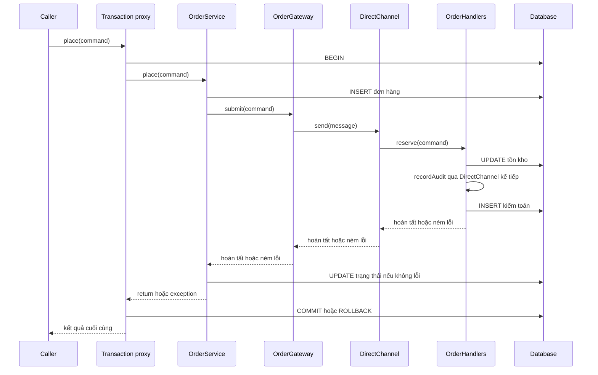

# Transaction với DirectChannel

## 1. Bài toán và mục tiêu

Trong module **SPRING_INTEGRATION_CORE**, một luồng tích hợp được ghép từ `Message`, `MessageChannel`, endpoint, gateway và Java DSL. Khi luồng cập nhật dữ liệu qua nhiều endpoint, cần xác định rõ những thao tác nào phải cùng commit hoặc cùng rollback.

Xét nghiệp vụ đặt hàng:

1. Tạo đơn hàng.
2. Trừ số lượng tồn kho.
3. Ghi bản ghi kiểm toán cho đơn hàng.
4. Chuyển đơn sang trạng thái xác nhận.

Nếu bước kiểm toán thất bại, yêu cầu nghiệp vụ là đơn hàng không được lưu và tồn kho không được giảm. Bài này dùng `DirectChannel` để nối các bước xử lý đồng bộ, đồng thời dùng transaction JDBC do Spring quản lý để thực hiện yêu cầu đó.

Sau bài học, bạn cần giải thích được transaction bắt đầu ở đâu, kết thúc ở đâu, vì sao exception có thể gây rollback và những thay đổi nào trong flow làm mất bảo đảm nguyên tử.

Phạm vi là luồng Java imperative, transaction cục bộ với một `DataSource`. Transaction reactive và phối hợp transaction phân tán cần cơ chế riêng.

## 2. DirectChannel giữ nguyên thread, không tự tạo transaction

`DirectChannel` chuyển message trực tiếp cho một subscriber trên thread gọi `send()`. Handler được gọi trước khi lời gọi gửi trả về. Đây là cơ sở để thao tác ở hai phía của channel có thể cùng tham gia transaction đang tồn tại. [Tài liệu DirectChannel](https://docs.spring.io/spring-integration/reference/channel/implementations.html#channel-implementations-directchannel)

Phân biệt ba trách nhiệm:

| Thành phần | Trách nhiệm trong ví dụ |
| --- | --- |
| `DirectChannel` | Chuyển message đồng bộ đến handler |
| Transaction interceptor của Spring | Bao quanh một phạm vi gọi, bắt đầu hoặc tham gia transaction và quyết định hoàn tất transaction |
| `DataSourceTransactionManager` | Quản lý transaction trên connection JDBC của một `DataSource` |
| `JdbcTemplate` | Thực hiện SQL bằng cách truy cập connection theo cơ chế quản lý tài nguyên của Spring |

Chỉ khai báo `new DirectChannel()` rồi gọi `send()` không làm xuất hiện transaction. Điểm khởi tạo có thể là một service có `@Transactional`, một `TransactionTemplate`, transaction của poller hoặc advice ở endpoint. Spring Integration cho phép dùng transaction của Spring để bao quanh flow do ứng dụng gọi. [Transaction trong message flow](https://docs.spring.io/spring-integration/reference/7.0/transactions.html)

Với JDBC, transaction manager gắn connection với thread hiện tại. `JdbcTemplate` dùng cơ chế truy cập connection tương thích để tham gia transaction đó. Dùng cùng thread nhưng truy cập một `DataSource` khác hoặc tự mở connection không được quản lý vẫn có thể tạo ra thao tác ngoài transaction mong muốn. [DataSourceTransactionManager](https://docs.spring.io/spring-framework/docs/current/javadoc-api/org/springframework/jdbc/datasource/DataSourceTransactionManager.html)

Có thể hình dung quan hệ cần thiết như sau:

```text
Transaction đã được mở
    + downstream chạy trong phạm vi gọi còn hiệu lực
    + truy cập đúng tài nguyên được quản lý
    + không tách sang transaction độc lập
    + lỗi được xử lý theo quy tắc rollback
    => các thay đổi JDBC có thể hoàn tất cùng nhau
```

Giữ cùng thread là một điều kiện quan trọng của mô hình này; tự nó chưa đủ chứng minh toàn bộ nghiệp vụ nguyên tử.

## 3. Nhìn ranh giới transaction qua call stack



Trong sơ đồ, gateway và các handler đều được gọi lồng nhau trên cùng thread. Khi ghi kiểm toán ném lỗi và lỗi đi ra khỏi `OrderService.place()`, transaction interceptor có thể rollback cả thao tác tạo đơn lẫn trừ kho.

Hai mốc không nên nhầm lẫn:

- `send()` hoàn tất cho biết đường xử lý đồng bộ tương ứng đã trả về.
- Transaction chỉ hoàn tất khi đi qua điểm kết thúc phạm vi transaction bên ngoài. Sau `send()`, service vẫn có thể cập nhật thêm dữ liệu hoặc ném lỗi.

Vì vậy, handler cuối chạy xong chưa có nghĩa là database đã commit. Ngay cả khi thân service trả về bình thường, lỗi tại thời điểm commit vẫn có thể làm lời gọi qua proxy thất bại.

## 4. Ví dụ: đặt hàng qua gateway và hai DirectChannel

### 4.1. Điều kiện triển khai

Các đoạn mã dưới đây dùng chung package `example.directtx`. Mỗi lớp hoặc interface `public` đặt trong tệp Java riêng.

Cần có các dependency tương thích cùng một bộ phiên bản:

| Mục đích | Dependency |
| --- | --- |
| Channel, gateway và Java DSL | `org.springframework.integration:spring-integration-core` |
| JDBC | `org.springframework:spring-jdbc` |
| Transaction | `org.springframework:spring-tx` |
| Spring Test cho ví dụ kiểm thử | `org.springframework:spring-test` |
| JUnit Jupiter | `org.junit.jupiter:junit-jupiter` |
| Database nhúng cho kiểm thử | `com.h2database:h2` |

Dùng dependency management của dự án để đồng bộ phiên bản Spring. Mã dùng `record` và text block; chọn JDK đáp ứng phiên bản Spring đang sử dụng.

Cấu hình chính nhận một `DataSource` từ ứng dụng. Phần kiểm thử bên dưới cung cấp `DataSource` H2 để ví dụ có thể được đưa vào một dự án kiểm thử mà không cần cấu hình database bên ngoài.

### 4.2. Payload và gateway

```java
package example.directtx;

public record PlaceOrder(String orderId, String sku, int quantity) {

    public PlaceOrder {
        if (orderId == null || orderId.isBlank()) {
            throw new IllegalArgumentException("orderId must not be blank");
        }
        if (sku == null || sku.isBlank()) {
            throw new IllegalArgumentException("sku must not be blank");
        }
        if (quantity <= 0) {
            throw new IllegalArgumentException("quantity must be positive");
        }
    }
}
```

```java
package example.directtx;

import org.springframework.integration.annotation.MessagingGateway;

@MessagingGateway(defaultRequestChannel = "orders.input")
public interface OrderGateway {

    void submit(PlaceOrder command);
}
```

Gateway chuyển lời gọi Java thành message có payload là `PlaceOrder`. Với đường đi toàn bộ là `DirectChannel`, kiểu trả về `void` không tự làm lời gọi bất đồng bộ: caller vẫn phải chờ xử lý đồng bộ hoàn tất.

Ví dụ không khai báo `errorChannel` riêng cho gateway để giữ đường truyền lỗi về caller theo hành vi mặc định. [Xử lý lỗi tại messaging gateway](https://docs.spring.io/spring-integration/reference/gateway.html)

### 4.3. Service mở transaction bao quanh nghiệp vụ

```java
package example.directtx;

import org.springframework.jdbc.core.JdbcTemplate;
import org.springframework.transaction.annotation.Transactional;

public class OrderService {

    private final JdbcTemplate jdbc;
    private final OrderGateway gateway;

    public OrderService(JdbcTemplate jdbc, OrderGateway gateway) {
        this.jdbc = jdbc;
        this.gateway = gateway;
    }

    @Transactional(transactionManager = "transactionManager")
    public void place(PlaceOrder command) {
        jdbc.update("""
                insert into purchase_order (id, sku, quantity, state)
                values (?, ?, ?, 'NEW')
                """,
                command.orderId(), command.sku(), command.quantity());

        gateway.submit(command);

        jdbc.update("""
                update purchase_order
                set state = 'CONFIRMED'
                where id = ?
                """,
                command.orderId());
    }
}
```

Caller phải lấy `OrderService` từ Spring và gọi qua bean được proxy. Tự tạo bằng `new OrderService(...)` rồi gọi trực tiếp sẽ không kích hoạt annotation transaction.

Trong chế độ proxy mặc định, một phương thức trong cùng instance gọi phương thức khác qua `this` cũng không kích hoạt interceptor chỉ vì phương thức được gọi có `@Transactional`. Nếu đã có transaction bên ngoài, transaction đó vẫn có thể đang hoạt động; vấn đề là lời gọi nội bộ không tạo phạm vi annotation mới. [Cơ chế proxy của @Transactional](https://docs.spring.io/spring-framework/reference/data-access/transaction/declarative/annotations.html)

### 4.4. Hai handler truy cập cùng database

```java
package example.directtx;

import org.springframework.jdbc.core.JdbcTemplate;

public class OrderHandlers {

    private final JdbcTemplate jdbc;

    public OrderHandlers(JdbcTemplate jdbc) {
        this.jdbc = jdbc;
    }

    public PlaceOrder reserve(PlaceOrder command) {
        int updated = jdbc.update("""
                update inventory
                set available = available - ?
                where sku = ? and available >= ?
                """,
                command.quantity(), command.sku(), command.quantity());

        if (updated != 1) {
            throw new InsufficientStockException(command.sku());
        }

        return command;
    }

    public void recordAudit(PlaceOrder command) {
        jdbc.update("""
                insert into order_audit (order_id, action)
                values (?, 'STOCK_RESERVED')
                """,
                command.orderId());
    }

    public static class InsufficientStockException
            extends RuntimeException {

        public InsufficientStockException(String sku) {
            super("Insufficient stock for " + sku);
        }
    }
}
```

`reserve()` trả lại payload để flow chuyển sang bước sau. `recordAudit()` trả về `void` và kết thúc flow một chiều.

Lệnh trừ kho gộp điều kiện kiểm tra và cập nhật trong một câu SQL. Không dùng cách đọc số lượng ra Java rồi mới trừ, vì hai request đồng thời có thể cùng nhìn thấy một giá trị cũ. Tính đúng đắn khi chạy đồng thời còn phụ thuộc database và mức isolation thực tế, cần được kiểm thử trên hệ quản trị triển khai.

Các handler không cần tự mở transaction mới trong ví dụ này: chúng thực hiện JDBC trong phạm vi `OrderService.place()` đã mở.

### 4.5. Cấu hình Java DSL

```java
package example.directtx;

import javax.sql.DataSource;

import org.springframework.context.annotation.Bean;
import org.springframework.context.annotation.Configuration;
import org.springframework.integration.channel.DirectChannel;
import org.springframework.integration.config.EnableIntegration;
import org.springframework.integration.config.IntegrationComponentScan;
import org.springframework.integration.dsl.IntegrationFlow;
import org.springframework.jdbc.core.JdbcTemplate;
import org.springframework.jdbc.datasource.DataSourceTransactionManager;
import org.springframework.transaction.PlatformTransactionManager;
import org.springframework.transaction.annotation.EnableTransactionManagement;

@Configuration(proxyBeanMethods = false)
@EnableIntegration
@EnableTransactionManagement
@IntegrationComponentScan(basePackageClasses = OrderGateway.class)
public class DirectOrderConfig {

    @Bean(name = "orders.input")
    public DirectChannel ordersInput() {
        DirectChannel channel = new DirectChannel();
        channel.setFailover(false);
        return channel;
    }

    @Bean(name = "orders.reserved")
    public DirectChannel ordersReserved() {
        DirectChannel channel = new DirectChannel();
        channel.setFailover(false);
        return channel;
    }

    @Bean
    public PlatformTransactionManager transactionManager(
            DataSource dataSource) {

        return new DataSourceTransactionManager(dataSource);
    }

    @Bean
    public JdbcTemplate jdbcTemplate(DataSource dataSource) {
        return new JdbcTemplate(dataSource);
    }

    @Bean
    public OrderService orderService(
            JdbcTemplate jdbc, OrderGateway gateway) {

        return new OrderService(jdbc, gateway);
    }

    @Bean
    public OrderHandlers orderHandlers(JdbcTemplate jdbc) {
        return new OrderHandlers(jdbc);
    }

    @Bean
    public IntegrationFlow orderFlow(OrderHandlers handlers) {
        return IntegrationFlow.from("orders.input")
                .handle(handlers, "reserve")
                .channel("orders.reserved")
                .handle(handlers, "recordAudit")
                .get();
    }
}
```

`@IntegrationComponentScan` đăng ký gateway proxy từ interface. Hai endpoint service activator trong DSL lần lượt gọi `reserve()` và `recordAudit()`.

Mỗi channel trong ví dụ có đúng một subscriber. Việc tắt failover thể hiện lựa chọn để lỗi ở handler đi về caller, tránh chuyển sang handler thay thế nếu sau này có thêm subscriber. Với nhiều subscriber, `DirectChannel` phân phối message theo cơ chế point-to-point, không thực thi tất cả handler như một chuỗi nghiệp vụ. [Cấu hình DirectChannel](https://docs.spring.io/spring-integration/reference/channel/configuration.html)

### 4.6. Kết quả mong đợi

Giả sử SKU `SKU-1` có tồn kho ban đầu là 10:

| Trường hợp | Đơn hàng | Tồn kho sau lời gọi | Kiểm toán |
| --- | --- | --- | --- |
| Đặt 2 sản phẩm, mọi bước thành công | Một đơn `CONFIRMED` | 8 | Một bản ghi |
| Đặt 99 sản phẩm | Không lưu đơn vừa tạo | 10 | Không có bản ghi |
| Đặt 2 sản phẩm, ghi kiểm toán lỗi | Không lưu đơn vừa tạo | 10 | Không có bản ghi của đơn lỗi |

Các kết quả này mô tả một transaction thực sự hoàn tất. Muốn xác minh, phải đọc database sau khi lời gọi qua service proxy đã kết thúc.

## 5. Kiểm thử commit và rollback bằng H2

Mock handler chỉ cho biết một phương thức được gọi hoặc ném lỗi. Để kiểm tra tính nguyên tử, cần chạy flow cùng transaction manager và database thật của bài kiểm thử.

Lớp sau dùng lại các lớp ở phần 4. Test method không gắn `@Transactional`, nhờ đó transaction của service có thể commit hoặc rollback ngay trong lời gọi đang kiểm tra.

```java
package example.directtx;

import javax.sql.DataSource;

import org.junit.jupiter.api.BeforeEach;
import org.junit.jupiter.api.Test;
import org.springframework.beans.factory.annotation.Autowired;
import org.springframework.context.annotation.Bean;
import org.springframework.context.annotation.Configuration;
import org.springframework.dao.DataIntegrityViolationException;
import org.springframework.jdbc.core.JdbcTemplate;
import org.springframework.jdbc.datasource.embedded.EmbeddedDatabase;
import org.springframework.jdbc.datasource.embedded.EmbeddedDatabaseBuilder;
import org.springframework.jdbc.datasource.embedded.EmbeddedDatabaseType;
import org.springframework.test.context.junit.jupiter.SpringJUnitConfig;

import static org.junit.jupiter.api.Assertions.assertEquals;
import static org.junit.jupiter.api.Assertions.assertThrows;
import static org.junit.jupiter.api.Assertions.assertTrue;

@SpringJUnitConfig(classes = {
        DirectOrderConfig.class,
        DirectOrderFlowTest.DatabaseConfig.class
})
class DirectOrderFlowTest {

    @Configuration(proxyBeanMethods = false)
    static class DatabaseConfig {

        @Bean(destroyMethod = "shutdown")
        EmbeddedDatabase dataSource() {
            return new EmbeddedDatabaseBuilder()
                    .generateUniqueName(true)
                    .setType(EmbeddedDatabaseType.H2)
                    .build();
        }
    }

    @Autowired
    OrderService service;

    @Autowired
    JdbcTemplate jdbc;

    @BeforeEach
    void prepareDatabase() {
        jdbc.execute("drop table if exists order_audit");
        jdbc.execute("drop table if exists purchase_order");
        jdbc.execute("drop table if exists inventory");

        jdbc.execute("""
                create table inventory (
                    sku varchar(40) primary key,
                    available integer not null check (available >= 0)
                )
                """);

        jdbc.execute("""
                create table purchase_order (
                    id varchar(40) primary key,
                    sku varchar(40) not null,
                    quantity integer not null,
                    state varchar(20) not null
                )
                """);

        jdbc.execute("""
                create table order_audit (
                    order_id varchar(40) primary key,
                    action varchar(40) not null,
                    foreign key (order_id) references purchase_order(id),
                    constraint reject_test_order
                        check (order_id <> 'O-FAIL')
                )
                """);

        jdbc.update("""
                insert into inventory (sku, available)
                values ('SKU-1', 10)
                """);
    }

    @Test
    void commitsWhenEveryStepSucceeds() {
        service.place(new PlaceOrder("O-OK", "SKU-1", 2));

        assertCountsAndStock("O-OK", 1, 1, 8);
        assertEquals("CONFIRMED", jdbc.queryForObject("""
                select state from purchase_order where id = ?
                """, String.class, "O-OK"));
    }

    @Test
    void rollsBackOrderWhenStockIsInsufficient() {
        RuntimeException failure = assertThrows(
                RuntimeException.class,
                () -> service.place(
                        new PlaceOrder("O-NO-STOCK", "SKU-1", 99)));

        assertTrue(causedBy(
                failure, OrderHandlers.InsufficientStockException.class));

        assertCountsAndStock("O-NO-STOCK", 0, 0, 10);
    }

    @Test
    void rollsBackOrderAndStockWhenAuditInsertFails() {
        RuntimeException failure = assertThrows(
                RuntimeException.class,
                () -> service.place(
                        new PlaceOrder("O-FAIL", "SKU-1", 2)));

        assertTrue(causedBy(
                failure, DataIntegrityViolationException.class));

        assertCountsAndStock("O-FAIL", 0, 0, 10);
    }

    private void assertCountsAndStock(
            String orderId,
            int expectedOrders,
            int expectedAudits,
            int expectedStock) {

        int orders = jdbc.queryForObject("""
                select count(*) from purchase_order where id = ?
                """, Integer.class, orderId).intValue();

        int audits = jdbc.queryForObject("""
                select count(*) from order_audit where order_id = ?
                """, Integer.class, orderId).intValue();

        int stock = jdbc.queryForObject("""
                select available from inventory where sku = 'SKU-1'
                """, Integer.class).intValue();

        assertEquals(expectedOrders, orders);
        assertEquals(expectedAudits, audits);
        assertEquals(expectedStock, stock);
    }

    private static boolean causedBy(
            Throwable failure, Class<? extends Throwable> type) {

        for (Throwable current = failure;
                current != null;
                current = current.getCause()) {

            if (type.isInstance(current)) {
                return true;
            }
        }
        return false;
    }
}
```

Constraint `reject_test_order` chỉ là cách chủ động gây lỗi SQL ở endpoint cuối trong môi trường kiểm thử. Nó không phải quy tắc đặt hàng cần đưa vào schema production.

Bài kiểm thử thứ ba phân biệt được hai cấu hình quan trọng:

- Nếu cùng transaction, lỗi kiểm toán làm biến mất đơn hàng vừa tạo và khôi phục tồn kho về 10.
- Nếu trừ kho đã commit trong transaction riêng, tồn kho có thể vẫn là 8 dù lời gọi đặt hàng báo lỗi.

Việc kiểm tra chuỗi `cause` giúp test không phụ thuộc vào việc lỗi nghiệp vụ nằm trực tiếp ở ngoài cùng hay được Spring Integration bọc trong exception của messaging.

Các test dùng chung database trong application context; giữ chúng chạy tuần tự với cấu hình này. Khi cần kiểm thử cạnh tranh, dùng dữ liệu và cơ chế đồng bộ riêng cho từng kịch bản.

H2 minh họa ranh giới transaction. Để xác minh khóa, isolation hoặc hành vi đặc thù SQL, chạy thêm kịch bản trên cùng loại database với môi trường triển khai.

## 6. Quy tắc exception quyết định rollback

Theo cấu hình mặc định thông thường của Spring, `RuntimeException` và `Error` thoát khỏi phạm vi được intercept dẫn đến rollback; checked exception cần quy tắc phù hợp. Có thể cấu hình `rollbackFor` và `noRollbackFor`. [Quy tắc rollback](https://docs.spring.io/spring-framework/reference/data-access/transaction/declarative/rolling-back.html)

Ví dụ khi một checked exception trực tiếp đi qua ranh giới service:

```java
@Transactional(rollbackFor = BusinessRejectedException.class)
public void place(PlaceOrder command)
        throws BusinessRejectedException {
    // Thao tác nghiệp vụ có thể ném BusinessRejectedException.
}
```

Đây là đoạn minh họa annotation; `BusinessRejectedException` là checked exception do ứng dụng định nghĩa.

Trong flow messaging, lỗi checked có thể được bọc thành một runtime exception. Vì vậy, cần xem loại exception thực sự đi qua transaction interceptor thay vì chỉ nhìn chữ ký phương thức handler. Hành vi còn chịu ảnh hưởng của quy tắc rollback được cấu hình cho ứng dụng.

### 6.1. Bắt lỗi rồi trả về bình thường

Xét biến thể sau của service:

```java
@Transactional
public void place(PlaceOrder command) {
    jdbc.update("""
            insert into purchase_order (id, sku, quantity, state)
            values (?, ?, ?, 'NEW')
            """,
            command.orderId(), command.sku(), command.quantity());

    try {
        gateway.submit(command);
    }
    catch (RuntimeException failure) {
        // Chỉ ghi nhận lỗi rồi tiếp tục.
    }
}
```

Trong cấu hình ví dụ, các handler không có transaction interceptor riêng. Nếu service nuốt lỗi và transaction chưa bị đánh dấu rollback-only, interceptor bên ngoài có thể thấy phương thức hoàn tất bình thường và thực hiện commit. Khi đó, đơn `NEW` và phần cập nhật đã thực hiện trước lỗi có thể được lưu.

Muốn nghiệp vụ thất bại dẫn đến rollback, thường nên để exception đi ra khỏi phương thức transaction. Nếu bắt lỗi để bổ sung ngữ cảnh, ném tiếp exception thích hợp. Chỉ chủ động đánh dấu rollback-only khi thiết kế thực sự cần hoàn tất phương thức mà vẫn hủy transaction.

### 6.2. Đã rollback-only thì bắt lỗi không cứu được transaction

Nếu một service bên trong có `@Transactional(propagation = REQUIRED)`, tham gia transaction hiện tại và đánh dấu rollback-only, việc bên ngoài bắt lỗi không xóa cờ đó. Khi phạm vi ngoài cố commit, có thể nhận `UnexpectedRollbackException`. [Propagation REQUIRED và rollback-only](https://docs.spring.io/spring-framework/reference/data-access/transaction/declarative/tx-propagation.html)

Vì vậy, câu “đã bắt exception thì transaction sẽ commit” cũng không đúng trong mọi cấu hình. Cần lần theo transaction interceptor nào đã nhìn thấy lỗi và transaction đã ở trạng thái nào.

## 7. Gateway, errorChannel và filter có thể thay đổi đường đi của lỗi

### 7.1. Error flow không thay thế quy tắc transaction

Trong flow đồng bộ, lỗi có thể truyền theo call stack về sender. Khi gửi trực tiếp qua `MessageChannel` hoặc `MessagingTemplate`, exception được ném về caller; khai báo global `errorChannel` không tự biến mọi lỗi đồng bộ thành message lỗi. [Xử lý lỗi của Spring Integration](https://docs.spring.io/spring-integration/reference/error-handling.html)

Gateway có thể được cấu hình để đưa lỗi sang error flow và biến lỗi thành kết quả bình thường. Nếu error flow hoàn tất mà không truyền thất bại về ranh giới transaction, caller có thể tiếp tục và commit khi transaction chưa bị đánh dấu rollback-only. [Error flow tại gateway](https://docs.spring.io/spring-integration/reference/gateway.html)

Ví dụ, một kết quả `OrderResult.rejected(...)` là giá trị trả về bình thường đối với transaction interceptor. Nếu nghiệp vụ yêu cầu hủy dữ liệu đã ghi, ứng dụng phải có cơ chế rollback tương ứng, chẳng hạn để exception thoát ra hoặc đánh dấu rollback-only có chủ đích.

Khi kiểm tra flow, theo dõi cả đường message chính và đường xử lý lỗi. Một dòng log ở error handler không chứng minh transaction đã rollback.

### 7.2. Filter loại message không nhất thiết là lỗi

Giả sử service đã tạo đơn, sau đó một filter loại message vì vượt hạn mức. Nếu filter chỉ discard và kết thúc bình thường, gateway một chiều có thể trả về mà không có exception. Phần tạo đơn trước đó vẫn có thể commit.

Nếu việc bị từ chối phải hủy toàn bộ nghiệp vụ, hãy biểu diễn sự từ chối như một lỗi tại ranh giới transaction. Ví dụ đoạn DSL minh họa:

```java
.filter(PlaceOrder.class,
        command -> command.quantity() <= 100,
        spec -> spec.throwExceptionOnRejection(true))
```

Đặt filter này trước bước trừ kho trong flow nếu hạn mức 100 là quy tắc nghiệp vụ được chọn. Với ví dụ chính, lỗi phải tiếp tục truyền về `OrderService.place()`.

Một phương án khác là thực hiện validation trước khi ghi đơn. Lựa chọn phụ thuộc việc validation chỉ dùng dữ liệu đầu vào hay cần đọc trạng thái database trong cùng transaction.

## 8. Đặt transaction ở handler đầu tiên có bao trùm phần sau không?

Không thể suy ra điều đó chỉ từ việc các channel đều là `DirectChannel`.

Giả sử caller chưa mở transaction, và chỉ phương thức `reserve()` được đánh dấu `@Transactional`:

```text
Endpoint gọi proxy của reserve()
    BEGIN
    reserve() cập nhật tồn kho
    reserve() trả payload
    COMMIT

Endpoint gửi payload sang output channel
    recordAudit() bắt đầu
    recordAudit() gặp lỗi
```

Transaction của phương thức có thể kết thúc khi phương thức trả về, trước khi endpoint gửi reply sang bước tiếp theo. Nếu transaction trước đã commit thì lỗi ở `recordAudit()` không đảo ngược được lần commit đó.

Khi cần bắt đầu transaction ngay tại endpoint và bao gồm phần downstream đồng bộ, Spring Integration cung cấp `TransactionHandleMessageAdvice`. Nó bao quanh `handleMessage()`, khác với advice transaction chỉ bao quanh phần xử lý request nội bộ. [Phạm vi transaction advice của endpoint](https://docs.spring.io/spring-integration/reference/handler-advice/tx-handle-message.html)

Trong Java DSL, một đoạn cấu hình minh họa là:

```java
.handle(handlers, "reserve",
        endpoint -> endpoint.transactional(txManager, true))
.channel("orders.reserved")
.handle(handlers, "recordAudit")
```

Ở đây `txManager` là transaction manager đã có trong phương thức cấu hình. Tham số `true` chọn loại advice bao quanh `handleMessage()`. [API ConsumerEndpointSpec.transactional](https://docs.spring.io/spring-integration/api/org/springframework/integration/dsl/ConsumerEndpointSpec.html)

Phạm vi bắt đầu ở endpoint này không tự bao gồm thao tác caller đã làm trước khi gửi message. Nếu caller đã insert đơn ngoài transaction, thêm advice ở `reserve()` không làm lần insert đó trở thành một phần của transaction mới.

Với ví dụ đặt hàng, mở transaction tại `OrderService.place()` giúp bao trọn thao tác tạo đơn, flow trừ kho và kiểm toán, cùng lần cập nhật trạng thái sau gateway.

## 9. Những thay đổi làm mất phạm vi nguyên tử ban đầu

### 9.1. Thêm ExecutorChannel hoặc QueueChannel

Ví dụ thay channel ở giữa bằng đường chuyển giao sang worker:

```text
Thread gọi:
  BEGIN
  tạo đơn
  gửi message sang worker
  cập nhật trạng thái
  kết thúc service và hoàn tất transaction

Thread worker:
  nhận message
  trừ kho
  ghi kiểm toán
```

Transaction imperative gắn với thread gọi không tự chuyển theo message sang worker. Một queue channel có consumer được poll trên thread khác cũng tạo ra vấn đề tương tự. [Transaction boundaries](https://docs.spring.io/spring-integration/reference/transactions.html)

Không nên diễn giải rằng transaction nhất thiết commit ngay đúng dòng gửi sang executor hoặc queue. Transaction bên ngoài vẫn có thể tiếp tục cho đến điểm kết thúc đã cấu hình. Điều mất đi là bảo đảm worker đang thực hiện cùng transaction vật lý với caller.

Việc caller đợi kết quả từ worker cũng không tự chia sẻ connection hoặc transaction sang thread kia. Muốn worker cập nhật database có transaction, cần xác lập transaction của worker và thiết kế quan hệ nhất quán giữa hai phía.

Tránh dựa vào tình huống executor thỉnh thoảng chạy task trên thread caller khi quá tải. Hành vi thay đổi theo tải không thể là cơ sở cho bảo đảm nghiệp vụ.

### 9.2. Dùng REQUIRES_NEW ở một bước

`REQUIRES_NEW` tạo transaction vật lý độc lập, tạm ngưng transaction bên ngoài. Bước bên trong có thể commit rồi transaction ngoài rollback. Giữ cùng thread không làm hai transaction trở thành một. [Propagation REQUIRES_NEW](https://docs.spring.io/spring-framework/reference/data-access/transaction/declarative/tx-propagation.html)

Trong bài toán đặt hàng, nếu ghi kiểm toán ở transaction độc lập, có thể có bản ghi kiểm toán cho thao tác cuối cùng không được commit. Điều đó có thể phù hợp với nhật ký ghi nhận lần thử, nhưng không phù hợp nếu bảng kiểm toán phải phản ánh duy nhất đơn hàng thành công.

Ngoài ra, transaction độc lập có thể cần thêm connection và phải chờ tài nguyên đang bị transaction ngoài khóa. Cần thiết kế dựa trên quan hệ dữ liệu cụ thể.

### 9.3. Thêm aggregator hoặc xử lý trì hoãn

Một aggregator có thể lưu message để chờ đủ nhóm. Lần nhận hiện tại kết thúc trước khi có đủ message; lần giải phóng nhóm có thể xảy ra ở lời gọi khác hoặc do timeout.

Vì vậy, không xem toàn bộ nhiều lần nhận của một nhóm là cùng transaction của caller đầu tiên chỉ vì các channel xung quanh là `DirectChannel`. Cần xác định riêng transaction cho việc lưu nhóm và cho lần xử lý kết quả.

### 9.4. Gọi HTTP, gửi email hoặc ghi file

Rollback JDBC không thu hồi email đã gửi, không hoàn tác một HTTP request đã thành công và không tự khôi phục file bị ghi đè.

Nếu ví dụ được mở rộng thêm thông báo đơn hàng, một phương án là ghi bản ghi outbox trong cùng transaction với đơn hàng, rồi một tiến trình khác đọc outbox để gửi. Cần thiết kế gửi lại và xử lý trùng cho bước phát thông báo.

Việc chạy callback sau commit giảm nguy cơ thông báo cho đơn chưa commit, nhưng callback đơn lẻ không bảo đảm tiến trình sẽ luôn gửi được khi ứng dụng dừng đột ngột. Yêu cầu độ bền phải được giải quyết trong thiết kế lưu trữ và giao nhận.

## 10. Nhiều subscriber và failover cần được xem xét riêng

Mặc định `DirectChannel` có cơ chế load balancing và failover. Khi một subscriber lỗi, dispatcher có thể thử subscriber tiếp theo nếu failover được bật. [Cấu hình dispatcher](https://docs.spring.io/spring-integration/reference/channel/configuration.html)

Ví dụ nguy hiểm về mặt nghiệp vụ:

```text
Subscriber A:
  đã ghi một phần dữ liệu
  sau đó ném lỗi

Dispatcher:
  thử subscriber B

Subscriber B:
  trả về thành công
```

Nếu lỗi của A không đi qua transaction interceptor đánh dấu rollback-only và không thoát khỏi phạm vi ngoài, các thay đổi trước lỗi có thể vẫn nằm trong transaction được commit. Nếu transaction đã rollback-only, thành công của B cũng không làm nó có thể commit trở lại.

Failover không tự tạo savepoint hay hoàn tác phần việc của subscriber trước. Nó cũng không đồng nghĩa với retry toàn bộ transaction.

Đối với chuỗi “trừ kho rồi ghi kiểm toán”, hãy nối các endpoint qua các channel liên tiếp như ví dụ. Không đăng ký cả hai như hai subscriber cạnh tranh trên cùng một `DirectChannel` rồi kỳ vọng cả hai luôn chạy theo thứ tự.

## 11. Quan sát transaction khi gỡ lỗi

Có thể đặt đoạn quan sát sau trong service và từng handler khi khảo sát flow:

```java
import org.springframework.transaction.support.TransactionSynchronizationManager;

System.out.printf(
        "thread=%s, txActive=%s, txName=%s%n",
        Thread.currentThread().getName(),
        TransactionSynchronizationManager.isActualTransactionActive(),
        TransactionSynchronizationManager.getCurrentTransactionName());
```

Với ví dụ chính, các bước phải chạy trên cùng thread và có transaction đang hoạt động trong lúc xử lý.

Tuy nhiên, chỉ thấy `txActive=true` hoặc cùng tên transaction chưa chứng minh mọi câu SQL dùng cùng tài nguyên. Cần kiểm tra `DataSource`, transaction manager, propagation và dữ liệu sau khi hoàn tất lời gọi. Nếu cần phân tích sâu, bổ sung log quản lý transaction và connection trong môi trường phát triển.

Một trình tự chẩn đoán hữu ích:

1. Xác định lời gọi có đi qua proxy của `OrderService` không.
2. Xác định transaction được mở trước thao tác ghi nào.
3. Theo dõi thread tại gateway, channel và từng handler.
4. Kiểm tra tất cả JDBC có dùng đúng `DataSource` không.
5. Tìm `REQUIRES_NEW`, `NOT_SUPPORTED`, executor, queue hoặc tác vụ bất đồng bộ bên trong service.
6. Theo exception qua gateway, advice, error flow và các khối `catch`.
7. Đọc dữ liệu sau khi lời gọi qua proxy đã kết thúc để phân biệt commit, rollback hoặc phần việc đã commit riêng.

## 12. Khi nào nên dùng TransactionTemplate?

Nếu cần nhìn phạm vi transaction ngay trong mã hoặc không muốn phụ thuộc vào interception tại một phương thức, có thể dùng `TransactionTemplate`. Spring cung cấp API callback để thực thi một khối xử lý trong transaction. [Programmatic transaction management](https://docs.spring.io/spring-framework/reference/data-access/transaction/programmatic.html)

Ví dụ sau là phương án thay thế thân nghiệp vụ, giả sử `txManager`, `jdbc`, `gateway` và `command` đã được cung cấp:

```java
import org.springframework.transaction.support.TransactionTemplate;

TransactionTemplate tx = new TransactionTemplate(txManager);

tx.executeWithoutResult(status -> {
    jdbc.update("""
            insert into purchase_order (id, sku, quantity, state)
            values (?, ?, ?, 'NEW')
            """,
            command.orderId(), command.sku(), command.quantity());

    gateway.submit(command);

    jdbc.update("""
            update purchase_order
            set state = 'CONFIRMED'
            where id = ?
            """,
            command.orderId());
});
```

Vẫn phải giữ cùng điều kiện về thread, tài nguyên và exception. Bao `send()` bằng template không truyền transaction xuyên qua executor hoặc làm thao tác HTTP trở thành giao dịch JDBC.

Khi callback tham gia một transaction đã tồn tại theo propagation mặc định, phạm vi ngoài vẫn quyết định thời điểm transaction vật lý hoàn tất. Không cần dùng đồng thời cả annotation và template cho cùng một ranh giới nếu không có lý do cụ thể.

## 13. Chọn thiết kế theo yêu cầu nghiệp vụ

| Yêu cầu | Hướng thiết kế |
| --- | --- |
| Tạo đơn, trừ kho và ghi kiểm toán phải cùng thành công trong một database | Transaction ở service bao ngoài, flow đồng bộ qua `DirectChannel` |
| Bắt đầu transaction ở một endpoint và bao downstream đồng bộ | Advice bao quanh `handleMessage()`, kiểm tra rõ điểm bắt đầu |
| Cần tách thread để xử lý lâu | Transaction riêng ở worker và cơ chế nhất quán giữa các bước |
| Cần gửi thông báo bền vững sau khi lưu đơn | Lưu outbox cùng transaction, phát thông báo bằng tiến trình riêng |
| Cần lưu nhật ký của lần thử dù nghiệp vụ thất bại | Thiết kế transaction nhật ký độc lập, xem xét khóa và quan hệ dữ liệu |
| Cần chờ nhiều message hoặc nhiều hệ thống hoàn tất | Xác lập ranh giới transaction từng bước và cơ chế điều phối phù hợp |

Một transaction đồng bộ dài sẽ giữ tài nguyên database trong suốt đường gọi. Với nghiệp vụ có I/O chậm, cần cân nhắc thời gian giữ khóa, connection pool và timeout. Chọn `DirectChannel` vì cần mô hình thực thi đồng bộ và ranh giới nguyên tử phù hợp, đồng thời giữ phần xử lý trong transaction gọn.

## 14. Tự kiểm tra mức hiểu

- Ai mở transaction trong ví dụ, và transaction kết thúc trước hay sau lần cập nhật trạng thái `CONFIRMED`?
- Vì sao gateway trả về `void` vẫn có thể truyền lỗi đồng bộ về service?
- Nếu chỉ gắn `@Transactional` lên `reserve()`, thao tác kiểm toán có chắc cùng transaction không?
- Vì sao bắt lỗi trong service có thể làm lưu đơn `NEW`, nhưng trong cấu hình khác lại dẫn đến `UnexpectedRollbackException`?
- Nếu thay `orders.reserved` bằng một queue có poller riêng, điều gì xảy ra với transaction ban đầu?
- Test nào trong bài phát hiện việc trừ kho đã commit trước khi ghi kiểm toán?
- Nếu mọi cập nhật database rollback nhưng email đã gửi, ranh giới nguyên tử thực tế của hệ thống là gì?

Để trả lời chính xác, hãy vẽ phạm vi transaction bao quanh các lời gọi, đánh dấu mọi điểm chuyển thread và chỉ ra exception nào thực sự đi qua transaction interceptor.

