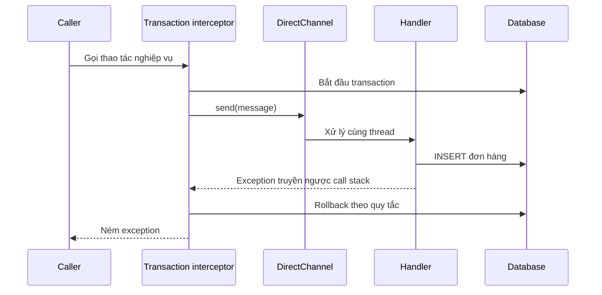

# Rollback và error channel

Trong chương **Transaction support** của module **SPRING_INTEGRATION_CORE**, bài này nối kiến thức về `Message`, `MessageChannel`, endpoint, gateway và Java DSL với một yêu cầu thực tế: khi xử lý thông điệp thất bại, dữ liệu phải trở về trạng thái nào và lỗi phải được chuyển cho ai?

Sau bài học, bạn có thể xác định phạm vi rollback, cấu hình đường nhận lỗi cho poller, đọc thông điệp lỗi và kiểm thử tác động lên cơ sở dữ liệu. Các ví dụ dùng giao dịch imperative với JDBC; giao dịch reactive có mô hình truyền ngữ cảnh riêng.

## 1. Ba kết quả cần quan sát riêng

Giả sử luồng nhận đơn hàng gồm các bước: nhận `OrderCommand`, ghi đơn vào cơ sở dữ liệu, kiểm tra điều kiện nghiệp vụ rồi hoàn tất. Bước kiểm tra ném exception sau khi câu lệnh `INSERT` đã chạy.

Cần trả lời ba câu hỏi:

| Câu hỏi | Cơ chế quyết định | Bằng chứng cần xem |
| --- | --- | --- |
| Bản ghi vừa thêm còn tồn tại không? | Transaction manager và các tài nguyên tham gia transaction | Truy vấn dữ liệu sau khi transaction kết thúc |
| Người gửi có nhận exception không? | Call stack, gateway và ranh giới xử lý đồng bộ/bất đồng bộ | Exception tại nơi gọi hoặc kết quả gateway |
| Hệ thống có nhận được thông tin lỗi không? | Error handler, error channel và endpoint xử lý lỗi | `ErrorMessage`, log hoặc bản ghi sự cố |

Một kết quả không đủ chứng minh hai kết quả còn lại. Trong ví dụ đơn hàng, dòng log báo lỗi vẫn có thể xuất hiện khi bản ghi đã commit; một bản ghi đã rollback cũng chưa bảo đảm message được giao lại.

Hãy thiết kế mỗi luồng với ba cam kết rõ ràng: **dữ liệu**, **phản hồi cho bên gọi**, **cách lưu nhận lỗi**.

## 2. Ranh giới transaction đi theo phạm vi thực thi

### 2.1. Luồng đồng bộ qua DirectChannel

`DirectChannel` gọi handler ngay trong thread gửi message. Vì thế transaction đã mở ở phía gọi có thể bao quanh các thao tác downstream, nếu chúng sử dụng tài nguyên được quản lý phù hợp. [Spring Integration: DirectChannel](https://docs.spring.io/spring-integration/reference/channel/implementations.html#directchannel).



Sơ đồ giả định không có tầng trung gian bắt và xử lý hết exception. `DirectChannel` giữ cách thực thi đồng bộ; transaction manager mới là thành phần quản lý commit và rollback.

Ngay cả khi cùng thread, hai thao tác JDBC dùng hai `DataSource` khác nhau cũng chưa tạo thành một transaction nguyên tử. Cần chỉ rõ transaction manager nào quản lý tài nguyên nào.

### 2.2. Handoff sang thread khác

Khi consumer chạy ở thread khác qua executor hoặc một poller riêng, transaction imperative của producer không tự đi theo message. Muốn xử lý consumer có giao dịch, cần mở transaction ở phía consumer. [Spring Integration: Transaction Boundaries](https://docs.spring.io/spring-integration/reference/transactions.html#transaction-boundaries).

```text
Thread A, transaction TX-A:
  ghi trạng thái tiếp nhận
  gửi message vào hàng đợi
  tiếp tục công việc và kết thúc TX-A

Thread B, transaction TX-B nếu đã cấu hình:
  nhận message
  ghi dữ liệu xử lý
  gặp lỗi -> rollback TX-B
```

Lỗi của TX-B không tự đảo ngược TX-A đã commit. Một lần `send()` thành công vào queue trong bộ nhớ chỉ xác nhận queue đã nhận message.

Handoff cũng không phải lệnh commit tức thời: TX-A hoàn tất khi phạm vi transaction của nó kết thúc. Producer có thể còn các câu lệnh khác sau `send()`.

| Thành phần | Đặc điểm cần tính khi thiết kế |
| --- | --- |
| `DirectChannel` | Handler thường chạy trong call stack gửi; phù hợp để giữ một phạm vi xử lý đồng bộ |
| `ExecutorChannel` với executor thực sự bất đồng bộ | Handler chạy ở worker; cần xác định transaction của worker |
| `QueueChannel` với polling consumer riêng | Producer enqueue trước, consumer xử lý sau; hai phạm vi cần được xét độc lập |
| Queue có JDBC message store | Có thể đưa thao tác lấy message vào transaction của consumer nếu cấu hình đúng |

Không suy luận chỉ từ tên channel. Hãy vẽ thread thực tế, nơi mở transaction và tài nguyên tham gia, nhất là khi executor có cách thực thi đặc biệt.

## 3. Điều kiện để exception dẫn đến rollback

### 3.1. Transaction interceptor phải thấy kết quả thất bại

Với cấu hình mặc định thông thường của giao dịch khai báo Spring, `RuntimeException` và `Error` dẫn tới rollback; checked exception cần quy tắc phù hợp. Ứng dụng có thể thay đổi mặc định này. [Spring Framework: Rolling Back a Declarative Transaction](https://docs.spring.io/spring-framework/reference/data-access/transaction/declarative/rolling-back.html).

Ví dụ phương thức nghiệp vụ cần rollback khi kiểm tra đơn hàng ném một checked exception:

```java
@Transactional(
    transactionManager = "orderTx",
    rollbackFor = InvalidOrderException.class
)
public void process(OrderCommand command) throws InvalidOrderException {
    repository.insert(command);
    validator.validate(command);
}
```

Đoạn này giả định phương thức được gọi qua Spring proxy và `repository` dùng tài nguyên do `orderTx` quản lý. Trong chế độ proxy thông thường, lời gọi nội bộ `this.process(...)` không đi qua transactional proxy.

Ở endpoint Integration, exception nghiệp vụ có thể được bọc trong `MessagingException`. Khi đặt quy tắc rollback, hãy xét exception thực sự đi qua transaction interceptor của phạm vi đang phân tích. Đừng chỉ nhìn khai báo `throws` của một phương thức nằm sâu trong handler.

### 3.2. Bắt exception rồi trả về bình thường

```java
public void storeAndValidate(OrderCommand command) {
    repository.insert(command);
    try {
        validator.validate(command);
    }
    catch (InvalidOrderException ex) {
        log.warn("Đơn không hợp lệ: {}", command.id(), ex);
        // Phương thức kết thúc bình thường.
    }
}
```

Nếu transaction bao ngoài chưa bị đánh dấu rollback-only, đoạn xử lý này có thể dẫn tới commit. Việc ghi log không thay đổi trạng thái transaction. Nếu yêu cầu là hủy các thay đổi, hãy cho lỗi truyền tới ranh giới quản lý giao dịch hoặc dùng cách đánh dấu rollback-only đã thiết kế rõ ràng.

### 3.3. Ngoại lệ đã bị bắt nhưng transaction vẫn rollback

Một service con dùng `PROPAGATION_REQUIRED` có thể tham gia transaction ngoài và đánh dấu transaction chung là rollback-only. Service ngoài bắt exception không xóa dấu này; khi cố commit, nó có thể nhận `UnexpectedRollbackException`. [Spring Framework: Transaction Propagation](https://docs.spring.io/spring-framework/reference/data-access/transaction/declarative/tx-propagation.html).

```text
Transaction ngoài bắt đầu
  -> gọi service con qua proxy
     -> service con thất bại, transaction chung bị đánh dấu rollback-only
  -> service ngoài bắt lỗi và trả về
  -> kết thúc transaction ngoài: không thể commit thành công
```

Vì vậy, khi đọc code có `catch`, cần biết lỗi bị bắt **trước hay sau** khi một transactional interceptor đã quan sát nó.

## 4. ErrorMessage mang thông tin gì?

Trong cơ chế xử lý lỗi bằng thông điệp, payload của `ErrorMessage` là một `Throwable`. Thường gặp `MessagingException` chứa `failedMessage` và chuỗi `cause`; tùy nguồn tạo lỗi, có thể có thêm `originalMessage`. [Spring Integration: Error Handling](https://docs.spring.io/spring-integration/reference/error-handling.html).

```text
ErrorMessage
  payload: MessageHandlingException hoặc Throwable khác
    failedMessage: Message đang được xử lý khi lỗi phát sinh, nếu có
    cause: Exception bên dưới
  originalMessage: Message gốc nếu chiến lược tạo lỗi cung cấp
```

Sau một transformer, message tại điểm hỏng có thể mang payload khác với message đầu vào. Khi chẩn đoán, giữ cả mã nghiệp vụ và tên bước xử lý, thay vì mặc định mọi lỗi đều chứa nguyên vẹn request ban đầu.

Một helper có thể dùng trong endpoint quan sát lỗi:

```java
import org.springframework.messaging.Message;
import org.springframework.messaging.MessagingException;
import org.springframework.messaging.support.ErrorMessage;

public final class ErrorContext {
    private ErrorContext() {
    }

    public static Message<?> failedMessage(ErrorMessage error) {
        Throwable current = error.getPayload();
        while (current != null) {
            if (current instanceof MessagingException messaging
                    && messaging.getFailedMessage() != null) {
                return messaging.getFailedMessage();
            }
            Throwable next = current.getCause();
            if (next == current) {
                break;
            }
            current = next;
        }
        return error.getOriginalMessage();
    }
}
```

Giá trị trả về vẫn có thể là `null`, ví dụ lỗi xảy ra trước khi lấy được message. Endpoint ghi nhận sự cố phải xử lý được trường hợp đó. Nếu lỗi nằm trong commit, ngữ cảnh message giúp truy vết nhưng không chứng minh mọi thay đổi đã được phục hồi thành công.

## 5. Chọn error channel và hiểu nơi phát sinh lỗi

Với `MessagePublishingErrorHandler`, channel trong header `errorChannel` của failed message được ưu tiên; nếu không có, dùng default error channel của error handler. Default đó có thể được đặt riêng, chẳng hạn qua cấu hình poller; nếu không tùy biến, framework sử dụng channel toàn cục `errorChannel`. [API MessagePublishingErrorHandler](https://docs.spring.io/spring-integration/docs/current/api/org/springframework/integration/channel/MessagePublishingErrorHandler.html).

Ví dụ định tuyến lỗi riêng cho một request:

```java
Message<OrderCommand> message = MessageBuilder
    .withPayload(new OrderCommand("ORDER-009", true))
    .setHeader(MessageHeaders.ERROR_CHANNEL, "orderErrors")
    .build();
```

Header chỉ là thông tin để thành phần có chức năng phát lỗi sử dụng. Khi gọi trực tiếp `DirectChannel.send()`, exception đồng bộ vẫn truyền về bên gọi; header này không tự bổ sung một khối `try/catch` quanh mọi handler. [Spring Integration: Synchronous Error Handling](https://docs.spring.io/spring-integration/reference/error-handling.html).

Channel lỗi mặc định là `PublishSubscribeChannel`, có subscriber ghi log. Bản thân tên `errorChannel` cũng không yêu cầu việc xử lý lỗi phải chạy ở thread khác: một channel đăng ký subscriber trực tiếp có thể gọi chúng đồng bộ. [Spring Integration: Default Error Channel](https://docs.spring.io/spring-integration/reference/error-handling.html).

Khi một message đã đi vào `orderErrors`, đừng giả định nó đồng thời xuất hiện trên channel toàn cục. Nếu cần quan sát tập trung, hãy thiết kế một bước chuyển tiếp hoặc ghi nhận chung có chủ đích.

## 6. Ví dụ Java DSL: poller rollback JDBC rồi chuyển lỗi

### 6.1. Mục tiêu và thành phần

Ta tạo một luồng nhỏ:

```text
orderInbox [QueueChannel trong bộ nhớ]
  -> poller mở transaction JDBC
  -> OrderWriter.store()
       INSERT processed_orders
       nếu failAfterInsert = true: ném IllegalStateException
  -> commit hoặc rollback

Lỗi thoát khỏi tác vụ được bảo vệ
  -> error handler
  -> orderErrors [QueueChannel để kiểm thử nhận ErrorMessage]
```

Các dependency cần có trong một ứng dụng Spring Boot với BOM tương thích:

- `org.springframework.boot:spring-boot-starter-integration`.
- `org.springframework.boot:spring-boot-starter-jdbc`.
- `com.h2database:h2` cho database thực hành.
- `org.springframework.boot:spring-boot-starter-test` cho kiểm thử.

Không cần thêm annotation `@Transactional` trên `OrderWriter` trong ví dụ này: transaction được đặt ở poller. `PollerSpec` hỗ trợ cả `.transactional(...)` và `.errorChannel(...)` để cấu hình hai trách nhiệm đó. [API PollerSpec](https://docs.spring.io/spring-integration/api/org/springframework/integration/dsl/PollerSpec.html).

### 6.2. Ứng dụng minh họa

```java
package example.integration;

import java.io.Serializable;
import java.time.Duration;
import javax.sql.DataSource;

import org.springframework.beans.factory.InitializingBean;
import org.springframework.beans.factory.annotation.Qualifier;
import org.springframework.boot.SpringApplication;
import org.springframework.boot.autoconfigure.SpringBootApplication;
import org.springframework.context.annotation.Bean;
import org.springframework.integration.channel.QueueChannel;
import org.springframework.integration.config.EnableIntegration;
import org.springframework.integration.dsl.IntegrationFlow;
import org.springframework.integration.dsl.Pollers;
import org.springframework.jdbc.core.JdbcTemplate;
import org.springframework.jdbc.support.JdbcTransactionManager;
import org.springframework.transaction.PlatformTransactionManager;

@SpringBootApplication
@EnableIntegration
public class RollbackErrorDemo {
    public static void main(String[] args) {
        SpringApplication.run(RollbackErrorDemo.class, args);
    }

    public record OrderCommand(String id, boolean failAfterInsert)
            implements Serializable {
    }

    @Bean
    public PlatformTransactionManager orderTx(DataSource dataSource) {
        return new JdbcTransactionManager(dataSource);
    }

    @Bean
    public InitializingBean demoSchema(JdbcTemplate jdbc) {
        return () -> jdbc.execute("""
            create table if not exists processed_orders (
                order_id varchar(80) primary key,
                processing_state varchar(30) not null
            )
            """);
    }

    @Bean
    public QueueChannel orderInbox() {
        return new QueueChannel(100);
    }

    @Bean
    public QueueChannel orderErrors() {
        return new QueueChannel(100);
    }

    @Bean
    public OrderWriter orderWriter(JdbcTemplate jdbc) {
        return new OrderWriter(jdbc);
    }

    @Bean
    public IntegrationFlow orderFlow(
            @Qualifier("orderInbox") QueueChannel inbox,
            @Qualifier("orderErrors") QueueChannel errors,
            @Qualifier("orderTx") PlatformTransactionManager tx,
            OrderWriter writer) {
        return IntegrationFlow.from(inbox)
            .handle(writer, "store", endpoint -> endpoint.poller(
                Pollers.fixedDelay(Duration.ofMillis(100))
                    .receiveTimeout(0)
                    .maxMessagesPerPoll(1)
                    .transactional(tx)
                    .errorChannel(errors)))
            .get();
    }

    public static final class OrderWriter {
        private final JdbcTemplate jdbc;

        public OrderWriter(JdbcTemplate jdbc) {
            this.jdbc = jdbc;
        }

        public void store(OrderCommand command) {
            jdbc.update("""
                insert into processed_orders(order_id, processing_state)
                values (?, ?)
                """, command.id(), "PROCESSED");

            if (command.failAfterInsert()) {
                throw new IllegalStateException(
                    "Lỗi mô phỏng sau INSERT: " + command.id());
            }
        }
    }
}
```

`JdbcTemplate` và `orderTx` cùng nhận một `DataSource`, nên câu lệnh `INSERT` tham gia transaction của poller. Giới hạn một message mỗi nhịp poll giúp ví dụ dễ theo dõi; nó không tạo ra khả năng rollback cho queue trong bộ nhớ.

Schema khởi tạo trong code chỉ phục vụ thực hành. Trong ứng dụng thực, dùng cơ chế migration của dự án và điều chỉnh cấu hình kết nối theo môi trường.

### 6.3. Thứ tự rollback và phát lỗi

Đối với poller imperative tiêu chuẩn trong ví dụ, có thể đọc mô hình thực thi như sau:

```text
Error handler bảo vệ tác vụ
  Transaction interceptor
    receive()
    gọi downstream handler
  Transaction interceptor hoàn tất commit/rollback
Error handler xử lý exception còn truyền ra ngoài
```

Đây là cách diễn giải cấu trúc thực thi từ mã nguồn `AbstractPollingEndpoint`: polling task được áp advice, rồi chạy trong executor có bảo vệ lỗi. Vì thế, với lỗi nghiệp vụ ở đây, rollback JDBC xảy ra trước lúc thông báo lỗi được đưa vào `orderErrors`. [Mã nguồn Spring Integration: AbstractPollingEndpoint](https://raw.githubusercontent.com/spring-projects/spring-integration/v7.1.1/spring-integration-core/src/main/java/org/springframework/integration/endpoint/AbstractPollingEndpoint.java).

Một consumer đọc `orderErrors` rồi chỉ ghi log không thể làm transaction JDBC đã rollback trở lại thành commit. Nếu thay cấu hình chuẩn bằng custom advice hoặc custom error handler, cần phân tích lại thứ tự bao quanh tác vụ.

### 6.4. Kiểm thử kết quả thực tế

Bài kiểm thử dưới đây cố ý không dùng `@Transactional` trên lớp test. Poller có transaction ở thread riêng; transaction của test không bao quanh nó. [Spring Framework: Test-managed Transactions](https://docs.spring.io/spring-framework/reference/testing/testcontext-framework/tx.html).

```java
package example.integration;

import java.time.Duration;

import org.junit.jupiter.api.Test;
import org.springframework.beans.factory.annotation.Autowired;
import org.springframework.beans.factory.annotation.Qualifier;
import org.springframework.boot.test.context.SpringBootTest;
import org.springframework.integration.channel.QueueChannel;
import org.springframework.jdbc.core.JdbcTemplate;
import org.springframework.messaging.Message;
import org.springframework.messaging.MessagingException;
import org.springframework.messaging.support.ErrorMessage;
import org.springframework.messaging.support.MessageBuilder;

import static org.awaitility.Awaitility.await;
import static org.junit.jupiter.api.Assertions.*;

@SpringBootTest(
    classes = RollbackErrorDemo.class,
    properties = {
        "spring.datasource.url=jdbc:h2:mem:rollback_error_demo;DB_CLOSE_DELAY=-1",
        "spring.datasource.username=sa",
        "spring.datasource.password="
    }
)
class RollbackErrorDemoTest {
    @Autowired
    @Qualifier("orderInbox")
    QueueChannel inbox;

    @Autowired
    @Qualifier("orderErrors")
    QueueChannel errors;

    @Autowired
    JdbcTemplate jdbc;

    @Test
    void rollsBackFailedOrderAndCommitsSuccessfulOrder() {
        jdbc.update("delete from processed_orders");

        var bad = new RollbackErrorDemo.OrderCommand("FAIL-009", true);
        assertTrue(inbox.send(MessageBuilder.withPayload(bad).build(), 1000));

        Message<?> notification = errors.receive(5000);
        ErrorMessage error = assertInstanceOf(ErrorMessage.class, notification);
        MessagingException failure = assertInstanceOf(
            MessagingException.class, error.getPayload());

        assertNotNull(failure.getFailedMessage());
        assertEquals(bad, failure.getFailedMessage().getPayload());
        assertTrue(hasCause(error.getPayload(), IllegalStateException.class));
        assertEquals(0, count("FAIL-009"));
        assertEquals(0, inbox.getQueueSize());

        var good = new RollbackErrorDemo.OrderCommand("OK-009", false);
        assertTrue(inbox.send(MessageBuilder.withPayload(good).build(), 1000));

        await().atMost(Duration.ofSeconds(5)).untilAsserted(
            () -> assertEquals(1, count("OK-009")));
        assertNull(errors.receive(0));
    }

    private int count(String id) {
        return jdbc.queryForObject(
            "select count(*) from processed_orders where order_id = ?",
            Integer.class, id);
    }

    private static boolean hasCause(Throwable error, Class<?> type) {
        Throwable current = error;
        while (current != null) {
            if (type.isInstance(current)) {
                return true;
            }
            Throwable next = current.getCause();
            if (next == current) {
                break;
            }
            current = next;
        }
        return false;
    }
}
```

Các assertion kiểm tra các cam kết khác nhau:

| Quan sát | Ý nghĩa trong thí nghiệm |
| --- | --- |
| Nhận được `ErrorMessage` | Đường báo lỗi của poller hoạt động |
| `failedMessage` bằng lệnh lỗi đã gửi | Có thể gắn lỗi với yêu cầu nghiệp vụ |
| Không còn dòng `FAIL-009` | Câu lệnh ghi đã rollback |
| Queue đầu vào rỗng | Queue trong bộ nhớ không tự khôi phục message đã lấy |
| Có dòng `OK-009` | Nhánh thành công thực sự commit |

Một kiểm thử chỉ xác nhận log hoặc exception sẽ bỏ sót ít nhất một cam kết. Với nhánh bất đồng bộ, chờ điều kiện có timeout giúp kiểm thử theo kết quả quan sát được, thay vì đoán thời gian bằng `Thread.sleep()`.

## 7. Biến thể đồng bộ: bên gọi quản lý transaction

Để đối chiếu với ví dụ poller, có thể thêm một đầu vào trực tiếp dùng chung `OrderWriter`:

```java
@Bean
public DirectChannel directOrders() {
    return new DirectChannel();
}

@Bean
public IntegrationFlow directOrderFlow(
        @Qualifier("directOrders") DirectChannel direct,
        OrderWriter writer) {
    return IntegrationFlow.from(direct)
        .handle(writer, "store")
        .get();
}
```

Đoạn này cần import `org.springframework.integration.channel.DirectChannel`. Bên gọi có thể dùng `TransactionTemplate` để bao quanh lệnh gửi:

```java
TransactionTemplate template = new TransactionTemplate(orderTx);

template.executeWithoutResult(status -> {
    directOrders.send(MessageBuilder.withPayload(
        new OrderCommand("DIRECT-009", true)).build());
});
```

Trong đó `orderTx` và `directOrders` là các bean đã inject; import thêm `org.springframework.transaction.support.TransactionTemplate`, và dùng kiểu `OrderCommand` của ứng dụng minh họa.

Exception truyền ra khỏi callback khiến transaction JDBC rollback trong cấu hình này. Không có bước tự động đưa lỗi vào `orderErrors` như ở poller. Nếu caller muốn vừa biết thất bại vừa ghi nhận sự cố, có thể bắt lỗi **bên ngoài** lời gọi `executeWithoutResult(...)`, khi phạm vi transaction đã hoàn tất, rồi thực hiện cơ chế ghi nhận đã chọn.

Cách đối chiếu này cũng giúp tìm lỗi cấu hình: cùng một handler ghi JDBC, nhưng việc có transaction và việc lỗi đi đâu đều phụ thuộc điểm bắt đầu luồng.

## 8. Gateway chuyển lỗi thành kết quả: xem đúng phạm vi transaction

Messaging gateway có thể được cấu hình `errorChannel` để biến exception downstream thành phản hồi nghiệp vụ. Nếu không cấu hình kênh lỗi riêng, gateway mặc định truyền lỗi về caller theo cơ chế unwrap của nó. [Spring Integration: Gateway Error Handling](https://docs.spring.io/spring-integration/reference/gateway.html#error-handling).

Ví dụ hợp đồng mong muốn là trả về `OrderResult` cho cả đơn hợp lệ và đơn bị từ chối:

```java
@MessagingGateway(
    defaultRequestChannel = "orderRequests",
    errorChannel = "orderGatewayErrors"
)
public interface OrderGateway {
    OrderResult submit(OrderCommand command);
}
```

Trong biến thể này, `orderRequests` là channel của luồng request/reply và `orderGatewayErrors` phải có endpoint tạo `OrderResult` phù hợp. Không nối nguyên ví dụ `OrderWriter.store()` trả `void` vào gateway này rồi kỳ vọng có kết quả.

Hãy so sánh hai thiết kế đồng bộ:

| Vị trí transaction | Nơi lỗi được chuyển thành `OrderResult` | Kết quả cần dự đoán |
| --- | --- | --- |
| Transaction bao quanh lời gọi gateway | Gateway xử lý hết lỗi trước khi trở về transaction ngoài | Transaction ngoài có thể commit nếu chưa rollback-only |
| Service downstream mở transaction riêng qua proxy | Service ném lỗi qua interceptor của chính nó trước khi gateway xử lý | Transaction service đã có thể rollback, dù caller nhận một kết quả bình thường |

Đây là phân tích cho hai cấu trúc cụ thể, không phải quy tắc rằng gateway luôn làm mất rollback. Nếu một service con đã đánh dấu transaction chung rollback-only, nhánh đầu vẫn có thể kết thúc bằng `UnexpectedRollbackException`.

Khi cần trả thông báo từ chối sau rollback, một cách bố trí dễ hiểu là để service giao dịch hoàn tất việc rollback trước, sau đó tầng biên chuyển lỗi thành kiểu phản hồi. Giữ cam kết dữ liệu trong service và cam kết phản hồi tại gateway giúp kiểm thử từng phần rõ ràng.

## 9. Advice xử lý lỗi có thể làm thay đổi kết quả giao dịch

Hai cấu hình cần đặc biệt để ý:

- `ExpressionEvaluatingRequestHandlerAdvice` có `trapException=true`: advice có thể xử lý lỗi rồi không ném tiếp.
- `RequestHandlerRetryAdvice` có recovery callback hoàn tất bình thường: sau khi hết lượt thử, lỗi có thể được chuyển thành kết quả recovery thay vì tiếp tục truyền ra.

Các hành vi này được mô tả trong [Spring Integration: Provided Advice Classes](https://docs.spring.io/spring-integration/reference/handler-advice/classes.html).

Xét transaction bao bên ngoài handler:

```text
Transaction interceptor
  -> handler advice
       -> handler ném exception
       -> advice ghi nhận hoặc recovery rồi trả về bình thường
  -> transaction interceptor nhìn thấy lần gọi hoàn tất
```

Nếu chưa rollback-only, transaction có thể commit. Gửi một `ErrorMessage` từ recovery không tự yêu cầu rollback.

Ngược lại, nếu exception đã đi ra khỏi transactional interceptor trước khi được recovery, transaction đó đã có kết quả thất bại. Cùng một recovery channel nhưng vị trí advice khác nhau có thể cho trạng thái dữ liệu khác nhau.

Trước khi thêm retry, hãy quyết định mỗi lần thử có transaction mới hay dùng chung transaction. Một transaction đã rollback-only không trở lại hợp lệ nhờ một lần thử thành công về sau. Với lỗi làm hỏng transaction, thường cần cấu trúc sao cho lần thử kế tiếp có một transaction còn dùng được; phải kiểm thử cách advice thực tế bao nhau.

## 10. Rollback, retry và redelivery là ba việc khác nhau

- **Rollback** hủy thay đổi của các tài nguyên tham gia giao dịch.
- **Retry** thực hiện lại thao tác theo chính sách thử lại.
- **Redelivery** giao lại message từ nguồn hoặc hạ tầng lưu trữ.

Trong ví dụ, database rollback nhưng `QueueChannel` mặc định lưu message trong bộ nhớ và không tham gia giao dịch JDBC. Vì message đã được consumer lấy ra, nó không tự xuất hiện lại. Channel dạng queue cần persistent message store hoặc nguồn bền vững khi thiết kế yêu cầu lưu giữ qua sự cố. [Spring Integration: QueueChannel](https://docs.spring.io/spring-integration/reference/channel/implementations.html#queuechannel).

Nếu dùng `JdbcChannelMessageStore`, có thể thiết kế việc nhận message và cập nhật dữ liệu nghiệp vụ trong một transaction JDBC phù hợp. Khi rollback thao tác lấy message trong store, message có thể tiếp tục được nhận lại. Cần schema của Integration, query provider đúng database và cấu hình poller giao dịch. [Spring Integration: JDBC Message Store](https://docs.spring.io/spring-integration/reference/jdbc/message-store.html).

Một thiết kế thay thế cho thí nghiệm:

```text
Producer
  -> lưu OrderCommand vào JDBC-backed channel

Consumer, transaction TX-C:
  lấy message khỏi JDBC-backed channel
  ghi processed_orders
  nếu thành công: commit cả hai thay đổi
  nếu thất bại: rollback cả hai thay đổi
```

Mô hình này yêu cầu thao tác queue và thao tác nghiệp vụ thực sự tham gia cùng transaction hoặc cơ chế phối hợp tương ứng. Hai database độc lập không tự có tính nguyên tử chỉ vì cùng dùng JDBC.

Nếu message luôn lỗi, việc nhận lại vô hạn sẽ gây vòng lặp. Thiết kế thực tế cần giới hạn thử lại, thời gian chờ và đích cách ly. Với đích cách ly bền vững, cần quyết định rõ lúc nào lưu message lỗi và lúc nào xác nhận message nguồn; một lần ghi log không thay thế bước lưu nhận đó.

## 11. Thiết kế error flow theo loại lỗi

Có thể chia sự cố thành lỗi cần xem xét nghiệp vụ, lỗi tài nguyên có khả năng phục hồi và lỗi chưa phân loại. `ErrorMessageExceptionTypeRouter` xem chuỗi nguyên nhân exception, giúp tránh phụ thuộc hoàn toàn vào lớp wrapper ngoài cùng. [Spring Integration: Routing and Error Handling](https://docs.spring.io/spring-integration/reference/router/implementations.html#routing-and-error-handling).

Ví dụ cấu hình để đặt trong một error flow riêng:

```java
@Bean
public IntegrationFlow classifiedErrors() {
    return IntegrationFlow.from("classifiedErrorInput")
        .routeByException(router -> router
            .channelMapping(IllegalArgumentException.class, "reviewErrors")
            .channelMapping(TransientDataAccessException.class, "retryCandidates")
            .defaultOutputChannel("unclassifiedErrors"))
        .get();
}
```

Đoạn này cần import `org.springframework.dao.TransientDataAccessException`. Các channel đích phải được cấu hình có consumer; `retryCandidates` chỉ là tên đích phân loại, chưa tạo ra retry. Nếu muốn dùng cho poller mẫu, thay default error channel của poller bằng `classifiedErrorInput` và cung cấp đầy đủ endpoint ở các nhánh.

Với ứng dụng đơn hàng, một bản ghi sự cố hữu ích có thể gồm:

| Trường | Ví dụ |
| --- | --- |
| Mã nghiệp vụ | `FAIL-009` |
| Luồng và bước lỗi | `orderFlow / orderWriter.store` |
| Loại lỗi kỹ thuật | `IllegalStateException` |
| Mã nhóm lỗi | `POST_INSERT_VALIDATION_FAILED` |
| Thời điểm, số lần xử lý | Dùng để điều phối thử lại và phát hiện lặp |
| Tham chiếu message cần xử lý lại | Khóa tới bản lưu bền vững nếu có |

Đừng dùng việc handler lỗi đã chạy làm tín hiệu xác nhận commit. Nếu cần theo dõi kết quả giao dịch, ghi nhận outcome ở điểm có thông tin hoàn tất transaction, rồi liên kết bằng mã nghiệp vụ.

## 12. Ghi nhận lỗi, synchronization và tác dụng ngoài database

### 12.1. Bản ghi lỗi có thể cùng bị rollback

Nếu endpoint ghi bảng audit trong chính transaction đang thất bại, bản ghi audit cũng có thể bị rollback. Tùy yêu cầu, có thể chọn giao dịch audit độc lập, cơ chế ghi log ngoài database hoặc lưu sự cố sau khi transaction chính hoàn tất.

`REQUIRES_NEW` tạo transaction vật lý độc lập khi được áp dụng qua hạ tầng giao dịch Spring phù hợp. Nó có thể giữ bản ghi audit dù transaction ngoài rollback, nhưng cần xét connection pool và nguy cơ chờ khóa từ transaction ngoài. [Spring Framework: REQUIRES_NEW](https://docs.spring.io/spring-framework/reference/data-access/transaction/declarative/tx-propagation.html#tx-propagation-requires-new).

Với `orderErrors` trong ví dụ, error consumer nhận message sau rollback của transaction poller; nếu consumer cần ghi database có giao dịch, hãy mở phạm vi giao dịch phù hợp cho chính thao tác ghi đó. Không mặc định consumer vẫn đang ở transaction cũ.

### 12.2. Callback sau rollback không hoàn tác hệ thống ngoài

Spring Integration hỗ trợ transaction synchronization để chạy thao tác theo kết quả commit/rollback. `PseudoTransactionManager` có thể kích hoạt các callback tương ứng nhưng không cung cấp rollback tài nguyên thật. [Spring Integration: Transaction Synchronization](https://docs.spring.io/spring-integration/reference/transactions.html#transaction-synchronization).

Ví dụ, sau rollback JDBC có thể chuyển file đầu vào sang thư mục cần kiểm tra. Đây là một thao tác tiếp theo theo kết quả giao dịch. Nếu file đã tải lên máy chủ ngoài hoặc email đã gửi, rollback JDBC không tự thu hồi tác dụng đó.

Với nghiệp vụ cần cập nhật dữ liệu rồi phát sự kiện, một lựa chọn thiết kế là ghi bản ghi outbox cùng transaction với dữ liệu nghiệp vụ. Thành phần gửi đọc outbox sau commit, quản lý retry và đánh dấu đã gửi. Cách này vẫn cần xử lý gửi lặp ở bên nhận; error channel đóng vai trò báo và điều phối sự cố trong thiết kế đã chọn.

Một lỗi ở bước `afterCommit` không thể khiến transaction đã commit quay lại rollback. Nếu callback có thể thất bại, hãy có cách quan sát và thực hiện lại tác vụ đó độc lập.

## 13. Chẩn đoán qua triệu chứng

| Triệu chứng | Giả thuyết cần kiểm tra | Hướng xác minh |
| --- | --- | --- |
| Có thông báo lỗi nhưng dữ liệu vẫn còn | Không có transaction, lỗi đã bị xử lý hết hoặc ghi ở tài nguyên khác | Xác định nơi mở transaction, manager, `DataSource` và vị trí bắt lỗi |
| Gửi DirectChannel thất bại nhưng không thấy error message | Caller đang nhận exception đồng bộ | Quan sát exception tại `send()` và cơ chế publisher thực sự được cấu hình |
| Database rollback nhưng message không được nhận lại | Input queue trong bộ nhớ hoặc nguồn chưa cấu hình redelivery | Kiểm tra loại queue, transaction của thao tác nhận và chính sách nguồn |
| Caller đã trả kết quả tiếp nhận nhưng downstream lỗi | Đã handoff sang thread khác | Phân biệt xác nhận tiếp nhận với kết quả xử lý cuối |
| Gateway trả kết quả lỗi nghiệp vụ nhưng có `UnexpectedRollbackException` | Một phạm vi con đã đánh dấu transaction chung rollback-only | Xem propagation và đường exception qua từng proxy |
| Nhánh retry vẫn thất bại sau một lần thử tưởng như thành công | Transaction đã bị đánh dấu rollback-only | Xem thứ tự retry/transaction advice và phạm vi từng lần thử |
| Error consumer bị treo hoặc báo lỗi tiếp | Queue lỗi đầy, thiếu consumer hoặc error flow tự thất bại | Xem dung lượng, timeout, subscriber và đích lưu nhận lỗi |
| Kiểm thử bất đồng bộ có dữ liệu còn lại sau test | Transaction test không bao quanh worker | Kiểm tra transaction ở consumer và cách cô lập dữ liệu test |

Quy trình phân tích cho một message cụ thể:

1. Tìm mã nghiệp vụ và message tại endpoint phát sinh lỗi.
2. Vẽ đường thực thi tới điểm lỗi, đánh dấu thread và transaction.
3. Xác định exception nào đi ra khỏi từng transactional interceptor.
4. Kiểm tra trạng thái dữ liệu sau khi transaction đã hoàn tất.
5. Xác định ai tạo `ErrorMessage`, channel nào nhận và có lưu nhận bền vững không.
6. Kiểm tra message nguồn còn tồn tại, được xác nhận hay sẽ được giao lại.

Khi thiết kế xong, hãy viết được một câu cam kết có thể kiểm thử, chẳng hạn: “Nếu xử lý `OrderCommand` lỗi sau `INSERT`, không có bản ghi đơn đã xử lý; một thông báo lỗi chứa mã đơn được tạo; việc giao lại tuân theo cơ chế nguồn đã cấu hình.” Mỗi vế của câu cần một bằng chứng riêng.
