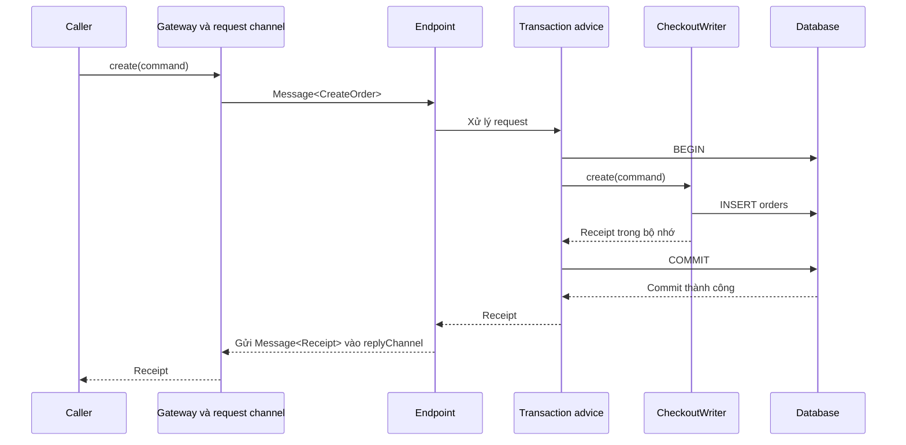

# Commit trước khi gửi reply

Trong chương **Transaction support** của module **SPRING_INTEGRATION_CORE**, bài này giải quyết một yêu cầu cụ thể: chỉ phát reply thành công sau khi transaction chứa thay đổi nghiệp vụ đã commit. Ta sử dụng các thành phần cốt lõi của Spring Integration — `Message`, `MessageChannel`, service activator, messaging gateway và Java DSL — để xác định đúng vị trí đặt transaction.

Ví dụ xuyên suốt là luồng tạo đơn hàng. Reply `CREATED` mang nghĩa đơn đã được lưu thành công vào cơ sở dữ liệu chính. Một đối tượng Java đã được tạo hoặc một câu SQL đã chạy chưa đủ để thực hiện lời hứa đó.

## 1. Kết quả cần đạt và phạm vi

Sau bài học, bạn có thể:

- Phân biệt tạo kết quả, flush, commit và gửi reply.
- Chọn transaction advice cho endpoint tạo reply.
- Nhận biết transaction bên ngoài làm mất giả định “handler kết thúc là đã commit”.
- Kiểm tra trạng thái DB ngay tại thời điểm phát reply.
- Xử lý tình huống dữ liệu đã commit nhưng reply không đến được người gọi.

Các ví dụ dùng luồng Java imperative với JDBC, transaction gắn với thread và một `DataSource`. Không áp dụng nguyên xi các suy luận về thread cho luồng Reactor dùng reactive transaction manager.

### 1.1. Cam kết về thứ tự

Ký hiệu:

- `C`: transaction nghiệp vụ commit thành công.
- `R`: endpoint bắt đầu gửi reply thành công ra channel.
- `D`: người gọi thực sự nhận được reply.

Thiết kế cần bảo đảm:

```text
C hoàn tất → R bắt đầu → D, nếu việc chuyển giao thành công
```

Nếu commit thất bại, không được phát reply `CREATED`. Tuy nhiên, `C` đã hoàn tất không bảo đảm `D` sẽ xảy ra: ứng dụng hoặc đường truyền có thể gặp lỗi ở khoảng giữa. Đây là hai yêu cầu khác nhau: thứ tự commit/reply và khả năng chuyển giao kết quả.

### 1.2. Những mốc dễ nhầm

| Mốc quan sát | Điều đã xảy ra | Có đủ để trả lời “đã commit” không? |
| --- | --- | --- |
| Tạo `Receipt` | Có một đối tượng kết quả trong bộ nhớ | Không |
| `JdbcTemplate.update()` trả về | Câu SQL đã thực thi trong ngữ cảnh hiện tại | Không, nếu transaction vẫn mở |
| JPA/Hibernate flush | Thay đổi được đồng bộ xuống DB trong transaction | Không |
| Thoát một scope `REQUIRED` bên trong | Scope cục bộ hoàn tất | Chưa chắc; transaction ngoài có thể còn mở |
| Transaction vật lý commit thành công | DB chấp nhận hoàn tất transaction | Có, với phạm vi và bảo đảm của DB đó |
| `MessageChannel.send()` thành công | Channel chấp nhận hoặc xử lý message theo loại channel | Không tự chứng minh một DB khác đã commit |

Spring phân biệt transaction logic với transaction vật lý; một scope `REQUIRED` có thể dùng chung transaction vật lý của caller. Vì vậy phải xác định ai thực sự sở hữu việc commit. [Spring Framework: Transaction Propagation](https://docs.spring.io/spring-framework/reference/data-access/transaction/declarative/tx-propagation.html)

## 2. Vì sao reply có thể xuất hiện quá sớm?

Một endpoint tạo reply thực hiện hai nhóm công việc:

1. Gọi logic xử lý request để nhận kết quả.
2. Dùng kết quả đó để tạo và gửi reply.

Vị trí advice quyết định transaction có bao cả nhóm thứ hai hay không. Trong Spring Integration, một `TransactionInterceptor` thông thường trong request handler advice chain chỉ bọc phần xử lý request của `AbstractReplyProducingMessageHandler`. `TransactionHandleMessageAdvice` bọc `handleMessage()`, nên bao gồm cả phần xử lý downstream đồng bộ trong cùng lời gọi. [Spring Integration: Transaction Support cho handler advice](https://docs.spring.io/spring-integration/reference/handler-advice/tx-handle-message.html)

Hai cấu trúc dưới đây là mã giả, thể hiện ranh giới chứ không phải API để sao chép.

### 2.1. Bọc toàn bộ xử lý message

```text
BEGIN
    result = xử_lý_request()
    gửi_reply(result)
COMMIT
```

Với reply queue trong bộ nhớ hoặc một consumer chạy độc lập, kết quả có thể đã được quan sát khi commit chưa xảy ra. Nếu commit thất bại sau đó, consumer đã nhận một thông báo thành công không còn phù hợp với trạng thái nghiệp vụ.

Một gateway đồng bộ nối hoàn toàn bằng `DirectChannel` có thể vẫn phải chờ stack gửi request trả về trước khi chính phương thức gateway trả về. Do đó không thể kết luận mọi gateway luôn trả về sớm. Điểm cần kiểm soát ở đây là **lúc message reply được phát**, kể cả khi có consumer hoặc channel khác tham gia.

### 2.2. Bọc phần xử lý request

```text
BEGIN
    result = xử_lý_request()
COMMIT
gửi_reply(result)
```

Cấu trúc này đáp ứng yêu cầu khi scope trên thực sự hoàn tất transaction vật lý của thay đổi nghiệp vụ. Việc tạo `result` trước commit là bình thường; việc công bố nó ra bên ngoài mới phải chờ commit.

Hệ quả thiết kế: các bước bắt buộc phải nguyên tử với việc tạo đơn phải nằm trong phần xử lý được bọc transaction. Bước nằm sau ranh giới commit không thể làm rollback thay đổi đã hoàn tất.

## 3. Chọn đúng advice trong Java DSL

| Cách cấu hình | Phạm vi chính | Ý nghĩa đối với bài toán |
| --- | --- | --- |
| `new TransactionInterceptorBuilder(false)` | Tạo `TransactionInterceptor` thông thường | Dùng cho phần xử lý request của endpoint tạo reply |
| `new TransactionInterceptorBuilder(true)` | Tạo `TransactionHandleMessageAdvice` | Bao cả xử lý downstream đồng bộ; reply có thể được gửi trước commit |
| `endpoint.transactional(txManager, false)` | Chọn advice thông thường với thuộc tính transaction mặc định | Cách viết ngắn khi không cần tùy chỉnh thêm |
| `endpoint.transactional(txManager, true)` | Chọn `TransactionHandleMessageAdvice` | Phù hợp khi chủ đích là mở rộng phạm vi transaction |
| `endpoint.handleMessageAdvice(...)` | Bọc `handleMessage()` | Cần xét cả hành vi gửi reply trong scope |

Giá trị boolean trên chọn **loại advice**, không có nghĩa “bật/tắt transaction”. Builder nằm trong package `org.springframework.integration.transaction`. [TransactionInterceptorBuilder API](https://docs.spring.io/spring-integration/api/org/springframework/integration/transaction/TransactionInterceptorBuilder.html), [ConsumerEndpointSpec API](https://docs.spring.io/spring-integration/api/org/springframework/integration/dsl/ConsumerEndpointSpec.html)

Trong bài này, ta tạo advice với `false` và gắn qua `.advice(...)`. Không đồng thời bọc toàn flow bằng một transaction lớn hơn rồi giả định scope bên trong sẽ commit độc lập.

`TransactionHandleMessageAdvice` vẫn có ích cho yêu cầu “một lỗi downstream phải rollback cả flow”. Đó là lựa chọn phạm vi nghiệp vụ khác với việc công bố kết quả sau commit. [TransactionHandleMessageAdvice API](https://docs.spring.io/spring-integration/api/org/springframework/integration/transaction/TransactionHandleMessageAdvice.html)

## 4. Ví dụ: chỉ trả CREATED sau khi lưu đơn đã commit

### 4.1. Điều kiện chạy ví dụ

Các lớp dưới đây cùng thuộc package `example.checkout`; mỗi kiểu `public` được đặt trong tệp Java tương ứng khi bạn thực hành.

Ứng dụng cần:

- Java hỗ trợ `record` và text block, chẳng hạn Java 17 cho một bộ Spring tương thích.
- `spring-integration-core`, `spring-jdbc` và JDBC driver.
- Một bean `DataSource` trỏ đến DB cần ghi.
- Các phiên bản Spring được quản lý đồng bộ theo BOM hoặc bộ phiên bản của ứng dụng.

Ví dụ cố ý dùng JDBC để thấy rõ ranh giới transaction. Chưa có transaction bên ngoài tại lúc gửi request vào flow. Phần 5 giải thích cách xử lý khi điều kiện này thay đổi.

Schema tối thiểu:

```sql
CREATE TABLE orders (
    request_id  VARCHAR(80) PRIMARY KEY,
    total_minor BIGINT NOT NULL CHECK (total_minor > 0),
    status      VARCHAR(20) NOT NULL
);
```

`request_id` do caller cung cấp để theo dõi cùng một yêu cầu. Khóa chính giúp ngăn tạo hai hàng cùng mã; riêng ràng buộc này chưa phải một giao thức trả lại kết quả khi retry.

### 4.2. Payload request và reply

```java
package example.checkout;

public record CreateOrder(String requestId, long totalMinor) {
}
```

```java
package example.checkout;

public record Receipt(String requestId, String status) {
}
```

Reply chỉ chứa giá trị đã materialize. Nếu chuyển ví dụ sang JPA, hãy trả DTO thay vì dựa vào việc truy cập lazy association khi transaction đã kết thúc.

### 4.3. Logic ghi dữ liệu

```java
package example.checkout;

import org.springframework.jdbc.core.JdbcTemplate;

public class CheckoutWriter {

    private final JdbcTemplate jdbc;

    public CheckoutWriter(JdbcTemplate jdbc) {
        this.jdbc = jdbc;
    }

    public Receipt create(CreateOrder command) {
        if (command.requestId() == null
                || command.requestId().isBlank()
                || command.totalMinor() <= 0) {
            throw new IllegalArgumentException("Invalid order request");
        }

        jdbc.update("""
                INSERT INTO orders (request_id, total_minor, status)
                VALUES (?, ?, ?)
                """,
                command.requestId(),
                command.totalMinor(),
                "CREATED");

        return new Receipt(command.requestId(), "CREATED");
    }
}
```

`create()` chưa tự gửi message nào. Nó chỉ ghi dữ liệu rồi cung cấp kết quả cho endpoint. Không bắt lỗi DB để trả một `Receipt` thành công thay thế.

Trong một nghiệp vụ phức tạp hơn, thao tác giữ tồn kho và ghi đơn cùng DB phải được thực hiện trong scope transaction này nếu chúng cần thành công hoặc rollback cùng nhau.

### 4.4. Gateway cho caller

```java
package example.checkout;

import org.springframework.integration.annotation.MessagingGateway;

@MessagingGateway(
        defaultRequestChannel = "checkoutRequests",
        defaultReplyTimeout = "5000")
public interface CheckoutGateway {

    Receipt create(CreateOrder command);
}
```

Gateway biến lời gọi Java thành trao đổi message. Với endpoint cuối không có output channel tường minh, reply được định tuyến theo `replyChannel` của request; gateway có thể cung cấp channel reply tạm thời. [Spring Integration: Messaging Gateways](https://docs.spring.io/spring-integration/reference/gateway.html)

Giá trị timeout ở đây giới hạn thời gian chờ reply theo cơ chế gateway. Nó không biến mọi bước đồng bộ thành công việc có thể tự động ngắt sau đúng năm giây.

### 4.5. Cấu hình flow và transaction

```java
package example.checkout;

import javax.sql.DataSource;

import org.springframework.beans.factory.annotation.Qualifier;
import org.springframework.context.annotation.Bean;
import org.springframework.context.annotation.Configuration;
import org.springframework.integration.annotation.IntegrationComponentScan;
import org.springframework.integration.channel.DirectChannel;
import org.springframework.integration.config.EnableIntegration;
import org.springframework.integration.dsl.IntegrationFlow;
import org.springframework.integration.transaction.TransactionInterceptorBuilder;
import org.springframework.jdbc.core.JdbcTemplate;
import org.springframework.jdbc.datasource.DataSourceTransactionManager;
import org.springframework.transaction.PlatformTransactionManager;
import org.springframework.transaction.annotation.Propagation;
import org.springframework.transaction.interceptor.TransactionInterceptor;

@Configuration
@EnableIntegration
@IntegrationComponentScan(basePackageClasses = CheckoutGateway.class)
public class CheckoutFlowConfiguration {

    @Bean
    public DirectChannel checkoutRequests() {
        return new DirectChannel();
    }

    @Bean
    public JdbcTemplate checkoutJdbc(DataSource dataSource) {
        return new JdbcTemplate(dataSource);
    }

    @Bean
    public PlatformTransactionManager checkoutTxManager(DataSource dataSource) {
        return new DataSourceTransactionManager(dataSource);
    }

    @Bean
    public CheckoutWriter checkoutWriter(
            @Qualifier("checkoutJdbc") JdbcTemplate jdbc) {
        return new CheckoutWriter(jdbc);
    }

    @Bean
    public TransactionInterceptor commitBeforeReplyAdvice(
            @Qualifier("checkoutTxManager")
            PlatformTransactionManager transactionManager) {

        return new TransactionInterceptorBuilder(false)
                .transactionManager(transactionManager)
                .propagation(Propagation.REQUIRED)
                .build();
    }

    @Bean
    public IntegrationFlow checkoutFlow(
            CheckoutWriter checkoutWriter,
            @Qualifier("commitBeforeReplyAdvice")
            TransactionInterceptor commitBeforeReplyAdvice) {

        return IntegrationFlow.from("checkoutRequests")
                .handle(checkoutWriter, "create",
                        endpoint -> endpoint
                                .advice(commitBeforeReplyAdvice)
                                .requiresReply(true))
                .get();
    }
}
```

Ba chi tiết quyết định kết quả của ví dụ:

1. `JdbcTemplate` và transaction manager dùng cùng `DataSource`.
2. Advice thông thường bao phần gọi `CheckoutWriter.create()`.
3. Không có transaction ngoài, nên `REQUIRED` tạo transaction mới và hoàn tất nó trước khi endpoint tiếp tục gửi reply.

Không cần `@EnableTransactionManagement` chỉ để sử dụng advice đã cấu hình tường minh như trên. Nếu chọn cách dùng `@Transactional` trên service thay thế, phải bật hạ tầng xử lý annotation và bảo đảm lời gọi đi qua proxy Spring.

`requiresReply(true)` phát hiện trường hợp handler không tạo kết quả. Nó không phải một thao tác commit và không biến lỗi tạo/gửi reply sau commit thành rollback nghiệp vụ.

### 4.6. Thứ tự khi chạy thành công



Đây là thứ tự của cấu hình minh họa, với các điều kiện đã nêu. Nếu commit ném lỗi, advice không trả kết quả thành công về endpoint để đi tiếp theo nhánh reply thông thường.

Caller sử dụng:

```java
Receipt receipt = checkoutGateway.create(
        new CreateOrder("checkout-2026-001", 125_000L));
```

Trong cấu hình này, giá trị `CREATED` được phát sau commit của hàng `orders` tương ứng. Nếu thêm một transformer sau service activator, transformer đó chạy sau ranh giới commit; lỗi của nó không làm đơn đã lưu biến mất.

## 5. Khi có transaction bên ngoài

Đây là điều kiện cần kiểm tra trước khi tái sử dụng cấu hình.

Giả sử caller được bao transaction:

```java
@Transactional
public Receipt createAndContinue(CreateOrder command) {
    Receipt receipt = checkoutGateway.create(command);
    performAnotherDatabaseUpdate();
    return receipt;
}
```

Nếu endpoint dùng `REQUIRED`, thay đổi tạo đơn tham gia transaction ngoài cùng tài nguyên. Flow có thể đã phát reply trong lúc transaction ấy vẫn mở; lỗi ở `performAnotherDatabaseUpdate()` còn có thể dẫn tới rollback.

Đừng đánh đồng “proxy của method ngoài chưa trả về” với “không có reply nội bộ nào được phát”. Một subscriber hoặc bước downstream có thể đã quan sát reply đó.

Có ba hướng thiết kế:

| Yêu cầu nghiệp vụ | Hướng xử lý |
| --- | --- |
| Tạo đơn là một đơn vị độc lập, phải commit trước reply của endpoint | Cho endpoint sở hữu transaction mới, hoặc dùng `REQUIRES_NEW` sau khi chấp nhận tính độc lập |
| Tạo đơn phải rollback cùng những cập nhật tiếp theo của caller | Giữ transaction ngoài; dời việc công bố thành công đến sau commit ngoài |
| Caller được phép nhận trạng thái tiếp nhận rồi theo dõi kết quả sau | Thiết kế API bất đồng bộ có mã theo dõi và trạng thái rõ ràng |

Nếu chọn transaction độc lập, thay dòng propagation trong advice:

```java
.propagation(Propagation.REQUIRES_NEW)
```

`REQUIRES_NEW` sử dụng transaction vật lý riêng. Với transaction manager hỗ trợ việc này, transaction ngoài được tạm dừng; transaction trong có thể commit dù transaction ngoài sau đó rollback. Nó cũng có thể cần thêm connection khi connection của transaction ngoài vẫn đang được giữ. `NESTED` dựa vào savepoint không tương đương một commit vật lý độc lập. [Spring Framework: Transaction Propagation](https://docs.spring.io/spring-framework/reference/data-access/transaction/declarative/tx-propagation.html)

Áp dụng vào ví dụ: nếu tạo đơn là một phần không thể tách rời của quy trình trừ tiền trong transaction ngoài, đổi sang `REQUIRES_NEW` chỉ để có reply sớm sẽ làm sai tính nguyên tử nghiệp vụ.

## 6. Các lựa chọn đặt ranh giới khác

### 6.1. Transaction trên service được proxy

Một service bean có `@Transactional` có thể thay cho advice ở endpoint. Endpoint gọi service qua proxy; nếu service sở hữu transaction vật lý, proxy hoàn tất transaction trước khi trả kết quả cho endpoint.

Cần bật transaction management, chọn đúng transaction manager và tránh self-invocation như `this.create(...)` khi dựa vào proxy mặc định. Cách này vẫn chịu quy tắc propagation: `REQUIRED` có thể tham gia transaction ngoài. [Spring Framework: Using @Transactional](https://docs.spring.io/spring-framework/reference/data-access/transaction/declarative/annotations.html)

Nên chọn một nơi thể hiện quyền sở hữu transaction rõ ràng. Chồng thêm annotation và endpoint advice mà không xác định mục đích sẽ làm khó việc đọc ranh giới commit.

### 6.2. TransactionTemplate bên trong handler

Với handler orchestration cần ranh giới thể hiện trực tiếp trong mã, có thể dùng `TransactionTemplate`. Đây là cơ chế callback quản lý vòng đời transaction cho code imperative. [Spring Framework: Programmatic Transaction Management](https://docs.spring.io/spring-framework/reference/data-access/transaction/programmatic.html)

Ví dụ thay thế dưới đây tạo transaction độc lập có chủ đích:

```java
package example.checkout;

import org.springframework.transaction.PlatformTransactionManager;
import org.springframework.transaction.TransactionDefinition;
import org.springframework.transaction.support.TransactionTemplate;

public class IndependentCheckoutService {

    private final CheckoutWriter writer;
    private final TransactionTemplate transaction;

    public IndependentCheckoutService(
            CheckoutWriter writer,
            PlatformTransactionManager transactionManager) {
        this.writer = writer;
        this.transaction = new TransactionTemplate(transactionManager);
        this.transaction.setPropagationBehavior(
                TransactionDefinition.PROPAGATION_REQUIRES_NEW);
    }

    public Receipt create(CreateOrder command) {
        return transaction.execute(status -> writer.create(command));
    }
}
```

Để thực hành biến thể này, đăng ký service bằng `@Bean` với `CheckoutWriter` và `checkoutTxManager`, rồi cho endpoint gọi service đó. Bỏ advice transaction ở endpoint trong biến thể này để ranh giới nằm ở một chỗ.

Điểm cần đọc là thời điểm `execute()` trả về, không phải thời điểm callback `writer.create()` trả về. Với transaction độc lập trên, việc hoàn tất transaction nằm giữa hai thời điểm ấy. Nếu đổi template sang `REQUIRED` và tham gia transaction ngoài, không còn cùng kết luận về commit vật lý. [TransactionTemplate API](https://docs.spring.io/spring-framework/docs/current/javadoc-api/org/springframework/transaction/support/TransactionTemplate.html)

### 6.3. afterCommit khi cần chờ transaction ngoài

Nếu phải giữ transaction ngoài, một hành động công bố kết quả có thể được thiết kế chạy sau commit bằng transaction synchronization.

`beforeCommit()` vẫn có thể được theo sau bởi rollback. `afterCommit()` được gọi sau commit thành công; exception từ đó có thể tới caller nhưng không đảo ngược transaction đã commit. Code truy cập dữ liệu sau commit cần ranh giới transaction mới nếu muốn một lần commit khác. [TransactionSynchronization API](https://docs.spring.io/spring-framework/docs/current/javadoc-api/org/springframework/transaction/support/TransactionSynchronization.html)

Không chỉ chuyển việc gửi reply sang callback mà bỏ qua vòng đời gateway. Nếu một gateway đang chờ reply, trong khi callback chỉ được chạy khi method bao gateway trả về và transaction ngoài commit, thiết kế tạo ra vòng chờ:

```text
method ngoài chờ gateway
gateway chờ reply
reply chờ afterCommit
afterCommit chờ method ngoài kết thúc
```

Cần đổi hợp đồng sang trả kết quả sau khi transaction ngoài đã hoàn tất, hoặc dùng mô hình bất đồng bộ phù hợp. Callback sau commit cũng không lưu bền ý định gửi nếu process dừng trước khi callback thực hiện.

## 7. MessageChannel và ranh giới thread

Trong luồng imperative, transaction context thường gắn với thread. Chuyển sang worker qua queue hoặc executor không tự mang transaction của thread gửi sang thread xử lý. Transaction phía gửi vẫn hoàn tất theo scope của nó, không chờ mọi công việc bất đồng bộ phía sau. [Spring Integration: Transaction Boundaries](https://docs.spring.io/spring-integration/reference/transactions.html#transaction-boundaries)

| Vị trí channel | Điều cần xét cho bài toán commit/reply |
| --- | --- |
| `DirectChannel` trước handler | Handler chạy trên thread gửi; có thể tham gia transaction hiện hữu |
| `QueueChannel` trước handler | Poller/consumer nhận cần có transaction riêng nếu nghiệp vụ yêu cầu |
| `ExecutorChannel` trước handler | Thread xử lý không tự kế thừa transaction imperative của thread gọi |
| Queue trong bộ nhớ sau handler | Message có thể được consumer khác lấy ngay; phải gửi sau commit nếu đó là reply thành công |
| Channel dựa trên tài nguyên transactional | Cần xét transaction manager và tài nguyên cụ thể; không suy luận từ tên channel |

Một `QueueChannel` thông thường giữ message trong bộ nhớ; `send()` có thể trả về ngay khi message được đưa vào queue. Việc đó không tự gắn queue với transaction JDBC. `DirectChannel` thực hiện dispatch trong thread gửi. [Spring Integration: Message Channel Implementations](https://docs.spring.io/spring-integration/reference/channel/implementations.html)

Vì vậy thêm queue không tự tạo một “hàng rào commit”. Chỉ thêm executor để tách thread cũng không chứng minh DB đã hoàn tất transaction trước lúc reply được công bố.

Nếu cần poller transactional để gộp nhận request và cập nhật DB, phải đánh giá cả quyền sở hữu transaction của poller. Một advice `REQUIRED` ở handler có thể đang tham gia scope lớn đó.

## 8. Lỗi trước và sau commit

| Điểm thất bại | Trạng thái có thể xác định | Hành vi reply mong muốn |
| --- | --- | --- |
| Validation trước ghi dữ liệu | Chưa có đơn mới | Không phát `CREATED` |
| SQL thất bại trong handler | Transaction đi theo quy tắc xử lý lỗi/rollback | Không phát `CREATED` |
| Transaction bị đánh dấu rollback-only | Không thể coi kết quả trong bộ nhớ là thành công đã commit | Không phát `CREATED` |
| Lỗi trước khi commit thực sự | Chưa có xác nhận commit thành công | Không phát `CREATED` |
| Mất kết nối ở thời điểm commit | Có thể chưa biết chắc kết quả phía DB | Không khẳng định thành công hoặc chắc chắn chưa tạo đơn |
| Tạo/chuyển đổi reply thất bại sau commit | Đơn có thể đã tồn tại bền vững | Báo lỗi chuyển giao, không hứa đã rollback đơn |
| Gửi reply thất bại sau commit | Dữ liệu đã commit; caller có thể chưa nhận được | Tra cứu hoặc retry có kiểm soát theo mã yêu cầu |

Không gọi rollback lại một `TransactionStatus` sau khi `commit()` đã kết thúc bằng việc ném exception; transaction manager chịu trách nhiệm hoàn tất/cleanup. Đồng thời, một lỗi trong giai đoạn sau commit không có nghĩa DB đã rollback. [PlatformTransactionManager API](https://docs.spring.io/spring-framework/docs/current/javadoc-api/org/springframework/transaction/PlatformTransactionManager.html)

### 8.1. Đừng chuyển mọi exception thành thành công

Trong flow đồng bộ, lỗi thường được truyền về caller. Với xử lý bất đồng bộ, cơ chế lỗi dựa trên `ErrorMessage` và `errorChannel` cần được cấu hình phù hợp. Không mặc định rằng mọi lời gọi `DirectChannel.send()` đều tự gửi lỗi vào global `errorChannel`. [Spring Integration: Error Handling](https://docs.spring.io/spring-integration/reference/error-handling.html)

Nếu error flow tạo một reply dự phòng, payload phải thể hiện đúng thất bại hoặc trạng thái chưa xác định. Không dùng lại `Receipt(..., "CREATED")` cho mọi lỗi để tránh làm caller hiểu sai.

Khi retry, phân biệt lỗi nghiệp vụ chưa commit với lỗi phát reply sau commit. Chạy lại thao tác tạo đơn một cách mù quáng có thể tạo thêm hiệu ứng phụ hoặc gặp khóa trùng.

### 8.2. Commit thất bại không luôn có kết quả DB chắc chắn

Ví dụ DB đã ghi nhận commit nhưng connection đứt trước khi ứng dụng nhận xác nhận. Ứng dụng có thể quan sát exception mà không biết chắc đơn đã tồn tại hay chưa.

Hợp đồng phù hợp là cho phép tra cứu bằng `request_id`, đối chiếu nội dung request và trả lại kết quả đã lưu. Không chỉ dựa vào câu “có exception nên không có dữ liệu” để quyết định gửi lại một lệnh tạo mới.

## 9. Kiểm thử ngay tại thời điểm phát reply

Kiểm tra DB sau khi `gateway.create()` đã trả về chưa đủ để phát hiện reply từng được phát trước commit. Khi test thực hiện truy vấn, transaction có thể đã kết thúc rồi.

Cần quan sát **ngay trong thao tác gửi reply**. `ChannelInterceptor.preSend()` là một điểm đặt phép kiểm tra phù hợp: nó chạy trước khi channel thực hiện gửi message. [Spring Integration: Channel Interceptors](https://docs.spring.io/spring-integration/reference/channel/interceptors.html)

### 9.1. Test tích hợp với connection độc lập

Ví dụ sau dùng:

- Cấu hình và các lớp của phần 4.
- JUnit Jupiter, `spring-test` và H2 trong test dependencies.
- Một DB H2 riêng cho context kiểm thử.
- `DataSource` gốc, không phải transaction-aware proxy, để mở connection quan sát độc lập.

Không gắn `@Transactional` lên class hoặc method test này. Transaction do test quản lý có thể khiến advice `REQUIRED` tham gia transaction test và làm thay đổi chính điều kiện cần kiểm tra. [Spring Framework: Test-managed Transactions](https://docs.spring.io/spring-framework/reference/testing/testcontext-framework/tx.html)

```java
package example.checkout;

import java.sql.Connection;
import java.sql.PreparedStatement;
import java.sql.ResultSet;
import java.sql.SQLException;
import java.util.concurrent.atomic.AtomicBoolean;

import javax.sql.DataSource;

import org.junit.jupiter.api.BeforeEach;
import org.junit.jupiter.api.Test;

import org.springframework.beans.factory.annotation.Autowired;
import org.springframework.beans.factory.annotation.Qualifier;
import org.springframework.context.annotation.Bean;
import org.springframework.context.annotation.Configuration;
import org.springframework.integration.channel.QueueChannel;
import org.springframework.jdbc.core.JdbcTemplate;
import org.springframework.jdbc.datasource.embedded.EmbeddedDatabase;
import org.springframework.jdbc.datasource.embedded.EmbeddedDatabaseBuilder;
import org.springframework.jdbc.datasource.embedded.EmbeddedDatabaseType;
import org.springframework.messaging.Message;
import org.springframework.messaging.MessageChannel;
import org.springframework.messaging.MessagingException;
import org.springframework.messaging.support.ChannelInterceptor;
import org.springframework.messaging.support.MessageBuilder;
import org.springframework.test.context.junit.jupiter.SpringJUnitConfig;

import static org.junit.jupiter.api.Assertions.*;

@SpringJUnitConfig(classes = {
        CheckoutFlowConfiguration.class,
        CommitBeforeReplyTest.DatabaseConfiguration.class
})
class CommitBeforeReplyTest {

    @Autowired
    @Qualifier("checkoutRequests")
    MessageChannel requests;

    @Autowired
    DataSource dataSource;

    @BeforeEach
    void cleanDatabase() {
        new JdbcTemplate(dataSource).update("DELETE FROM orders");
    }

    @Test
    void committedRowIsVisibleBeforeReplySend() {
        QueueChannel replies = new QueueChannel();
        AtomicBoolean observed = new AtomicBoolean();

        replies.addInterceptor(new ChannelInterceptor() {
            @Override
            public Message<?> preSend(
                    Message<?> message, MessageChannel channel) {
                Receipt receipt = (Receipt) message.getPayload();

                assertEquals(1, countCommittedRows(receipt.requestId()));
                observed.set(true);
                return message;
            }
        });

        boolean accepted = requests.send(MessageBuilder
                .withPayload(new CreateOrder("req-001", 125_000L))
                .setReplyChannel(replies)
                .build());

        assertTrue(accepted);
        assertTrue(observed.get());

        Message<?> reply = replies.receive(0);
        assertNotNull(reply);
        assertEquals(new Receipt("req-001", "CREATED"),
                reply.getPayload());
    }

    @Test
    void databaseFailureDoesNotProduceSuccessReply() {
        new JdbcTemplate(dataSource).update("""
                INSERT INTO orders (request_id, total_minor, status)
                VALUES (?, ?, ?)
                """, "req-duplicate", 10_000L, "CREATED");

        QueueChannel replies = new QueueChannel();

        assertThrows(MessagingException.class, () ->
                requests.send(MessageBuilder
                        .withPayload(new CreateOrder(
                                "req-duplicate", 20_000L))
                        .setReplyChannel(replies)
                        .build()));

        assertNull(replies.receive(0));
        assertEquals(1, countCommittedRows("req-duplicate"));
    }

    @Test
    void replyFailureDoesNotUndoCommittedOrder() {
        QueueChannel replies = new QueueChannel();

        replies.addInterceptor(new ChannelInterceptor() {
            @Override
            public Message<?> preSend(
                    Message<?> message, MessageChannel channel) {
                throw new IllegalStateException(
                        "Simulated reply transport failure");
            }
        });

        assertThrows(MessagingException.class, () ->
                requests.send(MessageBuilder
                        .withPayload(new CreateOrder(
                                "req-reply-failed", 30_000L))
                        .setReplyChannel(replies)
                        .build()));

        assertNull(replies.receive(0));
        assertEquals(1, countCommittedRows("req-reply-failed"));
    }

    private int countCommittedRows(String requestId) {
        try (Connection connection = dataSource.getConnection()) {
            connection.setAutoCommit(true);
            connection.setTransactionIsolation(
                    Connection.TRANSACTION_READ_COMMITTED);

            try (PreparedStatement statement = connection.prepareStatement(
                    "SELECT COUNT(*) FROM orders WHERE request_id = ?")) {
                statement.setString(1, requestId);

                try (ResultSet result = statement.executeQuery()) {
                    if (!result.next()) {
                        throw new IllegalStateException("Missing count result");
                    }
                    return result.getInt(1);
                }
            }
        }
        catch (SQLException exception) {
            throw new IllegalStateException(
                    "Cannot inspect committed data", exception);
        }
    }

    @Configuration
    static class DatabaseConfiguration {

        @Bean(destroyMethod = "shutdown")
        EmbeddedDatabase dataSource() {
            EmbeddedDatabase database = new EmbeddedDatabaseBuilder()
                    .generateUniqueName(true)
                    .setType(EmbeddedDatabaseType.H2)
                    .build();

            new JdbcTemplate(database).execute("""
                    CREATE TABLE orders (
                        request_id VARCHAR(80) PRIMARY KEY,
                        total_minor BIGINT NOT NULL CHECK (total_minor > 0),
                        status VARCHAR(20) NOT NULL
                    )
                    """);

            return database;
        }
    }
}
```

Ở test thứ nhất, connection quan sát được mở trực tiếp từ DB H2 và có isolation `READ_COMMITTED`. Nó không dùng `JdbcTemplate` gắn với transaction đang xử lý request. Vì vậy test kiểm tra khả năng đọc dữ liệu đã commit, thay vì vô tình đọc chính thay đổi chưa commit của writer.

Ở test thứ hai, bản ghi cũ phải còn tồn tại và không có success reply cho lần ghi trùng. Đây là kiểm tra lỗi SQL trong handler; nó không mô phỏng riêng một lỗi vật lý tại `Connection.commit()`.

Ở test thứ ba, lỗi phát reply được tạo sau khi writer đã hoàn tất transaction. Assertion về hàng còn trong DB chứng minh đúng hệ quả nghiệp vụ cần xử lý khi caller nhận exception sau commit.

### 9.2. Những tình huống nên bổ sung khi áp dụng thực tế

| Tình huống | Điều cần kiểm chứng |
| --- | --- |
| Lỗi trong `beforeCommit()` bằng transaction synchronization dành cho test | Không phát success reply khi giai đoạn trước commit thất bại |
| Lỗi commit được mô phỏng ở transaction manager hoặc JDBC driver | Không đi tiếp nhánh success; tài nguyên được cleanup đúng |
| Caller mở transaction ngoài với `REQUIRED` | Nhìn thấy sự khác biệt giữa scope kết thúc và commit vật lý |
| Endpoint chuyển sang `REQUIRES_NEW` | Đơn giữ nguyên sau khi transaction caller rollback, nếu đó là hợp đồng đã chọn |
| Consumer reply chạy ở thread khác | Không quan sát `CREATED` trước commit của đơn |
| Gửi lại cùng `request_id` sau khi mất reply | Đối chiếu và trả lại kết quả cũ theo chính sách idempotency |
| Chạy với DB sử dụng trong triển khai | Xác nhận hành vi isolation và lỗi commit của DB thực tế |

Không dùng `sleep()` để “đợi commit xong” làm tiêu chí thành công. Phép kiểm tra phải gắn với một mốc quan sát xác định, chẳng hạn callback gửi reply hoặc synchronization của transaction.

## 10. Khoảng trống sau commit: idempotency và outbox

Trong ví dụ, tiến trình có thể dừng giữa hai bước:

```text
DB đã commit
    ↓
Process dừng
    ↓
Reply chưa được phát
```

Caller không nhận được reply nhưng đơn đã tồn tại. Cần thiết kế cách lấy lại kết quả:

1. Caller gửi một mã yêu cầu ổn định.
2. Ứng dụng lưu thông tin đủ để nhận diện request và kết quả.
3. Khi nhận lại cùng mã, ứng dụng đối chiếu dữ liệu nghiệp vụ.
4. Nếu đó là cùng một yêu cầu đã hoàn tất, trả lại kết quả đã lưu.
5. Nếu cùng mã nhưng nội dung khác, báo xung đột theo hợp đồng API.

Đối với ví dụ phần 4, `request_id` mới chỉ có vai trò khóa duy nhất. Handler hiện tại sẽ ném lỗi khi ghi trùng; muốn trả kết quả cũ cần bổ sung logic tra cứu và đối chiếu. Không bắt mọi `DuplicateKeyException` rồi mặc định nội dung hai request là giống nhau.

Nếu cần chuyển kết quả bền vững sang broker hoặc một flow khác, có thể ghi thêm bản ghi outbox **trong cùng transaction với đơn hàng**, rồi để relay gửi sau:

```text
Transaction nghiệp vụ:
    INSERT orders
    INSERT outbox
COMMIT

Relay:
    đọc outbox đã commit
    gửi message
    ghi nhận kết quả gửi
```

Outbox giữ bền ý định phát message qua khoảng process dừng sau commit; relay vẫn cần cơ chế retry và xử lý message trùng. Nó không tự biến reply HTTP đồng bộ thành một kết quả sẽ được chuyển giao đúng một lần. [Spring: Outbox Pattern Strategies](https://spring.io/blog/2023/10/24/a-use-case-for-transactions-adapting-to-transactional-outbox-pattern/)

## 11. Cách đọc một flow để xác định bảo đảm

Khi xem một flow thực tế, hãy lần theo một yêu cầu cụ thể:

1. Xác định reply thành công đang hứa dữ liệu nào đã được lưu.
2. Chỉ ra transaction manager và tài nguyên chứa dữ liệu đó.
3. Xác định scope nào sở hữu commit vật lý, bao gồm transaction của caller hoặc poller.
4. Đặt thao tác phát reply sau commit đó.
5. Kiểm tra mọi bước có thể phát kết quả sớm: output channel, reply channel, wire tap hoặc lời gọi gửi message ngay trong service.
6. Quan sát trạng thái DB ngay lúc phát reply bằng connection độc lập.
7. Thiết kế kết quả cho trường hợp commit thành công nhưng caller không nhận được reply.

Với flow của bài, đường đi cần đọc là: `Message<CreateOrder>` → `checkoutRequests` → xử lý request trong advice → commit → `Message<Receipt>` vào `replyChannel`. Bảo đảm này dựa trên đúng phạm vi transaction và điều kiện thực thi đã nêu, chứ không dựa riêng vào việc có annotation hoặc có channel trong cấu hình.
