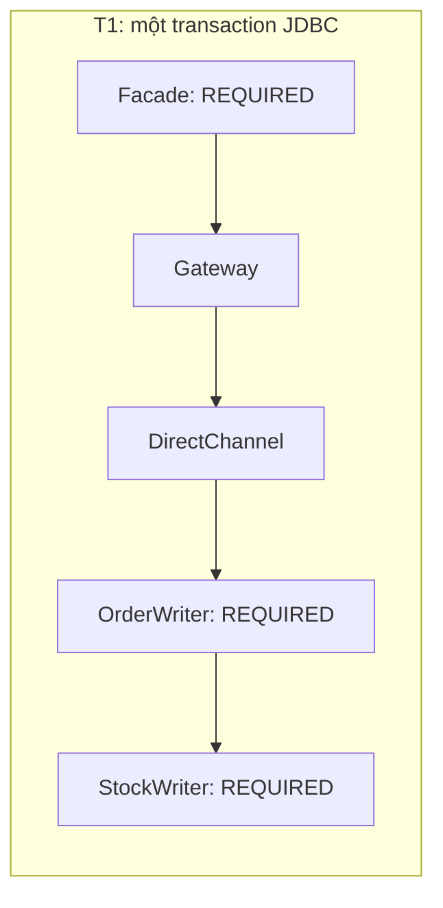
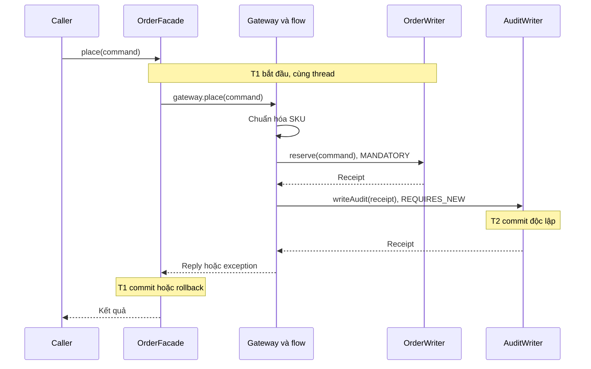

# Transaction propagation trong Spring Integration

## 1. Mục tiêu và phạm vi

Trong chương **Transaction support** của module **SPRING_INTEGRATION_CORE**, transaction propagation trả lời câu hỏi: khi một endpoint gọi tiếp một thao tác có cấu hình transaction, thao tác đó tham gia transaction hiện có, mở transaction khác hay chạy ngoài transaction?

Giả sử một luồng đặt hàng gồm gateway → transformer → service activator giữ tồn kho → service activator ghi audit. Nếu bước cuối thất bại, bản ghi đơn hàng, tồn kho và audit phải thay đổi như thế nào? Câu trả lời phụ thuộc vào propagation tại từng ranh giới, cách flow sử dụng `MessageChannel` và tài nguyên mà transaction manager quản lý.

Sau bài này, bạn có thể:

- Đọc và lựa chọn bảy chế độ `Propagation` của Spring.
- Phân biệt transaction vật lý, phạm vi logic và savepoint.
- Xác định nơi transaction bắt đầu và kết thúc trong flow dùng gateway hoặc poller.
- Áp dụng `@Transactional` và transaction advice trong Java DSL.
- Dự đoán kết quả commit/rollback khi có lỗi, đổi thread hoặc xử lý bất đồng bộ.
- Thiết kế phép kiểm chứng bằng trạng thái dữ liệu sau khi lời gọi hoàn tất.

Các ví dụ dùng Java 17 trở lên, Spring Integration Java DSL và JDBC với `JdbcTransactionManager`. Đây là luồng imperative dùng transaction gắn với thread. Với reactive transaction, context và cách cấu hình có cơ chế riêng; không áp dụng nguyên xi mô hình thread bên dưới.

## 2. Ba câu hỏi cần tách biệt

| Khái niệm | Câu hỏi được giải quyết | Ví dụ |
| --- | --- | --- |
| Propagation | Thao tác này dùng transaction nào khi được gọi? | `REQUIRED` tham gia transaction đang có. |
| Isolation | Các transaction đồng thời nhìn thấy thay đổi của nhau thế nào? | `READ_COMMITTED`. |
| Rollback rule | Kết quả hoặc exception nào làm transaction rollback? | `rollbackFor = BusinessException.class`. |

Propagation không thay thế hai cấu hình còn lại. Chọn `REQUIRES_NEW` tạo một transaction độc lập; nó không bảo đảm thao tác thành công, không loại bỏ lock contention và không biến các tài nguyên bên ngoài thành một transaction chung.

Một method chỉ khai báo annotation cũng chưa đủ. Cần có transaction manager, cơ chế áp dụng transaction và lời gọi thực sự đi qua cơ chế đó.

## 3. Transaction vật lý và phạm vi logic

### 3.1. Không đếm transaction bằng số endpoint

**Transaction vật lý** là transaction thực tế của tài nguyên, chẳng hạn một transaction trên JDBC connection. **Phạm vi logic** là phạm vi mà transaction interceptor quản lý quanh một lời gọi.

Ví dụ facade có `REQUIRED`, sau đó gọi hai bean đều có `REQUIRED`. Với cùng transaction manager và cùng thread, ba phạm vi logic có thể dùng chung một transaction vật lý `T1`.



Việc method bên trong trả về bình thường không đồng nghĩa dữ liệu đã commit. Khi nó chỉ tham gia `T1`, quyết định kết thúc transaction vật lý vẫn thuộc phạm vi bên ngoài. Spring cũng phân biệt rollback-only ở các phạm vi logic; một phạm vi tham gia có thể khiến toàn bộ transaction chung không còn commit được. Xem [Transaction Propagation của Spring Framework](https://docs.spring.io/spring-framework/reference/data-access/transaction/declarative/tx-propagation.html).

### 3.2. Những điều kiện để cùng tham gia transaction JDBC

Trong phạm vi bài này, cần kiểm tra đồng thời:

1. Lời gọi còn ở thread có transaction đang hoạt động.
2. Transaction manager được chọn quản lý đúng tài nguyên cần sử dụng.
3. Mã truy cập dữ liệu lấy connection theo cơ chế tham gia transaction của Spring.
4. Propagation cho phép tham gia và lời gọi đã đi qua interceptor.

`JdbcTemplate` sử dụng cơ chế lấy connection của Spring. Tự gọi `dataSource.getConnection()` rồi thao tác như một connection độc lập có thể làm mã không tham gia transaction mong muốn. Với JDBC, `DataSourceTransactionManager` gắn connection theo `DataSource` vào thread; `JdbcTransactionManager` kế thừa cơ chế này và bổ sung chuyển đổi exception ở bước commit/rollback. Tham khảo [DataSourceTransactionManager](https://docs.spring.io/spring-framework/docs/current/javadoc-api/org/springframework/jdbc/datasource/DataSourceTransactionManager.html) và [JdbcTransactionManager](https://docs.spring.io/spring-framework/docs/current/javadoc-api/org/springframework/jdbc/support/JdbcTransactionManager.html).

Hai manager quản lý hai database khác nhau không tự tạo ra một transaction nguyên tử chung chỉ vì cùng dùng `REQUIRED`. Cần xác định rõ tài nguyên của từng manager trước khi kết luận các thao tác sẽ commit hoặc rollback cùng nhau.

## 4. Bảy chế độ propagation

Trong bảng, “đã có transaction” nghĩa là transaction mà manager đang được chọn nhận diện được trong ngữ cảnh hiện tại.

| Chế độ | Chưa có transaction | Đã có transaction |
| --- | --- | --- |
| `REQUIRED` | Tạo mới. | Tham gia. |
| `REQUIRES_NEW` | Tạo mới. | Tạm treo transaction hiện có, tạo mới. |
| `NESTED` | Tạo mới như `REQUIRED`. | Tạo phạm vi lồng, thường bằng savepoint. |
| `SUPPORTS` | Chạy không có transaction tài nguyên. | Tham gia. |
| `MANDATORY` | Ném exception. | Tham gia. |
| `NOT_SUPPORTED` | Chạy ngoài transaction. | Tạm treo transaction hiện có. |
| `NEVER` | Chạy ngoài transaction. | Ném exception. |

Đây là các hợp đồng của [enum Propagation](https://docs.spring.io/spring-framework/docs/current/javadoc-api/org/springframework/transaction/annotation/Propagation.html). Khả năng suspend và nested còn phụ thuộc transaction manager.

### 4.1. `REQUIRED`: một đơn vị nghiệp vụ chung

Chọn `REQUIRED` khi các bước phải cùng thành công hoặc cùng thất bại, chẳng hạn tạo đơn và trừ tồn kho trong một database.

```text
T1 bắt đầu
  tạo order_request
  trừ inventory
  lưu thông tin giao hàng
T1 commit hoặc rollback toàn bộ
```

Điều kiện nghiệp vụ là ba thay đổi cùng thuộc một đơn vị công việc. Đặt ba annotation `REQUIRED` lên ba bean không bảo đảm điều đó nếu bean đầu tiên đã kết thúc transaction trước khi bean tiếp theo được gọi.

Ví dụ, nếu flow không có transaction bao ngoài và gọi lần lượt ba service proxy, mỗi service có thể tự mở rồi kết thúc transaction của mình. Cần đặt ranh giới ngoài tại facade, poller hoặc advice bao quanh phần flow cần nguyên tử.

### 4.2. `REQUIRES_NEW`: một kết quả có vòng đời độc lập

Chọn `REQUIRES_NEW` khi dữ liệu bên trong có ý nghĩa ngay cả nếu nghiệp vụ ngoài thất bại, chẳng hạn ghi nhận một lần xử lý đã được thử.

```text
T1: tạo đơn, giữ tồn kho
  tạm treo T1
  T2: ghi audit "RESERVATION_ATTEMPT"
  T2 commit
  tiếp tục T1
T1 rollback vì bước sau thất bại

Kết quả: audit tồn tại; đơn và thay đổi tồn kho không tồn tại.
```

Sự độc lập chỉ nói về transaction. Nếu `T2` ném exception và exception đi tiếp qua ranh giới `T1`, rollback rule của `T1` vẫn có thể làm `T1` rollback.

Khi thiết kế audit độc lập, cần xác định:

- **Ngữ nghĩa:** ghi “đã thử xử lý” khác với “đã đặt hàng thành công”.
- **Dữ liệu:** `T2` không nên phụ thuộc bản ghi chỉ mới được tạo, chưa commit trong `T1`.
- **Tài nguyên:** connection của `T1` có thể vẫn đang được giữ trong lúc `T2` cần connection khác.

Đặc biệt, nếu audit có khóa ngoại tới đơn chưa commit, transaction bên trong có thể chờ dữ liệu hoặc lock của transaction đang bị treo. Connection pool cũng có thể cạn khi nhiều worker cùng giữ connection ngoài rồi chờ connection bên trong. Cần tính theo mức đồng thời, độ sâu lồng và thời gian xử lý thực tế; không dùng `REQUIRES_NEW` như một cấu hình mặc định cho mọi endpoint.

### 4.3. `NESTED`: rollback một phần trong cùng transaction vật lý

Với JDBC có hỗ trợ savepoint, có thể mô hình hóa như sau:

```text
T1 bắt đầu
  tạo đơn chính
  savepoint S1
    thử ghi phần quà tặng
    lỗi nghiệp vụ
  rollback về S1
  tiếp tục hoàn tất đơn chính
T1 commit
```

Phần quà tặng bị loại bỏ, còn phần trước savepoint có thể được giữ lại. Nếu `T1` rollback sau đó, cả những thao tác nested đã thành công cũng bị rollback. Không có commit độc lập tại cuối phạm vi nested.

Điều kiện để tiếp tục sau lỗi là lỗi phải được xử lý **sau khi đã thoát qua ranh giới nested**, để interceptor thực hiện rollback về savepoint. Nếu exception tiếp tục thoát khỏi phạm vi ngoài, transaction ngoài vẫn có thể rollback. Một số lỗi database còn khiến transaction không thể tiếp tục; savepoint không phải cách phục hồi mọi loại lỗi.

Ví dụ triển khai là một bean `GiftWriter` riêng có method `@Transactional(transactionManager = "orderTxManager", propagation = Propagation.NESTED)`, được một bean ngoài gọi qua proxy. Không đổi `REQUIRES_NEW` thành `NESTED` chỉ vì muốn giảm số connection: hai lựa chọn có cam kết dữ liệu khác nhau.

Với JPA, cần phân biệt savepoint JDBC với trạng thái entity đang được quản lý trong persistence context. Không suy ra rằng manager hỗ trợ mọi thao tác nested chỉ từ tên annotation; phải kiểm tra manager, driver và công nghệ truy cập dữ liệu cụ thể.

### 4.4. Bốn chế độ còn lại trong thiết kế endpoint

| Chế độ | Ý nghĩa thiết kế hữu ích | Điều cần nhớ |
| --- | --- | --- |
| `MANDATORY` | Bắt buộc caller sở hữu đơn vị công việc, ví dụ writer của tồn kho. | Không tự mở transaction để sửa một caller cấu hình thiếu. |
| `SUPPORTS` | Cho phép thao tác tham gia nếu caller đã có transaction. | Không bảo đảm thao tác luôn nằm trong transaction. |
| `NOT_SUPPORTED` | Tạm chạy một đoạn ngoài transaction hiện tại, ví dụ một bước I/O được thiết kế riêng. | Không tự giải phóng các lock mà transaction ngoài đang giữ. |
| `NEVER` | Phát hiện việc gọi nhầm trong transaction. | Không tự suspend; đây là một điều kiện bắt buộc. |

Với `SUPPORTS`, transaction synchronization vẫn có thể tồn tại dù không có transaction tài nguyên thực sự. Vì vậy, cần phân biệt `isSynchronizationActive()` với `isActualTransactionActive()` khi quan sát hệ thống. Chi tiết về thuộc tính transaction nằm trong [TransactionDefinition](https://docs.spring.io/spring-framework/docs/current/javadoc-api/org/springframework/transaction/TransactionDefinition.html).

## 5. Channel và gateway ảnh hưởng đến propagation thế nào?

### 5.1. Propagation không được mang đi bằng message header

Trong transaction JDBC cục bộ, thêm header `transactionId`, `correlationId` hoặc `transactional=true` không chuyển transaction sang thread khác. Header có thể phục vụ quan sát và tương quan nghiệp vụ; nó không mang theo connection và quyền commit/rollback.

| Thành phần | Hành vi liên quan đến transaction |
| --- | --- |
| `DirectChannel` | Gọi handler trên thread gửi, cho phép tiếp tục transaction đang có. |
| `ExecutorChannel` | Có thể giao xử lý cho thread khác; không dựa vào transaction của sender. |
| `QueueChannel` với consumer dùng poller | Sender và consumer có các lần thực thi riêng; poller cần ranh giới transaction của nó. |
| `PublishSubscribeChannel` | Cần xét cấu hình executor và cách subscriber xử lý lỗi. |
| Gateway request/reply | Việc chờ reply không tự bảo đảm phần xử lý dùng cùng thread hoặc transaction. |

Xem [các triển khai MessageChannel](https://docs.spring.io/spring-integration/reference/channel/implementations.html) để đối chiếu cơ chế dispatch. Không dựa vào tình huống executor tình cờ chạy trên thread caller để bảo đảm tính nguyên tử.

Với flow bất đồng bộ, việc giao message thành công có thể cho phép phần transaction phía gửi hoàn tất trong khi downstream vẫn đang xử lý. Channel không tự commit một facade ngay tại dòng `send()`; facade vẫn kết thúc tại ranh giới transaction của chính nó. Điều bị mất qua ranh giới thread là việc downstream tự động tham gia transaction của sender.

### 5.2. Hợp đồng khi thay đổi channel

Giả sử facade đang có `T1`, còn writer dùng `MANDATORY`:

```text
Facade(T1) → gateway → DirectChannel → writer(MANDATORY)
                                          tham gia T1

Facade(T1) → gateway → ExecutorChannel → worker thread
                                           writer(MANDATORY)
                                           lỗi nếu worker chưa mở transaction
```

Nếu thay `MANDATORY` bằng `REQUIRED` ở worker, writer có thể mở `T2`. Việc đó giúp writer có transaction cục bộ, nhưng không khôi phục tính nguyên tử giữa `T1` và `T2`.

Router, filter, transformer hay aggregator cũng không tự quyết định propagation. Cần xem chúng chạy trong thread nào, advice bao quanh phạm vi nào và có thao tác chờ, lưu message hoặc đổi executor hay không. Một filter loại message mà không ném exception không tự đồng nghĩa với rollback.

## 6. Ví dụ hoàn chỉnh: đặt hàng, giữ tồn kho và audit độc lập

### 6.1. Hợp đồng của ví dụ

Luồng sử dụng gateway và các bước đồng bộ. `OrderFacade.place()` sở hữu `T1`; writer bắt buộc tham gia bằng `MANDATORY`; audit mở `T2` bằng `REQUIRES_NEW`.



Cờ `failAfterAudit` chỉ phục vụ minh họa lỗi sau audit. Trong hệ thống thực tế, có thể thay bước này bằng một kiểm tra nghiệp vụ thật hoặc cơ chế fault injection của môi trường kiểm thử.

### 6.2. Schema cho H2 dùng trong thực hành

```sql
create table inventory (
    sku varchar(64) primary key,
    available integer not null check (available >= 0)
);

create table order_request (
    order_id varchar(64) primary key,
    sku varchar(64) not null,
    quantity integer not null check (quantity > 0)
);

create table audit_event (
    audit_id bigint generated by default as identity primary key,
    order_id varchar(64) not null,
    event_code varchar(64) not null
);

insert into inventory(sku, available) values ('BOOK', 10);
```

`audit_event.order_id` cố ý không có khóa ngoại đến `order_request`. Audit phải lưu được mã tương quan ngay cả khi transaction tạo đơn rollback. Thực hiện DDL và dữ liệu khởi tạo trước khi gọi facade; không trộn DDL vào transaction đặt hàng.

### 6.3. Cấu hình và các bean

Đoạn sau đặt trong package riêng `example.tx`, có thể lưu thành `PropagationDemoConfig.java` trong một ứng dụng thực hành. Cần các dependency Spring Integration Core, Spring JDBC, Spring transaction/AOP, driver database và một bean `DataSource` đã cấu hình. Các class nghiệp vụ được khai báo thành bean trực tiếp để tránh phụ thuộc component scan cho service.

```java
package example.tx;

import java.util.Locale;
import javax.sql.DataSource;

import org.springframework.context.annotation.Bean;
import org.springframework.context.annotation.Configuration;
import org.springframework.integration.annotation.IntegrationComponentScan;
import org.springframework.integration.annotation.MessagingGateway;
import org.springframework.integration.channel.DirectChannel;
import org.springframework.integration.config.EnableIntegration;
import org.springframework.integration.dsl.IntegrationFlow;
import org.springframework.jdbc.core.JdbcTemplate;
import org.springframework.jdbc.support.JdbcTransactionManager;
import org.springframework.transaction.PlatformTransactionManager;
import org.springframework.transaction.annotation.EnableTransactionManagement;
import org.springframework.transaction.annotation.Propagation;
import org.springframework.transaction.annotation.Transactional;

@Configuration
@EnableIntegration
@EnableTransactionManagement
@IntegrationComponentScan(basePackageClasses = PropagationDemoConfig.class)
public class PropagationDemoConfig {

    public record PlaceOrder(
            String orderId, String sku, int quantity, boolean failAfterAudit) {
    }

    public record Receipt(
            String orderId, String sku, int quantity, boolean failAfterAudit) {
    }

    @MessagingGateway(defaultRequestChannel = "orderInput")
    public interface OrderGateway {
        Receipt place(PlaceOrder command);
    }

    @Bean
    public PlatformTransactionManager orderTxManager(DataSource dataSource) {
        return new JdbcTransactionManager(dataSource);
    }

    @Bean
    public JdbcTemplate jdbcTemplate(DataSource dataSource) {
        return new JdbcTemplate(dataSource);
    }

    @Bean
    public DirectChannel orderInput() {
        return new DirectChannel();
    }

    @Bean
    public OrderWriter orderWriter(JdbcTemplate jdbc) {
        return new OrderWriter(jdbc);
    }

    @Bean
    public AuditWriter auditWriter(JdbcTemplate jdbc) {
        return new AuditWriter(jdbc);
    }

    @Bean
    public OrderFacade orderFacade(OrderGateway gateway) {
        return new OrderFacade(gateway);
    }

    @Bean
    public IntegrationFlow orderFlow(
            DirectChannel orderInput,
            OrderWriter orderWriter,
            AuditWriter auditWriter) {

        return IntegrationFlow.from(orderInput)
                .transform(PlaceOrder.class, command -> new PlaceOrder(
                        command.orderId(),
                        command.sku().trim().toUpperCase(Locale.ROOT),
                        command.quantity(),
                        command.failAfterAudit()))
                .handle(orderWriter, "reserve")
                .handle(auditWriter, "writeAudit")
                .handle(Receipt.class, (receipt, headers) -> {
                    if (receipt.failAfterAudit()) {
                        throw new IllegalStateException("Failure after audit");
                    }
                    return receipt;
                })
                .get();
    }

    public static class OrderFacade {
        private final OrderGateway gateway;

        public OrderFacade(OrderGateway gateway) {
            this.gateway = gateway;
        }

        @Transactional(transactionManager = "orderTxManager")
        public Receipt place(PlaceOrder command) {
            if (command.quantity() <= 0) {
                throw new IllegalArgumentException("Quantity must be positive");
            }
            return gateway.place(command);
        }
    }

    public static class OrderWriter {
        private final JdbcTemplate jdbc;

        public OrderWriter(JdbcTemplate jdbc) {
            this.jdbc = jdbc;
        }

        @Transactional(
                transactionManager = "orderTxManager",
                propagation = Propagation.MANDATORY)
        public Receipt reserve(PlaceOrder command) {
            jdbc.update("""
                    insert into order_request(order_id, sku, quantity)
                    values (?, ?, ?)
                    """, command.orderId(), command.sku(), command.quantity());

            int updated = jdbc.update("""
                    update inventory
                    set available = available - ?
                    where sku = ? and available >= ?
                    """, command.quantity(), command.sku(), command.quantity());

            if (updated != 1) {
                throw new IllegalStateException("SKU missing or stock insufficient");
            }

            return new Receipt(command.orderId(), command.sku(),
                    command.quantity(), command.failAfterAudit());
        }
    }

    public static class AuditWriter {
        private final JdbcTemplate jdbc;

        public AuditWriter(JdbcTemplate jdbc) {
            this.jdbc = jdbc;
        }

        @Transactional(
                transactionManager = "orderTxManager",
                propagation = Propagation.REQUIRES_NEW)
        public Receipt writeAudit(Receipt receipt) {
            jdbc.update("""
                    insert into audit_event(order_id, event_code)
                    values (?, ?)
                    """, receipt.orderId(), "RESERVATION_ATTEMPT");
            return receipt;
        }
    }
}
```

Mọi lời gọi thực hành cần lấy bean từ `ApplicationContext`, chẳng hạn `context.getBean(PropagationDemoConfig.OrderFacade.class)`. Tự `new OrderFacade(...)` rồi gọi sẽ bỏ qua transaction proxy.

Ở ví dụ này không cấu hình gateway `errorChannel`, không thêm executor và không chuyển qua queue. Vì vậy lỗi của flow đồng bộ có thể quay lại facade. `Receipt` trả về từ một handler chỉ thể hiện bước đó đã hoàn tất; caller bên ngoài facade chỉ nhận kết quả thành công sau khi transaction interceptor của facade hoàn tất việc commit.

### 6.4. Dự đoán kết quả trước khi chạy

Mỗi dòng dưới đây bắt đầu từ inventory có 10 cuốn và hai bảng còn lại rỗng.

| Lời gọi | `order_request` sau khi kết thúc | `inventory.available` | Số audit |
| --- | --- | --- | --- |
| Đặt 2 cuốn, `failAfterAudit=false` | Có đơn. | 8 | 1 |
| Đặt 20 cuốn | Không có đơn. | 10 | 0 |
| Đặt 2 cuốn, `failAfterAudit=true` | Không có đơn. | 10 | 1 |

Trong dòng thứ hai, SQL insert đã chạy nhưng bị rollback cùng `T1` vì thiếu tồn kho. Audit chưa được gọi. Trong dòng thứ ba, audit đã commit bằng `T2` trước khi bước cuối ném exception, nên rollback của `T1` không xóa audit đó.

Nếu yêu cầu đổi thành “audit chỉ tồn tại khi đơn thành công và phải rollback cùng đơn”, có thể đổi audit sang `REQUIRED` trong cấu trúc đồng bộ này. Nếu audit là bằng chứng của cả các lần thất bại trước bước audit, phải thiết kế thêm điểm ghi nhận ở ranh giới lỗi; ví dụ hiện tại không tự bao phủ trường hợp đó.

## 7. Vì sao bắt exception rồi vẫn nhận `UnexpectedRollbackException`?

Xét hai bean khác nhau, đều dùng `REQUIRED` và cùng manager:

```text
outer() mở T1
  try:
    gọi inner() qua proxy
      inner() ném RuntimeException
      interceptor của inner đánh dấu T1 rollback-only
  catch:
    outer ghi log rồi tiếp tục
outer() trả về bình thường
interceptor của outer thử commit T1
  → rollback và báo UnexpectedRollbackException
```

Bắt exception trong `outer()` không xóa trạng thái rollback-only. Khi một bước bắt buộc của đơn hàng thất bại, hành vi phù hợp thường là để đơn thất bại và giữ nguyên nguyên nhân lỗi. Nếu một bước được phép thất bại độc lập, cần thiết kế ranh giới độc lập hoặc nested phù hợp từ trước.

Không phải mọi exception đã bị bắt đều dẫn đến lỗi này. Nếu exception được xử lý ngay trong method trước khi đi qua transaction interceptor, interceptor có thể không thấy nó; ngược lại, tài nguyên hoặc đoạn mã khác vẫn có thể đã đánh dấu transaction không thể commit. Cần theo dõi chính xác exception đi qua ranh giới nào.

Với cấu hình rollback mặc định thông thường, `RuntimeException` và `Error` gây rollback; checked exception không tự gây rollback. Có thể khai báo `rollbackFor` theo hợp đồng nghiệp vụ. Nếu ứng dụng đã đổi rollback rule toàn cục thì phải xét cấu hình đó. Trong flow, cũng cần xem exception mà interceptor thực sự nhận được, vì lỗi có thể được bọc bởi messaging exception. Xem [quy tắc rollback của Spring](https://docs.spring.io/spring-framework/reference/data-access/transaction/declarative/rolling-back.html).

## 8. Poller: mở transaction ở phía consumer

Flow khởi động bởi scheduler hoặc poller thường không có facade trên thread caller để cung cấp transaction. Poller là nơi thích hợp để đặt transaction bao quanh thao tác nhận và phần xử lý đồng bộ phía sau.

Đây là cấu hình bổ sung dùng `PlaceOrder` và `OrderWriter` của ví dụ trên. Bean `pendingOrders` là queue trong bộ nhớ, chủ yếu để quan sát ranh giới thread.

```java
import org.springframework.beans.factory.annotation.Qualifier;
import org.springframework.context.annotation.Bean;
import org.springframework.integration.channel.QueueChannel;
import org.springframework.integration.dsl.IntegrationFlow;
import org.springframework.integration.dsl.Pollers;
import org.springframework.integration.transaction.TransactionInterceptorBuilder;
import org.springframework.transaction.PlatformTransactionManager;
import org.springframework.transaction.annotation.Propagation;
import org.springframework.transaction.interceptor.TransactionInterceptor;

// Các method @Bean này nằm trong một class @Configuration.
@Bean
public QueueChannel pendingOrders() {
    return new QueueChannel(100);
}

@Bean
public TransactionInterceptor pollTransaction(
        @Qualifier("orderTxManager") PlatformTransactionManager manager) {
    return new TransactionInterceptorBuilder()
            .transactionManager(manager)
            .propagation(Propagation.REQUIRED)
            .build();
}

@Bean
public IntegrationFlow pendingOrdersFlow(
        QueueChannel pendingOrders,
        PropagationDemoConfig.OrderWriter writer,
        @Qualifier("pollTransaction") TransactionInterceptor pollTransaction) {

    return IntegrationFlow.from(pendingOrders)
            .handle(writer, "reserve", endpoint -> endpoint
                    .poller(Pollers.fixedDelay(500)
                            .maxMessagesPerPoll(1)
                            .transactional(pollTransaction)))
            .channel("nullChannel")
            .get();
}
```

Đoạn này giả định producer đã cung cấp `PlaceOrder` có SKU chuẩn hóa và quantity hợp lệ. Transaction advice được gắn vào **poller**, nên `MANDATORY` của writer tìm thấy transaction do poller mở. Nó không tham gia transaction mà producer có thể đã dùng khi enqueue. API cấu hình có trong [PollerSpec](https://docs.spring.io/spring-integration/api/org/springframework/integration/dsl/PollerSpec.html).

`QueueChannel` trong bộ nhớ không khôi phục message đã lấy ra chỉ vì transaction JDBC rollback. Transactional poller chỉ giúp rollback việc nhận nếu chính nguồn hoặc message store hỗ trợ transaction và được cấu hình tham gia đúng tài nguyên. Với queue/store bền vững, phải kiểm tra riêng tính nguyên tử giữa lấy message và cập nhật nghiệp vụ. Phần [Transaction Support của Spring Integration](https://docs.spring.io/spring-integration/reference/transactions.html) giải thích vai trò đặc biệt của transaction bao quanh thao tác `receive()`.

Nếu writer chuyển tiếp sang `ExecutorChannel`, công việc ở thread mới lại cần ranh giới transaction riêng. Không thể mở rộng transaction của poller chỉ bằng cách đặt thêm `REQUIRED` vào method ở worker.

## 9. Transaction advice trong Java DSL: chú ý phạm vi bao quanh

`@Transactional` trên một service bean thường chỉ bao quanh method của bean đó. Nếu method trả về payload rồi endpoint mới gửi payload sang downstream, transaction do method vừa mở có thể đã kết thúc trước downstream.

Khi cần bắt đầu transaction ngay tại một handler và bao quanh cả đoạn downstream đồng bộ, Spring Integration cung cấp `TransactionHandleMessageAdvice`. Builder nhận `true` tạo loại advice này:

```java
import org.springframework.integration.transaction.TransactionInterceptorBuilder;
import org.springframework.transaction.annotation.Propagation;
import org.springframework.transaction.interceptor.TransactionInterceptor;

TransactionInterceptor flowTransaction = new TransactionInterceptorBuilder(true)
        .transactionManager(manager)
        .propagation(Propagation.REQUIRED)
        .build();

// Trong một @Bean IntegrationFlow; hai channel là DirectChannel đã khai báo.
return IntegrationFlow.from(rawInput)
        .handle(PropagationDemoConfig.PlaceOrder.class,
                (payload, headers) -> payload,
                endpoint -> endpoint.advice(flowTransaction))
        .channel(validatedInput)
        .handle(writer, "reserve")
        .channel("nullChannel")
        .get();
```

Đây là một phương án cấu hình khác cho ranh giới đầu flow, không phải yêu cầu gắn thêm advice vào mọi bean của ví dụ facade. `manager`, `rawInput`, `validatedInput` và `writer` là các bean được inject vào method cấu hình.

Một `TransactionInterceptor` thông thường đặt trong request-handler advice chain có phạm vi hẹp hơn: với reply-producing handler, nó bao quanh xử lý request nội bộ và không tự bao luôn quá trình gửi reply xuống flow. Việc chọn đúng loại advice quan trọng không kém chọn propagation. Xem [Transaction Support cho handler advice](https://docs.spring.io/spring-integration/reference/handler-advice/tx-handle-message.html) và [TransactionInterceptorBuilder](https://docs.spring.io/spring-integration/api/org/springframework/integration/transaction/TransactionInterceptorBuilder.html).

Ngay cả handle-message advice cũng chỉ bao được đoạn downstream còn chạy trong phạm vi lời gọi đồng bộ. Nó không mang transaction qua executor hoặc queue sang một consumer khác.

## 10. Proxy, cấu hình tham gia và xử lý lỗi

### 10.1. Self-invocation bỏ qua propagation trong chế độ proxy

Ví dụ sai về kỳ vọng khi dùng proxy mặc định:

```java
@Transactional(transactionManager = "orderTxManager")
public void process() {
    this.saveAudit();
}

@Transactional(
        transactionManager = "orderTxManager",
        propagation = Propagation.REQUIRES_NEW)
public void saveAudit() {
    // Gọi trực tiếp qua this không đi qua transaction proxy.
}
```

Annotation của `saveAudit()` không được áp dụng cho lời gọi trực tiếp này. Nếu muốn transaction độc lập, tách audit thành bean khác rồi gọi bean được Spring inject, như `AuditWriter` trong ví dụ chính. Một lựa chọn lập trình khác là `TransactionTemplate` có propagation được cấu hình tường minh.

Các ví dụ trong bài dùng public method trên class không `final` và gọi bean do Spring quản lý. Cơ chế mặc định và giới hạn self-invocation được mô tả trong [Using @Transactional](https://docs.spring.io/spring-framework/reference/data-access/transaction/declarative/annotations.html); cách quản lý bằng callback nằm trong [Programmatic Transaction Management](https://docs.spring.io/spring-framework/reference/data-access/transaction/programmatic.html).

### 10.2. Thuộc tính bên trong không tự nâng cấp transaction ngoài

Nếu `T1` đã có và một method `REQUIRED` tham gia, việc method đó khai báo isolation cao hơn không biến transaction vật lý đang chạy thành transaction có isolation mới. Tương tự, timeout và read-only của phạm vi tham gia không mặc nhiên ghi đè đặc tính transaction ngoài.

Khi cần từ chối một số cấu hình tham gia không tương thích, có thể xem xét `setValidateExistingTransaction(true)` trên manager phù hợp. Khi thực sự cần một transaction độc lập với đặc tính riêng, phải đánh giá `REQUIRES_NEW` theo yêu cầu nghiệp vụ và chi phí tài nguyên, thay vì dùng nó chỉ để annotation bên trong có hiệu lực.

### 10.3. Error flow không phải một lệnh rollback từ xa

Với `DirectChannel`, exception thường đi ngược call stack tới caller. Với xử lý bất đồng bộ hoặc scheduled poller, lỗi có thể được đóng thành `ErrorMessage` rồi gửi tới `errorChannel`. Cách định tuyến lỗi này được mô tả trong [Error Handling của Spring Integration](https://docs.spring.io/spring-integration/reference/error-handling.html).

Muốn suy ra kết quả transaction, hãy xác định thời điểm lỗi gặp transaction interceptor:

- Nếu lỗi ra khỏi phạm vi `T1` và khớp rollback rule, `T1` rollback.
- Nếu recovery biến lỗi thành reply bình thường trước khi interceptor thấy lỗi, transaction có thể commit nếu chưa bị đánh dấu rollback-only.
- Nếu một bean tham gia đã đánh dấu rollback-only, reply thành công không làm transaction hợp lệ trở lại.
- Nếu lỗi chỉ được xử lý sau khi transaction phía gửi đã commit, error flow không thể rollback transaction đã kết thúc đó.

Trong ví dụ audit, không cấu hình recovery nuốt lỗi sau audit. Nếu thêm recovery, cần xác định rõ đó là một kết quả nghiệp vụ thành công hay thất bại trước khi thay đổi hợp đồng commit.

## 11. Thực hành kiểm chứng kết quả dữ liệu

### 11.1. Ma trận hành vi cần quan sát

| Tình huống | Điều cần xác minh sau lời gọi |
| --- | --- |
| `REQUIRED` tham gia và bước sau thất bại | Các thay đổi cùng transaction bị rollback. |
| `REQUIRES_NEW` thành công, transaction ngoài thất bại | Dữ liệu transaction mới vẫn tồn tại. |
| `REQUIRES_NEW` lỗi, caller xử lý lỗi đúng ranh giới | Đánh giá riêng kết quả transaction ngoài. |
| `NESTED` lỗi và được xử lý ngoài phạm vi nested | Phần sau savepoint bị bỏ, phần trước còn khả năng commit. |
| `NESTED` thành công rồi transaction ngoài rollback | Dữ liệu nested cũng bị rollback. |
| `MANDATORY` không có transaction | Lỗi xảy ra trước thân method nghiệp vụ. |
| `NEVER` được gọi trong transaction | Lời gọi bị từ chối. |
| Thay direct bằng executor | Kiểm tra thread và transaction phía consumer, không chỉ kết quả `send()`. |

Không chỉ kiểm tra “có exception hay không”. Hãy đọc lại database sau khi ranh giới transaction thực sự hoàn tất, bằng connection hoặc transaction quan sát thích hợp.

### 11.2. Hai assertion tiêu biểu cho ví dụ đặt hàng

Đây là trích đoạn JUnit 5 cho fixture đã nạp `PropagationDemoConfig`, bean `DataSource` H2 và schema ở mục 6. Mỗi test phải xóa dữ liệu cũ, khởi tạo `BOOK=10`, rồi lấy `facade` và `jdbc` từ context. Không đặt transaction bao ngoài test này, để `facade.place()` thực sự kết thúc transaction trước các assertion.

```java
import static org.junit.jupiter.api.Assertions.assertEquals;
import static org.junit.jupiter.api.Assertions.assertThrows;

import org.junit.jupiter.api.Test;

// facade: PropagationDemoConfig.OrderFacade, lấy từ ApplicationContext.
// jdbc: JdbcTemplate cùng DataSource.

@Test
void failureAfterAuditRollsBackOrderButKeepsAudit() {
    assertThrows(RuntimeException.class, () -> facade.place(
            new PropagationDemoConfig.PlaceOrder("O-101", " book ", 2, true)));

    assertEquals(0, jdbc.queryForObject(
            "select count(*) from order_request where order_id = ?",
            Integer.class, "O-101").intValue());

    assertEquals(10, jdbc.queryForObject(
            "select available from inventory where sku = ?",
            Integer.class, "BOOK").intValue());

    assertEquals(1, jdbc.queryForObject(
            "select count(*) from audit_event where order_id = ?",
            Integer.class, "O-101").intValue());
}

@Test
void insufficientStockRollsBackBeforeAudit() {
    assertThrows(RuntimeException.class, () -> facade.place(
            new PropagationDemoConfig.PlaceOrder("O-102", "BOOK", 20, false)));

    assertEquals(0, jdbc.queryForObject(
            "select count(*) from order_request where order_id = ?",
            Integer.class, "O-102").intValue());

    assertEquals(10, jdbc.queryForObject(
            "select available from inventory where sku = ?",
            Integer.class, "BOOK").intValue());

    assertEquals(0, jdbc.queryForObject(
            "select count(*) from audit_event where order_id = ?",
            Integer.class, "O-102").intValue());
}
```

Trong assertion về exception, kiểu bao ngoài có thể là messaging exception. Khi cần kiểm tra chính xác nguyên nhân nghiệp vụ, bổ sung assertion trên cause chain. Assertions về dữ liệu mới chứng minh được hợp đồng transaction của hai kịch bản.

### 11.3. Quan sát thread và trạng thái transaction

Có thể tạm ghi thông tin tại facade, writer và audit:

```java
import org.springframework.transaction.support.TransactionSynchronizationManager;

System.out.printf("thread=%s, actualTx=%s, synchronization=%s, name=%s%n",
        Thread.currentThread().getName(),
        TransactionSynchronizationManager.isActualTransactionActive(),
        TransactionSynchronizationManager.isSynchronizationActive(),
        TransactionSynchronizationManager.getCurrentTransactionName());
```

Cùng tên thread hoặc `actualTx=true` không chứng minh hai điểm dùng chung transaction vật lý. Cần kết hợp transaction log, thông tin connection khi cần và kết quả dữ liệu. Với async, dùng cơ chế chờ kết quả có timeout trong bài kiểm thử; một lệnh sleep cố định dễ đọc dữ liệu quá sớm.

## 12. Cách lựa chọn cho một flow thực tế

Trước khi đặt annotation, hãy viết hợp đồng dữ liệu thành các mệnh đề cụ thể: “tạo đơn và giữ tồn kho phải cùng rollback”; “audit lần thử phải còn dù tạo đơn thất bại”; “lấy message và ghi nghiệp vụ phải nguyên tử nếu tài nguyên cho phép”. Từ đó xác định một ranh giới ngoài cho từng đơn vị công việc.

Một trình tự thiết kế hữu ích là:

1. Liệt kê mọi thao tác có side effect và tài nguyên của chúng.
2. Vẽ các điểm đổi thread, queue, executor và giao tiếp từ xa.
3. Chọn nơi mở transaction: facade, poller hoặc handler advice.
4. Dùng `REQUIRED` hoặc `MANDATORY` cho phần cần cùng đơn vị công việc.
5. Chỉ tách `REQUIRES_NEW` khi kết quả độc lập có ý nghĩa; chỉ dùng `NESTED` khi rollback một phần phù hợp và được hỗ trợ.
6. Kiểm tra đường exception, recovery và thời điểm commit.
7. Kiểm chứng bằng dữ liệu cuối cùng, bao gồm cả kịch bản thất bại.

Một HTTP request, thao tác gửi email hay đổi tên file không được hoàn tác chỉ nhờ propagation của transaction JDBC. Tương tự, transaction synchronization không biến tài nguyên vốn không hỗ trợ transaction thành tài nguyên transactional. Nếu cần vừa lưu nghiệp vụ vừa công bố sự kiện bền vững, có thể thiết kế outbox: lưu bản ghi sự kiện cùng transaction database, rồi để một tiến trình khác phát và xử lý việc gửi lại theo hợp đồng idempotency.

Propagation là quyết định tại từng ranh giới thực thi. Khi đọc một flow, luôn gắn mỗi quyết định với thread, transaction manager, tài nguyên và đường xử lý lỗi cụ thể; đó là cơ sở để dự đoán chính xác phần dữ liệu nào được giữ lại sau một lần xử lý.
