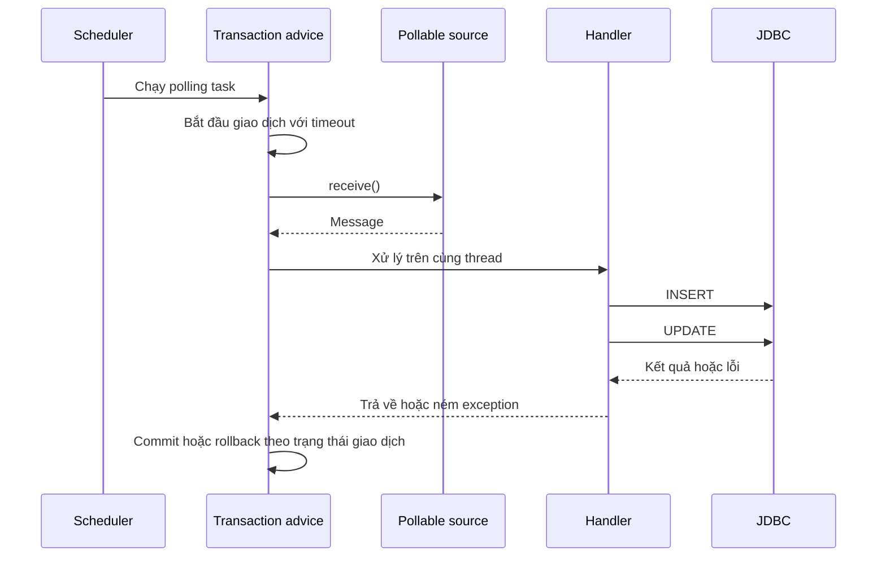

# Transaction timeout trong Spring Integration

## Mục tiêu và phạm vi

Trong module `SPRING_INTEGRATION_CORE`, bài này thuộc chương **Transaction support** và tập trung vào **Transaction timeout**: giới hạn thời gian của giao dịch bao quanh một phần luồng thông điệp. Sau bài học, bạn có thể đặt timeout cho poller bằng Java DSL, xác định đoạn xử lý được bảo vệ, giải thích vì sao một tác vụ vẫn chạy sau thời điểm hết hạn và thiết kế kiểm thử xác nhận rollback.

Ví dụ sử dụng luồng imperative, `PlatformTransactionManager` và JDBC. Bạn nên biết cấu trúc `Message`, vai trò của `MessageChannel`, polling consumer và các thao tác cơ bản của `JdbcTemplate`. Với luồng reactive, giao dịch dựa trên Reactor context cần được thiết kế riêng; không áp dụng nguyên xi các kết luận về thread-local trong bài này.

## 1. Timeout giới hạn điều gì?

Giả sử ứng dụng nhận yêu cầu nhập đơn hàng. Mỗi thông điệp cần ghi dữ liệu vào cơ sở dữ liệu, cập nhật trạng thái và kết thúc giao dịch. Một yêu cầu chậm có thể giữ connection hoặc khóa lâu, khiến các yêu cầu khác phải chờ. Transaction timeout cung cấp một ngân sách thời gian cho giao dịch để hệ thống giao dịch và tài nguyên tham gia nhận biết việc quá hạn.

Spring Integration sử dụng hạ tầng giao dịch của Spring Framework. Thuộc tính timeout có các quy tắc cơ bản sau:

- Đơn vị của `TransactionDefinition.getTimeout()`, `@Transactional(timeout = ...)` và `TransactionInterceptorBuilder.timeout(...)` là **giây**.
- `TIMEOUT_DEFAULT`, có giá trị `-1`, yêu cầu dùng mặc định của hệ thống giao dịch bên dưới. Không được suy ra rằng mọi môi trường đều có cùng một mặc định.
- Timeout do nơi khởi tạo giao dịch vật lý mới quyết định. Khai báo ở một nơi chỉ tham gia giao dịch đã tồn tại không tạo lại thời hạn.
- Transaction manager phải hỗ trợ timeout; không thể giả định mọi implementation thực thi giống nhau.

Để diễn đạt giới hạn rõ ràng trong cấu hình, nên dùng số giây dương. Không dùng `0` với giả định chung rằng đó luôn là “vô hạn”; cần tra hợp đồng của transaction manager và tài nguyên đang dùng. Xem [TransactionDefinition](https://docs.spring.io/spring-framework/docs/current/javadoc-api/org/springframework/transaction/TransactionDefinition.html) và [DefaultTransactionDefinition.setTimeout](https://docs.spring.io/spring-framework/docs/current/javadoc-api/org/springframework/transaction/support/DefaultTransactionDefinition.html#setTimeout(int)).

Có thể hình dung ngân sách như sau:

```text
Thời điểm bắt đầu giao dịch: t0
Timeout cấu hình:            5 giây
Thời hạn dự kiến:            t0 + 5 giây

SQL thứ nhất và xử lý trước đó đã dùng 3 giây
=> phần còn lại chỉ còn khoảng 2 giây, không phải thêm 5 giây cho SQL thứ hai.
```

Đây là mô hình giải thích thời hạn, không phải cam kết thread luôn dừng chính xác ở giây thứ năm. Việc phát hiện và xử lý hết hạn phụ thuộc cơ chế của transaction manager, driver và cơ sở dữ liệu.

## 2. Phân biệt các loại thời gian trong cùng luồng

Các cấu hình có tên gần giống nhau nhưng kiểm soát những hành vi khác nhau.

| Cấu hình | Điều được giới hạn hoặc điều phối | Đơn vị cần chú ý |
| --- | --- | --- |
| Transaction timeout | Thời gian của giao dịch được khởi tạo | Giây trong Spring transaction API |
| Poller `fixedDelay` | Khoảng trì hoãn giữa các lần kích hoạt theo fixed delay | Dùng `Duration` trong ví dụ; XML mặc định dùng mili giây nếu không chỉ định khác |
| Poller `receiveTimeout` | Thời gian chờ nhận thông điệp từ pollable channel | Mili giây trong Java DSL |
| Channel `send(message, timeout)` | Thời gian thao tác gửi được phép chờ nếu channel hỗ trợ chờ | Mili giây; phụ thuộc loại channel |
| Gateway `replyTimeout` | Thời gian chờ phản hồi khi thực sự bước vào pha chờ reply | Mili giây với các thuộc tính gateway tương ứng |
| JDBC query timeout | Giới hạn cho statement theo API/driver | Giây với `JdbcTemplate.setQueryTimeout` |
| HTTP client timeout | Các pha kết nối, lấy connection hoặc đọc phản hồi | Theo API của HTTP client |

Đơn vị và vai trò của poller được mô tả trong [Message Endpoints](https://docs.spring.io/spring-integration/reference/endpoint.html) và [PollerSpec](https://docs.spring.io/spring-integration/api/org/springframework/integration/dsl/PollerSpec.html).

Ví dụ `fixedDelay(Duration.ofSeconds(1))` kết hợp transaction timeout `5` có nghĩa poller được lên lịch theo fixed delay một giây và giao dịch có timeout năm giây. Hai giá trị không đặt giới hạn cho cùng một thao tác.

Một chi tiết dễ gây hiểu nhầm: với gateway đồng bộ và toàn bộ downstream chạy qua `DirectChannel` trên cùng thread, một handler chậm có thể giữ lời gọi gateway. `replyTimeout` không tự ngắt handler đó. Khi có bàn giao sang thread khác, phía gọi có thể hết thời gian chờ reply trong khi worker tiếp tục xử lý. Xem [Gateway Behavior When No response Arrives](https://docs.spring.io/spring-integration/reference/gateway.html#gateway-timeouts).

## 3. Ranh giới giao dịch quyết định nơi timeout có hiệu lực

### 3.1. Poller mở giao dịch trước thao tác nhận

Transaction advice của poller có thể bao quanh cả `receive()` và phần xử lý tiếp theo trên cùng thread. Đây là lý do đặt giao dịch tại poller hữu ích hơn việc chỉ đặt giao dịch ở service sau bước nhận. Tuy nhiên, thao tác nhận chỉ rollback được nếu tài nguyên nguồn thật sự tham gia giao dịch. Xem [Poller Transaction Support](https://docs.spring.io/spring-integration/reference/transactions.html).



Thời gian thông điệp đã nằm trong hàng đợi **trước khi poller mở giao dịch** không thuộc timeout này. Ngược lại, nếu giao dịch đã bắt đầu rồi mới chờ `receive()`, thời gian chờ đó tiêu tốn ngân sách giao dịch. Vì vậy, `receiveTimeout` rất dài có thể chiếm phần lớn ngân sách trước khi handler bắt đầu.

Trong polling endpoint imperative tiêu chuẩn, transaction advice bọc từng thao tác nhận và xử lý. Tăng `maxMessagesPerPoll` không tự biến toàn bộ các thông điệp trong một lần kích hoạt lịch thành một giao dịch duy nhất. Đồng thời, một lần nhận có thể tạo payload chứa nhiều bản ghi, khiến nhiều bản ghi vẫn được xử lý trong một giao dịch. Cần phân biệt số lần nhận thông điệp và số bản ghi trong payload. Có thể đối chiếu cách tạo advice và vòng lặp trong [AbstractPollingEndpoint](https://raw.githubusercontent.com/spring-projects/spring-integration/main/spring-integration-core/src/main/java/org/springframework/integration/endpoint/AbstractPollingEndpoint.java).

### 3.2. Giao dịch imperative gắn với thread

`DirectChannel` gọi handler trên thread gửi, nên phù hợp khi cần duy trì ngữ cảnh giao dịch xuyên qua nhiều endpoint đồng bộ. Việc bàn giao qua `ExecutorChannel` hoặc lưu vào `QueueChannel` để một consumer khác nhận không tự truyền giao dịch thread-local sang worker. Xem [DirectChannel](https://docs.spring.io/spring-integration/reference/channel/implementations.html#channel-implementations-directchannel).

```text
Poller [TX-A] -> DirectChannel -> Transformer -> JDBC handler
               Các bước đồng bộ có thể cùng TX-A.

Poller [TX-A] -> QueueChannel -> Poller khác [TX-B] -> JDBC handler
               Việc nhận và xử lý ở phía sau thuộc ranh giới riêng.
```

Sau khi bàn giao thành công, giao dịch phía trước có thể commit khi phạm vi gọi của nó kết thúc. Một lỗi ở consumer phía sau không tự rollback phần đã commit. Thời hạn cũng không được tự chuyển sang giao dịch mới qua header; nếu cần ngân sách cho toàn bộ yêu cầu, ứng dụng phải định nghĩa deadline nghiệp vụ riêng.

## 4. Ví dụ Java DSL: poller có timeout hai giây

Ví dụ minh họa việc ghi dữ liệu JDBC được commit hoặc rollback theo kết quả xử lý. `QueueChannel` trong ví dụ lưu thông điệp trong bộ nhớ và **không tự đưa thông điệp trở lại hàng đợi khi JDBC rollback**. Muốn bảo đảm nhận lại thông điệp, cần một nguồn hoặc message store có cơ chế giao dịch phù hợp cùng chính sách retry/redelivery. Các queue mặc định là bộ nhớ được mô tả tại [Message Channel Implementations](https://docs.spring.io/spring-integration/reference/channel/implementations.html).

Giả định ứng dụng đã có một `DataSource`, thư viện Spring Integration Core và Spring JDBC tương thích. Khởi tạo bảng sau trước khi gửi yêu cầu; không đặt DDL vào giao dịch nghiệp vụ đang kiểm thử.

```sql
CREATE TABLE processed_order (
    request_id VARCHAR(100) PRIMARY KEY,
    processing_status VARCHAR(20) NOT NULL
);
```

Cấu hình dưới đây dùng Java 17 trở lên để khai báo `record`. Các bean JDBC và transaction manager cùng sử dụng đúng một `DataSource`.

```java
import java.time.Duration;
import javax.sql.DataSource;

import org.springframework.beans.factory.annotation.Qualifier;
import org.springframework.context.annotation.Bean;
import org.springframework.context.annotation.Configuration;
import org.springframework.integration.channel.QueueChannel;
import org.springframework.integration.config.EnableIntegration;
import org.springframework.integration.dsl.IntegrationFlow;
import org.springframework.integration.dsl.Pollers;
import org.springframework.integration.transaction.TransactionInterceptorBuilder;
import org.springframework.jdbc.core.JdbcTemplate;
import org.springframework.jdbc.datasource.DataSourceTransactionManager;
import org.springframework.transaction.PlatformTransactionManager;
import org.springframework.transaction.annotation.Propagation;
import org.springframework.transaction.interceptor.TransactionInterceptor;

@Configuration
@EnableIntegration
public class OrderTimeoutConfiguration {

    public record OrderCommand(String requestId, boolean slow) {
    }

    @Bean
    JdbcTemplate orderJdbc(DataSource dataSource) {
        return new JdbcTemplate(dataSource);
    }

    @Bean
    PlatformTransactionManager orderTxManager(DataSource dataSource) {
        return new DataSourceTransactionManager(dataSource);
    }

    @Bean
    QueueChannel orderQueue() {
        return new QueueChannel(100);
    }

    @Bean
    QueueChannel orderErrorQueue() {
        return new QueueChannel(100);
    }

    @Bean
    TransactionInterceptor orderTxAdvice(
            @Qualifier("orderTxManager") PlatformTransactionManager txManager) {
        return new TransactionInterceptorBuilder()
                .transactionManager(txManager)
                .propagation(Propagation.REQUIRED)
                .timeout(2) // Giây, không phải mili giây.
                .build();
    }

    @Bean
    OrderWriter orderWriter(@Qualifier("orderJdbc") JdbcTemplate jdbc) {
        return new OrderWriter(jdbc);
    }

    @Bean
    IntegrationFlow orderFlow(
            @Qualifier("orderQueue") QueueChannel input,
            @Qualifier("orderErrorQueue") QueueChannel errors,
            @Qualifier("orderTxAdvice") TransactionInterceptor txAdvice,
            OrderWriter writer) {
        return IntegrationFlow.from(input)
                .handle(writer, "write", endpoint -> endpoint
                        .id("orderWriterEndpoint")
                        .poller(Pollers.fixedDelay(Duration.ofSeconds(1))
                                .maxMessagesPerPoll(1)
                                .receiveTimeout(100) // Mili giây.
                                .transactional(txAdvice)
                                .errorChannel(errors)))
                .get();
    }

    public static class OrderWriter {
        private final JdbcTemplate jdbc;

        public OrderWriter(JdbcTemplate jdbc) {
            this.jdbc = jdbc;
        }

        public void write(OrderCommand command) {
            jdbc.update(
                    "INSERT INTO processed_order "
                            + "(request_id, processing_status) VALUES (?, ?)",
                    command.requestId(), "PROCESSING");

            if (command.slow()) {
                simulateSlowWork();
            }

            jdbc.update(
                    "UPDATE processed_order SET processing_status = ? "
                            + "WHERE request_id = ?",
                    "DONE", command.requestId());
        }

        private void simulateSlowWork() {
            try {
                Thread.sleep(3100);
            }
            catch (InterruptedException ex) {
                Thread.currentThread().interrupt();
                throw new IllegalStateException("Interrupted during demo", ex);
            }
        }
    }
}
```

`Thread.sleep` chỉ tạo tình huống chậm để học và kiểm thử. Trong ứng dụng thật, cần xác định bước chậm là chờ khóa, truy vấn, CPU hay gọi mạng để chọn cơ chế giới hạn phù hợp.

API `.transactional(txAdvice)` gắn `TransactionInterceptor` vào polling task; builder cung cấp thuộc tính timeout và transaction manager. Xem [PollerSpec.transactional](https://docs.spring.io/spring-integration/api/org/springframework/integration/dsl/PollerSpec.html) và [TransactionInterceptorBuilder](https://docs.spring.io/spring-integration/api/org/springframework/integration/transaction/TransactionInterceptorBuilder.html).

Gửi hai thông điệp có mã yêu cầu khác nhau vào `orderQueue`:

```java
import org.springframework.integration.support.MessageBuilder;

boolean accepted = orderQueue.send(
        MessageBuilder.withPayload(
                new OrderTimeoutConfiguration.OrderCommand("order-fast", false))
                .build(),
        1000);

if (!accepted) {
    throw new IllegalStateException("Queue did not accept order-fast");
}

boolean slowAccepted = orderQueue.send(
        MessageBuilder.withPayload(
                new OrderTimeoutConfiguration.OrderCommand("order-slow", true))
                .build(),
        1000);

if (!slowAccepted) {
    throw new IllegalStateException("Queue did not accept order-slow");
}
```

Hai kết quả `true` chỉ chứng minh thao tác đưa thông điệp vào queue thành công. Handler chạy sau trên thread của poller. Trong điều kiện thông thường, `order-fast` được lưu với trạng thái `DONE`; với `order-slow`, lần JDBC thứ hai gặp giao dịch hết hạn, exception thoát khỏi handler và bản ghi `PROCESSING` được rollback. Xác nhận kết quả sau khi consumer đã xử lý, không truy vấn ngay sau `send()` rồi kết luận thất bại.

`orderErrorQueue` chỉ phục vụ quan sát lỗi trong ví dụ. Nó cũng có dung lượng hữu hạn; khi vận hành cần consumer xử lý hoặc lưu lỗi bền vững.

## 5. Vì sao hết timeout mà thread vẫn tiếp tục chạy?

Với `DataSourceTransactionManager`, Spring quản lý connection theo thread và hỗ trợ truyền timeout vào JDBC statement. Để hưởng cơ chế này, code phải dùng `JdbcTemplate`, hoặc đường truy cập JDBC có tích hợp `DataSourceUtils`/`TransactionAwareDataSourceProxy`. Tự lấy một connection độc lập rồi chạy SQL có thể bỏ qua giao dịch dự kiến. Xem [DataSourceTransactionManager](https://docs.spring.io/spring-framework/docs/current/javadoc-api/org/springframework/jdbc/datasource/DataSourceTransactionManager.html).

Có hai tình huống khác nhau:

1. Một thao tác JDBC mới bắt đầu sau khi thời hạn giao dịch đã hết: Spring có thể phát hiện và ném `TransactionTimedOutException`.
2. Statement đã chạy và vượt giới hạn mà driver áp dụng: lỗi có thể xuất phát từ driver/cơ sở dữ liệu, được dịch thành một loại `DataAccessException`, chẳng hạn `QueryTimeoutException` tùy trường hợp.

Không nên chỉ tìm một tên exception duy nhất để nhận diện mọi sự cố timeout. JTA còn có cơ chế áp dụng thời hạn từ transaction coordinator riêng. Xem [TransactionTimedOutException](https://docs.spring.io/spring-framework/docs/current/javadoc-api/org/springframework/transaction/TransactionTimedOutException.html).

Trong ví dụ, `Thread.sleep(3100)` không bị bộ đếm hai giây của giao dịch tự động ngắt. Sau khi ngủ xong, handler gọi `JdbcTemplate` lần nữa; đó là điểm có thể kiểm tra thời gian còn lại và phát hiện hết hạn. Cơ chế resource holder có khái niệm deadline và thời gian sống còn lại, như mô tả tại [ResourceHolderSupport](https://docs.spring.io/spring-framework/docs/current/javadoc-api/org/springframework/transaction/support/ResourceHolderSupport.html).

Nếu thay phần cuối bằng một vòng lặp CPU vô hạn hoặc một lời gọi mạng không có timeout, đừng kỳ vọng transaction timeout tự cứu thread. Với local JDBC transaction, cũng không được dùng tình huống “ghi dữ liệu, ngủ quá hạn rồi trả về mà không chạm tài nguyên nữa” làm bằng chứng chắc chắn rằng giao dịch sẽ rollback. Cần kiểm thử cơ chế thực thi thực tế; thời hạn cấu hình không phải một bộ giám sát ngắt tùy ý mọi mã Java.

### Query timeout không nhất thiết lấy giá trị nhỏ nhất

Một hiểu nhầm thường gặp là đặt `jdbcTemplate.setQueryTimeout(1)` và transaction timeout `5` sẽ luôn cho statement giới hạn một giây. Javadoc của `JdbcTemplate` nêu rằng timeout đặt trên template bị thời gian giao dịch còn lại ghi đè khi giao dịch hiện tại có timeout. Không nên giả định đây luôn là phép `min(queryTimeout, transactionTimeout)`.

Khi cần chính sách riêng cho statement hoặc lock wait, phải kiểm tra cách driver và cơ sở dữ liệu thực thi, đồng thời thiết kế cùng timeout giao dịch. Xem [JdbcTemplate.setQueryTimeout](https://docs.spring.io/spring-framework/docs/current/javadoc-api/org/springframework/jdbc/core/JdbcTemplate.html#setQueryTimeout(int)) và [DataSourceUtils.applyTimeout](https://docs.spring.io/spring-framework/docs/current/javadoc-api/org/springframework/jdbc/datasource/DataSourceUtils.html).

## 6. Các cách cấu hình khác và ảnh hưởng của propagation

### 6.1. XML cho poller

Nếu dự án dùng XML, có thể diễn đạt cùng ý tưởng bằng cấu hình sau. Đây là đoạn trích đặt trong tệp Spring XML đã khai báo namespace `int` và có bean `orderTxManager`.

```xml
<int:service-activator input-channel="orderQueue"
                       ref="orderWriter"
                       method="write">
    <int:poller fixed-delay="1000"
                receive-timeout="100"
                max-messages-per-poll="1">
        <int:transactional transaction-manager="orderTxManager"
                           propagation="REQUIRED"
                           timeout="2"/>
    </int:poller>
</int:service-activator>
```

Trong đoạn này, `fixed-delay="1000"` và `receive-timeout="100"` dùng mili giây theo cấu hình đang chọn; `timeout="2"` bên trong `transactional` dùng giây. Không áp dụng đơn vị của poller trigger sang thuộc tính giao dịch. Nếu cần nhiều advice qua `<int:advice-chain>`, đặt transaction advice trong chain thay vì khai báo đồng thời `<int:transactional>`; hai cách này loại trừ nhau. Xem [AOP Advice chains](https://docs.spring.io/spring-integration/reference/endpoint.html).

### 6.2. `@Transactional` ở service

Có thể đặt `@Transactional(timeout = 2)` trên phương thức service do Spring quản lý và gọi qua proxy. Khi service đó mở giao dịch mới, timeout thuộc phạm vi service, có thể không bao gồm bước nhận thông điệp trước đó.

Gắn `@Transactional` lên phương thức `@Bean` tạo `IntegrationFlow` không tự bọc các lần xử lý thông điệp trong tương lai. Tương tự, self-invocation trong cùng đối tượng có thể không đi qua proxy ở chế độ proxy mặc định. Cần phân biệt lúc khởi tạo bean với lúc gọi handler. Xem [Using @Transactional](https://docs.spring.io/spring-framework/reference/data-access/transaction/declarative/annotations.html).

### 6.3. Timeout bên trong có thay timeout bên ngoài không?

| Tình huống | Hiệu lực cần hiểu |
| --- | --- |
| Poller mở giao dịch với `REQUIRED`, timeout 5 giây; service `REQUIRED`, timeout 1 giây | Service tham gia giao dịch hiện tại; giá trị 1 giây không đặt lại deadline |
| Service dùng `REQUIRES_NEW`, timeout 1 giây | Mở giao dịch vật lý độc lập với timeout riêng; commit/rollback độc lập |
| Service dùng `NESTED` trong JDBC transaction có hỗ trợ savepoint | Dùng cùng giao dịch vật lý và savepoint; không tạo ngân sách độc lập như `REQUIRES_NEW` |

`REQUIRES_NEW` không phải một cách rút ngắn tùy ý giao dịch ngoài: tài nguyên của giao dịch ngoài vẫn có thể được giữ khi giao dịch trong mượn connection riêng. Phải xét atomicity và khả năng cấp connection trước khi chọn propagation. Xem [Transaction Propagation](https://docs.spring.io/spring-framework/reference/data-access/transaction/declarative/tx-propagation.html).

## 7. Xử lý lỗi, retry và tác dụng phụ

### 7.1. Lỗi phải đi qua ranh giới giao dịch

Khi cần rollback vì thất bại, exception phù hợp phải thoát khỏi phạm vi giao dịch hoặc giao dịch phải được đánh dấu rollback-only. Nếu code bắt lỗi rồi trả về như thành công trước khi transaction advice nhìn thấy lỗi, kết quả có thể là commit; nếu tài nguyên đã bị đánh dấu rollback-only, việc bắt lỗi cũng không khôi phục được khả năng commit.

Theo cấu hình rollback mặc định của Spring, `RuntimeException` và `Error` kích hoạt rollback, còn checked exception cần quy tắc phù hợp. Vì vậy, khi chuyển lỗi timeout thành exception nghiệp vụ, phải xét cả kiểu exception mới và vị trí chuyển đổi. Xem [Transactional: Attribute Semantics](https://docs.spring.io/spring-framework/docs/current/javadoc-api/org/springframework/transaction/annotation/Transactional.html).

### 7.2. `errorChannel` là nơi quan sát và điều phối lỗi

Với flow chạy trên thread gọi qua `DirectChannel`, exception có thể truyền về caller. Với poller hoặc xử lý bất đồng bộ, Spring Integration có cơ chế phát `ErrorMessage`; payload là exception và có thể cần duyệt chuỗi `cause` để tìm lỗi gốc. Xem [Error Handling](https://docs.spring.io/spring-integration/reference/error-handling.html).

Trong ví dụ, có thể nhận từ `orderErrorQueue` để quan sát lỗi. Không suy ra rằng producer đã thấy exception từ `send()`, hoặc việc có một error channel tự làm queue đầu vào transactional. Cũng cần phân biệt lỗi phát ra sau khi polling task thất bại với một recovery advice bên trong đã nuốt lỗi và trả về thành công.

Thông tin hữu ích khi lưu lỗi gồm mã yêu cầu nghiệp vụ, endpoint, thời điểm bắt đầu/kết thúc, timeout cấu hình và loại lỗi gốc. Với retry hoặc redelivery, dùng mã nghiệp vụ ổn định để liên kết các lần thử; `MessageHeaders.ID` không thay thế mặc định cho khóa idempotency nghiệp vụ.

### 7.3. Mỗi lần retry cần phạm vi giao dịch phù hợp

Về thiết kế, retry bao ngoài transaction có thể cho mỗi lần thử một giao dịch mới, nếu mỗi lần thật sự khởi tạo mới. Nếu transaction bao ngoài retry, các lần thử và thời gian backoff có thể cùng tiêu tốn một ngân sách, thậm chí tiếp tục trên giao dịch đã rollback-only. Khi dùng `REQUIRED`, phải kiểm tra có giao dịch ngoài tồn tại hay không trước khi kết luận “mỗi attempt là một transaction mới”.

Sau timeout, chỉ retry những thao tác có khả năng hồi phục, giới hạn số lần thử và xử lý trùng lặp bằng khóa nghiệp vụ. Không thử tiếp các câu SQL trong cùng giao dịch đã hết hạn chỉ vì còn số lần retry.

### 7.4. JDBC rollback không hoàn tác mọi tác dụng phụ

Nếu handler gửi HTTP thành công rồi JDBC timeout, rollback cơ sở dữ liệu không tự hoàn tác yêu cầu HTTP. Hai tài nguyên độc lập cũng không tự trở thành một giao dịch phân tán chỉ vì cùng nằm trong một flow. Có thể thiết kế ghi dữ liệu nghiệp vụ và outbox trong cùng giao dịch, rồi gửi ra ngoài bằng một worker riêng với cơ chế chống trùng phù hợp.

Transaction synchronization chỉ phối hợp callback với kết quả giao dịch, không biến file, HTTP hoặc tài nguyên không transactional thành tài nguyên có rollback. `PseudoTransactionManager` cũng không cung cấp rollback tài nguyên thật. Xem [Transaction Synchronization và Pseudo Transactions](https://docs.spring.io/spring-integration/reference/transactions.html).

## 8. Kiểm thử timeout và rollback có chủ đích

Một kiểm thử hữu ích phải chứng minh trạng thái dữ liệu sau khi phạm vi giao dịch kết thúc. Chỉ đo thời gian chạy hoặc chỉ kiểm tra một dòng log không đủ để kết luận rollback đúng.

Có thể kiểm tra cơ chế JDBC trước bằng JUnit 5, Spring JDBC và H2. Mã dưới đây sử dụng lại `OrderWriter` của ví dụ. Cơ sở dữ liệu được tạo riêng cho mỗi lần chạy, DDL thực thi trước giao dịch, và phép kiểm tra cuối thực hiện sau khi rollback đã hoàn thành.

```java
import org.junit.jupiter.api.Test;
import org.springframework.jdbc.core.JdbcTemplate;
import org.springframework.jdbc.datasource.DataSourceTransactionManager;
import org.springframework.jdbc.datasource.embedded.EmbeddedDatabase;
import org.springframework.jdbc.datasource.embedded.EmbeddedDatabaseBuilder;
import org.springframework.jdbc.datasource.embedded.EmbeddedDatabaseType;
import org.springframework.transaction.TransactionTimedOutException;
import org.springframework.transaction.support.TransactionTemplate;

import static org.junit.jupiter.api.Assertions.assertEquals;
import static org.junit.jupiter.api.Assertions.assertThrows;

class JdbcTransactionTimeoutTest {

    @Test
    void rollsBackEarlierInsertWhenTheNextOperationDetectsTimeout() {
        EmbeddedDatabase database = new EmbeddedDatabaseBuilder()
                .generateUniqueName(true)
                .setType(EmbeddedDatabaseType.H2)
                .build();

        try {
            JdbcTemplate jdbc = new JdbcTemplate(database);
            jdbc.execute("CREATE TABLE processed_order ("
                    + "request_id VARCHAR(100) PRIMARY KEY, "
                    + "processing_status VARCHAR(20) NOT NULL)");

            TransactionTemplate transaction = new TransactionTemplate(
                    new DataSourceTransactionManager(database));
            transaction.setTimeout(2);

            var writer = new OrderTimeoutConfiguration.OrderWriter(jdbc);
            var command = new OrderTimeoutConfiguration.OrderCommand(
                    "timeout-test", true);

            assertThrows(TransactionTimedOutException.class,
                    () -> transaction.executeWithoutResult(
                            status -> writer.write(command)));

            Integer remaining = jdbc.queryForObject(
                    "SELECT COUNT(*) FROM processed_order WHERE request_id = ?",
                    Integer.class,
                    "timeout-test");

            assertEquals(Integer.valueOf(0), remaining);
        }
        finally {
            database.shutdown();
        }
    }
}
```

Trong kiểm thử này, lần `INSERT` chạy trước thời gian chờ có chủ đích; lần JDBC tiếp theo chạm deadline đã hết. Việc dùng `TransactionTemplate` giúp kiểm tra riêng cơ chế giao dịch mà không phụ thuộc lịch poller. Cách cấu hình template được mô tả tại [Programmatic Transaction Management](https://docs.spring.io/spring-framework/reference/data-access/transaction/programmatic.html).

Kiểm thử trên chưa xác nhận toàn bộ Java DSL, error channel hay việc nhận lại thông điệp. Để kiểm tra cấu hình integration thực tế, cần bổ sung các kịch bản sau:

| Kịch bản | Điều cần xác nhận |
| --- | --- |
| Thông điệp nhanh | Bản ghi tồn tại với trạng thái `DONE` sau khi consumer hoàn thành |
| Thông điệp chậm | Có lỗi tương ứng, và không còn bản ghi `PROCESSING` đã ghi trong giao dịch thất bại |
| Lỗi từ poller | `orderErrorQueue` nhận `ErrorMessage`; chuỗi nguyên nhân phản ánh lỗi giao dịch |
| Nguồn transactional có redelivery | Thông điệp có thể nhận lại theo cấu hình nguồn; không chỉ kiểm tra rollback JDBC |
| Handler qua `ExecutorChannel` | Xác nhận ranh giới giao dịch riêng thay vì kỳ vọng timeout của thread trước truyền qua |
| `REQUIRED` bên trong | Xác nhận service không có deadline độc lập với giao dịch đã tồn tại |

Với kiểm thử poller, dùng chờ có điều kiện và thời hạn tổng phù hợp để quan sát kết quả thay vì một lần `sleep` cố định rồi truy vấn. Không đặt toàn bộ test trong một giao dịch bao ngoài khiến dữ liệu mà thread poller cần đọc chưa commit. Không dùng một cơ chế timeout của test để thay thế cho phép kiểm tra trạng thái dữ liệu sau giao dịch.

Kịch bản ngủ rồi truy cập JDBC kiểm tra việc phát hiện giao dịch đã hết hạn, không kiểm tra khả năng hủy một query đang chạy. Muốn xác nhận query timeout hoặc chờ khóa, cần kiểm thử trên loại cơ sở dữ liệu và driver mục tiêu, tạo tình huống truy vấn/khóa thực tế và kiểm tra cả lỗi lẫn trạng thái dữ liệu.

## 9. Chọn ngân sách và chẩn đoán sự cố

Không có một giá trị timeout đúng cho mọi flow. Hãy xác định yêu cầu thời gian từ nghiệp vụ, đo thời gian xử lý bình thường và xem phần nào thật sự cần giữ giao dịch mở.

Một ví dụ lập ngân sách để thảo luận với nhóm:

```text
Yêu cầu cần kết quả trong khoảng 10 giây:
- Chờ trước khi worker bắt đầu: mục tiêu tối đa 2 giây.
- Giao dịch ghi dữ liệu:       ngân sách 5 giây.
- Trả kết quả:                 dự kiến 1 giây.
- Phần dự phòng:               2 giây.
```

Đây là ngân sách thiết kế, không phải bảo đảm tự có từ `timeout(5)`. Hàng đợi phải được kiểm soát, lời gọi mạng phải có giới hạn riêng, và ứng dụng cần quyết định xử lý thế nào khi deadline nghiệp vụ đã hết trước lúc consumer bắt đầu.

Nếu có transformer hoặc filter chỉ xử lý dữ liệu thuần và tốn thời gian đáng kể, cân nhắc thực hiện chúng trước khi mở giao dịch ghi dữ liệu, miễn là vẫn giữ đúng tính nhất quán cần thiết. Với aggregator, thời gian chờ gom nhóm là vòng đời nhóm thông điệp; cần thiết kế riêng, tránh giữ một JDBC transaction mở chỉ để đợi các thông điệp khác.

Khi thấy lỗi timeout tăng, có thể kiểm tra theo thứ tự sau:

1. Tìm request cụ thể và xác định exception gốc, thay vì chỉ nhìn exception bọc ngoài của messaging.
2. Xác định transaction manager, nơi mở giao dịch, propagation và giá trị timeout thật sự có hiệu lực.
3. Vẽ ranh giới thread/channel; tìm chỗ chuyển sang queue hoặc executor.
4. Đo thời gian nhận thông điệp, thời gian chạy SQL, chờ khóa và thời gian xử lý bên ngoài JDBC.
5. Kiểm tra pool connection, query plan và giao dịch khác đang giữ khóa.
6. Xác nhận rollback, redelivery và tác dụng phụ bên ngoài trước khi quyết định retry.

Việc tăng timeout có thể che một truy vấn chậm hoặc khiến connection và khóa được giữ lâu hơn. Chỉ điều chỉnh sau khi biết nguyên nhân và khả năng đáp ứng của tài nguyên.

## 10. Các lỗi hiểu cần tránh

| Cách hiểu | Cách áp dụng đúng |
| --- | --- |
| `timeout(2000)` là hai giây | Trong transaction builder, đó là 2.000 giây; dùng `timeout(2)` cho hai giây |
| Poller chạy mỗi giây nên giao dịch không thể lâu hơn một giây | Chu kỳ poller và timeout giao dịch là hai cấu hình khác nhau |
| Hết timeout sẽ ngắt mọi handler | Cần xét cơ chế phát hiện hết hạn; CPU và HTTP cần giới hạn phù hợp |
| Đặt timeout ngắn hơn ở service `REQUIRED` sẽ rút ngắn transaction ngoài | Service đang tham gia giao dịch vật lý có sẵn |
| JDBC rollback sẽ trả message về queue bộ nhớ | Phải có nguồn transactional hoặc cơ chế lưu/nhận lại được thiết kế riêng |
| Gateway hết chờ đồng nghĩa worker đã rollback | Thời gian chờ caller và kết quả worker cần được xác nhận riêng |
| Có `errorChannel` thì mọi lỗi đều rollback | Kết quả còn phụ thuộc vị trí advice, exception propagation và trạng thái giao dịch |
| Một test chạy quá hai giây là bằng chứng timeout không hoạt động | Có thể lỗi chỉ được phát hiện ở thao tác tài nguyên tiếp theo; cần kiểm tra dữ liệu và nguyên nhân |

Khi thiết kế một flow có transaction timeout, cần trả lời được bốn câu hỏi: **ai mở giao dịch, tài nguyên nào tham gia, điểm nào phát hiện hết hạn và dữ liệu/thông điệp đi đâu sau thất bại**. Bốn câu trả lời này liên kết cấu hình timeout với hành vi thực tế của hệ thống.
