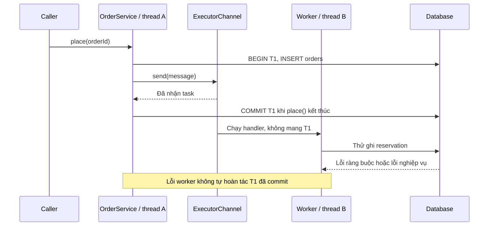

# Không để async channel phá vỡ transaction context

Một luồng thông điệp có thể đi qua nhiều endpoint nhưng vẫn thuộc cùng transaction; ngược lại, chỉ một lần chuyển sang thread khác cũng có thể khiến các bước xử lý không còn chung transaction. Điều cần xác định là **thread nào đang thực thi, transaction bắt đầu và kết thúc ở đâu, tài nguyên nào thực sự tham gia**.

Trong chương Transaction support của `SPRING_INTEGRATION_CORE`, bài này dùng `Message`, `MessageChannel`, gateway, endpoint và Java DSL để phân tích ranh giới đó. Mục tiêu là thiết kế đúng hành vi commit, rollback và bàn giao công việc khi cần xử lý bất đồng bộ.

## 1. Phạm vi và kiến thức cần có

Bài tập trung vào transaction kiểu imperative, dùng `PlatformTransactionManager` với JDBC. Người học cần biết cách tạo bean, gọi messaging gateway và nối các endpoint trong `IntegrationFlow`.

Sau bài học, bạn có thể:

- Chỉ ra điểm chuyển thread trong một flow và dự đoán bước nào còn thuộc transaction của caller.
- Giữ các cập nhật cần nguyên tử trên cùng thread.
- Tách producer và consumer thành hai transaction có chủ đích.
- Phân biệt hàng đợi trong bộ nhớ, hàng đợi bền vững và hàng đợi thực sự tham gia transaction.
- Kiểm chứng kết quả bằng dữ liệu sau commit hoặc rollback, thay vì chỉ nhìn log gửi message.

Với transaction JDBC thông thường, `@Transactional` không truyền transaction sang thread mới. Transaction reactive dùng `ReactiveTransactionManager` và Reactor context có mô hình khác; không áp dụng máy móc kết luận về thread-local cho pipeline reactive. Xem [hợp đồng của @Transactional](https://docs.spring.io/spring-framework/docs/current/javadoc-api/org/springframework/transaction/annotation/Transactional.html).

Các đoạn cấu hình dưới đây minh họa những API Java DSL thông dụng. Dùng bộ phiên bản Spring Framework, Spring Integration và driver cơ sở dữ liệu tương thích do ứng dụng quản lý; không cần thay dependency để thực hành nguyên lý trong bài.

## 2. Transaction context không nằm trong Message

Trong mô hình JDBC đang xét, có ba lớp thông tin riêng biệt:

| Lớp | Ví dụ | Vai trò |
| --- | --- | --- |
| Dữ liệu thông điệp | Payload chứa `orderId`, header chứa `commandId` | Mô tả công việc và giúp đối chiếu |
| Ngữ cảnh xử lý | Thread, call stack, endpoint đang chạy | Quyết định đường thực thi và đường truyền exception |
| Trạng thái transaction | JDBC connection gắn với thread, rollback-only, callback đồng bộ transaction | Quản lý commit hoặc rollback tài nguyên |

Một `Message<Long>` được chuyển sang worker vẫn mang mã đơn hàng. Điều đó không mang theo transaction của thread gửi. Header như `transactionId`, `correlationId` hoặc mã trace chỉ là dữ liệu; chúng không làm JDBC connection của worker tham gia transaction nguồn.

`TransactionSynchronizationManager` quản lý tài nguyên và các synchronization theo thread. Ứng dụng có thể đọc trạng thái để chẩn đoán, nhưng không nên tự sao chép resource map hoặc bind connection của caller vào worker. Xem [TransactionSynchronizationManager](https://docs.spring.io/spring-framework/docs/current/javadoc-api/org/springframework/transaction/support/TransactionSynchronizationManager.html).

Để các thao tác JDBC cùng thuộc transaction, cần kiểm tra đồng thời:

1. Có transaction bao quanh đoạn xử lý.
2. Đoạn xử lý tiếp tục trên thread gắn transaction đó.
3. Các thao tác dùng tài nguyên do transaction manager tương ứng quản lý.
4. Không có propagation chủ động tạo hoặc tách sang transaction khác.
5. Lỗi tới được ranh giới transaction và đáp ứng quy tắc rollback.

Cùng thread là điều kiện quan trọng nhưng chưa đủ. Một lệnh HTTP gửi tới dịch vụ thanh toán không tự trở thành tài nguyên có thể rollback chỉ vì nó được gọi trên thread đang giữ transaction JDBC.

## 3. Đọc loại channel như đọc ranh giới thực thi

| Thành phần hoặc cách gọi | Cách thực thi cần chú ý | Hệ quả đối với transaction của sender |
| --- | --- | --- |
| `DirectChannel` | Gọi handler trên thread gửi | Có thể tiếp tục dùng transaction hiện có |
| `ExecutorChannel` với thread pool | Bàn giao handler cho executor | Không bảo đảm handler tham gia transaction của sender |
| `QueueChannel` được consumer/poller nhận sau | Tách việc gửi và việc nhận | Không tự nối transaction producer với transaction consumer |
| `PublishSubscribeChannel` không có executor | Thông thường gọi subscriber đồng bộ | Các nhánh có thể dùng transaction hiện có nếu không đổi thread |
| `PublishSubscribeChannel` có executor | Subscriber có thể chạy trên thread khác | Cần xem các nhánh là những phạm vi thực thi riêng |
| `@Async`, `CompletableFuture`, tự submit task trong handler | Việc đổi thread bị giấu trong mã nghiệp vụ | Channel phía trước là direct cũng không giữ được transaction qua đoạn này |

`DirectChannel` gọi handler trước khi `send()` trả về; nó không tự mở transaction. `ExecutorChannel` không cung cấp transaction bao trùm sender và handler. Với `CallerRunsPolicy`, task có thể chạy trên thread gửi khi pool quá tải; không dùng tình huống phụ thuộc tải đó để bảo đảm transaction. Xem [Message Channel Implementations](https://docs.spring.io/spring-integration/reference/channel/implementations.html).

Đối với `QueueChannel`, chính cấu trúc queue tách `send()` khỏi `receive()`. Việc nhận thường do poller thực hiện trên thread riêng. Nếu tự viết một đoạn gửi rồi nhận trên cùng thread, cần phân tích đúng đoạn mã đó; tên channel không thay thế cho việc kiểm tra đường thực thi thực tế.

### 3.1. Chuyển thread không có nghĩa commit ngay tại send()

Giả sử một phương thức `@Transactional` thực hiện:

```text
mở transaction T1
  cập nhật A
  gửi message qua ExecutorChannel
  cập nhật B
kết thúc phương thức: commit hoặc rollback T1
```

Handler async không còn nằm trong call stack dùng T1. Tuy nhiên, T1 vẫn có thể tiếp tục bao quanh cập nhật B. Nói chính xác, **phạm vi T1 không lan sang worker**; không phải channel chủ động commit T1 ngay tại lệnh gửi.

Worker còn có thể bắt đầu trước khi T1 commit. Nếu đọc lại A bằng connection khác, worker có thể không thấy thay đổi chưa commit, phải chờ lock hoặc nhận kết quả khác dự kiến, tùy isolation và loại truy vấn.

## 4. Tình huống lỗi: đơn hàng đã commit, giữ chỗ thất bại

Giả sử nghiệp vụ yêu cầu tạo đơn hàng và giữ chỗ cùng thành công. Trình tự thực tế lại là:



Sơ đồ thể hiện một thứ tự thực thi có thể xảy ra. Trong vận hành, worker có thể bắt đầu sớm hơn, ngay cả khi producer chưa commit.

Có hai biến thể cần phân biệt:

- **Worker không mở transaction riêng:** các câu lệnh JDBC có thể chạy với auto-commit. Một câu lệnh thành công rồi câu lệnh sau thất bại có thể để lại dữ liệu dở dang.
- **Worker có transaction T2 riêng:** lỗi có thể rollback các thay đổi trong T2. Đơn hàng đã commit ở T1 vẫn tồn tại.

Thêm `@Transactional` vào worker có thể giải quyết tính nguyên tử bên trong worker khi lời gọi đi qua proxy Spring. Nó không ghép T2 trở lại T1.

### 4.1. Những dấu hiệu dễ gây hiểu nhầm

| Dấu hiệu quan sát | Điều có thể kết luận | Điều còn phải kiểm tra |
| --- | --- | --- |
| `send()` trả về `true` | Channel đã chấp nhận message theo hợp đồng của nó | Handler đã hoàn tất nghiệp vụ hay chưa |
| Producer không nhận exception | Không có lỗi truyền về theo đường gọi hiện tại | Worker có lỗi ở thread khác hay không |
| Cả hai log đều có cùng `commandId` | Hai bước thuộc cùng công việc logic | Hai bước có dùng chung transaction hay không |
| `isActualTransactionActive()` đều là `true` | Mỗi vị trí đang có transaction thực | Đó có phải cùng transaction hay là T1 và T2 |
| Lỗi đã xuất hiện ở `errorChannel` | Cơ chế xử lý lỗi đã nhận được thông tin | Transaction nào rollback và message có được nhận lại không |

## 5. Thiết kế A: giữ toàn bộ phần cần nguyên tử trên cùng thread

Chọn cách này khi việc tạo đơn và giữ chỗ phải có cùng kết quả commit. Transaction được mở ở service bao quanh lời gọi gateway; flow dùng `DirectChannel`.

### 5.1. Mô hình dữ liệu thực hành

Ví dụ dùng hai bảng và một `DataSource`:

```sql
CREATE TABLE orders (
    id BIGINT PRIMARY KEY,
    status VARCHAR(32) NOT NULL
);

CREATE TABLE reservations (
    order_id BIGINT PRIMARY KEY,
    CONSTRAINT fk_reservation_order
        FOREIGN KEY (order_id) REFERENCES orders(id)
);
```

Quan hệ khóa ngoại cố ý giúp phát hiện lỗi thứ tự xử lý nếu sau này chuyển worker sang chạy trước lúc producer commit.

### 5.2. Gateway và cấu hình flow

Mỗi public type trong các ví dụ được đặt ở tệp Java riêng trong ứng dụng thực hành. Ứng dụng cần component scanning cho service, handler và gateway; các đoạn dưới lược bỏ khai báo package.

```java
import org.springframework.integration.annotation.MessagingGateway;

@MessagingGateway(defaultRequestChannel = "reservationInput")
public interface ReservationGateway {

    void reserve(Long orderId);
}
```

```java
import javax.sql.DataSource;

import org.springframework.context.annotation.Bean;
import org.springframework.context.annotation.Configuration;
import org.springframework.integration.channel.DirectChannel;
import org.springframework.integration.config.EnableIntegration;
import org.springframework.integration.dsl.IntegrationFlow;
import org.springframework.jdbc.core.JdbcTemplate;
import org.springframework.jdbc.datasource.DataSourceTransactionManager;
import org.springframework.transaction.PlatformTransactionManager;
import org.springframework.transaction.annotation.EnableTransactionManagement;

@Configuration
@EnableIntegration
@EnableTransactionManagement
public class SynchronousReservationConfig {

    @Bean
    public PlatformTransactionManager transactionManager(
            DataSource dataSource) {
        return new DataSourceTransactionManager(dataSource);
    }

    @Bean
    public JdbcTemplate jdbcTemplate(DataSource dataSource) {
        return new JdbcTemplate(dataSource);
    }

    @Bean
    public DirectChannel reservationInput() {
        return new DirectChannel();
    }

    @Bean
    public IntegrationFlow reservationFlow(
            DirectChannel reservationInput,
            ReservationHandler reservationHandler) {
        return IntegrationFlow.from(reservationInput)
                .handle(reservationHandler, "reserve")
                .get();
    }
}
```

Nếu ứng dụng đã có `JdbcTemplate` và transaction manager tương ứng, sử dụng các bean đó. Ví dụ giả định chỉ có một `DataSource`; khi có nhiều nguồn dữ liệu, cần chọn đúng bean bằng qualifier.

### 5.3. Đặt transaction ở service bao quanh gateway

```java
import org.springframework.jdbc.core.JdbcTemplate;
import org.springframework.stereotype.Service;
import org.springframework.transaction.annotation.Transactional;

@Service
public class OrderService {

    private final JdbcTemplate jdbc;
    private final ReservationGateway gateway;

    public OrderService(
            JdbcTemplate jdbc,
            ReservationGateway gateway) {
        this.jdbc = jdbc;
        this.gateway = gateway;
    }

    @Transactional(transactionManager = "transactionManager")
    public void place(Long orderId) {
        jdbc.update(
                "INSERT INTO orders(id, status) VALUES (?, ?)",
                orderId, "NEW");
        gateway.reserve(orderId);
    }
}
```

```java
import org.springframework.jdbc.core.JdbcTemplate;
import org.springframework.stereotype.Component;

@Component
public class ReservationHandler {

    private final JdbcTemplate jdbc;

    public ReservationHandler(JdbcTemplate jdbc) {
        this.jdbc = jdbc;
    }

    public void reserve(Long orderId) {
        jdbc.update(
                "INSERT INTO reservations(order_id) VALUES (?)",
                orderId);

        int changed = jdbc.update(
                "UPDATE orders SET status = ? WHERE id = ?",
                "RESERVED", orderId);

        if (changed != 1) {
            throw new IllegalStateException(
                    "Không cập nhật được đơn hàng " + orderId);
        }
    }
}
```

Trong cấu hình này, `reserve()` không cần tự mở transaction: nó chạy khi `place()` còn giữ transaction và cùng dùng `JdbcTemplate` gắn với `DataSource` đã chọn.

Khi gọi `place()` qua bean Spring:

1. Transaction interceptor mở T1.
2. Service ghi đơn hàng.
3. Gateway gửi message; direct channel gọi handler trên cùng thread.
4. Handler ghi reservation và cập nhật trạng thái đơn.
5. Các bước thành công thì T1 commit.
6. Nếu handler ném lỗi phù hợp quy tắc rollback và lỗi truyền ra khỏi `place()`, T1 rollback.

Để thực hành nhánh lỗi, tạm chèn `throw new IllegalStateException("demo failure");` sau câu lệnh cập nhật trạng thái trong handler của ứng dụng thử nghiệm. Sau khi lời gọi kết thúc bằng lỗi, cả đơn hàng mới và reservation đều phải vắng mặt.

Đây là phép kiểm tra rollback toàn bộ, vì lỗi xảy ra **sau khi** cả hai bảng đã được ghi trong transaction.

### 5.4. Vì sao vị trí annotation quan trọng?

Nếu chỉ đặt `@Transactional` trên phương thức handler, transaction có thể kết thúc khi phương thức đó trả về. Một endpoint phía sau nhận kết quả của handler không mặc nhiên còn ở trong transaction vừa kết thúc.

Khi cần mở transaction tại endpoint và bao phủ downstream đồng bộ, Spring Integration có `TransactionHandleMessageAdvice`. Advice này có phạm vi khác với một `TransactionInterceptor` thông thường đặt trong request-handler advice chain; nó vẫn không truyền transaction qua thread mới. Xem [Transaction Support cho message handler](https://docs.spring.io/spring-integration/reference/handler-advice/tx-handle-message.html).

Với ví dụ trên, service bao quanh gateway làm ranh giới dễ quan sát: transaction kết thúc sau khi toàn bộ lời gọi đồng bộ quay về service.

## 6. Thiết kế B: dùng transaction riêng và bàn giao công việc bền vững

Chọn cách này khi bên gọi có thể nhận kết quả “đã tiếp nhận”, còn giữ chỗ hoàn tất sau.

Hợp đồng nghiệp vụ cần thể hiện rõ:

- T1 commit đơn hàng trạng thái `ACCEPTED` cùng công việc cần xử lý.
- T2 nhận công việc và thực hiện giữ chỗ.
- T2 thành công thì đơn chuyển sang `RESERVED`.
- T2 lỗi thì đơn đã tiếp nhận vẫn tồn tại; công việc cần được thử lại hoặc chuyển sang xử lý thất bại có kiểm soát.

Hai transaction độc lập trở thành một phần chủ đích của thiết kế. Không có kỳ vọng rollback T2 sẽ xóa đơn hàng đã commit ở T1.

### 6.1. Transactional poller phải bao cả receive và xử lý

Nếu chỉ mở transaction ở handler:

```text
receive khỏi queue
    -> mở transaction trong handler
    -> handler lỗi, rollback dữ liệu nghiệp vụ
```

Việc lấy message đã xảy ra trước transaction của handler. Không thể suy ra message được khôi phục.

Với transactional poller và message store tham gia transaction:

```text
mở T2
    -> receive khỏi store
    -> xử lý bằng các endpoint đồng bộ
    -> commit cả việc lấy message và cập nhật nghiệp vụ
hoặc rollback T2
    -> hoàn tác các thay đổi thuộc T2
```

Poller là vị trí phù hợp để đặt transaction bao quanh `receive()`. Xem [Poller Transaction Support](https://docs.spring.io/spring-integration/reference/transactions.html#poller-transaction-support).

Điều kiện khôi phục message phụ thuộc tài nguyên: rollback JDBC không hoàn tác thao tác lấy message khỏi một queue Java trong bộ nhớ. Với persistent store có hỗ trợ transaction và poller cấu hình đúng, việc lấy message chỉ được xác nhận khi transaction thành công. Xem [Persistent QueueChannel Configuration](https://docs.spring.io/spring-integration/reference/channel/configuration.html).

### 6.2. Ví dụ QueueChannel dùng JDBC store và PostgreSQL

Cấu hình sau là **phương án thay thế** cấu hình đồng bộ ở mục 5. Không bật đồng thời hai cấu hình có bean cùng tên.

Ứng dụng thực hành cần:

- Các thư viện Spring Integration core, Spring Integration JDBC, Spring JDBC và driver PostgreSQL tương thích.
- Một `DataSource` PostgreSQL dùng cho cả bảng nghiệp vụ và bảng message store.
- Schema nghiệp vụ ở mục 5 và schema message store tương ứng phiên bản đang dùng.
- Các service và handler được Spring quản lý.

`JdbcChannelMessageStore` cần query provider phù hợp với cơ sở dữ liệu. Schema mẫu được đóng gói trong thư viện Spring Integration JDBC; cần tạo bảng trước khi dùng store. Xem [JDBC Message Store](https://docs.spring.io/spring-integration/reference/jdbc/message-store.html).

```java
import java.time.Duration;

import javax.sql.DataSource;

import org.springframework.context.annotation.Bean;
import org.springframework.context.annotation.Configuration;
import org.springframework.integration.channel.QueueChannel;
import org.springframework.integration.config.EnableIntegration;
import org.springframework.integration.dsl.IntegrationFlow;
import org.springframework.integration.dsl.Pollers;
import org.springframework.integration.jdbc.store.JdbcChannelMessageStore;
import org.springframework.integration.jdbc.store.channel
        .PostgresChannelMessageStoreQueryProvider;
import org.springframework.integration.store.MessageGroupQueue;
import org.springframework.jdbc.core.JdbcTemplate;
import org.springframework.jdbc.datasource.DataSourceTransactionManager;
import org.springframework.transaction.PlatformTransactionManager;
import org.springframework.transaction.annotation.EnableTransactionManagement;

@Configuration
@EnableIntegration
@EnableTransactionManagement
public class DurableReservationConfig {

    @Bean
    public PlatformTransactionManager transactionManager(
            DataSource dataSource) {
        return new DataSourceTransactionManager(dataSource);
    }

    @Bean
    public JdbcTemplate jdbcTemplate(DataSource dataSource) {
        return new JdbcTemplate(dataSource);
    }

    @Bean
    public JdbcChannelMessageStore reservationStore(
            DataSource dataSource) {
        JdbcChannelMessageStore store =
                new JdbcChannelMessageStore(dataSource);
        store.setChannelMessageStoreQueryProvider(
                new PostgresChannelMessageStoreQueryProvider());
        return store;
    }

    @Bean
    public QueueChannel durableReservationQueue(
            JdbcChannelMessageStore reservationStore) {
        return new QueueChannel(
                new MessageGroupQueue(
                        reservationStore, "reservation-work"));
    }

    @Bean
    public IntegrationFlow durableReservationFlow(
            QueueChannel durableReservationQueue,
            ReservationHandler reservationHandler,
            PlatformTransactionManager transactionManager) {
        return IntegrationFlow.from(durableReservationQueue)
                .handle(reservationHandler, "reserve",
                        endpoint -> endpoint.poller(
                                Pollers.fixedDelay(
                                                Duration.ofMillis(200))
                                        .receiveTimeout(0)
                                        .maxMessagesPerPoll(1)
                                        .transactional(transactionManager)))
                .get();
    }
}
```

`MessageGroupQueue` nối queue với message store. Group ID `reservation-work` được giữ ổn định qua các lần khởi động để tiếp tục nhận công việc đã lưu. Xem [MessageGroupQueue](https://docs.spring.io/spring-integration/api/org/springframework/integration/store/MessageGroupQueue.html).

Trong poller, `transactional(transactionManager)` đặt transaction advice quanh polling task. `receiveTimeout(0)` tránh chờ message khi queue rỗng; `maxMessagesPerPoll(1)` giới hạn số message lấy trong một lần poll. Xem [PollerSpec](https://docs.spring.io/spring-integration/api/org/springframework/integration/dsl/PollerSpec.html).

### 6.3. Producer ghi đơn hàng và enqueue trong cùng T1

```java
import java.util.UUID;

import org.springframework.beans.factory.annotation.Qualifier;
import org.springframework.integration.channel.QueueChannel;
import org.springframework.jdbc.core.JdbcTemplate;
import org.springframework.messaging.Message;
import org.springframework.messaging.support.MessageBuilder;
import org.springframework.stereotype.Service;
import org.springframework.transaction.annotation.Transactional;

@Service
public class OrderSubmissionService {

    private final JdbcTemplate jdbc;
    private final QueueChannel queue;

    public OrderSubmissionService(
            JdbcTemplate jdbc,
            @Qualifier("durableReservationQueue") QueueChannel queue) {
        this.jdbc = jdbc;
        this.queue = queue;
    }

    @Transactional(transactionManager = "transactionManager")
    public String submit(Long orderId) {
        String commandId = UUID.randomUUID().toString();

        jdbc.update(
                "INSERT INTO orders(id, status) VALUES (?, ?)",
                orderId, "ACCEPTED");

        Message<Long> message = MessageBuilder.withPayload(orderId)
                .setHeader("commandId", commandId)
                .build();

        if (!queue.send(message, 1_000)) {
            throw new IllegalStateException(
                    "Không bàn giao được lệnh " + commandId);
        }

        return commandId;
    }
}
```

Ví dụ tạo message có payload `Long` và header nghiệp vụ `String`, không đưa entity đang gắn persistence context, connection hay reply channel tạm vào store. Nếu dùng DTO riêng hoặc header phức tạp, cần kiểm tra cơ chế serialization và cấu hình deserialization của phiên bản đang dùng.

Khi service được gọi qua proxy, các thao tác ghi đơn hàng và ghi message dùng cùng `DataSource` trong T1. Lỗi enqueue làm T1 rollback. Ở mức isolation không cho đọc bẩn, consumer không đọc được message chưa commit của producer.

Ở phía nhận, poller mở T2 trước khi lấy message. Handler ở mục 5 thực hiện JDBC trên thread poller. Nếu handler lỗi sau khi ghi reservation, T2 phải rollback cả cập nhật nghiệp vụ lẫn thao tác lấy message khỏi store.

Các bảo đảm trên yêu cầu cùng tài nguyên và transaction manager thích hợp. Chỉ có hai bean cùng trỏ tới “cùng tên database” chưa đủ nếu thực tế chúng dùng những `DataSource` hoặc connection không tham gia chung transaction.

### 6.4. Điểm ngắt thread thứ hai vẫn có thể làm hỏng thiết kế

Cấu hình đúng ở đầu consumer chưa đủ nếu flow tiếp tục như sau:

```text
transactional poller
    -> receive khỏi JDBC store trong T2
    -> ExecutorChannel
    -> handler nghiệp vụ trên thread khác
```

Poller có thể hoàn tất T2 sau khi bàn giao task. Message đã bị lấy khỏi store, nhưng nghiệp vụ chưa kết thúc. Lỗi ở handler không tự phục hồi message thuộc T2 đã commit.

Vì vậy, phần xử lý mà T2 cần bảo vệ phải tiếp tục đồng bộ. Nếu cần thêm một giai đoạn async, phải thiết kế thêm một lần bàn giao bền vững, với hợp đồng và transaction riêng.

### 6.5. Thử lại và message lỗi vĩnh viễn

Cấu hình tối thiểu chưa đặt giới hạn số lần thử. Một message luôn gây lỗi có thể được poll lại liên tục sau mỗi rollback.

Khi triển khai thực tế, cần thêm chính sách cho lỗi tạm thời và lỗi vĩnh viễn:

- Retry có giới hạn và backoff cho lỗi có khả năng phục hồi.
- Lưu số lần thử theo cách không bị mất cùng transaction vừa rollback.
- Chuyển message lỗi vĩnh viễn sang khu vực xử lý riêng, có lưu nguyên nhân.
- Thiết kế việc xác nhận message gốc và lưu bản ghi thất bại để không xuất hiện khoảng trống làm mất công việc.

Không bắt lỗi rồi trả về thành công chỉ để tránh log lặp: hành vi đó có thể khiến poller commit việc lấy message dù nghiệp vụ chưa hoàn tất.

## 7. Sau commit, outbox và tài nguyên ngoài JDBC

### 7.1. Gửi sau commit giải quyết thứ tự nhìn thấy dữ liệu

Một callback sau commit có thể dùng để khởi động tác vụ chỉ khi đơn hàng đã lưu thành công. `@TransactionalEventListener` mặc định gắn với pha `AFTER_COMMIT`; nếu không có transaction, listener không chạy theo mặc định. Xem [Transaction-bound Events](https://docs.spring.io/spring-framework/reference/data-access/transaction/event.html).

Tuy nhiên, cần phân tích khoảng hở sau đây:

```text
commit đơn hàng
    -> tiến trình dừng
    -> chưa kịp enqueue tác vụ
```

Một event trong bộ nhớ hoặc việc submit vào executor sau commit không tạo bản ghi công việc bền vững. Callback cũng không thể rollback transaction đã commit nếu thao tác gửi sau đó thất bại.

Cách này có thể phù hợp cho thông báo không bắt buộc giao chắc chắn, hoặc khi đã có cơ chế đối soát và khôi phục riêng.

### 7.2. Outbox cho lần bàn giao cần phục hồi

Khi cần gửi sang broker hoặc hệ thống khác, một thiết kế thường dùng là:

```text
T1: ghi orders + ghi outbox trong cùng database
    -> commit
relay: đọc outbox đã commit
    -> gửi tới hệ thống đích
    -> đánh dấu đã gửi
consumer: xử lý theo khóa nghiệp vụ ổn định
```

Đây là phương án thiết kế suy ra từ yêu cầu loại bỏ khoảng hở giữa hai lần ghi. Relay có thể gửi thành công rồi dừng trước khi đánh dấu đã gửi, nên cần chấp nhận khả năng phát lại và xử lý idempotent.

Trong ví dụ ở mục 6, queue dùng JDBC store và ghi cùng transaction với đơn hàng đã thực hiện bàn giao bền vững nội bộ. Không cần thêm bảng outbox nếu yêu cầu chỉ là worker nội bộ nhận công việc từ chính queue đó.

### 7.3. Database và broker không tự có chung transaction

Nếu dùng JDBC local transaction để ghi đơn, rồi gửi tới một broker độc lập, không được suy ra hai thao tác cùng commit hoặc rollback.

Cần lựa chọn một cơ chế rõ ràng, chẳng hạn outbox hoặc transaction phân tán với các tài nguyên thực sự hỗ trợ và được cấu hình phù hợp. Khái niệm “transactional channel” không có nghĩa tự động có transaction toàn cục giữa mọi database và broker.

Tương tự, rollback T2 không tự thu hồi email đã gửi hay hoàn tác HTTP request đã được bên ngoài xử lý. Các tác dụng phụ đó cần khóa idempotency, trạng thái bền vững hoặc hành động bù phù hợp nghiệp vụ.

## 8. Xử lý lỗi phải khớp với transaction cần rollback

Trong flow đồng bộ, exception có thể truyền ngược theo call stack. Trong flow async, lỗi thường được biểu diễn bằng `ErrorMessage` gửi tới error channel theo cấu hình; scheduled poller cũng có cơ chế công bố lỗi qua error handler. Xem [Error Handling](https://docs.spring.io/spring-integration/reference/error-handling.html).

Cần phân biệt **thông báo lỗi** với **quyết định transaction**:

| Tình huống | Tác động cần hiểu |
| --- | --- |
| Lỗi đi ra khỏi service đang giữ T1 | T1 được xét rollback theo quy tắc của nó |
| Handler async thất bại khi T1 đã commit | Chỉ các transaction còn hiệu lực ở phía worker có thể bị rollback |
| Handler bắt lỗi bên trong phạm vi transaction rồi trả về | Transaction interceptor có thể thấy xử lý thành công và commit |
| Lỗi thoát khỏi polling task có transaction advice | Advice có cơ hội rollback trước khi lỗi được báo ra lớp xử lý bên ngoài |
| Error flow ghi log sau rollback | Log hỗ trợ vận hành; không tự tạo redelivery nếu nguồn không hỗ trợ |

Thứ tự advice, retry và recovery có thể thay đổi đường đi của exception. Khi recovery chuyển lỗi thành một kết quả bình thường bên trong phạm vi transaction, phải xác định đó có thực sự là kết quả nghiệp vụ được phép commit hay không.

### 8.1. Gateway chờ kết quả không đồng nghĩa chung transaction

Một gateway request-reply có thể chờ worker async và nhận phản hồi hoặc lỗi theo cấu hình. Nếu lỗi quay về trước khi phương thức transaction của caller kết thúc, caller có thể rollback T1.

Tuy nhiên, các thay đổi ở worker vẫn không vì thế tự thuộc T1. Nếu worker đã commit T2, rollback T1 không hoàn tác T2. Timeout cũng không mặc nhiên hủy tác vụ đang chạy: worker có thể tiếp tục và hoàn tất sau khi caller hết thời gian chờ.

### 8.2. REQUIRED không tìm transaction ở thread khác

`REQUIRED` tham gia transaction hiện có trong ngữ cảnh thực thi phù hợp, hoặc tạo transaction khi chưa có. `REQUIRES_NEW` chủ động tạo một transaction vật lý độc lập trong mô hình thông thường. Xem [Transaction Propagation](https://docs.spring.io/spring-framework/reference/data-access/transaction/declarative/tx-propagation.html).

Vì thế:

- Worker dùng `REQUIRED` nhưng không nhận được ngữ cảnh T1 sẽ không tự tìm T1 dựa trên message.
- Chuyển worker sang `REQUIRES_NEW` làm tính độc lập rõ hơn, không nối lại tính nguyên tử với producer.
- Đặt `MANDATORY` ở một service được gọi qua proxy có thể phát hiện việc thiếu transaction ở điểm đó, nhưng không chứng minh transaction đang có là transaction mong muốn.

Cũng cần kiểm tra lời gọi qua proxy: tự gọi một phương thức `@Transactional` từ phương thức khác trong cùng đối tượng, theo cơ chế proxy mặc định, không tự kích hoạt transaction mới.

## 9. Các endpoint nghiệp vụ cũng ảnh hưởng đường rollback

Một flow thường có transformer, router, filter và aggregator. Không nên chỉ kiểm tra channel rồi bỏ qua hành vi endpoint:

- **Transformer:** có thể đổi payload trong cùng thread. Nếu cần báo thất bại, lỗi phải thoát tới ranh giới transaction; trả payload “báo lỗi” vẫn có thể bị coi là kết quả bình thường.
- **Router:** chọn nhánh xử lý. Mỗi nhánh cần được kiểm tra riêng về channel, transaction manager và cơ chế xử lý lỗi.
- **Filter:** loại message mà không ném lỗi có thể là kết quả hợp lệ và khiến transaction commit. Nếu nghiệp vụ yêu cầu rollback khi bị loại, phải thể hiện điều đó trong cấu hình hoặc mã xử lý.
- **Aggregator:** lưu và gom nhiều message không đồng nghĩa các message đầu vào cùng chung một transaction. Đường release hoặc timeout có thể được kích hoạt ở thời điểm khác; cần xác định transaction của lần ghi store và lần phát kết quả.

Ví dụ, transactional poller nhận lệnh rồi filter loại lệnh trùng một cách có chủ đích có thể commit việc lấy message. Đó là hành vi hợp lý nếu hệ thống đã chứng minh lệnh đó được xử lý trước đó. Nếu filter vô tình loại lệnh hợp lệ, log “poll thành công” không phát hiện được việc mất nghiệp vụ.

## 10. Quan sát và kiểm chứng bằng kết quả bền vững

### 10.1. Gắn probe ở hai phía điểm chuyển thread

Có thể dùng hàm sau trong ứng dụng thực hành:

```java
import org.springframework.messaging.Message;
import org.springframework.transaction.support
        .TransactionSynchronizationManager;

public final class TxProbe {

    private TxProbe() {
    }

    public static void log(String stage, Message<?> message) {
        System.out.printf(
                "stage=%s thread=%s txActive=%s txName=%s commandId=%s%n",
                stage,
                Thread.currentThread().getName(),
                TransactionSynchronizationManager
                        .isActualTransactionActive(),
                TransactionSynchronizationManager
                        .getCurrentTransactionName(),
                message.getHeaders().get("commandId"));
    }
}
```

Đặt probe trước khi gửi, tại đầu handler và trước khi kết thúc phạm vi transaction. Không dùng tên transaction hoặc trạng thái `txActive=true` làm bằng chứng duy nhất về việc chia sẻ cùng transaction. Kết quả trong database sau khi phạm vi transaction kết thúc mới cho biết cập nhật nào được commit hoặc rollback.

### 10.2. Ma trận kiểm chứng

| Ca thực hành | Cách tạo tình huống | Kết quả cần kiểm tra |
| --- | --- | --- |
| Direct flow thành công | Gọi `OrderService.place()` | Có đơn `RESERVED` và reservation |
| Direct flow rollback | Ném lỗi sau hai cập nhật trong handler | Không còn đơn mới và reservation |
| Executor tách transaction | Thay channel đầu vào bằng executor có worker riêng | Worker không tự dùng transaction của producer |
| Producer rollback khi enqueue bền vững | Ném lỗi sau `queue.send()`, trước khi service kết thúc | Không có đơn và không có công việc đã commit |
| Consumer JDBC rollback | Ném lỗi sau cập nhật trong T2 | Không có reservation đã commit; message vẫn có thể được nhận lại |
| Queue trong bộ nhớ | Nhận message rồi làm handler lỗi | Không kỳ vọng rollback JDBC tự đưa message về queue |
| Consumer có điểm async thứ hai | Chèn executor sau bước receive | Phát hiện việc xác nhận message trước khi nghiệp vụ hoàn tất |
| Khởi động lại sau producer commit | Dừng consumer, enqueue, khởi động lại | Message bền vững vẫn được nhận với cùng group ID |
| Phát lại cùng công việc | Gửi lại với cùng khóa idempotency | Không lặp tác dụng nghiệp vụ sau khi bổ sung xử lý idempotent |

Với bài thử async, dùng `CountDownLatch`, barrier hoặc công cụ chờ có timeout để kiểm soát thứ tự. Không dùng một khoảng `Thread.sleep()` tùy ý làm căn cứ rằng worker đã hoàn tất.

Khi thử rollback consumer, nên dừng cơ chế poll tự động sau lần lỗi được kiểm soát hoặc phối hợp bằng latch, tránh lần poll tiếp theo làm thay đổi dữ liệu trước lúc kiểm tra.

Một test được bao sẵn bởi `@Transactional` có thể làm mờ ranh giới cần kiểm chứng. Hãy gọi service qua proxy và truy vấn kết quả sau khi transaction ứng dụng kết thúc; dùng connection hoặc phạm vi transaction kiểm tra độc lập khi cần.

### 10.3. Idempotency phải đi cùng transaction nghiệp vụ

Trong ví dụ tối thiểu, `commandId` mới giúp theo dõi; chưa có cơ chế chống xử lý trùng hoàn chỉnh. Khóa chính của `reservations` ngăn một hàng bị chèn hai lần nhưng có thể làm message trùng lỗi lặp vô hạn.

Một cách mở rộng là lưu khóa đã xử lý:

```sql
CREATE TABLE processed_commands (
    command_id VARCHAR(100) PRIMARY KEY,
    order_id BIGINT NOT NULL
);
```

Trong cùng T2, consumer cần:

1. Ghi nhận `commandId` bằng cơ chế nguyên tử, xử lý được cạnh tranh.
2. Nếu lệnh đã hoàn tất trước đó, kết thúc theo nhánh thành công có chủ đích.
3. Nếu là lệnh mới, cập nhật nghiệp vụ rồi commit cùng bản ghi chống trùng.

Với PostgreSQL có thể dùng `INSERT ... ON CONFLICT DO NOTHING` và kiểm tra số hàng ảnh hưởng. Tránh kiểu “SELECT chưa thấy rồi INSERT” nếu không có ràng buộc hoặc cơ chế khóa phù hợp.

Không ghi dấu “đã xử lý” trong transaction riêng trước khi hoàn tất nghiệp vụ. Nếu cập nhật nghiệp vụ rollback nhưng dấu đó vẫn còn, lần phát lại có thể bị bỏ qua dù công việc chưa thành công.

## 11. Những cách sửa không giải quyết đúng ranh giới

| Cách làm | Vấn đề | Hướng xử lý |
| --- | --- | --- |
| Thêm header chứa transaction ID | Chỉ thêm dữ liệu vào message | Thiết kế ranh giới transaction và tài nguyên tham gia |
| Sao chép thread-local hoặc connection sang worker | Tự vượt cơ chế quản lý vòng đời, tài nguyên và concurrency | Mở transaction hợp lệ ở phía nhận |
| Thu nhỏ thread pool còn một worker | Worker vẫn khác thread caller | Dùng direct flow nếu phải chia sẻ transaction |
| Dùng `CallerRunsPolicy` để “giữ transaction” | Hành vi thay đổi theo tải | Chọn mô hình không phụ thuộc trạng thái pool |
| Chỉ thêm `@Transactional` vào handler | Có thể bỏ ngoài transaction bước receive | Đặt transaction ở poller khi cần bảo vệ thao tác lấy message |
| Chuyển sang persistent store nhưng thiếu transaction | Bền vững không tự tạo tính nguyên tử | Cấu hình transaction và kiểm chứng rollback |
| Bắt mọi exception rồi ghi log | Có thể chuyển thất bại thành commit | Để lỗi đi tới ranh giới hoặc recovery theo hợp đồng rõ ràng |
| Tăng timeout gateway | Chỉ thay đổi thời gian chờ | Xử lý riêng tính nguyên tử, hủy tác vụ và kết quả trễ |

## 12. Chọn mô hình theo cam kết nghiệp vụ

Trước khi thêm một channel async, hãy viết cụ thể cam kết của lời gọi:

- Nếu caller phải biết tạo đơn và giữ chỗ đã cùng hoàn tất, dùng flow đồng bộ trong cùng transaction phù hợp.
- Nếu caller chỉ cần biết công việc đã được tiếp nhận bền vững, commit trạng thái tiếp nhận cùng message hoặc outbox, rồi xử lý bằng transaction consumer riêng.
- Nếu cần tương tác với hệ thống ngoài, xác định điểm bàn giao, khả năng phát lại và hành vi bù cho từng tác dụng phụ.

Với mỗi đoạn flow, vẽ riêng thread và transaction:

```text
Đồng bộ:
thread A | T1: tạo đơn -> gateway -> DirectChannel -> giữ chỗ -> COMMIT

Bất đồng bộ có bàn giao bền vững:
thread A | T1: tạo đơn ACCEPTED + ghi message -> COMMIT
thread B | T2: receive + giữ chỗ + đổi trạng thái -> COMMIT / ROLLBACK
```

Thiết kế đạt yêu cầu khi kết quả commit và rollback phù hợp cam kết nghiệp vụ, đồng thời vẫn giải thích được chuyện gì xảy ra nếu một worker lỗi, message bị phát lại hoặc tiến trình dừng ở giữa hai giai đoạn.
