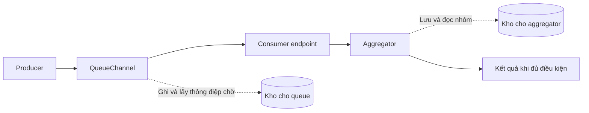

# MessageStore là gì

Trong module **SPRING_INTEGRATION_CORE**, MessageStore là phần giúp một luồng tích hợp giữ lại thông điệp khi chưa thể xử lý ngay. Bài này thuộc chương **Message store**, tập trung vào bản chất của kho thông điệp, quan hệ với MessageChannel và endpoint, cùng cách sử dụng trong Java DSL.

Sau bài học, bạn có thể giải thích thông điệp được giữ ở đâu khi aggregator đang chờ dữ liệu, phân biệt lưu trong bộ nhớ với lưu bền, và xác định những điều còn phải cấu hình để xử lý lỗi hoặc khôi phục sau khi ứng dụng dừng.

## 1. Từ nhu cầu chờ thông điệp đến Message Store

Giả sử hệ thống đặt hàng nhận ba thông báo đóng gói cho một đơn:

- Kiện A đã sẵn sàng.
- Kiện B đã sẵn sàng.
- Kiện C đã sẵn sàng.

Ứng dụng chỉ tạo thông báo “đơn hàng sẵn sàng giao” khi nhận đủ cả ba. Nếu mới nhận A và B, aggregator phải giữ chúng để chờ C. Tương tự, khi producer đưa thông điệp vào QueueChannel nhanh hơn consumer xử lý, channel phải giữ phần tồn đọng.

Các thành phần này có trạng thái cần tồn tại qua nhiều lần nhận thông điệp. Spring Integration cung cấp cơ chế Message Store để tách việc giữ trạng thái khỏi logic điều phối của thành phần tích hợp. [Tài liệu Message Store](https://docs.spring.io/spring-integration/reference/message-store.html).



Hai kho trong sơ đồ thể hiện hai vai trò lưu trữ. Một kho chứa hàng đợi cần tiêu thụ; kho còn lại chứa dữ liệu của các nhóm đang chờ tổng hợp. Chúng không phải hai bước mà mọi luồng đều bắt buộc có.

Với ví dụ đơn hàng, câu hỏi cần đặt ra là: nếu JVM dừng sau khi nhận A và B, lần khởi động sau còn tìm được chúng hay phải yêu cầu gửi lại? Câu trả lời phụ thuộc vào implementation của kho, trạng thái đã được commit, và cách ứng dụng kết nối lại với dữ liệu cũ.

## 2. Định nghĩa và ranh giới trách nhiệm

**MessageStore là một strategy interface của Spring Integration để lưu và truy xuất các đối tượng Message.** Việc lưu có thể thực hiện bằng cấu trúc dữ liệu trong JVM hoặc bằng một hệ thống lưu trữ bên ngoài.

Message bao gồm payload và headers. Ví dụ, payload có thể là thông tin kiện hàng, còn headers chứa `orderId`, mã sự kiện và thông tin định tuyến. Lưu payload đơn lẻ chưa diễn đạt đầy đủ những dữ liệu mà luồng có thể cần khi tiếp tục xử lý. [Mô hình Message](https://docs.spring.io/spring-integration/reference/message.html).

Phân công trách nhiệm trong một luồng như sau:

| Thành phần | Trách nhiệm |
| --- | --- |
| Message | Mang dữ liệu và headers của một lần trao đổi |
| MessageChannel | Cung cấp cách gửi và nhận thông điệp |
| Endpoint | Thực hiện một bước như biến đổi, định tuyến hoặc tổng hợp |
| MessageStore và các hợp đồng lưu nhóm | Giữ thông điệp hoặc trạng thái nhóm cho thành phần cần lưu |
| Gateway | Chuyển lời gọi của ứng dụng sang trao đổi thông điệp |

Một MessageStore không tự tạo lịch polling, gọi service nghiệp vụ, quyết định retry hay gửi thư báo lỗi. Những hành vi đó thuộc endpoint và cấu hình luồng. Việc khai báo một bean kho cũng chưa làm mọi thông điệp tự động được ghi vào kho: thành phần sử dụng phải được nối với bean đó.

Ví dụ, transformer xử lý ngay trên DirectChannel thường không cần kho riêng. Aggregator cần giữ nhiều đầu vào để tổng hợp thì có nhu cầu lưu trạng thái rõ ràng.

## 3. Phân biệt các hợp đồng lưu trữ

Trong trao đổi thông thường, “message store” có thể chỉ chung cơ chế lưu của Spring Integration. Khi viết Java, cần phân biệt các interface cụ thể.

| Interface | Dữ liệu và thao tác chính | Trường hợp điển hình |
| --- | --- | --- |
| `MessageStore` | Thêm, đọc, xóa Message theo UUID | Lưu thông điệp riêng lẻ; claim check |
| `BasicMessageGroupStore` | Thêm vào nhóm, lấy nhóm, đếm và poll thông điệp trong nhóm | Hợp đồng nền cho lưu theo nhóm |
| `MessageGroupStore` | Mở rộng thao tác nhóm, hỗ trợ trạng thái hoàn tất và callback hết hạn | Aggregator, resequencer |
| `ChannelMessageStore` | Nhánh hợp đồng dành cho kho tối ưu cho channel | QueueChannel có kho phía sau |

`MessageGroupStore` và `ChannelMessageStore` đều mở rộng `BasicMessageGroupStore`. Chúng không mặc nhiên mở rộng `MessageStore`. Một implementation có thể thực hiện nhiều interface, chẳng hạn `SimpleMessageStore`; vì vậy không nên suy rằng mọi kho cho channel đều dùng được với aggregator. [MessageGroupStore API](https://docs.spring.io/spring-integration/api/org/springframework/integration/store/MessageGroupStore.html), [ChannelMessageStore API](https://docs.spring.io/spring-integration/api/org/springframework/integration/store/ChannelMessageStore.html).

### 3.1. Các thao tác trên thông điệp riêng lẻ

Những phương thức thường gặp của `MessageStore` gồm:

```java
<T> Message<T> addMessage(Message<T> message);

Message<?> getMessage(UUID id);

Message<?> removeMessage(UUID id);

long getMessageCount();
```

Cần hiểu đúng ý nghĩa của chúng:

- `getMessage(id)` đọc thông điệp, không có nghĩa thông điệp đã được xử lý xong.
- `removeMessage(id)` là thao tác xóa riêng, có thể trả về `null` nếu không tìm thấy.
- `addMessage(...)` trả lại Message đã lưu. Implementation có thể tạo đối tượng khác, nên khi lưu theo UUID hãy lấy ID từ giá trị trả về.
- `getMessageCount()` là khả năng tùy chọn; implementation có thể không hỗ trợ.

Nếu một implementation đồng thời quản lý nhóm, việc xóa thông điệp riêng lẻ còn chịu ràng buộc khi thông điệp vẫn thuộc nhóm. Hãy thao tác qua hợp đồng nhóm cho dữ liệu do aggregator sở hữu. [MessageStore API](https://docs.spring.io/spring-integration/api/org/springframework/integration/store/MessageStore.html).

### 3.2. Message ID, correlation key và mã nghiệp vụ

Ba loại khóa thường xuất hiện cạnh nhau nhưng phục vụ các mục đích khác nhau:

| Khóa | Ví dụ | Ý nghĩa |
| --- | --- | --- |
| Message ID | UUID trong `headers.id` | Định danh kỹ thuật của Message |
| Correlation key/group ID | `aggregate:order:SO-1001` | Gom các Message cần xử lý chung |
| Business event ID | `packing-event-781` | Nhận diện một sự kiện nghiệp vụ qua các lần gửi lại |

Một sự kiện được gửi lại có thể được bọc trong Message mới với UUID mới. Vì vậy, việc dùng UUID để lưu thông điệp không thay thế cơ chế phát hiện trùng theo mã sự kiện nghiệp vụ.

Ví dụ cùng một thông báo “kiện A sẵn sàng” xuất hiện hai lần với hai Message ID khác nhau vẫn có thể làm một nhóm đếm đủ ba phần tử quá sớm. Đây là vấn đề của hợp đồng đầu vào và idempotency, không được giải quyết chỉ bằng cách đổi implementation của kho.

## 4. Lưu trong bộ nhớ và lưu bền

`SimpleMessageStore` là implementation dựa trên bộ nhớ JVM. Constructor không tham số tạo kho không giới hạn dung lượng theo cấu hình mặc định. Nó phù hợp để học và kiểm thử, nhưng dữ liệu sẽ không còn khi tiến trình mất bộ nhớ của nó. Các constructor khác cho phép cấu hình giới hạn. [SimpleMessageStore API](https://docs.spring.io/spring-integration/api/org/springframework/integration/store/SimpleMessageStore.html).

| Tiêu chí | Kho trong bộ nhớ | Kho bên ngoài có cấu hình lưu bền phù hợp |
| --- | --- | --- |
| Vị trí dữ liệu | Heap của JVM | Cơ sở dữ liệu hoặc backend tương ứng |
| Khi JVM dừng đột ngột | Không giữ được dữ liệu đang nằm trong heap | Có thể đọc lại dữ liệu đã ghi và commit |
| Chi phí truy cập | Không có chuyến đi mạng tới backend | Có I/O, chuyển đổi dữ liệu và có thể có khóa |
| Điều cần quản lý | Heap, số nhóm, kích thước payload | Dung lượng, kết nối, schema, chỉ mục và độ bền backend |
| Kiểm thử cần thiết | Hành vi API và vòng đời nhóm | Thêm kiểm thử restart, rollback và đọc dữ liệu cũ |

“Bên ngoài JVM” chưa đủ để kết luận dữ liệu bền vững. Ví dụ, một cơ sở dữ liệu chạy ở chế độ chỉ giữ trong bộ nhớ vẫn có thể mất dữ liệu khi chính cơ sở dữ liệu dừng.

Đồng thời, một lần ghi kho thành công chỉ bảo vệ trạng thái tại ranh giới ghi đó. Nó không tự xác nhận rằng tất cả bước nghiệp vụ tiếp theo đã hoàn tất.

## 5. Ví dụ tối thiểu: lưu, đọc và xóa Message

Ví dụ dưới đây chỉ cần các thư viện Spring Integration core và Spring Messaging tương ứng trong dự án. Đặt mã vào `MessageStoreDemo.java` khi thực hành.

```java
import java.util.UUID;

import org.springframework.integration.store.MessageStore;
import org.springframework.integration.store.SimpleMessageStore;
import org.springframework.messaging.Message;
import org.springframework.messaging.support.MessageBuilder;

public class MessageStoreDemo {

    public static void main(String[] args) {
        MessageStore store = new SimpleMessageStore();

        Message<String> original = MessageBuilder
                .withPayload("Kiện A đã sẵn sàng")
                .setHeader("orderId", "SO-1001")
                .setHeader("eventId", "packing-event-781")
                .build();

        Message<String> stored = store.addMessage(original);
        UUID storedId = stored.getHeaders().getId();

        if (storedId == null) {
            throw new IllegalStateException("Message phải có ID");
        }

        Message<?> loaded = store.getMessage(storedId);
        if (loaded == null) {
            throw new IllegalStateException("Không tìm thấy Message");
        }

        System.out.println(loaded.getPayload());
        System.out.println(loaded.getHeaders().get("orderId"));

        store.removeMessage(storedId);

        if (store.getMessage(storedId) != null) {
            throw new IllegalStateException("Message chưa được xóa");
        }
    }
}
```

Kết quả in ra là:

```text
Kiện A đã sẵn sàng
SO-1001
```

Chương trình chủ động gọi `addMessage`, `getMessage` và `removeMessage` để làm rõ API. Trong cấu hình aggregator thông thường, framework thực hiện thao tác lưu nhóm; mã nghiệp vụ không cần chèn thêm một lần `addMessage` trước mỗi lần gửi.

Không nên diễn giải ví dụ này thành quy trình “lấy ra là chắc chắn xử lý được”. Nếu thực hiện một tác động bên ngoài rồi tiến trình dừng trước bước xóa, lần chạy lại có thể gặp lại thông điệp đó.

## 6. Dùng kho phía sau QueueChannel

QueueChannel giữ thông điệp để consumer nhận sau. Khi dùng Java DSL, có thể truyền `ChannelMessageStore` và một group ID ổn định cho `MessageChannels.queue(...)`. [MessageChannels API](https://docs.spring.io/spring-integration/api/org/springframework/integration/dsl/MessageChannels.html).

Cấu hình minh họa độc lập:

```java
import org.springframework.context.annotation.Bean;
import org.springframework.context.annotation.Configuration;
import org.springframework.integration.channel.QueueChannel;
import org.springframework.integration.dsl.MessageChannels;
import org.springframework.integration.store.SimpleMessageStore;

@Configuration
public class OrderInboxConfiguration {

    @Bean
    public SimpleMessageStore queueMessageStore() {
        return new SimpleMessageStore();
    }

    @Bean
    public QueueChannel orderInbox(SimpleMessageStore queueMessageStore) {
        return MessageChannels
                .queue(queueMessageStore, "queue:order-inbox:v1")
                .get();
    }
}
```

Ở cấu hình này:

1. `orderInbox.send(message)` đưa Message vào hàng đợi được kho hỗ trợ.
2. `orderInbox.receive(timeout)` lấy một Message khỏi hàng đợi.
3. Consumer endpoint nối vào channel sẽ cần poller để chủ động lấy dữ liệu.
4. Vì kho vẫn là `SimpleMessageStore`, cấu hình này chưa cung cấp khả năng giữ dữ liệu qua restart.

Group ID `queue:order-inbox:v1` đại diện cho một hàng đợi logic, khác với group ID theo từng đơn hàng của aggregator. Với kho bền, cần dùng lại đúng định danh để truy cập hàng đợi cũ sau restart. Tạo UUID ngẫu nhiên cho tên nhóm ở mỗi lần khởi động có thể khiến ứng dụng chuyển sang một hàng đợi mới trong khi dữ liệu cũ vẫn nằm ở backend. [MessageGroupQueue API](https://docs.spring.io/spring-integration/api/org/springframework/integration/store/MessageGroupQueue.html).

Kho không tự chạy consumer. Nếu gửi được nhưng thông điệp nằm mãi trong hàng đợi, cần kiểm tra consumer, poller và lịch chạy trước khi kết luận lỗi ở MessageStore.

## 7. Dùng MessageGroupStore trong aggregator bằng Java DSL

### 7.1. Hợp đồng đầu vào

Ví dụ sau tổng hợp đúng ba thông báo kiện hàng của một đơn:

- Payload là tên kiện: `A`, `B` hoặc `C`.
- Header `orderId` phải tồn tại.
- Ba thông báo hợp lệ và khác nhau được gửi đúng một lần trong bài minh họa.
- Kết quả là chuỗi `A, B, C`.
- Nhóm được xóa khi tổng hợp bình thường hoàn tất.

Đầu vào trong hệ thống thực tế cần thêm kiểm tra hợp lệ và xử lý trùng theo mã kiện hoặc mã sự kiện. Chỉ kiểm tra `group.size() == 3` không chứng minh đã nhận đủ ba kiện khác nhau.

### 7.2. Cấu hình luồng

Đặt cấu hình sau vào `OrderAggregationConfiguration.java`. Ví dụ dùng Java DSL với `IntegrationFlow.from(...)` và chưa cần database hay broker.

```java
import java.util.stream.Collectors;

import org.springframework.context.annotation.Bean;
import org.springframework.context.annotation.Configuration;
import org.springframework.integration.channel.DirectChannel;
import org.springframework.integration.channel.QueueChannel;
import org.springframework.integration.config.EnableIntegration;
import org.springframework.integration.dsl.IntegrationFlow;
import org.springframework.integration.store.MessageGroupStore;
import org.springframework.integration.store.SimpleMessageStore;

@Configuration
@EnableIntegration
public class OrderAggregationConfiguration {

    @Bean
    public DirectChannel orderParts() {
        return new DirectChannel();
    }

    @Bean
    public QueueChannel completedOrders() {
        return new QueueChannel(10);
    }

    @Bean
    public MessageGroupStore orderGroupStore() {
        return new SimpleMessageStore();
    }

    @Bean
    public IntegrationFlow orderAggregationFlow(
            DirectChannel orderParts,
            QueueChannel completedOrders,
            MessageGroupStore orderGroupStore) {

        return IntegrationFlow.from(orderParts)
                .aggregate(aggregator -> aggregator
                        .messageStore(orderGroupStore)
                        .correlationStrategy(message ->
                                "aggregate:order:"
                                        + message.getHeaders().get("orderId"))
                        .releaseStrategy(group -> group.size() == 3)
                        .outputProcessor(group ->
                                group.getMessages().stream()
                                        .map(message ->
                                                message.getPayload().toString())
                                        .sorted()
                                        .collect(Collectors.joining(", ")))
                        .expireGroupsUponCompletion(true))
                .channel(completedOrders)
                .get();
    }
}
```

Luồng vào là DirectChannel nên lời gọi gửi đi qua aggregator trên thread của bên gửi. QueueChannel đầu ra chỉ giữ kết quả để mã kiểm thử nhận lại; nó không thay đổi nơi aggregator lưu dữ liệu đầu vào.

Các quyết định cấu hình được tách rõ:

| Cấu hình | Câu hỏi được trả lời |
| --- | --- |
| `messageStore(orderGroupStore)` | Giữ các nhóm ở đâu? |
| `correlationStrategy(...)` | Những Message nào thuộc cùng một nhóm? |
| `releaseStrategy(...)` | Khi nào được tổng hợp nhóm? |
| `outputProcessor(...)` | Chuyển nhóm thành payload kết quả như thế nào? |
| `expireGroupsUponCompletion(true)` | Sau hoàn tất bình thường có xóa toàn bộ nhóm không? |

Các tùy chọn này thuộc Java DSL cho correlating handler và aggregator. [CorrelationHandlerSpec API](https://docs.spring.io/spring-integration/api/org/springframework/integration/dsl/CorrelationHandlerSpec.html), [AggregatorSpec API](https://docs.spring.io/spring-integration/api/org/springframework/integration/dsl/AggregatorSpec.html).

Phần tiền tố `aggregate:order:` diễn đạt phạm vi sử dụng của khóa. Nếu nhiều luồng cùng truy cập backend, cần tránh việc hai luồng không liên quan sử dụng cùng vùng lưu và cùng group ID.

### 7.3. Kiểm thử trạng thái trước và sau khi đủ nhóm

Ví dụ JUnit Jupiter sau dùng cùng cấu hình trên. Test xác nhận hành vi có ý nghĩa: hai thông điệp chưa tạo đầu ra, chúng đang nằm trong nhóm, và thông điệp thứ ba tạo đúng kết quả rồi dọn nhóm.

```java
import org.junit.jupiter.api.Test;

import org.springframework.context.annotation.AnnotationConfigApplicationContext;
import org.springframework.integration.channel.QueueChannel;
import org.springframework.integration.store.MessageGroupStore;
import org.springframework.messaging.Message;
import org.springframework.messaging.MessageChannel;
import org.springframework.messaging.support.MessageBuilder;

import static org.junit.jupiter.api.Assertions.*;

class OrderAggregationTest {

    @Test
    void waitsForThreePartsThenRemovesCompletedGroup() {
        try (var context = new AnnotationConfigApplicationContext(
                OrderAggregationConfiguration.class)) {

            MessageChannel input =
                    context.getBean("orderParts", MessageChannel.class);
            QueueChannel output =
                    context.getBean("completedOrders", QueueChannel.class);
            MessageGroupStore store =
                    context.getBean("orderGroupStore", MessageGroupStore.class);

            assertTrue(input.send(part("A"), 1000));
            assertTrue(input.send(part("B"), 1000));

            assertNull(output.receive(0));
            assertEquals(2,
                    store.messageGroupSize("aggregate:order:SO-1001"));

            assertTrue(input.send(part("C"), 1000));

            Message<?> result = output.receive(1000);
            assertNotNull(result);
            assertEquals("A, B, C", result.getPayload());
            assertEquals(0, store.getMessageGroupCount());
            assertNull(output.receive(0));
        }
    }

    private static Message<String> part(String name) {
        return MessageBuilder.withPayload(name)
                .setHeader("orderId", "SO-1001")
                .build();
    }
}
```

Test này kiểm tra luồng trong một tiến trình với kho trong bộ nhớ. Nó chưa kiểm chứng lưu bền, rollback hoặc xử lý đồng thời từ nhiều ứng dụng. Các đoạn mã trong bài là mã thực hành; cần chạy trong dự án đã khai báo các dependency tương ứng.

Cấu hình minh họa chưa đặt timeout cho nhóm chưa đủ ba thông báo. Nếu C không đến, nhóm A và B tiếp tục chờ. Khi chuyển sang tình huống vận hành, phải quyết định thời hạn chờ và hành động khi hết hạn.

## 8. Chuyển sang kho JDBC

Spring Integration có hai implementation JDBC cần phân biệt:

- `JdbcMessageStore` phục vụ lưu Message và các mẫu có trạng thái như aggregator hoặc claim check.
- `JdbcChannelMessageStore` được tối ưu riêng cho message channel.

Với ví dụ aggregator, có thể thay bean `orderGroupStore` bằng đoạn sau, giữ kiểu hợp đồng `MessageGroupStore` ở tham số của flow:

```java
import javax.sql.DataSource;

import org.springframework.context.annotation.Bean;
import org.springframework.integration.jdbc.store.JdbcMessageStore;
import org.springframework.integration.store.MessageGroupStore;

// Thay phương thức @Bean orderGroupStore() trong cấu hình trước.
// DataSource phải được cấu hình riêng.
@Bean
public MessageGroupStore orderGroupStore(DataSource dataSource) {
    return new JdbcMessageStore(dataSource);
}
```

Đây là một phương thức bên trong lớp cấu hình, không phải một tệp Java độc lập. Dự án cần thêm module `spring-integration-jdbc`, JDBC driver và các bảng tương ứng. Các script `org/springframework/integration/jdbc/schema-*.sql` trong JAR là điểm bắt đầu để tạo schema cho đúng database. Khai báo bean không thay thế bước chuẩn bị schema. [JdbcMessageStore API](https://docs.spring.io/spring-integration/api/org/springframework/integration/jdbc/store/JdbcMessageStore.html).

Nếu mục tiêu là QueueChannel, chọn implementation cho channel và cấu hình query provider đúng hệ quản trị cơ sở dữ liệu. Không lấy `JdbcChannelMessageStore` truyền vào cấu hình aggregator chỉ vì cả hai đều chứa chữ “MessageStore”. [Hướng dẫn JDBC Message Store](https://docs.spring.io/spring-integration/reference/jdbc/message-store.html).

### 8.1. Payload và headers phải đọc lại được

Kho trong bộ nhớ có thể giữ một object đang tồn tại trong JVM. Kho bền phải chuyển dữ liệu sang biểu diễn có thể lưu rồi dựng lại khi đọc.

Với cơ chế serialization mặc định của `JdbcMessageStore`, cần chú ý dữ liệu có thể serialize; headers không phù hợp có thể bị loại bỏ. Payload chứa stream đang mở, kết nối database hay đối tượng phụ thuộc phiên làm việc hiện tại thường không phải hợp đồng dữ liệu thích hợp để khôi phục sau restart. [Giới hạn khi dùng kho bền](https://docs.spring.io/spring-integration/reference/message-store.html).

Một hợp đồng thực hành dễ kiểm soát hơn là:

- Payload mang dữ liệu độc lập, ví dụ chuỗi JSON hoặc DTO phù hợp serializer đã chọn.
- Headers nghiệp vụ chứa các giá trị đơn giản như mã đơn, mã kiện, mã sự kiện.
- Tài nguyên lớn được tham chiếu bằng khóa ổn định nếu không cần nhúng toàn bộ dữ liệu.
- Khi nâng cấp ứng dụng, kiểm thử đọc lại dữ liệu mà phiên bản trước đã ghi.

Đặc biệt, channel trả lời tạm thời của một gateway gắn với tiến trình đang chạy. Lưu Message không làm lời gọi đang chờ ở gateway sống tiếp qua restart. Với công việc dài hoặc có thể gián đoạn, hãy thiết kế nơi nhận kết quả và mã tra cứu bền phù hợp với luồng nghiệp vụ.

## 9. Lưu bền, giao dịch và xử lý đúng một lần

Xét hàng đợi được lưu bằng JDBC:

```text
t1: Thông điệp đã được ghi và commit.
t2: Consumer lấy thông điệp khỏi hàng đợi.
t3: Consumer gọi một API thanh toán.
t4: Consumer ghi kết quả xử lý.
```

Nếu ứng dụng dừng giữa t2 và t3, khả năng lấy lại thông điệp phụ thuộc vào việc thao tác lấy khỏi kho có nằm trong giao dịch chưa commit hay không. Nếu t2 đã commit mà t3 chưa chạy, thông điệp có thể đã rời hàng đợi dù nghiệp vụ chưa được thực hiện.

Nếu dừng giữa t3 và t4, API có thể đã thanh toán thành công nhưng ứng dụng chưa kịp ghi nhận. Thử lại khi khôi phục có thể tạo một yêu cầu thanh toán nữa.

Vì vậy, cần phân biệt:

| Khả năng | Câu hỏi |
| --- | --- |
| Lưu bền | Sau sự cố tiến trình, trạng thái đã commit còn ở backend không? |
| Giao dịch | Những thao tác nào cùng commit hoặc rollback? |
| Retry | Khi thất bại, bước nào được thực hiện lại? |
| Idempotency | Thực hiện lại có tạo thêm tác động nghiệp vụ không? |

Với polling consumer và kho hỗ trợ giao dịch, có thể cấu hình transaction manager cho poller để thao tác nhận và phần xử lý đồng bộ thích hợp tham gia cùng giao dịch. Ngữ cảnh giao dịch thông thường gắn với thread; thêm ExecutorChannel hoặc một ranh giới hàng đợi tạo ra phần xử lý khác cần xem xét riêng. [Transaction Support](https://docs.spring.io/spring-integration/reference/transactions.html).

Cần chọn transaction manager phù hợp với tài nguyên của kho. Đồng thời, transaction manager JDBC không tự rollback được tác động đã xảy ra ở một API HTTP bên ngoài. Với ví dụ thanh toán, khóa idempotency được phía nhận xử lý hoặc cơ chế đối soát là phần thiết kế bổ sung.

Đưa lỗi tới `errorChannel` cũng không đồng nghĩa thông điệp tự quay lại kho. Kết quả còn phụ thuộc vào giao dịch, exception có được truyền ra hay bị xử lý mất, và cấu hình retry/recovery.

## 10. Quản lý vòng đời nhóm và khả năng khôi phục

Aggregator quản lý cả các thông điệp đang chờ lẫn trạng thái của nhóm. Nhóm đã phát kết quả không nhất thiết bị xóa hoàn toàn ngay.

Cấu hình `expireGroupsUponCompletion(true)` trong ví dụ chọn xóa nhóm sau hoàn tất bình thường. Message đến muộn có cùng correlation key có thể tạo nhóm mới. Nếu giữ trạng thái hoàn tất, aggregator có thể nhận diện và loại các Message đến muộn; đổi lại phải có kế hoạch dọn metadata đó. [Vòng đời nhóm của aggregator](https://docs.spring.io/spring-integration/reference/aggregator.html).

Những quyết định cần làm rõ trong thiết kế:

| Tình huống | Quyết định cần có |
| --- | --- |
| Đủ các Message hợp lệ | Phát kết quả và chọn chính sách giữ hoặc xóa trạng thái hoàn tất |
| Thiếu Message quá thời hạn | Bỏ nhóm, gửi nhóm thiếu sang xử lý riêng, hoặc cho phép kết quả một phần |
| Message đến sau khi nhóm kết thúc | Bỏ qua, đối soát hoặc tạo phiên xử lý mới theo nghiệp vụ |
| Ứng dụng restart khi nhóm đang chờ | Kết nối đúng kho, giữ khóa tương quan ổn định và xử lý nhóm cũ |
| Số nhóm tăng liên tục | Theo dõi tuổi nhóm, xác định dữ liệu thiếu và triển khai dọn phù hợp |

`MessageGroupStoreReaper` là một lựa chọn hỗ trợ quét hết hạn nhóm. Việc hết hạn cần có lịch chạy và hành động tương ứng; chỉ có timestamp hoặc một bean kho chưa tạo ra tiến trình dọn dữ liệu.

Trong ví dụ ba kiện hàng, việc tự phát “sẵn sàng giao” khi chỉ có A và B là sai nghiệp vụ. Chính sách hết hạn thích hợp có thể là ghi nhận đơn thiếu thông báo và chuyển sang đối soát, thay vì cho phép kết quả một phần.

### 10.1. Nhiều instance cùng xử lý

Một backend dùng chung giúp các instance truy cập cùng dữ liệu, nhưng chưa đủ để phối hợp toàn bộ chuỗi đọc, thêm, kiểm tra và phát kết quả của aggregator.

Khi nhiều aggregator instance thao tác cùng nhóm, cần cơ chế khóa dùng chung phù hợp. Khóa trong bộ nhớ của một JVM không bảo vệ được nhóm khỏi instance ở JVM khác. Phân biệt khóa của correlating handler với bảo đảm giao dịch hoặc khóa bên trong implementation của kho; chúng phục vụ các lớp thao tác khác nhau. [Lock Registry của aggregator](https://docs.spring.io/spring-integration/reference/aggregator.html#_lock_registry).

Ví dụ này dùng một application context và không chứng minh hành vi triển khai nhiều instance.

### 10.2. Thông tin quan sát hữu ích

Các số liệu có ích tùy khả năng backend gồm số thông điệp đang chờ, số nhóm chưa đủ, tuổi của nhóm cũ nhất, tốc độ ghi/đọc, số lần lỗi và kích thước dữ liệu.

Nếu lưu lượng đầu vào vượt tốc độ hoàn thành nhóm trong thời gian dài, chuyển từ heap sang database chỉ thay nơi tích lũy dữ liệu. Vẫn phải tìm nguyên nhân: thiếu kiện, correlation sai, consumer chậm hoặc chính sách hết hạn chưa phù hợp.

Không sửa trực tiếp các MessageGroup của aggregator để “dọn nhanh” trong lúc luồng đang chạy. Thao tác vận hành cần đi qua cơ chế được thiết kế cho vòng đời nhóm, có phối hợp đồng thời phù hợp.

## 11. Phân biệt với những khái niệm gần nhau

| Khái niệm | Vai trò | Khác với MessageStore ở đâu? |
| --- | --- | --- |
| Cache ứng dụng | Giảm chi phí tính toán hoặc truy cập dữ liệu | Cơ chế loại bỏ cache có thể không phù hợp với thông điệp chưa xử lý |
| Message broker | Cung cấp hạ tầng gửi nhận, phân phối và các cơ chế của broker | MessageStore không tự cung cấp giao thức mạng hay quản lý consumer |
| Repository nghiệp vụ | Lưu sự thật nghiệp vụ như đơn hàng và hóa đơn | Thông điệp đang chờ là trạng thái tích hợp, không mặc nhiên là bản ghi nghiệp vụ chính thức |
| MetadataStore | Lưu trạng thái dạng key-value của endpoint | Phù hợp với metadata và một số cơ chế idempotent, khác hợp đồng lưu toàn bộ Message hoặc nhóm |
| Claim check | Giữ nội dung lớn và truyền khóa tham chiếu qua các bước trung gian | Là mẫu sử dụng MessageStore, không phải một backend lưu trữ khác |

MetadataStore cung cấp hợp đồng key-value và được dùng trong các tình huống lưu trạng thái hoặc hỗ trợ idempotent receiver. Không nên đồng nhất `MetadataStore` với các metadata mà MessageGroupStore dùng để quản lý nhóm. [Metadata Store](https://docs.spring.io/spring-integration/reference/meta-data-store.html).

Trong claim check, một bước gửi Message vào kho rồi truyền khóa; bước sau dùng khóa lấy lại nội dung. Chính sách xóa sau khi lấy cần được chọn theo việc nội dung còn phải được sử dụng lần nữa hay không. [Claim Check](https://docs.spring.io/spring-integration/reference/claim-check.html).

## 12. Những lỗi dễ gặp khi bắt đầu

| Hiểu nhầm hoặc lỗi cấu hình | Hệ quả | Cách xử lý |
| --- | --- | --- |
| Tạo bean MessageStore nhưng chưa gắn vào thành phần cần lưu | Luồng vẫn sử dụng cơ chế lưu đang được cấu hình trước đó | Truyền rõ kho cho queue hoặc aggregator |
| Dùng SimpleMessageStore rồi kỳ vọng khôi phục sau restart | Mất trạng thái trong heap | Dùng backend có cấu hình độ bền đáp ứng yêu cầu |
| Chọn JdbcChannelMessageStore cho aggregator | Sai hợp đồng API | Chọn implementation hỗ trợ MessageGroupStore |
| Dùng UUID mới làm group ID của queue mỗi lần khởi động | Không đọc được hàng đợi logic cũ | Dùng định danh ổn định và quản lý phạm vi khóa |
| Chỉ đếm số Message để kết luận đủ sự kiện | Phát kết quả sai khi có thông điệp trùng | Kiểm tra phần tử nghiệp vụ cần có và cơ chế chống trùng |
| Không đặt chính sách cho nhóm thiếu dữ liệu | Số nhóm chờ và dung lượng tiếp tục tăng | Chọn thời hạn chờ và quy trình xử lý thiếu |
| Coi lưu bền là bảo đảm tác động nghiệp vụ đúng một lần | Tác động trùng khi retry sau sự cố | Thiết kế giao dịch, idempotency và đối soát phù hợp |

## 13. Tự kiểm tra khả năng áp dụng

Sau khi chạy ví dụ, hãy thử các thay đổi sau và giải thích kết quả dự kiến trước khi sửa mã:

1. Gửi A và B với cùng `orderId`, gửi C với `orderId` khác. Có nhóm nào đủ điều kiện không?
2. Gửi A, A, B thành ba Message mới. Vì sao điều kiện đếm hiện tại có thể phát kết quả sai?
3. Xóa `expireGroupsUponCompletion(true)` rồi quan sát nhóm sau khi phát kết quả. Bạn cần phân biệt số Message đang giữ với số metadata nhóm như thế nào?
4. Dừng một ứng dụng sau khi nhận hai kiện rồi khởi động lại bằng kho trong bộ nhớ. Điều gì đã mất?
5. Khi thay bằng JDBC, dữ liệu cần được ghi và commit ở đâu, và ứng dụng cần dùng lại khóa nào để tiếp tục nhóm cũ?
6. Nếu xử lý nghiệp vụ gọi API thành công rồi ứng dụng dừng trước khi ghi nhận kết quả, MessageStore giải quyết được phần nào và phần nào cần idempotency?

Một thử nghiệm khôi phục có ý nghĩa phải đóng tiến trình hoặc application context cũ, tạo runtime mới, kết nối lại đúng backend bền và xác nhận dữ liệu đã commit vẫn sử dụng được. Tạo một đối tượng Java mới nhưng giữ nguyên kho trong bộ nhớ cũ chưa chứng minh khả năng khôi phục sau sự cố tiến trình.
