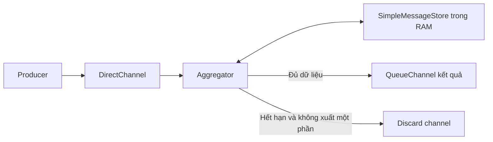

# SimpleMessageStore

## 1. Mục tiêu và ngữ cảnh

Trong chương **Message store** của module `SPRING_INTEGRATION_CORE`, bài này giải thích cách `SimpleMessageStore` giữ trạng thái thông điệp trong bộ nhớ để một endpoint có thể chờ xử lý tiếp. Trọng tâm là mối liên hệ giữa `Message`, `MessageChannel`, aggregator và cấu hình Java DSL; đồng thời làm rõ giới hạn về dung lượng, xử lý lỗi và kiểm thử.

Sau bài học, bạn có thể:

- Phân biệt lưu một message theo ID với lưu nhiều message theo group ID.
- Cấu hình dung lượng và thời gian chờ khi kho đầy.
- Gắn store vào aggregator và quan sát nhóm đang chờ.
- Chọn chính sách dọn nhóm, xử lý message đến muộn và tránh giữ dữ liệu vô hạn.
- Nhận biết khi nào cần chuyển sang một kho có khả năng lưu bền.

Các API và ví dụ được đối chiếu với **Spring Integration 6.5.0**, dùng Java 17 trở lên. Ví dụ cấu hình cần dependency `org.springframework.integration:spring-integration-core`; ví dụ kiểm thử cần JUnit Jupiter. Trong ứng dụng Spring Boot, để BOM của ứng dụng quản lý bộ phiên bản Spring tương thích. Mốc 6.5.0 ở đây là mốc tham chiếu cho bài học.

## 2. SimpleMessageStore giải quyết việc gì?

Giả sử hệ thống nhận ba phần của một đơn hàng ở ba thời điểm khác nhau. Aggregator phải giữ hai phần đầu trong khi chờ phần cuối. `SimpleMessageStore` cung cấp nơi giữ các message và trạng thái nhóm ngay trong heap của tiến trình Java.

Lớp này thuộc package `org.springframework.integration.store`, triển khai các hợp đồng lưu message, lưu nhóm và thao tác phục vụ channel. Dữ liệu được giữ trong cấu trúc map ở RAM. Xem định nghĩa và các constructor trong [Javadoc SimpleMessageStore 6.5.0](https://docs.spring.io/spring-integration/docs/6.5.0/api/org/springframework/integration/store/SimpleMessageStore.html).

Trong một luồng tích hợp, các thành phần phối hợp như sau:

| Thành phần | Trách nhiệm trong ví dụ đơn hàng |
| --- | --- |
| `Message<OrderPart>` | Mang một phần đơn hàng và các header |
| `DirectChannel` | Chuyển message đến endpoint trên luồng gọi hiện tại |
| Aggregator endpoint | Tìm nhóm, kiểm tra điều kiện và tạo kết quả |
| `SimpleMessageStore` | Giữ message và trạng thái nhóm trong thời gian chờ |
| `QueueChannel` đầu ra | Giữ kết quả để phía tiêu thụ nhận sau |



Store không tự gọi service nghiệp vụ hay tự xác định một đơn hàng đã đủ dữ liệu. Những quyết định đó thuộc endpoint và các strategy được cấu hình. Khi đọc flow, hãy xác định riêng nơi chuyển message, nơi giữ trạng thái và nơi quyết định xử lý.

Nếu JVM dừng, dữ liệu đang nằm trong `SimpleMessageStore` không được khôi phục từ một backend lưu bền. Đây là lựa chọn thuận tiện cho học tập, kiểm thử hoặc trạng thái tạm có thể tái tạo. Tài liệu [Message Store của Spring Integration](https://docs.spring.io/spring-integration/reference/message-store.html) trình bày vai trò của kho bộ nhớ và các lựa chọn lưu trữ khác.

## 3. Hai đường lưu trữ cần phân biệt

### 3.1. Message riêng lẻ

Nhóm API này làm việc với ID trong `MessageHeaders.ID`:

```java
store.addMessage(message);
store.getMessage(message.getHeaders().getId());
store.removeMessage(message.getHeaders().getId());
```

ID message thường là một `UUID` do framework tạo. Nó định danh một message cụ thể; một khóa nghiệp vụ như `orderId` có thể xuất hiện trong nhiều message khác nhau.

### 3.2. Message thuộc nhóm

Nhóm API này làm việc với một khóa tương quan:

```java
store.addMessageToGroup("order:ORD-42", message);
store.getMessageGroup("order:ORD-42");
store.removeMessagesFromGroup("order:ORD-42", message);
store.removeMessageGroup("order:ORD-42");
```

Group ID có kiểu `Object`, nhưng trong ứng dụng nên dùng khóa ổn định, dễ quan sát và có `equals()`/`hashCode()` nhất quán, chẳng hạn chuỗi `order:ORD-42`. Các thao tác lưu nhóm được mô tả trong [Javadoc MessageGroupStore](https://docs.spring.io/spring-integration/docs/6.5.0/api/org/springframework/integration/store/MessageGroupStore.html).

Với `SimpleMessageStore`, thêm message vào nhóm không đồng thời đưa nó vào vùng tra cứu message riêng lẻ. Khi kiểm tra một aggregator, hãy đọc đúng số liệu của nhóm thay vì suy ra từ bộ đếm message riêng lẻ.

| Cần quan sát | API phù hợp |
| --- | --- |
| Message được lưu qua `addMessage()` | `getMessageCount()` |
| Tổng message trong các nhóm | `getMessageCountForAllMessageGroups()` |
| Số nhóm đang được giữ | `getMessageGroupCount()` |
| Số message của một nhóm | `messageGroupSize(groupId)` |

### 3.3. Ví dụ trực tiếp, không cần Spring context

```java
package example;

import org.springframework.integration.store.SimpleMessageStore;
import org.springframework.messaging.Message;
import org.springframework.messaging.support.MessageBuilder;

public class StoreBasics {

    public static void main(String[] args) {
        SimpleMessageStore store = new SimpleMessageStore(10, 3, 0L);

        Message<String> standalone = MessageBuilder
                .withPayload("audit:received")
                .build();

        store.addMessage(standalone);
        System.out.println(store.getMessageCount()); // 1
        System.out.println(store.getMessage(
                standalone.getHeaders().getId()).getPayload());

        Message<String> first = MessageBuilder
                .withPayload("part-1")
                .build();
        Message<String> second = MessageBuilder
                .withPayload("part-2")
                .build();

        String groupId = "order:ORD-42";
        store.addMessageToGroup(groupId, first);
        store.addMessageToGroup(groupId, second);

        System.out.println(store.messageGroupSize(groupId)); // 2
        System.out.println(store.getMessageGroupCount()); // 1
        System.out.println(store.getMessageCountForAllMessageGroups()); // 2
        System.out.println(store.getMessageCount()); // Vẫn là 1

        store.removeMessagesFromGroup(groupId, first);
        System.out.println(store.messageGroupSize(groupId)); // 1

        store.removeMessageGroup(groupId);
        store.removeMessage(standalone.getHeaders().getId());

        System.out.println(store.getMessageGroupCount()); // 0
        System.out.println(store.getMessageCount()); // 0
    }
}
```

Khi gọi `getMessageGroup()` với khóa chưa tồn tại, implementation này trả về một đối tượng nhóm rỗng; việc đọc đó không tự đăng ký một nhóm mới trong store. Để kết luận nhóm có được giữ hay không, cần xét vòng đời và bộ đếm nhóm, tránh chỉ kiểm tra kết quả khác `null`. Các chi tiết về vùng lưu trữ độc lập và cách đọc nhóm được thể hiện trong [mã nguồn SimpleMessageStore 6.5.0](https://github.com/spring-projects/spring-integration/blob/v6.5.0/spring-integration-core/src/main/java/org/springframework/integration/store/SimpleMessageStore.java).

## 4. Dung lượng: giới hạn nào bảo vệ phần nào?

Constructor thường dùng:

```java
new SimpleMessageStore(individualCapacity, groupCapacity, upperBoundTimeout);
```

| Tham số | Ý nghĩa |
| --- | --- |
| `individualCapacity` | Giới hạn message lưu riêng lẻ qua `addMessage()` |
| `groupCapacity` | Giới hạn số message trong **mỗi nhóm** |
| `upperBoundTimeout` | Thời gian chờ chỗ trống khi thao tác thêm gặp giới hạn, tính bằng millisecond |

`new SimpleMessageStore()` không đặt giới hạn dung lượng. Giá trị capacity nhỏ hơn 1 có nghĩa không giới hạn cho phần tương ứng; `0` không có nghĩa là cấm thêm message. Constructor một đối số đặt cùng một giá trị cho vùng riêng lẻ và dung lượng từng nhóm. Các quy tắc constructor này nằm trong [Javadoc SimpleMessageStore](https://docs.spring.io/spring-integration/docs/6.5.0/api/org/springframework/integration/store/SimpleMessageStore.html).

### 4.1. Group capacity không chặn tổng số nhóm

Ví dụ cấu hình:

```java
SimpleMessageStore store = new SimpleMessageStore(100, 3, 0L);
```

Một nhóm `order:A` có thể giữ ba message, đồng thời nhóm `order:B` cũng có thể giữ ba message. Thêm nhóm `order:C` tiếp tục tạo một nhóm khác. Giá trị `3` không giới hạn toàn store ở ba message và cũng không giới hạn store ở ba nhóm.

Vì vậy, cần thiết kế cả giới hạn kích thước nhóm lẫn thời gian tồn tại của nhóm. Ví dụ, nếu mỗi phút xuất hiện 5.000 đơn hàng nhưng một phần ba số đơn luôn thiếu message cuối, số nhóm chờ vẫn tăng dù mỗi nhóm chỉ giữ hai message.

Một ước lượng phục vụ thiết kế:

```text
Bộ nhớ giữ trạng thái ≈ tổng message còn giữ × kích thước trung bình
                      + metadata của nhóm
                      + chi phí collection, khóa và đối tượng phụ trợ
```

Đây là ước lượng để tìm yếu tố chi phối, không phải công thức đo heap chính xác. Payload ảnh 1 MB và payload mã đơn hàng vài chục byte tạo mức sử dụng bộ nhớ rất khác nhau dù bộ đếm message bằng nhau.

### 4.2. Thời gian chờ khi đầy khác thời gian sống của nhóm

Đối với việc chờ một chỗ trống ở giới hạn dung lượng:

| `upperBoundTimeout` | Cách chờ |
| --- | --- |
| `0` | Thử ngay, không chờ chỗ trống |
| Số dương | Chờ tối đa số millisecond đã cấu hình |
| Số âm | Chờ cho đến khi có chỗ trống hoặc thread bị ngắt |

Cơ chế này dựa trên `UpperBound`; xem [mã nguồn UpperBound 6.5.0](https://github.com/spring-projects/spring-integration/blob/v6.5.0/spring-integration-core/src/main/java/org/springframework/integration/util/UpperBound.java). Đây không phải TTL, không lập lịch dọn nhóm và không phải timeout phản hồi của gateway.

Một lỗi cấu hình đáng chú ý: đặt group capacity là 3 nhưng release strategy đòi đủ 4 message. Message thứ tư không có chỗ để được giữ, nên điều kiện đếm đủ 4 không thể đạt theo luồng bình thường. Tăng thời gian chờ không sửa được mâu thuẫn đó; phải sửa giới hạn hoặc điều kiện nghiệp vụ.

Trong bản 6.5.0, thao tác thêm message riêng lẻ hết chỗ ném `MessagingException`; thêm vào nhóm hết chỗ ném `IllegalStateException`. Khi đi qua endpoint, ngoại lệ có thể được bọc thêm. Đây là hành vi implementation được kiểm chứng ở [SimpleMessageStore.java](https://github.com/spring-projects/spring-integration/blob/v6.5.0/spring-integration-core/src/main/java/org/springframework/integration/store/SimpleMessageStore.java), không nên suy rộng thành hợp đồng chung của mọi loại message store.

## 5. Ghép SimpleMessageStore với aggregator bằng Java DSL

### 5.1. Yêu cầu của ví dụ

Mỗi đơn hàng trong ví dụ có đúng ba phần hợp lệ, được gửi một lần. `orderId` là khóa nhóm. Sau phần thứ ba, flow tạo một `OrderBatch`. Nếu 30 giây không có phần mới và nhóm chưa đủ, các phần đang giữ được chuyển sang discard channel.

Để tập trung vào store, ví dụ dùng điều kiện đếm `size() == 3`. Với dữ liệu thực có khả năng gửi trùng, cần bổ sung quy tắc kiểm tra danh tính từng phần trước khi dựa vào số lượng.

```java
package example;

import java.util.Comparator;
import java.util.List;

import org.springframework.beans.factory.annotation.Qualifier;
import org.springframework.context.annotation.Bean;
import org.springframework.context.annotation.Configuration;
import org.springframework.integration.channel.DirectChannel;
import org.springframework.integration.channel.QueueChannel;
import org.springframework.integration.config.EnableIntegration;
import org.springframework.integration.dsl.IntegrationFlow;
import org.springframework.integration.store.SimpleMessageStore;

@Configuration(proxyBeanMethods = false)
@EnableIntegration
public class OrderPartsConfig {

    public record OrderPart(String orderId, int partNumber, String sku) {
    }

    public record OrderBatch(String orderId, List<OrderPart> parts) {
    }

    @Bean
    public DirectChannel orderPartsInput() {
        return new DirectChannel();
    }

    @Bean
    public QueueChannel completedOrders() {
        return new QueueChannel(100);
    }

    @Bean
    public QueueChannel discardedOrderParts() {
        return new QueueChannel(100);
    }

    @Bean
    public SimpleMessageStore orderPartsStore() {
        return new SimpleMessageStore(100, 3, 0L);
    }

    @Bean
    public IntegrationFlow orderPartsFlow(
            @Qualifier("orderPartsInput") DirectChannel input,
            @Qualifier("completedOrders") QueueChannel output,
            @Qualifier("discardedOrderParts") QueueChannel discarded,
            @Qualifier("orderPartsStore") SimpleMessageStore store) {

        return IntegrationFlow.from(input)
                .aggregate(a -> a
                        .messageStore(store)
                        .correlationStrategy(message ->
                                ((OrderPart) message.getPayload()).orderId())
                        .releaseStrategy(group -> group.size() == 3)
                        .outputProcessor(group -> {
                            List<OrderPart> parts = group.getMessages().stream()
                                    .map(message ->
                                            (OrderPart) message.getPayload())
                                    .sorted(Comparator.comparingInt(
                                            OrderPart::partNumber))
                                    .toList();
                            return new OrderBatch(parts.get(0).orderId(), parts);
                        })
                        .groupTimeout(30_000L)
                        .sendPartialResultOnExpiry(false)
                        .expireGroupsUponCompletion(true)
                        .expireGroupsUponTimeout(true)
                        .discardChannel(discarded)
                        .sendTimeout(1_000L))
                .channel(output)
                .get();
    }
}
```

Các phương thức gắn store, đặt correlation, release và timeout được mô tả trong [Javadoc CorrelationHandlerSpec](https://docs.spring.io/spring-integration/docs/6.5.0/api/org/springframework/integration/dsl/CorrelationHandlerSpec.html). Phương thức tạo kết quả và chính sách xóa nhóm hoàn tất được mô tả trong [Javadoc AggregatorSpec](https://docs.spring.io/spring-integration/docs/6.5.0/api/org/springframework/integration/dsl/AggregatorSpec.html).

Trong cấu hình này, vùng message riêng lẻ có capacity 100 nhưng aggregator sử dụng vùng message theo nhóm. Giá trị đó không trở thành giới hạn tổng 100 message cho aggregator. Hai queue đầu ra có giới hạn riêng và cần được tiêu thụ; nếu đầy, việc gửi kết quả hoặc discard cũng có thể thất bại.

`@EnableIntegration` cung cấp hạ tầng Spring Integration, bao gồm scheduler mặc định phục vụ group timeout. Việc đợi kết quả xảy ra qua `completedOrders`, còn từng lần gửi vào `DirectChannel` chỉ chạy phần xử lý tương ứng trên thread gọi. Một gateway yêu cầu phản hồi sau mỗi phần phải có hợp đồng chờ phù hợp với cách gom nhóm; hết thời gian chờ ở gateway không tự xóa nhóm trong store.

### 5.2. Theo dõi hai nhóm xen kẽ

Với các message hợp lệ và chưa xảy ra timeout:

| Lần gửi | Message | Trạng thái sau xử lý |
| --- | --- | --- |
| 1 | A, phần 2 | Nhóm A có một message |
| 2 | B, phần 1 | Nhóm A và B mỗi nhóm có một message |
| 3 | A, phần 1 | Nhóm A có hai message |
| 4 | A, phần 3 | Xuất batch A, xóa nhóm A |
| 5 | B, phần 2 | Nhóm B có hai message |
| 6 | B, phần 3 | Xuất batch B, xóa nhóm B |

`outputProcessor` sắp xếp rõ ràng theo `partNumber`; kết quả không phụ thuộc việc producer gửi phần nào trước. Nếu một transformer đứng trước aggregator tạo message mới, cần bảo đảm dữ liệu làm khóa nhóm vẫn còn sau bước biến đổi. Nếu một filter loại bỏ một phần, nhóm có thể không đạt điều kiện release và cần đường xử lý hết hạn.

## 6. Vòng đời nhóm: giữ, hoàn tất và xóa

Trong thiết kế gom thông điệp, cần trả lời ba câu hỏi riêng: đã đủ điều kiện xuất kết quả chưa, còn cần giữ dấu vết nhóm hay không, và nhóm chờ quá lâu sẽ đi đâu.

| Tình huống | Chính sách cần cân nhắc |
| --- | --- |
| Nhóm đang nhận các phần | Giữ message, chờ release hoặc timeout |
| Nhóm hoàn tất, cần chặn message đến muộn | Giữ metadata hoàn tất trong một khoảng thời gian |
| Nhóm hoàn tất, khóa được phép dùng cho lượt mới | Xóa nhóm sau hoàn tất |
| Nhóm thiếu phần quá lâu | Discard hoặc xuất kết quả một phần theo nghiệp vụ |

`completeGroup(groupId)` đánh dấu hoàn tất; `removeMessageGroup(groupId)` xóa nhóm. Tự gọi hai API này trong lúc aggregator đang sở hữu nhóm có thể phá vỡ vòng đời do endpoint quản lý. Ưu tiên cấu hình chính sách trên aggregator. Các thao tác hoàn tất và hết hạn thuộc [hợp đồng MessageGroupStore](https://docs.spring.io/spring-integration/docs/6.5.0/api/org/springframework/integration/store/MessageGroupStore.html).

### 6.1. Đánh đổi khi xóa nhóm ngay

Ví dụ chọn `expireGroupsUponCompletion(true)` để nhóm được dọn sau khi tạo batch. Nếu sau đó một message mới mang cùng `orderId` xuất hiện, nó có thể bắt đầu nhóm mới. Khi cần loại message đến muộn, giữ metadata hoàn tất với `false` rồi dọn theo thời hạn thích hợp. Chính sách giữ/xóa nhóm và việc tái sử dụng correlation ID được giải thích trong [tài liệu Aggregator](https://docs.spring.io/spring-integration/reference/aggregator.html).

Hãy định nghĩa danh tính nghiệp vụ trước khi chọn chính sách: một `orderId` dùng suốt đời đơn hàng khác với khóa `orderId + processingAttempt`. Nếu retry được phép tạo lượt mới, khóa cần thể hiện lượt đó. Nếu retry là gửi lại cùng một phần, cần nhận diện phần đã xử lý; tạo message với UUID mới không chứng minh đó là một sự kiện nghiệp vụ mới.

### 6.2. Timeout và dọn nhóm

`groupTimeout(30_000L)` của aggregator tính khoảng không nhận message mới của từng nhóm. `sendPartialResultOnExpiry(false)` chọn discard khi nhóm hết hạn mà release strategy vẫn chưa cho xuất; đặt `true` cho phép gom phần đang có thành kết quả. Bật cờ này chỉ chọn hành vi khi hết hạn, không tự cung cấp bộ định thời. Cơ chế này được mô tả trong [Aggregator và Group Timeout](https://docs.spring.io/spring-integration/reference/aggregator.html#agg-and-group-to).

Một cách khác là quét store bằng `MessageGroupStoreReaper`:

```java
import org.springframework.integration.store.MessageGroupStoreReaper;

// Đặt trong phương thức có tham chiếu đến store cần quét.
MessageGroupStoreReaper reaper = new MessageGroupStoreReaper(store);
reaper.setTimeout(60_000L);
reaper.run(); // Một lần quét; cần scheduler để chạy định kỳ.
```

Reaper gọi cơ chế hết hạn của store, từ đó gọi các callback đã đăng ký. Aggregator đăng ký callback để áp dụng chính sách của nó. Với store được dùng trực tiếp, phải định nghĩa callback/chính sách dọn phù hợp; không giả định gọi `expireMessageGroups()` luôn tương đương xóa tất cả dữ liệu cũ.

`setTimeout()` đặt ngưỡng tuổi nhóm cần xét, còn lịch gọi `run()` quyết định tần suất quét. Ví dụ quét mỗi 5 giây với ngưỡng 60 giây không đảm bảo dọn chính xác tại giây thứ 60. Xem [Javadoc MessageGroupStoreReaper](https://docs.spring.io/spring-integration/docs/6.5.0/api/org/springframework/integration/store/MessageGroupStoreReaper.html). Cách chọn timestamp và gọi callback được thể hiện trong [AbstractMessageGroupStore.java](https://github.com/spring-projects/spring-integration/blob/v6.5.0/spring-integration-core/src/main/java/org/springframework/integration/store/AbstractMessageGroupStore.java).

Nên cấp store riêng cho từng aggregator/resequencer có vòng đời độc lập. Việc chia sẻ store khiến quét hết hạn và callback cần phối hợp với nhiều endpoint; thêm tiền tố group ID chỉ giải quyết nguy cơ trùng khóa, chưa giải quyết quyền sở hữu việc dọn dữ liệu.

## 7. copyOnGet, payload và truy cập đồng thời

Mặc định `copyOnGet` là `false`: khi nhóm đã tồn tại, `getMessageGroup()` trả về tham chiếu tới nhóm đang được sử dụng. Không sửa trực tiếp collection hay trạng thái nhóm từ công cụ quản trị trong lúc endpoint đang xử lý. Spring cảnh báo cụ thể về thao tác bên ngoài aggregator trong [Message Store: lưu ý về SimpleMessageStore](https://docs.spring.io/spring-integration/reference/message-store.html).

Khi cần đọc một bản sao nhóm, có thể cấu hình:

```java
SimpleMessageStore store = new SimpleMessageStore(100, 10, 0L);
store.setCopyOnGet(true);
```

Đây là sao chép cấu trúc nhóm khi đọc; không nên hiểu là sao chép sâu mọi payload. Nếu payload chứa một `ArrayList` có thể sửa, producer vẫn có thể giữ tham chiếu đến nó. Thay đổi danh sách sau khi gửi có thể làm dữ liệu đang chờ khác với dữ liệu dự kiến. Dùng payload bất biến hoặc tạo bản sao ở ranh giới gửi giúp vòng đời dữ liệu dễ kiểm soát.

Implementation có cấu trúc dữ liệu đồng thời và khóa phục vụ thao tác nhóm. Tuy nhiên, một chuỗi do ứng dụng tự viết như “đọc size, kiểm tra, rồi thêm” vẫn gồm nhiều thao tác. Hãy để endpoint quản lý điều kiện release thay vì tạo một bộ điều phối song song dựa vào các lần đọc rời rạc.

Khóa phân tán cũng không biến heap của hai JVM thành một vùng lưu trữ chung. Nếu hai instance nhận các phần của cùng đơn hàng và mỗi instance giữ store riêng, mỗi nơi vẫn chỉ thấy phần dữ liệu của mình. Thiết kế nhiều instance cần phối hợp cả định tuyến message, nơi giữ trạng thái và cơ chế khóa.

## 8. Dùng làm nơi giữ dữ liệu cho QueueChannel

`QueueChannel` thông thường có thể dùng queue bộ nhớ của riêng nó. Để minh họa việc dùng store phía sau queue, có thể bọc store bằng `MessageGroupQueue` rồi truyền vào constructor nhận `Queue` của channel:

```java
import org.springframework.integration.channel.QueueChannel;
import org.springframework.integration.store.MessageGroupQueue;
import org.springframework.integration.store.SimpleMessageStore;
import org.springframework.messaging.Message;
import org.springframework.messaging.support.MessageBuilder;

// Đoạn lệnh đặt trong một phương thức.
SimpleMessageStore queueStore = new SimpleMessageStore(100, 10, 0L);
MessageGroupQueue queue = new MessageGroupQueue(
        queueStore, "queue:pending-orders", 10);
QueueChannel pendingOrders = new QueueChannel(queue);

boolean accepted = pendingOrders.send(
        MessageBuilder.withPayload("ORD-42").build(), 0L);
if (!accepted) {
    throw new IllegalStateException("Queue đang đầy");
}

Message<?> next = pendingOrders.receive(0L);
```

Queue này dùng một group ID ổn định để biểu diễn một hàng đợi logic. Capacity của queue và capacity mỗi nhóm được đặt cùng là 10 để tránh hai giới hạn mâu thuẫn. Constructor và vai trò lớp bọc được mô tả trong [MessageGroupQueue](https://docs.spring.io/spring-integration/docs/6.5.0/api/org/springframework/integration/store/MessageGroupQueue.html); constructor channel tương ứng nằm trong [QueueChannel](https://docs.spring.io/spring-integration/docs/6.5.0/api/org/springframework/integration/channel/QueueChannel.html).

Phía tiêu thụ có thể gọi `receive()` như ví dụ hoặc dùng endpoint có poller. Cả queue và store trong ví dụ vẫn thuộc bộ nhớ tiến trình. Để tiếp tục nhận dữ liệu sau restart, backend phía sau phải có khả năng lưu bền; chỉ giữ nguyên group ID là chưa đủ.

## 9. Lỗi dung lượng và đường xử lý lỗi

Trong một flow dùng `DirectChannel`, lỗi xử lý được truyền về thread đang gửi. Khi xử lý ở poller hoặc executor, lỗi cần được chuyển qua cơ chế bất đồng bộ, thường thành `ErrorMessage` qua error channel theo cấu hình hạ tầng. Header `errorChannel` không tự thay đổi mọi lời gọi đồng bộ thành gửi lỗi bất đồng bộ. Xem [Error Handling của Spring Integration](https://docs.spring.io/spring-integration/reference/error-handling.html).

Khi gặp lỗi kho đầy, xử lý cần dựa vào nguyên nhân:

| Nguyên nhân | Hướng điều chỉnh |
| --- | --- |
| Release đòi nhiều message hơn group capacity | Sửa điều kiện release hoặc capacity |
| Nhóm thường xuyên thiếu phần cuối | Điều tra nguồn dữ liệu và chính sách hết hạn |
| Số khóa tương quan tăng đột biến | Kiểm tra khóa nhóm, thời gian giữ và khả năng nhận vào |
| Kết quả bị nghẽn ở queue đầu ra | Bổ sung/khôi phục consumer và xem giới hạn queue |
| Payload quá lớn so với dự kiến | Giảm kích thước dữ liệu giữ hoặc đổi thiết kế lưu trữ |

Retry liên tục một nhóm chưa thể giải phóng không tạo thêm chỗ trống. Tăng capacity mà không tìm hiểu nhóm tồn đọng có thể chỉ kéo dài thời gian trước khi heap đầy.

Một thao tác thêm thành công cũng chưa có nghĩa tác động nghiệp vụ phía sau đã được thực hiện đúng một lần. Nếu service sau aggregator thất bại, cần xác định dữ liệu nào còn giữ, dữ liệu nào có thể phát lại và tác động nào đã xảy ra. Với `SimpleMessageStore`, không nên kỳ vọng rollback giao dịch cơ sở dữ liệu tự khôi phục trạng thái RAM.

## 10. Kiểm thử những ranh giới quan trọng

### 10.1. Dung lượng từng nhóm và vùng lưu riêng lẻ

Các kiểm thử sau mô tả trực tiếp hành vi tham chiếu 6.5.0, không khởi tạo Spring context:

```java
package example;

import org.junit.jupiter.api.Test;
import org.springframework.integration.store.SimpleMessageStore;
import org.springframework.messaging.Message;
import org.springframework.messaging.MessagingException;
import org.springframework.messaging.support.MessageBuilder;

import static org.junit.jupiter.api.Assertions.*;

class SimpleMessageStoreTest {

    @Test
    void groupCapacityAppliesToEachGroup() {
        SimpleMessageStore store = new SimpleMessageStore(1, 2, 0L);

        store.addMessageToGroup("A", message("A-1"));
        store.addMessageToGroup("A", message("A-2"));
        store.addMessageToGroup("B", message("B-1"));
        store.addMessageToGroup("B", message("B-2"));

        assertEquals(2, store.messageGroupSize("A"));
        assertEquals(2, store.messageGroupSize("B"));
        assertEquals(4, store.getMessageCountForAllMessageGroups());
        assertEquals(0L, store.getMessageCount());
        assertThrows(IllegalStateException.class,
                () -> store.addMessageToGroup("A", message("A-3")));
    }

    @Test
    void removingStandaloneMessageFreesItsCapacity() {
        SimpleMessageStore store = new SimpleMessageStore(1, 2, 0L);
        Message<String> first = message("first");

        store.addMessage(first);
        assertThrows(MessagingException.class,
                () -> store.addMessage(message("second")));

        store.removeMessage(first.getHeaders().getId());
        assertDoesNotThrow(() -> {
            store.addMessage(message("replacement"));
        });
        assertEquals(1L, store.getMessageCount());
    }

    private static Message<String> message(String payload) {
        return MessageBuilder.withPayload(payload).build();
    }
}
```

Kiểm thử đầu tiên ngăn cách hiểu sai rằng capacity 2 chặn cả store ở hai message. Kiểm thử thứ hai xác nhận việc xóa message riêng lẻ trả lại khả năng nhận message mới.

### 10.2. Kiểm thử flow và việc dọn nhóm

Đặt kiểm thử sau cùng package với `OrderPartsConfig` ở mục 5:

```java
package example;

import java.util.List;

import org.junit.jupiter.api.Test;
import org.springframework.context.annotation.AnnotationConfigApplicationContext;
import org.springframework.integration.channel.QueueChannel;
import org.springframework.integration.store.SimpleMessageStore;
import org.springframework.messaging.Message;
import org.springframework.messaging.MessageChannel;
import org.springframework.messaging.support.MessageBuilder;

import static org.junit.jupiter.api.Assertions.*;

class OrderPartsFlowTest {

    @Test
    void releasesOnlyAfterThreePartsAndRemovesTheGroup() {
        try (var context = new AnnotationConfigApplicationContext(
                OrderPartsConfig.class)) {
            MessageChannel input = context.getBean(
                    "orderPartsInput", MessageChannel.class);
            QueueChannel output = context.getBean(
                    "completedOrders", QueueChannel.class);
            SimpleMessageStore store = context.getBean(
                    "orderPartsStore", SimpleMessageStore.class);

            send(input, 2);
            send(input, 1);

            assertNull(output.receive(0L));
            assertEquals(2, store.messageGroupSize("ORD-42"));

            send(input, 3);

            Message<?> result = output.receive(1_000L);
            assertNotNull(result);
            var batch = assertInstanceOf(
                    OrderPartsConfig.OrderBatch.class, result.getPayload());
            assertEquals("ORD-42", batch.orderId());
            assertEquals(List.of(1, 2, 3), batch.parts().stream()
                    .map(OrderPartsConfig.OrderPart::partNumber).toList());
            assertEquals(0, store.getMessageGroupCount());
            assertEquals(0, store.getMessageCountForAllMessageGroups());
        }
    }

    private static void send(MessageChannel input, int partNumber) {
        var part = new OrderPartsConfig.OrderPart(
                "ORD-42", partNumber, "SKU-" + partNumber);
        assertTrue(input.send(MessageBuilder.withPayload(part).build()));
    }
}
```

Để bao phủ nghiệp vụ rộng hơn, bổ sung kịch bản hai đơn xen kẽ, message trùng, message đến sau hoàn tất và nhóm thiếu phần bị discard. Kiểm thử timeout cần chờ theo điều kiện có giới hạn, thay vì dựa vào một khoảng `sleep` cố định. Tạo một store mới có thể minh họa phạm vi trạng thái theo instance; việc chứng minh phục hồi sau restart thực sự cần một kiểm thử khởi động lại tiến trình và backend phù hợp.

## 11. Quan sát vận hành và chọn loại store

Trong môi trường tải thực, nên quan sát cả số message đang giữ, số nhóm, tuổi nhóm, tỷ lệ timeout/discard, lỗi dung lượng và heap/GC. Chỉ theo dõi `getMessageCount()` có thể bỏ sót toàn bộ message của aggregator. Các bộ đếm nhóm được tính trong [AbstractMessageGroupStore](https://github.com/spring-projects/spring-integration/blob/v6.5.0/spring-integration-core/src/main/java/org/springframework/integration/store/AbstractMessageGroupStore.java); cần cân nhắc chi phí khi quét số lượng nhóm lớn với tần suất cao.

Ví dụ, nếu output mỗi phút vẫn đều nhưng số nhóm tăng liên tục, hãy kiểm tra những nhóm không bao giờ đủ phần. Nếu số nhóm ổn định nhưng heap tăng, hãy kiểm tra kích thước payload và tham chiếu đang giữ. Nếu nhóm hết hạn hàng loạt sau khi triển khai filter mới, hãy kiểm tra liệu filter có loại dữ liệu mà release strategy vẫn đòi hay không.

| Yêu cầu | Đánh giá lựa chọn |
| --- | --- |
| Học EIP, thử Java DSL, kiểm thử nhanh | `SimpleMessageStore` thuận tiện |
| Trạng thái ngắn hạn có thể tái tạo trong một JVM | Có thể dùng nếu dung lượng và vòng đời được kiểm soát |
| Dữ liệu đang chờ phải còn sau restart | Cần store có khả năng lưu bền |
| Nhiều instance cùng xử lý một nhóm | Cần thiết kế chia sẻ trạng thái hoặc định tuyến nhất quán |
| Muốn giao dịch và phục hồi khi xử lý thất bại | Đánh giá toàn bộ ranh giới giao dịch và đặc tính backend |

Khi chuyển sang JDBC, Redis hoặc backend khác, kiểm tra lại serialization của payload/header, schema hoặc key, cơ chế khóa và cách phục hồi nhóm. Ví dụ chạy tốt trong RAM chưa chứng minh các channel reference trong header có thể được lưu và khôi phục nguyên nghĩa. Tài liệu [Message Store](https://docs.spring.io/spring-integration/reference/message-store.html) nêu các giới hạn liên quan đến serialization và header khi dùng kho lưu bền.
