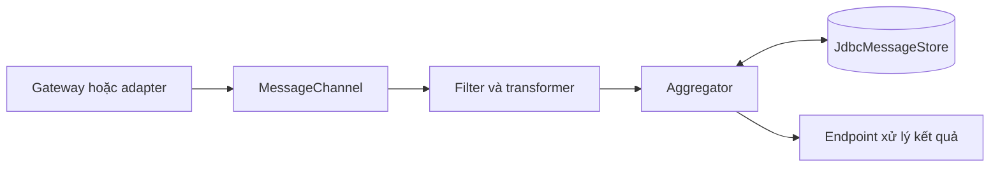

# JdbcMessageStore

## 1. Bài toán: giữ trạng thái của luồng thông điệp qua các lần chạy

Trong module **SPRING_INTEGRATION_CORE**, `Message` mang dữ liệu, `MessageChannel` nối các bước xử lý, còn endpoint thực hiện công việc như chuyển đổi, định tuyến hay gom nhóm. Với endpoint có trạng thái, cần trả lời thêm một câu hỏi: dữ liệu đang chờ xử lý được giữ ở đâu?

Giả sử một đơn hàng cần nhận ba kết quả: thanh toán, giữ hàng và giao vận. Aggregator đã nhận hai kết quả thì ứng dụng dừng để triển khai phiên bản mới. Nếu nhóm chỉ nằm trong bộ nhớ, lần khởi động tiếp theo không còn biết hai kết quả trước đó.

`JdbcMessageStore` đưa trạng thái thông điệp xuống cơ sở dữ liệu quan hệ thông qua JDBC. Nó phù hợp với các thành phần tương quan thông điệp như aggregator, resequencer, cũng như mẫu claim check. Lớp này cung cấp cả hợp đồng `MessageStore` và `MessageGroupStore`. [API JdbcMessageStore](https://docs.spring.io/spring-integration/api/org/springframework/integration/jdbc/store/JdbcMessageStore.html).

Sau bài này, người học có thể cấu hình store, gắn store vào aggregator bằng Java DSL, thiết kế phạm vi transaction, giải thích việc khôi phục sau restart và xác định nguyên nhân khi nhóm bị treo hoặc dữ liệu không được đọc lại.

## 2. Store nằm ở đâu trong luồng tích hợp?



Trong luồng này:

- Gateway hoặc adapter đưa thông điệp vào hệ thống.
- Filter loại thông điệp không hợp lệ; transformer chuẩn hóa payload và header.
- Aggregator xác định các thông điệp thuộc cùng một nhóm và thời điểm phát kết quả.
- Store lưu thông điệp cùng trạng thái nhóm theo yêu cầu của aggregator.
- Endpoint phía sau sử dụng kết quả đã gom để thực hiện nghiệp vụ.

Việc khai báo một bean `JdbcMessageStore` chưa làm cho mọi channel hay endpoint có tính bền vững. Thành phần cần lưu trạng thái phải được cấu hình sử dụng chính store đó. Một `DirectChannel` vẫn truyền thông điệp trực tiếp giữa các handler; nó không tự ghi mọi thông điệp xuống database.

### 2.1. Hai loại hợp đồng lưu trữ

| Hợp đồng | Đơn vị làm việc | Thao tác điển hình | Trường hợp sử dụng |
|---|---|---|---|
| `MessageStore` | Một thông điệp có định danh | `addMessage`, `getMessage`, `removeMessage` | Claim check |
| `MessageGroupStore` | Nhóm thông điệp cùng trạng thái nhóm | Thêm vào nhóm, đọc nhóm, đánh dấu hoàn tất, xóa nhóm | Aggregator, resequencer |

Một nhóm không chỉ là danh sách payload. Endpoint còn cần biết nhóm đã hoàn tất hay chưa, thời điểm tạo, thời điểm cập nhật và thông tin phục vụ xử lý theo thứ tự. Đây là lý do không thể thay store của aggregator bằng một bảng chỉ có cột JSON chứa payload mà vẫn giữ nguyên hành vi của framework.

### 2.2. Phân biệt các thành phần gần tên nhau

| Thành phần | Mục đích chính | Điểm cần nhớ |
|---|---|---|
| `SimpleMessageStore` | Lưu thông điệp và nhóm trong bộ nhớ | Thuận tiện khi học hoặc thử nghiệm; dữ liệu không tồn tại qua việc mất tiến trình |
| `JdbcMessageStore` | Lưu thông điệp và nhóm trong RDBMS | Phù hợp với aggregator và claim check |
| `JdbcChannelMessageStore` | Lưu hàng đợi của message channel | Được tối ưu riêng cho channel; không dùng thay store của aggregator |
| `JdbcMetadataStore` | Lưu metadata dạng khóa–giá trị | Thích hợp cho checkpoint hoặc trạng thái đã xử lý, không thay thế kho thông điệp đầy đủ |
| `JdbcLockRegistry` | Điều phối khóa qua database | Giúp nhiều instance phối hợp thao tác trên cùng nhóm |

Nếu nhu cầu chính là làm bền vững một `QueueChannel`, nên xem xét `JdbcChannelMessageStore`. Tài liệu Spring Integration phân biệt rõ store tổng quát với store được tối ưu cho hàng đợi channel. [JDBC Message Store](https://docs.spring.io/spring-integration/reference/jdbc/message-store.html).

## 3. Dữ liệu nào được ghi xuống database?

### 3.1. Các bảng của store tổng quát

Với prefix mặc định `INT_`, các bảng chính của `JdbcMessageStore` gồm:

| Bảng | Vai trò |
|---|---|
| `INT_MESSAGE` | Lưu định danh và dữ liệu đã serialize của từng thông điệp |
| `INT_MESSAGE_GROUP` | Lưu trạng thái của từng nhóm |
| `INT_GROUP_TO_MESSAGE` | Liên kết nhóm với các thông điệp thuộc nhóm |

Script đi kèm module JDBC còn có thể tạo bảng cho channel, metadata và lock. Chẳng hạn, `INT_CHANNEL_MESSAGE` phục vụ store của channel; `INT_LOCK` phục vụ cơ chế khóa JDBC. Không phải mọi bảng trong cùng script đều được `JdbcMessageStore` sử dụng. Có thể đối chiếu cấu trúc cụ thể trong [schema H2 của Spring Integration 6.5.3](https://raw.githubusercontent.com/spring-projects/spring-integration/v6.5.3/spring-integration-jdbc/src/main/resources/org/springframework/integration/jdbc/schema-h2.sql).

Các bảng trên là cấu trúc nội bộ của framework. `GROUP_KEY` không nên được giả định là chuỗi `orderId` hay `batchId` nguyên bản có thể truy vấn trực tiếp. Để làm việc với định danh nghiệp vụ, sử dụng API của store và correlation strategy của endpoint.

### 3.2. Schema phải đi cùng phiên bản thư viện

Đường dẫn script thường có dạng:

```text
org/springframework/integration/jdbc/schema-<database>.sql
```

Ví dụ với H2:

```text
classpath:org/springframework/integration/jdbc/schema-h2.sql
```

Hãy lấy script từ chính artifact `spring-integration-jdbc` mà ứng dụng đang sử dụng. Không sao chép DDL của một phiên bản khác rồi giả định các tên cột, kiểu dữ liệu hoặc cấu trúc bảng vẫn giống nhau.

Trong môi trường triển khai thực tế, đưa phần schema cần thiết vào Flyway hoặc Liquibase để kiểm soát thay đổi. Không chạy lại script tạo bảng không có tính lặp an toàn mỗi lần ứng dụng khởi động. Đổi prefix trong cấu hình Java cũng không tự tạo hoặc đổi tên bảng hiện có.

## 4. Chuẩn bị ví dụ thực hành

Ví dụ dưới đây dùng Java 17 trở lên, Spring Boot và API Java DSL có trong Spring Integration 6.5. Các phiên bản dependency do BOM của dự án quản lý. Khi dùng phiên bản khác, sử dụng schema đóng gói cùng phiên bản đó.

### 4.1. Dependency

Trong dự án Spring Boot đã có dependency management:

```xml
<dependency>
    <groupId>org.springframework.boot</groupId>
    <artifactId>spring-boot-starter-integration</artifactId>
</dependency>

<dependency>
    <groupId>org.springframework.boot</groupId>
    <artifactId>spring-boot-starter-jdbc</artifactId>
</dependency>

<dependency>
    <groupId>org.springframework.integration</groupId>
    <artifactId>spring-integration-jdbc</artifactId>
</dependency>

<dependency>
    <groupId>com.h2database</groupId>
    <artifactId>h2</artifactId>
    <scope>runtime</scope>
</dependency>
```

H2 chỉ dùng để thực hành trên máy cá nhân. Driver JDBC cần được thay bằng driver của database đích khi chuyển môi trường.

### 4.2. Dùng H2 dạng file để quan sát restart

```yaml
spring:
  datasource:
    url: jdbc:h2:file:./data/order-message-store;DB_CLOSE_ON_EXIT=FALSE
    driver-class-name: org.h2.Driver
    username: sa
    password: ""
  integration:
    jdbc:
      initialize-schema: never
  sql:
    init:
      mode: never
```

Đường dẫn file được tính từ thư mục làm việc của ứng dụng. Hai lần chạy phải trỏ đến cùng file database nếu muốn quan sát việc khôi phục dữ liệu.

Với một database thực hành còn rỗng, ở lần khởi tạo đầu tiên, tạm thay phần `spring.sql.init` bằng:

```yaml
spring:
  sql:
    init:
      mode: always
      schema-locations: classpath:org/springframework/integration/jdbc/schema-h2.sql
```

Giữ cấu hình `spring.integration.jdbc.initialize-schema: never` ở phần còn lại để chỉ có một cơ chế tạo schema. Sau khi tạo thành công, đưa `spring.sql.init.mode` về `never` trước lần chạy tiếp theo.

Nếu dùng `jdbc:h2:mem:...`, dữ liệu không còn sau khi tiến trình JVM kết thúc. Cấu hình `DB_CLOSE_DELAY=-1` của database trong bộ nhớ cũng không làm dữ liệu tồn tại qua việc tắt JVM.

## 5. Khai báo store và gắn vào aggregator

### 5.1. Payload có thể serialize

Mỗi kết quả thành phần được biểu diễn bằng một DTO nhỏ:

```java
package example.integration.store;

import java.io.Serial;
import java.io.Serializable;

public record PartResult(
        String orderId,
        String partId,
        boolean successful
) implements Serializable {

    @Serial
    private static final long serialVersionUID = 1L;
}
```

Trong ví dụ, `partId` lần lượt là `PAYMENT`, `STOCK` và `SHIPPING`. `batchId` sẽ nằm trong header để phân biệt từng lần thu thập kết quả. Một đơn hàng xử lý lại ở đợt khác phải dùng `batchId` khác.

### 5.2. Cấu hình Java DSL

```java
package example.integration.store;

import javax.sql.DataSource;

import org.springframework.context.annotation.Bean;
import org.springframework.context.annotation.Configuration;
import org.springframework.integration.channel.DirectChannel;
import org.springframework.integration.channel.QueueChannel;
import org.springframework.integration.config.EnableIntegration;
import org.springframework.integration.dsl.IntegrationFlow;
import org.springframework.integration.jdbc.store.JdbcMessageStore;
import org.springframework.jdbc.datasource.DataSourceTransactionManager;
import org.springframework.messaging.MessageChannel;
import org.springframework.messaging.PollableChannel;
import org.springframework.transaction.PlatformTransactionManager;
import org.springframework.transaction.annotation.EnableTransactionManagement;

@Configuration
@EnableIntegration
@EnableTransactionManagement
public class OrderStoreConfiguration {

    @Bean
    public JdbcMessageStore orderGroupStore(DataSource dataSource) {
        JdbcMessageStore store = new JdbcMessageStore(dataSource);
        store.setTablePrefix("INT_");
        store.setRegion("order-results-v1");
        return store;
    }

    @Bean
    public PlatformTransactionManager integrationTransactionManager(
            DataSource dataSource) {
        return new DataSourceTransactionManager(dataSource);
    }

    @Bean
    public MessageChannel orderResultInput() {
        return new DirectChannel();
    }

    @Bean
    public PollableChannel orderSummaryOutput() {
        return new QueueChannel();
    }

    @Bean
    public IntegrationFlow aggregateOrderResults(
            JdbcMessageStore orderGroupStore) {
        return IntegrationFlow.from("orderResultInput")
                .aggregate(spec -> spec
                        .messageStore(orderGroupStore)
                        .correlationStrategy(message ->
                                message.getHeaders()
                                        .get("batchId", String.class))
                        .releaseStrategy(group -> group.size() == 3)
                        .expireGroupsUponCompletion(false))
                .channel("orderSummaryOutput")
                .get();
    }
}
```

Điểm gắn kết nằm ở `.messageStore(orderGroupStore)`. DSL cho phép cấu hình correlation strategy, release strategy và store tại cùng endpoint. [Aggregators and Resequencers trong Java DSL](https://docs.spring.io/spring-integration/reference/dsl/java-aggregators.html).

Ý nghĩa của cấu hình:

1. Các thông điệp có cùng `batchId` đi vào cùng một nhóm.
2. Khi nhóm có ba thông điệp, aggregator phát kết quả.
3. Bộ xử lý nhóm mặc định tạo payload dạng tập hợp các payload đầu vào.
4. `expireGroupsUponCompletion(false)` giữ dấu vết nhóm hoàn tất thay vì xóa ngay toàn bộ nhóm sau release.
5. `orderSummaryOutput` là hàng đợi trong bộ nhớ để dễ quan sát kết quả khi thực hành.

Ví dụ giả định mỗi phần được gửi đúng một lần và mỗi `batchId` chỉ thuộc một đơn hàng. Điều kiện `group.size() == 3` đếm số thông điệp, không xác nhận có đủ ba `partId` khác nhau. Khi có redelivery, cần loại trùng theo khóa nghiệp vụ hoặc dùng release strategy kiểm tra đủ tập kết quả mong đợi; đồng thời quy định cách xử lý các bản sao trong đầu ra.

### 5.3. Đưa thông điệp vào một transaction rõ ràng

```java
package example.integration.store;

import org.springframework.beans.factory.annotation.Qualifier;
import org.springframework.messaging.Message;
import org.springframework.messaging.MessageChannel;
import org.springframework.messaging.support.MessageBuilder;
import org.springframework.stereotype.Service;
import org.springframework.transaction.annotation.Transactional;

@Service
public class OrderResultIngress {

    private final MessageChannel input;

    public OrderResultIngress(
            @Qualifier("orderResultInput") MessageChannel input) {
        this.input = input;
    }

    @Transactional(transactionManager = "integrationTransactionManager")
    public void accept(String batchId, PartResult result) {
        if (batchId == null || batchId.isBlank()) {
            throw new IllegalArgumentException("batchId must not be blank");
        }

        Message<PartResult> message = MessageBuilder
                .withPayload(result)
                .setHeader("batchId", batchId)
                .build();

        if (!this.input.send(message)) {
            throw new IllegalStateException("Message was not accepted");
        }
    }
}
```

Gọi `accept` qua bean do Spring quản lý để interceptor transaction có hiệu lực. Tự tạo đối tượng bằng `new` hoặc tự gọi một phương thức có `@Transactional` từ bên trong cùng đối tượng không tạo ra transaction theo cơ chế proxy thông thường.

Vì đầu vào là `DirectChannel`, aggregator được gọi đồng bộ trên thread gửi. Các thao tác JDBC của store có thể tham gia transaction do `integrationTransactionManager` quản lý trên cùng `DataSource`.

`QueueChannel` đầu ra trong ví dụ chỉ phục vụ quan sát. Việc đưa kết quả vào hàng đợi bộ nhớ không rollback cùng JDBC. Nếu cần cập nhật nghiệp vụ nguyên tử với trạng thái nhóm, dùng handler JDBC đồng bộ trong cùng transaction hoặc ghi một bản ghi outbox cùng transaction để phát tiếp sau đó.

## 6. Quan sát vòng đời nhóm và khôi phục sau restart

### 6.1. Kịch bản chạy

Từ một runner, controller hoặc integration test, gọi bean `OrderResultIngress` theo thứ tự:

```java
ingress.accept("ORDER-42:ATTEMPT-1",
        new PartResult("ORDER-42", "PAYMENT", true));

ingress.accept("ORDER-42:ATTEMPT-1",
        new PartResult("ORDER-42", "STOCK", true));
```

Sau khi hai lời gọi đã commit, dừng ứng dụng. Khởi động lại với cùng database, prefix và region, rồi gửi kết quả còn lại:

```java
ingress.accept("ORDER-42:ATTEMPT-1",
        new PartResult("ORDER-42", "SHIPPING", true));
```

Khi chạy trong test hoặc mã quan sát có tham chiếu đến `PollableChannel orderSummaryOutput`, lấy kết quả bằng:

```java
Message<?> summary = orderSummaryOutput.receive(1_000);
if (summary == null) {
    throw new IllegalStateException("No aggregated result");
}

Collection<?> results = (Collection<?>) summary.getPayload();
```

Đoạn đọc kết quả sử dụng `java.util.Collection` và `org.springframework.messaging.Message`. Đầu ra mặc định là tập hợp payload; không nên kiểm thử bằng cách giả định thứ tự `PAYMENT`, `STOCK`, `SHIPPING` nếu chưa cấu hình yêu cầu thứ tự tương ứng.

### 6.2. Trạng thái mong đợi

| Thời điểm | Trạng thái nhóm | Kết quả đầu ra |
|---|---|---|
| Sau `PAYMENT` đã commit | Nhóm có một thông điệp | Chưa có |
| Sau `STOCK` đã commit | Nhóm có hai thông điệp | Chưa có |
| Sau restart, trước thông điệp mới | Trạng thái nhóm vẫn nằm trong database | Chưa có |
| Sau `SHIPPING` và xử lý thành công | Nhóm hoàn tất theo cấu hình aggregator | Có tập hợp ba kết quả |

Restart không tự tạo một thông điệp đầu vào mới. Với ví dụ này, chính kết quả `SHIPPING` đến sau restart kích hoạt aggregator đọc lại nhóm và đánh giá release strategy.

Để quan sát store qua API trong bài thực hành:

```java
MessageGroup group = orderGroupStore
        .getMessageGroup("ORDER-42:ATTEMPT-1");

int pendingMessages = group.size();
boolean completed = group.isComplete();
```

`MessageGroup` thuộc package `org.springframework.integration.store`. Sau khi release hoàn toàn với cấu hình giữ nhóm hoàn tất, không nên mong đợi các thông điệp thành viên vẫn nằm nguyên trong nhóm; dấu vết hoàn tất và thông điệp đang chờ là hai loại trạng thái khác nhau.

### 6.3. Dữ liệu bền vững không đồng nghĩa endpoint tự hoạt động lại mọi công việc

Cần tách ba tình huống:

- **Nhóm chưa đủ dữ liệu:** thông điệp đến tiếp theo có thể làm nhóm được đọc lại và xử lý.
- **Nhóm cần hết hạn:** phải có cơ chế kiểm tra hoặc lập lịch hết hạn sau restart.
- **Kết quả đã phát vào channel bộ nhớ:** store của aggregator không phục hồi thay cho channel đầu ra đó.

Một phép kiểm thử restart chỉ có ý nghĩa khi các lần ghi trước restart đã commit. Đóng application context rồi mở lại trong khi transaction của test vẫn chưa commit không chứng minh được tính bền vững như trong triển khai thật.

## 7. Transaction quyết định phạm vi nhất quán

### 7.1. Các thao tác riêng lẻ cần được gắn thành một đơn vị công việc

Một lần nhận thông điệp có thể kéo theo việc ghi dữ liệu thông điệp, cập nhật liên kết nhóm, cập nhật trạng thái và gọi endpoint phía sau. Các câu lệnh SQL thành công riêng lẻ không đủ để chứng minh toàn bộ bước xử lý là nguyên tử.

Với luồng đồng bộ, ranh giới có thể được tổ chức như sau:

```text
BEGIN
  nhận thông điệp vào aggregator
  thay đổi trạng thái nhóm trong JdbcMessageStore
  nếu nhóm được release:
    ghi kết quả nghiệp vụ hoặc outbox bằng cùng DataSource
COMMIT
```

Nếu một lỗi cần rollback xảy ra, lỗi đó phải được truyền về ranh giới transaction. Khi một advice hoặc error handler nuốt exception và coi lần xử lý là thành công, transaction có thể commit thay vì rollback.

### 7.2. Thread và tài nguyên tham gia transaction

Transaction JDBC thông thường gắn với thread. `DirectChannel` cho phép lời gọi tiếp tục đồng bộ; chuyển sang `ExecutorChannel` hoặc một hàng đợi để worker khác xử lý tạo ra ranh giới cần được thiết kế riêng. Transaction của thread gửi không tự đi theo thông điệp sang thread nhận. Với endpoint đọc từ pollable channel, có thể cấu hình transaction tại poller. [Transaction Support](https://docs.spring.io/spring-integration/reference/transactions.html).

Để store và cập nhật nghiệp vụ tham gia cùng local transaction:

- Chúng phải sử dụng tài nguyên JDBC được transaction manager tương ứng quản lý.
- Lời gọi phải nằm trong cùng ranh giới transaction có hiệu lực.
- Exception cần dẫn đến rollback theo quy tắc đã cấu hình.

Hai transaction manager có tên khác nhau không tự phối hợp chỉ vì các bean cùng thuộc một Spring application context.

### 7.3. HTTP và các tác động bên ngoài

Giả sử handler đã gọi thành công API giao vận, nhưng database commit thất bại. Lần xử lý sau có thể gọi lại API đó. Rollback JDBC không hoàn tác được tác động HTTP đã xảy ra.

Khi có tác động bên ngoài, thiết kế cần thêm khóa idempotency hoặc outbox phù hợp. Ví dụ khóa `ORDER-42:ATTEMPT-1:CREATE-SHIPMENT` giúp hệ thống đích nhận diện cùng một yêu cầu nghiệp vụ được gửi lại.

Vì vậy, việc dùng `JdbcMessageStore` không đủ để tuyên bố toàn bộ quy trình đạt exactly-once. Tính bền vững của nhóm, việc loại trùng và tính nguyên tử của tác động bên ngoài cần được đánh giá riêng.

## 8. Serialization: payload lưu được nhưng header có thể thay đổi

### 8.1. Hợp đồng dữ liệu được lưu

Với cơ chế mặc định, cần chuẩn bị payload có thể Java serialize. `Serializable` trên lớp ngoài cùng chưa đủ nếu một trường bên trong tham chiếu đến đối tượng không serialize được.

Những dữ liệu như `String`, UUID hoặc DTO nhỏ có cấu trúc rõ ràng phù hợp hơn việc đưa vào payload một `InputStream`, connection JDBC, đối tượng request đang mở hay một service bean.

Đối với header, `JdbcMessageStore` loại các giá trị không serialize được trước khi ghi theo cơ chế mặc định. Điều này có nghĩa lỗi có thể biểu hiện bằng việc một header biến mất sau khi đọc lại, thay vì luôn xuất hiện exception tại lúc lưu. [Message Store và serialization](https://docs.spring.io/spring-integration/reference/message-store.html).

Header tự định nghĩa trong ví dụ là `batchId` dạng `String`, vì đây là dữ liệu cần tồn tại ổn định qua nhiều lần chạy. Correlation key nên có biểu diễn ổn định; tránh dùng một object tùy biến có định danh phụ thuộc vào địa chỉ bộ nhớ hoặc `toString()` không ổn định.

### 8.2. `replyChannel` và `errorChannel`

Các header này có thể chứa tham chiếu đến đối tượng channel trong tiến trình hiện tại. Không thể coi một đối tượng channel là địa chỉ trả lời có ý nghĩa ở mọi JVM hoặc sau mọi lần restart.

`HeaderChannelRegistry` có thể hỗ trợ biểu diễn tham chiếu channel bằng tên phục vụ các luồng thích hợp, nhưng registry trong bộ nhớ không làm sống lại temporary reply channel của một gateway đã dừng. Với xử lý kéo dài qua restart, nên có đầu ra được định danh ổn định và cơ chế nhận kết quả phù hợp với nghiệp vụ.

Đây cũng là lý do cần phân biệt thời gian chờ trả lời của gateway với thời gian tồn tại của một nhóm trong store: gateway có thể đã timeout trong khi nhóm vẫn tiếp tục được thu thập.

### 8.3. Đổi cấu trúc DTO khi còn dữ liệu cũ

Payload đã lưu là dữ liệu của một phiên bản hợp đồng. Trước khi đổi tên lớp, chuyển package, sửa kiểu trường hoặc thay serializer, hãy quyết định cách đọc các bản ghi còn tồn tại.

Với DTO dùng Java serialization, khai báo `serialVersionUID` rõ ràng giúp kiểm soát tương thích, nhưng không bảo đảm mọi thay đổi cấu trúc đều tương thích. Một lần nâng cấp ứng dụng cần xét cả dữ liệu đang chờ trong store.

Nếu tùy chỉnh serialization, hai phía ghi và đọc phải thống nhất định dạng. Không thể chỉ thay serializer thành JSON mà giữ deserializer mặc định rồi mong dữ liệu đọc lại được. Định dạng dữ liệu và schema nên được xem là một hợp đồng có phiên bản.

## 9. Dùng JdbcMessageStore cho claim check

Trong mẫu claim check, luồng lưu thông điệp gốc vào store và chuyển một định danh nhỏ qua các bước chưa cần đến payload lớn. Khi cần xử lý nội dung, thành phần phía sau dùng định danh để lấy thông điệp gốc. Spring Integration có các transformer claim check in/out để thực hiện mẫu này. [Claim Check](https://docs.spring.io/spring-integration/reference/claim-check.html).

API cơ bản có thể minh họa như sau:

```java
Message<String> original = MessageBuilder
        .withPayload("Noi dung tai lieu can xu ly")
        .setHeader("documentId", "DOC-15")
        .build();

Message<String> stored = documentStore.addMessage(original);
UUID reference = stored.getHeaders().getId();

// Chuyển reference qua những bước chỉ cần định danh.
Message<?> restored = documentStore.getMessage(reference);
if (restored == null) {
    throw new IllegalStateException("Claim check does not exist");
}

// Sau khi công việc tương ứng đã được xử lý thành công:
documentStore.removeMessage(reference);
```

Đoạn minh họa sử dụng `java.util.UUID`, `org.springframework.messaging.Message` và `org.springframework.messaging.support.MessageBuilder`. `documentStore` là một bean `JdbcMessageStore` đã được cấu hình, có thể dùng region riêng như `document-claims-v1`.

`getMessage` không đồng nghĩa với xóa. Ngược lại, nếu xóa dữ liệu trước khi công việc có thể phục hồi hoàn tất, lần retry có thể còn reference nhưng mất nội dung để đọc.

Với transformer claim check out, tùy chọn `remove-message` quyết định có xóa thông điệp sau khi lấy hay không. Nếu giữ lại để đọc nhiều lần, cần quy định thời điểm dọn dữ liệu. Nếu xóa khi lấy, cần xem xét rollback và khả năng retry của toàn bộ đơn vị xử lý.

Việc đọc rồi xóa ở ví dụ API cũng không tạo ra cơ chế claim độc quyền giữa nhiều consumer. Nếu nghiệp vụ yêu cầu chỉ một consumer được nhận công việc, phải có thêm cơ chế điều phối thích hợp.

## 10. Prefix, region và nhiều instance

### 10.1. Hai cách phân vùng

```java
store.setTablePrefix("ORD_INT_");
store.setRegion("order-results-v1");
```

Prefix thay đổi tên bảng mà store truy vấn. Ví dụ trên yêu cầu các bảng như `ORD_INT_MESSAGE` đã tồn tại. Region phân tách dữ liệu logic trong cùng một tập bảng.

Có thể hình dung phạm vi dữ liệu qua bộ ba:

```text
database/schema + table prefix + region
```

Đổi region khiến một instance nhìn vào một phân vùng khác; dữ liệu cũ vẫn có thể còn nguyên nhưng không còn được instance đó nhìn thấy. Đây là một nguyên nhân phổ biến khiến ứng dụng có vẻ mất nhóm sau khi đổi cấu hình.

Region là phân vùng dữ liệu, không phải hàng rào phân quyền database. Các môi trường cần cách ly quyền truy cập vẫn phải được thiết kế với tài khoản, schema hoặc database thích hợp.

### 10.2. Cùng chia sẻ dữ liệu chưa đủ để cùng xử lý an toàn

Khi hai instance cùng cập nhật một nhóm, cần đồng bộ toàn bộ chuỗi đọc trạng thái, thêm thông điệp, đánh giá release và đánh dấu hoàn tất. Khóa trong một JVM không điều phối được instance ở JVM khác.

Spring Integration cung cấp `JdbcLockRegistry` cho các thành phần tương quan sử dụng chung `MessageGroupStore` qua nhiều instance. [JDBC Lock Registry](https://docs.spring.io/spring-integration/reference/jdbc/lock-registry.html).

Với deployment nhiều instance, có thể bổ sung các bean sau vào cấu hình:

```java
@Bean
public DefaultLockRepository orderLockRepository(DataSource dataSource) {
    DefaultLockRepository repository = new DefaultLockRepository(dataSource);
    repository.setRegion("order-result-locks-v1");
    return repository;
}

@Bean
public JdbcLockRegistry orderLockRegistry(
        DefaultLockRepository orderLockRepository) {
    return new JdbcLockRegistry(orderLockRepository);
}
```

Hai lớp thuộc package `org.springframework.integration.jdbc.lock`. Sau đó truyền `JdbcLockRegistry orderLockRegistry` vào phương thức tạo flow và thêm:

```java
.aggregate(spec -> spec
        .messageStore(orderGroupStore)
        .lockRegistry(orderLockRegistry)
        .correlationStrategy(message ->
                message.getHeaders().get("batchId", String.class))
        .releaseStrategy(group -> group.size() == 3)
        .expireGroupsUponCompletion(false))
```

Các instance cùng phối hợp phải dùng chung phạm vi dữ liệu của store, phạm vi khóa và cách tạo correlation key. Mỗi instance cần có danh tính chủ sở hữu khóa riêng; không cấu hình chúng thành cùng một chủ sở hữu.

Cũng cần lựa chọn thời gian sống và cơ chế gia hạn khóa phù hợp với thời gian xử lý dài nhất. Nếu quyền sở hữu khóa hết hạn khi công việc chưa xong, giả định chỉ có một instance đang thao tác có thể bị phá vỡ.

## 11. Nhóm hoàn tất, nhóm hết hạn và dọn dữ liệu

### 11.1. Vì sao giữ dấu vết hoàn tất?

Sau khi một nhóm đã phát kết quả, thông điệp đến muộn với cùng correlation key cần được xử lý theo một chính sách rõ ràng. Giữ trạng thái hoàn tất giúp endpoint nhận diện rằng nhóm đó đã kết thúc. Xóa nhóm ngay cho phép cùng khóa được tạo lại, nên thông điệp đến muộn có thể trở thành thành viên đầu tiên của một nhóm mới.

Do đó, `expireGroupsUponCompletion(true)` là một quyết định về vòng đời và khả năng tái sử dụng khóa, không chỉ là tùy chọn tiết kiệm dung lượng. Chính sách completion, discard và xử lý thông điệp muộn cần được thiết kế cùng nhau. [Aggregator](https://docs.spring.io/spring-integration/reference/aggregator.html).

Với ví dụ đơn hàng, dùng khóa có đợt xử lý như `ORDER-42:ATTEMPT-1` giúp phân biệt lần xử lý mới với thông điệp đến muộn của lần trước. Nếu cần chống xử lý lặp lâu hơn thời gian giữ nhóm, cần một dấu vết nghiệp vụ hoặc metadata có thời hạn lưu phù hợp.

### 11.2. Nhóm không bao giờ nhận đủ dữ liệu

Nếu kết quả giao vận không bao giờ tới, nhóm có thể tồn tại vô thời hạn. Ứng dụng phải quyết định một trong những cách xử lý như phát kết quả từng phần, chuyển thông điệp sang luồng xử lý thất bại hoặc đóng nhóm và ghi nhận thiếu dữ liệu.

Store không tự quyết định thời hạn nghiệp vụ. Việc có cột thời gian trong database cũng không có nghĩa database tự xóa nhóm theo TTL.

`MessageGroupStoreReaper` hỗ trợ gọi cơ chế expire trên những nhóm vượt ngưỡng thời gian. Ví dụ bean:

```java
@Bean
public MessageGroupStoreReaper orderGroupReaper(
        JdbcMessageStore orderGroupStore) {
    MessageGroupStoreReaper reaper =
            new MessageGroupStoreReaper(orderGroupStore);
    reaper.setTimeout(300_000L);
    return reaper;
}
```

`MessageGroupStoreReaper` thuộc package `org.springframework.integration.store`. Chỉ khai báo bean chưa tạo lịch chạy: cần một scheduler gọi `run()` định kỳ, chẳng hạn qua phương thức `@Scheduled` khi đã bật scheduling. [API MessageGroupStoreReaper](https://docs.spring.io/spring-integration/api/org/springframework/integration/store/MessageGroupStoreReaper.html).

Ngưỡng 300 giây trong đoạn trên là cấu hình thời gian cho cơ chế expire của store; nó không tự bảo đảm đúng SLA “300 giây kể từ thông điệp cuối” của mọi endpoint. Cần kiểm tra mốc thời gian được dùng và phản ứng của aggregator khi nhận callback expire. Chu kỳ chạy scheduler còn làm thời điểm xử lý thực tế lệch so với ngưỡng cấu hình.

Nếu dùng timeout được endpoint lập lịch trong bộ nhớ, cần thiết kế cách phát hiện lại nhóm tồn đọng sau restart. Việc lưu nhóm bền vững không đồng nghĩa mọi timer trong JVM cũng được lưu bền vững.

### 11.3. Không dọn bảng theo từng mảnh

Xóa trực tiếp các hàng trong `INT_MESSAGE` mà bỏ qua liên kết nhóm có thể tạo dữ liệu không nhất quán. Ưu tiên API và cơ chế vòng đời của framework. Công việc bảo trì ngoài ứng dụng cần hiểu toàn bộ quan hệ giữa các bảng, ranh giới transaction và việc các instance khác còn đang sử dụng dữ liệu.

## 12. Xử lý lỗi và quan sát vận hành

### 12.1. Những tín hiệu cần theo dõi

Theo dõi số nhóm đang chờ, tuổi của nhóm cũ nhất, kích thước nhóm, thời gian thao tác JDBC, số lần rollback và thời gian chờ khóa. Một nhóm ngày càng lớn có thể chỉ ra lỗi correlation hoặc thiếu giới hạn nghiệp vụ.

Các truy vấn chỉ đọc sau giúp quan sát số lượng theo phân vùng, với prefix mặc định:

```sql
SELECT REGION, COUNT(*) AS MESSAGE_COUNT
FROM INT_MESSAGE
GROUP BY REGION;

SELECT REGION, COMPLETE, COUNT(*) AS GROUP_COUNT
FROM INT_MESSAGE_GROUP
GROUP BY REGION, COMPLETE;
```

Số hàng thông điệp và số hàng nhóm không bắt buộc bằng nhau. Một nhóm đang chờ có nhiều thông điệp, còn nhóm hoàn tất có thể chỉ còn dấu vết trạng thái.

### 12.2. Chẩn đoán theo triệu chứng

| Triệu chứng | Hướng kiểm tra |
|---|---|
| Lỗi không tìm thấy bảng hoặc cột | Schema, quyền truy cập, prefix và phiên bản DDL |
| Khởi động lại không thấy nhóm cũ | URL database, đường dẫn file H2, region, prefix và việc transaction trước đó đã commit |
| `NotSerializableException` khi ghi | Kiểu payload và toàn bộ đối tượng được payload tham chiếu |
| Lỗi đọc payload sau nâng cấp | Classpath, tên lớp, tương thích serialization, serializer/deserializer và chính sách deserialization của phiên bản đang dùng |
| Header biến mất sau đọc lại | Giá trị header có serialize được hay không; header có tham chiếu tài nguyên cục bộ của JVM hay không |
| Nhóm không release | Correlation key, release strategy, dữ liệu thiếu, thông điệp trùng hoặc nhóm đã hoàn tất |
| Hai instance cho kết quả không nhất quán | Distributed lock, phạm vi khóa, timeout khóa và transaction |
| Database tăng dung lượng liên tục | Nhóm chờ vô hạn, dấu vết completion chưa được dọn hoặc claim check chưa được xóa |
| Database đã rollback nhưng API ngoài vẫn bị gọi | Tác động bên ngoài nằm ngoài local transaction; kiểm tra idempotency hoặc outbox |

Không nên retry vô hạn lỗi schema hoặc dữ liệu không thể deserialize. Lỗi hạ tầng tạm thời và lỗi hợp đồng dữ liệu cần cách xử lý khác nhau để tránh tạo một luồng retry không thể thành công.

## 13. Chi phí và giới hạn thiết kế

### 13.1. Chi phí theo số thông điệp và kích thước nhóm

Đưa trạng thái xuống database làm tăng số lần truy cập JDBC, chi phí serialize và thời gian giữ khóa. Với release strategy hoặc processor cần duyệt toàn bộ nhóm, kích thước nhóm càng lớn thì mỗi lần đánh giá có thể càng tốn tài nguyên.

Ưu tiên DTO gọn, correlation có giới hạn rõ và thời hạn lưu phù hợp. Với payload rất lớn, có thể cân nhắc lưu nội dung ở hệ thống lưu trữ chuyên dụng rồi để thông điệp mang tham chiếu bền vững đến nội dung đó.

### 13.2. Pool, index và transaction dài

Lượng thread xử lý không nên được tăng độc lập với connection pool và khả năng chịu tải của database. Transaction giữ khóa nhóm trong khi chờ một lời gọi mạng chậm có thể gây tắc nghẽn cho các thông điệp cùng nhóm.

Index phải phù hợp với các truy vấn của phiên bản store đang dùng và dữ liệu thực tế. Hãy đo query plan, lock wait và độ trễ trước khi bổ sung index; mỗi index cũng làm tăng chi phí ghi.

### 13.3. Store không thay thế broker

Trong ví dụ, database giữ trạng thái aggregator; đầu vào và đầu ra vẫn có những đặc tính riêng. Nếu hệ thống cần hàng đợi phân tán, cơ chế giao nhận hoặc đặc tính vận hành của broker, cần đánh giá channel và transport tương ứng. Chọn `JdbcMessageStore` cho phần trạng thái không tự cung cấp các đặc tính đó cho toàn bộ luồng.

## 14. Kịch bản kiểm chứng khi tích hợp vào dự án

Những kịch bản sau kiểm chứng hành vi của thiết kế thay vì chỉ kiểm tra bean được tạo thành công:

| Kịch bản | Cách thực hiện | Điều cần xác nhận |
|---|---|---|
| Khôi phục nhóm đã commit | Gửi hai kết quả, đóng tiến trình, mở lại cùng DB, gửi kết quả cuối | Đầu ra chứa đủ các kết quả từ trước và sau restart |
| Rollback phần cập nhật nhóm | Trong luồng đồng bộ có transaction, cố ý ném lỗi trước commit | Thông điệp chưa commit không trở thành trạng thái nhóm đã lưu |
| Rollback kết quả nghiệp vụ | Dùng handler JDBC cùng transaction, gây lỗi trước commit | Trạng thái nhóm và cập nhật nghiệp vụ không commit lệch nhau |
| Khác region | Đọc cùng correlation key qua store thuộc region khác | Các phân vùng không nhìn thấy dữ liệu của nhau |
| Thông điệp trùng | Gửi lại cùng khóa nghiệp vụ bằng message mới | Chính sách loại trùng hoặc release không hoàn tất nhóm sớm |
| Thông điệp đến muộn | Gửi thêm dữ liệu sau khi nhóm hoàn tất | Hành vi discard hoặc tái tạo nhóm đúng chính sách đã chọn |
| Nhóm hết hạn | Cho nhóm thiếu dữ liệu vượt ngưỡng và chạy cơ chế expire | Luồng thất bại hoặc kết quả từng phần được xử lý theo cấu hình |
| Nhiều instance | Gửi đồng thời cùng correlation key qua hai instance | Khóa và transaction giữ được quy tắc xử lý của nhóm |
| Nâng cấp DTO | Đọc dữ liệu được ghi bởi phiên bản ứng dụng trước | Hợp đồng serialization tương thích hoặc có lộ trình chuyển đổi |

Với CI, database thực tế qua Testcontainers thường phản ánh hành vi dialect, transaction và khóa tốt hơn việc chỉ chạy H2. Một phép thử mở lại application context trên database trong bộ nhớ vẫn hữu ích, nhưng không thay thế phép thử mất tiến trình với dữ liệu đã commit vào kho bền vững.

Thiết kế hoàn chỉnh cần xác định được nơi giữ trạng thái nhóm, ranh giới commit, cách nhận diện xử lý lặp và chính sách dọn dữ liệu. Khi những phần này rõ ràng, `JdbcMessageStore` trở thành một thành phần có thể kiểm chứng được trong luồng thông điệp của Spring Integration.
