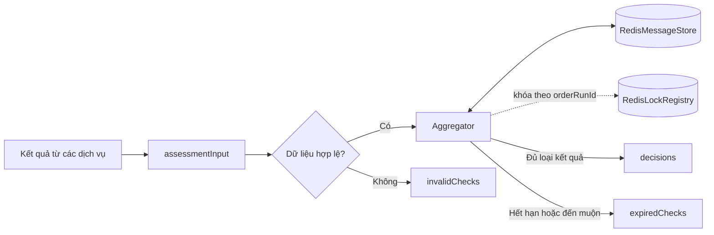

# RedisMessageStore

## 1. Mục tiêu và phạm vi

Trong module **SPRING_INTEGRATION_CORE**, chương **Message store**, bài này trình bày cách dùng `RedisMessageStore` để giữ trạng thái thông điệp ngoài bộ nhớ của tiến trình. Trọng tâm là kết nối `Message`, channel, aggregator và Java DSL thành một luồng có thể tiếp tục sử dụng dữ liệu đã lưu khi ứng dụng khởi động lại.

Sau bài học, bạn có thể:

- Phân biệt lưu một message với lưu trạng thái một nhóm message.
- Cấu hình Redis connection, namespace và serializer cho store.
- Gắn store vào aggregator và phối hợp khóa giữa nhiều instance.
- Thiết kế thời hạn chờ, đường xử lý message bị loại và chính sách dọn nhóm.
- Kiểm thử việc đọc lại dữ liệu và nhận diện giới hạn của tính bền vững.

Ví dụ Java lấy **Spring Integration 6.5.x, Java 17+** làm mốc API. Dùng bộ phiên bản Spring Boot/Spring Data Redis tương thích do BOM quản lý; khi áp dụng cho Spring Integration 7.x, cần đối chiếu lại API serialization, đặc biệt các lớp Jackson.

## 2. Vì sao aggregator cần message store?

Một lần đánh giá đơn hàng cần ba kết quả: kiểm tra kho, thanh toán và gian lận. Chúng có thể đến khác thời điểm, từ các hệ thống khác nhau.

```text
09:00:00  STOCK đến
09:00:02  PAYMENT đến
09:00:03  ứng dụng bị dừng
09:00:08  ứng dụng chạy lại
09:00:09  FRAUD đến
```

Nếu hai kết quả đầu chỉ nằm trong bộ nhớ tiến trình, aggregator sau khi chạy lại chỉ thấy kết quả cuối. Khi trạng thái đã được ghi vào Redis và còn đọc được, instance mới có thể dùng lại chúng để xét điều kiện hoàn tất.

`RedisMessageStore` triển khai cả hợp đồng `MessageStore` và `MessageGroupStore`. Thành phần xử lý chọn cách nhóm, điều kiện phát kết quả và đầu ra; store đảm nhiệm việc lưu và truy xuất trạng thái. Các giao diện này không biến store thành một endpoint tự xử lý nghiệp vụ. [Mã nguồn RedisMessageStore 6.5.3](https://raw.githubusercontent.com/spring-projects/spring-integration/v6.5.3/spring-integration-redis/src/main/java/org/springframework/integration/redis/store/RedisMessageStore.java).



Trong thiết kế này, Redis giữ các message đang chờ tổng hợp. Nơi lưu quyết định cuối cùng và cơ chế giao nhận kết quả vẫn cần được lựa chọn riêng.

## 3. MessageStore và MessageGroupStore

| Hợp đồng | Thao tác tiêu biểu | Tình huống |
| --- | --- | --- |
| `MessageStore` | `addMessage(message)`, `getMessage(id)`, `removeMessage(id)` | Lưu/đọc một message, hỗ trợ Claim Check |
| `MessageGroupStore` | `addMessageToGroup(groupId, message)`, `getMessageGroup(groupId)`, `removeMessageGroup(groupId)` | Aggregator, resequencer và vòng đời nhóm |
| `RedisMessageStore` | Hỗ trợ hai hợp đồng trên | Dùng Redis làm kho trạng thái |

ID của một `Message` thường là `UUID` trong header `id`. Correlation key là khóa nghiệp vụ xác định nhóm; hai khái niệm này phục vụ hai mục đích khác nhau.

Ví dụ:

```text
Message A: id=uuid-A, orderRunId=ORDER-42:CHECK-1, type=STOCK
Message B: id=uuid-B, orderRunId=ORDER-42:CHECK-1, type=PAYMENT

Nhóm: ORDER-42:CHECK-1
```

`orderRunId` nhận diện **một lần đánh giá** đơn hàng. Nếu cần đánh giá lại, dùng khóa mới như `ORDER-42:CHECK-2`. Cách đặt khóa này tránh đưa kết quả của hai lần xử lý vào cùng nhóm.

### 3.1. Cấu trúc lưu và namespace

Trong mã nguồn `AbstractKeyValueMessageStore` của bản 6.5.3, message được bọc để lưu riêng, còn metadata nhóm giữ thông tin như danh sách message ID và trạng thái hoàn tất. Không nên giả định toàn bộ payload của nhóm luôn nằm trong một Redis value. [Mã nguồn AbstractKeyValueMessageStore](https://raw.githubusercontent.com/spring-projects/spring-integration/v6.5.3/spring-integration-core/src/main/java/org/springframework/integration/store/AbstractKeyValueMessageStore.java).

Với prefix `lesson:dev:assessment:v1:`, các dạng key trong triển khai này gồm:

```text
lesson:dev:assessment:v1:MESSAGE_<messageId>
lesson:dev:assessment:v1:MESSAGE_<groupId>_<messageId>
lesson:dev:assessment:v1:GROUP_OF_MESSAGES_<groupId>
```

Dạng thứ nhất phục vụ message độc lập; hai dạng sau liên quan đến message trong nhóm và metadata nhóm. Đây là chi tiết triển khai để hỗ trợ chẩn đoán, không phải định dạng ứng dụng nên tự ghi trực tiếp.

Chọn namespace theo môi trường và mục đích:

```text
orders:dev:assessment:v1:
orders:prod:assessment:v1:
orders:prod:claim-check:v1:
```

Các instance cùng xử lý một luồng phải dùng cùng namespace. Luồng khác cần namespace riêng, nhất là khi có tác vụ hết hạn nhóm.

## 4. Chuẩn bị dependency và Redis

Trong dự án đã có parent hoặc BOM Spring Boot tương thích với Spring Integration 6.5.x:

```xml
<dependencies>
    <dependency>
        <groupId>org.springframework.boot</groupId>
        <artifactId>spring-boot-starter-integration</artifactId>
    </dependency>
    <dependency>
        <groupId>org.springframework.integration</groupId>
        <artifactId>spring-integration-redis</artifactId>
    </dependency>
    <dependency>
        <groupId>org.springframework.boot</groupId>
        <artifactId>spring-boot-starter-data-redis</artifactId>
    </dependency>
    <dependency>
        <groupId>org.springframework.boot</groupId>
        <artifactId>spring-boot-starter-test</artifactId>
        <scope>test</scope>
    </dependency>
</dependencies>
```

Không tự ghép các phiên bản Spring Integration và Spring Data Redis độc lập. Nếu không dùng Spring Boot, phải quản lý các phiên bản tương thích và thêm Redis client, chẳng hạn Lettuce. Module hỗ trợ store là `spring-integration-redis`. [Tài liệu Redis Support 6.5](https://docs.spring.io/spring-integration/reference/6.5/redis.html).

Ví dụ dưới đây giả định Redis local đang nghe ở `127.0.0.1:6379`. Các thuộc tính `lesson.*` chỉ phục vụ bài thực hành:

```properties
lesson.redis.host=127.0.0.1
lesson.redis.port=6379
lesson.store-prefix=lesson:dev:assessment:v1:
lesson.lock-prefix=lesson:dev:assessment-lock:v1
```

Cấu hình Java sử dụng `@Value` với giá trị mặc định nên cũng có thể chạy qua Spring Test mà không cần Spring Boot. Trong ứng dụng đã được Boot cấp `RedisConnectionFactory`, sử dụng factory đó và bỏ bean factory minh họa để tránh khai báo trùng.

## 5. Ví dụ Java DSL: tổng hợp ba kết quả kiểm tra

Quy tắc nghiệp vụ của ví dụ:

1. Mỗi `orderRunId` phải có đủ `STOCK`, `PAYMENT` và `FRAUD`.
2. Một kết quả bị lặp không được thay thế cho loại kết quả còn thiếu.
3. Chỉ chấp thuận khi mọi kết quả đang được tổng hợp đều có `passed=true`.
4. Kết quả của một lần đánh giá là bất biến. Nếu nghiệp vụ cho phép điều chỉnh, mở lần đánh giá mới hoặc bổ sung quy tắc phiên bản rõ ràng.
5. Nhóm thiếu dữ liệu khi hết hạn được chuyển sang đường xử lý riêng.

Dưới đây là một lớp cấu hình hoàn chỉnh. Ba `QueueChannel` đầu ra là queue trong bộ nhớ để dễ quan sát khi học.

```java
package example.integration;

import java.io.Serializable;
import java.util.EnumSet;
import java.util.Set;
import java.util.stream.Collectors;

import org.springframework.beans.factory.annotation.Value;
import org.springframework.context.annotation.Bean;
import org.springframework.context.annotation.Configuration;
import org.springframework.data.redis.connection.RedisConnectionFactory;
import org.springframework.data.redis.connection.lettuce.LettuceConnectionFactory;
import org.springframework.integration.channel.DirectChannel;
import org.springframework.integration.channel.QueueChannel;
import org.springframework.integration.config.EnableIntegration;
import org.springframework.integration.dsl.IntegrationFlow;
import org.springframework.integration.redis.store.RedisMessageStore;
import org.springframework.integration.redis.util.RedisLockRegistry;
import org.springframework.integration.store.MessageGroup;
import org.springframework.integration.store.MessageGroupStoreReaper;
import org.springframework.scheduling.annotation.EnableScheduling;
import org.springframework.scheduling.annotation.Scheduled;

@Configuration(proxyBeanMethods = false)
@EnableIntegration
@EnableScheduling
public class RedisOrderFlow {

    public enum CheckType {
        STOCK, PAYMENT, FRAUD
    }

    public record CheckResult(
            String orderRunId,
            CheckType type,
            boolean passed) implements Serializable {
    }

    public record OrderDecision(
            String orderRunId,
            boolean approved) implements Serializable {
    }

    @Bean
    RedisConnectionFactory redisConnectionFactory(
            @Value("${lesson.redis.host:127.0.0.1}") String host,
            @Value("${lesson.redis.port:6379}") int port) {

        return new LettuceConnectionFactory(host, port);
    }

    @Bean
    RedisMessageStore assessmentStore(
            RedisConnectionFactory connectionFactory,
            @Value("${lesson.store-prefix:lesson:dev:assessment:v1:}")
            String prefix) {

        return new RedisMessageStore(connectionFactory, prefix);
    }

    @Bean
    RedisLockRegistry assessmentLocks(
            RedisConnectionFactory connectionFactory,
            @Value("${lesson.lock-prefix:lesson:dev:assessment-lock:v1}")
            String lockPrefix) {

        return new RedisLockRegistry(connectionFactory, lockPrefix);
    }

    @Bean
    DirectChannel assessmentInput() {
        return new DirectChannel();
    }

    @Bean
    QueueChannel decisions() {
        return new QueueChannel();
    }

    @Bean
    QueueChannel invalidChecks() {
        return new QueueChannel();
    }

    @Bean
    QueueChannel expiredChecks() {
        return new QueueChannel();
    }

    @Bean
    IntegrationFlow assessmentFlow(
            RedisMessageStore assessmentStore,
            RedisLockRegistry assessmentLocks) {

        return IntegrationFlow.from("assessmentInput")
                .filter(CheckResult.class, RedisOrderFlow::validCheck,
                        filter -> filter.discardChannel("invalidChecks"))
                .aggregate(aggregator -> aggregator
                        .messageStore(assessmentStore)
                        .lockRegistry(assessmentLocks)
                        .correlationStrategy(message ->
                                ((CheckResult) message.getPayload())
                                        .orderRunId())
                        .releaseStrategy(RedisOrderFlow::hasAllCheckTypes)
                        .outputProcessor(RedisOrderFlow::toDecision)
                        .groupTimeout(60_000L)
                        .sendPartialResultOnExpiry(false)
                        .expireGroupsUponCompletion(false)
                        .expireGroupsUponTimeout(false)
                        .minimumTimeoutForEmptyGroups(300_000L)
                        .discardChannel("expiredChecks"))
                .channel("decisions")
                .get();
    }

    private static boolean validCheck(CheckResult result) {
        return result.orderRunId() != null
                && !result.orderRunId().isBlank()
                && result.type() != null;
    }

    private static boolean hasAllCheckTypes(MessageGroup group) {
        Set<CheckType> received = group.getMessages().stream()
                .map(message -> (CheckResult) message.getPayload())
                .map(CheckResult::type)
                .collect(Collectors.toSet());

        return received.containsAll(EnumSet.allOf(CheckType.class));
    }

    private static OrderDecision toDecision(MessageGroup group) {
        var checks = group.getMessages().stream()
                .map(message -> (CheckResult) message.getPayload())
                .toList();

        String orderRunId = checks.get(0).orderRunId();
        boolean approved = checks.stream().allMatch(CheckResult::passed);
        return new OrderDecision(orderRunId, approved);
    }

    @Bean
    MessageGroupStoreReaper assessmentReaper(
            RedisMessageStore assessmentStore) {

        var reaper = new MessageGroupStoreReaper(assessmentStore);
        reaper.setTimeout(300_000L);
        reaper.setExpireOnDestroy(false);
        return reaper;
    }

    @Bean
    ReaperJob assessmentReaperJob(MessageGroupStoreReaper assessmentReaper) {
        return new ReaperJob(assessmentReaper);
    }

    public static final class ReaperJob {

        private final MessageGroupStoreReaper reaper;

        public ReaperJob(MessageGroupStoreReaper reaper) {
            this.reaper = reaper;
        }

        @Scheduled(initialDelay = 15_000L, fixedDelay = 15_000L)
        public void expireOldGroups() {
            this.reaper.run();
        }
    }
}
```

`@EnableIntegration` đăng ký hạ tầng Spring Integration. Spring quản lý vòng đời `LettuceConnectionFactory`, lock registry và reaper; không gọi thủ công các hàm khởi tạo bean.

### 5.1. Đọc luồng theo trách nhiệm

| Thành phần | Trách nhiệm trong ví dụ |
| --- | --- |
| `assessmentInput` | Nhận `Message<CheckResult>` trên thread gửi |
| Filter | Loại bản ghi thiếu khóa hoặc thiếu loại kiểm tra |
| Correlation strategy | Chọn nhóm từ `orderRunId` |
| Release strategy | Kiểm tra tập loại kết quả đã nhận |
| Output processor | Tạo `OrderDecision` |
| `assessmentStore` | Lưu message và trạng thái nhóm vào Redis |
| `assessmentLocks` | Phối hợp truy cập cùng nhóm giữa các instance |
| `decisions` | Giữ kết quả để chương trình học/test nhận ra đọc |
| Reaper | Quét nhóm đủ điều kiện hết hạn theo lịch |

Việc xét tập `CheckType` là lựa chọn của bài toán này. Dùng riêng `group.size() == 3` có thể hoàn tất sai khi đầu vào là `STOCK, STOCK, PAYMENT`. Giữ đủ ba loại cũng chưa thay thế được cơ chế chống lặp về nghiệp vụ: các bản ghi trùng vẫn có thể tiêu thụ bộ nhớ Redis.

Nếu hệ thống cho phép thay đổi một kết quả sau khi đã phát quyết định, cần thiết kế luồng cập nhật riêng. Aggregator trên có thể đã hoàn tất trước khi bản điều chỉnh đến.

### 5.2. Gửi và nhận message

Đoạn sau đặt trong một phương thức Java, với các lớp từ `RedisOrderFlow` đã được import:

```java
try (var context =
        new org.springframework.context.annotation.AnnotationConfigApplicationContext(
                RedisOrderFlow.class)) {

    var input = context.getBean("assessmentInput",
            org.springframework.messaging.MessageChannel.class);
    var output = context.getBean("decisions", QueueChannel.class);

    input.send(new org.springframework.messaging.support.GenericMessage<>(
            new RedisOrderFlow.CheckResult(
                    "ORDER-42:CHECK-1",
                    RedisOrderFlow.CheckType.STOCK, true)));
    input.send(new org.springframework.messaging.support.GenericMessage<>(
            new RedisOrderFlow.CheckResult(
                    "ORDER-42:CHECK-1",
                    RedisOrderFlow.CheckType.PAYMENT, true)));
    input.send(new org.springframework.messaging.support.GenericMessage<>(
            new RedisOrderFlow.CheckResult(
                    "ORDER-42:CHECK-1",
                    RedisOrderFlow.CheckType.FRAUD, true)));

    var message = output.receive(1_000);
    if (message != null) {
        System.out.println(message.getPayload());
    }
}
```

Với Redis sạch cho khóa nhóm này, kết quả mong đợi là:

```text
OrderDecision[orderRunId=ORDER-42:CHECK-1, approved=true]
```

Mỗi lần chạy thử lại cần một `orderRunId` mới hoặc một namespace thực hành mới. Khi metadata hoàn tất còn tồn tại, message mới có cùng khóa sẽ bị coi là đến muộn.

Các queue đầu ra của ví dụ mất nội dung khi JVM dừng và mặc định không giới hạn dung lượng. Khi triển khai, cần consumer hoạt động liên tục, giới hạn tải và lựa chọn đầu ra có tính bền vững phù hợp. Lưu nhóm trong Redis không tự làm các queue khác trở thành persistent.

## 6. Serialization: lưu cả payload và headers

Serializer mặc định của `RedisMessageStore` là Java serialization. Payload và dữ liệu được lưu cùng nó phải phù hợp với serializer; một đối tượng không thể serialize trong header có thể làm thao tác ghi thất bại. Vì thế DTO trong ví dụ triển khai `Serializable`. [Triển khai serializer mặc định](https://raw.githubusercontent.com/spring-projects/spring-integration/v6.5.3/spring-integration-redis/src/main/java/org/springframework/integration/redis/store/RedisMessageStore.java).

Hãy kiểm tra message thực tế ngay trước ranh giới lưu:

- Ưu tiên DTO chỉ chứa dữ liệu như chuỗi, số, enum và các cấu trúc đã có hợp đồng serialization.
- Chuyển stream, request object, connection hoặc đối tượng framework thành dữ liệu cần thiết trước khi lưu.
- Giữ các header cần cho correlation, theo dõi và nghiệp vụ; xử lý các header tham chiếu tài nguyên cục bộ theo thiết kế luồng.
- Kiểm thử dữ liệu do phiên bản ứng dụng cũ ghi khi triển khai phiên bản mới.

Một channel Java trong `replyChannel` không thể trở thành địa chỉ liên tiến trình chỉ bằng serialization. Nếu dùng `HeaderChannelRegistry` để đổi tham chiếu channel thành tên, registry đó vẫn có vòng đời và phạm vi cần quản lý. Với luồng chờ dài, nên dùng điểm nhận kết quả có tên ổn định và định danh nghiệp vụ.

### 6.1. Đổi sang JSON

Có thể cấu hình `setValueSerializer(...)`. Với mốc 6.5.x và Jackson 2, một biến thể bean dùng mapper có nhận biết message là:

```java
@Bean
RedisMessageStore jsonAssessmentStore(
        RedisConnectionFactory connectionFactory) {

    var mapper =
            org.springframework.integration.support.json.JacksonJsonUtils
                    .messagingAwareMapper("example.integration");

    var serializer =
            new org.springframework.data.redis.serializer
                    .GenericJackson2JsonRedisSerializer(mapper);

    var store = new RedisMessageStore(
            connectionFactory, "lesson:dev:assessment:json:v1:");
    store.setValueSerializer(serializer);
    return store;
}
```

Đây là phương án **thay thế** bean store mặc định, cần các dependency Jackson 2 tương thích. Không thêm cả hai bean rồi để việc chọn store trở nên mơ hồ.

Mapper phải xử lý được envelope message, headers và đối tượng nội bộ của store, không chỉ DTO payload. Giới hạn package tin cậy theo dữ liệu thực tế; tránh mở quyền deserialization cho mọi kiểu. Khi chuyển sang Spring Integration 7.x, đối chiếu các lớp Jackson 3 tương ứng trong tài liệu của phiên bản sử dụng. [Hướng dẫn serialization Redis 6.5](https://docs.spring.io/spring-integration/reference/6.5/redis.html), [hướng dẫn Redis hiện hành](https://docs.spring.io/spring-integration/reference/redis.html).

Thay serializer không tự chuyển đổi dữ liệu cũ. Kế hoạch chuyển đổi có thể là xử lý hết nhóm cũ trước, dùng namespace mới cho dữ liệu mới hoặc xây dựng migration đã kiểm thử. Trong một namespace còn nhóm đang hoạt động, tất cả instance phải đọc/ghi cùng định dạng.

## 7. Nhiều instance: store dùng chung và khóa dùng chung

Khi hai instance cùng nhận message của `ORDER-42:CHECK-1`, mỗi bên đều có thể thực hiện chuỗi thao tác đọc nhóm, thêm message, xét release và cập nhật trạng thái. Các lệnh Redis riêng lẻ không thay thế việc phối hợp toàn bộ chuỗi này.

Aggregator có khóa cục bộ theo nhóm. Khi nhóm được dùng chung giữa các tiến trình, cấu hình một distributed `LockRegistry` như `RedisLockRegistry`. [Distributed Locks](https://docs.spring.io/spring-integration/reference/distributed-locks.html).

Các instance của ví dụ cần thống nhất:

```text
store-prefix   = lesson:prod:assessment:v1:
lock-prefix    = lesson:prod:assessment-lock:v1
correlation    = cùng quy tắc orderRunId
serialization  = cùng định dạng và kiểu dữ liệu tương thích
```

Hai prefix có vai trò riêng; chúng không cần giống nhau. Điều quan trọng là mọi instance thao tác cùng nhóm phải dùng cùng không gian khóa và cùng không gian dữ liệu.

Khóa Redis có thời hạn để có thể thu hồi khi tiến trình chết. Phải chọn thời hạn phù hợp với thời gian giữ khóa; các phiên bản hỗ trợ renewal cho phép cấu hình scheduler gia hạn. Mất quyền sở hữu khóa trong lúc thao tác cần được quan sát như sự cố đồng thời. [Redis Lock Registry](https://docs.spring.io/spring-integration/reference/redis.html#redis-lock-registry).

Trong bài thực hành, output processor chỉ tính toán trong bộ nhớ và gửi ra queue. Nếu thay bằng một lời gọi HTTP dài, hãy đánh giá lại phạm vi giữ khóa và khả năng trùng tác dụng phụ.

## 8. Timeout, completed group và reaper

Ba chính sách trong ví dụ phục vụ ba nhu cầu khác nhau:

| Chính sách | Giá trị ví dụ | Ý nghĩa |
| --- | --- | --- |
| `groupTimeout` | 60.000 ms | Thời gian không có message mới trước khi buộc xét hoàn tất nhóm |
| Reaper timeout | 300.000 ms | Ngưỡng tuổi nhóm để lần quét xét hết hạn |
| Reaper fixed delay | 15.000 ms | Khoảng nghỉ giữa hai lần thực thi tác vụ quét |
| `minimumTimeoutForEmptyGroups` | 300.000 ms | Giữ metadata nhóm rỗng thêm thời gian để nhận diện message đến muộn |

`groupTimeout` là cơ chế theo nhóm, còn reaper quét store. Tác vụ đã được lên lịch trong JVM không tự tồn tại qua việc tiến trình bị chết. Dùng reaper hoặc cơ chế purge nhóm mồ côi của correlation endpoint để xử lý nhóm còn nằm trong persistent store sau khi khởi động lại. [Quản lý nhóm và timeout của Aggregator 6.5](https://docs.spring.io/spring-integration/reference/6.5/aggregator.html).

`MessageGroupStoreReaper` là `Runnable`: đặt timeout và khai báo bean chưa tạo ra lịch quét. Trong ví dụ, `ReaperJob` gọi `run()` định kỳ; vòng đời Spring khởi động reaper. [Mã nguồn MessageGroupStoreReaper](https://raw.githubusercontent.com/spring-projects/spring-integration/v6.5.3/spring-integration-core/src/main/java/org/springframework/integration/store/MessageGroupStoreReaper.java).

### 8.1. Nhóm hết hạn được xử lý thế nào?

Trong ví dụ:

- `sendPartialResultOnExpiry(false)` không cho thiếu một loại kiểm tra mà vẫn phát quyết định bình thường.
- `discardChannel("expiredChecks")` nhận message bị loại do hết hạn hoặc đến sau khi nhóm đã hoàn tất.
- Hai tùy chọn `expireGroupsUponCompletion(false)` và `expireGroupsUponTimeout(false)` giữ metadata hoàn tất để nhận diện message đến muộn.
- Reaper và thời hạn nhóm rỗng giúp metadata này được dọn về sau.

Một nhóm hoàn tất có thể đã bỏ các message thành viên nhưng còn metadata rỗng. Vì vậy, thấy nhóm tồn tại không có nghĩa payload thành viên vẫn còn.

Sau khi metadata bị dọn, message dùng lại correlation key có thể tạo nhóm mới. Nếu cần chặn phát quyết định trùng lâu hơn thời gian giữ metadata, lưu dấu nghiệp vụ ở đích bằng khóa `orderRunId`, chẳng hạn unique constraint.

Các khoảng thời gian trên là tham số học tập, không phải cam kết SLA. Chu kỳ scheduler, tải hệ thống và chính sách tính tuổi nhóm đều ảnh hưởng thời điểm xử lý thực tế. Đo độ trễ và xác định cửa sổ message đến muộn dựa trên nghiệp vụ.

### 8.2. Không dùng Redis TTL thay cho vòng đời nhóm

Tự đặt `EXPIRE` cho các key nội bộ có thể làm message và metadata biến mất ở các thời điểm khác nhau. Nó cũng không thực thi output processor hoặc đường discard của aggregator.

Hãy để endpoint và store quản lý nhóm qua API tương ứng. Nếu cần retention đặc biệt, thiết kế nó với đầy đủ quan hệ giữa dữ liệu thành viên, metadata và xử lý hết hạn.

Mỗi aggregator độc lập nên có store bean và namespace riêng khi dùng expiration callback. Chia sẻ bừa một store giữa các endpoint có thể khiến nhóm được xử lý hết hạn bởi sai thành phần. [Message store và expiry callback trong Aggregator](https://docs.spring.io/spring-integration/reference/aggregator.html).

## 9. Chọn RedisMessageStore hay RedisChannelMessageStore?

| Nhu cầu | Thành phần phù hợp |
| --- | --- |
| Giữ nhóm cho aggregator hoặc resequencer | `RedisMessageStore` |
| Lưu message độc lập cho Claim Check | `RedisMessageStore` |
| QueueChannel lưu hàng đợi trong Redis | `RedisChannelMessageStore` |
| QueueChannel có ưu tiên theo khả năng Redis store hỗ trợ | `RedisChannelPriorityMessageStore` |
| Lưu metadata như dấu đã đọc của adapter | `RedisMetadataStore` |

`RedisChannelMessageStore` được chuyên biệt cho hàng đợi và sử dụng Redis list. Nó không cung cấp đầy đủ hợp đồng `MessageGroupStore` cần cho aggregator. `RedisMessageStore` hỗ trợ nhóm, nhưng với nhu cầu queue thì nên chọn store chuyên dụng. [Redis channel message stores](https://docs.spring.io/spring-integration/reference/redis.html#redis-channel-message-stores).

Nếu bổ sung một hàng đợi persistent trước aggregator, đó là một lớp đảm bảo riêng. Cần kiểm tra cả việc lấy phần tử khỏi queue, bàn giao cho handler và xử lý khi consumer chết; không suy ra cơ chế acknowledgement giống message broker từ việc sử dụng Redis list.

## 10. Message độc lập và Claim Check

Với payload lớn mà một số bước chỉ cần dữ liệu định tuyến, có thể lưu message rồi truyền token. Claim Check của Spring Integration có transformer check-in và check-out hỗ trợ mẫu này. [Claim Check](https://docs.spring.io/spring-integration/reference/6.5/claim-check.html).

Ví dụ thao tác trực tiếp, đặt trong phương thức có biến `connectionFactory`:

```java
var store = new RedisMessageStore(
        connectionFactory, "lesson:dev:claim-check:v1:");

var original = org.springframework.messaging.support.MessageBuilder
        .withPayload("noi-dung-can-luu")
        .setHeader("businessKey", "DOCUMENT-42")
        .build();

store.addMessage(original);
java.util.UUID token = original.getHeaders().getId();

var restored = store.getMessage(token);
// Xử lý restored khi thực sự cần dữ liệu gốc.

store.removeMessage(token);
// Chỉ xóa khi vòng đời nghiệp vụ cho phép.
```

Trong ứng dụng, cần quy định token mất hiệu lực khi nào, có bao nhiêu bên được đọc và xử lý thế nào nếu bản ghi không còn. Token này là ID của message độc lập; không dùng `getMessage(groupId)` để đọc một nhóm.

Tách namespace Claim Check khỏi namespace aggregator để việc dọn một loại dữ liệu không ảnh hưởng loại còn lại.

## 11. Xử lý lỗi và giới hạn giao dịch

### 11.1. Phân loại lỗi theo hành động

| Hiện tượng | Hướng xử lý |
| --- | --- |
| Redis không kết nối được | Kiểm tra endpoint, credential, timeout; retry có giới hạn |
| Payload/header không serialize được | Sửa hợp đồng dữ liệu, đưa vào đường xử lý lỗi |
| Không đọc được dữ liệu sau deploy | Kiểm tra tương thích class, serializer và namespace |
| Tranh chấp hoặc mất quyền sở hữu khóa | Kiểm tra thời gian giữ khóa, tải và cấu hình renewal |
| Thiếu một kết quả đến hết hạn | Bù dữ liệu, đánh dấu đánh giá thất bại hoặc mở lần đánh giá mới |
| Đích đã xử lý nhưng lời gọi bị timeout | Tra cứu bằng khóa nghiệp vụ trước khi thực hiện lại |

Trong luồng dùng `DirectChannel`, lỗi xử lý đồng bộ truyền về thread gọi `send`. Không phải mọi exception đều tự chuyển thành message trên global `errorChannel`. Với poller hoặc tác vụ bất đồng bộ, cơ chế báo lỗi phụ thuộc thành phần thực thi và error handler. [Error Handling 6.5](https://docs.spring.io/spring-integration/reference/6.5/error-handling.html).

Tác vụ `@Scheduled` trong ví dụ cần được giám sát lỗi như tác vụ nền thông thường. Nếu muốn gửi lỗi vào luồng Spring Integration, cấu hình error handler/scheduler thích hợp; với group timeout, kiểm tra cả scheduler mà aggregator sử dụng.

Retry lỗi serialization thường không giúp ích. Với lỗi mạng, một timeout có thể xảy ra khi lệnh đã được máy chủ thực hiện nhưng client chưa nhận phản hồi. Thiết kế tiếp nhận lặp và quan sát trạng thái trước khi kết luận thao tác chưa xảy ra.

### 11.2. Vì sao chưa có exactly-once?

Xét việc mở rộng đầu ra thành:

```text
đủ ba kết quả
    -> gọi dịch vụ phát hành phiếu
    -> cập nhật/hoàn tất nhóm
```

Nếu dịch vụ đã tạo phiếu nhưng tiến trình chết trước khi ghi nhận đầy đủ trạng thái, lần xử lý tiếp theo có thể tạo thêm phiếu. Distributed lock phối hợp truy cập nhóm, còn idempotency của thao tác tạo phiếu cần cơ chế riêng.

Một hướng thiết kế là truyền `orderRunId` làm idempotency key và để đích lưu duy nhất một kết quả cho khóa đó. Khi cần giao dịch bao trùm thay đổi cơ sở dữ liệu và phát sự kiện, cân nhắc transactional outbox phù hợp với hệ thống đích.

Không thêm `@Transactional` rồi mặc định coi Redis, cơ sở dữ liệu quan hệ và HTTP cùng rollback. Spring Data Redis yêu cầu cấu hình rõ ràng để `RedisTemplate` tham gia transaction; transaction Redis cũng không tạo giao dịch nguyên tử với HTTP. `RedisMessageStore` tự xây template nội bộ, nên cấu hình một template khác không tự đổi hành vi của nó. [Spring Data Redis Transactions](https://docs.spring.io/spring-data/redis/reference/redis/transactions.html), [mã nguồn RedisMessageStore](https://raw.githubusercontent.com/spring-projects/spring-integration/v6.5.3/spring-integration-redis/src/main/java/org/springframework/integration/redis/store/RedisMessageStore.java).

## 12. Redis persistence và vận hành

### 12.1. Phân biệt hai kiểu khởi động lại

Ứng dụng khởi động lại và Redis khởi động lại là hai thí nghiệm khác nhau:

| Sự cố | Điều kiện để dữ liệu còn dùng được |
| --- | --- |
| JVM ứng dụng chết, Redis vẫn chạy | Dữ liệu đã ghi và chưa bị xóa; instance mới dùng đúng cấu hình |
| Redis cũng chết và khởi động lại | Cần cơ chế persistence và dữ liệu lưu trữ còn tồn tại |
| Chuyển sang replica khi failover | Cần đánh giá độ trễ sao chép và cửa sổ mất dữ liệu |
| Deploy đổi class hoặc serializer | Cần tương thích với dữ liệu đã lưu |

Redis có RDB snapshot, AOF hoặc kết hợp hai cơ chế. Lựa chọn persistence và chính sách đồng bộ ghi quyết định cửa sổ mất dữ liệu khi máy chủ gặp sự cố. Với container, vị trí dữ liệu phải được lưu trên volume có vòng đời phù hợp. [Redis persistence](https://redis.io/docs/latest/operate/oss_and_stack/management/persistence/).

### 12.2. Bộ nhớ và chi phí thao tác

Message đang chờ là trạng thái xử lý. Nếu chính sách eviction cho phép loại key của store khi thiếu bộ nhớ, luồng có thể mất dữ liệu cần để hoàn tất nhóm.

Với kho trạng thái cần giữ, cân nhắc Redis riêng và `noeviction`; khi hết bộ nhớ, các lệnh ghi bị từ chối thay vì tự loại dữ liệu. Ứng dụng vẫn phải xử lý lỗi ghi và điều tiết tải. [Redis key eviction](https://redis.io/docs/latest/develop/reference/eviction/).

Ước lượng ban đầu có thể dùng:

```text
dung lượng chờ ≈ số nhóm đang mở
              × số message trung bình mỗi nhóm
              × kích thước message sau serialize
              + metadata + overhead Redis
```

Đây là mô hình để lập thí nghiệm tải, không phải công thức cấp phát chính xác. Cần tính cả metadata hoàn tất, dữ liệu replica, persistence và phần dự phòng.

Theo dõi số nhóm đang mở, tuổi nhóm lâu nhất, số lần discard, lỗi serializer, độ trễ Redis, tranh chấp khóa và dung lượng bộ nhớ. Các API đếm/quét của store có thể cần thao tác trên nhiều key; tránh gọi với tần suất cao trên dữ liệu lớn mà chưa đo chi phí.

Nhóm lớn còn làm tăng chi phí đọc dữ liệu cho release strategy/output processor. Cần giới hạn kích thước nhóm hoặc chia nhỏ bài toán thay vì chỉ tăng bộ nhớ Redis.

## 13. Kiểm thử minh họa với Redis thật

Kiểm thử serialization và khả năng đọc từ client khác cần một Redis thật hoặc Redis container dành riêng cho test. Mock không thể xác nhận dữ liệu đã được mã hóa/giải mã đúng.

Lớp dưới đây đặt cùng package với `RedisOrderFlow`, dùng JUnit Jupiter và Spring Test. Nó giả định Redis test đang chạy tại địa chỉ đã cấu hình. Các test chạy tuần tự để dùng chung queue quan sát.

```java
package example.integration;

import java.util.UUID;

import org.junit.jupiter.api.Test;
import org.springframework.beans.factory.annotation.Autowired;
import org.springframework.beans.factory.annotation.Qualifier;
import org.springframework.data.redis.connection.RedisConnectionFactory;
import org.springframework.integration.channel.QueueChannel;
import org.springframework.integration.redis.store.RedisMessageStore;
import org.springframework.messaging.MessageChannel;
import org.springframework.messaging.support.GenericMessage;
import org.springframework.test.context.TestPropertySource;
import org.springframework.test.context.junit.jupiter.SpringJUnitConfig;

import static org.junit.jupiter.api.Assertions.*;
import static example.integration.RedisOrderFlow.CheckType.*;

@SpringJUnitConfig(RedisOrderFlow.class)
@TestPropertySource(properties = {
        "lesson.store-prefix=lesson:test:assessment:v1:",
        "lesson.lock-prefix=lesson:test:assessment-lock:v1"
})
class RedisOrderFlowTest {

    @Autowired
    RedisConnectionFactory connectionFactory;

    @Autowired
    @Qualifier("assessmentInput")
    MessageChannel input;

    @Autowired
    @Qualifier("decisions")
    QueueChannel output;

    @Autowired
    RedisMessageStore assessmentStore;

    @Test
    void anotherStoreInstanceCanReadTheMessage() {
        String prefix = "lesson:test:roundtrip:" + UUID.randomUUID() + ":";
        var writer = new RedisMessageStore(connectionFactory, prefix);
        var reader = new RedisMessageStore(connectionFactory, prefix);
        var original = new GenericMessage<>("payload-can-doc-lai");
        UUID id = original.getHeaders().getId();

        try {
            writer.addMessage(original);

            var restored = reader.getMessage(id);
            assertNotNull(restored);
            assertEquals(original.getPayload(), restored.getPayload());
            assertEquals(id, restored.getHeaders().getId());
        }
        finally {
            writer.removeMessage(id);
        }
    }

    @Test
    void duplicateTypeCannotReplaceTheMissingType() {
        String runId = "ORDER-TEST:" + UUID.randomUUID();

        try {
            submit(runId, STOCK);
            submit(runId, STOCK);
            submit(runId, PAYMENT);

            assertNull(output.receive(0));

            submit(runId, FRAUD);

            var completed = output.receive(1_000);
            assertNotNull(completed);
            assertEquals(
                    new RedisOrderFlow.OrderDecision(runId, true),
                    completed.getPayload());
            assertNull(output.receive(0));
        }
        finally {
            assessmentStore.removeMessageGroup(runId);
        }
    }

    private void submit(String runId, RedisOrderFlow.CheckType type) {
        boolean accepted = input.send(new GenericMessage<>(
                new RedisOrderFlow.CheckResult(runId, type, true)));
        assertTrue(accepted);
    }
}
```

Test thứ nhất xác nhận hai đối tượng store đọc chung dữ liệu Redis; nó chưa chứng minh Redis sống qua một lần khởi động lại. Test thứ hai xác nhận điều kiện release theo loại kết quả, thay vì số lượng message.

Để cô lập môi trường CI, dùng Redis container hoặc tài nguyên test riêng và cấp prefix riêng cho mỗi lần chạy. Dọn đúng message/nhóm do test tạo; tránh `FLUSHALL` trên Redis dùng chung.

### 13.1. Các tình huống cần thực hành thêm

| Thí nghiệm | Kết quả cần quan sát |
| --- | --- |
| Chỉ gửi STOCK và PAYMENT | Chưa có quyết định |
| Gửi FRAUD với `passed=false` | Có quyết định `approved=false` |
| Gửi khóa rỗng | Bản ghi đi vào `invalidChecks` |
| Nhóm không đủ dữ liệu đến timeout | Không có quyết định; kiểm tra `expiredChecks` |
| Gửi message sau khi nhóm đã hoàn tất | Message bị loại khi metadata còn tồn tại |
| Hai instance xử lý cùng nhóm | Cùng namespace/lock registry phối hợp thao tác |
| Chèn header không serialize được | Lỗi lưu được nhìn thấy và phân loại đúng |
| Đổi serializer nhưng giữ dữ liệu cũ | Phát hiện tính không tương thích trước triển khai |

Để kiểm tra phục hồi khi JVM chết, gửi hai loại kết quả, xác nhận chúng đã có trong store, rồi dừng đột ngột tiến trình ứng dụng thử nghiệm. Khởi động instance mới với cùng namespace trước thời hạn dọn nhóm và gửi loại cuối. Phải nhận được một quyết định từ dữ liệu đã lưu.

Tách thí nghiệm này khỏi graceful shutdown, vì lifecycle callback có thể xử lý trạng thái khi context đóng. Kiểm tra riêng trường hợp không còn message mới: reaper phải xử lý được nhóm tồn đọng sau restart.

Để đánh giá độ bền của Redis, thực hiện thêm một thí nghiệm khởi động lại chính Redis với persistence và volume đã cấu hình, sau đó đối chiếu dữ liệu khôi phục.

## 14. Lỗi thiết kế thường gặp

| Thiết kế | Hệ quả | Cách điều chỉnh |
| --- | --- | --- |
| Dùng khóa mới ngẫu nhiên cho từng message | Mỗi kết quả rơi vào một nhóm | Giữ `orderRunId` chung cho một lần đánh giá |
| Chỉ đếm ba message | Bản lặp có thể gây release sớm | Xét đủ ba loại kết quả |
| Các instance dùng prefix khác nhau | Không thấy cùng nhóm | Thống nhất namespace của cùng luồng |
| Store chung nhưng khóa cục bộ | Có cạnh tranh giữa các tiến trình | Dùng distributed lock phù hợp |
| Không dọn nhóm chờ hoặc metadata hoàn tất | Dữ liệu tăng theo thời gian | Đặt chính sách hết hạn và chạy tác vụ quét |
| Đặt TTL trực tiếp lên key nội bộ | Có thể mất đồng bộ trạng thái | Dùng vòng đời nhóm qua endpoint/store |
| Ghi header chứa tài nguyên sống | Serialization lỗi hoặc dữ liệu không dùng được sau restart | Chuyển thành dữ liệu ổn định trước khi lưu |
| Coi output queue trong ví dụ là persistent | Mất kết quả khi JVM chết | Chọn cơ chế lưu/giao nhận cho đầu ra |
| Đổi serializer ngay trên namespace cũ | Instance không đọc được nhóm đang chờ | Lập kế hoạch chuyển định dạng |
| Coi lưu Redis là bảo đảm exactly-once | Tác dụng phụ có thể lặp | Dùng khóa nghiệp vụ và cơ chế idempotency ở đích |

## 15. Bài thực hành củng cố

Mở rộng ví dụ bằng một consumer lưu `OrderDecision` vào bảng có khóa duy nhất `orderRunId`. Gửi lại cùng bộ kết quả, thử message đến muộn và chạy hai instance cùng lúc. Quan sát mối quan hệ giữa hoàn tất nhóm, dọn metadata và bản ghi quyết định.

Tiếp theo, bổ sung một phép chuyển đổi DTO đầu vào trước filter, cùng một router dựa trên `approved` để đưa quyết định sang hai luồng nghiệp vụ. Giữ nguyên hợp đồng dữ liệu tại ranh giới Redis và kiểm tra lỗi serialization khi thêm header mới.

Khi giải thích thiết kế, cần chỉ ra rõ dữ liệu nào nằm trong Redis, ai giữ khóa nhóm, điều kiện nào cho phép phát quyết định, ai xử lý nhóm quá hạn và ở đâu tác dụng phụ được bảo vệ khỏi thực thi lặp.
