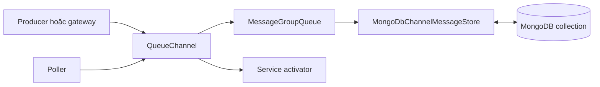

# MongoDbChannelMessageStore

## Mục tiêu bài học

Trong chương **Message store** của module **SPRING_INTEGRATION_CORE**, bài này giải thích cách dùng `MongoDbChannelMessageStore` làm nơi lưu thông điệp cho channel có hàng đợi. Người học sẽ nối được `Message`, `MessageChannel`, poller và endpoint bằng Java DSL; chọn đúng store cho FIFO hoặc priority; đồng thời xác định thông điệp nằm ở đâu khi ứng dụng dừng hoặc handler thất bại.

Ví dụ xuyên suốt là dịch vụ tiếp nhận yêu cầu xử lý đơn hàng. Producer cần gửi nhanh, còn consumer có thể tạm dừng khi hệ thống kho bận. Các yêu cầu đang chờ cần tồn tại qua lần khởi động lại ứng dụng.

Ví dụ sử dụng API Spring Integration **6.5.x**, Java 17 trở lên và driver MongoDB đồng bộ. Đây là mốc API để đọc mã minh họa, không phải khẳng định về phiên bản mới nhất. Khi đưa vào dự án, dùng bộ phiên bản tương thích do dependency management của dự án quản lý.

## 1. Vị trí của store trong luồng thông điệp

`MongoDbChannelMessageStore` chuyên phục vụ message channel có lưu hàng đợi. Nó không phải channel, endpoint hay MongoDB outbound adapter. Producer vẫn gửi `Message<?>` vào channel; consumer vẫn nhận từ channel theo giao diện `PollableChannel`. Chi tiết lưu trữ nằm phía sau. [Javadoc của MongoDbChannelMessageStore](https://docs.spring.io/spring-integration/docs/6.5.0/api/org/springframework/integration/mongodb/store/MongoDbChannelMessageStore.html).



Đọc sơ đồ theo hai đường:

- **Gửi:** producer gọi `send()`, channel chuyển thao tác thêm hàng đợi thành thao tác ghi store.
- **Nhận:** poller gọi `receive()`, channel lấy một thông điệp khỏi store rồi chuyển nó đến handler.

Với cấu hình không có transaction bao quanh lần nhận, thông điệp đã rời hàng đợi trước khi handler hoàn tất. Sự khác biệt giữa “đã lưu”, “đã nhận” và “đã xử lý thành công” quyết định thiết kế phục hồi ở phần sau.

| Thành phần | Trách nhiệm trong ví dụ đơn hàng |
| --- | --- |
| `Message<String>` | Mang lệnh xử lý và header như `businessKey`, `priority` |
| `QueueChannel` | Cung cấp thao tác gửi và nhận của hàng đợi |
| `MessageGroupQueue` | Nối giao diện queue với nhóm thông điệp trong store |
| `MongoDbChannelMessageStore` | Thực hiện thao tác lưu và lấy thông điệp qua MongoDB |
| Poller | Quy định lịch nhận, số thông điệp mỗi lượt và ranh giới transaction nếu có |
| Service activator | Thực thi nghiệp vụ sau khi nhận thông điệp |

### 1.1. Chọn đúng loại store

Channel store được tối ưu cho việc xếp và lấy thông điệp. Đừng chọn nó cho aggregator chỉ vì thấy kiểu `MessageGroupStore` trong cây kế thừa. Aggregator cần trạng thái nhóm và vòng đời khác với hàng đợi; một số thao tác nhóm không được channel store triển khai. Với aggregator hoặc resequencer dùng MongoDB, xem một store hỗ trợ đầy đủ yêu cầu đó, chẳng hạn `MongoDbMessageStore`. [MongoDB Message Store](https://docs.spring.io/spring-integration/reference/6.5/mongodb.html#mongodb-message-store).

Ví dụ một luồng có cả xếp hàng và gom nhóm:

```text
Tiếp nhận đơn
    -> channel có MongoDbChannelMessageStore
    -> chia đơn thành các dòng hàng
    -> aggregator có MessageGroupStore phù hợp
    -> tạo kết quả tổng hợp
```

Hai nơi lưu có hai mục đích. Group của hàng đợi đại diện cho một channel logic; group của aggregator thường đại diện cho một tập thông điệp cần gom theo correlation key.

## 2. Danh tính hàng đợi: database, collection và groupId

Để đọc lại hàng đợi sau khi khởi động, ứng dụng phải quay về cùng database, collection và `groupId`. Với `MessageGroupQueue`, `groupId` cần ổn định qua lần khởi động và phân biệt được từng hàng đợi logic. [MessageGroupQueue trong Spring Integration 6.5.0](https://github.com/spring-projects/spring-integration/blob/v6.5.0/spring-integration-core/src/main/java/org/springframework/integration/store/MessageGroupQueue.java).

Quy ước minh họa:

```text
database   = integration_demo
collection = si_order_channel_messages
groupId    = orders:pending:v1
```

Trong ứng dụng này, chuỗi `orders:pending:v1` có nghĩa là hàng đợi yêu cầu đơn hàng đang chờ. Nó không phải số đơn hàng và cũng không thay thế header `correlationId`.

### 2.1. Hai lỗi định danh thường gặp

**Tạo groupId ngẫu nhiên mỗi lần chạy:**

```java
// Không phù hợp nếu muốn nối lại cùng hàng đợi sau restart.
new MessageGroupQueue(store, java.util.UUID.randomUUID().toString());
```

Mỗi lần khởi động tạo một địa chỉ hàng đợi mới. Dữ liệu cũ có thể còn trong database nhưng consumer đang nhìn vào nhóm khác.

**Cho hai hàng đợi độc lập dùng cùng groupId:**

```text
ordersQueue     -> collection A, groupId = work
invoicesQueue   -> collection A, groupId = work
```

Trong thiết kế này, hai consumer đang cùng truy cập một vùng thông điệp. Nếu payload đều là chuỗi, lỗi còn có thể đi qua bước kiểm tra kiểu và chỉ xuất hiện ở nghiệp vụ.

Hãy dùng định danh theo trách nhiệm, ví dụ `orders:pending:v1` và `invoices:pending:v1`. Khi đổi tên group hoặc collection, cần có kế hoạch đọc nốt, chuyển đổi hoặc lưu trữ hàng đợi cũ.

### 2.2. Nhiều bản sao ứng dụng

Nếu hai instance cùng trỏ vào một nhóm, hãy xem chúng là các consumer cạnh tranh của một hàng đợi. Muốn mỗi instance xử lý mọi thông điệp, cần thiết kế fan-out thành các hàng đợi riêng.

Quyết định này nên thể hiện rõ trong cấu hình triển khai:

| Mục tiêu | Cách đặt định danh trong ví dụ |
| --- | --- |
| Hai worker chia tải xử lý đơn | Cùng database, collection và groupId |
| Đơn hàng và hóa đơn độc lập | GroupId riêng hoặc collection riêng |
| Hai môi trường thử nghiệm độc lập | Database riêng; có thể thêm tiền tố collection |
| Tạo luồng mới và đọc nốt luồng cũ | Duy trì consumer cho group cũ đến khi xử lý xong |

## 3. Cấu hình hàng đợi bền vững bằng Java DSL

Phần này giả định có một ứng dụng Spring Boot tương thích với Spring Integration 6.5.x. Cấu hình dưới đây nằm trong phạm vi component scan của ứng dụng.

### 3.1. Dependency và kết nối

Thêm dependency vào dự án đã có Spring Boot dependency management:

```xml
<dependency>
    <groupId>org.springframework.boot</groupId>
    <artifactId>spring-boot-starter-integration</artifactId>
</dependency>
<dependency>
    <groupId>org.springframework.boot</groupId>
    <artifactId>spring-boot-starter-data-mongodb</artifactId>
</dependency>
<dependency>
    <groupId>org.springframework.integration</groupId>
    <artifactId>spring-integration-mongodb</artifactId>
</dependency>
```

Starter MongoDB cung cấp hạ tầng Spring Data và driver đồng bộ; artifact Integration bổ sung message store. Việc dùng store này vẫn là I/O đồng bộ dù ứng dụng có những luồng reactive khác. [Kết nối MongoDB trong Spring Integration](https://docs.spring.io/spring-integration/reference/6.5/mongodb.html#mongodb-connection).

Trong `application.yml` của ứng dụng học tập:

```yaml
spring:
  data:
    mongodb:
      uri: mongodb://localhost:27017/integration_demo
```

MongoDB phải sẵn sàng trước khi ứng dụng khởi tạo store. Phần hàng đợi cơ bản chưa bật transaction nhiều thao tác.

### 3.2. Store, channel và consumer

```java
package vn.example.integration;

import java.time.Duration;

import org.springframework.beans.factory.annotation.Qualifier;
import org.springframework.context.annotation.Bean;
import org.springframework.context.annotation.Configuration;
import org.springframework.data.mongodb.MongoDatabaseFactory;
import org.springframework.integration.channel.QueueChannel;
import org.springframework.integration.config.EnableIntegration;
import org.springframework.integration.dsl.IntegrationFlow;
import org.springframework.integration.dsl.Pollers;
import org.springframework.integration.mongodb.store.MongoDbChannelMessageStore;
import org.springframework.integration.store.MessageGroupQueue;
import org.springframework.messaging.MessageHandler;
import org.springframework.messaging.PollableChannel;

@Configuration(proxyBeanMethods = false)
@EnableIntegration
public class OrderQueueConfiguration {

    public static final String ORDER_GROUP = "orders:pending:v1";

    @Bean
    MongoDbChannelMessageStore fifoChannelStore(
            MongoDatabaseFactory databaseFactory) {

        return new MongoDbChannelMessageStore(
                databaseFactory, "si_order_channel_messages");
    }

    @Bean
    PollableChannel ordersQueue(
            @Qualifier("fifoChannelStore") MongoDbChannelMessageStore store) {

        return new QueueChannel(new MessageGroupQueue(store, ORDER_GROUP));
    }

    @Bean
    IntegrationFlow ordersFlow(
            @Qualifier("ordersQueue") PollableChannel ordersQueue) {

        return IntegrationFlow.from(ordersQueue)
                .handle((MessageHandler) message -> {
                    String command = (String) message.getPayload();
                    String key = message.getHeaders()
                            .get("businessKey", String.class);
                    System.out.println("Xu ly " + key + ": " + command);
                }, endpoint -> endpoint
                        .id("orderConsumer")
                        .poller(Pollers.fixedDelay(Duration.ofMillis(500))
                                .receiveTimeout(0)
                                .maxMessagesPerPoll(5)))
                .get();
    }
}
```

`fifoChannelStore` là Spring bean để Spring thực hiện lifecycle khởi tạo. `ordersQueue` sử dụng một nhóm cố định trong collection. `ordersFlow` tạo polling consumer vì nguồn là `PollableChannel`.

Trong ví dụ, mỗi lượt lấy tối đa năm thông điệp rồi chờ theo lịch `fixedDelay`. Nếu xử lý từng lệnh mất 200 ms, năm lệnh có thể cần khoảng một giây, chưa tính I/O. Vì vậy cấu hình này không có nghĩa consumer xử lý chính xác mười lệnh mỗi giây.

`receiveTimeout(0)` yêu cầu thử nhận ngay trong mỗi lượt poll. Khi chưa có dữ liệu, poller quay lại theo lịch. Cách này cũng dễ quan sát khi producer và consumer nằm ở các JVM khác nhau; không dựa vào tín hiệu chờ nội bộ của một đối tượng queue.

Không thêm consumer thứ hai chỉ để xem thông điệp bằng `receive()`: thao tác đó lấy thông điệp khỏi hàng đợi và cạnh tranh với `orderConsumer`.

### 3.3. Gửi thông điệp

Từ một bean producer có inject `@Qualifier("ordersQueue") PollableChannel ordersQueue`, có thể gửi:

```java
import org.springframework.messaging.Message;
import org.springframework.messaging.support.MessageBuilder;

Message<String> command = MessageBuilder
        .withPayload("reserve-stock:ORD-2026-001")
        .setHeader("businessKey", "ORD-2026-001:reserve-stock")
        .build();

boolean accepted = ordersQueue.send(command);
if (!accepted) {
    throw new IllegalStateException("Khong gui duoc lenh xu ly don hang");
}
```

`send()` thành công chỉ xác nhận bước đưa thông điệp vào channel theo cấu hình hiện tại. Nó không xác nhận rằng kho đã được giữ hay đơn đã xử lý xong. Lỗi kết nối hoặc serialize có thể xuất hiện ngay tại bước gửi.

Ở ví dụ này, `businessKey` là định danh nghiệp vụ do ứng dụng đặt để nhận diện lại cùng một thao tác. Message ID do framework tạo và business key có vai trò khác nhau.

### 3.4. Gateway ở phía producer

Ứng dụng có thể bọc channel bằng giao diện nghiệp vụ:

```java
import org.springframework.integration.annotation.MessagingGateway;
import org.springframework.messaging.handler.annotation.Header;

@MessagingGateway(defaultRequestChannel = "ordersQueue")
public interface OrderGateway {

    void submit(String command, @Header("businessKey") String businessKey);
}
```

Đặt interface trong package được quét bởi `@IntegrationComponentScan`, rồi inject `OrderGateway` vào service gửi lệnh. Phương thức `void` phù hợp với ví dụ tiếp nhận bất đồng bộ này.

Nếu cần người dùng theo dõi kết quả, producer có thể trả một mã yêu cầu ở lớp API và consumer cập nhật trạng thái nghiệp vụ. Một reply channel tạm thời của lời gọi đồng bộ không phải địa chỉ để khôi phục phản hồi sau khi tiến trình khởi động lại.

## 4. FIFO và priority: thứ tự nào được bảo đảm?

### 4.1. FIFO của store

Ở mốc mã nguồn 6.5.0, thao tác poll sắp theo `lastModifiedTime` rồi `sequence` tăng dần; khi bật priority, `priority` giảm dần được đặt trước hai khóa đó. `sequence` nội bộ giúp phân biệt các bản ghi có cùng thời gian millisecond. [Mã nguồn thao tác thêm và poll](https://github.com/spring-projects/spring-integration/blob/v6.5.0/spring-integration-mongodb/src/main/java/org/springframework/integration/mongodb/store/MongoDbChannelMessageStore.java).

Đừng đồng nhất `sequence` này với header `sequenceNumber` của splitter. Một giá trị phục vụ thứ tự lưu trong store; giá trị kia mô tả vị trí thành phần trong một chuỗi thông điệp của luồng tích hợp.

Trong bài toán đơn hàng, cần hỏi rõ yêu cầu thứ tự:

| Yêu cầu | Hệ quả thiết kế trong ví dụ |
| --- | --- |
| Lấy các lệnh đang chờ theo thứ tự lưu của hàng đợi | Dùng chế độ FIFO |
| Đơn ưu tiên được lấy trước đơn thường | Dùng priority và quy ước mức ưu tiên |
| Hoàn tất nghiệp vụ đúng thứ tự đã nhận | Tránh xử lý song song trong phạm vi cần giữ thứ tự |
| Giữ thứ tự nghiệp vụ giữa các producer phân tán | Bổ sung phiên bản hoặc sequence nghiệp vụ và quy tắc xử lý |

Ví dụ consumer A nhận lệnh 1 rồi gọi kho trong hai giây. Consumer B nhận lệnh 2 và hoàn tất sau 100 ms. Thứ tự lấy vẫn có thể đúng, nhưng lệnh 2 hoàn tất trước lệnh 1.

Với nhiều máy gửi đồng thời, không nên dùng thứ tự hàng đợi để suy ra quan hệ nhân quả tuyệt đối giữa các sự kiện. Nếu lệnh “hủy đơn” chỉ hợp lệ sau “tạo đơn”, hãy biểu diễn điều kiện đó trong trạng thái nghiệp vụ.

### 4.2. Store và channel có priority

Bổ sung các bean sau vào lớp cấu hình để tạo một hàng đợi ưu tiên riêng:

```java
import org.springframework.integration.channel.PriorityChannel;

@Bean
MongoDbChannelMessageStore priorityChannelStore(
        MongoDatabaseFactory databaseFactory) {

    MongoDbChannelMessageStore store = new MongoDbChannelMessageStore(
            databaseFactory, "si_priority_channel_messages");
    store.setPriorityEnabled(true);
    return store;
}

@Bean
PollableChannel urgentOrdersQueue(
        @Qualifier("priorityChannelStore") MongoDbChannelMessageStore store) {

    return new PriorityChannel(store, "orders:urgent:v1");
}
```

Ví dụ này chưa gắn consumer vào `urgentOrdersQueue`, nên có thể gửi đủ thông điệp rồi đọc kết quả theo thứ tự. Constructor `PriorityChannel(store, groupId)` sử dụng store hỗ trợ priority làm hàng đợi phía sau. [PriorityChannel trong Spring Integration 6.5.0](https://github.com/spring-projects/spring-integration/blob/v6.5.0/spring-integration-core/src/main/java/org/springframework/integration/channel/PriorityChannel.java).

```java
import org.springframework.integration.IntegrationMessageHeaderAccessor;

urgentOrdersQueue.send(MessageBuilder.withPayload("NORMAL-1")
        .setHeader(IntegrationMessageHeaderAccessor.PRIORITY, 1)
        .build());
urgentOrdersQueue.send(MessageBuilder.withPayload("URGENT-1")
        .setHeader(IntegrationMessageHeaderAccessor.PRIORITY, 9)
        .build());
urgentOrdersQueue.send(MessageBuilder.withPayload("URGENT-2")
        .setHeader(IntegrationMessageHeaderAccessor.PRIORITY, 9)
        .build());

System.out.println(urgentOrdersQueue.receive(0).getPayload());
System.out.println(urgentOrdersQueue.receive(0).getPayload());
System.out.println(urgentOrdersQueue.receive(0).getPayload());
```

Với ba lần gửi tuần tự đều thành công và chưa có consumer khác, kết quả dự kiến là:

```text
URGENT-1
URGENT-2
NORMAL-1
```

Ứng dụng nên luôn đặt priority kiểu `Integer`, chẳng hạn `1`, `5`, `9`. Tránh gửi chuỗi `"9"` hoặc trộn thông điệp thiếu priority với thông điệp có priority rồi suy đoán thứ tự.

`priorityEnabled` là lựa chọn của toàn bộ store bean. Khi đồng thời có FIFO và priority, dùng hai store bean riêng. Hai bean có thể dùng chung collection nhưng phải phân biệt nhóm; ví dụ ở đây tách collection để người học dễ quan sát. [Quy tắc cấu hình priority store](https://docs.spring.io/spring-integration/docs/6.5.0/api/org/springframework/integration/mongodb/store/MongoDbChannelMessageStore.html).

Đừng đổi `priorityEnabled` trong lúc hệ thống đang chạy để biến một backlog FIFO thành backlog ưu tiên: thông điệp đã ghi trước đó có thể chưa mang metadata priority theo cách mới.

### 4.3. Khi ưu tiên cao làm ưu tiên thấp bị chờ lâu

Giả sử mỗi giây hệ thống nhận 20 lệnh priority 9 nhưng chỉ xử lý được 15 lệnh. Lệnh priority 1 có thể tiếp tục chờ dù đã đến từ lâu.

Với yêu cầu tất cả đơn đều phải được phục vụ trong thời hạn nhất định, có thể thiết kế hai queue và chia suất xử lý, ví dụ bốn lệnh ưu tiên rồi một lệnh thường. Đây là chính sách điều phối của ứng dụng; chỉ đặt header priority chưa biểu diễn được chính sách đó.

## 5. Payload và header phải đi qua được lưu trữ

Với constructor nhận `MongoDatabaseFactory` và không truyền converter riêng, cấu hình mặc định của channel store đăng ký converter ghi `Message` thành binary; converter ghi dùng Java serialization. Vì thế không thể suy ra rằng mọi payload của ứng dụng đều lưu được chỉ vì MongoDB nhận document linh hoạt. [Khởi tạo converter của store](https://github.com/spring-projects/spring-integration/blob/v6.5.0/spring-integration-mongodb/src/main/java/org/springframework/integration/mongodb/store/AbstractConfigurableMongoDbMessageStore.java), [MessageToBinaryConverter](https://github.com/spring-projects/spring-integration/blob/v6.5.0/spring-integration-mongodb/src/main/java/org/springframework/integration/mongodb/support/MessageToBinaryConverter.java).

### 5.1. Lựa chọn dữ liệu cho ví dụ

Chuỗi lệnh trong bài giúp tập trung vào cơ chế hàng đợi. Với ứng dụng thực tế, có thể chọn JSON dạng chuỗi để hợp đồng dữ liệu không phụ thuộc trực tiếp vào lớp Java:

```java
String command = """
        {
          "schemaVersion": 1,
          "orderId": "ORD-2026-001",
          "action": "RESERVE_STOCK"
        }
        """;
```

Nếu chọn DTO Java cho cấu hình serialization mặc định, DTO cần khả năng serialize và các đối tượng bên trong cũng phải phù hợp:

```java
package vn.example.integration;

import java.io.Serializable;

public record ReserveStockCommand(
        String orderId,
        String warehouseId,
        int quantity) implements Serializable {

    private static final long serialVersionUID = 1L;
}
```

Thêm `Serializable` không tự giải quyết việc đổi tên lớp, xóa lớp hoặc thay đổi hợp đồng dữ liệu. Hãy thử đọc thông điệp do bản ứng dụng trước ghi khi kiểm tra khả năng nâng cấp.

### 5.2. Xem cả header

Trước ranh giới lưu trữ, rà soát dữ liệu thực sự được đưa vào message:

| Nên biểu diễn dưới dạng dữ liệu | Không nên mang nguyên đối tượng vào message bền vững |
| --- | --- |
| Mã đơn hàng, mã khách hàng | HTTP request/response đang mở |
| Trace ID, tenant ID, business key | Kết nối database, session hoặc stream đang mở |
| Tên channel ổn định khi cần định tuyến lỗi | Một channel tạm thời gắn với lời gọi đang chờ |
| Giá trị tham số cần cho consumer | Service bean hoặc callback chứa trạng thái tiến trình |

Bảng này là quy ước thiết kế cho ví dụ, không phải danh sách tự động lọc header của store. Hãy kiểm tra message thực tế qua chu kỳ ghi và đọc thay vì chỉ thử serialize riêng payload.

Nếu truyền `MongoTemplate` hoặc `MappingMongoConverter` tùy chỉnh vào store, cần kiểm tra lại toàn bộ cặp converter ghi/đọc. Một template dùng cho entity nghiệp vụ không mặc nhiên có cùng cơ chế chuyển đổi message với constructor mặc định.

Converter đọc binary của framework có API cấu hình các mẫu lớp được phép deserialize. Với dữ liệu lưu dài hạn, cần kiểm soát quyền ghi collection và lựa chọn chuyển đổi phù hợp với nguồn dữ liệu. [BinaryToMessageConverter](https://github.com/spring-projects/spring-integration/blob/v6.5.0/spring-integration-mongodb/src/main/java/org/springframework/integration/mongodb/support/BinaryToMessageConverter.java).

## 6. Độ bền, thao tác poll và lỗi giữa chừng

### 6.1. Timeline của cấu hình cơ bản

Giả sử producer gửi lệnh giữ hàng và consumer chưa bật transaction:

```text
T0  Producer tạo message
T1  Store ghi message thành công
T2  Consumer poll: lấy và xóa message khỏi hàng đợi
T3  Handler gọi hệ thống kho
T4  Handler hoàn tất
```

Ở triển khai 6.5.0, poll sử dụng `MongoTemplate.findAndRemove()`. Thao tác lấy và xóa tránh cách làm “đọc trước, xóa sau” của hai lệnh rời. Nó không bao gồm toàn bộ nghiệp vụ của handler. [Mã nguồn poll của channel store](https://github.com/spring-projects/spring-integration/blob/v6.5.0/spring-integration-mongodb/src/main/java/org/springframework/integration/mongodb/store/MongoDbChannelMessageStore.java).

Từ timeline, có thể suy luận các tình huống của chính ví dụ này:

| Điểm xảy ra sự cố | Câu hỏi cần giải quyết |
| --- | --- |
| Trước T1 | Producer có gửi lại không? Căn cứ nào xác nhận đã tiếp nhận? |
| Sau T1, trước T2 | Có quay lại đúng database, collection, groupId để đọc tiếp không? |
| Sau T2, trước T4 | Message đã rời queue; cơ chế nào lưu lại hoặc rollback công việc đang làm? |
| Kho đã giữ hàng nhưng ứng dụng chưa ghi nhận kết quả | Lần xử lý lại có giữ hàng lần nữa không? |

Thành công của một lệnh MongoDB cũng chịu chính sách xác nhận ghi của deployment. Hãy lựa chọn write concern theo mức độ mất dữ liệu chấp nhận được; đừng dùng việc thay RAM bằng database làm bằng chứng cho mọi tình huống hỏng hóc. MongoDB phân biệt tính nguyên tử ở document với transaction gồm nhiều thao tác. [Atomicity and Transactions của MongoDB](https://www.mongodb.com/docs/manual/core/write-operations-atomicity/).

### 6.2. Bổ sung transaction cho lần poll

Khi muốn rollback việc lấy khỏi queue nếu handler đồng bộ thất bại, cần một MongoDB transaction thực sự và transaction bao quanh cả lần nhận. Chỉ thêm `@Transactional` vào phương thức nghiệp vụ được gọi sau khi message đã bị lấy ra là quá muộn để bao phủ thao tác nhận đó.

Bean transaction manager minh họa:

```java
import org.springframework.data.mongodb.MongoTransactionManager;

@Bean
MongoTransactionManager channelTransactionManager(
        MongoDatabaseFactory databaseFactory) {

    return new MongoTransactionManager(databaseFactory);
}
```

Trong bean flow, inject transaction manager này rồi thay cấu hình poller bằng:

```java
endpoint -> endpoint
        .id("orderConsumer")
        .poller(Pollers.fixedDelay(Duration.ofMillis(500))
                .receiveTimeout(0)
                .maxMessagesPerPoll(1)
                .transactional(channelTransactionManager))
```

Đây là đoạn thay thế phần cấu hình endpoint của `ordersFlow`, không phải một consumer mới chạy song song. Ví dụ giới hạn một message mỗi lượt để dễ quan sát ranh giới công việc. API `.transactional(...)` thêm transaction advice quanh polling task. [PollerSpec](https://github.com/spring-projects/spring-integration/blob/v6.5.0/spring-integration-core/src/main/java/org/springframework/integration/dsl/PollerSpec.java).

Điều kiện thực hiện:

1. MongoDB chạy với topology hỗ trợ transaction, chẳng hạn replica set được cấu hình đúng; standalone của phần cơ bản chưa đủ cho ví dụ này.
2. Store và transaction manager dùng cùng `MongoDatabaseFactory` để các thao tác tham gia đúng session.
3. Việc nhận và xử lý liên quan vẫn nằm trên luồng thực thi được transaction bao phủ.
4. Exception phải đi ra khỏi phần được transaction advice bao quanh để áp dụng quy tắc rollback.

Spring Data dùng `MongoTransactionManager` để liên kết session với luồng thực thi; MongoDB transaction cần session hoạt động. [Sessions and Transactions của Spring Data MongoDB](https://docs.spring.io/spring-data/mongodb/reference/mongodb/client-session-transactions.html).

Khởi tạo collection và index trước khi cho worker nhận tải sẽ làm quá trình triển khai dễ kiểm soát hơn. Lỗi transaction tạm thời hoặc lỗi ở bước commit cần chính sách retry phù hợp với loại lỗi; đoạn cấu hình trên chưa cài đặt chính sách đó.

### 6.3. Những việc transaction MongoDB chưa bao phủ

Trong ví dụ giữ hàng qua HTTP, một transaction MongoDB không rollback được cuộc gọi đến hệ thống kho:

```text
1. Consumer nhận lệnh trong transaction MongoDB.
2. Kho xác nhận giữ hàng qua HTTP.
3. Ứng dụng gặp lỗi, transaction MongoDB rollback.
4. Lệnh xuất hiện lại trong queue và được xử lý lại.
```

Tình huống này đòi hỏi hệ thống kho nhận một idempotency key, hoặc có giao thức nghiệp vụ khác để nhận diện cùng một thao tác. Tương tự, ghi sang PostgreSQL bằng transaction manager riêng cần một thiết kế phối hợp rõ ràng.

Đừng hứa “exactly once” chỉ từ việc dùng channel store và bật transaction. Hãy mô tả chính xác hiệu ứng cần tránh lặp: gửi email, trừ tiền hay giữ số lượng hàng. Sau đó thiết kế quy tắc chống lặp ngay tại nơi tạo hiệu ứng đó.

## 7. Xử lý lỗi: lưu thông điệp chờ và lưu công việc thất bại

### 7.1. Error channel phục vụ quan sát và điều phối lỗi

Consumer của `QueueChannel` chạy sau lần gửi của producer. Vì vậy lỗi nghiệp vụ ở consumer không tự ném ngược về lời gọi producer đã hoàn tất. Với scheduled poller, Spring Integration có cơ chế chuyển lỗi sang `ErrorMessage`; header `errorChannel` của message có thể quyết định đích, nếu không có thì dùng đích mặc định. [Error Handling](https://docs.spring.io/spring-integration/reference/6.5/error-handling.html).

Ví dụ tạo channel lỗi riêng:

```java
import org.springframework.integration.channel.DirectChannel;
import org.springframework.messaging.MessageChannel;

@Bean
MessageChannel orderErrors() {
    return new DirectChannel();
}

@Bean
IntegrationFlow orderErrorFlow() {
    return IntegrationFlow.from("orderErrors")
            .handle((MessageHandler) message -> {
                System.err.println("Xu ly don hang that bai: "
                        + message.getPayload().getClass().getSimpleName());
            })
            .get();
}
```

Thêm `.errorChannel("orderErrors")` vào cấu hình poller đang dùng. Ví dụ trên chỉ minh họa tiếp nhận lỗi, chưa tạo kho lưu thất bại và chưa gửi lại công việc.

Việc ghi log lỗi hoặc gửi `ErrorMessage` không đưa message gốc trở lại hàng đợi. Với cấu hình cơ bản chưa có transaction, cần thiết kế cách giữ lại yêu cầu thất bại nếu muốn xử lý lại sau khi tiến trình kết thúc.

### 7.2. Tách retry handler và phục hồi bền vững

`RequestHandlerRetryAdvice` hỗ trợ retry lời gọi handler và có thể kết hợp recovery callback khi hết lượt thử. Retry ngay trong handler khác với việc giữ công việc qua lần khởi động lại. [Retry Advice](https://docs.spring.io/spring-integration/reference/6.5/handler-advice/classes.html#retry-advice).

Áp dụng vào ví dụ đơn hàng:

| Tình huống | Chính sách minh họa |
| --- | --- |
| Kho trả lỗi tạm thời | Thử lại có giới hạn và backoff |
| Lệnh thiếu mã đơn bắt buộc | Lưu thông tin từ chối để sửa dữ liệu |
| Hết số lần thử lại | Lưu bản ghi thất bại bền vững, kèm business key và nguyên nhân |
| Kho đã nhận lệnh nhưng kết nối bị đứt | Tra cứu hoặc gửi lại với cùng idempotency key |

Nếu cần một queue lưu công việc thất bại, có thể tạo channel riêng với store và groupId riêng, nhưng nên chuyển lỗi thành một envelope dữ liệu đơn giản thay vì mặc nhiên lưu nguyên mọi đối tượng exception:

```json
{
  "schemaVersion": 1,
  "businessKey": "ORD-2026-001:reserve-stock",
  "command": "reserve-stock:ORD-2026-001",
  "attempts": 3,
  "errorCode": "WAREHOUSE_UNAVAILABLE"
}
```

Thiết kế phải xác định rõ thời điểm đánh dấu message gốc đã xử lý thất bại và thời điểm lưu envelope. Nếu hai thao tác không cùng transaction, hãy kiểm tra cửa sổ có thể mất hoặc lặp công việc.

### 7.3. Poison message và vòng lặp rollback

Giả sử handler luôn ném exception vì `quantity = -1`. Nếu mỗi lần lỗi đều rollback việc poll, message có thể được nhận lại vô hạn.

Một chính sách hoàn chỉnh cần phân loại lỗi, giới hạn thử và đường thoát sang nơi lưu thất bại. Nếu dùng transaction, dữ liệu đếm số lần thử nằm trong chính transaction bị rollback cũng có thể quay về giá trị cũ. Phải quyết định rõ nơi lưu và cập nhật số lần thử.

Tương tự, nếu recovery callback nuốt exception và trả về bình thường, transaction advice có thể coi tác vụ đã hoàn tất. Cần thống nhất recovery mang nghĩa “đã chuyển công việc sang nơi chịu trách nhiệm khác” hay “vẫn thất bại và phải rollback”.

### 7.4. Idempotency tại nghiệp vụ

Với lệnh `reserve-stock:ORD-2026-001`, quy ước business key là `ORD-2026-001:reserve-stock`. Consumer hoặc hệ thống kho dùng khóa này để nhận biết thao tác đã có kết quả.

Việc kiểm tra khóa rồi ghi kết quả bằng hai thao tác tách rời vẫn có thể chạy đua giữa hai worker. Một thiết kế có thể dùng ràng buộc duy nhất và transaction phù hợp khi dữ liệu cùng nằm trong MongoDB; với hệ thống kho bên ngoài, cần hợp đồng idempotency ở API của kho.

Khóa chống lặp phải đại diện đúng nghiệp vụ. Dùng riêng số đơn hàng sẽ chặn nhầm thao tác “hủy giữ hàng” sau “giữ hàng” nếu hai hành động cần được thực hiện độc lập.

## 8. Index, dung lượng và quan sát hàng đợi

### 8.1. Quản lý index

Store có cơ chế tự tạo index lúc khởi tạo; `setCreateIndexes(false)` cho phép tắt cơ chế đó từ các phiên bản hỗ trợ tùy chọn này. Chỉ tắt khi quy trình triển khai đã tạo đúng index cần thiết. [Tùy chọn createIndexes](https://docs.spring.io/spring-integration/reference/6.5/mongodb.html#mongodb-message-store).

Đoạn cấu hình minh họa cho môi trường quản lý index riêng:

```java
MongoDbChannelMessageStore store = new MongoDbChannelMessageStore(
        databaseFactory, "si_order_channel_messages");
store.setCreateIndexes(false);
```

Tắt tạo index không đồng nghĩa store có thể chạy tốt khi thiếu index. Người vận hành cần đối chiếu index với phiên bản framework được triển khai, đồng thời kiểm tra quyền tạo index nếu để store tự khởi tạo.

Có thể xem index trong `mongosh`:

```javascript
use integration_demo
db.si_order_channel_messages.getIndexes()
```

Không dùng một bộ tên index tự suy đoán làm chuẩn cho mọi phiên bản. Khi nâng cấp, so sánh yêu cầu truy vấn và index trong đúng phiên bản sẽ chạy.

### 8.2. Đo queue depth theo nhóm

Với store bean của ví dụ, đo số thông điệp chờ bằng:

```java
int pending = store.messageGroupSize(
        OrderQueueConfiguration.ORDER_GROUP);
```

Không dùng tổng số document của collection làm queue depth. Một collection có thể phục vụ nhiều group và chứa document kỹ thuật như bộ đếm sequence.

Đừng gọi `store.getMessageGroup(groupId).size()` để thay thế phép đo trên: với channel store, `getMessageGroup()` chỉ tạo đối tượng bọc groupId, không tải toàn bộ thông điệp. [Hành vi getMessageGroup](https://docs.spring.io/spring-integration/docs/6.5.0/api/org/springframework/integration/mongodb/store/MongoDbChannelMessageStore.html#getMessageGroup(java.lang.Object)).

Queue depth là ảnh chụp tại một thời điểm. Khi consumer khác đang nhận, số liệu có thể thay đổi ngay sau khi đo.

### 8.3. Backlog và điều tiết producer

Một channel có lưu database vẫn cần chính sách điều tiết tải. Trong cấu hình channel dùng `message-store`, không ghép thuộc tính `capacity` như cấu hình queue trong bộ nhớ; với priority store cũng không ghép comparator tùy ý để mong đổi thứ tự truy vấn. [Cấu hình channel có message store](https://docs.spring.io/spring-integration/reference/6.5/channel/configuration.html).

Ví dụ producer tạo 100 lệnh mỗi giây, consumer xử lý 80 lệnh mỗi giây. Nếu tốc độ giữ nguyên trong một giờ, lượng chờ tăng khoảng:

```text
(100 - 80) × 3.600 = 72.000 lệnh
```

Đây là phép tính dung lượng cho kịch bản, chưa tính retry và kích thước thực tế. Nếu mỗi message sau khi lưu chiếm trung bình 4 KiB, riêng dữ liệu của phần backlog tăng thêm khoảng 281 MiB, chưa tính index và các chi phí lưu trữ khác.

Có thể giới hạn lượng tiếp nhận ở lớp API, tăng năng lực consumer trong phạm vi nghiệp vụ cho phép, hoặc tách loại công việc có thời gian xử lý khác nhau.

### 8.4. Các tín hiệu hữu ích

| Tín hiệu | Cách đọc trong ví dụ |
| --- | --- |
| Queue depth theo groupId | Số lệnh đang chờ, không phải tổng việc đang chạy |
| Tuổi của lệnh chờ lâu nhất | Đơn hàng có đang trễ thời hạn phục vụ không |
| Tốc độ nhận và hoàn tất | Phân biệt backlog do consumer chậm hay do lượng gửi tăng |
| Lỗi gửi, lỗi poll, lỗi handler | Xác định sự cố xảy ra trước hay sau khi lấy khỏi queue |
| Số công việc thất bại và xử lý lại | Nhìn thấy vòng retry không tạo tiến triển |
| Độ trễ MongoDB và sử dụng connection pool | Phát hiện tài nguyên I/O đang giới hạn throughput |

Đây là các chỉ số nên thiết kế cho ứng dụng; không phải lời khẳng định mọi chỉ số đều được store xuất sẵn.

Thông điệp trong queue là công việc đang chờ. Nếu tự đặt TTL để xóa, cần coi đó là chính sách hết hạn nghiệp vụ và xác định xử lý phần việc bị loại, thay vì dùng TTL chỉ để làm collection nhỏ lại.

## 9. Kiểm thử tích hợp hành vi lưu và lấy

Mock store chỉ giúp kiểm tra mã gọi API. Muốn chứng minh khả năng đọc lại, cần đi qua MongoDB và quá trình chuyển đổi message thật.

Đoạn JUnit 5 sau dùng database thử nghiệm `si_channel_store_it`, tạo collection riêng cho mỗi test và chỉ dọn collection đó. Cần dependency `spring-boot-starter-test` với scope `test`, cùng MongoDB thử nghiệm đang chạy ở localhost. Các test này không bật transaction nên không yêu cầu topology transaction của phần 6.2.

```java
package vn.example.integration;

import java.util.UUID;

import com.mongodb.client.MongoClient;
import com.mongodb.client.MongoClients;
import org.junit.jupiter.api.AfterEach;
import org.junit.jupiter.api.BeforeEach;
import org.junit.jupiter.api.Test;
import org.springframework.context.support.GenericApplicationContext;
import org.springframework.data.mongodb.MongoDatabaseFactory;
import org.springframework.data.mongodb.core.SimpleMongoClientDatabaseFactory;
import org.springframework.integration.IntegrationMessageHeaderAccessor;
import org.springframework.integration.channel.PriorityChannel;
import org.springframework.integration.channel.QueueChannel;
import org.springframework.integration.mongodb.store.MongoDbChannelMessageStore;
import org.springframework.integration.store.MessageGroupQueue;
import org.springframework.messaging.Message;
import org.springframework.messaging.support.MessageBuilder;

import static org.junit.jupiter.api.Assertions.*;

class MongoChannelStoreIntegrationTest {

    private static final String DATABASE = "si_channel_store_it";
    private static final String GROUP = "orders:test:v1";

    private MongoClient client;
    private MongoDatabaseFactory factory;
    private String collection;

    @BeforeEach
    void setUp() {
        client = MongoClients.create("mongodb://localhost:27017");
        factory = new SimpleMongoClientDatabaseFactory(client, DATABASE);
        collection = "channel_it_" + UUID.randomUUID().toString().replace("-", "");
    }

    @AfterEach
    void tearDown() {
        if (client != null) {
            try {
                if (collection != null) {
                    client.getDatabase(DATABASE)
                            .getCollection(collection).drop();
                }
            } finally {
                client.close();
            }
        }
    }

    private GenericApplicationContext openContext(boolean priority) {
        GenericApplicationContext context = new GenericApplicationContext();
        context.registerBean("store", MongoDbChannelMessageStore.class, () -> {
            MongoDbChannelMessageStore store =
                    new MongoDbChannelMessageStore(factory, collection);
            store.setPriorityEnabled(priority);
            return store;
        });
        context.refresh();
        return context;
    }

    private MongoDbChannelMessageStore store(GenericApplicationContext context) {
        return context.getBean("store", MongoDbChannelMessageStore.class);
    }

    private QueueChannel queue(MongoDbChannelMessageStore store, String group) {
        return new QueueChannel(new MessageGroupQueue(store, group));
    }

    @Test
    void readsPendingMessageAfterContextRecreation() {
        try (GenericApplicationContext first = openContext(false)) {
            MongoDbChannelMessageStore firstStore = store(first);
            QueueChannel queue = queue(firstStore, GROUP);
            assertTrue(queue.send(MessageBuilder
                    .withPayload("reserve-stock:ORD-001")
                    .setHeader("businessKey", "ORD-001:reserve-stock")
                    .build()));
            assertEquals(1, firstStore.messageGroupSize(GROUP));
        }

        try (GenericApplicationContext second = openContext(false)) {
            MongoDbChannelMessageStore secondStore = store(second);
            Message<?> restored = queue(secondStore, GROUP).receive(0);

            assertNotNull(restored);
            assertEquals("reserve-stock:ORD-001", restored.getPayload());
            assertEquals("ORD-001:reserve-stock",
                    restored.getHeaders().get("businessKey"));
            assertEquals(0, secondStore.messageGroupSize(GROUP));
        }
    }

    @Test
    void pollsHighPriorityThenFifoWithinSamePriority() {
        try (GenericApplicationContext context = openContext(true)) {
            PriorityChannel queue = new PriorityChannel(store(context), GROUP);
            assertTrue(queue.send(command("NORMAL-1", 1)));
            assertTrue(queue.send(command("URGENT-1", 9)));
            assertTrue(queue.send(command("URGENT-2", 9)));

            Message<?> first = queue.receive(0);
            Message<?> second = queue.receive(0);
            Message<?> third = queue.receive(0);
            assertNotNull(first);
            assertNotNull(second);
            assertNotNull(third);
            assertEquals("URGENT-1", first.getPayload());
            assertEquals("URGENT-2", second.getPayload());
            assertEquals("NORMAL-1", third.getPayload());
            assertNull(queue.receive(0));
        }
    }

    @Test
    void keepsDifferentGroupsSeparate() {
        try (GenericApplicationContext context = openContext(false)) {
            MongoDbChannelMessageStore store = store(context);
            QueueChannel orders = queue(store, "orders:test:v1");
            QueueChannel invoices = queue(store, "invoices:test:v1");

            assertTrue(orders.send(command("ORDER-ONLY", 1)));
            assertNull(invoices.receive(0));
            assertEquals(1, store.messageGroupSize("orders:test:v1"));
        }
    }

    private Message<String> command(String payload, int priority) {
        return MessageBuilder.withPayload(payload)
                .setHeader(IntegrationMessageHeaderAccessor.PRIORITY, priority)
                .build();
    }
}
```

Test đầu tạo lại context và store, giữ nguyên MongoDB bên ngoài. Nó chứng minh message được đọc lại qua store mới, nhưng chưa mô phỏng JVM bị kill hoặc MongoDB failover. Muốn kiểm tra restart tiến trình, chạy producer ở tiến trình A, dừng A sau khi xác nhận gửi, rồi chạy consumer ở tiến trình B với cùng định danh.

Không khởi động `ordersFlow` của ứng dụng trong các test chủ động `receive()` này, vì poller có thể lấy message trước test.

Những kịch bản tiếp theo cần kiểm tra tùy yêu cầu của hệ thống:

| Kịch bản | Kết quả cần quan sát |
| --- | --- |
| Đổi groupId sau khi ghi | Consumer mới không thấy dữ liệu của nhóm cũ |
| Payload hoặc header không serialize được | Lỗi xuất hiện khi đi qua bước ghi thật |
| Handler ném lỗi khi chưa có transaction | Queue không tự phục hồi message đã poll |
| Handler ném lỗi với transaction bao quanh poll | Rollback làm công việc có thể được nhận lại |
| Hai consumer cùng nhận một nhóm | Không suy diễn rằng mỗi consumer đều nhận mọi message |
| Bản ứng dụng mới đọc message cũ | Hợp đồng payload và converter còn tương thích |
| Gửi lại cùng business key | Nghiệp vụ không tạo hiệu ứng lặp ngoài ý muốn |

Với test rollback, dùng MongoDB replica set thử nghiệm, kết thúc transaction rồi nhận lại bằng thao tác mới để tránh quan sát dữ liệu trong chính transaction chưa hoàn tất.

## 10. Chẩn đoán theo triệu chứng

| Triệu chứng | Điểm nên kiểm tra đầu tiên |
| --- | --- |
| Database có dữ liệu nhưng consumer không nhận | Đúng database, collection, groupId; endpoint và poller đã chạy chưa |
| Restart xong không còn thấy lệnh chờ | GroupId có đổi không; message đã bị poll trước lúc dừng chưa |
| Priority không như dự kiến | Store đúng bean chưa; `priorityEnabled`; kiểu và giá trị header; consumer khác có đang lấy không |
| Payload lưu không thành công | Object graph của payload/header và converter đang dùng |
| Handler lỗi rồi message biến mất | Ranh giới transaction, recovery callback và cơ chế lưu thất bại |
| Một message liên tục xuất hiện lại | Lỗi dữ liệu cố định, rollback và giới hạn retry |
| Poll chậm khi backlog tăng | Index thực tế, độ trễ MongoDB, pool kết nối và tần suất poll |
| Đếm group luôn bằng 0 nhưng queue vẫn có dữ liệu | Có đang dùng nhầm `getMessageGroup().size()` thay cho `messageGroupSize()` không |
| Consumer ở JVM khác phản ứng trễ | Lịch poll, receive timeout và việc chờ tín hiệu nội bộ |

Để kết luận “mất message”, trước hết cần phân biệt ba trạng thái: còn chờ trong queue, đã được consumer nhận, hoặc đã được chuyển sang nơi xử lý lỗi. Collection rỗng chỉ cho biết trạng thái lưu tại thời điểm quan sát, chưa phản ánh đầy đủ lịch sử xử lý.

## 11. Vận dụng vào thiết kế luồng tích hợp

Với dịch vụ đơn hàng trong bài, một thiết kế có thể gồm gateway nhận lệnh một chiều, transformer chuẩn hóa payload, filter kiểm tra dữ liệu bắt buộc, router phân loại mức ưu tiên, các channel có MongoDB store, và service activator thực thi nghiệp vụ.

```text
OrderGateway
    -> chuẩn hóa dữ liệu
    -> kiểm tra dữ liệu đầu vào
    -> định tuyến thường / ưu tiên
    -> các queue bền vững
    -> polling consumer
    -> nghiệp vụ có idempotency
    -> ghi nhận kết quả hoặc công việc thất bại
```

Chọn vị trí đặt ranh giới bền vững theo ý nghĩa tiếp nhận. Nếu filter loại thông điệp trước queue, producer chưa có một công việc chờ trong store để khôi phục. Nếu xử lý xác thực sau queue, consumer phải có đường kết thúc rõ ràng cho lệnh không hợp lệ.

`MongoDbChannelMessageStore` giải quyết phần lưu thông điệp chờ của channel trong thiết kế này. Định danh ổn định giúp nối lại hàng đợi; priority quyết định thứ tự lấy; poller và transaction quyết định phạm vi xử lý; còn retry, lưu lỗi và idempotency quyết định cách công việc tiếp tục khi có sự cố.
