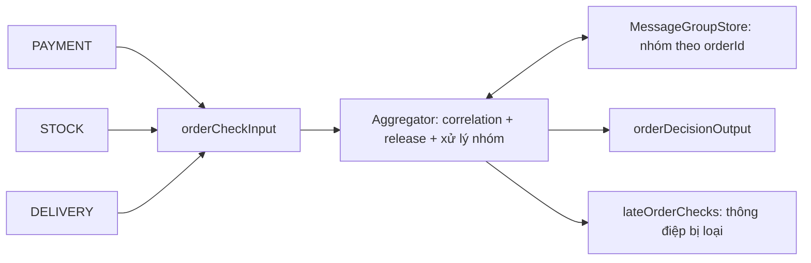

# MessageGroupStore

`MessageGroupStore` là hợp đồng lưu trữ trạng thái của các nhóm thông điệp có cùng khóa liên kết trong Spring Integration. Khi aggregator phải đợi nhiều thông điệp trước khi tạo kết quả, store giữ nhóm đang chờ và thông tin về nhóm đó. Đây là một thành phần quan trọng của chương **Message store** trong module **SPRING_INTEGRATION_CORE**: thiết kế luồng bằng `Message`, `MessageChannel`, endpoint và Java DSL, đồng thời hiểu cách quản lý trạng thái, xử lý lỗi và kiểm thử mẫu tích hợp.

Bài sử dụng Java 17 và API Spring Integration 6.5 làm mốc cho ví dụ; đây là mốc của bài học, không phải khẳng định về phiên bản dependency của dự án. Ví dụ chính cần `spring-integration-core`; ví dụ kiểm thử cần JUnit Jupiter; phần JDBC cần thêm `spring-integration-jdbc`, JDBC driver và `DataSource` đã cấu hình. Người đọc nên biết cấu trúc `Message<?>`, `DirectChannel`, `QueueChannel` và ý nghĩa của aggregator.

## 1. Vì sao cần lưu cả nhóm thông điệp?

Giả sử hệ thống chỉ quyết định tiếp nhận đơn hàng sau khi nhận đủ ba kết quả:

| Loại kiểm tra | Thông tin nhận được |
| --- | --- |
| `PAYMENT` | Thanh toán có hợp lệ không |
| `STOCK` | Kho có đủ hàng không |
| `DELIVERY` | Địa chỉ có thể giao hàng không |

Ba kết quả được gửi độc lập và có thể đến khác thứ tự. Một lần chạy có thể diễn ra như sau:

| Thời điểm | Thông điệp đến | Trạng thái cần giữ |
| --- | --- | --- |
| t1 | PAYMENT của ORD-42 | ORD-42 đã có PAYMENT |
| t2 | STOCK của ORD-99 | ORD-99 đã có STOCK |
| t3 | STOCK của ORD-42 | ORD-42 còn thiếu DELIVERY |
| t4 | PAYMENT gửi lặp của ORD-42 | ORD-42 vẫn còn thiếu DELIVERY |
| t5 | DELIVERY của ORD-42 | Đủ ba loại kiểm tra để quyết định |

Nếu giữ dữ liệu chờ trong biến của service, ta phải tự giải quyết việc phân nhóm, cạnh tranh giữa các luồng và dọn trạng thái. Trong thiết kế Spring Integration, các trách nhiệm được tách thành:

- `CorrelationStrategy` xác định nhóm mà thông điệp thuộc về.
- `MessageGroupStore` giữ dữ liệu và trạng thái nhóm.
- `ReleaseStrategy` quyết định nhóm đã đủ điều kiện xử lý chưa.
- `MessageGroupProcessor` tạo kết quả từ nhóm.

Aggregator điều phối những thành phần này. Store không tự quyết định đơn hàng hợp lệ hay tự gửi kết quả đến channel. Cách phân chia trên giữ logic nghiệp vụ độc lập với nơi lưu trạng thái. [Mô hình aggregator](https://docs.spring.io/spring-integration/reference/6.5/aggregator.html).



Một channel vận chuyển hoặc đệm thông điệp giữa các endpoint. Group store giữ trạng thái phục vụ một endpoint có tương quan; hai thành phần này đảm nhiệm hai vai trò riêng trong sơ đồ.

## 2. Phân biệt các hợp đồng lưu trữ

Tên `MessageStore` thường được dùng theo nghĩa tổng quát trong tài liệu. Khi lập trình, cần nhìn đúng kiểu Java mà endpoint yêu cầu.

| Hợp đồng | Mục đích |
| --- | --- |
| `MessageStore` | Lưu và tìm một thông điệp bằng `MessageHeaders.ID` kiểu `UUID` |
| `BasicMessageGroupStore` | Các thao tác nhóm cơ bản: thêm, lấy, đếm, lấy ra và xóa nhóm |
| `MessageGroupStore` | Bổ sung quản lý nhóm phục vụ correlation, completion, metadata và expiry |
| `ChannelMessageStore` | Hợp đồng đánh dấu các tối ưu dành cho `QueueChannel` |

`MessageGroupStore` và `ChannelMessageStore` đều mở rộng `BasicMessageGroupStore`. `MessageStore` là giao diện độc lập; `MessageGroupStore` **không** kế thừa `MessageStore`. Một lớp cụ thể có thể triển khai nhiều hợp đồng. [MessageStore API](https://docs.spring.io/spring-integration/docs/6.5.0/api/org/springframework/integration/store/MessageStore.html), [BasicMessageGroupStore API](https://docs.spring.io/spring-integration/docs/6.5.0/api/org/springframework/integration/store/BasicMessageGroupStore.html), [ChannelMessageStore API](https://docs.spring.io/spring-integration/docs/6.5.0/api/org/springframework/integration/store/ChannelMessageStore.html).

Ví dụ, `SimpleMessageStore` hỗ trợ cả lưu thông điệp riêng và lưu nhóm. `JdbcMessageStore` phù hợp với aggregator, còn `JdbcChannelMessageStore` được tối ưu cho channel có hàng đợi. Không thể lấy tên lớp chứa chữ “Store” làm căn cứ để truyền nó vào `aggregate(...).messageStore(...)`; phải kiểm tra lớp đó có triển khai `MessageGroupStore` hay không. [SimpleMessageStore API](https://docs.spring.io/spring-integration/docs/6.5.0/api/org/springframework/integration/store/SimpleMessageStore.html), [JDBC Message Store](https://docs.spring.io/spring-integration/reference/6.5/jdbc/message-store.html).

## 3. MessageGroup chứa những gì?

`MessageGroup` biểu diễn một nhóm thông điệp được xử lý cùng ngữ cảnh. Các phương thức hữu ích gồm:

| Phương thức | Ý nghĩa khi đọc trạng thái |
| --- | --- |
| `getGroupId()` | Khóa liên kết của nhóm |
| `size()` | Số thông điệp hiện có |
| `getMessages()` | Các thông điệp trong nhóm |
| `isComplete()` | Nhóm đã được đánh dấu hoàn tất hay chưa |
| `getTimestamp()` | Mốc thời gian tạo nhóm |
| `getLastModified()` | Mốc cập nhật gần nhất |
| `getSequenceSize()` | Thông tin kích thước sequence, khi thông điệp có sequence header |
| `getLastReleasedMessageSequenceNumber()` | Theo dõi sequence đã phát, hữu ích với resequencer |
| `getCondition()` | Chuỗi trạng thái bổ sung để phục vụ logic nhóm |

Các thuộc tính trên là dữ liệu của nhóm, không phải toàn bộ dữ liệu nghiệp vụ của đơn hàng. [MessageGroup API](https://docs.spring.io/spring-integration/docs/6.5.0/api/org/springframework/integration/store/MessageGroup.html).

### 3.1. Phân biệt message ID và group ID

Trong ví dụ:

```text
message ID:  UUID của từng Message
group ID:    "ORD-42"
business key cho một kết quả: ("ORD-42", PAYMENT)
```

Một lần gửi lại PAYMENT có thể có message ID mới nhưng vẫn mang cùng business key. Store không thể suy ra rằng hai thông điệp đó là cùng một sự kiện nghiệp vụ chỉ từ nội dung.

Khóa nhóm phải ổn định, không `null` và không thay đổi sau khi dùng làm khóa. Trong hệ thống nhiều tenant hoặc nhiều đợt xử lý, có thể chọn khóa như `tenantId + ":" + orderId + ":" + attemptId`. Các thành phần phải dùng cùng quy tắc tạo khóa; một khóa quá rộng có thể trộn hai lần kiểm tra độc lập vào cùng nhóm.

### 3.2. Nhóm rỗng có thể vẫn còn ý nghĩa

Sau khi xử lý một nhóm, aggregator có thể bỏ các thông điệp nhưng giữ metadata “đã hoàn tất”. Khi đó `size() == 0` và `isComplete() == true` là trạng thái hợp lệ.

Dấu mốc hoàn tất giúp aggregator nhận ra thông điệp đến muộn. Xóa dấu mốc này cho phép cùng group ID khởi tạo một nhóm mới. Vì vậy, “không còn thông điệp” và “không còn nhóm” có ý nghĩa khác nhau. [AggregatingMessageHandler API](https://docs.spring.io/spring-integration/docs/6.5.0/api/org/springframework/integration/aggregator/AggregatingMessageHandler.html).

## 4. Các thao tác API cần nắm

Không cần tự triển khai store để dùng aggregator. Tuy nhiên, hiểu API giúp đọc trạng thái và viết kiểm thử có chủ đích.

| Nhóm thao tác | API tiêu biểu |
| --- | --- |
| Thêm và đọc | `addMessageToGroup(groupId, message)`, `addMessagesToGroup(groupId, messages...)`, `getMessageGroup(groupId)` |
| Đếm hoặc lấy ra | `messageGroupSize(groupId)`, `pollMessageFromGroup(groupId)` |
| Cập nhật trạng thái | `completeGroup(groupId)`, `setGroupCondition(groupId, condition)` |
| Loại bỏ | `removeMessagesFromGroup(groupId, messages...)`, `removeMessageGroup(groupId)` |
| Truy xuất metadata | `getGroupMetadata(groupId)` |
| Xử lý hết hạn | `registerMessageGroupExpiryCallback(callback)`, `expireMessageGroups(timeout)` |
| Quan sát tổng thể | `getMessageGroupCount()`, `getMessageCountForAllMessageGroups()` |

`getMessageGroup` trả về một nhóm rỗng nếu chưa có nhóm cho khóa đó, không phải `null`. `pollMessageFromGroup` vừa lấy vừa loại thông điệp khỏi nhóm; FIFO phụ thuộc implementation. `completeGroup` đánh dấu hoàn tất, không đồng nghĩa với gọi processor, gửi kết quả hay xóa toàn bộ nhóm. [BasicMessageGroupStore API](https://docs.spring.io/spring-integration/docs/6.5.0/api/org/springframework/integration/store/BasicMessageGroupStore.html), [MessageGroupStore API](https://docs.spring.io/spring-integration/docs/6.5.0/api/org/springframework/integration/store/MessageGroupStore.html).

### 4.1. Ví dụ thao tác trực tiếp

Đây là ví dụ độc lập để quan sát hợp đồng; store này chưa gắn vào aggregator.

```java
import org.springframework.integration.store.MessageGroup;
import org.springframework.integration.store.MessageGroupStore;
import org.springframework.integration.store.SimpleMessageStore;
import org.springframework.messaging.Message;
import org.springframework.messaging.support.MessageBuilder;

public class GroupStoreDemo {

    public static void main(String[] args) {
        MessageGroupStore store = new SimpleMessageStore();
        String groupId = "ORD-42";

        Message<String> payment = MessageBuilder
                .withPayload("PAYMENT_OK")
                .build();
        Message<String> stock = MessageBuilder
                .withPayload("STOCK_OK")
                .build();

        store.addMessageToGroup(groupId, payment);
        store.addMessageToGroup(groupId, stock);

        MessageGroup group = store.getMessageGroup(groupId);
        System.out.println(group.size());         // 2
        System.out.println(group.isComplete());   // false

        store.completeGroup(groupId);

        MessageGroup completed = store.getMessageGroup(groupId);
        System.out.println(completed.isComplete()); // true
        System.out.println(completed.size());       // 2

        store.removeMessageGroup(groupId);
        System.out.println(store.getMessageGroupCount()); // 0
    }
}
```

Không có kết quả tổng hợp được gửi ra trong ví dụ này vì không có aggregator. Trong luồng thực tế, để endpoint sở hữu các thao tác cập nhật nhóm; việc một service khác tự thêm hoặc xóa thông điệp có thể phá vỡ điều kiện phát kết quả mà endpoint đang kiểm soát.

Với `SimpleMessageStore`, `getMessageGroup` mặc định có thể trả về chính nhóm đang được sử dụng. Không sửa `group.getMessages()` hoặc gọi `group.add(...)` từ mã quan sát. Dùng API store khi cần thay đổi trạng thái trong ví dụ độc lập; khi store đã thuộc aggregator, thao tác qua luồng do endpoint quản lý. [Lưu ý về SimpleMessageStore](https://docs.spring.io/spring-integration/reference/6.5/message-store.html).

## 5. Vòng đời nhóm trong aggregator

Với cách cấu hình của bài, một nhóm đi qua các bước:

1. Thông điệp đến channel đầu vào.
2. Correlation strategy lấy `orderId`.
3. Handler khóa ngữ cảnh nhóm rồi thêm thông điệp vào store.
4. Release strategy kiểm tra đã đủ loại kết quả chưa.
5. Nếu chưa đủ, thông điệp được giữ lại để chờ.
6. Nếu đã đủ, processor tạo `OrderDecision` và handler gửi kết quả.
7. Sau khi phát kết quả thành công theo đường xử lý thông thường, handler đánh dấu nhóm hoàn tất và dọn thông điệp theo chính sách đã chọn.

Có hai lựa chọn quan trọng sau khi hoàn tất bình thường:

| Cấu hình | Trạng thái giữ lại | Thông điệp cùng khóa đến sau |
| --- | --- | --- |
| `expireGroupsUponCompletion(false)` | Giữ nhóm hoàn tất, bỏ thông điệp đã xử lý | Aggregator đưa vào nhánh discard |
| `expireGroupsUponCompletion(true)` | Xóa nhóm | Có thể tạo nhóm mới |

Giá trị mặc định của tùy chọn này là `false`. Hành vi đánh dấu hoàn tất và loại thông điệp sau khi release thuộc handler, không phải tác dụng đầy đủ của riêng lời gọi `store.completeGroup(...)`. [Mã nguồn AggregatingMessageHandler 6.5.0](https://raw.githubusercontent.com/spring-projects/spring-integration/v6.5.0/spring-integration-core/src/main/java/org/springframework/integration/aggregator/AggregatingMessageHandler.java).

Trong nghiệp vụ đơn hàng, giữ dấu hoàn tất ngăn một PAYMENT gửi chậm làm khởi động lại phép gom. Nếu muốn thực hiện lần kiểm tra mới, nên bổ sung `attemptId` vào khóa thay vì tùy tiện xóa nhóm cũ.

## 6. Ví dụ Java DSL: gom kết quả kiểm tra đơn hàng

Ví dụ dưới đây là một cấu hình hoàn chỉnh, dùng store trong bộ nhớ và các channel có tên rõ ràng. Nó không dựa vào sequence header vì ba thông điệp đến từ những nguồn độc lập.

Quy tắc nghiệp vụ được chọn:

- Đủ ba **loại** kiểm tra thì mới quyết định.
- Tất cả kết quả phải `passed == true` thì đơn hàng được chấp nhận.
- Kết quả gửi lặp cùng loại, cùng giá trị được coi là tương đương khi tính quyết định.
- Hai kết quả cùng loại nhưng mâu thuẫn làm luồng báo lỗi.
- Thông điệp đến sau khi nhóm đã hoàn tất được chuyển sang channel discard.

```java
package example.integration;

import java.io.Serializable;
import java.util.EnumMap;
import java.util.Map;
import java.util.Objects;

import org.springframework.beans.factory.annotation.Qualifier;
import org.springframework.context.annotation.Bean;
import org.springframework.context.annotation.Configuration;
import org.springframework.integration.channel.DirectChannel;
import org.springframework.integration.channel.QueueChannel;
import org.springframework.integration.config.EnableIntegration;
import org.springframework.integration.dsl.IntegrationFlow;
import org.springframework.integration.store.MessageGroup;
import org.springframework.integration.store.MessageGroupStore;
import org.springframework.integration.store.SimpleMessageStore;
import org.springframework.messaging.Message;

@Configuration
@EnableIntegration
public class OrderCheckConfiguration {

    public enum CheckType {
        PAYMENT, STOCK, DELIVERY
    }

    public record CheckResult(
            String orderId,
            CheckType type,
            boolean passed) implements Serializable {

        public CheckResult {
            if (orderId == null || orderId.isBlank()) {
                throw new IllegalArgumentException("orderId is required");
            }
            Objects.requireNonNull(type, "type is required");
        }
    }

    public record OrderDecision(
            String orderId,
            boolean accepted) implements Serializable {
    }

    @Bean
    public MessageGroupStore orderCheckStore() {
        return new SimpleMessageStore();
    }

    @Bean
    public DirectChannel orderCheckInput() {
        return new DirectChannel();
    }

    @Bean
    public QueueChannel orderDecisionOutput() {
        return new QueueChannel();
    }

    @Bean
    public QueueChannel lateOrderChecks() {
        return new QueueChannel();
    }

    @Bean
    public IntegrationFlow orderCheckFlow(
            @Qualifier("orderCheckStore") MessageGroupStore store) {

        return IntegrationFlow.from("orderCheckInput")
                .aggregate(spec -> spec
                        .messageStore(store)
                        .correlationStrategy(message ->
                                ((CheckResult) message.getPayload()).orderId())
                        .releaseStrategy(group ->
                                resultsByType(group).size()
                                        == CheckType.values().length)
                        .outputProcessor(OrderCheckConfiguration::decide)
                        .expireGroupsUponCompletion(false)
                        .discardChannel("lateOrderChecks"))
                .channel("orderDecisionOutput")
                .get();
    }

    private static Map<CheckType, CheckResult> resultsByType(
            MessageGroup group) {

        Map<CheckType, CheckResult> results =
                new EnumMap<>(CheckType.class);

        for (Message<?> message : group.getMessages()) {
            CheckResult current = (CheckResult) message.getPayload();
            CheckResult previous =
                    results.putIfAbsent(current.type(), current);

            if (previous != null
                    && previous.passed() != current.passed()) {
                throw new IllegalStateException(
                        "Conflicting result: "
                                + current.orderId() + "/" + current.type());
            }
        }

        return results;
    }

    private static OrderDecision decide(MessageGroup group) {
        Map<CheckType, CheckResult> results = resultsByType(group);
        String orderId = results.values().iterator().next().orderId();
        boolean accepted = results.values().stream()
                .allMatch(CheckResult::passed);

        return new OrderDecision(orderId, accepted);
    }
}
```

`messageStore(store)` gắn store vào aggregator; `correlationStrategy` và `releaseStrategy` điều khiển cách dùng nhóm; `outputProcessor` tạo payload đầu ra. Các tùy chọn này thuộc builder của correlation handler và aggregator. [CorrelationHandlerSpec API](https://docs.spring.io/spring-integration/docs/6.5.0/api/org/springframework/integration/dsl/CorrelationHandlerSpec.html), [AggregatorSpec API](https://docs.spring.io/spring-integration/docs/6.5.0/api/org/springframework/integration/dsl/AggregatorSpec.html).

### 6.1. Vì sao không dùng điều kiện size() == 3?

Ba thông điệp có thể là PAYMENT, PAYMENT và STOCK. Điều kiện đếm đơn thuần sẽ coi như đủ, dù chưa có DELIVERY.

`resultsByType` đếm các giá trị enum khác nhau, do đó phân biệt số thông điệp và số phần nghiệp vụ đã nhận. Đây là quy tắc của ví dụ, không phải cơ chế tự loại trùng của store.

Thông điệp gửi lặp vẫn chiếm chỗ trong nhóm trước lúc release. Nếu một nguồn gửi lại liên tục, cần giới hạn retry hoặc lọc trùng bằng business key trước aggregator. Việc tính đúng quyết định chưa giải quyết được dung lượng lưu trữ.

### 6.2. Vì sao vẫn chờ đủ khi đã có một kết quả false?

Ví dụ muốn tạo một quyết định sau khi đã thu thập đủ cả ba kiểm tra, kể cả khi một kiểm tra thất bại. Nếu nghiệp vụ muốn từ chối ngay khi gặp `false`, cần thay đổi đồng thời release strategy, processor và chính sách dành cho các kết quả còn đến sau.

Không nên chỉ đổi điều kiện release mà để processor mặc định rằng đã có đủ ba phần.

### 6.3. Vai trò của các channel trong ví dụ

`orderCheckInput` là `DirectChannel` nên xử lý aggregator diễn ra trên luồng gọi `send`. `orderDecisionOutput` và `lateOrderChecks` là `QueueChannel` để mã kiểm thử lấy kết quả bằng `receive`.

`lateOrderChecks` là tên minh họa cho nhánh discard, không phải error channel. Nếu bổ sung cơ chế hết hạn, cùng discard channel còn có thể nhận thông điệp từ nhóm thiếu dữ liệu; khi triển khai cần đặt tên và gắn thông tin chẩn đoán phù hợp với tất cả lý do loại bỏ.

## 7. Kiểm thử hành vi thay vì chỉ đếm dữ liệu

Kiểm thử cần xác nhận cả quyết định đầu ra lẫn trạng thái nhóm. Chỉ kiểm tra store có ba thông điệp không chứng minh rằng aggregator đã gom đúng nghiệp vụ.

Lớp JUnit dưới đây sử dụng trực tiếp application context của ví dụ, mỗi phép thử tạo context riêng nên không dùng chung dữ liệu.

```java
package example.integration;

import example.integration.OrderCheckConfiguration.CheckResult;
import example.integration.OrderCheckConfiguration.CheckType;
import example.integration.OrderCheckConfiguration.OrderDecision;

import org.junit.jupiter.api.Test;

import org.springframework.context.annotation.AnnotationConfigApplicationContext;
import org.springframework.integration.channel.QueueChannel;
import org.springframework.integration.store.MessageGroup;
import org.springframework.integration.store.MessageGroupStore;
import org.springframework.messaging.Message;
import org.springframework.messaging.MessageChannel;
import org.springframework.messaging.support.MessageBuilder;

import static org.junit.jupiter.api.Assertions.*;

class OrderCheckFlowTest {

    @Test
    void waitsForDistinctChecksAndDiscardsLateMessages() {
        try (var context = new AnnotationConfigApplicationContext(
                OrderCheckConfiguration.class)) {

            MessageChannel input = context.getBean(
                    "orderCheckInput", MessageChannel.class);
            QueueChannel output = context.getBean(
                    "orderDecisionOutput", QueueChannel.class);
            QueueChannel discarded = context.getBean(
                    "lateOrderChecks", QueueChannel.class);
            MessageGroupStore store = context.getBean(
                    "orderCheckStore", MessageGroupStore.class);

            send(input, "ORD-42", CheckType.STOCK, true);
            send(input, "ORD-99", CheckType.PAYMENT, true);
            send(input, "ORD-42", CheckType.PAYMENT, true);
            send(input, "ORD-42", CheckType.PAYMENT, true);

            // ORD-42 có ba Message nhưng mới có hai loại kiểm tra.
            assertNull(output.receive(0));
            assertEquals(3, store.messageGroupSize("ORD-42"));
            assertEquals(1, store.messageGroupSize("ORD-99"));

            send(input, "ORD-42", CheckType.DELIVERY, false);

            Message<?> result = output.receive(0);
            assertNotNull(result);
            assertEquals(
                    new OrderDecision("ORD-42", false),
                    result.getPayload());
            assertNull(output.receive(0));

            MessageGroup completed = store.getMessageGroup("ORD-42");
            assertTrue(completed.isComplete());
            assertEquals(0, completed.size());
            assertEquals(1, store.messageGroupSize("ORD-99"));

            send(input, "ORD-42", CheckType.PAYMENT, true);

            Message<?> late = discarded.receive(0);
            assertNotNull(late);
            assertEquals(
                    new CheckResult("ORD-42", CheckType.PAYMENT, true),
                    late.getPayload());
            assertNull(output.receive(0));
        }
    }

    @Test
    void forceExpiryDiscardsAnIncompleteGroup() {
        try (var context = new AnnotationConfigApplicationContext(
                OrderCheckConfiguration.class)) {

            MessageChannel input = context.getBean(
                    "orderCheckInput", MessageChannel.class);
            QueueChannel output = context.getBean(
                    "orderDecisionOutput", QueueChannel.class);
            QueueChannel discarded = context.getBean(
                    "lateOrderChecks", QueueChannel.class);
            MessageGroupStore store = context.getBean(
                    "orderCheckStore", MessageGroupStore.class);

            send(input, "ORD-TIMEOUT", CheckType.PAYMENT, true);

            // Chỉ dùng để ép mọi nhóm hết hạn trong phép thử độc lập.
            store.expireMessageGroups(-1);

            assertNull(output.receive(0));
            assertNotNull(discarded.receive(0));
            assertEquals(0, store.getMessageGroupCount());
        }
    }

    private static void send(
            MessageChannel input,
            String orderId,
            CheckType type,
            boolean passed) {

        boolean sent = input.send(MessageBuilder
                .withPayload(new CheckResult(orderId, type, passed))
                .build());

        assertTrue(sent);
    }
}
```

Ở phép thử thứ hai, aggregator đã đăng ký callback hết hạn với store. Khi bị ép hết hạn, nhóm chưa đủ điều kiện release được đưa sang discard theo cấu hình mặc định không gửi partial result, và nhóm bị xóa theo mặc định expiry do timeout. Giá trị âm ở đây là thao tác ép quét của `store.expireMessageGroups`; không dùng nó làm chính sách timeout nghiệp vụ. [MessageGroupStore API](https://docs.spring.io/spring-integration/docs/6.5.0/api/org/springframework/integration/store/MessageGroupStore.html), [Mã nguồn AbstractCorrelatingMessageHandler 6.5.0](https://raw.githubusercontent.com/spring-projects/spring-integration/v6.5.0/spring-integration-core/src/main/java/org/springframework/integration/aggregator/AbstractCorrelatingMessageHandler.java).

Các kết quả kỳ vọng của ví dụ là:

| Tình huống | Kết quả cần quan sát |
| --- | --- |
| Có ba thông điệp nhưng thiếu một loại kiểm tra | Chưa phát `OrderDecision` |
| Hai đơn hàng gửi xen kẽ | Mỗi đơn giữ nhóm riêng |
| Đủ ba loại, có một kết quả `false` | Một quyết định từ chối |
| Nhóm đã release | Không còn thông điệp, còn cờ hoàn tất |
| Kết quả đến muộn | Có trên discard channel, không tạo quyết định thứ hai |
| Ép hết hạn nhóm thiếu dữ liệu | Không phát quyết định đầy đủ |

Các phép thử không dùng `sleep` vì đường xử lý đang đồng bộ. Khi đổi đầu vào sang executor hoặc polling, phải chờ kết quả có giới hạn thời gian phù hợp; không giữ giả định rằng `send` đã xử lý xong aggregator.

## 8. Nhóm không bao giờ đủ: expiry và cleanup

Nếu DELIVERY không bao giờ đến, ORD-42 có thể nằm trong store mãi. Đổi sang database chỉ chuyển nơi tích tụ trạng thái; vẫn phải định nghĩa chính sách thời gian và cách xử lý nhóm thiếu.

Cần quyết định riêng:

1. Nhóm đang chờ được giữ tối đa bao lâu?
2. Hết thời gian thì gửi kết quả thiếu hay chuyển sang discard?
3. Dấu hoàn tất được giữ bao lâu để nhận diện thông điệp đến muộn?

### 8.1. expireMessageGroups không tự tạo lịch quét

`expireMessageGroups(timeout)` tìm nhóm đáp ứng tiêu chí thời gian rồi gọi các expiry callback đã đăng ký. Ý nghĩa của callback có thể là ép hoàn tất, discard hoặc xóa dữ liệu; bản thân việc có store không làm xuất hiện một tác vụ quét định kỳ.

`MessageGroupStoreReaper` là thành phần có thể gọi từ lịch để thực hiện việc quét. Với một store tự sử dụng ngoài aggregator, phải thiết kế callback của chính mình. Khi store đã thuộc aggregator, không gắn thêm callback xóa nhóm một cách tùy tiện vì sẽ cạnh tranh với chính sách của handler. [MessageGroupStoreReaper API](https://docs.spring.io/spring-integration/docs/6.5.0/api/org/springframework/integration/store/MessageGroupStoreReaper.html).

### 8.2. Phân biệt tuổi nhóm và thời gian không hoạt động

| Cơ chế | Tiêu chí điển hình |
| --- | --- |
| Reaper gọi store với timeout | Mặc định xét tuổi kể từ lúc tạo nhóm |
| `AbstractMessageGroupStore.setTimeoutOnIdle(true)` | Chuyển phép tính expiry của store sang thời gian từ lần cập nhật gần nhất |
| `groupTimeout(30_000)` trên aggregator | Lập tác vụ cho từng nhóm khi không có thông điệp mới trong khoảng cấu hình |

Đơn vị ở các cấu hình số nêu trên là millisecond. Việc `groupTimeout` lập lại tác vụ khi có thông điệp mới khác với deadline cố định tính từ lúc tạo nhóm. [AbstractMessageGroupStore API](https://docs.spring.io/spring-integration/docs/6.5.0/api/org/springframework/integration/store/AbstractMessageGroupStore.html), [Aggregator và group timeout](https://docs.spring.io/spring-integration/reference/6.5/aggregator.html).

Ví dụ, PAYMENT đến ở giây 0, STOCK đến ở giây 25:

- Deadline theo tuổi 30 giây của nhóm sẽ chạm ở khoảng giây 30.
- Timeout không hoạt động 30 giây sẽ chạm ở khoảng giây 55 nếu không có thông điệp khác.

Các con số là mô hình thời gian mong đợi; scheduler bận, thời gian khóa và chu kỳ quét có thể làm xử lý diễn ra muộn hơn.

### 8.3. Cấu hình reaper cho ví dụ

Cấu hình sau nhập cấu hình luồng ở trên, tạo một reaper do Spring quản lý và gọi nó mỗi năm giây. Đây là phần bổ sung tùy chọn, không được nhập trong các phép thử ở mục 7.

```java
package example.integration;

import org.springframework.beans.factory.annotation.Qualifier;
import org.springframework.context.annotation.Bean;
import org.springframework.context.annotation.Configuration;
import org.springframework.context.annotation.Import;
import org.springframework.integration.store.MessageGroupStore;
import org.springframework.integration.store.MessageGroupStoreReaper;
import org.springframework.scheduling.annotation.EnableScheduling;
import org.springframework.scheduling.annotation.Scheduled;

@Configuration
@EnableScheduling
@Import(OrderCheckConfiguration.class)
public class OrderCheckExpiryConfiguration {

    @Bean
    public MessageGroupStoreReaper orderCheckReaper(
            @Qualifier("orderCheckStore") MessageGroupStore store) {

        MessageGroupStoreReaper reaper =
                new MessageGroupStoreReaper(store);
        reaper.setTimeout(30_000);
        return reaper;
    }

    @Bean
    public ScheduledGroupSweep scheduledGroupSweep(
            @Qualifier("orderCheckReaper")
            MessageGroupStoreReaper reaper) {

        return new ScheduledGroupSweep(reaper);
    }

    public static class ScheduledGroupSweep {

        private final MessageGroupStoreReaper reaper;

        public ScheduledGroupSweep(MessageGroupStoreReaper reaper) {
            this.reaper = reaper;
        }

        @Scheduled(fixedDelay = 5_000)
        public void sweep() {
            reaper.run();
        }
    }
}
```

Reaper là bean có lifecycle; Spring khởi động nó khi context chạy. Chỉ khai báo reaper không tạo ra chu kỳ quét: `@Scheduled` ở ví dụ mới là nơi cung cấp lịch. Với cách quét này, nhóm đủ tuổi 30 giây được xét ở lượt quét tiếp theo. [Mã nguồn MessageGroupStoreReaper 6.5.0](https://raw.githubusercontent.com/spring-projects/spring-integration/v6.5.0/spring-integration-core/src/main/java/org/springframework/integration/store/MessageGroupStoreReaper.java).

### 8.4. Giữ dấu hoàn tất trong một khoảng hữu hạn

Đối với nghiệp vụ của bài, không tạo `OrderDecision` từ dữ liệu thiếu. Để giữ dấu hoàn tất sau cả đường xử lý bình thường và đường timeout, có thể bổ sung vào builder `aggregate`:

```java
.sendPartialResultOnExpiry(false)
.expireGroupsUponCompletion(false)
.expireGroupsUponTimeout(false)
.minimumTimeoutForEmptyGroups(300_000)
```

Đoạn này là phần nối trong builder của mục 6, không phải một cấu hình độc lập. Thời gian năm phút dành cho nhóm rỗng cần được chọn theo cửa sổ gửi lại thực tế. Handler có cơ chế lên lịch dọn nhóm rỗng; reaper cũng có thể tham gia dọn các dấu mốc đủ điều kiện. [AbstractCorrelatingMessageHandler API](https://docs.spring.io/spring-integration/docs/6.5.0/api/org/springframework/integration/aggregator/AbstractCorrelatingMessageHandler.html).

Nếu chọn `groupTimeout(30_000)` để xử lý từng nhóm theo thời gian không hoạt động, không cần đồng thời thêm reaper chỉ để làm cùng nhiệm vụ. Vẫn cần xem xét trạng thái còn sót sau restart và việc dọn metadata.

Giữ marker năm phút không tạo ra sự bảo vệ vô thời hạn. Sau khi marker bị xóa, một thông điệp cũ có thể mở nhóm mới. Nếu nghiệp vụ cần nhớ đơn hàng đã xử lý trong thời gian dài hơn, phải có trạng thái nghiệp vụ hoặc cơ chế idempotency riêng.

### 8.5. Partial result phải có hợp đồng riêng

Nếu đổi sang `sendPartialResultOnExpiry(true)`, processor có thể nhận nhóm thiếu kiểm tra. Hàm `decide` hiện tại chỉ phản ánh những kết quả đã có; dùng nó để chấp nhận đơn hàng thiếu DELIVERY sẽ sai yêu cầu.

Một thiết kế cho phép kết quả thiếu nên trả cấu trúc biểu diễn rõ:

```text
orderId: ORD-42
status: INCOMPLETE
received: [PAYMENT, STOCK]
missing: [DELIVERY]
reason: GROUP_TIMEOUT
```

Cần bổ sung quy tắc tính `missing` và nhánh xử lý tương ứng trước khi bật partial release. Tùy chọn timeout không thay thế việc thiết kế hợp đồng đầu ra.

## 9. Thay store trong bộ nhớ bằng JDBC

`SimpleMessageStore` phù hợp với ví dụ và kiểm thử nhanh. Dữ liệu của nó mất khi tiến trình kết thúc. Khi cần giữ nhóm qua restart, một lựa chọn là `JdbcMessageStore`.

Trong `OrderCheckConfiguration`, thay bean `orderCheckStore` hiện tại bằng bean sau; không khai báo thêm bean trùng tên bên cạnh nó:

```java
@Bean
public JdbcMessageStore orderCheckStore(DataSource dataSource) {
    JdbcMessageStore store = new JdbcMessageStore(dataSource);
    store.setRegion("order-check-v1");
    store.addAllowedPatterns(
            CheckResult.class.getName(),
            CheckType.class.getName());
    return store;
}
```

Hai import bổ sung là:

```java
import javax.sql.DataSource;
import org.springframework.integration.jdbc.store.JdbcMessageStore;
```

`region` phân vùng dữ liệu của store trên cùng hệ thống bảng. `addAllowedPatterns` khai báo các lớp payload tùy biến được phép deserialize với cơ chế mặc định. Nếu mở rộng cấu trúc payload, phải xem xét cả các lớp được lồng bên trong. [JdbcMessageStore API](https://docs.spring.io/spring-integration/docs/6.5.0/api/org/springframework/integration/jdbc/store/JdbcMessageStore.html).

### 9.1. Schema và dữ liệu lưu

Trước khi tạo context, database phải có schema đúng với phiên bản và loại database đang dùng. Spring Integration JDBC cung cấp các script `org/springframework/integration/jdbc/schema-*.sql`. Với prefix mặc định, generic store sử dụng các bảng phục vụ message, message group và liên kết group-message như `INT_MESSAGE`, `INT_MESSAGE_GROUP`, `INT_GROUP_TO_MESSAGE`.

Không dùng schema dành riêng cho channel store để thay thế schema của generic message store. Khi đổi table prefix, cả schema và cấu hình truy vấn phải thống nhất. [Khởi tạo JDBC Message Store](https://docs.spring.io/spring-integration/reference/6.5/jdbc/message-store.html), [Mã nguồn JdbcMessageStore 6.5.0](https://raw.githubusercontent.com/spring-projects/spring-integration/v6.5.0/spring-integration-jdbc/src/main/java/org/springframework/integration/jdbc/store/JdbcMessageStore.java).

### 9.2. Payload và headers cũng là dữ liệu cần khôi phục

Ví dụ khai báo record triển khai `Serializable` để payload phù hợp với cơ chế JDBC mặc định. Không nên đưa entity đang gắn persistence context, socket, stream hoặc đối tượng service vào payload chờ lưu.

Kiểm tra cả headers: một `replyChannel` tạm thời là đối tượng của tiến trình hiện tại, không tự trở thành địa chỉ phản hồi bền vững sau restart. Luồng mẫu dùng output channel có tên rõ ràng nên không phụ thuộc vào reply channel tạm của một lời gọi gateway. [Message Store và serialization](https://docs.spring.io/spring-integration/reference/6.5/message-store.html).

Khi thay đổi mô hình dữ liệu, cần kiểm thử đọc lại thông điệp đã lưu bằng phiên bản ứng dụng trước đó. Dùng một store bền vững kéo theo trách nhiệm tương thích dữ liệu giữa các lần triển khai.

### 9.3. Kịch bản khôi phục cần kiểm thử

Một phép thử restart có ý nghĩa nên thực hiện đúng các bước:

1. Dùng database thử nghiệm được giữ nguyên giữa hai application context.
2. Context thứ nhất gửi PAYMENT và STOCK cho ORD-42, rồi đóng.
3. Context thứ hai tạo lại cùng flow, store, database và region.
4. Gửi DELIVERY cho ORD-42.
5. Kiểm tra có đúng một `OrderDecision`, dữ liệu nhóm được dọn theo chính sách.
6. Kiểm tra thêm nhóm không có thông điệp mới sau restart để xác nhận cơ chế hết hạn vẫn xử lý được.

Không chạy lại script xóa bảng giữa hai context; nếu làm vậy, phép thử không còn kiểm tra khôi phục. Scheduler là trạng thái của tiến trình, nên không thể suy ra tác vụ hẹn giờ cũ cũng được lưu chỉ vì các message đã vào database.

## 10. Đồng thời, nhiều instance và quyền sở hữu nhóm

### 10.1. Một khóa nhóm tạo ra một điểm đồng bộ

Hai luồng gửi thông điệp cho ORD-42 có thể cùng muốn thêm dữ liệu và phát kết quả. Nếu chỉ bảo vệ từng câu lệnh ghi mà không bảo vệ quyết định tổng thể, cả hai đều có thể kết luận rằng cần phát.

Handler dùng `LockRegistry` để phối hợp theo correlation key. Khi triển khai nhiều instance cùng xử lý một group ID, cần registry phân tán phù hợp với topology, chẳng hạn JDBC hoặc Redis. Khóa mặc định trong bộ nhớ chỉ có phạm vi của tiến trình. [Distributed Locks](https://docs.spring.io/spring-integration/reference/6.5/distributed-locks.html).

Từ Spring Integration 6.5, `AbstractMessageGroupStore` còn có `setLockRegistry` để bảo vệ các thao tác metadata của store. Khóa tại handler và khóa tại store có phạm vi công việc khác nhau; cấu hình một lớp không cho phép bỏ qua tính nhất quán ở lớp còn lại. Khi dùng khóa phân tán ở cả hai lớp, cần thiết kế phạm vi khóa, tính tái nhập và thời gian giữ khóa nhất quán. [AbstractMessageGroupStore API](https://docs.spring.io/spring-integration/docs/6.5.0/api/org/springframework/integration/store/AbstractMessageGroupStore.html).

Một lựa chọn kiến trúc khác là phân phối đầu vào sao cho cùng correlation key luôn tới cùng instance. Lựa chọn này vẫn phải giải quyết failover, xử lý lại và dữ liệu đang chờ khi instance dừng.

### 10.2. Không dùng chung một instance store cho nhiều aggregator

Expiry callback gắn với handler sở hữu nhóm. Nếu hai aggregator dùng cùng một instance `MessageGroupStore`, thao tác quét có nguy cơ áp dụng callback của endpoint này vào nhóm của endpoint khác.

Mỗi endpoint có correlation nên sở hữu store riêng. Với JDBC, chúng có thể dùng cùng database nhưng cần region tách biệt; các instance của **cùng** endpoint phân tán thì dùng cùng region theo thiết kế. Đổi namespace của group ID không thay thế việc tách callback ownership. [Quản lý trạng thái trong aggregator](https://docs.spring.io/spring-integration/reference/6.5/aggregator.html).

### 10.3. Persistent store không tự cung cấp exactly-once

Xét một tình huống: aggregator đã gửi yêu cầu tới hệ thống ngoài, hệ thống ngoài thực hiện thành công, rồi tiến trình lỗi trước khi ghi nhận trạng thái hoàn tất. Sau khôi phục, dữ liệu có thể được xử lý lại.

Lưu bền, khóa và tính duy nhất của tác dụng nghiệp vụ giải quyết những vấn đề khác nhau. Nên truyền business key tới nơi nhận để thực hiện idempotency, hoặc thiết kế transaction/outbox phù hợp với các tài nguyên cần đồng bộ.

Transaction gắn với luồng xử lý và tài nguyên tham gia. Đổi sang channel bất đồng bộ có thể tạo ranh giới luồng mới; transaction database không tự bao gồm một HTTP call. [Transaction Support](https://docs.spring.io/spring-integration/reference/6.5/transactions.html).

## 11. Xử lý lỗi của luồng dùng group store

Trong cấu hình mẫu, nếu `resultsByType` phát hiện hai kết quả mâu thuẫn, ngoại lệ đi theo đường gọi đồng bộ của `DirectChannel`. Bên gửi cần xử lý thất bại của `send`; không giả định rằng mọi lỗi đều tự được chuyển tới `errorChannel`.

Khi nhóm hết hạn từ scheduler, lỗi xảy ra trên luồng scheduler. Cần cấu hình cơ chế báo lỗi của tác vụ nền, chẳng hạn `MessagePublishingErrorHandler` khi phù hợp, để lỗi đi vào luồng vận hành. Channel discard tiếp nhận thông điệp bị loại theo chính sách; error channel nhận thông tin lỗi xử lý. [Error Handling](https://docs.spring.io/spring-integration/reference/6.5/error-handling.html).

Nếu lỗi xảy ra sau khi thông điệp đã được thêm vào nhóm, không mặc định rằng dữ liệu sẽ tự biến mất. Với store trong bộ nhớ, ngoại lệ không cung cấp rollback. Với JDBC, rollback chỉ có ý nghĩa khi thao tác thực sự nằm trong transaction phù hợp.

Ví dụ về chính sách cho dữ liệu mâu thuẫn:

- Gắn `orderId`, loại kiểm tra và mã sự kiện nguồn vào thông tin lỗi.
- Dừng retry vô hạn cho một thông điệp luôn gây lỗi.
- Có quy trình xử lý lại hoặc đóng nhóm lỗi do endpoint sở hữu.
- Không xóa dữ liệu của nhóm đang hoạt động chỉ để làm giảm số lượng nhóm.

Đây là lựa chọn thiết kế vận hành của ứng dụng. `MessageGroupStore` cung cấp trạng thái để phối hợp xử lý, không thể tự chọn cách hòa giải hai kết quả PAYMENT trái nhau.

## 12. Dung lượng, hiệu năng và khả năng quan sát

### 12.1. Tính cả nhóm đang chờ và dấu hoàn tất

Một mô hình ước lượng đơn giản:

```text
Số nhóm đang chờ ≈ số khóa nhóm mới mỗi giây × thời gian chờ trung bình

Số dấu hoàn tất ≈ số nhóm hoàn tất mỗi giây × thời gian giữ dấu
```

Ví dụ ở trạng thái ổn định, nếu có 100 nhóm mới mỗi giây và mỗi nhóm chờ trung bình 20 giây, hệ thống có khoảng 2.000 nhóm đang chờ. Nếu mỗi giây hoàn tất 100 nhóm và giữ dấu năm phút, có thể có khoảng 30.000 dấu hoàn tất.

Đây là ước lượng dung lượng, không phải giới hạn framework. Cần cộng thêm message headers, kích thước payload, thông điệp gửi lặp, bộ nhớ cấu trúc dữ liệu hoặc index của database.

### 12.2. Tránh tải cả nhóm chỉ để đếm

Persistent store có thể tải thông điệp theo cơ chế lazy load. `getGroupMetadata` cung cấp metadata mà không cần lấy toàn bộ messages; `MessageGroupMetadata` chứa những thông tin như cờ hoàn tất và mốc thời gian. Vì thế, mã theo dõi cần metadata nên ưu tiên API phù hợp thay vì deserialize payload chỉ để biết nhóm đã cũ hay chưa. [MessageGroupMetadata API](https://docs.spring.io/spring-integration/docs/6.5.0/api/org/springframework/integration/store/MessageGroupMetadata.html).

Trong ví dụ đơn hàng, mỗi lần gọi `resultsByType` duyệt các thông điệp đã lưu. Nếu nhóm có n thông điệp đến lần lượt và lần nào cũng quét toàn bộ nhóm, tổng số lượt xem có thể tăng gần `1 + 2 + ... + n`, tức O(n²). Với ba loại kết quả, cách viết này dễ hiểu; với nhóm lớn hoặc nhiều lần gửi lặp, cần thiết kế lại.

Một khả năng là dùng `condition` của nhóm để giữ biểu diễn ngắn của tiến độ và cập nhật thông qua `groupConditionSupplier`. Điều kiện dạng chuỗi phải có định dạng, cách cập nhật và quy tắc đọc nhất quán; nó không tự trở thành bảng dữ liệu nghiệp vụ. [Message Group Condition](https://docs.spring.io/spring-integration/reference/6.5/message-store.html).

### 12.3. Những chỉ số nên thu thập

| Chỉ số | Ý nghĩa vận hành |
| --- | --- |
| Số nhóm đang chờ và tuổi của nhóm lâu nhất | Phát hiện nguồn còn thiếu hoặc chính sách release sai |
| Số thông điệp đang được giữ | Ước lượng backlog và dung lượng |
| Số nhóm rỗng đã hoàn tất | Kiểm tra cửa sổ giữ dấu và cleanup |
| Số nhóm bị timeout hoặc discard | Phát hiện thiếu dữ liệu, thông điệp đến muộn |
| Số lần lỗi serializer hoặc truy cập store | Phát hiện dữ liệu hoặc hạ tầng không tương thích |
| Thời gian chờ khóa, thời gian truy vấn | Phát hiện nhóm nóng và nút thắt lưu trữ |

Các phương thức đếm tổng của store là khả năng tùy implementation, có thể không được hỗ trợ hoặc có chi phí truy vấn. Không dùng chúng trong mọi lần xử lý thông điệp. Kết quả đếm giữa những lời gọi riêng lẻ cũng có thể thay đổi khi hệ thống đang chạy. [AbstractMessageGroupStore API](https://docs.spring.io/spring-integration/docs/6.5.0/api/org/springframework/integration/store/AbstractMessageGroupStore.html).

## 13. Chẩn đoán những lỗi thường gặp

| Hiện tượng | Điểm cần kiểm tra |
| --- | --- |
| Các kết quả của cùng đơn hàng không gặp nhau | Correlation key có thống nhất không; có khác tenant, kiểu dữ liệu hoặc attempt không |
| Ba message đã tới mà kết quả vẫn chưa phát | Điều kiện có cần ba loại riêng không; có thông điệp gửi lặp hoặc thiếu loại nào không |
| Kết quả được tạo hai lần | Nhóm có bị xóa sớm không; dữ liệu cũ có mở nhóm mới không; khóa giữa các instance có thống nhất không |
| Số message giảm nhưng số group tiếp tục tăng | Dấu hoàn tất có được giữ vô hạn không |
| Đổi sang JDBC nhưng vẫn mất nhóm sau restart | Có dùng lại database và region không; có xóa schema khi khởi động không |
| Nhóm cũ tồn tại mãi sau restart | Có lịch quét hoặc cơ chế xử lý nhóm còn sót không |
| Reaper không làm gì | Bean đã chạy lifecycle chưa; timeout và lịch gọi `run` có được cấu hình không |
| Thông điệp thiếu kiểm tra vẫn tạo quyết định chấp nhận | Có bật partial result trong khi processor giả định đủ dữ liệu không |
| Lỗi tuần tự hóa hoặc deserialize | Payload, headers, lớp cho phép và tương thích phiên bản dữ liệu |
| Nhóm của endpoint khác bị xử lý | Có dùng chung instance store hoặc region không đúng ownership không |

Khi điều tra, ghi nhận group ID, loại kiểm tra đã nhận, trạng thái complete, thời gian tạo và cập nhật, cùng endpoint đang sở hữu nhóm. Những thông tin này giúp phân biệt lỗi correlation, release, timeout và lưu trữ trước khi thay đổi cấu hình.

