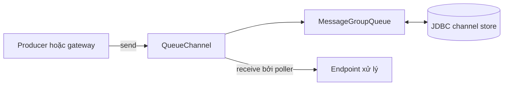
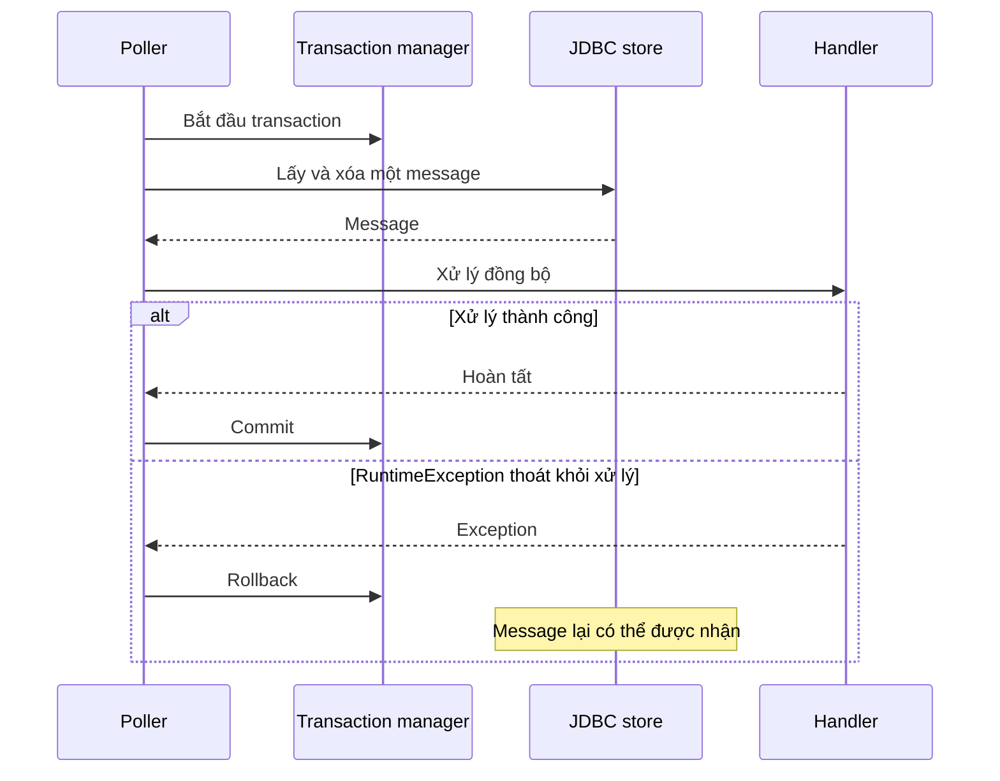

# PersistentQueueChannel

## 1. Mục tiêu và phạm vi

Trong module `SPRING_INTEGRATION_CORE`, một luồng thông điệp được tạo từ `Message`, `MessageChannel`, endpoint và gateway. Chương **Message store** bổ sung khả năng giữ lại trạng thái khi luồng phải đệm message. Bài này tập trung vào **PersistentQueueChannel**: cách xây dựng một hàng đợi thông điệp bền vững, kết nối với endpoint bằng Java DSL và xác định điều gì xảy ra khi xử lý thất bại.

Sau bài học, bạn có thể:

- Giải thích quan hệ giữa `QueueChannel`, `MessageGroupQueue` và kho message.
- Cấu hình hàng đợi JDBC, giữ nguyên định danh qua các lần khởi động.
- Đặt transaction bao quanh thao tác lấy message và phần xử lý đồng bộ.
- Phân biệt phục hồi message, thử lại và chống thực thi trùng.
- Thiết kế kiểm thử cho restart, rollback và xử lý thành công.

Ví dụ sử dụng API Spring Integration 6.5 và Java 17 trở lên. Đây là mốc API của ví dụ; khi đưa vào dự án, dùng bộ phiên bản Spring tương thích do BOM của dự án quản lý. Các ví dụ là cấu hình Java thông thường, không phụ thuộc cơ chế tự cấu hình của Spring Boot.

## 2. PersistentQueueChannel thực chất là gì?

Trong bài này, **PersistentQueueChannel là tên gọi cho một `QueueChannel` được hỗ trợ bởi kho lưu trữ bền vững**, không phải tên một lớp cần import từ Spring Integration. Đối tượng channel trong mã vẫn là `org.springframework.integration.channel.QueueChannel`.

Cấu hình mặc định:

```java
QueueChannel orders = new QueueChannel(100);
```

giữ message trong bộ nhớ của tiến trình. Nếu JVM dừng đột ngột, các message đang đợi có thể mất. Có thể thay phần lưu trữ bằng một persistent message store. Khi gửi, message được ghi vào store; khi nhận, message được lấy ra và loại khỏi store theo cơ chế của store. [Tài liệu cấu hình persistent QueueChannel](https://docs.spring.io/spring-integration/reference/6.5/channel/configuration.html).

Với JDBC, có ba tầng cần nhận diện:

| Thành phần | Vai trò trong cấu hình của bài |
| --- | --- |
| `QueueChannel` | Cung cấp API gửi và nhận thông điệp; là một `PollableChannel` |
| `MessageGroupQueue` | Chuyển các thao tác hàng đợi thành thao tác trên một nhóm message trong store |
| `JdbcChannelMessageStore` | Lưu và lấy message bằng JDBC, dùng SQL phù hợp với hệ quản trị cơ sở dữ liệu |

`MessageGroupQueue` nhận store cùng `groupId` trong constructor. Để sử dụng lại hàng đợi sau restart, phải truyền lại cùng `groupId`. [Javadoc MessageGroupQueue 6.5](https://docs.spring.io/spring-integration/docs/6.5.0/api/org/springframework/integration/store/MessageGroupQueue.html).



Sơ đồ mô tả trách nhiệm của các thành phần. Trong thực thi, poller gọi `receive()` trên channel, rồi channel ủy quyền cho queue và store để lấy message.

## 3. Vì sao cần hàng đợi bền vững?

Giả sử một ứng dụng tiếp nhận yêu cầu ghi nhận đơn hàng. Người gửi cần được xác nhận rằng yêu cầu đã được tiếp nhận, còn endpoint ghi nhận có thể tạm dừng để bảo trì.

Có thể thiết kế:

```text
Tiếp nhận yêu cầu
    → kiểm tra định dạng
    → durableOrders
    → poller
    → ghi nhận đơn hàng
```

Một yêu cầu đã commit vào `durableOrders` vẫn nằm trong cơ sở dữ liệu khi ứng dụng được triển khai lại. Consumer có thể tiếp tục lấy các yêu cầu tồn đọng sau khi khởi động.

Tuy nhiên, cần phân biệt ba câu hỏi:

1. **Đã lưu yêu cầu chưa?** Đây là kết quả của thao tác ghi và commit vào store.
2. **Nếu xử lý thất bại, yêu cầu có còn để xử lý lại không?** Điều này phụ thuộc transaction bao quanh thao tác nhận.
3. **Nếu xử lý lại, có tạo tác dụng phụ lần hai không?** Đây là bài toán idempotency của nghiệp vụ.

Chọn persistent store mới trả lời một phần câu hỏi thứ nhất. Hai câu hỏi còn lại cần được thiết kế rõ ràng.

### 3.1. Phân biệt các lựa chọn thường gặp

| Lựa chọn | Dữ liệu chờ nằm ở đâu? | Hướng sử dụng |
| --- | --- | --- |
| `QueueChannel` trong bộ nhớ | Heap của JVM | Đệm ngắn hạn khi chấp nhận rủi ro mất dữ liệu chờ |
| `QueueChannel` với JDBC store | Bảng dữ liệu | Đệm bền vững trong kiến trúc đang sử dụng JDBC |
| Message broker qua adapter | Hệ thống messaging riêng | Khi cần các khả năng vận hành và giao tiếp của broker |

Một bảng hàng đợi trong cơ sở dữ liệu vẫn cần kế hoạch về dung lượng, throughput và phục hồi. Việc thay bộ nhớ bằng JDBC không tự tạo ra mọi khả năng của một broker.

## 4. Vòng đời message và ranh giới transaction

### 4.1. Đường gửi

```text
Producer tạo Message
    → channel.send(message)
    → store ghi dữ liệu
    → transaction ghi được commit
    → message trở thành dữ liệu chờ bền vững
```

Nếu `send()` tham gia một transaction đang mở, giá trị trả về thành công chưa có nghĩa transaction đó đã commit. Khi transaction bên ngoài rollback, bản ghi vừa thêm cũng bị rollback nếu store tham gia đúng transaction.

Vì vậy, khi API tiếp nhận trả lời “đã chấp nhận”, hợp đồng của API nên gắn với thời điểm commit. Ví dụ: service hoàn tất transaction ghi yêu cầu trước khi lớp HTTP tạo phản hồi chấp nhận.

### 4.2. Đường nhận

Với store có hỗ trợ transaction, poller nên bắt đầu transaction **trước khi nhận**:

```text
BEGIN
    nhận và xóa message khỏi hàng đợi
    thực hiện xử lý đồng bộ
COMMIT nếu thành công
ROLLBACK nếu thất bại theo quy tắc transaction
```

Rollback khôi phục việc loại message khỏi hàng đợi, nên message có thể được nhận lại. Chỉ gắn `@Transactional` vào một method nghiệp vụ được gọi sau `receive()` là chưa đủ để bao phủ thao tác nhận trước đó. [Transaction Support](https://docs.spring.io/spring-integration/reference/6.5/transactions.html).



Bảng sau phân tích các tình huống của ví dụ JDBC dùng cùng `DataSource` và transaction manager:

| Tình huống | Kết quả mong đợi |
| --- | --- |
| Producer rollback trước commit | Message mới không trở thành dữ liệu chờ đã commit |
| Message đã commit, ứng dụng dừng trước khi consumer nhận | Message vẫn chờ trong cơ sở dữ liệu còn nguyên dữ liệu |
| Consumer nhận trong transaction rồi handler ném `RuntimeException` | Việc lấy message và các thay đổi JDBC cùng transaction bị rollback |
| Handler hoàn tất và transaction commit | Message rời hàng đợi; thay đổi nghiệp vụ cùng transaction được lưu |
| Consumer nhận ngoài transaction rồi tiến trình dừng | Có khoảng trống khiến message đã bị loại nhưng nghiệp vụ chưa hoàn tất |

Độ bền ở đây còn phụ thuộc cấu hình lưu trữ và phục hồi của cơ sở dữ liệu. Hàng đợi không thể khôi phục dữ liệu từ một cơ sở dữ liệu đã bị xóa.

## 5. Ví dụ JDBC/H2 với định danh cố định

### 5.1. Thư viện và điều kiện chạy

Ví dụ cần các dependency sau trong cùng bộ phiên bản Spring tương thích:

| Dependency | Mục đích |
| --- | --- |
| `org.springframework.integration:spring-integration-core` | Channel, endpoint, Java DSL và hạ tầng Integration |
| `org.springframework.integration:spring-integration-jdbc` | `JdbcChannelMessageStore` và query provider |
| `org.springframework:spring-jdbc` | `JdbcTemplate`, `DataSourceTransactionManager`, công cụ khởi tạo schema |
| `com.h2database:h2` | Driver H2 cho thực hành |
| `org.junit.jupiter:junit-jupiter` | Chỉ cần khi triển khai các ví dụ kiểm thử |

H2 trong ví dụ dùng file. URL `jdbc:h2:mem:...` chỉ phù hợp cho kiểm thử trong bộ nhớ; nó không chứng minh khả năng giữ message khi JVM kết thúc.

Các đoạn mã Java bên dưới đặt trong cùng package thực hành. Cơ sở dữ liệu phải được khởi tạo trước khi mở application context.

### 5.2. Cấu hình store và channel

```java
import javax.sql.DataSource;

import org.springframework.context.annotation.Bean;
import org.springframework.context.annotation.Configuration;
import org.springframework.integration.channel.QueueChannel;
import org.springframework.integration.config.EnableIntegration;
import org.springframework.integration.jdbc.store.JdbcChannelMessageStore;
import org.springframework.integration.jdbc.store.channel.H2ChannelMessageStoreQueryProvider;
import org.springframework.integration.store.MessageGroupQueue;
import org.springframework.jdbc.core.JdbcTemplate;
import org.springframework.jdbc.datasource.DataSourceTransactionManager;
import org.springframework.jdbc.datasource.DriverManagerDataSource;
import org.springframework.transaction.PlatformTransactionManager;

@Configuration
@EnableIntegration
public class DurableQueueConfig {

    public static final String GROUP_ID = "orders.v1";
    public static final String REGION = "spring-integration-core-demo";

    @Bean
    public DataSource dataSource() {
        DriverManagerDataSource ds = new DriverManagerDataSource();
        ds.setDriverClassName("org.h2.Driver");
        ds.setUrl("jdbc:h2:file:./data/si-orders");
        ds.setUsername("sa");
        ds.setPassword("");
        return ds;
    }

    @Bean
    public JdbcTemplate jdbcTemplate(DataSource dataSource) {
        return new JdbcTemplate(dataSource);
    }

    @Bean
    public PlatformTransactionManager queueTxManager(DataSource dataSource) {
        return new DataSourceTransactionManager(dataSource);
    }

    @Bean
    public JdbcChannelMessageStore channelStore(DataSource dataSource) {
        JdbcChannelMessageStore store = new JdbcChannelMessageStore(dataSource);
        store.setChannelMessageStoreQueryProvider(
                new H2ChannelMessageStoreQueryProvider());
        store.setRegion(REGION);
        return store;
    }

    @Bean
    public QueueChannel durableOrders(JdbcChannelMessageStore channelStore) {
        return new QueueChannel(new MessageGroupQueue(channelStore, GROUP_ID));
    }
}
```

`JdbcChannelMessageStore` là implementation chuyên cho message channel; không dùng nó thay store đầy đủ của aggregator. Thuộc tính query provider phải phù hợp hệ quản trị cơ sở dữ liệu. Khi chuyển sang PostgreSQL, cần đổi cả `DataSource`, DDL và query provider tương ứng. [Javadoc JdbcChannelMessageStore 6.5](https://docs.spring.io/spring-integration/docs/6.5.0/api/org/springframework/integration/jdbc/store/JdbcChannelMessageStore.html).

`DriverManagerDataSource` giúp ví dụ ngắn gọn; ứng dụng thực tế thường sử dụng connection pool. File H2 ở đường dẫn tương đối được tính theo thư mục làm việc của tiến trình. Hai lần chạy từ hai thư mục khác nhau có thể mở hai file cơ sở dữ liệu khác nhau.

### 5.3. Khởi tạo schema đúng một lần

Trong JAR `spring-integration-jdbc` 6.5, script H2 nằm tại:

```text
org/springframework/integration/jdbc/schema-h2.sql
```

Script chứa bảng `INT_CHANNEL_MESSAGE` và sequence phục vụ channel store, cùng các bảng dành cho thành phần JDBC khác. Dùng script đúng phiên bản thư viện, không tự rút gọn schema thành vài cột tùy ý. [Schema H2 trong mã nguồn Spring Integration 6.5.0](https://raw.githubusercontent.com/spring-projects/spring-integration/v6.5.0/spring-integration-jdbc/src/main/resources/org/springframework/integration/jdbc/schema-h2.sql).

Có thể chạy đoạn sau trong một chương trình `main` khởi tạo riêng, trước lần mở context đầu tiên:

```java
import javax.sql.DataSource;

import org.springframework.core.io.ClassPathResource;
import org.springframework.jdbc.core.JdbcTemplate;
import org.springframework.jdbc.datasource.init.ResourceDatabasePopulator;

// Chạy với cơ sở dữ liệu thực hành mới, chưa có schema.
DataSource ds = new DurableQueueConfig().dataSource();

ResourceDatabasePopulator initializer = new ResourceDatabasePopulator(
        new ClassPathResource(
                "org/springframework/integration/jdbc/schema-h2.sql"));
initializer.execute(ds);

new JdbcTemplate(ds).execute("""
        CREATE TABLE ORDER_RECEIPT (
            EVENT_KEY VARCHAR(100) PRIMARY KEY,
            ORDER_ID VARCHAR(100) NOT NULL
        )
        """);
```

Đây là bước bootstrap cho cơ sở dữ liệu thực hành mới, không phải đoạn chạy lại mỗi lần restart. Khi triển khai lâu dài, quản lý DDL bằng migration và giữ nguyên dữ liệu chờ. Không dùng drop script trong quy trình khởi động lại để thử độ bền.

### 5.4. Endpoint với transactional poller

```java
import org.springframework.beans.factory.annotation.Qualifier;
import org.springframework.context.annotation.Bean;
import org.springframework.context.annotation.Configuration;
import org.springframework.integration.channel.QueueChannel;
import org.springframework.integration.dsl.IntegrationFlow;
import org.springframework.integration.dsl.Pollers;
import org.springframework.jdbc.core.JdbcTemplate;
import org.springframework.transaction.PlatformTransactionManager;

@Configuration
public class OrderConsumerConfig {

    @Bean
    public IntegrationFlow orderFlow(
            @Qualifier("durableOrders") QueueChannel orders,
            @Qualifier("queueTxManager") PlatformTransactionManager txManager,
            JdbcTemplate jdbc) {

        return IntegrationFlow.from(orders)
                .handle(String.class, (orderId, headers) -> {
                    String eventKey = (String) headers.get("eventKey");
                    if (eventKey == null || eventKey.isBlank()) {
                        throw new IllegalArgumentException("Thiếu eventKey");
                    }
                    if (orderId.isBlank()) {
                        throw new IllegalArgumentException("Thiếu orderId");
                    }

                    // Cú pháp H2: ghi nhận lại cùng eventKey không thêm hàng mới.
                    jdbc.update("""
                            MERGE INTO ORDER_RECEIPT (EVENT_KEY, ORDER_ID)
                            KEY (EVENT_KEY) VALUES (?, ?)
                            """, eventKey, orderId);
                    return null; // Handler kết thúc luồng, không tạo reply.
                }, endpoint -> endpoint
                        .id("orderConsumer")
                        .poller(Pollers.fixedDelay(500)
                                .receiveTimeout(0)
                                .maxMessagesPerPoll(1)
                                .transactional(txManager)))
                .get();
    }
}
```

Ý nghĩa các cấu hình poller:

- `fixedDelay(500)`: đặt khoảng trễ giữa các lần chạy tác vụ polling.
- `receiveTimeout(0)`: không chờ message khi hàng đợi đang rỗng trong lần nhận đó.
- `maxMessagesPerPoll(1)`: giới hạn một message mỗi lần polling trong ví dụ.
- `transactional(txManager)`: áp dụng transaction advice cho polling task.

Các lựa chọn này có trong [Javadoc PollerSpec 6.5](https://docs.spring.io/spring-integration/docs/6.5.0/api/org/springframework/integration/dsl/PollerSpec.html). Khi dùng Spring thuần, mở context với cả `DurableQueueConfig` và `OrderConsumerConfig` để có consumer.

Store và `JdbcTemplate` trong ví dụ cùng dùng một `DataSource`, nên thao tác lấy message và câu lệnh `MERGE` tham gia cùng transaction. `DataSourceTransactionManager` liên kết connection với thread hiện tại; `JdbcTemplate` sử dụng cơ chế lấy connection phù hợp để tham gia transaction. [Javadoc DataSourceTransactionManager](https://docs.spring.io/spring-framework/docs/6.2.0/javadoc-api/org/springframework/jdbc/datasource/DataSourceTransactionManager.html).

`MERGE ... KEY` là cú pháp H2 của bài thực hành. Nó minh họa việc gửi lại cùng `eventKey` và cùng `orderId` chỉ để lại một bản ghi. Nếu dùng lại cùng khóa cho một đơn khác, câu lệnh này có thể cập nhật bản ghi cũ. Nghiệp vụ thực tế phải xác định rõ quy tắc khóa và từ chối xung đột nội dung; không xem `MERGE` là giải pháp idempotency hoàn chỉnh cho mọi hệ thống.

### 5.5. Gửi message

Đoạn sau chạy với context đã mở:

```java
import org.springframework.integration.channel.QueueChannel;
import org.springframework.messaging.Message;
import org.springframework.messaging.support.MessageBuilder;

QueueChannel orders = context.getBean("durableOrders", QueueChannel.class);

Message<String> message = MessageBuilder.withPayload("ORDER-1001")
        .setHeader("eventKey", "evt-order-1001-created")
        .setHeader("schemaVersion", 1)
        .build();

if (!orders.send(message)) {
    throw new IllegalStateException("Không tiếp nhận được yêu cầu");
}
```

`eventKey` là khóa nghiệp vụ ổn định của một sự kiện. Khi producer thử gửi lại cùng sự kiện, nó phải sử dụng lại khóa này. Tạo UUID mới cho mỗi lần retry sẽ làm cơ chế chống trùng coi các lần gửi là các sự kiện khác nhau.

Với luồng không cần trả kết quả nghiệp vụ ngay, một gateway một chiều cũng phù hợp. Interface có method trả `void` có thể che API messaging khỏi caller. Nếu bổ sung `@MessagingGateway` trong cấu hình Spring thuần, cần bật `@IntegrationComponentScan` cho package chứa interface. [Javadoc MessagingGateway 6.5](https://docs.spring.io/spring-integration/docs/6.5.0/api/org/springframework/integration/annotation/MessagingGateway.html).

## 6. Biến thể XML và Java DSL

XML có thể khai báo channel như sau, giả sử đã có các bean `channelStore` và `queueTxManager`:

```xml
<int:channel id="durableOrders">
    <int:queue message-store="channelStore"/>
</int:channel>

<int:service-activator input-channel="durableOrders"
                       ref="orderHandler"
                       method="handle">
    <int:poller fixed-delay="500"
                receive-timeout="0"
                max-messages-per-poll="1">
        <int:transactional transaction-manager="queueTxManager"/>
    </int:poller>
</int:service-activator>
```

Đây là mảnh cấu hình để đặt trong tài liệu XML đã khai báo namespace `int`; nó không phải file XML độc lập. Với cấu hình namespace, tên channel là một phần định danh nhóm lưu trữ. Đổi tên channel có thể khiến ứng dụng không còn đọc nhóm dữ liệu cũ.

Không đặt đồng thời thuộc tính `capacity` và `message-store` trên `<int:queue>`. Quy tắc này được nêu trong [cấu hình persistent QueueChannel](https://docs.spring.io/spring-integration/reference/6.5/channel/configuration.html).

Java DSL có overload khai báo store và group ID trực tiếp:

```java
// Biến thể thay thế, không khai báo trùng bean với ví dụ chính.
return IntegrationFlow
        .from("incomingOrders")
        .channel(org.springframework.integration.dsl.MessageChannels.queue(
                "durableOrders", channelStore, "orders.v1"))
        .get();
```

Luồng này chỉ minh họa producer đưa dữ liệu vào hàng đợi; vẫn cần endpoint có poller để tiêu thụ. Overload tương ứng nằm trong [Javadoc MessageChannels 6.5](https://docs.spring.io/spring-integration/docs/6.5.0/api/org/springframework/integration/dsl/MessageChannels.html).

## 7. Định danh hàng đợi và serialization

### 7.1. Những giá trị phải ổn định

Khi mở lại hàng đợi, cần truy cập cùng dữ liệu vật lý và cùng không gian logic:

| Giá trị | Nếu thay đổi ngoài ý muốn |
| --- | --- |
| Cơ sở dữ liệu hoặc schema kết nối | Ứng dụng truy cập tập dữ liệu khác |
| Table prefix | SQL trỏ sang nhóm bảng khác |
| `region` | Message cũ thuộc phân vùng logic khác |
| `groupId` | Queue mới không lấy các message thuộc nhóm cũ |
| Tên channel khi dùng cấu hình suy ra group từ channel | Có thể thay đổi nhóm được sử dụng |

Nhiều queue có thể dùng chung một store nhưng phải có group ID riêng nếu muốn tách dữ liệu. Các ứng dụng có tên channel giống nhau có thể phân tách bằng `region`. [JDBC Message Store: phân vùng store](https://docs.spring.io/spring-integration/reference/6.5/jdbc/message-store.html).

Trong ví dụ Java, `GROUP_ID` được truyền trực tiếp, nên đổi tên method bean không tự đổi hằng số này. Ngược lại, tạo group ID bằng `UUID.randomUUID()` mỗi lần chạy sẽ khiến queue mới không đọc backlog cũ.

### 7.2. Message phải đọc lại được sau triển khai

Store cần chuyển message sang dạng lưu trữ và khôi phục lại. Không nên đưa các đối tượng gắn với tiến trình như connection, stream, request HTTP hay callback vào thông điệp sẽ tồn tại lâu dài.

Hợp đồng dữ liệu nên gồm payload rõ ràng, khóa sự kiện, phiên bản dữ liệu và các header thật sự cần cho xử lý. Với ví dụ, `String`, `Integer` và các giá trị header đơn giản giúp giảm phụ thuộc vào lớp nghiệp vụ.

Các implementation store có chiến lược serialization khác nhau; không suy hành vi của một store sang tất cả store khác. Đặc biệt, không dựa vào việc header không serializable sẽ luôn được tự động giữ lại hoặc loại bỏ theo cùng một cách. [Message Store: lưu ý serialization](https://docs.spring.io/spring-integration/reference/6.5/message-store.html).

Trong `JdbcChannelMessageStore` 6.5, cấu hình mặc định sử dụng Java serialization và converter giải tuần tự hóa có danh sách lớp được phép. Nếu dùng DTO tự định nghĩa, cần bảo đảm DTO và dữ liệu liên quan có thể serialize, phiên bản mới đọc được dữ liệu cũ, đồng thời cho phép đúng lớp cần thiết, chẳng hạn:

```java
store.addAllowedPatterns("vn.example.integration.OrderCommand");
```

Không mở toàn bộ lớp bằng wildcard chỉ để bỏ qua lỗi cấu hình. API mở rộng danh sách được phép và các điểm thay serializer/deserializer có trong [mã nguồn JdbcChannelMessageStore 6.5.0](https://raw.githubusercontent.com/spring-projects/spring-integration/v6.5.0/spring-integration-jdbc/src/main/java/org/springframework/integration/jdbc/store/JdbcChannelMessageStore.java).

Một gateway request/reply có thể dùng reply channel tạm gắn với lời gọi đang chờ. Lưu request xuống cơ sở dữ liệu không làm lời gọi và thread chờ sống qua restart. Với tác vụ lâu dài, nên lưu kết quả theo `eventKey` hoặc correlation ID để caller tra cứu hay nhận thông báo sau.

## 8. Bảo đảm xử lý và tác dụng phụ bên ngoài

### 8.1. Khả năng xử lý lại không đồng nghĩa exactly-once

Xét handler thực hiện:

```text
Gọi API thu tiền thành công
    → tiến trình dừng trước khi transaction JDBC commit
    → transaction rollback
    → message xuất hiện lại
    → API thu tiền bị gọi lần nữa
```

Đây là phân tích tình huống của thiết kế: transaction JDBC không điều khiển việc hoàn tác một lời gọi HTTP đã hoàn tất. Handler có khả năng nhận lại message, nên tác dụng phụ cần khóa idempotency hoặc một quy trình phối hợp riêng.

Nếu thay đổi nghiệp vụ và queue cùng nằm trong một transaction cơ sở dữ liệu, có thể commit chúng nguyên tử trong phạm vi đó. Điều này vẫn không có nghĩa mọi thao tác ngoài cơ sở dữ liệu đều exactly-once.

Với nghiệp vụ đơn hàng, có thể chọn:

- Ghi nhận `eventKey` và cập nhật trạng thái đơn trong cùng transaction.
- Yêu cầu dịch vụ thanh toán hỗ trợ khóa idempotency, truyền lại cùng khóa khi retry.
- Ghi yêu cầu gửi ra ngoài vào một outbox trong transaction nghiệp vụ, rồi có tiến trình chuyển tiếp và chiến lược chống trùng tương ứng.

Đây là các lựa chọn thiết kế bổ sung cho bài toán cụ thể, không phải các hành vi tự bật của `QueueChannel`.

### 8.2. Giữ phần nguyên tử trên cùng thread

Nếu handler đồng bộ chuyển qua `ExecutorChannel`, tạo `CompletableFuture` hoặc chuyển sang một queue khác rồi kết thúc, transaction hiện tại không tự theo công việc đang chạy ở thread khác. Khi đó, cần xác định lại điểm commit và cơ chế lưu bền ở mỗi lần bàn giao. [Ranh giới transaction trong luồng thông điệp](https://docs.spring.io/spring-integration/reference/6.5/transactions.html).

Ngay trong transaction, handler bắt exception rồi trả về bình thường cũng có thể khiến polling được xem là thành công, trừ khi transaction đã được đánh dấu rollback-only. Với lỗi phải xử lý lại, cần để lỗi phù hợp thoát khỏi phần xử lý hoặc chủ động đặt rollback theo hợp đồng đã chọn.

## 9. Retry, errorChannel và message không thể xử lý

Khi consumer chạy bằng poller, lỗi xử lý xảy ra tách khỏi lời gọi `send()` trước đó. Hạ tầng có thể phát `ErrorMessage` tới error channel. Message có header `errorChannel` hoặc error channel cấu hình cho poller có thể ảnh hưởng nơi nhận lỗi; cần kiểm tra cấu hình đang sử dụng. [Error Handling](https://docs.spring.io/spring-integration/reference/6.5/error-handling.html).

Ba cơ chế cần được xem riêng:

| Cơ chế | Điều giải quyết |
| --- | --- |
| Rollback thao tác nhận | Cho phép message còn lại để nhận tiếp |
| Retry | Quyết định khi nào và bao nhiêu lần thử xử lý |
| Quarantine hoặc dead-letter | Giữ message không xử lý được để kiểm tra và khôi phục có kiểm soát |

Một message sai định dạng có thể rollback liên tục. Nếu nó luôn được chọn sớm, tiến độ xử lý các message khác có thể bị ảnh hưởng. `maxMessagesPerPoll(1)` chỉ giới hạn lượng nhận mỗi lần, không đặt số lần retry tối đa.

Ví dụ chính cố ý ném lỗi khi thiếu `eventKey` để minh họa rollback. Trước khi sử dụng như một luồng vận hành thực tế, cần thêm chính sách phân loại:

- Lỗi tạm thời: thử lại với khoảng chờ và giới hạn phù hợp.
- Lỗi dữ liệu không thể sửa bằng retry: lưu payload cùng thông tin lỗi vào nơi cách ly.
- Lỗi hạ tầng lưu trữ: quan sát và khôi phục kết nối, tránh báo tiếp nhận thành công khi chưa lưu được.

Đưa `ErrorMessage` tới `errorChannel` không tự chuyển message gốc sang một queue bền vững. Nếu muốn việc lấy khỏi queue nguồn và đưa sang quarantine là nguyên tử, hai thao tác phải tham gia cùng transaction phù hợp. Error flow chạy sau rollback hoặc trên thread khác không được mặc nhiên coi là nằm trong transaction nhận ban đầu.

Nếu số lần thử phải tồn tại qua restart, hãy lưu nó bằng trạng thái bền vững đã thiết kế. Không giả định bộ đếm trong RAM hoặc một header do retry advice thêm sẽ tự phản ánh mọi lần nhận lại từ store.

## 10. Kết hợp với các endpoint cốt lõi

Hàng đợi bền vững thường nằm giữa các thành phần đã học trong module:

```text
Gateway → transformer → filter/router → durable queue → poller → handler
```

Vị trí đặt queue quyết định dữ liệu nào đã được tiếp nhận bền vững. Có thể kiểm tra định dạng và chuẩn hóa payload trước queue để giảm số message không hợp lệ phải lưu. Cần xác định rõ cách caller biết yêu cầu bị từ chối.

Sau queue, một filter loại message mà không báo lỗi có thể là một kết quả xử lý hợp lệ và transaction nhận sẽ commit. Vì vậy, nếu nghiệp vụ yêu cầu giữ lại các bản ghi bị loại, cần tuyến lưu trữ cho chúng; không dựa vào rollback khi không có lỗi.

Nếu endpoint tiếp theo là aggregator, việc queue giao message thành công cho aggregator không có nghĩa nhóm của aggregator đã bền vững. Aggregator cần store phù hợp cho trạng thái riêng. `JdbcChannelMessageStore` được tối ưu cho hàng đợi, còn `JdbcMessageStore` phục vụ các nhu cầu như aggregator và claim check. [Phân biệt các JDBC message store](https://docs.spring.io/spring-integration/reference/6.5/jdbc/message-store.html).

## 11. Kiểm thử các thuộc tính quan trọng

Các ví dụ sau là mã kiểm thử để triển khai trong dự án thực hành. Chúng không thay thế việc chạy kiểm thử với dependency và cơ sở dữ liệu thực tế của dự án.

### 11.1. Mở lại channel và đọc backlog

Chỉ mở `DurableQueueConfig`, không mở `OrderConsumerConfig`, để poller không lấy message trước phần kiểm tra:

```java
import org.junit.jupiter.api.Test;
import org.springframework.context.annotation.AnnotationConfigApplicationContext;
import org.springframework.integration.channel.QueueChannel;
import org.springframework.messaging.Message;
import org.springframework.messaging.support.MessageBuilder;

import static org.junit.jupiter.api.Assertions.*;

class DurableQueueReopenTest {

    @Test
    void readsCommittedMessageAfterContextReopens() {
        // Điều kiện: schema đã có, queue dành riêng cho test và đang rỗng.
        try (var first = new AnnotationConfigApplicationContext(
                DurableQueueConfig.class)) {
            QueueChannel queue = first.getBean(
                    "durableOrders", QueueChannel.class);
            assertTrue(queue.send(MessageBuilder.withPayload("ORDER-REOPEN")
                    .setHeader("eventKey", "evt-reopen")
                    .build()));
        }

        try (var second = new AnnotationConfigApplicationContext(
                DurableQueueConfig.class)) {
            QueueChannel queue = second.getBean(
                    "durableOrders", QueueChannel.class);
            Message<?> restored = queue.receive(0);

            assertNotNull(restored);
            assertEquals("ORDER-REOPEN", restored.getPayload());
            assertEquals("evt-reopen", restored.getHeaders().get("eventKey"));
            assertNull(queue.receive(0));
        }
    }
}
```

Bài kiểm thử này xác minh việc mở lại context và store với cùng định danh. Để chứng minh phục hồi qua JVM, thực hiện thêm hai lần chạy tiến trình riêng: tiến trình thứ nhất gửi rồi kết thúc; tiến trình thứ hai mở cùng cơ sở dữ liệu và nhận lại. Một kịch bản dừng đột ngột sau khi xác nhận commit giúp kiểm tra tình huống crash sát thực tế hơn đóng context bình thường.

### 11.2. Rollback thao tác nhận

Trong một test độc lập, vẫn không bật consumer, dùng `TransactionTemplate` để thể hiện ranh giới nhận:

```java
import org.springframework.transaction.PlatformTransactionManager;
import org.springframework.transaction.support.TransactionTemplate;

// context chỉ đăng ký DurableQueueConfig; queue riêng đang rỗng.
QueueChannel queue = context.getBean("durableOrders", QueueChannel.class);
PlatformTransactionManager tm = context.getBean(
        "queueTxManager", PlatformTransactionManager.class);
TransactionTemplate tx = new TransactionTemplate(tm);

assertTrue(queue.send(MessageBuilder.withPayload("ORDER-ROLLBACK")
        .setHeader("eventKey", "evt-rollback")
        .build()));

assertThrows(IllegalStateException.class, () ->
        tx.executeWithoutResult(status -> {
            Message<?> received = queue.receive(0);
            assertNotNull(received);
            throw new IllegalStateException("Mô phỏng xử lý thất bại");
        }));

Message<?> availableAgain = tx.execute(status -> queue.receive(0));
assertNotNull(availableAgain);
assertEquals("ORDER-ROLLBACK", availableAgain.getPayload());
assertNull(queue.receive(0));
```

Các import `QueueChannel`, `Message`, `MessageBuilder` và JUnit assertions giống ví dụ trước. `TransactionTemplate` thực thi callback trong transaction và hỗ trợ đánh dấu rollback-only khi cần. [Programmatic Transaction Management](https://docs.spring.io/spring-framework/reference/data-access/transaction/programmatic.html).

Test này kiểm tra store và transaction manager, chưa kiểm tra việc endpoint DSL đã thực sự gắn transaction advice. Cần thêm test tích hợp mở cả hai cấu hình, cho handler ném lỗi có kiểm soát và xác minh message còn trong queue sau rollback. Khi kiểm tra bất đồng bộ, chờ có giới hạn đến điều kiện mong muốn thay vì giả định một khoảng ngủ cố định luôn đủ.

### 11.3. Các quan sát cần có ở mức luồng

| Kịch bản | Quan sát cần xác minh |
| --- | --- |
| Handler thành công | Queue hết message tương ứng và dữ liệu nghiệp vụ đã commit |
| Handler cập nhật JDBC rồi ném lỗi | Message còn để xử lý lại và cập nhật nghiệp vụ chưa commit |
| Gửi lại cùng sự kiện | Kết quả nghiệp vụ tuân thủ quy tắc idempotency |
| Bàn giao sang quarantine | Message lỗi còn ở nơi cách ly sau restart theo thiết kế |
| Thay phiên bản ứng dụng | Dữ liệu chờ từ phiên bản cũ vẫn đọc và xử lý được |

Dùng cơ sở dữ liệu, region hoặc group dành riêng cho test. Không xóa dữ liệu hàng đợi đang dùng chung để tạo trạng thái test rỗng. Trước khi tăng số consumer, bổ sung kiểm thử cạnh tranh trên đúng hệ quản trị cơ sở dữ liệu triển khai.

## 12. Dung lượng, thứ tự và quan sát vận hành

### 12.1. Backlog là dữ liệu có chi phí

Trong thiết kế thực hành, giả sử trung bình có 80 message đến mỗi giây nhưng consumer chỉ xử lý 60 message mỗi giây. Sau 10 phút:

```text
Backlog tăng = (80 - 60) × 600 = 12.000 message
```

Đây là phép ước lượng tải của ví dụ, chưa tính biến động hay thời gian retry. Nếu mỗi message chiếm khoảng 4 KiB sau serialization, riêng dữ liệu message đã vào khoảng 47 MiB, chưa gồm index, log giao dịch và overhead lưu trữ.

Cần theo dõi độ sâu queue, tuổi message lâu nhất, tốc độ vào/ra, số lần rollback và thời gian xử lý. Một queue sâu nhưng đang giảm nhanh khác với queue ít message nhưng có một yêu cầu mắc kẹt nhiều giờ.

`MessageGroupQueue` có constructor nhận capacity, nhưng lock mặc định trong implementation là lock trong JVM. Giới hạn như vậy không tự trở thành quota nguyên tử giữa nhiều tiến trình. Nếu cần backpressure hoặc hạn mức toàn hệ thống, phải thiết kế riêng tại điểm tiếp nhận. [Mã nguồn MessageGroupQueue 6.5.0](https://raw.githubusercontent.com/spring-projects/spring-integration/v6.5.0/spring-integration-core/src/main/java/org/springframework/integration/store/MessageGroupQueue.java).

### 12.2. Đo độ sâu mà không tiêu thụ message

Với ví dụ này, có thể gọi:

```java
int waiting = channelStore.messageGroupSize(DurableQueueConfig.GROUP_ID);
```

Hoặc quan sát các nhóm trong region bằng truy vấn chỉ đọc:

```sql
SELECT REGION, GROUP_KEY, COUNT(*) AS WAITING_COUNT
FROM INT_CHANNEL_MESSAGE
WHERE REGION = 'spring-integration-core-demo'
GROUP BY REGION, GROUP_KEY;
```

`GROUP_KEY` trong bảng là biểu diễn nội bộ của khóa nhóm; không giả định nó chứa nguyên chuỗi `orders.v1`. Không gọi `receive()` để đo queue vì nhận message là thao tác tiêu thụ.

### 12.3. Thứ tự nhận và thứ tự hoàn tất

Một hàng đợi FIFO hướng tới việc lấy message theo thứ tự lưu trữ của store. Khi nhiều consumer xử lý song song, message được lấy sau vẫn có thể hoàn tất trước. Nếu nghiệp vụ cần tuần tự theo từng đơn hàng, phải xác định khóa phân vùng hoặc giới hạn cạnh tranh tương ứng.

Thêm thread chưa chắc tăng throughput nếu cơ sở dữ liệu phải chờ lock hoặc connection pool đã hết connection. Bắt đầu từ cấu hình một consumer, đo thời gian xử lý và tải SQL, rồi tăng mức song song với kiểm thử trên cơ sở dữ liệu đích.

## 13. Tự kiểm tra thiết kế

Trước khi coi một luồng có hàng đợi JDBC là đáp ứng yêu cầu, hãy trả lời bằng hành vi quan sát được:

1. API tiếp nhận trả thành công ở thời điểm nào so với commit?
2. Sau restart, ứng dụng có mở cùng cơ sở dữ liệu, region và group ID không?
3. Transaction có bắt đầu trước `receive()` và bao phủ phần nghiệp vụ cần nguyên tử không?
4. Khi thử lại cùng một sự kiện, tác dụng phụ có tuân thủ khóa idempotency không?
5. Message sai vĩnh viễn được giữ ở đâu và ai có thể xử lý lại?
6. Khi backlog tăng, hệ thống giới hạn tiếp nhận hoặc mở rộng xử lý bằng cách nào?

Một cấu hình PersistentQueueChannel có ý nghĩa khi các câu trả lời này nhất quán: dữ liệu được lưu trước khi xác nhận tiếp nhận, message chưa hoàn tất có thể phục hồi theo chính sách, và xử lý lại không phá vỡ quy tắc nghiệp vụ.

