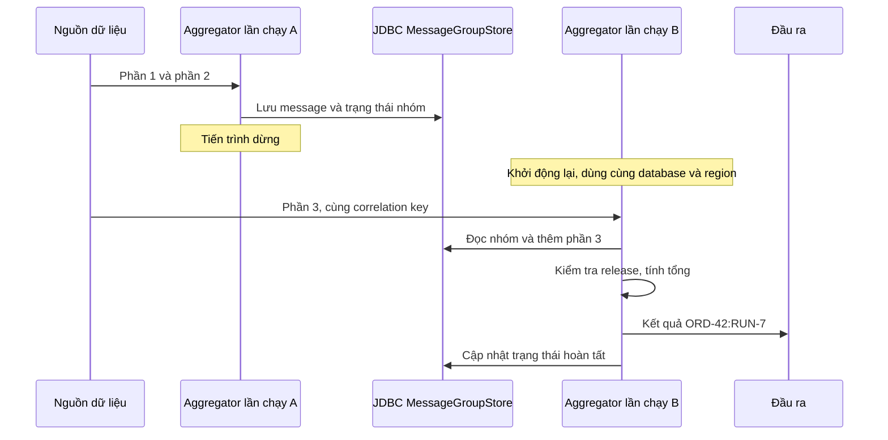
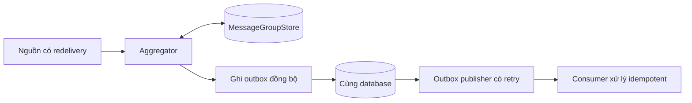

# Aggregator persistence

## 1. Mục tiêu và phạm vi

Trong chương **Message store** của Spring Integration Core, bài này trình bày cách lưu bền trạng thái của aggregator để một nhóm thông điệp đang chờ có thể tiếp tục được xử lý sau khi ứng dụng khởi động lại.

Sau bài học, bạn có thể:

- Phân biệt trạng thái của aggregator, hàng đợi đầu vào và kết quả đầu ra.
- Cấu hình `JdbcMessageStore` bằng Java DSL.
- Thiết kế correlation key và điều kiện release phù hợp với bản tin trùng.
- Quyết định cách xử lý nhóm hoàn tất, nhóm thiếu dữ liệu và thông điệp đến muộn.
- Xác định ranh giới transaction, khóa và khả năng phục hồi cần kiểm thử.

Ví dụ dùng **Java 17 trở lên và API Spring Integration 6.5.x**. Phiên bản dependency thực tế cần theo BOM của dự án. Mẫu cấu hình ban đầu dành cho một instance; các phần sau bổ sung thiết kế transaction và nhiều instance.

## 2. Vì sao aggregator cần persistence?

Giả sử một lần nhập đơn hàng được chia thành ba phần:

| Khóa nghiệp vụ | Phần | Số tiền |
| --- | --- | --- |
| `ORD-42:RUN-7` | 1/3 | 100000 |
| `ORD-42:RUN-7` | 2/3 | 200000 |
| `ORD-42:RUN-7` | 3/3 | 300000 |

Ứng dụng nhận phần 1 và 2 rồi dừng đột ngột. Sau khi khởi động lại, phần 3 mới đến. Nếu hai phần đầu chỉ nằm trong bộ nhớ, aggregator không còn đủ dữ liệu để tạo tổng 600000.

Aggregator có nhiệm vụ gom thông điệp, giữ chúng trong store, kiểm tra khả năng release và tạo kết quả tổng hợp. Store bền vững bảo vệ phần trạng thái đang được giữ này. Các vai trò đó được tách qua `CorrelationStrategy`, `ReleaseStrategy` và `MessageGroupProcessor`. [Tham chiếu Aggregator](https://docs.spring.io/spring-integration/reference/6.5/aggregator.html)



Sơ đồ mô tả luồng logic. Nó không khẳng định việc gửi đầu ra và cập nhật database đã nằm trong cùng một transaction.

## 3. Chính xác những gì cần được giữ lại?

Trạng thái nhóm không chỉ là một danh sách payload. Cần phân biệt:

| Thành phần | Vai trò khi phục hồi |
| --- | --- |
| Correlation key | Tìm đúng nhóm mà thông điệp mới thuộc về |
| Các message thuộc nhóm | Cung cấp dữ liệu chưa được tổng hợp |
| Trạng thái complete | Phân biệt nhóm đang chờ với nhóm đã kết thúc |
| Timestamp và last modified | Làm cơ sở đánh giá tuổi hoặc thời gian không hoạt động |
| Thông tin sequence/condition nếu có | Hỗ trợ chiến lược release tương ứng |

Spring Integration có mô hình metadata riêng cho message group, bao gồm danh tính message, thời gian, cờ complete và thông tin sequence/condition. Không nên thay thế cả mô hình bằng một bảng chỉ lưu payload rồi kỳ vọng aggregator tự khôi phục đầy đủ. [API MessageGroupMetadata](https://docs.spring.io/spring-integration/docs/6.5.0/api/org/springframework/integration/store/MessageGroupMetadata.html)

Một cách đọc kiến trúc hữu ích:

```text
MessageChannel      -> chuyển message tới endpoint
Aggregator endpoint -> điều phối correlation, release và output
MessageGroupStore   -> giữ dữ liệu và trạng thái của nhóm
Downstream          -> tiếp nhận, lưu hoặc thực hiện kết quả
```

Nếu mất message trước khi tới aggregator, message group store chưa có gì để phục hồi. Nếu kết quả đã rời aggregator nhưng nằm trong một queue bộ nhớ, persistence của nhóm cũng không bảo vệ queue đó.

## 4. Chọn store và chuẩn bị database

Với JDBC, lựa chọn cho bài này là `org.springframework.integration.jdbc.store.JdbcMessageStore`. Nó phục vụ các thành phần correlation như aggregator. `JdbcChannelMessageStore` chuyên cho message channel, không phải lựa chọn thay thế để truyền vào `.aggregate(a -> a.messageStore(...))`. [API JdbcMessageStore](https://docs.spring.io/spring-integration/docs/6.5.0/api/org/springframework/integration/jdbc/store/JdbcMessageStore.html)

Trước khi chạy ví dụ, dự án cần:

1. Các dependency `spring-integration-core`, `spring-integration-jdbc`, Spring JDBC và JDBC driver.
2. Một bean `DataSource` trỏ tới database giữ dữ liệu qua lần chạy.
3. Schema được tạo bằng migration phù hợp với phiên bản Spring Integration.
4. Quyền đọc, ghi và cập nhật các bảng message store.

Trong JAR `spring-integration-jdbc`, các script `org/springframework/integration/jdbc/schema-*.sql` cung cấp cấu trúc theo hệ quản trị. Chọn đúng script và quản lý thay đổi schema cùng ứng dụng; không chạy lại script drop/create ở mỗi lần restart. [Khởi tạo JDBC Message Store](https://docs.spring.io/spring-integration/reference/6.5/jdbc/message-store.html)

Để thực hành restart, dùng PostgreSQL hoặc H2 chế độ file. Một database chỉ nằm trong bộ nhớ của tiến trình sẽ làm mất dữ liệu khi tiến trình kết thúc, dù ứng dụng đã chọn đúng lớp store.

## 5. Ví dụ Java DSL: gom các phần đơn hàng

### 5.1. Hợp đồng dữ liệu

Ví dụ quy định:

- Một nhóm ứng với cặp `orderId` và `runId`.
- Hai định danh không chứa dấu `:`, để cách nối khóa không bị nhập nhằng.
- Mỗi phần có chỉ số từ 1 tới `expectedParts`.
- Mọi phần trong nhóm thống nhất về `expectedParts`.
- Gửi lại cùng một phần với dữ liệu tương đương được phép; dữ liệu mâu thuẫn bị từ chối.
- Chỉ phát kết quả đầy đủ. Nhóm thiếu dữ liệu hết hạn đi vào nhánh discard.

Dùng `runId` giúp tách lần xử lý mới khỏi một lần xử lý cũ của cùng đơn hàng. Khi redelivery sau restart, nguồn phải giữ nguyên `runId`; tạo UUID mới ở mỗi lần nhận sẽ chia một công việc thành nhiều nhóm.

### 5.2. Cấu hình và thuật toán minh họa

Đây là cấu hình để đưa vào một ứng dụng đã có `DataSource`. Các record được đặt trong cùng lớp để ví dụ tự chứa.

```java
package example.integration.orders;

import java.io.Serializable;
import java.math.BigDecimal;
import java.time.Duration;
import java.util.Objects;
import java.util.SortedMap;
import java.util.TreeMap;

import javax.sql.DataSource;

import org.springframework.beans.factory.annotation.Qualifier;
import org.springframework.context.annotation.Bean;
import org.springframework.context.annotation.Configuration;
import org.springframework.integration.channel.DirectChannel;
import org.springframework.integration.channel.QueueChannel;
import org.springframework.integration.config.EnableIntegration;
import org.springframework.integration.dsl.IntegrationFlow;
import org.springframework.integration.jdbc.store.JdbcMessageStore;
import org.springframework.integration.store.MessageGroup;
import org.springframework.messaging.Message;

@Configuration
@EnableIntegration
public class PersistentOrderAggregation {

    public record OrderPart(
            String orderId,
            String runId,
            int partNo,
            int expectedParts,
            BigDecimal amount) implements Serializable {

        public OrderPart {
            Objects.requireNonNull(orderId, "orderId");
            Objects.requireNonNull(runId, "runId");
            Objects.requireNonNull(amount, "amount");

            if (orderId.isBlank() || runId.isBlank()
                    || orderId.contains(":") || runId.contains(":")) {
                throw new IllegalArgumentException("Invalid business key");
            }

            if (expectedParts <= 0
                    || partNo < 1
                    || partNo > expectedParts) {
                throw new IllegalArgumentException("Invalid part numbering");
            }
        }
    }

    public record CompletedOrder(
            String orderId,
            String runId,
            int partCount,
            BigDecimal total) implements Serializable {
    }

    @Bean
    public DirectChannel orderParts() {
        return new DirectChannel();
    }

    @Bean
    public QueueChannel completedOrders() {
        return new QueueChannel();
    }

    @Bean
    public QueueChannel discardedOrderParts() {
        return new QueueChannel();
    }

    @Bean
    public JdbcMessageStore orderAggregationStore(DataSource dataSource) {
        JdbcMessageStore store = new JdbcMessageStore(dataSource);
        store.setRegion("order-parts-v1");
        return store;
    }

    @Bean
    public IntegrationFlow orderAggregationFlow(
            @Qualifier("orderParts") DirectChannel input,
            @Qualifier("completedOrders") QueueChannel output,
            @Qualifier("discardedOrderParts") QueueChannel discard,
            @Qualifier("orderAggregationStore") JdbcMessageStore store) {

        return IntegrationFlow.from(input)
                .aggregate(a -> a
                        .id("persistentOrderAggregator")
                        .messageStore(store)
                        .correlationStrategy(message ->
                                groupKey((OrderPart) message.getPayload()))
                        .releaseStrategy(PersistentOrderAggregation::ready)
                        .outputProcessor(PersistentOrderAggregation::summarize)
                        .expireGroupsUponCompletion(false)
                        .expireGroupsUponTimeout(false)
                        .sendPartialResultOnExpiry(false)
                        .minimumTimeoutForEmptyGroups(
                                Duration.ofDays(1).toMillis())
                        .groupTimeout(Duration.ofMinutes(2).toMillis())
                        .expireTimeout(Duration.ofMinutes(10).toMillis())
                        .expireDuration(Duration.ofSeconds(30))
                        .discardChannel(discard))
                .channel(output)
                .get();
    }

    public static String groupKey(OrderPart part) {
        return part.orderId() + ":" + part.runId();
    }

    private static SortedMap<Integer, OrderPart> uniqueParts(
            MessageGroup group) {

        SortedMap<Integer, OrderPart> parts = new TreeMap<>();
        Integer expected = null;

        for (Message<?> message : group.getMessages()) {
            OrderPart part = (OrderPart) message.getPayload();

            if (expected == null) {
                expected = part.expectedParts();
            }
            else if (expected.intValue() != part.expectedParts()) {
                throw new IllegalArgumentException(
                        "Conflicting expectedParts");
            }

            OrderPart previous = parts.putIfAbsent(part.partNo(), part);
            if (previous != null
                    && previous.amount().compareTo(part.amount()) != 0) {
                throw new IllegalArgumentException(
                        "Conflicting amount for part " + part.partNo());
            }
        }

        return parts;
    }

    private static boolean ready(MessageGroup group) {
        SortedMap<Integer, OrderPart> parts = uniqueParts(group);
        return !parts.isEmpty()
                && parts.size() == parts.get(parts.firstKey()).expectedParts();
    }

    private static CompletedOrder summarize(MessageGroup group) {
        SortedMap<Integer, OrderPart> parts = uniqueParts(group);
        OrderPart first = parts.get(parts.firstKey());

        BigDecimal total = parts.values().stream()
                .map(OrderPart::amount)
                .reduce(BigDecimal.ZERO, BigDecimal::add);

        return new CompletedOrder(
                first.orderId(), first.runId(), parts.size(), total);
    }
}
```

`messageStore(...)`, các chiến lược, timeout và nhánh discard là cấu hình của correlation endpoint; `outputProcessor(...)` tạo payload đầu ra từ nhóm được release. [API CorrelationHandlerSpec](https://docs.spring.io/spring-integration/docs/6.5.0/api/org/springframework/integration/dsl/CorrelationHandlerSpec.html), [API AggregatorSpec](https://docs.spring.io/spring-integration/docs/6.5.0/api/org/springframework/integration/dsl/AggregatorSpec.html)

Có ba giới hạn cần hiểu khi dùng mẫu:

- `completedOrders` và `discardedOrderParts` là queue bộ nhớ để quan sát kết quả trong lab. Chúng cần được thay bằng đích bền vững trong thiết kế phục hồi đầu cuối.
- Mẫu chưa khai báo transaction bao trùm toàn bộ thao tác thêm message, release và gửi kết quả.
- Ngoại lệ do dữ liệu mâu thuẫn cần chính sách phục hồi riêng. Khi chưa có transaction phù hợp, không được giả định message gây lỗi đã bị loại khỏi store.

Thuật toán duyệt nhóm được chọn để dễ đọc. Nó thích hợp cho nhóm nhỏ trong bài thực hành, không phải tối ưu cho hàng chục nghìn phần.

## 6. Thực hành tiếp tục nhóm sau restart

Trong một đoạn runner hoặc bài kiểm thử có Spring context, gửi hai phần đầu:

```java
import java.math.BigDecimal;

import org.springframework.integration.channel.DirectChannel;
import org.springframework.integration.support.MessageBuilder;

import example.integration.orders.PersistentOrderAggregation.OrderPart;

// context là ApplicationContext của ứng dụng đang chạy.
DirectChannel input = context.getBean("orderParts", DirectChannel.class);

input.send(MessageBuilder.withPayload(
        new OrderPart("ORD-42", "RUN-7", 1, 3,
                new BigDecimal("100000"))).build());

input.send(MessageBuilder.withPayload(
        new OrderPart("ORD-42", "RUN-7", 2, 3,
                new BigDecimal("200000"))).build());
```

Lúc này chưa có `CompletedOrder`. Có thể kiểm tra trạng thái qua store:

```java
JdbcMessageStore store =
        context.getBean("orderAggregationStore", JdbcMessageStore.class);

MessageGroup group = store.getMessageGroup("ORD-42:RUN-7");

System.out.println(group.size());       // 2
System.out.println(group.isComplete()); // false
```

Thực hiện tiếp:

1. Dừng ứng dụng sau khi hai lệnh gửi thành công.
2. Khởi động lại với cùng database, schema và region.
3. Trong bài thực hành này, khởi động lại sớm hơn ngưỡng purge 10 phút.
4. Gửi phần 3 với cùng `orderId`, `runId` và `expectedParts`.
5. Đọc kết quả từ queue đầu ra của context mới.

```java
input.send(MessageBuilder.withPayload(
        new OrderPart("ORD-42", "RUN-7", 3, 3,
                new BigDecimal("300000"))).build());

QueueChannel output =
        context.getBean("completedOrders", QueueChannel.class);

Message<?> result = output.receive(1000);
if (result == null) {
    throw new IllegalStateException("Expected completed order");
}

System.out.println(result.getPayload());
// CompletedOrder[orderId=ORD-42, runId=RUN-7,
//                partCount=3, total=600000]
```

Các biến `context`, `input` và `store` sau restart phải lấy từ context mới. Không giữ đối tượng channel của lần chạy cũ để mô phỏng phục hồi.

Đây là kịch bản thực hành và kết quả kỳ vọng; bài viết không tuyên bố đã chạy các đoạn mã trên trong môi trường dự án.

## 7. Duplicate: lưu được thông điệp chưa có nghĩa là xử lý đúng nghiệp vụ

Xét chuỗi phần `1, 2, 2`. Nếu điều kiện release là `group.size() == 3`, nhóm có thể được coi là đủ dù thiếu phần 3.

Mẫu dùng số phần **khác nhau theo partNo**, đồng thời cộng tiền trên tập phần đã khử trùng:

```text
Các message đang giữ:  1, 2, 2
Các partNo duy nhất:   1, 2
Số phần yêu cầu:       3
Quyết định:            chưa release
```

Đếm phần duy nhất nhưng vẫn cộng tất cả message sẽ tạo một lỗi khác: tổng tiền bị cộng hai lần. Vì vậy release strategy và output processor cùng gọi `uniqueParts(...)`.

Ở đây, “trùng” được định nghĩa theo hợp đồng nghiệp vụ `orderId + runId + partNo`, không dựa vào việc hai message có cùng `MessageHeaders.ID`. Một lần gửi lại có thể được đóng gói thành message mới.

Bản sao không mâu thuẫn vẫn có thể chiếm thêm dung lượng store trước khi nhóm hoàn tất. Với lượng redelivery lớn, có thể bổ sung idempotent receiver hoặc inbox với ràng buộc duy nhất theo khóa nghiệp vụ. Việc đánh dấu đã nhận và lưu phần cần có ranh giới nhất quán; đánh dấu thành công trước khi lưu phần có thể khiến lần gửi lại bị loại dù dữ liệu chưa được giữ.

## 8. Complete, expire và thông điệp đến muộn

Cần phân biệt **hoàn tất một nhóm** với **xóa hoàn toàn dấu vết của nhóm**:

| Cấu hình sau release bình thường | Trạng thái giữ lại | Khi cùng khóa đến tiếp |
| --- | --- | --- |
| `expireGroupsUponCompletion(false)` | Nhóm complete, thường không còn message đã release | Có thể nhận diện và discard bản tin đến muộn |
| `expireGroupsUponCompletion(true)` | Nhóm bị xóa | Message có thể mở một nhóm mới |

Giá trị mặc định là `false`. [API AggregatingMessageHandler](https://docs.spring.io/spring-integration/docs/6.5.0/api/org/springframework/integration/aggregator/AggregatingMessageHandler.html)

Trong ví dụ, giữ metadata giúp một bản gửi lại của `ORD-42:RUN-7` không vô tình tạo kết quả thứ hai ngay sau kết quả đầu. Một lần nhập mới phải dùng `RUN-8`.

Tuy nhiên, dấu complete chỉ tồn tại trong khoảng lưu giữ. Sau khi metadata hết hạn và bị xóa, aggregator có thể tiếp nhận cùng khóa như một nhóm mới. Nếu nghiệp vụ yêu cầu chống lặp lâu hơn một ngày, cần giữ một business ledger hoặc khóa duy nhất ở đầu ra lâu tương ứng.

`minimumTimeoutForEmptyGroups(...)` hỗ trợ giữ nhóm rỗng trước khi dọn, đặc biệt khi thời gian giữ dấu complete cần dài hơn thời gian chờ nhóm thiếu. Đây không phải cam kết metadata biến mất chính xác tại một thời điểm tuyệt đối; còn phụ thuộc cơ chế và lịch dọn. [API minimumTimeoutForEmptyGroups](https://docs.spring.io/spring-integration/docs/6.5.0/api/org/springframework/integration/aggregator/AbstractCorrelatingMessageHandler.html#setMinimumTimeoutForEmptyGroups(long))

## 9. Timeout và nhóm mồ côi sau restart

### 9.1. Hai mốc thời gian của ví dụ

| Thiết lập | Ý nghĩa trong lab |
| --- | --- |
| `groupTimeout(2 phút)` | Đặt lịch force-complete khi nhóm đang chạy không nhận thêm message |
| `expireTimeout(10 phút)` | Ngưỡng xem xét các nhóm cũ trong store |
| `expireDuration(30 giây)` | Chu kỳ quét nhóm cũ |
| `minimumTimeoutForEmptyGroups(1 ngày)` | Giữ dấu nhóm rỗng phục vụ xử lý bản tin đến muộn |

Lịch timeout đang nằm trong scheduler của JVM không phải là một bản timer được khôi phục nguyên vẹn từ database. Nhóm có thể còn dữ liệu sau restart nhưng không còn lịch cũ, nhất là khi không có message mới tới.

Cơ chế `expireTimeout` cho phép purge nhóm cũ khi khởi động; `expireDuration` bổ sung lịch quét định kỳ. Đây là cách xử lý nhóm mồ côi, không phải tự khôi phục mọi thời điểm timeout trước khi ứng dụng dừng. [API expireTimeout và expireDuration](https://docs.spring.io/spring-integration/docs/6.5.0/api/org/springframework/integration/aggregator/AbstractCorrelatingMessageHandler.html#setExpireTimeout(long))

Vì vậy, nhóm vừa restart có thể chờ khác với nhịp hai phút ban đầu. Nếu SLA yêu cầu một deadline nghiệp vụ cố định, cần lưu deadline trong dữ liệu và thiết kế recovery theo deadline đó.

### 9.2. Quyết định khi nhóm thiếu dữ liệu

Mẫu đặt `sendPartialResultOnExpiry(false)`, nên không phát đơn hàng thiếu phần như một đơn hàng hoàn chỉnh. `expireGroupsUponTimeout(false)` giữ trạng thái kết thúc để xử lý message tới sau timeout. Các tùy chọn timeout và complete là những quyết định riêng. [API expireGroupsUponTimeout](https://docs.spring.io/spring-integration/docs/6.5.0/api/org/springframework/integration/aggregator/AbstractCorrelatingMessageHandler.html#setExpireGroupsUponTimeout(boolean))

Có thể thiết kế một chính sách khác:

- Phát kết quả một phần nếu nghiệp vụ chấp nhận; payload phải biểu đạt rõ phần thiếu.
- Ghi một sự kiện thất bại hoặc yêu cầu bù dữ liệu.
- Cho phép mở lại công việc bằng một `runId` mới sau khi được quyết định rõ ràng.

Nếu bật partial release, phải điều chỉnh cả output processor và downstream. Việc đổi một cờ không làm `CompletedOrder` tự mang ý nghĩa “chưa đầy đủ”.

### 9.3. Khi dùng MessageGroupStoreReaper

`MessageGroupStoreReaper` cung cấp `run()` để gọi expiry theo lịch; bản thân việc tạo bean không thay cho cấu hình lịch gọi. Nó là một lựa chọn khác khi cần điều khiển việc dọn nhóm từ bên ngoài. [API MessageGroupStoreReaper](https://docs.spring.io/spring-integration/docs/6.5.0/api/org/springframework/integration/store/MessageGroupStoreReaper.html)

Trong lab đã dùng purge của endpoint. Khi chọn reaper cho một thiết kế khác, xác định rõ cơ chế nào chịu trách nhiệm dọn, timeout dựa vào tuổi hay thời gian không hoạt động, và nhánh xử lý khi hết hạn.

## 10. Transaction: bảo vệ một lần thay đổi nhóm

`JdbcMessageStore` không tự tạo một transaction bao trùm mọi bước nghiệp vụ của flow. Một ranh giới thường cần xem xét là:

```text
BEGIN
    lưu phần vừa nhận
    đọc/kiểm tra nhóm
    nếu đủ: tạo kết quả và ghi outbox
    cập nhật trạng thái nhóm
COMMIT
```

Với luồng đồng bộ qua `DirectChannel`, có thể mở transaction ở lối vào bằng Spring transaction. Transaction gắn với thread; chuyển qua `ExecutorChannel` hoặc một queue có consumer khác thread sẽ tạo ranh giới khác. [Transaction boundaries](https://docs.spring.io/spring-integration/reference/6.5/transactions.html)

Đoạn sau minh họa cách mở transaction cho một lệnh gửi trong phiên bản lab một instance:

```java
import org.springframework.jdbc.datasource.DataSourceTransactionManager;
import org.springframework.transaction.support.TransactionTemplate;

TransactionTemplate tx = new TransactionTemplate(
        new DataSourceTransactionManager(dataSource));

tx.executeWithoutResult(status -> {
    boolean accepted = input.send(
            MessageBuilder.withPayload(part).build());

    if (!accepted) {
        throw new IllegalStateException("Message was not accepted");
    }
});
```

Ở đây `dataSource` phải là nguồn dữ liệu mà store sử dụng; `part` là một `OrderPart` đã được tạo. Không bắt rồi nuốt ngoại lệ bên trong callback nếu muốn transaction rollback.

Đoạn mã chỉ thêm ranh giới JDBC. Hai queue bộ nhớ trong mẫu vẫn không rollback như các bản ghi database. Để có thiết kế nhất quán, thay đầu ra bằng thao tác ghi outbox đồng bộ vào cùng database, trong cùng transaction.

DSL cũng có `transactional(transactionManager, true)` để dùng advice cho toàn bộ `handleMessage()` và nhánh đồng bộ phía sau. Cần chọn cơ chế transaction phù hợp với lối vào của ứng dụng. [API ConsumerEndpointSpec](https://docs.spring.io/spring-integration/docs/6.5.0/api/org/springframework/integration/dsl/ConsumerEndpointSpec.html)

### Đường timeout cần transaction riêng

Timeout và purge chạy từ scheduler, không đi qua callback gửi message ở trên. Advice của thao tác nhận bình thường không tự bao phủ mọi lần force-complete.

Có thể dùng `forceReleaseAdvice(...)` với transaction interceptor cho thao tác force-complete; nếu nhánh discard ghi dữ liệu quan trọng thì nhánh đó cũng phải tham gia ranh giới phù hợp. [API forceReleaseAdvice](https://docs.spring.io/spring-integration/docs/6.5.0/api/org/springframework/integration/dsl/CorrelationHandlerSpec.html#forceReleaseAdvice(org.aopalliance.aop.Advice...))

## 11. Persistence không tự tạo exactly-once ở đầu ra

Giả sử downstream là một HTTP API trừ tiền:

| Điểm dừng | Rủi ro nếu không có cơ chế phối hợp |
| --- | --- |
| API đã trừ tiền, trạng thái nhóm chưa commit | Retry có thể gọi trừ tiền lần nữa |
| Trạng thái nhóm đã kết thúc, kết quả chỉ nằm trong queue bộ nhớ | Restart có thể làm mất kết quả chưa được tiêu thụ |
| ACK nguồn trước khi lưu phần bền vững | Nguồn không gửi lại phần đã bị mất |
| Đã lưu phần nhưng chưa ACK nguồn | Redelivery có thể đưa bản sao tới aggregator |

Các tình huống này là phân tích ranh giới của ví dụ: một database transaction không thể tự rollback tác dụng của HTTP API.

Một hướng thiết kế thực tế:



Message group và outbox cần cùng transaction. Outbox publisher có thể phát lại sự kiện sau lỗi, nên consumer dùng một `eventId` ổn định, chẳng hạn `order-completed:ORD-42:RUN-7`, để nhận diện công việc đã làm.

Unique constraint theo `eventId` giúp bảo vệ việc tạo kết quả nghiệp vụ. Cần quyết định rõ một lần ghi lại cùng event là thành công idempotent hay lỗi cần điều tra; không dùng thao tác “bỏ qua mọi xung đột” để che dữ liệu mâu thuẫn.

## 12. Chạy nhiều instance: dùng chung store và khóa phù hợp

Khi hai instance cùng nhận phần của một nhóm, khóa trong bộ nhớ từng JVM không phối hợp được chúng. Với shared message group store, `JdbcLockRegistry` cung cấp cơ chế khóa dựa trên database. [JDBC Lock Registry](https://docs.spring.io/spring-integration/reference/6.5/jdbc/lock-registry.html)

Các bean minh họa:

```java
import org.springframework.integration.jdbc.lock.DefaultLockRepository;
import org.springframework.integration.jdbc.lock.JdbcLockRegistry;

@Bean
public DefaultLockRepository orderLockRepository(DataSource dataSource) {
    DefaultLockRepository repository = new DefaultLockRepository(dataSource);
    repository.setRegion("order-parts-v1-locks");
    return repository;
}

@Bean
public JdbcLockRegistry orderLocks(
        DefaultLockRepository orderLockRepository) {

    return new JdbcLockRegistry(orderLockRepository);
}
```

Sau đó inject `JdbcLockRegistry orderLocks` vào bean flow và thêm:

```java
.aggregate(a -> a
        .messageStore(store)
        .lockRegistry(orderLocks)
        // Các cấu hình correlation, release và expiry như mẫu.
)
```

Từ 6.5, `AbstractMessageGroupStore` còn hỗ trợ `setLockRegistry(...)` cho các thao tác nội bộ cần tính nguyên tử. Có thể cấu hình store bằng registry đã chọn; khóa tại store và khóa điều phối toàn bộ thao tác aggregator có phạm vi khác nhau. [API AbstractMessageGroupStore.setLockRegistry](https://docs.spring.io/spring-integration/docs/6.5.0/api/org/springframework/integration/store/AbstractMessageGroupStore.html#setLockRegistry(org.springframework.integration.support.locks.LockRegistry))

```java
// Thêm vào bean orderAggregationStore và bổ sung tham số orderLocks.
store.setLockRegistry(orderLocks);
```

Cần chuẩn bị thêm bảng lock theo schema. Mỗi tiến trình có repository/registry riêng và client identity riêng; dùng cùng namespace khóa giữa các instance xử lý cùng luồng. Không dùng một `DefaultLockRepository` cho nhiều đối tượng `JdbcLockRegistry` độc lập trong cùng ứng dụng. [API DefaultLockRepository](https://docs.spring.io/spring-integration/docs/6.5.0/api/org/springframework/integration/jdbc/lock/DefaultLockRepository.html)

Đây là bổ sung cấu hình khóa, chưa phải một cam kết đầy đủ cho mọi tổ hợp transaction. Khi transaction được mở ngoài endpoint, phải kiểm tra khóa có được giữ tới lúc commit hay đã nhả trước đó. Cả đường nhận, timeout và purge cần tuân theo quy tắc nhất quán. TTL khóa cũng phải phù hợp với thời gian xử lý và cơ chế gia hạn.

## 13. Region và quyền sở hữu nhóm

Hai aggregator độc lập có thể cùng dùng một database vật lý, nhưng cần namespace dữ liệu tách biệt. Ví dụ:

```text
order aggregation:  region = order-parts-v1
invoice aggregation: region = invoice-parts-v1
```

Các instance của **cùng** aggregator dùng region giống nhau để tiếp tục và chia sẻ nhóm. Tạo region theo một UUID ngẫu nhiên ở mỗi lần boot sẽ khiến ứng dụng nhìn sang một tập dữ liệu khác.

`JdbcMessageStore.setRegion(...)` là cơ chế phân vùng dữ liệu logic của store. [API JdbcMessageStore.setRegion](https://docs.spring.io/spring-integration/docs/6.5.0/api/org/springframework/integration/jdbc/store/JdbcMessageStore.html#setRegion(java.lang.String))

Không chia sẻ cùng đối tượng store giữa các aggregator độc lập rồi dựa vào tiền tố correlation key để cho rằng mọi callback expiry đã an toàn. Các endpoint có thể đăng ký callback xử lý nhóm hết hạn khác nhau. Với reaper hoặc purge, ưu tiên store bean và vùng dữ liệu dành riêng cho từng endpoint độc lập. [Quản lý MessageGroupStore và callback expiry](https://docs.spring.io/spring-integration/reference/aggregator.html)

## 14. Serialization, header và triển khai phiên bản mới

Với cơ chế mặc định của JDBC store, payload cần serializable; header không serializable có thể bị loại trước khi lưu. Đối tượng channel trong `replyChannel` hoặc `errorChannel` không phải địa chỉ bền vững dùng lại sau restart. Header channel registry hỗ trợ một số trường hợp biểu diễn channel, nhưng một registry trong bộ nhớ không tự duy trì request đang chờ qua việc JVM bị hủy. [Message Store: serialization và channel headers](https://docs.spring.io/spring-integration/reference/6.5/message-store.html)

Vì vậy, luồng đợi đủ phần qua nhiều lần chạy nên có:

- Khóa nghiệp vụ nằm trong dữ liệu bền vững.
- Đích kết quả ổn định, được cấu hình lại sau restart.
- Cơ chế tra cứu trạng thái hoặc nhận callback/event ở tầng nghiệp vụ.

Không để một lời gọi gateway HTTP đồng bộ chờ hàng giờ rồi kỳ vọng thread chờ và temporary reply channel tự sống lại sau restart.

Khi deploy thay đổi model, phải xét dữ liệu của bản cũ còn trong store. Với ví dụ, đổi package hoặc cấu trúc `OrderPart` có thể ảnh hưởng khả năng đọc nhóm đang chờ. Các lựa chọn gồm giữ tương thích, hoàn tất/drain nhóm trước deploy, hoặc migration dữ liệu có kế hoạch.

Nếu chọn serializer tùy chỉnh, hãy kiểm thử round-trip toàn bộ message cần thiết. Chỉ kiểm thử JSON của payload chưa chứng minh các header và trạng thái nghiệp vụ đã được phục hồi đúng.

## 15. Lỗi xử lý khác với discard nghiệp vụ

Một phần đến muộn bị discard theo chính sách là tình huống khác với database không truy cập được hoặc output processor ném lỗi.

Qua `DirectChannel`, lỗi có thể truyền về thread gọi `send()`. Với poller hoặc scheduler, xử lý lỗi cần đi theo cơ chế bất đồng bộ và error handler tương ứng. [Error Handling](https://docs.spring.io/spring-integration/reference/error-handling.html)

Đối với mẫu:

| Hiện tượng | Hướng xử lý cần thiết kế |
| --- | --- |
| Dữ liệu một phần mâu thuẫn | Quarantine dữ liệu, sửa hoặc chạy lại theo quyết định nghiệp vụ |
| JDBC tạm thời lỗi | Rollback khi có transaction, retry có giới hạn và redelivery |
| Nhóm hết thời gian chờ | Ghi nhận thiếu phần, discard hoặc yêu cầu bổ sung |
| Lỗi khi xử lý timeout | Giám sát scheduler và cấu hình error handler phù hợp |
| Không deserialize được nhóm cũ | Phục hồi tương thích hoặc migration; không retry vô hạn |

`discardedOrderParts` trong lab giúp quan sát nhánh bị loại. Trong hệ thống thực, phải tiêu thụ nhánh này và lưu lý do đủ để điều tra. Việc có một channel mang tên “discard” không tự bảo đảm dữ liệu bị loại đã được lưu bền vững.

## 16. Kế hoạch kiểm thử phục hồi

Đây là các kịch bản cần triển khai khi đưa cấu hình vào dự án, không phải kết quả kiểm thử đã thực thi:

| Kịch bản | Cách kích hoạt | Kỳ vọng |
| --- | --- | --- |
| Nhóm đủ bình thường | Gửi 1, 2, 3 | Một kết quả, tổng 600000 |
| Sai thứ tự | Gửi 3, 1, 2 | Vẫn đủ nhóm, tổng không đổi |
| Bản sao hợp lệ | Gửi 1, 2, 2 rồi 3 | Không release ở bước 1, 2, 2; tổng không nhân đôi |
| Dữ liệu mâu thuẫn | Cùng partNo nhưng khác amount | Báo lỗi và xử lý theo chính sách phục hồi |
| Restart khi đang chờ | Lần A gửi 1, 2; lần B gửi 3 | Phục hồi đúng hai phần cũ |
| Đến muộn sau complete | Gửi lại phần 1 trước khi metadata bị dọn | Đi vào nhánh discard, không tạo kết quả mới |
| Không có phần cuối | Chờ timeout | Không phát CompletedOrder thiếu phần |
| Nhóm mồ côi | Restart, không gửi message mới | Lịch purge xử lý theo chính sách expiry |
| Rollback | Gây lỗi downstream trong thiết kế JDBC transaction/outbox | Dữ liệu không ở trạng thái commit một nửa |
| Cạnh tranh nhiều instance | Hai tiến trình nhận cùng nhóm | Không tạo hai hiệu ứng nghiệp vụ cho cùng eventId |
| Deploy model mới | Đọc nhóm viết bởi phiên bản trước | Deserialize và tiếp tục đúng, hoặc chặn theo kế hoạch migration |

Một bài kiểm thử restart có ý nghĩa cần đóng context A rồi mở context B hoặc chạy hai tiến trình, vẫn giữ database. Tạo lại cùng bean với `SimpleMessageStore`, hoặc xóa schema trước context B, không kiểm chứng được phục hồi từ dữ liệu cũ.

Đối với lỗi tiến trình ở các điểm khó, nên chèn điểm dừng có kiểm soát trước commit, sau commit và sau khi gửi đầu ra. Tách kỳ vọng của cấu hình lab khỏi kỳ vọng của thiết kế đã bổ sung outbox.

## 17. Dung lượng, hiệu năng và khả năng quan sát

Giả sử có 2000 nhóm đang mở, trung bình 20 phần mỗi nhóm, mỗi message sau serialization khoảng 4 KiB. Chỉ phần message đã xấp xỉ:

```text
2000 × 20 × 4 KiB ≈ 156 MiB
```

Con số chưa tính metadata, chỉ mục, bản sao, log giao dịch và chi phí lưu trữ. Nếu các phần liên tục gửi lại, dung lượng có thể tăng dù số phần nghiệp vụ duy nhất không đổi.

Thuật toán mẫu đọc toàn nhóm mỗi lần kiểm tra release. Với n phần đến lần lượt, lượng duyệt có thể tăng theo 1 + 2 + ... + n, chưa kể chi phí database. Khi nhóm lớn, cần đo số query và lượng dữ liệu đọc; cân nhắc metadata/condition hoặc thiết kế tổng hợp theo lô nhỏ hơn, với bảo đảm nhất quán phù hợp.

Các số liệu hữu ích:

- Số nhóm đang mở, tuổi nhóm lâu nhất và số phần còn thiếu.
- Số nhóm complete đang giữ metadata và nhịp dọn.
- Số timeout, discard, bản sao và dữ liệu mâu thuẫn.
- Độ trễ ghi store, đợi khóa và độ sâu outbox.
- Số sự kiện đầu ra được xử lý idempotent sau redelivery.

Log nên có `orderId`, `runId`, `partNo` và tên flow. Tránh dùng từng business key làm nhãn metric vì số giá trị khác nhau có thể tăng không giới hạn.

## 18. Bài tập áp dụng

1. Dùng database giữ dữ liệu qua lần chạy và thực hiện kịch bản gửi hai phần rồi restart.
2. Gửi lại phần 2 bằng một message mới để kiểm tra khác biệt giữa message identity và business identity.
3. Cho một nhóm thiếu phần hết hạn; xác định message bị discard được lưu ở đâu.
4. Thay queue đầu ra bằng ghi outbox trong cùng JDBC transaction với xử lý nhóm.
5. Chạy hai instance dùng chung store và khóa; gây lỗi ngay trước commit rồi theo dõi redelivery.
6. Thiết kế thời gian giữ dấu complete theo khoảng trễ thực tế của nguồn và khoảng chống lặp nghiệp vụ.

Với mỗi bài tập, ghi rõ database nào giữ nhóm, transaction kết thúc ở đâu, điều gì xảy ra với ACK nguồn và khóa nào giúp downstream nhận ra một kết quả đã được xử lý.
