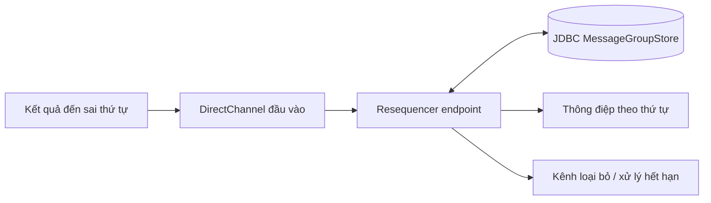

# Resequencer persistence

## Mục tiêu bài học

Trong chương **Message store** của **SPRING_INTEGRATION_CORE**, bài này tập trung vào việc lưu bền trạng thái của resequencer: endpoint giữ các thông điệp đến sai thứ tự rồi phát chúng theo thứ tự của chuỗi. Người học sẽ nối các khái niệm `Message`, `MessageChannel`, endpoint và Java DSL với một yêu cầu thực tế: ứng dụng khởi động lại mà vẫn tiếp tục được chuỗi đang xử lý.

Sau bài học, bạn có thể:

- Xác định dữ liệu nào cần tồn tại qua restart, bao gồm cả tiến độ đã phát.
- Cấu hình `JdbcMessageStore` cho resequencer bằng Java DSL.
- Phân biệt phát một đoạn liên tiếp với xử lý nhóm hết hạn.
- Thiết kế transaction, xử lý lỗi và kiểm thử phục hồi phù hợp với luồng tích hợp.

Các ví dụ dùng API của **Spring Integration 6.5.x**, đối chiếu với tài liệu và mã nguồn 6.5.10. Đây là mốc minh họa để các tên lớp và phương thức nhất quán; phiên bản thư viện thực tế phải theo BOM hoặc dependency management của ứng dụng.

## 1. Vì sao resequencer cần persistence?

Giả sử một lần xử lý vận đơn tạo ra bốn phần kết quả, đánh số từ `1` đến `4`. Các worker chạy song song nên kết quả có thể về theo thứ tự:

```text
Thứ tự đến:   3, 1, 4, 2
Thứ tự cần:   1, 2, 3, 4
Correlation:  shipment:SHP-42:run-7
```

Resequencer gom thông điệp theo correlation key và quyết định lúc nào có thể phát. Với chiến lược mặc định, thông tin thứ tự nằm trong các header `CORRELATION_ID`, `SEQUENCE_NUMBER` và `SEQUENCE_SIZE`. Kết quả vẫn là các thông điệp riêng lẻ, thay vì một thông điệp tổng hợp như aggregator. Xem [Resequencer](https://docs.spring.io/spring-integration/reference/6.5/resequencer.html).

Nếu endpoint giữ phần `3` trong bộ nhớ rồi JVM dừng, phần đó không tự xuất hiện trong lần chạy sau. Một broker đầu vào có thể đã xác nhận giao phần `3`, nên không thể mặc định trông chờ broker gửi lại.

Persistence đặt bộ đệm và trạng thái nhóm vào nơi lưu trữ sống lâu hơn tiến trình. Khi ứng dụng mới nhận phần còn thiếu, resequencer có cơ sở tiếp tục xử lý nhóm cũ.



Sơ đồ có hai đường ra vì bài toán còn bao gồm phần đến muộn, nhóm thiếu dữ liệu và lỗi giao tiếp. Ghi được thông điệp xuống database chỉ giải quyết một phần của quá trình phục hồi.

## 2. Trạng thái cần lưu gồm những gì?

Chỉ lưu payload chưa đủ. Hãy nhìn nhóm từ góc độ một tiến trình vừa khởi động:

| Thành phần | Ý nghĩa khi tiếp tục xử lý |
| --- | --- |
| Correlation key | Ghép phần mới vào đúng lần xử lý cũ |
| Thông điệp đang chờ | Giữ các phần đã nhận nhưng chưa phát |
| Header thứ tự | Biết vị trí và kích thước chuỗi |
| Số thứ tự đã phát gần nhất | Biết phần tiếp theo cần có |
| Cờ hoàn tất của nhóm | Phân biệt nhóm còn mở với nhóm đã đóng |
| Thời điểm tạo, cập nhật | Phục vụ chính sách hết hạn và dọn nhóm |

Ví dụ, trước khi ứng dụng dừng:

```text
Đã phát:                 1
Còn trong nhóm:          3
Last released sequence:  1
Phần tiếp theo cần:      2
```

Nếu sau restart vẫn có phần `3` nhưng tiến độ trở thành `0`, endpoint có thể chờ phần `1` dù phần đó đã được chuyển xuống dưới. Vì vậy tiến độ phát là dữ liệu nghiệp vụ của bộ sắp xếp.

Ở nhánh phát từng đoạn, `ResequencingMessageHandler` cập nhật tiến độ qua `setLastReleasedSequenceNumberForGroup(...)` rồi loại các thông điệp đã phát khỏi nhóm. Khi đọc nhóm, `JdbcMessageStore` khôi phục giá trị này từ metadata. Xem [ResequencingMessageHandler](https://github.com/spring-projects/spring-integration/blob/v6.5.10/spring-integration-core/src/main/java/org/springframework/integration/aggregator/ResequencingMessageHandler.java) và [JdbcMessageStore](https://github.com/spring-projects/spring-integration/blob/v6.5.10/spring-integration-jdbc/src/main/java/org/springframework/integration/jdbc/store/JdbcMessageStore.java).

Từ các cơ chế đó, có thể rút ra yêu cầu thiết kế: một store tự viết cho resequencer phải thực hiện đúng hợp đồng của `MessageGroupStore`, bao gồm metadata và thao tác cập nhật nhóm, thay vì chỉ có thao tác lưu/đọc message.

### Phạm vi của correlation key

Key cần ổn định qua restart và đủ riêng biệt giữa các lần chạy:

```text
shipment:SHP-42:run-7
shipment:SHP-42:run-8
```

Hai lần chạy có thể cùng vận đơn nhưng không phải cùng chuỗi. Nếu dùng một key cho cả hai, phần `2` của lần chạy mới có thể gặp trạng thái của lần cũ.

Tương tự, tạo correlation key ngẫu nhiên mỗi lần nhận lại một phần sẽ khiến các phần không gặp nhau. Hãy mang định danh lần xử lý từ nguồn hoặc lưu nó theo một quy tắc có thể khôi phục.

## 3. Hai chế độ phát và tác động đến trạng thái

### 3.1. Chờ đủ toàn bộ chuỗi

Với `releasePartialSequences(false)`, nhóm có kích thước mong đợi `4` chờ đến khi có đủ chuỗi hợp lệ. Giả sử đầu vào không trùng và các header nhất quán:

| Thông điệp đến | Các phần đang giữ | Phát ra |
| --- | --- | --- |
| 3 | 3 | Chưa phát |
| 1 | 1, 3 | Chưa phát |
| 4 | 1, 3, 4 | Chưa phát |
| 2 | Đủ 1, 2, 3, 4 | 1, 2, 3, 4 |

Chế độ này thích hợp khi consumer chỉ nên bắt đầu sau khi đã tập hợp đủ kết quả. Đổi lại, một phần thất lạc có thể giữ cả nhóm lại.

### 3.2. Phát ngay đoạn liên tiếp

Với `releasePartialSequences(true)`, resequencer có thể phát đoạn liên tiếp bắt đầu ngay sau vị trí đã phát:

| Thông điệp đến | Phát ra trong lượt này | Còn chờ | Tiến độ đã phát |
| --- | --- | --- | --- |
| 3 | Chưa phát | 3 | 0 |
| 1 | 1 | 3 | 1 |
| 4 | Chưa phát | 3, 4 | 1 |
| 2 | 2, 3, 4 | Không còn thông điệp chờ | 4 |

Điểm quyết định là sự liên tiếp. Có phần `3` và `4` chưa đủ để vượt qua phần `2` đang thiếu. Logic mặc định kết hợp `SequenceSizeReleaseStrategy` để xét điểm bắt đầu và `ResequencingMessageGroupProcessor` để lấy đoạn có thể phát. Xem [release strategy](https://github.com/spring-projects/spring-integration/blob/v6.5.10/spring-integration-core/src/main/java/org/springframework/integration/aggregator/SequenceSizeReleaseStrategy.java) và [group processor](https://github.com/spring-projects/spring-integration/blob/v6.5.10/spring-integration-core/src/main/java/org/springframework/integration/aggregator/ResequencingMessageGroupProcessor.java).

Sau lần phát từng đoạn, nhóm có thể rỗng thông điệp nhưng vẫn chứa tiến độ cần thiết. Không được suy luận `group.size() == 0` đồng nghĩa có thể xóa nhóm ngay.

### 3.3. Phát từng đoạn khác với phát khi hết hạn

Hai tùy chọn giải quyết hai thời điểm khác nhau:

| Tùy chọn | Câu hỏi nó trả lời |
| --- | --- |
| `releasePartialSequences` | Khi luồng đang chạy bình thường, có phát ngay đoạn liên tiếp không? |
| `sendPartialResultOnExpiry` | Khi nhóm bị buộc kết thúc, có thử gửi kết quả còn có thể tạo ra không? |

Bật phát từng đoạn không tự cho phép phát kết quả thiếu khi timeout. Trong ví dụ của bài, bật tùy chọn thứ nhất và tắt tùy chọn thứ hai để quan sát riêng hai hành vi.

Cũng không nên tùy tiện thay release strategy bằng `group -> group.size() >= 2`: số lượng phần không chứng minh chuỗi liên tiếp. Với API 6.5.x, bật partial sequences còn yêu cầu strategy tương thích với `SequenceSizeReleaseStrategy`. Cấu hình tương quan và phát nằm trên [CorrelationHandlerSpec](https://github.com/spring-projects/spring-integration/blob/v6.5.10/spring-integration-core/src/main/java/org/springframework/integration/dsl/CorrelationHandlerSpec.java).

## 4. Chuẩn hóa thông điệp trước khi lưu

Một hợp đồng đầu vào đơn giản có thể yêu cầu:

- Correlation key có giá trị, giữ nguyên cho một lần xử lý.
- `SEQUENCE_NUMBER` là số nguyên bắt đầu từ `1`.
- `SEQUENCE_SIZE` là số nguyên dương, thống nhất trong nhóm.
- Số thứ tự không vượt kích thước chuỗi.
- Mỗi vị trí biểu diễn cùng một phần nghiệp vụ khi được gửi lại.

Hàm sau tạo dữ liệu minh họa bằng payload `String`, tránh đưa các đối tượng phụ thuộc tiến trình vào message:

```java
import org.springframework.integration.IntegrationMessageHeaderAccessor;
import org.springframework.messaging.Message;
import org.springframework.messaging.support.MessageBuilder;

public final class LessonMessages {

    private LessonMessages() {
    }

    public static Message<String> part(String correlationKey,
                                       int number,
                                       int size) {
        if (correlationKey == null || correlationKey.isBlank()) {
            throw new IllegalArgumentException("Correlation key is required");
        }
        if (size < 1 || number < 1 || number > size) {
            throw new IllegalArgumentException("Invalid sequence");
        }

        return MessageBuilder.withPayload("part-" + number)
                .setHeader(
                        IntegrationMessageHeaderAccessor.CORRELATION_ID,
                        correlationKey)
                .setHeader(
                        IntegrationMessageHeaderAccessor.SEQUENCE_NUMBER,
                        number)
                .setHeader(
                        IntegrationMessageHeaderAccessor.SEQUENCE_SIZE,
                        size)
                .build();
    }
}
```

Trong ứng dụng, transformer có thể chuyển dữ liệu nguồn về DTO; filter kiểm tra tính hợp lệ; router đưa thông điệp sai sang kênh xử lý riêng trước khi vào resequencer. Đây là đề xuất tổ chức luồng cho ví dụ, không phải một bước mà resequencer tự thực hiện thay bạn.

Nếu filter loại phần `2` nhưng các phần còn lại vẫn khai báo `SEQUENCE_SIZE = 4`, nhóm sẽ có một khoảng trống thực sự. Đừng sửa kích thước thành `3` một cách cơ học: cần xác định lại hợp đồng thứ tự hoặc đánh dấu lần xử lý thất bại.

## 5. Chọn JDBC store và chuẩn bị database

Resequencer cần `MessageGroupStore`. Trong ví dụ JDBC, dùng `JdbcMessageStore` để lưu nhóm. `JdbcChannelMessageStore` dành cho các message channel được lưu bền và không thay thế trực tiếp store của endpoint này. Việc dùng JDBC cho một `QueueChannel` đầu vào cũng không tự làm bộ đệm nội bộ của resequencer trở nên bền vững. Xem [JDBC Message Store](https://docs.spring.io/spring-integration/reference/6.5/jdbc/message-store.html).

Ví dụ độc lập dưới đây giả định ứng dụng đã có:

| Thành phần | Mục đích |
| --- | --- |
| `spring-integration-core` | Endpoint, channel và Java DSL |
| `spring-integration-jdbc` | JDBC message store |
| `DataSource` và JDBC driver | Kết nối database bền vững |
| Spring JDBC và transaction support | Khởi tạo schema, quản lý transaction |
| JUnit Jupiter, H2 ở môi trường test | Chạy kịch bản mở lại context |

Các phiên bản phải đồng bộ theo dependency management của ứng dụng. Ví dụ không giả định repository đang dùng một phiên bản Spring Boot cụ thể.

### Schema phải có trước khi endpoint chạy

Trong JAR `spring-integration-jdbc`, script mẫu nằm ở:

```text
org/springframework/integration/jdbc/schema-h2.sql
org/springframework/integration/jdbc/schema-postgresql.sql
```

Dùng script tương ứng database và phiên bản thư viện để tạo schema ban đầu; quản lý thay đổi bằng migration trong môi trường vận hành. Không chạy script xóa/tạo lại bảng mỗi lần ứng dụng khởi động.

Với prefix mặc định, các bảng liên quan đến nhóm JDBC gồm `INT_MESSAGE`, `INT_MESSAGE_GROUP` và `INT_GROUP_TO_MESSAGE`. Có thể quan sát metadata bằng truy vấn chỉ đọc:

```sql
SELECT GROUP_KEY,
       REGION,
       COMPLETE,
       LAST_RELEASED_SEQUENCE,
       CREATED_DATE,
       UPDATED_DATE
FROM INT_MESSAGE_GROUP
WHERE REGION = 'si-core.resequencer.shipment.v1';
```

`GROUP_KEY` trong store có thể là giá trị đã được chuyển đổi, không phải nguyên văn correlation key nghiệp vụ. Dùng API của store để tra theo key ứng dụng; không tự cập nhật các bảng nội bộ để “đẩy tiếp” một nhóm.

### Giữ ổn định không gian lưu trữ

Ứng dụng sau restart phải trỏ về cùng database, schema, table prefix và `region` của lần trước. Đổi một trong các giá trị đó có thể khiến trạng thái cũ vẫn nằm trong database nhưng flow mới không nhìn thấy.

Trong ví dụ, `region` được đặt cố định theo chức năng, không theo tên pod. Các endpoint không liên quan nên có vùng lưu trữ riêng để tránh trộn nhóm có cùng correlation key.

## 6. Cấu hình Java DSL có persistence và transaction

Cấu hình sau dành cho **một application instance**. Hai `QueueChannel` đầu ra giúp quan sát kết quả trong bài thực hành; chúng lưu trong bộ nhớ. Phạm vi được lưu bền trong ví dụ là nhóm của resequencer.

```java
import java.time.Duration;

import javax.sql.DataSource;

import org.springframework.context.annotation.Bean;
import org.springframework.context.annotation.Configuration;
import org.springframework.integration.channel.DirectChannel;
import org.springframework.integration.channel.QueueChannel;
import org.springframework.integration.config.EnableIntegration;
import org.springframework.integration.dsl.IntegrationFlow;
import org.springframework.integration.jdbc.store.JdbcMessageStore;
import org.springframework.integration.transaction.TransactionInterceptorBuilder;
import org.springframework.jdbc.datasource.DataSourceTransactionManager;
import org.springframework.transaction.PlatformTransactionManager;
import org.springframework.transaction.interceptor.TransactionInterceptor;

@Configuration
@EnableIntegration
public class PersistentResequencerConfig {

    @Bean
    public PlatformTransactionManager resequencerTransactionManager(
            DataSource dataSource) {
        return new DataSourceTransactionManager(dataSource);
    }

    @Bean
    public JdbcMessageStore resequencerStore(DataSource dataSource) {
        JdbcMessageStore store = new JdbcMessageStore(dataSource);
        store.setRegion("si-core.resequencer.shipment.v1");
        store.setTimeoutOnIdle(true);
        return store;
    }

    @Bean
    public DirectChannel resequenceInput() {
        return new DirectChannel();
    }

    @Bean
    public QueueChannel orderedOutput() {
        return new QueueChannel();
    }

    @Bean
    public QueueChannel resequenceDiscard() {
        return new QueueChannel();
    }

    @Bean
    public TransactionInterceptor expiryTransactionAdvice(
            PlatformTransactionManager resequencerTransactionManager) {
        return new TransactionInterceptorBuilder()
                .transactionManager(resequencerTransactionManager)
                .build();
    }

    @Bean
    public IntegrationFlow persistentResequencerFlow(
            JdbcMessageStore resequencerStore,
            PlatformTransactionManager resequencerTransactionManager,
            TransactionInterceptor expiryTransactionAdvice) {

        return IntegrationFlow.from("resequenceInput")
                .resequence(r -> r
                                .messageStore(resequencerStore)
                                .releasePartialSequences(true)
                                .groupTimeout(60_000L)
                                .sendPartialResultOnExpiry(false)
                                .expireGroupsUponTimeout(false)
                                .discardChannel("resequenceDiscard")
                                .expireTimeout(300_000L)
                                .expireDuration(Duration.ofSeconds(30))
                                .forceReleaseAdvice(expiryTransactionAdvice),
                        e -> e.transactional(
                                resequencerTransactionManager))
                .channel("orderedOutput")
                .get();
    }
}
```

Đây là cách gắn store vào endpoint bằng lambda của Java DSL; các mẫu DSL tương ứng được mô tả tại [Aggregators and Resequencers](https://docs.spring.io/spring-integration/reference/6.5/dsl/java-aggregators.html). Phương thức `transactional(...)` của endpoint tạo transaction advice cho handler; xem [ConsumerEndpointSpec](https://github.com/spring-projects/spring-integration/blob/v6.5.10/spring-integration-core/src/main/java/org/springframework/integration/dsl/ConsumerEndpointSpec.java).

Các tham số có vai trò khác nhau:

| Cấu hình | Vai trò trong ví dụ |
| --- | --- |
| `messageStore(...)` | Thay bộ đệm mặc định bằng JDBC group store |
| `releasePartialSequences(true)` | Cho phép phát đoạn liên tiếp trong xử lý thường |
| `groupTimeout(60_000L)` | Đặt thời gian chờ cho tác vụ kết thúc nhóm đang chờ |
| `sendPartialResultOnExpiry(false)` | Chọn đường loại bỏ nếu nhóm hết hạn mà không đủ điều kiện phát |
| `expireGroupsUponTimeout(false)` | Giữ metadata nhóm đã đóng sau nhánh timeout phù hợp |
| `expireTimeout(300_000L)` | Ngưỡng để rà soát nhóm cũ còn nằm trong store |
| `expireDuration(...)` | Chu kỳ thực hiện việc rà soát |
| `forceReleaseAdvice(...)` | Transaction riêng cho thao tác buộc kết thúc |

Các giá trị một phút, năm phút và ba mươi giây chỉ để minh họa các cơ chế. Khi triển khai, chọn chúng từ độ trễ hợp lệ của nguồn và chính sách xử lý chuỗi thiếu.

`setTimeoutOnIdle(true)` khiến việc hết hạn do quét store dựa vào lần cập nhật gần nhất khi có giá trị này. Mặc định của cơ chế quét store dựa vào tuổi từ lúc tạo nhóm. Đây là cấu hình của store, khác với việc lên lịch `groupTimeout` khi xử lý thông điệp. Xem [AbstractMessageGroupStore](https://github.com/spring-projects/spring-integration/blob/v6.5.10/spring-integration-core/src/main/java/org/springframework/integration/store/AbstractMessageGroupStore.java).

## 7. Kiểm thử tiếp tục chuỗi sau khi mở lại context

Một kiểm thử dùng hai store trong cùng context chưa chứng minh đường khởi động lại của endpoint. Kịch bản dưới đây đóng context thứ nhất, tạo context thứ hai trên cùng H2 file database rồi gửi phần còn thiếu.

Đặt `LessonMessages` và `PersistentResequencerConfig` từ các ví dụ trước trong cùng package của bài thử. Test cần JUnit Jupiter và H2 trên test classpath.

```java
import java.nio.file.Path;

import javax.sql.DataSource;

import org.junit.jupiter.api.Test;
import org.junit.jupiter.api.io.TempDir;

import org.springframework.context.annotation.AnnotationConfigApplicationContext;
import org.springframework.core.io.ClassPathResource;
import org.springframework.integration.channel.DirectChannel;
import org.springframework.integration.channel.QueueChannel;
import org.springframework.integration.jdbc.store.JdbcMessageStore;
import org.springframework.integration.store.MessageGroup;
import org.springframework.jdbc.datasource.DriverManagerDataSource;
import org.springframework.jdbc.datasource.init.ResourceDatabasePopulator;
import org.springframework.messaging.Message;

import static org.junit.jupiter.api.Assertions.*;

class PersistentResequencerRestartTest {

    @TempDir
    Path databaseDirectory;

    @Test
    void continuesWithPersistedBufferAndProgress() {
        String databasePath = databaseDirectory
                .resolve("resequence-db")
                .toAbsolutePath()
                .toString()
                .replace('\\', '/');

        DataSource dataSource = new DriverManagerDataSource(
                "jdbc:h2:file:" + databasePath, "sa", "");

        // Chỉ tạo schema một lần cho database mới của test.
        new ResourceDatabasePopulator(new ClassPathResource(
                "org/springframework/integration/jdbc/schema-h2.sql"))
                .execute(dataSource);

        String key = "shipment:SHP-42:run-7";

        try (var first = openContext(dataSource)) {
            DirectChannel input =
                    first.getBean("resequenceInput", DirectChannel.class);
            QueueChannel output =
                    first.getBean("orderedOutput", QueueChannel.class);
            JdbcMessageStore store =
                    first.getBean(JdbcMessageStore.class);

            assertTrue(input.send(LessonMessages.part(key, 1, 4)));
            assertEquals("part-1", takePayload(output));

            assertTrue(input.send(LessonMessages.part(key, 3, 4)));
            assertNull(output.receive(0));

            MessageGroup group = store.getMessageGroup(key);
            assertEquals(1, group.size());
            assertEquals(1,
                    group.getLastReleasedMessageSequenceNumber());
        }

        try (var second = openContext(dataSource)) {
            DirectChannel input =
                    second.getBean("resequenceInput", DirectChannel.class);
            QueueChannel output =
                    second.getBean("orderedOutput", QueueChannel.class);
            JdbcMessageStore store =
                    second.getBean(JdbcMessageStore.class);

            // Xác nhận trạng thái đã có trước khi gửi phần mới.
            MessageGroup restored = store.getMessageGroup(key);
            assertEquals(1, restored.size());
            assertEquals(1,
                    restored.getLastReleasedMessageSequenceNumber());

            assertTrue(input.send(LessonMessages.part(key, 2, 4)));
            assertEquals("part-2", takePayload(output));
            assertEquals("part-3", takePayload(output));

            assertTrue(input.send(LessonMessages.part(key, 4, 4)));
            assertEquals("part-4", takePayload(output));
            assertNull(output.receive(0));
        }
    }

    private static AnnotationConfigApplicationContext openContext(
            DataSource dataSource) {
        var context = new AnnotationConfigApplicationContext();
        context.registerBean("dataSource", DataSource.class,
                () -> dataSource);
        context.register(PersistentResequencerConfig.class);
        context.refresh();
        return context;
    }

    private static Object takePayload(QueueChannel output) {
        Message<?> message = output.receive(1_000);
        assertNotNull(message, "Expected a resequenced message");
        return message.getPayload();
    }
}
```

Test kiểm tra đồng thời hai điều: phần `3` còn trong store và tiến độ `1` được khôi phục. Sau khi nhận phần `2`, endpoint phát `2, 3` mà không cần nhận lại phần `1`.

Đây là kiểm thử restart ở mức application context, có đóng ứng dụng có trật tự. Nó chưa mô phỏng tiến trình bị dừng giữa một transaction, mất kết nối database hoặc consumer gây tác dụng phụ rồi lỗi. Những tình huống đó cần kiểm thử tích hợp có chủ đích riêng.

## 8. Transaction bảo vệ phần nào của luồng?

Các thao tác lưu nhóm, cập nhật tiến độ và xóa các phần đã phát cần có ranh giới transaction phù hợp. Một handler có thể chạy đồng bộ trên `DirectChannel` trong transaction hiện tại; khi chuyển sang thread khác, ranh giới đó cần được xem xét lại. Tài liệu [Transaction Support](https://docs.spring.io/spring-integration/reference/6.5/transactions.html) giải thích cách transaction gắn với luồng thực thi.

Trong cấu hình trên:

1. Transaction ở endpoint bảo vệ các thao tác JDBC trong lượt xử lý thông điệp thông thường.
2. `forceReleaseAdvice` bảo vệ lượt buộc kết thúc được gọi từ lịch timeout hoặc cơ chế quét.
3. `QueueChannel` đầu ra vẫn là tài nguyên trong bộ nhớ, không tham gia rollback JDBC.

Điểm thứ ba rất quan trọng khi đọc kết quả kiểm thử. Nếu đã đưa phần `2` vào queue rồi database rollback, consumer có thể đã thấy phần `2` trong khi store vẫn ở trạng thái trước đó. Ngược lại, sau khi database commit và queue chưa được consumer đọc, JVM dừng có thể làm mất phần nằm ở queue.

### Phân tích các cửa sổ lỗi

Bảng dưới đây là suy luận thiết kế từ ví dụ, không phải cam kết giao nhận mặc định của framework:

| Thời điểm lỗi | Điều cần xem xét |
| --- | --- |
| Trước khi commit phần mới vào store | Nguồn có gửi lại phần đó không? |
| Sau khi commit bộ đệm nhưng trước khi nhận phần thiếu | Store có sống qua restart và còn đúng region không? |
| Sau khi đã gửi một số phần ra, trước khi commit tiến độ | Consumer có xử lý trùng an toàn không? |
| Sau khi commit tiến độ nhưng đầu ra còn trong RAM | Có đường giao nhận bền vững phía sau không? |
| Sau khi consumer thực hiện tác dụng phụ rồi báo lỗi | Có khóa idempotency hoặc transaction nghiệp vụ không? |

Vì vậy, persistence của resequencer không suy ra xử lý `exactly-once` đầu cuối. Khi cần bảo vệ đường giao tiếp, có thể thiết kế đầu ra bền vững hoặc một outbox trong cùng database, kết hợp consumer có khả năng nhận lại an toàn.

Một định danh nghiệp vụ như `eventId` thường hữu ích cho idempotency hơn việc dựa duy nhất vào ID kỹ thuật của một `Message` mới được tạo khi retry. Phải quy định rõ cùng một `eventId` có nghĩa là cùng tác dụng phụ nào và lưu kết quả kiểm tra ở đâu.

### Xác nhận đầu vào cũng là một ranh giới

Một `send(...)` thành công chỉ mang ý nghĩa của đường thực thi hiện tại. Với broker, thời điểm acknowledge cần được phối hợp với việc lưu bền; với một queue trong bộ nhớ trước resequencer, phần chưa được endpoint nhận vẫn có thể mất khi JVM dừng.

Thiết kế phục hồi nên vẽ cả điểm acknowledge đầu vào lẫn điểm commit đầu ra. Đây là cách tìm khoảng trống giữa các thành phần, thay vì chỉ kiểm tra database có bản ghi.

## 9. Restart, timeout và nhóm bị bỏ lại

### 9.1. Có dữ liệu không đồng nghĩa có một tác vụ đang đợi

Một group store lưu dữ liệu nhóm; tác vụ scheduler trong JVM là trạng thái khác. Sau restart, không nên giả định mọi lịch `groupTimeout` cũ được khôi phục từ database.

Nhóm có thể còn phần `3` nhưng không bao giờ nhận thêm phần `2`. Khi đó cần cơ chế rà soát nhóm cũ độc lập với sự xuất hiện của thông điệp mới.

Trong 6.5.x, cấu hình `expireTimeout` cùng `expireDuration` cho phép endpoint xử lý nhóm cũ khi khởi động và định kỳ. Đây là lý do ví dụ dùng cả timeout theo nhóm và quét nhóm mồ côi. Xem [quản lý nhóm hết hạn](https://docs.spring.io/spring-integration/reference/6.5/aggregator.html) và [AbstractCorrelatingMessageHandler](https://github.com/spring-projects/spring-integration/blob/v6.5.10/spring-integration-core/src/main/java/org/springframework/integration/aggregator/AbstractCorrelatingMessageHandler.java).

Thời gian xử lý thực tế còn phụ thuộc chu kỳ quét, lịch thực thi và thời gian khóa. Không diễn giải `expireTimeout = 300_000` thành một cam kết tác vụ luôn chạy đúng ở mili giây thứ `300_000`.

### 9.2. Hết hạn không tạo ra phần bị thiếu

Trong ví dụ, khi nhóm thiếu dữ liệu bị buộc kết thúc và không được release strategy cho phép phát, các thông điệp còn lại đi theo chính sách loại bỏ vì `sendPartialResultOnExpiry(false)`.

Đường loại bỏ cần có consumer và cách ghi nhận đủ dữ liệu để điều tra hoặc phục hồi. Queue minh họa trong bộ nhớ chưa phải nơi lưu lỗi bền vững. Có thể thay bằng luồng ghi database hoặc hạ tầng chuyển tiếp phù hợp, đồng thời kiểm thử lỗi ngay trên đường này.

Nếu nghiệp vụ cho phép gửi kết quả chưa đầy đủ, cần mô tả chính xác consumer sẽ hiểu các vị trí thiếu như thế nào. Không coi việc bật `sendPartialResultOnExpiry(true)` là cách tái tạo phần thất lạc.

### 9.3. Nhóm đóng và thông điệp đến muộn

Cờ `expireGroupsUponTimeout(false)` giúp giữ metadata của nhóm đã đóng sau timeout để từ chối phần đến muộn. Nếu xóa toàn bộ dấu vết, cùng correlation key có thể mở một nhóm mới. Đây là hành vi được mô tả tại [cấu hình timeout của resequencer](https://docs.spring.io/spring-integration/reference/6.5/resequencer.html).

Từ đó có hai quyết định nghiệp vụ riêng:

- Giữ dấu vết bao lâu để nhận diện các phần đến muộn?
- Khi thực sự muốn chạy lại, dùng key lần xử lý mới hay khôi phục lần cũ theo một quy trình kiểm soát?

Không mặc định mọi nhóm sau một lần phát bình thường đều giữ cùng loại dấu vết. Đường hoàn tất toàn chuỗi và đường phát từng đoạn có thể dọn trạng thái khác nhau; kiểm thử đúng chế độ đang dùng. Cũng cần bảo đảm tác vụ dọn nhóm không xóa tiến độ của chuỗi vẫn được phép tiếp tục.

## 10. Nhiều instance: cùng database cần có khóa phối hợp

Một database dùng chung giúp các instance nhìn thấy cùng dữ liệu. Nó chưa làm toàn bộ chuỗi thao tác đọc nhóm, thêm phần, xét phát và cập nhật tiến độ trở thành một thao tác duy nhất.

`DefaultLockRegistry` là khóa cục bộ. Khi nhiều instance cùng xử lý một correlation key trong shared store, cần cơ chế phối hợp phù hợp; `JdbcLockRegistry` là một lựa chọn mà Spring Integration cung cấp cho trường hợp này. Xem [JDBC Lock Registry](https://docs.spring.io/spring-integration/reference/6.5/jdbc/lock-registry.html).

Ví dụ bổ sung bean:

```java
import javax.sql.DataSource;

import org.springframework.context.annotation.Bean;
import org.springframework.integration.jdbc.lock.DefaultLockRepository;
import org.springframework.integration.jdbc.lock.JdbcLockRegistry;

// Các bean này đặt trong lớp @Configuration của ứng dụng.
@Bean
public DefaultLockRepository resequencerLockRepository(
        DataSource dataSource) {
    DefaultLockRepository repository =
            new DefaultLockRepository(dataSource);
    repository.setRegion("si-core-resequence-locks");
    return repository;
}

@Bean
public JdbcLockRegistry resequencerLockRegistry(
        DefaultLockRepository resequencerLockRepository) {
    return new JdbcLockRegistry(resequencerLockRepository);
}
```

Sau đó truyền registry vào phương thức tạo flow và thêm `.lockRegistry(resequencerLockRegistry)` trong lambda `r -> ...` của resequencer.

Các instance phối hợp cùng nhóm phải dùng cùng không gian khóa; mỗi tiến trình cần định danh chủ sở hữu riêng. Schema khóa phải được tạo trước khi dùng. Thời hạn khóa và cơ chế gia hạn cần tương ứng thời gian xử lý thực tế.

Khóa phối hợp không thay thế transaction hoặc idempotency. Nếu bước sau resequencer lại đưa thông điệp vào executor chạy song song, thứ tự bắt đầu hay hoàn tất tác dụng phụ vẫn có thể khác thứ tự phát. Nếu nghiệp vụ yêu cầu thứ tự xử lý theo vận đơn, cần giữ quy tắc đó ở cả consumer phía sau.

## 11. Serialization, gateway và lỗi

### 11.1. Payload phải đọc lại được sau restart

Store JDBC mặc định dựa trên serialization; payload cần tương thích, còn header không serializable có thể bị loại trước khi lưu. Không nên đặt connection, stream hoặc đối tượng gắn với request đang mở vào message cần tồn tại lâu. Xem [Message Store và serialization](https://docs.spring.io/spring-integration/reference/6.5/message-store.html).

Với DTO nghiệp vụ, hãy kiểm thử đọc dữ liệu do phiên bản ứng dụng trước tạo ra. Thay đổi tên lớp, kiểu dữ liệu hoặc quy tắc serializer có thể chỉ lộ lỗi khi đọc một nhóm cũ, dù các nhóm mới vẫn chạy.

Ví dụ dùng `String` để tập trung vào cơ chế resequencer. Nó không thay thế thiết kế định dạng dữ liệu dài hạn cho một hệ thống triển khai nhiều phiên bản.

### 11.2. Không kéo dài vòng đời request bằng persistence

Một synchronous gateway có thể tạo reply channel tạm thời gắn với lời gọi hiện tại. JVM restart làm mất lời gọi đang chờ; lưu message không hồi sinh được caller đó.

Khi thời gian chờ chuỗi có thể vượt vòng đời request, một thiết kế phù hợp cho ví dụ là trả về định danh xử lý rồi thông báo kết quả bất đồng bộ hoặc cho phép truy vấn trạng thái. Đặt rõ output channel ổn định như trong cấu hình giúp tránh phụ thuộc vào đường trả lời tạm thời.

`HeaderChannelRegistry` hỗ trợ ánh xạ header channel trong một số tình huống serialization, nhưng không được hiểu là phục hồi một thread hay một yêu cầu HTTP đã kết thúc.

### 11.3. Phân biệt loại bỏ với exception

`discardChannel` là đường xử lý thông điệp bị loại theo chính sách nhóm. Exception có thể phát sinh từ JDBC, serializer hoặc consumer, và cần cơ chế xử lý lỗi của luồng tương ứng.

Ví dụ, với `DirectChannel`, exception có thể truyền về bên gọi `send(...)`. Với tác vụ chạy nền, cần quan sát lỗi của scheduler hoặc poller đã cấu hình. Không giả định mọi lỗi đều tự chuyển thành một thông điệp trên discard channel.

Retry cũng cần giữ nguyên correlation key và định danh nghiệp vụ. Tạo một chuỗi mới cho mỗi lần retry có thể che mất lỗi lưu trữ bằng cách phân tán các phần sang nhiều nhóm.

## 12. Các kịch bản kiểm thử và quan sát cần có

Ngoài test mở lại context ở trên, nên bổ sung các tình huống theo hợp đồng thực tế:

| Kịch bản | Điều phải kiểm tra |
| --- | --- |
| Nhận đủ nhưng sai thứ tự | Đầu ra theo số thứ tự trong từng nhóm |
| Hai correlation key xen kẽ | Các phần không trộn giữa hai nhóm |
| Restart trước lần phát đầu tiên | Thông điệp đang chờ vẫn còn |
| Restart sau một lần phát từng đoạn | Bộ đệm và tiến độ đều được khôi phục |
| Không có phần mới sau restart | Cơ chế quét cuối cùng xử lý nhóm cũ |
| Một phần đến hai lần | Hành vi trùng vị trí và idempotency đúng hợp đồng |
| Timeout rồi phần còn thiếu mới đến | Đường loại bỏ và thời gian giữ dấu vết đúng |
| Consumer lỗi sau khi nhận một phần | Không giả định rollback có thể thu hồi tác dụng phụ |
| Database gián đoạn | Không acknowledge sớm và không tăng tiến độ sai |
| Hai instance nhận cùng nhóm | Khóa phối hợp bảo vệ thao tác nhóm |
| Nâng cấp ứng dụng khi còn nhóm chờ | Dữ liệu cũ vẫn deserializable |

Các chỉ số có ích cho ví dụ vận đơn gồm số nhóm đang chờ, số thông điệp đệm, tuổi nhóm lâu nhất, số lượt hết hạn, số thông điệp bị loại và độ trễ từ lúc nhận đến lúc phát.

Log nên có correlation key, số thứ tự và định danh nghiệp vụ để nối được các phần sau restart. Hạn chế ghi nguyên payload nếu không cần thiết cho điều tra.

Cần phân biệt số thông điệp đang giữ với số bản ghi nhóm: một nhóm rỗng có thể vẫn lưu tiến độ hoặc dấu vết đóng nhóm. Chỉ theo dõi tổng message count sẽ bỏ sót việc metadata tăng liên tục.

Về hiệu năng, nên đo số phần mỗi nhóm và mức phân tán khoảng trống. Resequencer phù hợp với các chuỗi tương đối ngắn, khoảng trống nhỏ; nhóm rất lớn hoặc thiếu nhiều vị trí cần đánh giá kiến trúc và chi phí sắp xếp/truy xuất riêng.

## 13. Những lỗi thiết kế thường gặp

| Cách làm | Hệ quả trong kịch bản của bài | Hướng xử lý |
| --- | --- | --- |
| Dùng database trong bộ nhớ để chứng minh restart tiến trình | Dữ liệu có thể mất cùng JVM | Dùng database tồn tại ngoài tiến trình hoặc H2 file khi thử |
| Khởi tạo lại schema ở lần chạy thứ hai | Xóa trạng thái cần kiểm tra | Tạo schema một lần, giữ dữ liệu giữa hai lần chạy |
| Gắn store vào queue nhưng bỏ qua resequencer | Nhóm chờ vẫn có thể ở RAM | Gắn `MessageGroupStore` trực tiếp vào endpoint |
| Đổi region theo pod | Instance mới không thấy nhóm cũ | Dùng namespace chức năng ổn định |
| Xóa mọi nhóm có size bằng 0 | Có thể mất tiến độ hoặc dấu vết | Dọn theo vòng đời và chính sách retention |
| Dùng lại key cho lần chạy khác | Trộn phần hoặc gặp trạng thái cũ | Thêm định danh lần xử lý |
| Chỉ kiểm tra thứ tự ở channel đầu ra | Consumer song song vẫn có thể hoàn tất sai thứ tự | Kiểm tra cả tác dụng phụ nghiệp vụ |
| Cho rằng lưu bền đã loại bỏ mọi thông điệp trùng | Retry có thể lặp tác dụng phụ | Thiết kế idempotency ở nơi thực hiện tác dụng phụ |

Khi triển khai một resequencer có persistence, hãy xác định rõ bốn điểm: **trạng thái được lưu ở đâu, tiến độ được commit lúc nào, nhóm bỏ lại được xử lý ra sao và consumer nhận lại thông điệp có an toàn không**. Các quyết định này gắn message store với toàn bộ luồng tích hợp và tạo ra một kịch bản phục hồi có thể kiểm thử.
