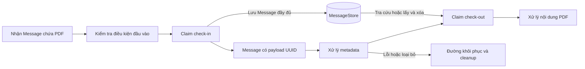

# Claim check pattern

## 1. Mục tiêu và bối cảnh

Trong chương **Message store** của module **SPRING_INTEGRATION_CORE**, Claim Check giúp thiết kế đoạn luồng chỉ cần metadata nhưng đang phải mang theo payload lớn. Thông điệp đầy đủ được gửi vào một kho lưu trữ; luồng tiếp tục với mã tham chiếu và lấy lại dữ liệu khi đến bước cần xử lý nội dung.

Sau bài học, bạn có thể:

- Xác định vị trí check-in và check-out trong một `IntegrationFlow`.
- Phân biệt mã claim check, `MessageHeaders.ID` và mã định danh nghiệp vụ.
- Cấu hình bằng Java DSL, lựa chọn `MessageStore` và chính sách xóa.
- Thiết kế đường lỗi, retry và dọn dữ liệu khi thông điệp không đi đến check-out.
- Viết kiểm thử cho payload, header và vòng đời dữ liệu trong store.

Các ví dụ Java dùng Java 17 và API Spring Integration 6.5.0 làm mốc minh họa. Dự án thực tế cần quản lý phiên bản các dependency theo BOM đang sử dụng. Bài học tập trung vào cơ chế cốt lõi; broker, object storage và giao dịch được nhắc đến ở các điểm ảnh hưởng trực tiếp đến tính đúng đắn của luồng.

## 2. Bài toán: nhiều bước chỉ cần thông tin trên phong bì

Giả sử dịch vụ tiếp nhận hồ sơ nhận một `Message<byte[]>` chứa tài liệu PDF dung lượng 12 MiB. Header có:

| Header nghiệp vụ | Giá trị ví dụ | Mục đích |
| --- | --- | --- |
| `documentId` | `DOC-2026-001` | Theo dõi một hồ sơ trong nghiệp vụ |
| `tenantId` | `tenant-a` | Xác định đơn vị sở hữu |
| `department` | `FINANCE` | Chọn tuyến xử lý |
| `documentType` | `PDF` | Chọn chính sách chấp nhận |
| `traceId` | `trace-001` | Liên kết log giữa các bước |

Các bước xác định tuyến, chọn mức ưu tiên và kiểm tra quyền theo tenant có thể chỉ cần header. Chỉ bước trích xuất nội dung mới cần đọc mảng byte.

Với Claim Check, đoạn xử lý metadata có dạng:

```text
Message<byte[]> → check-in → Message<UUID> → xử lý metadata
                → check-out → Message<byte[]> → đọc nội dung PDF
```

Ý tưởng gửi dữ liệu vào kho rồi truyền mã nhận lại dữ liệu được Spring Integration hỗ trợ qua hai transformer: incoming và outgoing claim check. [Tài liệu Claim Check](https://docs.spring.io/spring-integration/reference/claim-check.html).

Trong ví dụ này, lợi ích được kỳ vọng nằm ở đoạn có queue, serialize, ghi log hoặc truyền qua tiến trình khác. Nếu mọi endpoint đều nối bằng `DirectChannel` và chỉ chuyền cùng một tham chiếu object, cần đo trước khi thêm store: mỗi lần đi qua channel không mặc nhiên tạo thêm một bản sao PDF.

## 3. Check-in thực sự lưu và trả về điều gì?

Gọi thông điệp đầu vào là `M0`:

```text
M0.payload       = byte[] của tài liệu
M0.headers.id    = U0
M0.documentId    = DOC-2026-001
```

Với triển khai được đối chiếu ở Spring Integration 6.5.0, `ClaimCheckInTransformer` lấy `U0` từ header ID, gọi `store.addMessage(M0)` và trả `U0` làm payload mới. Store nhận **toàn bộ Message**, gồm payload và header. Mã claim không phải UUID được tạo riêng cho thao tác gửi kho. [Mã nguồn ClaimCheckInTransformer 6.5.0](https://raw.githubusercontent.com/spring-projects/spring-integration/v6.5.0/spring-integration-core/src/main/java/org/springframework/integration/transformer/ClaimCheckInTransformer.java).

Sau check-in, gọi thông điệp đang chạy trong luồng là `M1`:

| Thành phần | Vai trò |
| --- | --- |
| `M0.headers.id = U0` | Khóa tra cứu dữ liệu đã gửi vào store |
| `M1.payload = U0` | Claim check mà check-out cần nhận |
| `M1.headers.id` | ID của thông điệp đang lưu chuyển; không dùng thay cho payload claim |
| `documentId` | Khóa nghiệp vụ, có thể tồn tại qua nhiều lần gửi lại |
| `claimCheckId` nếu ứng dụng bổ sung | Bản sao mã claim trong header để đối soát hoặc cleanup |

Một lỗi dễ xảy ra là truyền `M1.headers.id` cho store thay vì `M1.payload`. Hãy coi payload UUID là hợp đồng của đoạn luồng giữa hai transformer.

Nếu retry tạo một Message mới từ cùng dữ liệu nghiệp vụ, thông điệp có thể nhận ID khác. Vì vậy `documentId` vẫn cần thiết khi chống xử lý trùng hoặc tìm lại hồ sơ sau sự cố; mã claim không thay thế được khóa nghiệp vụ ổn định.

### Header vẫn là một phần của thông điệp tham chiếu

Check-in không phải bước tự động loại bỏ header nhạy cảm. Nếu header chứa dữ liệu lớn hoặc thông tin cá nhân, việc thu nhỏ payload chưa giải quyết vấn đề đó.

Trong đoạn metadata, nên giữ các giá trị ngắn, có kiểu dữ liệu rõ ràng: chuỗi, số, mã tenant và mã theo dõi. Tránh nhét lại PDF, object graph lớn hoặc dữ liệu bí mật vào header. Những field dùng để quyết định tuyến cần có trước khi check-in, hoặc phải được bổ sung từ nguồn metadata phù hợp.

## 4. Check-out: khôi phục nội dung và hợp nhất header

`ClaimCheckOutTransformer` yêu cầu payload là một đối tượng `UUID`. Nó gọi `getMessage(id)` khi giữ dữ liệu, hoặc `removeMessage(id)` khi bật xóa. Không tìm thấy thông điệp là lỗi chuyển đổi. Sau khi lấy dữ liệu, transformer dùng thông điệp đã lưu làm nền rồi sao chép header hiện tại lên; header nghiệp vụ hiện tại được ưu tiên khi trùng tên. [Mã nguồn ClaimCheckOutTransformer 6.5.0](https://raw.githubusercontent.com/spring-projects/spring-integration/v6.5.0/spring-integration-core/src/main/java/org/springframework/integration/transformer/ClaimCheckOutTransformer.java).

Ví dụ thiết kế:

```text
Lúc check-in:
  payload      = PDF
  department   = FINANCE
  documentId   = DOC-2026-001

Ngay trước check-out:
  payload      = U0
  department   = AUDIT
  routingStage = REVIEWED

Sau check-out:
  payload      = PDF đã lưu
  department   = AUDIT
  documentId   = DOC-2026-001
  routingStage = REVIEWED
```

Sự ưu tiên này hữu ích khi luồng cập nhật tuyến xử lý. Với `tenantId` hoặc thông tin phân quyền, cần kiểm soát endpoint nào được phép thay đổi header để tránh dùng metadata do nguồn không đáng tin cậy cung cấp.

Cũng cần phân biệt “không có header” và “header đã bị xóa có chủ đích”. Do check-out dựng lại thông điệp từ bản trong store, header cũ vẫn có thể xuất hiện nếu chỉ bị bỏ khỏi thông điệp tham chiếu. Khi cần loại bỏ một header khỏi đầu ra, đặt bước `headerFilter` sau check-out hoặc chuẩn hóa toàn bộ tập header tại ranh giới nhận dữ liệu.

Không thiết kế kiểm thử dựa trên giả định toàn bộ header kỹ thuật, ID và timestamp phải giống nguyên trạng sau vòng biến đổi. Điều quan trọng là nội dung nghiệp vụ và chính sách header mà ứng dụng đã công bố.

## 5. Ranh giới trách nhiệm trong một luồng



Vai trò của các thành phần:

| Thành phần Spring Integration | Trách nhiệm trong thiết kế |
| --- | --- |
| `Message` | Mang payload và metadata của một bước |
| `MessageChannel` | Nối các endpoint; quyết định thêm về đồng bộ, bất đồng bộ hoặc đệm |
| Check-in endpoint | Chuyển từ dữ liệu đầy đủ sang tham chiếu |
| Router, filter, header enricher | Xử lý đoạn metadata theo hợp đồng đã chọn |
| Check-out endpoint | Chuyển lại từ tham chiếu sang dữ liệu đầy đủ |
| `MessageStore` | Cất giữ và cung cấp thông điệp theo mã claim |
| Gateway | Cung cấp giao diện gọi luồng; thời gian chờ phải phù hợp với vòng đời xử lý |

Đặt kiểm tra chắc chắn loại bỏ dữ liệu trước check-in giúp giảm bản ghi mồ côi. Nếu filter phải chạy sau check-in, nhánh discard cần biết ai chịu trách nhiệm kết thúc vòng đời bản ghi.

Một router ở đoạn metadata cần đọc header hoặc mã tham chiếu. Một transformer vốn nhận `byte[]` sẽ không tiếp tục hoạt động đúng nếu đặt trong đoạn đang mang `UUID`.

## 6. Ví dụ Java DSL hoàn chỉnh trong bộ nhớ

### 6.1. Dependency và giả định chạy

Ví dụ cần:

- `org.springframework.integration:spring-integration-core`.
- JUnit Jupiter và AssertJ khi chạy mã kiểm thử ở phần sau.
- Spring Context đi cùng hệ dependency tương thích.

Trong ứng dụng Spring Boot, có thể nhận dependency nền qua `spring-boot-starter-integration`. Không cần cài thêm module Java DSL riêng cho ví dụ này.

Cấu hình sau có một channel nhận dữ liệu và một `QueueChannel` giữ kết quả để kiểm tra. Các bước từ đầu vào đến check-out xử lý đồng bộ. Queue ở cuối chỉ làm nơi nhận kết quả trong bài thực hành.

### 6.2. Cấu hình

```java
package example.claimcheck;

import org.springframework.context.annotation.Bean;
import org.springframework.context.annotation.Configuration;
import org.springframework.integration.channel.DirectChannel;
import org.springframework.integration.channel.QueueChannel;
import org.springframework.integration.config.EnableIntegration;
import org.springframework.integration.dsl.IntegrationFlow;
import org.springframework.integration.store.MessageStore;
import org.springframework.integration.store.SimpleMessageStore;

@Configuration
@EnableIntegration
public class ClaimCheckFlowConfig {

    @Bean
    public MessageStore claimCheckStore() {
        return new SimpleMessageStore();
    }

    @Bean
    public DirectChannel documentsIn() {
        return new DirectChannel();
    }

    @Bean
    public QueueChannel processedDocuments() {
        return new QueueChannel(10);
    }

    @Bean
    public IntegrationFlow documentFlow(MessageStore claimCheckStore) {
        return IntegrationFlow.from("documentsIn")
                .<byte[]>filter(bytes -> bytes.length > 0)
                .claimCheckIn(claimCheckStore)
                .enrichHeaders(headers -> headers
                        .headerExpression("claimCheckId", "payload")
                        .header("processingStage", "METADATA_CHECKED"))
                .claimCheckOut(claimCheckStore, true)
                .channel("processedDocuments")
                .get();
    }
}
```

Java DSL có các overload `claimCheckIn(MessageStore)`, `claimCheckOut(MessageStore)` và `claimCheckOut(MessageStore, boolean)`; overload check-out không truyền boolean giữ `removeMessage=false`. [Java DSL API 6.5.0](https://docs.spring.io/spring-integration/docs/6.5.0/api/org/springframework/integration/dsl/BaseIntegrationFlowDefinition.html).

Luồng thực hiện lần lượt:

1. Loại mảng rỗng trước khi phát sinh dữ liệu trong store.
2. Lưu thông điệp đầy đủ và thay payload bằng UUID.
3. Sao chép UUID vào `claimCheckId`, đồng thời đánh dấu bước metadata.
4. Khôi phục payload và xóa bản đã lưu.
5. Đưa thông điệp kết quả vào `processedDocuments`.

`claimCheckId` và `processingStage` là header do ví dụ tự định nghĩa. Framework không yêu cầu các tên này.

Bước gắn `METADATA_CHECKED` chỉ minh họa vị trí xử lý header; ứng dụng cần thay bằng quy tắc xác thực hoặc định tuyến thật. Không dùng nhãn này để suy ra hồ sơ đã được phê duyệt nghiệp vụ.

### 6.3. Gửi một thông điệp mẫu

Đoạn sau chạy khi context đã khởi tạo cấu hình trên:

```java
byte[] pdf = new byte[] { 37, 80, 68, 70, 45 };

Message<byte[]> request = MessageBuilder.withPayload(pdf)
        .setHeader("documentId", "DOC-2026-001")
        .setHeader("tenantId", "tenant-a")
        .setHeader("department", "FINANCE")
        .build();

DirectChannel input =
        context.getBean("documentsIn", DirectChannel.class);
QueueChannel output =
        context.getBean("processedDocuments", QueueChannel.class);

input.send(request);
Message<?> result = output.receive(1_000);
```

Import bổ sung cho đoạn gửi: `org.springframework.messaging.Message` và `org.springframework.messaging.support.MessageBuilder`. Biến `context` là Spring application context đã chứa `ClaimCheckFlowConfig`.

Mảng năm byte chỉ là dữ liệu mô phỏng, không phải một file PDF hợp lệ. Ví dụ kiểm tra khả năng bảo toàn payload, không kiểm tra việc phân tích định dạng PDF.

Với một đầu vào hợp lệ, kết quả cần có payload cùng nội dung, `documentId` được giữ lại, `processingStage` đã xuất hiện và `claimCheckId` chứa UUID. Do bật xóa ở check-out, tra cứu UUID này trong store sẽ không còn dữ liệu.

Nếu gửi mảng rỗng, filter mặc định loại thông điệp nên sẽ không có kết quả ở output. Với hợp đồng request-reply, cần thiết kế phản hồi từ chối hoặc đường lỗi cụ thể để người gọi không chỉ chờ đến timeout.

### 6.4. Giới hạn của ví dụ tối giản

`SimpleMessageStore` giữ dữ liệu trong bộ nhớ của tiến trình, phù hợp cho minh họa; không cung cấp độ bền qua restart. [Message Store](https://docs.spring.io/spring-integration/reference/message-store.html).

Cấu hình cũng chưa có cơ chế điều tiết khi queue kết quả đầy. Khi mở rộng thành dịch vụ, cần định nghĩa timeout, tải tối đa và cách xử lý lỗi gửi kết quả. Đặc biệt, dữ liệu trong store đã bị xóa ở check-out trước khi endpoint tiếp theo hoàn tất công việc.

## 7. Chọn thời điểm xóa theo vòng đời nghiệp vụ

Tùy chọn `removeMessage` chỉ kiểm soát hành động của check-out. Hãy lựa chọn dựa trên việc ai còn cần dữ liệu và có thể phát lại ở đâu.

| Lựa chọn | Phù hợp khi | Việc ứng dụng phải xử lý thêm |
| --- | --- | --- |
| `false` | Cần đọc lại, retry từ mã claim hoặc nhiều nhánh cùng đọc | Xác định mốc thành công và cleanup |
| `true` | Lần đọc này là lần lấy cuối cùng theo thiết kế | Chấp nhận hoặc bù đắp rủi ro lỗi sau check-out |
| Giữ khi đọc, xóa riêng sau thành công | Cần retry mà chưa muốn mất bản dữ liệu gốc | Phối hợp trạng thái hoàn tất, idempotency và thao tác xóa |

Không xóa khi đã lấy xong có thể làm store tăng mãi, đặc biệt nguy hiểm khi dùng heap. Tài liệu gọi lựa chọn lấy và xóa là **Claim Once**, với giá trị mặc định của `remove-message` là `false`. [Claim Once](https://docs.spring.io/spring-integration/reference/claim-check.html#claim-once).

### 7.1. Xóa khi đọc chưa bảo đảm xử lý đúng một lần

Xem chuỗi sự kiện:

```text
1. Check-out lấy và xóa tài liệu U0.
2. Handler gọi hệ thống thanh toán hoặc ghi kết quả.
3. Handler gặp lỗi.
4. Cơ chế phát lại gửi lại mã U0.
5. Store không còn tài liệu.
```

Thao tác lấy và xóa diễn ra trước khi toàn bộ công việc nghiệp vụ thành công. Vì vậy không thể suy ra exactly-once cho cả luồng từ cờ `true`.

Nếu giao dịch JDBC bao phủ thao tác xóa và thay đổi dữ liệu nghiệp vụ trong cùng tài nguyên, rollback có thể giúp khôi phục trạng thái. Nhưng một lần gọi HTTP bên ngoài hoặc một broker độc lập không tự tham gia cùng giao dịch chỉ vì luồng có `MessageStore`.

Với nghiệp vụ cần phát lại bằng mã claim, có thể giữ dữ liệu ở check-out rồi xóa sau mốc hoàn tất đã ghi nhận bền vững. Khi thao tác nghiệp vụ đã thành công nhưng cleanup lỗi, lần thử lại phải nhận biết hồ sơ đã xử lý để tránh lặp tác dụng phụ.

### 7.2. Nhiều nhánh đọc cùng một claim

Giả sử hai nhánh audit và trích xuất cùng nhận `U0`. Nếu một nhánh xóa dữ liệu khi lấy, nhánh còn lại có thể thất bại.

Thiết kế cần một trong những cách:

- Cả hai nhánh chỉ đọc; một bên điều phối xóa sau khi mọi nhánh cần thiết hoàn tất.
- Khôi phục dữ liệu trước khi chia nhánh, nếu chi phí truyền payload chấp nhận được.
- Có bộ theo dõi số bên sử dụng hoặc trạng thái hoàn tất từng nhánh do ứng dụng quản lý.

Không dựa vào thứ tự chạy thường thấy trên máy phát triển để bảo đảm nhánh nào đọc trước. Nếu cần tính độc quyền giữa nhiều consumer, phải đánh giá giao dịch và đặc tính đồng thời của store cụ thể.

## 8. Dùng JDBC khi cần lưu bền vững

Để thay store trong ví dụ, thêm dependency `org.springframework.integration:spring-integration-jdbc` và driver cho cơ sở dữ liệu. **Thay thế** bean `claimCheckStore` hiện tại bằng bean sau; không khai báo đồng thời hai bean cùng tên.

```java
import javax.sql.DataSource;

import org.springframework.context.annotation.Bean;
import org.springframework.integration.jdbc.store.JdbcMessageStore;
import org.springframework.integration.store.MessageStore;

@Bean
public MessageStore claimCheckStore(DataSource dataSource) {
    JdbcMessageStore store = new JdbcMessageStore(dataSource);
    store.setRegion("document-claim-check");
    return store;
}
```

Bean này giả định đã có `DataSource` và schema tương thích với phiên bản thư viện. Spring Integration cung cấp script `schema-*.sql` trong module JDBC; `JdbcMessageStore` phục vụ claim check, còn `JdbcChannelMessageStore` được thiết kế chuyên cho message channel. [JDBC Message Store](https://docs.spring.io/spring-integration/reference/jdbc/message-store.html).

`setRegion` phân chia không gian lưu trữ logic của store. Các instance cần đọc cùng mã claim phải thống nhất region, schema và cơ sở dữ liệu. Nó không thay thế cơ chế phân quyền dữ liệu. [JdbcMessageStore API](https://docs.spring.io/spring-integration/api/org/springframework/integration/jdbc/store/JdbcMessageStore.html).

### 8.1. Dữ liệu serialize được mới thực sự đi qua ranh giới lưu trữ

Store bền vững đưa thêm ranh giới serialization. Với JDBC mặc định, payload phải phù hợp cơ chế Java serialization; một số header không serialize được sẽ bị loại. Tài liệu cũng lưu ý `replyChannel` và `errorChannel` dạng object là điểm cần xem xét khi lưu hoặc khôi phục message. [Giới hạn serialization của Message Store](https://docs.spring.io/spring-integration/reference/message-store.html).

Các quyết định cần làm rõ cho ví dụ tài liệu:

- Dùng `byte[]` hoặc biểu diễn tài liệu ổn định thay cho một `InputStream` đang mở.
- Không lưu kết nối JDBC, HTTP request hoặc bean xử lý vào payload.
- Xác định cách đọc dữ liệu cũ khi triển khai phiên bản model mới.
- Quy định header nào thực sự cần bền vững và header nào được tái tạo sau khi đọc.
- Nếu dùng serializer tùy chỉnh, kiểm tra cả thông điệp đã lưu và ứng dụng đọc nó.

Một luồng chạy được với `SimpleMessageStore` chưa chứng minh payload có thể serialize vào JDBC. Kiểm thử với store thật phải bao gồm khởi động lại hoặc tạo reader context mới.

### 8.2. Lưu bền vững không tự làm toàn bộ luồng bền vững

Sau khi check-in ghi database, UUID còn phải đến được bên xử lý tiếp. Nếu tiến trình dừng giữa hai thao tác, dữ liệu có thể tồn tại trong store nhưng không còn công việc nào giữ mã claim.

Ngược lại, nếu bên nhận quan sát được mã trước khi giao dịch lưu dữ liệu commit, check-out có thể báo thiếu dữ liệu.

Khi cần bảo đảm giao nhận, hãy thiết kế thứ tự commit, đường phát lại và cơ chế đối soát. Một phương án là ghi dữ liệu và bản ghi outbox trong cùng giao dịch database, sau đó phát tham chiếu từ outbox. Đây là thiết kế bổ sung của ứng dụng, không phải hành vi tự động của transformer.

## 9. Truyền mã claim qua broker hoặc dịch vụ khác

Hai instance cùng có một bean tên `claimCheckStore` không có nghĩa chúng chia sẻ dữ liệu. Nếu mỗi instance dùng `SimpleMessageStore` riêng, consumer nhận UUID từ instance khác vẫn không tìm thấy payload.

Để truyền tham chiếu qua ranh giới tiến trình, cần thống nhất:

| Điều cần thống nhất | Ví dụ quyết định |
| --- | --- |
| Kho dữ liệu | Cùng database, schema và region |
| Biểu diễn mã claim | UUID nội bộ, chuỗi UUID trên wire |
| Header được truyền | `documentId`, `tenantId`, metadata định tuyến cần thiết |
| Thời hạn giữ dữ liệu | Dài hơn thời gian xếp hàng và phát lại được phép |
| Cơ chế truy cập | Consumer chỉ được lấy tài liệu thuộc phạm vi được cấp |
| Khả năng đọc dữ liệu cũ | Serializer và model tương thích |

### Chuyển chuỗi trở lại UUID

Nếu adapter nhận mã dưới dạng chuỗi, hãy chuyển kiểu có chủ đích trước check-out:

```java
.<String, java.util.UUID>transform(java.util.UUID::fromString)
.claimCheckOut(claimCheckStore, false)
```

Đoạn này được chèn vào một `IntegrationFlow` đang nhận `String`. Nó không phù hợp khi payload thực tế đã là UUID hoặc vẫn là JSON envelope; cần giải mã envelope và kiểm tra hợp đồng trước.

Mã claim có định dạng UUID không đồng nghĩa người gửi được phép lấy dữ liệu. Nếu đưa mã vào API công khai, lớp truy cập phải kiểm tra người dùng, tenant và quyền sở hữu tài liệu.

### Trường hợp tài liệu quá lớn cho MessageStore

Có thể cân nhắc một thiết kế riêng: payload lưu ở object storage, còn thông điệp chứa key, checksum và metadata. Đây vẫn là cách áp dụng ý tưởng Claim Check, nhưng bộ transformer tích hợp sẵn không tự hiểu object key hoặc URL.

Thiết kế tùy chỉnh cần endpoint lưu/đọc, kiểm tra tính toàn vẹn và cleanup tương ứng. Không đưa một chuỗi URL vào `ClaimCheckOutTransformer` rồi kỳ vọng nó tải file; hợp đồng của transformer này là UUID và `MessageStore`.

## 10. Xử lý lỗi theo vị trí phát sinh

| Vị trí lỗi | Hậu quả cần xét | Hướng xử lý |
| --- | --- | --- |
| Ghi vào store thất bại | Chưa có claim hợp lệ để tiếp tục | Dừng luồng, retry lỗi hạ tầng phù hợp |
| Đã ghi store nhưng không chuyển được UUID | Có thể có bản ghi mồ côi | Phát lại hoặc đối soát các công việc chưa hoàn tất |
| Filter loại sau check-in | Dữ liệu còn nhưng không đến check-out | Dùng discard flow có chính sách cleanup |
| Check-out nhận sai kiểu payload | Vi phạm hợp đồng đoạn luồng | Chuẩn hóa kiểu, sửa mapping; tránh retry vô hạn |
| Không tìm thấy UUID | Sai kho, đã xóa, hết hạn hoặc mất dữ liệu | Phân loại nguyên nhân trước khi quyết định phát lại |
| Handler lỗi sau check-out có xóa | Replay bằng UUID không còn đủ dữ liệu | Xem lại thời điểm xóa hoặc nguồn khôi phục |
| Cleanup lỗi sau nghiệp vụ thành công | Dữ liệu tiếp tục chiếm dung lượng | Retry cleanup riêng, không lặp nghiệp vụ |

Thông điệp thiếu trong store không nên được thay bằng payload rỗng để “luồng vẫn chạy”. Cách đó biến sự cố lưu trữ thành dữ liệu nghiệp vụ sai và làm mất dấu nguyên nhân.

### 10.1. Đồng bộ và bất đồng bộ có đường lỗi khác nhau

Trong luồng dùng `DirectChannel` của ví dụ, lỗi có thể truyền về caller qua call stack. Với tác vụ bất đồng bộ hoặc poller, framework có cơ chế gửi `ErrorMessage` đến error channel phù hợp. Không nên giả định mọi lỗi đồng bộ tự động đi vào bean `errorChannel`. [Error Handling](https://docs.spring.io/spring-integration/reference/error-handling.html).

Vì vậy, khi kiểm thử:

- Luồng đồng bộ: kiểm tra exception mà thao tác gửi hoặc gateway nhận được.
- Luồng bất đồng bộ: kiểm tra error flow và công việc khôi phục sau khi lỗi được xuất bản.
- Broker: kiểm tra thêm acknowledge, redelivery và dead-letter theo adapter thực tế.

Một `ErrorMessage` không làm dữ liệu claim tự biến mất hoặc tự khôi phục. Error handler vẫn phải quyết định giữ, retry, chuyển sang luồng xử lý thủ công hay kết thúc hồ sơ.

### 10.2. Retry từ đâu quyết định cần giữ dữ liệu gì

Nếu retry nằm ngay quanh handler sau check-out, lần thử lại có thể dùng thông điệp đã khôi phục mà không cần tra store thêm. Nếu broker gửi lại mã UUID cho toàn bộ đoạn luồng, check-out sẽ chạy lại.

Hai phạm vi retry này cần chính sách lưu dữ liệu khác nhau. Khi đánh giá cấu hình, hãy vẽ vị trí retry so với check-out, thay vì chỉ nhìn vào số lần thử.

Không ghi toàn bộ payload vào log lỗi để tiện debug. Ưu tiên các trường phục vụ đối soát: `documentId`, claim UUID, endpoint, loại lỗi và số lần thử; kiểm soát thông tin tenant theo chính sách hệ thống.

## 11. Cleanup, thời hạn lưu và quan sát vận hành

### 11.1. Phân công rõ ai kết thúc vòng đời bản ghi

Có thể dùng mô hình quản lý của ứng dụng:

```text
STORED → REFERENCE_SENT → PROCESSING → SUCCEEDED → DELETED
                            │
                            └→ RETRY_PENDING hoặc MANUAL_REVIEW
```

Đây là trạng thái do ứng dụng thiết kế, không phải tập trạng thái sẵn có trong `MessageStore`. Nó giúp trả lời vì sao một tài liệu vẫn còn trong kho và có được phép xóa hay chưa.

Ví dụ quy tắc:

- `SUCCEEDED`: đủ điều kiện xóa sau thời gian giữ cần thiết.
- `RETRY_PENDING`: giữ dữ liệu cho các lần thử còn được phép.
- `MANUAL_REVIEW`: chỉ xóa theo quyết định xử lý hồ sơ.
- `STORED` quá lâu mà chưa có tham chiếu được phát: cần đối soát hoặc phát lại.

Chọn TTL theo thời gian tồn tại của công việc, không chỉ theo thời gian xử lý bình thường. Nếu broker có thể phát lại sau một ngày nhưng dữ liệu bị xóa sau một giờ, hệ thống tự tạo ra các mã claim không còn dùng được.

`MessageStore` cơ bản cung cấp thao tác thêm, lấy và xóa theo UUID; đếm thông điệp là khả năng tùy chọn của triển khai. Nó không định nghĩa một cơ chế TTL thống nhất cho mọi backend. [MessageStore API](https://docs.spring.io/spring-integration/api/org/springframework/integration/store/MessageStore.html).

Cơ chế dọn dữ liệu cần dựa trên backend và trạng thái nghiệp vụ cụ thể. Không tự động áp dụng quy tắc hết hạn message group của aggregator cho các message rời được lưu bằng claim check.

### 11.2. Theo dõi cả dữ liệu lẫn tham chiếu

Các chỉ số hữu ích:

| Nhóm | Điều cần quan sát | Câu hỏi trả lời |
| --- | --- | --- |
| Dung lượng | Số bản ghi, tổng byte, tốc độ tăng | Store có đang tích tụ không? |
| Vòng đời | Tuổi của công việc chưa hoàn tất | Có hồ sơ bị mắc kẹt không? |
| Hiệu năng | Độ trễ check-in và check-out | Store có làm chậm luồng không? |
| Tính đúng đắn | Số lần claim không tìm thấy | Có xóa sớm hoặc truyền nhầm kho không? |
| Khôi phục | Retry, cleanup thất bại, hồ sơ cần xử lý tay | Đường phục hồi có vận hành được không? |

Đo tuổi bản ghi thường cần metadata hoặc bảng theo dõi riêng. Không giả định mọi triển khai đều cung cấp API liệt kê toàn bộ message kèm thời điểm hết hạn.

### 11.3. Ước lượng dung lượng trước khi chọn store

Một ước lượng phục vụ thiết kế là:

```text
Số message lưu đồng thời ≈ tốc độ check-in × thời gian giữ trung bình

Dung lượng payload ≈ số message lưu đồng thời × kích thước trung bình
```

Giả sử ứng dụng nhận 200 message/giây, giữ trung bình 30 giây và mỗi payload 2 MiB:

```text
Số message ≈ 200 × 30 = 6.000
Payload ≈ 6.000 × 2 MiB = 12.000 MiB ≈ 11,72 GiB
```

Con số này chưa tính header, index, serialization và dữ liệu giữ lại vì retry. Nếu thời gian giữ tăng lên do downstream chậm, dung lượng cũng tăng theo.

Với `SimpleMessageStore`, việc thu nhỏ thông điệp trong channel không đồng nghĩa heap đã được giải phóng: payload vẫn nằm trong store. Với JDBC, chi phí chuyển sang database, mạng và thao tác serialize; cần đo tổng thể trước khi kết luận hệ thống nhanh hơn.

## 12. Kiểm thử hành vi cốt lõi

Các kiểm thử sau dùng JUnit Jupiter, AssertJ và cấu hình ở phần 6. Chúng minh họa hợp đồng cần kiểm tra; bài này không kèm project build riêng.

```java
package example.claimcheck;

import java.util.UUID;

import org.junit.jupiter.api.Test;

import org.springframework.context.annotation.AnnotationConfigApplicationContext;
import org.springframework.integration.channel.DirectChannel;
import org.springframework.integration.channel.QueueChannel;
import org.springframework.integration.store.SimpleMessageStore;
import org.springframework.integration.store.MessageStore;
import org.springframework.integration.transformer.ClaimCheckInTransformer;
import org.springframework.integration.transformer.ClaimCheckOutTransformer;
import org.springframework.integration.transformer.MessageTransformationException;
import org.springframework.messaging.Message;
import org.springframework.messaging.support.MessageBuilder;

import static org.assertj.core.api.Assertions.assertThat;
import static org.assertj.core.api.Assertions.assertThatThrownBy;

class ClaimCheckFlowTest {

    @Test
    void flowRestoresPayloadAndRemovesStoredMessage() {
        try (var context = new AnnotationConfigApplicationContext(
                ClaimCheckFlowConfig.class)) {

            var input = context.getBean(
                    "documentsIn", DirectChannel.class);
            var output = context.getBean(
                    "processedDocuments", QueueChannel.class);
            var store = context.getBean(
                    "claimCheckStore", MessageStore.class);

            byte[] pdf = { 37, 80, 68, 70, 45 };
            Message<byte[]> request = MessageBuilder.withPayload(pdf)
                    .setHeader("documentId", "DOC-2026-001")
                    .build();

            assertThat(input.send(request)).isTrue();

            Message<?> result = output.receive(1_000);
            assertThat(result).isNotNull();
            assertThat(result.getPayload()).isInstanceOf(byte[].class);
            assertThat((byte[]) result.getPayload()).containsExactly(pdf);
            assertThat(result.getHeaders().get("documentId"))
                    .isEqualTo("DOC-2026-001");
            assertThat(result.getHeaders().get("processingStage"))
                    .isEqualTo("METADATA_CHECKED");

            UUID claimId = result.getHeaders().get(
                    "claimCheckId", UUID.class);
            assertThat(claimId).isEqualTo(request.getHeaders().getId());
            assertThat(store.getMessage(claimId)).isNull();
        }
    }

    @Test
    void defaultCheckoutKeepsDataAndCurrentBusinessHeaderWins() {
        var store = new SimpleMessageStore();
        var checkIn = new ClaimCheckInTransformer(store);
        var checkOut = new ClaimCheckOutTransformer(store);

        Message<String> original = MessageBuilder.withPayload("PDF-CONTENT")
                .setHeader("department", "FINANCE")
                .build();

        Message<?> reference = checkIn.transform(original);
        assertThat(reference.getPayload())
                .isEqualTo(original.getHeaders().getId());
        UUID claimId = (UUID) reference.getPayload();

        Message<?> routedReference = MessageBuilder.fromMessage(reference)
                .setHeader("department", "AUDIT")
                .build();

        Message<?> firstRead = checkOut.transform(routedReference);
        Message<?> secondRead = checkOut.transform(routedReference);

        assertThat(firstRead.getPayload()).isEqualTo("PDF-CONTENT");
        assertThat(secondRead.getPayload()).isEqualTo("PDF-CONTENT");
        assertThat(firstRead.getHeaders().get("department"))
                .isEqualTo("AUDIT");
        assertThat(store.getMessage(claimId)).isNotNull();
    }

    @Test
    void removingCheckoutMakesReplayOfTheSameClaimFail() {
        var store = new SimpleMessageStore();
        var checkIn = new ClaimCheckInTransformer(store);
        var checkOut = new ClaimCheckOutTransformer(store);
        checkOut.setRemoveMessage(true);

        Message<?> reference = checkIn.transform(
                MessageBuilder.withPayload("PDF-CONTENT").build());
        UUID claimId = (UUID) reference.getPayload();

        assertThat(checkOut.transform(reference).getPayload())
                .isEqualTo("PDF-CONTENT");
        assertThat(store.getMessage(claimId)).isNull();

        assertThatThrownBy(() -> checkOut.transform(reference))
                .isInstanceOf(MessageTransformationException.class);
    }

    @Test
    void unknownClaimAndStringPayloadAreRejected() {
        var store = new SimpleMessageStore();
        var checkOut = new ClaimCheckOutTransformer(store);

        Message<UUID> unknown = MessageBuilder
                .withPayload(UUID.randomUUID())
                .build();
        Message<String> wrongType = MessageBuilder
                .withPayload(UUID.randomUUID().toString())
                .build();

        assertThatThrownBy(() -> checkOut.transform(unknown))
                .isInstanceOf(MessageTransformationException.class);
        assertThatThrownBy(() -> checkOut.transform(wrongType))
                .isInstanceOf(MessageTransformationException.class);
    }
}
```

Kiểm thử dùng exception bao ngoài `MessageTransformationException` ở ranh giới transformer. Cách kiểm tra claim không tồn tại này cũng xuất hiện trong bộ kiểm thử chính thức. [ClaimCheckTransformerTests 6.5.0](https://raw.githubusercontent.com/spring-projects/spring-integration/v6.5.0/spring-integration-core/src/test/java/org/springframework/integration/transformer/ClaimCheckTransformerTests.java).

Bốn kiểm thử bảo vệ các hành vi khác nhau:

1. Luồng DSL khôi phục payload và truyền tiếp header.
2. Check-out mặc định cho phép đọc lại, đồng thời ưu tiên header nghiệp vụ hiện tại.
3. Bật xóa làm mã claim không còn dùng được sau lần lấy đầu.
4. UUID chưa lưu và chuỗi chưa chuyển kiểu đều bị từ chối.

Khi đổi sang JDBC, cần bổ sung kiểm thử tích hợp có giá trị riêng: ghi bằng context thứ nhất, đóng context, mở context thứ hai với cùng database/region rồi đọc lại. Ngoài ra cần kiểm tra lỗi sau check-out trong ranh giới giao dịch dự định sử dụng, thay vì chỉ chứng minh thao tác lưu và đọc thành công.

## 13. Các lỗi thiết kế thường gặp

| Hiểu nhầm | Hệ quả | Điều chỉnh |
| --- | --- | --- |
| Claim check tự giảm mọi loại bộ nhớ | Heap vẫn tăng khi store trong bộ nhớ giữ payload | Đo dung lượng giữ thực tế và chọn backend phù hợp |
| UUID đang chạy luôn là ID header hiện tại | Tra nhầm khóa | Giữ hợp đồng payload UUID |
| Có cùng bean name là cùng kho | Consumer ở instance khác không lấy được dữ liệu | Dùng backend và namespace chung |
| `removeMessage=true` bảo đảm exactly-once | Lỗi nghiệp vụ sau check-out không phát lại được | Thiết kế mốc xóa, idempotency và giao dịch |
| Filter sau check-in chỉ đơn giản bỏ qua message | Bản ghi có thể tồn tại vô hạn | Gắn discard flow với cleanup |
| Mọi header bị loại khỏi tham chiếu đều biến mất vĩnh viễn | Header cũ có thể trở lại khi khôi phục | Lọc hoặc chuẩn hóa sau check-out |
| Chỉ cần retry mọi lỗi thiếu UUID | Lỗi vĩnh viễn tạo vòng lặp | Phân biệt sai kho, hết hạn, đã xóa và lỗi tạm thời |
| Store có TTL chung cho mọi triển khai | Dữ liệu không được dọn như dự kiến | Chọn và kiểm thử cơ chế hết hạn cụ thể |
| Kiểm thử bộ nhớ đủ đại diện cho JDBC | Lỗi serialization và restart bị bỏ sót | Kiểm thử với backend lưu bền vững thật |

## 14. Vận dụng vào luồng tài liệu

Một trình tự thực hành phù hợp là giữ nguyên ví dụ trong bộ nhớ, sau đó thay đổi từng yếu tố có mục đích:

1. Gửi thông điệp có `documentId` và xác nhận claim payload chính là ID của thông điệp lúc check-in.
2. Thêm bước cập nhật header nghiệp vụ giữa check-in và check-out; quan sát header sau khôi phục.
3. Đổi check-out sang `false`, đọc lại cùng một UUID rồi xóa có chủ đích để thấy trách nhiệm cleanup.
4. Thêm filter sau check-in và một nhánh discard; quy định rõ nhánh này giữ hay xóa dữ liệu.
5. Thay store bằng JDBC, giữ nguyên hợp đồng UUID và kiểm tra qua hai vòng đời application context.
6. Mô phỏng lỗi downstream sau check-out; xác định retry của ứng dụng bắt đầu từ mã claim hay từ payload đã khôi phục.

Một thiết kế hoàn chỉnh phải trả lời được ba câu hỏi: dữ liệu ở đâu khi chỉ còn UUID trong luồng, ai còn cần đọc dữ liệu đó, và sự kiện nào cho phép xóa. Khi ba câu trả lời rõ ràng, Java DSL chỉ còn là cách diễn đạt các ranh giới đã được lựa chọn.
