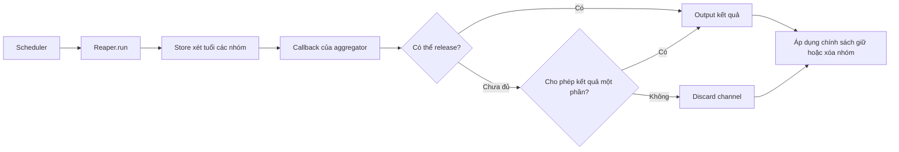

# Message expiration

Message expiration là chính sách quyết định khi nào một message hoặc một nhóm message đã chờ quá lâu và cần chuyển sang cách xử lý khác. Trong chương **Message store** của Spring Integration Core, chủ đề này gắn trực tiếp với trạng thái của aggregator, resequencer, việc giải phóng dữ liệu và cách đối xử với message đến muộn.

Một chính sách expiration đầy đủ phải trả lời được bốn câu hỏi: đối tượng nào hết hạn, thời gian tính từ đâu, thành phần nào phát hiện và kết quả được gửi đi đâu. Chỉ khai báo một con số timeout chưa đủ để trả lời cả bốn câu hỏi.

Sau bài này, bạn có thể thiết kế thời hạn cho nhóm message, cấu hình `MessageGroupStoreReaper` bằng Java, phân biệt expiration với timeout của gateway và xây dựng đường xử lý message hết hạn trong một luồng tích hợp.

## 1. Xác định đối tượng thực sự hết hạn

Trong một luồng thông điệp có nhiều khái niệm thời gian cùng tồn tại:

| Khái niệm | Đối tượng chịu tác động | Câu hỏi cần trả lời |
| --- | --- | --- |
| Deadline nghiệp vụ | Một yêu cầu hoặc một message | Đến thời điểm này còn được phép xử lý nghiệp vụ không? |
| Group expiration | Một `MessageGroup` trong store | Nhóm đã chờ quá lâu để tiếp tục gom dữ liệu chưa? |
| Thời gian giữ nhóm đã hoàn tất | Metadata của nhóm rỗng | Cần nhớ khóa tương quan bao lâu để nhận diện message đến muộn? |
| Timeout khi gửi hoặc nhận qua channel | Một thao tác `send` hoặc `receive` | Luồng gọi được chờ thao tác này tối đa bao lâu? |
| Reply timeout của gateway | Bên gọi chờ phản hồi | Người gọi chờ kết quả tối đa bao lâu? |
| TTL của broker hoặc cơ sở lưu trữ | Message/key/record theo cơ chế của hệ thống đó | Thành phần lưu trữ xóa hoặc chuyển dữ liệu khi nào? |

Ví dụ, gateway ngừng chờ sau 5 giây không có nghĩa nhóm mà aggregator đang giữ sẽ bị xóa sau 5 giây. Nhóm vẫn cần chính sách riêng. Tương tự, timeout của một lệnh `QueueChannel.receive(...)` chỉ giới hạn thời gian chờ nhận trong lần gọi đó.

Message store cung cấp nơi lưu trạng thái cho những thành phần đệm message. Aggregator giữ nhóm trong store; một queue giữ message cho đến khi consumer nhận. Vì vậy, cần chọn cơ chế expiration đúng với thành phần sử dụng store. [Tài liệu Message Store](https://docs.spring.io/spring-integration/reference/message-store.html) mô tả vai trò lưu trữ này và phân biệt store phục vụ channel với store dùng cho nhóm message.

**Không có quy tắc chung rằng mọi message đưa vào Spring Integration đều tự hết hạn sau một khoảng TTL.** Nếu ứng dụng tự thêm header như `expiresAt`, cần có filter, handler hoặc adapter được cấu hình để sử dụng header đó.

## 2. Bài toán: đơn hàng thiếu một phần dữ liệu

Giả sử một đơn hàng cần ba phần dữ liệu từ các nhánh tích hợp:

- Kết quả kiểm tra tồn kho.
- Kết quả xác thực thanh toán.
- Kết quả kiểm tra phương án vận chuyển.

Mỗi message mang header `orderId`. Aggregator dùng header này để gom ba phần vào cùng nhóm. Trong ví dụ, các message đã được kiểm tra tính hợp lệ và loại trùng ở trước aggregator.

Quy tắc vận hành được chọn cho bài thực hành:

| Tình huống | Chính sách |
| --- | --- |
| Nhận đủ ba phần | Phát một kết quả tổng hợp sang `completedOrders` |
| Chưa đủ sau 30 giây tính từ lúc tạo nhóm | Chuyển những message đã nhận sang `expiredOrders` |
| Nhóm đã hoàn tất hoặc hết hạn | Giữ metadata nhóm rỗng để chặn message đến muộn |
| Metadata đã cũ ít nhất 5 phút theo mốc cập nhật của nhóm | Cho phép cơ chế dọn nhóm xóa metadata |
| Có lỗi kỹ thuật trong tác vụ dọn nhóm | Đưa lỗi sang `expirationErrors` |

Hai khoảng 30 giây và 5 phút có mục đích khác nhau. Khoảng thứ nhất giới hạn chờ dữ liệu. Khoảng thứ hai giữ dấu vết khóa tương quan sau khi đã quyết định kết quả.

Trong hệ thống thực, điều kiện “đủ ba phần” nên kiểm tra đủ ba loại kết quả khác nhau. Điều kiện `group.size() == 3` bên dưới chỉ minh họa expiration trên đầu vào đã loại trùng; nó không thay cho việc kiểm tra danh tính từng nhánh.

## 3. Chọn mốc thời gian: tuổi nhóm hay thời gian không hoạt động

### 3.1. Expiration theo tuổi nhóm

Với store kế thừa `AbstractMessageGroupStore`, `timeoutOnIdle` mặc định là `false`: phép xét expiration dùng thời điểm tạo nhóm. Khi bật `setTimeoutOnIdle(true)`, phép xét chuyển sang mốc cập nhật cuối của nhóm nếu có. Đây là cấu hình của store, không phải cấu hình mặc định áp dụng đồng loạt cho mọi sản phẩm lưu trữ. [Javadoc AbstractMessageGroupStore](https://docs.spring.io/spring-integration/api/org/springframework/integration/store/AbstractMessageGroupStore.html#setTimeoutOnIdle(boolean)).

Có thể mô hình hóa điều kiện đủ tuổi như sau:

```text
mốc xét = thời điểm tạo nhóm                          // timeoutOnIdle = false
mốc xét = thời điểm cập nhật cuối, nếu store có mốc này // timeoutOnIdle = true

đủ điều kiện xét hết hạn khi: hiện tại - mốc xét >= timeout
```

`MessageGroup.getTimestamp()` là timestamp của nhóm. Nó không phải deadline nghiệp vụ của từng message và cũng không thay thế thời gian xảy ra sự kiện trong hệ thống nguồn.

### 3.2. Hai chính sách tạo ra kết quả khác nhau

Giả sử nhóm bắt đầu lúc giây 0, có thêm message lúc giây 20 và timeout là 30 giây:

| Chính sách | Nhóm đủ điều kiện xét hết hạn khoảng lúc nào? | Ý nghĩa nghiệp vụ |
| --- | --- | --- |
| Theo tuổi nhóm | Giây 30 | Chỉ chờ tối đa một khoảng kể từ khi bắt đầu tập hợp |
| Theo thời gian không hoạt động | Giây 50 | Chờ thêm một khoảng sau lần cập nhật cuối |

Nếu message tiếp tục đến mỗi 20 giây, chính sách theo thời gian không hoạt động có thể tiếp tục gia hạn. Với đơn hàng cần một hạn chót tổng thể, cần cân nhắc deadline riêng hoặc giới hạn theo tuổi nhóm.

Đây là lựa chọn nghiệp vụ: một cảm biến gửi dữ liệu theo đợt có thể phù hợp với cửa sổ không hoạt động; một yêu cầu đặt chỗ cần kết thúc trong thời hạn cam kết thường cần mốc tuyệt đối.

### 3.3. Khi dùng `groupTimeout`

Aggregator còn có cơ chế `.groupTimeout(30_000L)`. Với giá trị cố định, tác vụ ép hoàn tất được đặt lại khi nhận message mới mà nhóm chưa được release. Cơ chế này xử lý từng nhóm, khác với reaper quét toàn bộ store. [Tài liệu Aggregator, phần group timeout](https://docs.spring.io/spring-integration/reference/aggregator.html).

Đoạn Java DSL sau là một **phương án khác** với reaper của ví dụ chính:

```java
.aggregate(a -> a
    .correlationStrategy(m -> m.getHeaders().get("orderId"))
    .releaseStrategy(group -> group.size() == 3)
    .groupTimeout(30_000L)
    .sendPartialResultOnExpiry(false)
    .expireGroupsUponTimeout(false)
    .discardChannel("expiredOrders"))
```

Với phương án này, cần bảo đảm handler có scheduler hoạt động. Không mặc nhiên diễn giải nó thành “30 giây kể từ message đầu tiên”. Nếu cần hạn chót theo thời điểm tạo nhóm, hãy chọn reaper theo tuổi nhóm hoặc biểu thức timeout tương ứng với yêu cầu.

## 4. Reaper phát hiện hết hạn bằng cách nào?

`MessageGroupStore` có hai API quan trọng:

```java
void registerMessageGroupExpiryCallback(MessageGroupCallback callback);

int expireMessageGroups(long timeout);
```

Lệnh `expireMessageGroups(timeout)` tìm nhóm đáp ứng ngưỡng thời gian và gọi callback đã đăng ký. Callback quyết định cách xử lý nhóm; việc quét không tự định nghĩa hành vi nghiệp vụ “xóa”, “trả kết quả một phần” hay “bù trừ”. Aggregator đăng ký callback để nối quá trình này với xử lý nhóm của handler. [Javadoc MessageGroupStore](https://docs.spring.io/spring-integration/api/org/springframework/integration/store/MessageGroupStore.html).

`MessageGroupStoreReaper` là một `Runnable` đóng gói thao tác đó. Cấu hình `setTimeout(30_000L)` đặt ngưỡng, còn scheduler phải gọi `run()` theo lịch. Tạo bean reaper riêng lẻ chưa tạo ra lịch chạy định kỳ. Giá trị timeout của reaper tính bằng mili giây. [Javadoc MessageGroupStoreReaper](https://docs.spring.io/spring-integration/api/org/springframework/integration/store/MessageGroupStoreReaper.html).



Trong sơ đồ, `discard` là đường xử lý những message không tiếp tục tham gia kết quả mong đợi. Ứng dụng vẫn có thể ghi nhận chúng, phát sự kiện hết hạn hoặc yêu cầu điều tra.

### Độ trễ của tác vụ quét

Giả sử nhóm đủ tuổi ở giây 32, còn reaper chạy ở giây 30, 35, 40. Nhóm thường được phát hiện ở giây 35. Với lịch quét chu kỳ `R`, có thể ước lượng thời gian phát hiện:

```text
thời điểm đủ tuổi <= thời điểm phát hiện
thời điểm phát hiện ≈ thời điểm đủ tuổi + tối đa một chu kỳ quét
```

Ước lượng này giả định scheduler chạy đều và tác vụ không bị nghẽn. Nếu cơ sở dữ liệu chậm, scheduler thiếu luồng, tác vụ trước chạy lâu hoặc ứng dụng tạm dừng, độ trễ có thể lớn hơn. Với `fixedDelay`, khoảng nghỉ được tính sau khi lượt chạy trước kết thúc, nên thời gian chạy tác vụ cũng ảnh hưởng khoảng cách giữa hai lượt.

Reaper phù hợp để phát hiện và xử lý nhóm tồn đọng. Một deadline cần được tuân thủ ngay trước thao tác nghiệp vụ vẫn cần kiểm tra ở điểm thực hiện thao tác đó.

## 5. Phân biệt release, complete và remove

Khi thiết kế expiration, cần tách ba sự kiện:

- **Release:** phát kết quả từ những message hiện có trong nhóm.
- **Complete:** đánh dấu nhóm đã kết thúc vòng tập hợp này.
- **Remove/expire hoàn toàn:** xóa cả nhóm cùng metadata khỏi store.

Với aggregator, nhóm có thể đã complete, không còn chứa message nhưng metadata vẫn tồn tại. Metadata này giúp handler nhận biết message có cùng khóa tương quan là đến muộn. Khi metadata bị xóa, message mới cùng khóa có thể bắt đầu một nhóm mới.

Các lựa chọn cần đặt rõ ràng trong cấu hình:

| Thuộc tính | Mặc định | Tác dụng chính |
| --- | --- | --- |
| `sendPartialResultOnExpiry` | `false` | Khi nhóm bị ép kết thúc mà release strategy vẫn chưa cho phép release, chọn phát kết quả một phần hay discard |
| `expireGroupsUponCompletion` | `false` | Chọn xóa hoàn toàn nhóm sau khi release bình thường |
| `expireGroupsUponTimeout` | `true` | Chọn xóa hoàn toàn nhóm trên đường xử lý timeout |
| `minimumTimeoutForEmptyGroups` | Cần chọn theo yêu cầu | Đặt khoảng giữ tối thiểu theo mốc cập nhật cho nhóm rỗng trước khi dọn metadata |

Các mặc định và ý nghĩa của nhóm hoàn tất được mô tả trong [Javadoc AbstractCorrelatingMessageHandler](https://docs.spring.io/spring-integration/docs/6.5.0/api/org/springframework/integration/aggregator/AbstractCorrelatingMessageHandler.html) và [mã nguồn AggregatingMessageHandler 6.5.0](https://github.com/spring-projects/spring-integration/blob/v6.5.0/spring-integration-core/src/main/java/org/springframework/integration/aggregator/AggregatingMessageHandler.java).

Một chi tiết cần chú ý: khi timeout xảy ra, handler còn hỏi lại release strategy. Nếu strategy lúc đó cho phép release, việc giữ/xóa nhóm có thể đi qua nhánh hoàn tất bình thường. Vì vậy, cấu hình cả hai cờ expiration theo chính sách mong muốn, thay vì suy luận rằng mọi lần chạy reaper đều là một lần discard.

Chính sách giữ metadata có một giới hạn tự nhiên: sau khi metadata bị dọn, store không còn nhớ khóa đó đã kết thúc. Nếu yêu cầu nghiệp vụ là “mỗi đơn hàng chỉ được hoàn tất một lần”, cần thêm trạng thái đơn hàng hoặc cơ chế idempotency bền vững.

## 6. Cấu hình Java DSL: hết hạn sau 30 giây tuổi nhóm

Ví dụ dưới đây dùng API Spring Integration 6.5.x và Java 17 trở lên. Phần Java DSL nằm trong dependency `org.springframework.integration:spring-integration-core`; kiểm thử dùng JUnit Jupiter. Phiên bản dependency nên do BOM của ứng dụng quản lý.

`SimpleMessageStore` và các `QueueChannel` ở đây lưu dữ liệu trong bộ nhớ, phù hợp để thực hành. Trong triển khai cần khôi phục sau restart, hãy chọn store và đường nhận message hết hạn có khả năng lưu bền phù hợp.

### 6.1. Flow và store

```java
import org.springframework.context.annotation.Bean;
import org.springframework.context.annotation.Configuration;
import org.springframework.integration.channel.DirectChannel;
import org.springframework.integration.channel.QueueChannel;
import org.springframework.integration.config.EnableIntegration;
import org.springframework.integration.dsl.IntegrationFlow;
import org.springframework.integration.store.MessageGroupStoreReaper;
import org.springframework.integration.store.SimpleMessageStore;

@Configuration
@EnableIntegration
public class OrderExpirationFlowConfig {

    @Bean
    public DirectChannel orderParts() {
        return new DirectChannel();
    }

    @Bean
    public QueueChannel completedOrders() {
        return new QueueChannel();
    }

    @Bean
    public QueueChannel expiredOrders() {
        return new QueueChannel();
    }

    @Bean
    public SimpleMessageStore orderStore() {
        SimpleMessageStore store = new SimpleMessageStore();
        store.setTimeoutOnIdle(false);
        return store;
    }

    @Bean
    public IntegrationFlow collectOrderParts(SimpleMessageStore orderStore) {
        return IntegrationFlow.from("orderParts")
            .aggregate(a -> a
                .messageStore(orderStore)
                .correlationStrategy(m -> m.getHeaders().get("orderId"))
                .releaseStrategy(group -> group.size() == 3)
                .sendPartialResultOnExpiry(false)
                .discardIndividuallyOnExpiry(true)
                .expireGroupsUponCompletion(false)
                .expireGroupsUponTimeout(false)
                .minimumTimeoutForEmptyGroups(300_000L)
                .discardChannel("expiredOrders"))
            .channel("completedOrders")
            .get();
    }

    @Bean
    public MessageGroupStoreReaper orderReaper(SimpleMessageStore orderStore) {
        MessageGroupStoreReaper reaper = new MessageGroupStoreReaper(orderStore);
        reaper.setTimeout(30_000L);
        reaper.setExpireOnDestroy(false);
        return reaper;
    }
}
```

Các phương thức cấu hình nhóm như `messageStore`, `minimumTimeoutForEmptyGroups`, `expireGroupsUponTimeout` và `discardIndividuallyOnExpiry` nằm trong [Javadoc CorrelationHandlerSpec 6.5.0](https://docs.spring.io/spring-integration/docs/6.5.0/api/org/springframework/integration/dsl/CorrelationHandlerSpec.html).

Điểm cần đọc từ cấu hình:

- `orderId` là khóa nghiệp vụ dùng để gom nhóm; producer phải cung cấp giá trị hợp lệ.
- `timeoutOnIdle(false)` chọn tuổi nhóm, nên phần dữ liệu thứ hai đến không kéo dài thời hạn chờ.
- `sendPartialResultOnExpiry(false)` chọn đường discard khi chưa đủ ba phần.
- `discardIndividuallyOnExpiry(true)` gửi từng message gốc sang `expiredOrders`; consumer không nhận một message tổng hợp của cả nhóm hết hạn.
- Hai cờ `expireGroupsUpon...` đều là `false` để giữ metadata sau khi kết thúc.
- `minimumTimeoutForEmptyGroups(300_000L)` cho nhóm rỗng một khoảng giữ tối thiểu để nhận diện message đến muộn.

`setExpireOnDestroy(false)` chỉ tắt lựa chọn xử lý hết hạn khi **bean reaper** bị hủy. Không dùng thuộc tính này để suy luận rằng mọi endpoint khác đều không có hành vi lifecycle riêng khi ứng dụng đóng.

Đường `expiredOrders` là channel ứng dụng tự đặt tên. Trong ví dụ, nó chưa phải một dead-letter queue bền vững. Cần có consumer hoặc công cụ quan sát nhận message khỏi queue; nếu chỉ đẩy sang một queue trong bộ nhớ không giới hạn mà không đọc, lượng dữ liệu chờ sẽ chuyển sang queue đó.

### 6.2. Scheduler chạy reaper và xuất bản lỗi

Tách scheduler khỏi cấu hình flow giúp kiểm thử đường expiration mà không chờ 30 giây.

```java
import org.springframework.beans.factory.annotation.Qualifier;
import org.springframework.context.annotation.Bean;
import org.springframework.context.annotation.Configuration;
import org.springframework.context.annotation.Import;
import org.springframework.integration.channel.MessagePublishingErrorHandler;
import org.springframework.integration.channel.QueueChannel;
import org.springframework.integration.store.MessageGroupStoreReaper;
import org.springframework.scheduling.annotation.EnableScheduling;
import org.springframework.scheduling.annotation.Scheduled;
import org.springframework.scheduling.concurrent.ThreadPoolTaskScheduler;

@Configuration
@EnableScheduling
@Import(OrderExpirationFlowConfig.class)
public class OrderExpirationSchedulingConfig {

    private final MessageGroupStoreReaper orderReaper;

    public OrderExpirationSchedulingConfig(MessageGroupStoreReaper orderReaper) {
        this.orderReaper = orderReaper;
    }

    @Bean
    public QueueChannel expirationErrors() {
        return new QueueChannel();
    }

    @Bean
    public ThreadPoolTaskScheduler expirationTaskScheduler(
            @Qualifier("expirationErrors") QueueChannel errorChannel) {
        MessagePublishingErrorHandler errorHandler =
            new MessagePublishingErrorHandler();
        errorHandler.setDefaultErrorChannel(errorChannel);

        ThreadPoolTaskScheduler scheduler = new ThreadPoolTaskScheduler();
        scheduler.setPoolSize(2);
        scheduler.setThreadNamePrefix("order-expiry-");
        scheduler.setErrorHandler(errorHandler);
        return scheduler;
    }

    @Scheduled(
        fixedDelay = 5_000L,
        initialDelay = 5_000L,
        scheduler = "expirationTaskScheduler"
    )
    public void sweepExpiredOrderGroups() {
        orderReaper.run();
    }
}
```

Nạp `OrderExpirationSchedulingConfig` khi chạy ứng dụng. Flow giữ trách nhiệm xử lý nhóm, còn phương thức được `@Scheduled` đánh dấu có trách nhiệm kích hoạt lượt quét. Bean scheduler do Spring quản lý lifecycle; không cần tự gọi `initialize()` trong ví dụ này. Ngữ nghĩa `fixedDelay` và cơ chế chọn scheduler được trình bày trong [tài liệu Task Execution and Scheduling](https://docs.spring.io/spring-framework/reference/integration/scheduling.html).

`MessagePublishingErrorHandler` chuyển exception thành `ErrorMessage` gửi qua message channel. Ví dụ chọn channel mặc định là `expirationErrors`; ứng dụng cần đọc channel này để ghi nhận hoặc xử lý lỗi. [Javadoc MessagePublishingErrorHandler](https://docs.spring.io/spring-integration/api/org/springframework/integration/channel/MessagePublishingErrorHandler.html).

Không đưa thời hạn chờ dữ liệu 30 giây vào `@Scheduled(fixedDelay = ...)` rồi bỏ qua `setTimeout`. Hai con số cấu hình hai công việc khác nhau: ngưỡng tuổi nhóm và tần suất phát hiện nhóm đủ tuổi.
