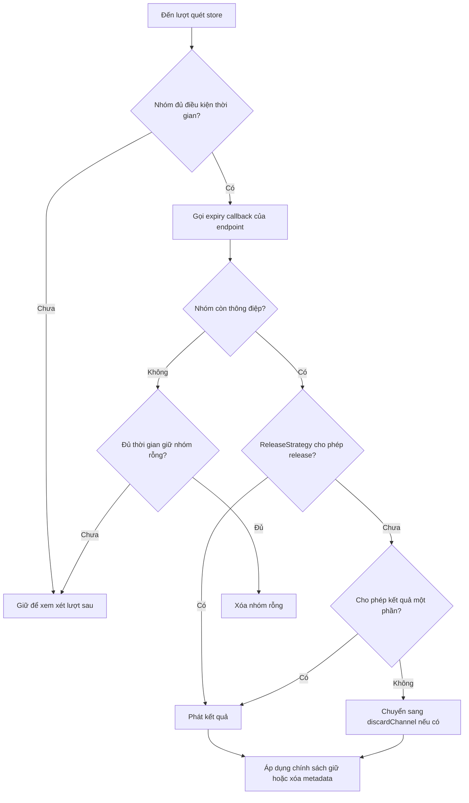

# Message store cleanup

Trong chương **Message store** của module `SPRING_INTEGRATION_CORE`, cleanup là việc kết thúc vòng đời dữ liệu đang được các endpoint giữ lại. Một luồng thông điệp dùng `Message`, `MessageChannel`, gateway và aggregator cần quy định cả khi nào nhận dữ liệu, khi nào phát kết quả và khi nào được phép bỏ trạng thái đã lưu.

Bài này tập trung vào `MessageGroupStore` của aggregator: dọn nhóm thiếu thông điệp, giữ rồi xóa metadata của nhóm đã hoàn tất, và xử lý nhóm còn sót trong kho bền vững sau khi ứng dụng khởi động lại. Các ví dụ Java DSL lấy Spring Integration **6.5** làm mốc API; các giá trị thời gian là lựa chọn minh họa cho bài học.

## 1. Vì sao cần chính sách cleanup?

Giả sử dịch vụ tổng hợp ba phần dữ liệu của một lô hàng. Mỗi thông điệp có header `batchId`; aggregator chờ đủ ba phần rồi phát một kết quả.

Trong thực tế có thể xảy ra:

- Hai phần đã tới nhưng phần thứ ba mất hoặc upstream không gửi.
- Lô đã xử lý xong nhưng upstream gửi lại một phần.
- Ứng dụng dừng sau khi lưu một phần dữ liệu, rồi khởi động lại.
- Mỗi ngày xuất hiện hàng triệu `batchId` mới, khiến metadata của các lô cũ tích lũy.

Kho thông điệp giải quyết nhu cầu giữ dữ liệu của các thành phần có bộ đệm. Với kho bền vững, dữ liệu có thể tồn tại qua lần khởi động lại; với kho trong bộ nhớ, dữ liệu chiếm tài nguyên của tiến trình. Việc chọn một kho lưu trữ chưa tự xác định được chính sách kết thúc các nhóm không bao giờ nhận đủ dữ liệu. [Spring Integration — Message Store](https://docs.spring.io/spring-integration/reference/message-store.html).

Một chính sách cho ví dụ lô hàng có thể là:

| Tình huống | Chính sách nghiệp vụ minh họa |
| --- | --- |
| Đủ ba phần | Phát kết quả ngay |
| Chưa đủ sau 30 giây từ lúc tạo nhóm | Chuyển dữ liệu hiện có sang nhánh xử lý lô thiếu |
| Có thông điệp đến muộn sau khi đóng lô | Loại sang nhánh kiểm tra trong khoảng giữ metadata |
| Metadata không đổi ít nhất 60 giây | Cho phép xóa dấu vết của nhóm |
| Có thông điệp sau khi metadata đã bị xóa | Xử lý theo quy tắc chống trùng nghiệp vụ hoặc coi là nhóm mới |

Hai mốc 30 và 60 giây phục vụ hai mục tiêu khác nhau. Mốc đầu giới hạn thời gian chờ dữ liệu; mốc sau giới hạn thời gian giữ dấu vết để nhận biết thông điệp đến muộn.

## 2. Dữ liệu nào đang được dọn?

`MessageGroup` biểu diễn tập thông điệp cùng một khóa tương quan. Ngoài các thông điệp, nhóm còn có định danh, trạng thái hoàn tất và các mốc thời gian như `timestamp`, `lastModified`. Vì vậy, “không còn payload trong nhóm” và “không còn nhóm trong store” là hai trạng thái khác nhau. [Javadoc — MessageGroup](https://docs.spring.io/spring-integration/docs/current/api/org/springframework/integration/store/MessageGroup.html).

Cần phân biệt ba thao tác:

| Thao tác | Điều xảy ra | Ý nghĩa đối với luồng |
| --- | --- | --- |
| Release | Aggregator tạo và gửi kết quả | Kết thúc bước gom dữ liệu theo chính sách release |
| Complete và giữ nhóm rỗng | Thông điệp được loại khỏi nhóm, metadata hoàn tất vẫn tồn tại | Có thể nhận biết thông điệp tới sau thuộc nhóm đã đóng |
| Remove group | Xóa nhóm cùng trạng thái liên quan theo implementation | Store không còn dấu vết để nhận biết nhóm cũ |

Ở aggregator, `expireGroupsUponCompletion(false)` giữ nhóm rỗng sau lần release bình thường; `true` cho phép xóa hẳn nhóm. Đây là sự đánh đổi giữa dung lượng metadata và thời gian nhận biết thông điệp đến muộn. [Mã nguồn AggregatingMessageHandler 6.5.0](https://raw.githubusercontent.com/spring-projects/spring-integration/v6.5.0/spring-integration-core/src/main/java/org/springframework/integration/aggregator/AggregatingMessageHandler.java).

Có thể gọi metadata giữ lại là một “dấu đánh dấu đã đóng”. Nó hữu ích trong một khoảng thời gian hữu hạn, nhưng không thay thế sổ chống trùng nghiệp vụ cho những sự kiện có thể phát lại sau nhiều ngày.

## 3. Luồng quyết định khi nhóm quá hạn

`expireMessageGroups(timeout)` chọn các nhóm đủ điều kiện thời gian rồi gọi expiry callback đã đăng ký. Callback quyết định cách xử lý nhóm. Do đó, tên phương thức này không đồng nghĩa với một lệnh xóa trực tiếp tất cả dữ liệu cũ. [Javadoc — MessageGroupStore](https://docs.spring.io/spring-integration/docs/current/api/org/springframework/integration/store/MessageGroupStore.html).

Với aggregator, callback đi qua cơ chế forced completion. Luồng khái quát:



Trong lần forced completion, release strategy được hỏi lại. Nếu vẫn chưa thể release, cấu hình quyết định phát kết quả một phần hay discard. Vì vậy, một đợt cleanup có thể phát sinh thêm thông điệp ở đầu ra và nhánh discard. [Mã nguồn AbstractCorrelatingMessageHandler 6.5.0 — forceComplete](https://raw.githubusercontent.com/spring-projects/spring-integration/v6.5.0/spring-integration-core/src/main/java/org/springframework/integration/aggregator/AbstractCorrelatingMessageHandler.java).

Trong thiết kế nghiệp vụ, nên coi timeout là một sự kiện có kết quả rõ ràng: lô thiếu được lưu để điều tra, được phát thành kết quả tạm, hoặc được hủy theo quy tắc đã định.

## 4. Phân biệt tuổi nhóm, thời gian không hoạt động và lịch quét

### 4.1. Tuổi nhóm và thời gian không hoạt động

Với `AbstractMessageGroupStore`, cách tính timeout mặc định dựa trên thời điểm tạo nhóm. `setTimeoutOnIdle(true)` chuyển tiêu chí sang `lastModified` khi mốc này có giá trị. Đây là lựa chọn trên store, không phải thuộc tính `groupTimeout` của aggregator. [Mã nguồn AbstractMessageGroupStore 6.5.0](https://raw.githubusercontent.com/spring-projects/spring-integration/v6.5.0/spring-integration-core/src/main/java/org/springframework/integration/store/AbstractMessageGroupStore.java).

Ví dụ đặt ngưỡng 30 giây:

| Sự kiện | Thời gian |
| --- | --- |
| Tạo nhóm từ thông điệp đầu | 10:00:00 |
| Có cập nhật tiếp theo | 10:00:20 |
| Đủ tuổi 30 giây kể từ tạo | 10:00:30 |
| Đủ 30 giây không hoạt động nếu không có cập nhật khác | 10:00:50 |

Nếu yêu cầu là “mỗi lô chỉ được chờ tối đa 30 giây kể từ khi mở”, chọn tuổi nhóm. Nếu yêu cầu là “chờ cho tới khi upstream im lặng 30 giây”, chọn thời gian không hoạt động.

Cách thứ hai có thể khiến nhóm tồn tại lâu nếu dữ liệu liên tục nhỏ giọt. Đó là lý do nên viết rõ mốc bắt đầu tính thời gian trong yêu cầu nghiệp vụ.

### 4.2. Timeout và chu kỳ quét

`MessageGroupStoreReaper` là một `Runnable`. Khai báo bean chưa tạo lịch gọi `run()`; phải có scheduler hoặc bên gọi chủ động. Reaper cần đang chạy theo lifecycle và được đặt timeout phù hợp. [Javadoc — MessageGroupStoreReaper](https://docs.spring.io/spring-integration/docs/current/api/org/springframework/integration/store/MessageGroupStoreReaper.html).

Giả sử:

- `T` là ngưỡng tuổi 30 giây.
- `P` là khoảng nghỉ 5 giây giữa các lần quét.
- Một lần quét mất thời gian nhỏ so với `P`.

Trong điều kiện ít tải, nhóm thường được xem xét gần khoảng `T` đến `T + P`. Đây là ước lượng để lập kế hoạch, không phải cam kết deadline. Với `fixedDelay`, khoảng giữa hai thời điểm bắt đầu còn bao gồm thời gian chạy lượt trước. Tranh chấp khóa, database chậm hoặc scheduler bận đều làm tăng độ trễ.

Đặt timeout ngắn nhưng quét mỗi giờ sẽ không đáp ứng yêu cầu xử lý trong vài chục giây.

## 5. Những cấu hình cần quyết định cùng nhau

Các tên trong cột Java DSL được dùng khi cấu hình aggregator:

| Cấu hình | Câu hỏi cần trả lời |
| --- | --- |
| `expireGroupsUponCompletion(boolean)` | Sau release bình thường, có xóa luôn metadata không? |
| `expireGroupsUponTimeout(boolean)` | Khi forced completion do timeout, có xóa hẳn nhóm không? |
| `sendPartialResultOnExpiry(boolean)` | Nhóm thiếu có được phát thành kết quả một phần không? |
| `discardChannel(...)` | Dữ liệu bị loại sẽ đi đâu? |
| `minimumTimeoutForEmptyGroups(long)` | Nhóm rỗng phải không đổi ít nhất bao lâu trước khi được xóa? |
| `groupTimeout(long)` | Có cần hẹn xử lý riêng từng nhóm sau khoảng không có thông điệp mới không? |

Các phương thức này thuộc `AggregatorSpec` hoặc lớp cha `CorrelationHandlerSpec`. Đặc biệt, tên DSL là `minimumTimeoutForEmptyGroups`; thuộc tính XML tương ứng mang tên `empty-group-min-timeout`. [Javadoc — AggregatorSpec](https://docs.spring.io/spring-integration/docs/current/api/org/springframework/integration/dsl/AggregatorSpec.html), [Javadoc — CorrelationHandlerSpec](https://docs.spring.io/spring-integration/docs/current/api/org/springframework/integration/dsl/CorrelationHandlerSpec.html).

Trong dòng API dùng ở bài:

- `expireGroupsUponCompletion` mặc định là `false`.
- `expireGroupsUponTimeout` của aggregator mặc định là `true`.
- `sendPartialResultOnExpiry` mặc định là `false`.

Hãy đặt tường minh các lựa chọn quan trọng trong cấu hình của ứng dụng. Riêng forced completion có thể release bình thường nếu release strategy đổi quyết định; khi giữ nhóm sau timeout, chính sách completion cũng cần được xét. Tránh hiểu hai cờ expiry là hai công tắc xóa hoàn toàn độc lập. [Spring Integration — Expiring Groups](https://docs.spring.io/spring-integration/reference/aggregator.html).

## 6. Ví dụ Java DSL: cleanup lô thiếu và giữ metadata có thời hạn

### 6.1. Giả định của ví dụ

Ứng dụng đã có dependency `org.springframework.integration:spring-integration-core` với phiên bản được quản lý phù hợp trong dự án, cùng cấu hình Spring thông thường. Nạp lớp `MessageStoreCleanupConfig` vào application context.

Quy tắc dữ liệu:

- Payload là chuỗi đại diện một phần dữ liệu.
- Header `batchId` bắt buộc có giá trị.
- Mỗi lô có đúng ba thông điệp hợp lệ và khác nhau trước khi release.
- Kiểm tra trùng dữ liệu hoặc thiếu header diễn ra ở bước validation phía trước.

Điều kiện `group.size() == 3` chỉ phục vụ ví dụ. Nó không chứng minh đã nhận đủ ba phần nghiệp vụ khác nhau nếu upstream có thể gửi trùng.

Ví dụ sử dụng `SimpleMessageStore` để quan sát cơ chế trong một tiến trình. Đây là implementation trong bộ nhớ, không cung cấp khả năng phục hồi dữ liệu sau khi tiến trình mất. [Javadoc — SimpleMessageStore](https://docs.spring.io/spring-integration/docs/current/api/org/springframework/integration/store/SimpleMessageStore.html).

### 6.2. Cấu hình đầy đủ

```java
import org.springframework.beans.factory.BeanFactory;
import org.springframework.beans.factory.annotation.Qualifier;
import org.springframework.context.annotation.Bean;
import org.springframework.context.annotation.Configuration;
import org.springframework.integration.channel.DirectChannel;
import org.springframework.integration.channel.MessagePublishingErrorHandler;
import org.springframework.integration.channel.QueueChannel;
import org.springframework.integration.config.EnableIntegration;
import org.springframework.integration.dsl.IntegrationFlow;
import org.springframework.integration.store.MessageGroupStoreReaper;
import org.springframework.integration.store.SimpleMessageStore;
import org.springframework.scheduling.annotation.EnableScheduling;
import org.springframework.scheduling.annotation.Scheduled;
import org.springframework.scheduling.concurrent.ThreadPoolTaskScheduler;

@Configuration
@EnableIntegration
@EnableScheduling
public class MessageStoreCleanupConfig {

    @Bean
    public SimpleMessageStore batchStore() {
        SimpleMessageStore store = new SimpleMessageStore();
        store.setTimeoutOnIdle(false);
        return store;
    }

    @Bean
    public DirectChannel batchesInput() {
        return new DirectChannel();
    }

    @Bean
    public QueueChannel batchesOutput() {
        return new QueueChannel(100);
    }

    @Bean
    public QueueChannel batchesDiscard() {
        return new QueueChannel(100);
    }

    @Bean
    public ThreadPoolTaskScheduler taskScheduler(BeanFactory beanFactory) {
        MessagePublishingErrorHandler errorHandler =
                new MessagePublishingErrorHandler();
        errorHandler.setBeanFactory(beanFactory);

        ThreadPoolTaskScheduler scheduler = new ThreadPoolTaskScheduler();
        scheduler.setPoolSize(2);
        scheduler.setThreadNamePrefix("batch-cleanup-");
        scheduler.setErrorHandler(errorHandler);
        return scheduler;
    }

    @Bean
    public IntegrationFlow batchesFlow(
            DirectChannel batchesInput,
            SimpleMessageStore batchStore,
            @Qualifier("batchesOutput") QueueChannel batchesOutput,
            @Qualifier("batchesDiscard") QueueChannel batchesDiscard) {

        return IntegrationFlow.from(batchesInput)
                .aggregate(aggregator -> aggregator
                        .messageStore(batchStore)
                        .correlationExpression("headers['batchId']")
                        .releaseStrategy(group -> group.size() == 3)
                        .expireGroupsUponCompletion(false)
                        .expireGroupsUponTimeout(false)
                        .sendPartialResultOnExpiry(false)
                        .discardIndividuallyOnExpiry(true)
                        .discardChannel(batchesDiscard)
                        .minimumTimeoutForEmptyGroups(60_000)
                        .sendTimeout(1_000))
                .channel(batchesOutput)
                .get();
    }

    @Bean
    public MessageGroupStoreReaper batchReaper(
            SimpleMessageStore batchStore) {

        MessageGroupStoreReaper reaper =
                new MessageGroupStoreReaper(batchStore);
        reaper.setTimeout(30_000);
        reaper.setExpireOnDestroy(false);
        return reaper;
    }

    @Bean
    public CleanupJob cleanupJob(MessageGroupStoreReaper batchReaper) {
        return new CleanupJob(batchReaper);
    }

    public static final class CleanupJob {

        private final MessageGroupStoreReaper reaper;

        public CleanupJob(MessageGroupStoreReaper reaper) {
            this.reaper = reaper;
        }

        @Scheduled(initialDelay = 5_000, fixedDelay = 5_000)
        public void cleanup() {
            this.reaper.run();
        }
    }
}
```

Hai queue đầu ra được giới hạn 100 phần tử để quan sát trong môi trường học. Khi dùng lâu hơn, cần consumer đọc thường xuyên. `sendTimeout(1_000)` giới hạn thời gian chờ gửi của handler khi queue bị đầy; khi đó việc gửi có thể thất bại và phải được xử lý như lỗi giao nhận.

`discardIndividuallyOnExpiry(true)` chỉ định gửi từng thông điệp bị loại sang discard channel. API này có từ 6.5; nếu muốn nhận cả nhóm trong một thông điệp, có thể xem lựa chọn `false` và thay đổi consumer tương ứng. [Mã nguồn CorrelationHandlerSpec 6.5.0](https://raw.githubusercontent.com/spring-projects/spring-integration/v6.5.0/spring-integration-core/src/main/java/org/springframework/integration/dsl/CorrelationHandlerSpec.java).

### 6.3. Quan sát release bình thường và thông điệp đến muộn

Đoạn dưới đặt trong mã đã có `context` là application context đang chạy và đã nạp lớp cấu hình trên:

```java
import java.util.List;

import org.springframework.integration.channel.QueueChannel;
import org.springframework.messaging.Message;
import org.springframework.messaging.MessageChannel;
import org.springframework.messaging.support.MessageBuilder;

// context là application context đang chạy.
MessageChannel input = context.getBean(
        "batchesInput", MessageChannel.class);
QueueChannel output = context.getBean(
        "batchesOutput", QueueChannel.class);
QueueChannel discard = context.getBean(
        "batchesDiscard", QueueChannel.class);

for (String part : List.of("part-1", "part-2", "part-3")) {
    boolean sent = input.send(MessageBuilder.withPayload(part)
            .setHeader("batchId", "BATCH-100")
            .build());
    if (!sent) {
        throw new IllegalStateException("Không gửi được dữ liệu đầu vào");
    }
}

Message<?> result = output.receive(1_000);
if (result == null) {
    throw new IllegalStateException("Chưa nhận được kết quả tổng hợp");
}
System.out.println(result.getPayload());

input.send(MessageBuilder.withPayload("late-part")
        .setHeader("batchId", "BATCH-100")
        .build());

Message<?> late = discard.receive(1_000);
System.out.println(late == null ? "Không có dữ liệu bị loại"
        : late.getPayload());
```

Thực hiện liên tiếp trước khi metadata bị dọn, sẽ quan sát được một kết quả tổng hợp và `late-part` trên discard channel. Khi kiểm tra payload tổng hợp, nên so sánh các phần tử; đừng xây dựng nghiệp vụ phụ thuộc vào thứ tự nếu chưa thiết kế rõ quy tắc sắp xếp.

Để quan sát timeout, gửi một thông điệp cho `BATCH-200` rồi để scheduler hoạt động:

```java
input.send(MessageBuilder.withPayload("only-part")
        .setHeader("batchId", "BATCH-200")
        .build());
```

Sau khi nhóm đủ tuổi 30 giây và một lượt quét xử lý thành công, `only-part` được chuyển sang discard channel. Nhóm không tạo kết quả tổng hợp vì ví dụ không cho phép kết quả một phần. Metadata hoàn tất được giữ lại và được xem xét xóa khi đủ khoảng không đổi 60 giây.

Không đóng application context ngay sau lệnh gửi cuối nếu đang thực hành việc quan sát tác vụ theo lịch.

### 6.4. Tại sao vẫn cần reaper khi có thời gian giữ nhóm rỗng?

`minimumTimeoutForEmptyGroups` không phải một lịch quét chung cho mọi nhóm. Aggregator có cơ chế lên lịch xóa nhóm rỗng trong một số đường release; reaper còn giúp xét các nhóm cũ trong store, bao gồm dữ liệu được giữ lại qua lần khởi động lại. Khi dùng cả hai, coi khoảng giữ là điều kiện đủ về thời gian, còn thời điểm xóa thực tế phụ thuộc đường xử lý và tác vụ đang hoạt động. [Javadoc 6.5 — AbstractCorrelatingMessageHandler](https://docs.spring.io/spring-integration/docs/6.5.x/api/org/springframework/integration/aggregator/AbstractCorrelatingMessageHandler.html).

## 7. Khi nào dùng groupTimeout hoặc purge nhóm mồ côi?

`groupTimeout(30_000)` hẹn forced completion cho từng nhóm khi không có thông điệp mới trong khoảng tương ứng. Reaper là cách quét store định kỳ theo ngưỡng đã đặt. Vì vậy, thay reaper bằng `groupTimeout` có thể làm thay đổi ý nghĩa thời gian của ví dụ từ “tuổi nhóm” sang “chờ từ thông điệp mới nhất”. [Javadoc — AbstractCorrelatingMessageHandler](https://docs.spring.io/spring-integration/docs/current/api/org/springframework/integration/aggregator/AbstractCorrelatingMessageHandler.html).

Một vấn đề riêng xuất hiện khi dùng kho bền vững: dữ liệu nhóm còn trong store, nhưng tác vụ hẹn giờ trước khi tiến trình dừng không tự trở thành lịch chạy bền vững.

Khi muốn dùng timeout riêng từng nhóm, có thể chọn cơ chế purge nhóm cũ của endpoint. Ví dụ sau là **phương án cấu hình thay thế** cho cách cleanup trong mục 6:

```java
import java.time.Duration;

.aggregate(aggregator -> aggregator
        .messageStore(batchStore)
        .correlationExpression("headers['batchId']")
        .releaseStrategy(group -> group.size() == 3)
        .groupTimeout(30_000)
        .expireTimeout(300_000)
        .expireDuration(Duration.ofSeconds(30))
        .expireGroupsUponCompletion(false)
        .expireGroupsUponTimeout(false)
        .minimumTimeoutForEmptyGroups(60_000)
        .sendPartialResultOnExpiry(false)
        .discardChannel(batchesDiscard))
```

Ở đây, `expireTimeout` đặt ngưỡng cho nhóm cũ cần purge; `expireDuration` đặt chu kỳ thực hiện. Endpoint có `purgeOrphanedGroups()` và sử dụng forced completion khi purge. Chính sách release/discard vẫn phải được cấu hình đầy đủ. [Javadoc — purgeOrphanedGroups và expireTimeout](https://docs.spring.io/spring-integration/docs/current/api/org/springframework/integration/aggregator/AbstractCorrelatingMessageHandler.html).

Mốc năm phút trong ví dụ thay thế là một khoảng bảo vệ do người thiết kế chọn. Nó phải dựa trên thời gian xử lý hợp lệ và thời gian phục hồi mong muốn. Đừng bật thêm nhiều lịch quét với các ngưỡng khác nhau chỉ vì muốn “chắc chắn có dọn”; trước hết hãy xác định lịch nào chịu trách nhiệm cho nhóm đang chờ, nhóm rỗng và nhóm còn sót sau restart.

## 8. Kho bền vững và ranh giới dữ liệu cần bảo vệ

### 8.1. Chọn đúng loại store

Với JDBC, `JdbcMessageStore` phù hợp cho aggregator; `JdbcChannelMessageStore` được tối ưu cho message channel. Hai thành phần có mục tiêu sử dụng khác nhau. Không dùng một reaper của aggregator như công cụ dọn tùy ý backlog của queue. [Spring Integration — JDBC Message Store](https://docs.spring.io/spring-integration/reference/jdbc/message-store.html).

Đối với queue, một thông điệp đang chờ có thể vẫn là công việc hợp lệ. Đối với aggregator, một nhóm chưa đủ dữ liệu cũng có thể còn nằm trong thời gian chờ hợp lệ. Quyết định xóa phải gắn với endpoint sở hữu dữ liệu.

Nếu dùng claim check hoặc lưu từng message độc lập, cần xác định lúc nào tham chiếu không còn được sử dụng và đường xử lý nào chịu trách nhiệm loại dữ liệu tương ứng. Không suy rằng expiry của `MessageGroupStore` bao phủ mọi dạng lưu message.

### 8.2. Mỗi endpoint cần phạm vi nhóm riêng

Một store instance dùng expiry callback không nên dùng chung cho nhiều aggregator/resequencer độc lập. Nếu callback của endpoint này được gọi cho nhóm của endpoint khác, kết quả có thể bị phát hoặc loại bởi sai chính sách. Tạo bean store riêng cho từng endpoint và kiểm tra cả cách tách dữ liệu vật lý ở backend. [Mã nguồn AbstractMessageGroupStore 6.5.0 — đăng ký expiry callback](https://raw.githubusercontent.com/spring-projects/spring-integration/v6.5.0/spring-integration-core/src/main/java/org/springframework/integration/store/AbstractMessageGroupStore.java).

Ví dụ, hai bean cùng trỏ một database vẫn có thể nhìn thấy cùng dữ liệu nếu không phân vùng phù hợp. Tùy backend, có thể tách bằng region, namespace, bảng hoặc cơ chế được implementation hỗ trợ. Khóa tương quan có prefix giúp tránh trùng tên nhưng chưa đủ nếu thao tác quét vẫn nhìn thấy toàn bộ nhóm của hai luồng.

### 8.3. Tránh xóa trực tiếp dữ liệu đang hoạt động

Một lệnh SQL xóa theo cột thời gian có thể làm nhóm mất payload mà không thực hiện release, discard hoặc cập nhật metadata theo cùng vòng đời. Vì vậy, với dữ liệu ứng dụng đang dùng, ưu tiên API và chính sách của endpoint.

Nếu cần bảo trì dữ liệu tồn dư ngoài vòng đời bình thường, nên có thủ tục riêng: xác định phạm vi sở hữu, dừng hoặc cô lập writer liên quan, ghi nhận dữ liệu cần giữ, thực hiện theo lô và xác minh các liên kết còn nhất quán. Đây là hoạt động bảo trì vận hành, cần được thiết kế riêng cho schema và backend cụ thể.

## 9. Lỗi cleanup, transaction và khả năng phục hồi

### 9.1. Phân biệt discard và lỗi kỹ thuật

| Loại tình huống | Ví dụ | Đường xử lý nên thiết kế |
| --- | --- | --- |
| Dữ liệu không đủ theo chính sách | Lô chỉ có hai phần khi hết thời gian chờ | Discard hoặc kết quả một phần có trạng thái rõ ràng |
| Giao nhận thất bại | Discard queue đầy, database mất kết nối | Error flow, cảnh báo và chính sách thử lại |
| Nghiệp vụ không hợp lệ | Đủ ba message nhưng cùng một mã phần | Validation và xử lý dữ liệu sai trước khi chốt lô |

`discardChannel` không tự trở thành kho lỗi bền vững. Nếu dữ liệu lô thiếu phải được phục hồi sau sự cố, cần consumer ghi nó vào nơi bền vững, kèm `batchId`, mã phần và lý do xử lý.

### 9.2. Lỗi trên scheduler không quay về lời gọi ban đầu

Một thông điệp có thể được gửi qua gateway hoặc channel ở thời điểm đầu, trong khi cleanup chạy sau đó trên luồng scheduler. Lỗi trong lần cleanup không thể được ném ngược vào lời gọi đã kết thúc. Error flow cần được thiết kế cho đường xử lý bất đồng bộ này. [Spring Integration — Error Handling](https://docs.spring.io/spring-integration/reference/error-handling.html).

Cấu hình mục 6 gắn `MessagePublishingErrorHandler` vào scheduler để phát `ErrorMessage` tới error channel được phân giải. Khi vận hành cần consumer giám sát error channel và chính sách xử lý lỗi giao nhận, thay vì chỉ dựa vào việc một bean `errorChannel` có tồn tại. [Mã nguồn MessagePublishingErrorHandler 6.5.0](https://raw.githubusercontent.com/spring-projects/spring-integration/v6.5.0/spring-integration-core/src/main/java/org/springframework/integration/channel/MessagePublishingErrorHandler.java).

### 9.3. Cleanup có transaction boundary riêng

Transaction của lời gọi đầu vào thường đã kết thúc trước khi scheduler chạy. Nếu cần transaction cho forced completion, Java DSL có `forceReleaseAdvice(...)` để gắn advice vào thao tác này. Ví dụ khái niệm, trong cấu hình đã có `transactionManager` phù hợp:

```java
import org.springframework.transaction.interceptor.TransactionInterceptor;

// Đưa vào phần cấu hình aggregator cần transaction khi forced completion.
.forceReleaseAdvice(new TransactionInterceptor(
        transactionManager,
        new org.springframework.transaction.interceptor
                .MatchAlwaysTransactionAttributeSource()))
```

Advice cho forced completion không thay thế cấu hình transaction của đường nhận và release bình thường. Các ranh giới luồng và tài nguyên tham gia quyết định phạm vi transaction thực tế. [Spring Integration — Transaction Support](https://docs.spring.io/spring-integration/reference/transactions.html), [Javadoc — forceReleaseAdvice](https://docs.spring.io/spring-integration/docs/current/api/org/springframework/integration/dsl/CorrelationHandlerSpec.html).

Khi kết quả được gửi tới HTTP hoặc tài nguyên ngoài transaction database, rollback trong store không đồng nghĩa với hoàn tác được tác dụng phụ đã xảy ra ở hệ thống ngoài. Nên có khóa idempotency ở phía xử lý kết quả hoặc dùng thiết kế outbox khi cần gắn kết bền vững giữa thay đổi trạng thái và việc phát sự kiện.

### 9.4. Shutdown và nhiều instance

Trong ví dụ, `setExpireOnDestroy(false)` chủ động giữ chính sách “dừng ứng dụng không ép tất cả nhóm hết hạn”. Bật expiry khi dừng có thể khiến một lần triển khai trở thành sự kiện kết thúc hàng loạt nhóm. `SimpleMessageStore` vẫn mất dữ liệu khi tiến trình mất; muốn phục hồi phải chọn kho bền vững. [Mã nguồn MessageGroupStoreReaper 6.5.0](https://raw.githubusercontent.com/spring-projects/spring-integration/v6.5.0/spring-integration-core/src/main/java/org/springframework/integration/store/MessageGroupStoreReaper.java).

Với nhiều instance, cần xác định ai được quét một phân vùng, khóa nào bảo vệ thao tác nhóm và cách tránh phát tác dụng phụ trùng. Khóa trong một JVM không tự đồng bộ với JVM khác. Có thể chọn một instance làm nhiệm vụ cleanup hoặc thiết kế cơ chế phối hợp phân tán; lựa chọn phải được kiểm chứng cùng backend và topology của hệ thống.

## 10. Chọn retention và theo dõi dung lượng

Thời gian giữ metadata nên xuất phát từ khoảng trễ và khả năng phát lại của upstream. Ví dụ, upstream có thể thử gửi lại trong 15 phút thì giữ dấu vết 60 giây không đáp ứng mục tiêu chặn mọi lần gửi lại trong khoảng đó.

Ước lượng dung lượng có thể tách thành hai phần:

```text
Thông điệp đang chờ ≈
    số thông điệp đầu vào mỗi giây × thời gian chờ trung bình

Metadata nhóm rỗng ≈
    số nhóm đóng mỗi giây × thời gian giữ metadata trung bình
```

Nếu đóng 200 nhóm mỗi giây và giữ dấu vết 15 phút:

```text
200 × 15 × 60 = 180.000 nhóm rỗng
```

Đây là phép ước lượng theo trạng thái ổn định để lập ngân sách, chưa tính burst, chỉ mục, chi phí serialization và độ trễ cleanup.

Các số đo hữu ích:

| Số đo | Câu hỏi mà số đo giúp trả lời |
| --- | --- |
| Số nhóm đang mở và tuổi nhóm lớn nhất | Có nhóm bị kẹt quá thời gian hợp lệ không? |
| Tổng message trong nhóm | Payload có đang tích lũy không? |
| Số nhóm rỗng | Metadata có được dọn theo chính sách không? |
| Số nhóm bị timeout và số thông điệp đến muộn | Upstream có thiếu dữ liệu hoặc gửi lại nhiều không? |
| Thời gian một lượt quét, lỗi và lần chạy thành công gần nhất | Cleanup có theo kịp lượng phát sinh không? |
| Độ sâu output/discard queue | Cleanup có tạo áp lực lên consumer không? |

Trong code quản trị nhỏ có thể đọc số đếm từ store. Với store lớn, cần đo chi phí của thao tác thống kê trước khi gọi thường xuyên: một phương thức đếm không mặc nhiên có chi phí hằng số.

Không dùng `batchId` làm nhãn metric cho từng lô nếu số giá trị rất lớn. Ghi định danh lô trong log có cấu trúc hoặc trace phục vụ điều tra.

## 11. Kiểm thử các nhánh của vòng đời cleanup

Kiểm thử nên xác minh kết quả nghiệp vụ và trạng thái store. Chỉ xác nhận rằng scheduler đã gọi `run()` chưa chứng minh dữ liệu được xử lý đúng.

| Ca kiểm thử | Dữ liệu đầu vào | Điều cần xác minh |
| --- | --- | --- |
| Release bình thường | Ba phần hợp lệ cùng `batchId` | Một kết quả chứa đủ ba phần; nhóm không còn giữ payload |
| Giữ dấu vết | Gửi thêm một phần trước khi hết retention | Không có kết quả thứ hai; thông điệp tới discard |
| Timeout không cho phép partial | Chỉ một hoặc hai phần | Không có output; các phần được chuyển đúng nhánh; metadata theo chính sách |
| Timeout cho phép partial | Một hoặc hai phần, bật partial | Đầu ra chứa phần hiện có và có cách nhận biết kết quả thiếu |
| Xóa nhóm rỗng | Metadata đủ thời gian không đổi | Nhóm được xóa; số nhóm giảm tương ứng |
| Message sau khi đã xóa metadata | Gửi lại khóa tương quan cũ | Xác minh khả năng tạo nhóm mới và lớp chống trùng nghiệp vụ |
| Cleanup khi đang nhận message | Message tới gần lượt quét | Không phát trùng, không mất dữ liệu, không kẹt khóa |
| Khởi động lại với store bền vững | Nhóm cũ còn trong backend | Reaper hoặc purge tìm được nhóm dù không có message mới |
| Downstream thất bại | Consumer ném lỗi hoặc queue đầy | Error flow nhận lỗi; trạng thái khôi phục/thử lại đúng thiết kế |
| Hai instance xử lý cùng phạm vi | Gửi và quét đồng thời | Cơ chế phối hợp và idempotency bảo vệ kết quả |

Có thể kiểm tra riêng “reaper có kích hoạt callback và callback có xóa nhóm không” bằng unit test không cần scheduler thật:

```java
import static org.junit.jupiter.api.Assertions.assertEquals;

import org.junit.jupiter.api.Test;
import org.springframework.integration.store.MessageGroupStoreReaper;
import org.springframework.integration.store.SimpleMessageStore;
import org.springframework.messaging.support.MessageBuilder;

class MessageStoreCleanupTest {

    @Test
    void reaperInvokesCallbackThatRemovesGroup() {
        SimpleMessageStore store = new SimpleMessageStore();
        store.registerMessageGroupExpiryCallback((messageStore, group) ->
                messageStore.removeMessageGroup(group.getGroupId()));

        store.addMessageToGroup("TEST-1",
                MessageBuilder.withPayload("part-1").build());
        assertEquals(1, store.getMessageGroupCount());

        MessageGroupStoreReaper reaper = new MessageGroupStoreReaper(store);
        reaper.setTimeout(0);
        reaper.start();
        try {
            reaper.run();
            assertEquals(0, store.getMessageGroupCount());
        }
        finally {
            reaper.stop();
        }
    }
}
```

Test này dùng timeout bằng 0 **chỉ trong store riêng của test** để không phải chờ thời gian trôi. Nó kiểm tra callback tự định nghĩa, không kiểm tra đầy đủ chính sách của aggregator. Không đăng ký callback xóa thẳng này vào store của aggregator đang cần release/discard.

Với kiểm thử retention, tách tác vụ theo lịch khỏi hành động quét, chuẩn bị nhóm có mốc thời gian phù hợp bằng fixture được backend hỗ trợ, rồi gọi tác vụ chủ động. Khi bắt buộc chờ thời gian thật, dùng thời gian chờ có giới hạn và điều kiện quan sát rõ; tránh phụ thuộc vào một lần sleep dài cố định.

Phần restart cần integration test với chính implementation bền vững sẽ dùng. Chạy lại context chứa `SimpleMessageStore` chỉ chứng minh một store trong bộ nhớ mới được tạo, không chứng minh khả năng phục hồi dữ liệu.

## 12. Các lỗi thiết kế thường gặp

| Biểu hiện | Nguyên nhân cần xem xét | Hướng điều chỉnh |
| --- | --- | --- |
| Số nhóm tăng nhưng message giảm | Metadata nhóm hoàn tất được giữ lâu | Xác định retention và đường dọn nhóm rỗng |
| Đã khai báo reaper mà không có cleanup | Chưa có lịch gọi, lifecycle chưa chạy hoặc timeout chưa phù hợp | Kiểm tra lịch, trạng thái chạy và cấu hình tường minh |
| Lô bị đóng khi dữ liệu vẫn tới | Dùng tuổi nhóm cho yêu cầu tính theo không hoạt động | Chọn đúng mốc thời gian |
| Nhóm liên tục nhận dữ liệu nên không hết hạn | Timeout theo không hoạt động liên tục được lùi | Xem có cần thêm deadline tổng thể cho lô không |
| Message muộn tạo thêm kết quả | Metadata bị xóa trước khoảng phát lại | Điều chỉnh retention và chống trùng nghiệp vụ |
| Sau restart có nhóm tồn tại mãi | Chỉ dựa vào lịch timeout trong tiến trình cũ | Dùng reaper hoặc purge có phạm vi rõ ràng |
| Cleanup gây ùn queue | Consumer chậm hoặc ngừng hoạt động | Giám sát queue, giới hạn thời gian gửi và xử lý lỗi |
| Nhóm của luồng khác bị xử lý | Store hoặc phạm vi backend bị dùng chung | Tách ownership và phạm vi quét |
| Bảng đã dọn nhưng kết quả bị mất | Xóa trực tiếp hoặc tác dụng phụ không cùng transaction | Thiết kế lại vòng đời, transaction và idempotency |

Cleanup hoàn chỉnh cần trả lời được bốn câu hỏi: nhóm nào thuộc trách nhiệm của endpoint, mốc nào làm nó quá hạn, dữ liệu còn lại đi đâu và metadata được giữ bao lâu. Các câu trả lời đó quyết định cấu hình Spring Integration và tiêu chí kiểm thử.

