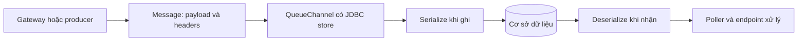

# Serialization của message

## 1. Mục tiêu và bối cảnh

Trong chương **Message store** của **SPRING_INTEGRATION_CORE**, serialization là bước biến trạng thái của một message thành dạng có thể lưu, còn deserialization dựng lại message từ dạng đó. Đây là ranh giới cần hiểu khi nối `Message`, `MessageChannel`, endpoint và gateway thành một luồng có khả năng tiếp tục xử lý sau gián đoạn.

Sau bài học, bạn có thể:

- Phân biệt message đang nằm trong bộ nhớ với message đã được mã hóa để lưu.
- Thiết kế payload và headers phù hợp với một message store bền vững.
- Nhận diện lỗi do đồ thị đối tượng, kênh trả lời tạm và thay đổi phiên bản dữ liệu.
- Cấu hình ví dụ Java DSL dùng JDBC-backed `QueueChannel`.
- Xây dựng kiểm thử cho việc ghi, đọc, khởi động lại và phục hồi khi không giải mã được message.

Ví dụ chính dùng **Java 17 và API Spring Integration 6.5**. Các đoạn cấu hình giả định các thư viện Spring cùng một bộ phiên bản tương thích. Phần JSON tích hợp sẵn được ghi rõ là dành cho **Spring Integration 7.0 trở lên**, không phải API có sẵn trong 6.5.

## 2. Ranh giới serialization nằm ở đâu?

Xét tình huống dịch vụ đặt hàng nhận yêu cầu, đưa vào hàng đợi, rồi một endpoint lấy ra để xử lý:



Với một kênh đồng bộ truyền trực tiếp, các endpoint có thể làm việc trên đối tượng Java trong cùng tiến trình mà chưa gặp ranh giới mã hóa. Khi message đi vào kho lưu trữ, nội dung cần đủ độc lập để được dựng lại ở lần đọc sau.

Một message trong bộ nhớ có thể hợp lệ đối với handler nhưng chưa chắc hợp lệ đối với store. Ví dụ, handler đọc được một `InputStream` còn mở; store lại không thể lưu vị trí đọc, tài nguyên hệ điều hành và vòng đời của stream chỉ bằng cách giữ một tham chiếu Java.

Spring Integration mô tả message store như cơ chế hỗ trợ những thành phần cần đệm message, chẳng hạn queue và aggregator. Cách biểu diễn payload, headers và trạng thái nhóm phụ thuộc implementation được chọn. [Tài liệu Message Store](https://docs.spring.io/spring-integration/reference/6.5/message-store.html).

Cần tách ba câu hỏi:

| Câu hỏi | Nội dung cần kiểm tra |
|---|---|
| Ghi được không? | Payload và headers có biểu diễn phù hợp với serializer không? |
| Đọc lại được không? | Reader có lớp, kiểu dữ liệu, cấu hình và phiên bản tương thích không? |
| Xử lý tiếp đúng không? | Routing, correlation, bảo đảm giao dịch và tác dụng phụ còn đúng không? |

Serialization giải quyết biểu diễn dữ liệu. Khả năng phục hồi của cả luồng còn phụ thuộc vào giao dịch, cơ chế thử lại, idempotency và cách tổ chức các endpoint.

## 3. Không có một quy tắc serialization chung cho mọi store

| Lựa chọn | Điều cần hiểu |
|---|---|
| `SimpleMessageStore` | Dùng bộ nhớ; việc message đi qua được chưa chứng minh khả năng ghi và đọc qua một định dạng lưu bền vững. |
| `JdbcMessageStore` | Phù hợp các nhu cầu lưu message và nhóm message, chẳng hạn aggregator hoặc claim check. |
| `JdbcChannelMessageStore` | Chuyên cho message channel; không thay thế trực tiếp store của aggregator. |
| Store Redis, MongoDB hoặc implementation khác | Kiểm tra cơ chế chuyển đổi và ánh xạ kiểu của đúng implementation; không suy từ hành vi của JDBC. |

Trong nhánh JDBC, tài liệu phân biệt `JdbcMessageStore` với `JdbcChannelMessageStore` và yêu cầu chuẩn bị schema tương ứng trước khi sử dụng. Query provider của channel store phải khớp hệ quản trị cơ sở dữ liệu. [JDBC Message Store](https://docs.spring.io/spring-integration/reference/6.5/jdbc/message-store.html).

Ví dụ, một bài thử chỉ dùng `SimpleMessageStore` có thể thành công với payload chứa service bean. Kết quả đó không phải bằng chứng để chuyển nguyên payload ấy sang kho JDBC.

Cũng cần phân biệt **message content** với **metadata điều phối**. Group key, region, thứ tự trong queue hoặc trạng thái hoàn tất nhóm có thể được lưu bằng cấu trúc riêng của store. Viết JSON cho payload không có nghĩa là đã tự hiện thực toàn bộ giao thức lưu nhóm của framework.

## 4. Java serialization: phải xét toàn bộ đồ thị đối tượng

### 4.1. Payload cần biểu diễn được

Khi dùng Java serialization, một payload có `implements Serializable` mới chỉ đáp ứng bước đầu. Các đối tượng được tham chiếu qua những trường tham gia serialization cũng phải phù hợp.

Ví dụ sau có vấn đề:

```java
import java.io.InputStream;
import java.io.Serializable;

public final class ImportRequest implements Serializable {
    private static final long serialVersionUID = 1L;

    private final String importId;
    private final InputStream content;

    public ImportRequest(String importId, InputStream content) {
        this.importId = importId;
        this.content = content;
    }
}
```

Đánh dấu `ImportRequest` là `Serializable` không khiến `InputStream` trở thành dữ liệu có thể lưu. Khi serializer duyệt đến một đối tượng không hỗ trợ serialization, Java có thể ném `NotSerializableException`. [Hợp đồng Serializable của Java 17](https://docs.oracle.com/en/java/javase/17/docs/api/java.base/java/io/Serializable.html).

Một thiết kế phù hợp hơn tùy dữ liệu:

- Nội dung nhỏ: đọc thành `byte[]` và đóng stream trước ranh giới lưu.
- Nội dung lớn: lưu tệp vào kho bền vững, rồi đưa `objectKey`, checksum và metadata cần thiết vào payload.
- Dữ liệu nghiệp vụ: ánh xạ thành DTO chỉ chứa các giá trị cần cho consumer.

Với phương án tham chiếu tệp, phải bảo đảm tệp còn tồn tại đến lúc consumer đọc. Nếu lưu tệp và ghi message là hai thao tác riêng, cần xử lý trường hợp một bên thành công và bên kia thất bại.

Đánh dấu trường `content` là `transient` chỉ loại nó khỏi dạng serialized. Consumer sẽ không tự nhận lại nội dung stream sau deserialization. Chỉ dùng `transient` khi giá trị bị bỏ có thể tái tạo hoặc không còn cần thiết.

### 4.2. Lớp bao ngoài không đại diện cho mọi phần tử bên trong

Giả sử một header có kiểu `ArrayList`:

```java
var details = new java.util.ArrayList<Object>();
details.add("source-A");
details.add(new Object());
```

Danh sách là serializable nhưng phần tử `new Object()` không phải. Kiểm tra duy nhất:

```java
headerValue instanceof java.io.Serializable
```

không chứng minh toàn bộ nội dung header ghi được.

Trong thiết kế message, nên đặt quy tắc về các kiểu giá trị được phép thay vì coi `Map<String, Object>` là một hợp đồng đủ chặt. Chẳng hạn, `tenantId` luôn là `String` và `schemaVersion` luôn là số nguyên.

### 4.3. Headers có thể bị loại bỏ trước khi ghi

Với cơ chế mặc định của `JdbcMessageStore`, tài liệu nêu rằng headers không serializable bị loại trước bước serialization. Vì vậy, **ghi thành công không chứng minh mọi header được giữ nguyên**. [Giới hạn serialization của Message Store](https://docs.spring.io/spring-integration/reference/6.5/message-store.html).

Hai tình huống cần phân biệt:

1. Header có giá trị trực tiếp không serializable: có thể bị loại theo cơ chế của store.
2. Header là container serializable nhưng chứa đối tượng con không serializable: serialization vẫn có thể thất bại.

Không lấy hành vi này làm cơ chế kiểm tra dữ liệu cho mọi store. Nên chuẩn hóa message trước khi lưu và kiểm thử chính xác những header mà phần còn lại của flow cần.

## 5. Thiết kế hợp đồng payload và headers

### 5.1. Payload là dữ liệu nghiệp vụ độc lập

Một payload đặt hàng đơn giản:

```java
package com.example.integration.message;

import java.io.Serializable;
import java.util.Objects;

public record OrderCreated(
        String orderId,
        long totalMinor,
        String currency
) implements Serializable {

    public OrderCreated {
        Objects.requireNonNull(orderId, "orderId");
        Objects.requireNonNull(currency, "currency");
        if (orderId.isBlank()) {
            throw new IllegalArgumentException("orderId must not be blank");
        }
        if (totalMinor < 0) {
            throw new IllegalArgumentException("totalMinor must be non-negative");
        }
    }
}
```

Đặt lớp này trong `OrderCreated.java`. Đoạn code dùng record để giảm mã lặp; không cần đưa entity JPA, proxy, datasource hoặc service vào payload.

`totalMinor` biểu diễn số đơn vị nhỏ nhất của đồng tiền theo quy ước hợp đồng. Ví dụ, `12500` với `USD` tương ứng `125.00 USD`. Consumer phải biết quy ước theo từng tiền tệ; không mặc định mọi tiền tệ đều có hai chữ số thập phân.

Record không khiến dữ liệu bất kỳ trở thành an toàn để serialize. Nếu đổi một thành phần thành `List<SomeType>`, vẫn phải xét kiểu và giá trị của từng phần tử.

### 5.2. Phân loại headers theo mục đích

| Header hoặc nhóm dữ liệu | Cách biểu diễn nên cân nhắc | Lý do |
|---|---|---|
| `eventId` | Chuỗi định danh duy nhất của sự kiện | Dùng cho truy vết và chống xử lý trùng |
| `tenantId` | Chuỗi | Chọn đúng phạm vi nghiệp vụ |
| `schemaVersion` | Số nguyên hoặc chuỗi phiên bản được quy định rõ | Chọn reader hoặc bước chuyển đổi |
| Correlation và sequence | Giá trị tương thích với correlation/release strategy | Giữ khả năng ghép nhóm và sắp thứ tự |
| `contentType` | Kiểu hoặc chuỗi mà converter mục tiêu hiểu | Tránh mất thông tin định dạng |
| `replyChannel`, `errorChannel` | Tên kênh ổn định hoặc cơ chế registry phù hợp | Tránh phụ thuộc trực tiếp vào đối tượng runtime |
| HTTP request, session, connection | Ánh xạ các giá trị cần thiết thành DTO hoặc metadata nhỏ | Không lưu cả hạ tầng xử lý yêu cầu |
| Bean, executor, transaction context | Tái lấy từ application context tại consumer | Vòng đời của chúng thuộc tiến trình ứng dụng |

Đây là một chính sách thiết kế cho ví dụ, không phải danh sách bắt buộc của Spring Integration.

`eventId` và `MessageHeaders.ID` phục vụ hai vai trò khác nhau. Một flow có thể tạo message mới khi transform hoặc enrich. Duy trì `eventId` riêng giúp nhận diện cùng sự kiện nghiệp vụ qua các bước đó.

`MessageHeaders.ID` và `TIMESTAMP` là headers đặc biệt. Không dùng `setHeader("id", ...)` để tùy tiện gán lại khi tái tạo message. Với codec tùy biến, cần nêu rõ cách bảo toàn hoặc ánh xạ định danh, rồi kiểm tra bằng round trip.

### 5.3. Chuẩn hóa trước ranh giới lưu

Một flow thực tế nên có một bước chuyển đổi đầu vào thành hợp đồng lưu:

```text
HTTP/JMS/file input
    -> transformer tạo DTO
    -> chuẩn hóa headers cần thiết
    -> filter kiểm tra hợp đồng
    -> persistent channel hoặc aggregator
    -> consumer
```

Transformer chịu trách nhiệm ánh xạ dữ liệu. Filter có thể từ chối message thiếu `eventId`, phiên bản không được hỗ trợ hoặc payload vượt giới hạn. Router sau khi đọc có thể chọn nhánh xử lý theo loại sự kiện hoặc `tenantId`.

Nếu chọn cách chỉ giữ một danh sách headers, phải đưa cả headers mà EIP tiếp theo cần vào danh sách. Xóa nhầm correlation hoặc sequence có thể khiến aggregator chờ mãi dù mọi payload đều deserialize thành công.

## 6. Kênh trả lời, kênh lỗi và giới hạn của gateway

### 6.1. Đối tượng channel không phải địa chỉ lưu bền vững

Một tham chiếu `MessageChannel` trỏ tới đối tượng đang sống trong application context. Kể cả một đối tượng có thể chuyển thành bytes, bản được dựng lại cũng không mặc nhiên là bean channel mà flow cần dùng.

Ví dụ, synchronous gateway có thể tạo kênh trả lời tạm để chờ kết quả:

```text
gateway đang chờ
    -> message có replyChannel tạm
    -> persistent queue
    -> consumer chạy sau đó
```

Sau khi tiến trình khởi động lại, lời gọi Java đang chờ đã chấm dứt. Việc có lại dữ liệu request không khôi phục stack của thread gọi gateway.

### 6.2. HeaderChannelRegistry giải quyết ánh xạ trong một vòng đời phù hợp

Header enricher có thể đổi `replyChannel` và `errorChannel` từ đối tượng channel sang chuỗi do `HeaderChannelRegistry` quản lý. Registry giữ ánh xạ để framework tìm lại channel khi gửi reply hoặc lỗi. [Header Channel Registry](https://docs.spring.io/spring-integration/reference/6.5/content-enrichment.html).

Một đoạn cấu hình XML minh họa:

```xml
<int:header-enricher input-channel="beforeStore"
                     output-channel="persistentInput"
                     xmlns:int="http://www.springframework.org/schema/integration">
    <int:header-channels-to-string/>
</int:header-enricher>
```

Đoạn này minh họa một thành phần bên trong cấu hình Spring XML, không phải toàn bộ application context.

Thời gian giữ ánh xạ phải phù hợp thời gian đợi. Registry mặc định là trạng thái trong bộ nhớ: không suy rằng một chuỗi sinh từ channel tạm sẽ phân giải được sau restart hoặc trên JVM khác.

### 6.3. Phản hồi nghiệp vụ lâu dài cần hợp đồng riêng

Với tác vụ có thể chạy sau restart hoặc chờ nhiều phút, nên cân nhắc:

1. Producer gửi command với `requestId` hoặc `eventId`.
2. Consumer xử lý rồi phát kết quả tới kênh hoặc đích phản hồi được cấu hình ổn định.
3. Bên nhận tra cứu kết quả hoặc ghép response bằng correlation ID.

Tên bean channel ổn định chỉ phân giải trong application context tương ứng. Khi producer và consumer ở các tiến trình khác nhau, phải có transport hoặc địa chỉ phản hồi mà cả hai bên hiểu; tên bean tự nó không tạo kết nối liên tiến trình.

Với yêu cầu gửi một chiều, gateway có phương thức `void` phù hợp hơn việc giữ một lời gọi đồng bộ qua thời gian chờ dài của queue.

## 7. Ví dụ Java DSL với JDBC-backed QueueChannel

### 7.1. Điều kiện của ví dụ

Cần có `spring-integration-core`, `spring-integration-jdbc`, `spring-jdbc`, trình điều khiển H2 và các dependency Spring tương thích. Nếu dùng Spring Boot, để BOM phù hợp quản lý bộ phiên bản thay vì ghép các phiên bản Spring tùy ý.

Ví dụ sau giả định:

- `DataSource` đã được ứng dụng khai báo.
- Schema H2 của Spring Integration đã được tạo trước khi context khởi động.
- Database tồn tại độc lập với vòng đời consumer nếu cần thử restart.
- Payload là `OrderCreated` ở mục 5.
- Producer chỉ gửi headers đã chuẩn hóa.

Script mẫu nằm trong JAR tại `org/springframework/integration/jdbc/schema-h2.sql`. Trong môi trường cần giữ dữ liệu, quản lý schema bằng migration; không chạy script xóa/tạo lại bảng mỗi lần restart.

### 7.2. Khai báo store, channel và consumer

```java
package com.example.integration.config;

import javax.sql.DataSource;

import com.example.integration.message.OrderCreated;
import org.springframework.context.annotation.Bean;
import org.springframework.context.annotation.Configuration;
import org.springframework.integration.channel.QueueChannel;
import org.springframework.integration.config.EnableIntegration;
import org.springframework.integration.dsl.IntegrationFlow;
import org.springframework.integration.dsl.Pollers;
import org.springframework.integration.jdbc.store.JdbcChannelMessageStore;
import org.springframework.integration.jdbc.store.channel.H2ChannelMessageStoreQueryProvider;
import org.springframework.integration.store.MessageGroupQueue;
import org.springframework.jdbc.datasource.DataSourceTransactionManager;
import org.springframework.transaction.PlatformTransactionManager;

@Configuration
@EnableIntegration
public class DurableOrderFlowConfiguration {

    @Bean
    JdbcChannelMessageStore orderChannelStore(DataSource dataSource) {
        JdbcChannelMessageStore store =
                new JdbcChannelMessageStore(dataSource);
        store.setChannelMessageStoreQueryProvider(
                new H2ChannelMessageStoreQueryProvider());
        store.setRegion("orders");
        return store;
    }

    @Bean
    QueueChannel durableOrders(JdbcChannelMessageStore orderChannelStore) {
        MessageGroupQueue queue =
                new MessageGroupQueue(orderChannelStore, "order-created");
        return new QueueChannel(queue);
    }

    @Bean
    PlatformTransactionManager integrationTransactionManager(
            DataSource dataSource) {
        return new DataSourceTransactionManager(dataSource);
    }

    @Bean
    IntegrationFlow orderConsumer(
            PlatformTransactionManager integrationTransactionManager) {
        return IntegrationFlow.from("durableOrders")
                .handle(OrderCreated.class, (order, headers) -> {
                    System.out.printf(
                            "eventId=%s orderId=%s totalMinor=%d%n",
                            headers.get("eventId"),
                            order.orderId(),
                            order.totalMinor());
                    return null;
                }, endpoint -> endpoint.poller(
                        Pollers.fixedDelay(1000)
                                .maxMessagesPerPoll(1)
                                .transactional(
                                        integrationTransactionManager)))
                .get();
    }
}
```

Handler trả `null` vì ví dụ kết thúc việc xử lý tại đây. Khi thay bằng nghiệp vụ thật, có thể nối endpoint tiếp theo hoặc phát event kết quả theo hợp đồng của ứng dụng.

`MessageGroupQueue` cần group ID ổn định để cùng queue logic được nhận diện qua các lần khởi động. Đổi ngẫu nhiên `"order-created"` mỗi lần chạy sẽ làm consumer nhìn sang nhóm khác. [API MessageGroupQueue 6.5](https://docs.spring.io/spring-integration/docs/6.5.0/api/org/springframework/integration/store/MessageGroupQueue.html).

`transactional(...)` gắn transaction advice cho polling task. Cần truyền transaction manager quản lý cùng datasource của store. [API PollerSpec 6.5](https://docs.spring.io/spring-integration/docs/6.5.0/api/org/springframework/integration/dsl/PollerSpec.html).

### 7.3. Producer gửi message

Đặt đoạn sau trong phương thức của producer đã được inject bean `durableOrders`:

```java
import java.util.UUID;

import com.example.integration.message.OrderCreated;
import org.springframework.messaging.Message;
import org.springframework.messaging.support.MessageBuilder;

// durableOrders là bean QueueChannel của cấu hình phía trên.
OrderCreated payload = new OrderCreated("ORD-1001", 12500, "USD");

Message<OrderCreated> message = MessageBuilder.withPayload(payload)
        .setHeader("eventId", UUID.randomUUID().toString())
        .setHeader("tenantId", "tenant-a")
        .setHeader("schemaVersion", 1)
        .build();

boolean accepted = durableOrders.send(message);
if (!accepted) {
    throw new IllegalStateException("Message was not accepted");
}
```

`accepted` không có nghĩa đơn hàng đã được xử lý. Nếu thao tác gửi đang nằm trong một giao dịch bên ngoài, tính bền vững còn phụ thuộc giao dịch đó có commit hay không.

Để quan sát lưu và đọc tách rời, dừng consumer, gửi một message và xác nhận giao dịch ghi đã commit. Sau đó khởi động lại consumer với cùng database, region và group ID. Không dùng H2 in-memory rồi đóng toàn bộ database để kết luận dữ liệu phải sống qua restart.

### 7.4. Giao dịch không bao trùm mọi tác dụng phụ

Trong ví dụ, transaction có thể bao việc lấy message khỏi JDBC queue và xử lý đồng bộ trên cùng thread. Nếu chuyển sang channel dùng executor hoặc khởi chạy tác vụ bất đồng bộ, phải xác định lại ranh giới giao dịch. [Transaction Support](https://docs.spring.io/spring-integration/reference/6.5/transactions.html).

Một lời gọi HTTP tới hệ thống ngoài không tự rollback cùng transaction JDBC. Nếu HTTP thành công rồi transaction đọc queue rollback, message có thể được xử lý lại và gọi HTTP lần nữa.

Do đó, consumer cần idempotency theo `eventId` hoặc khóa nghiệp vụ khi tác dụng phụ không được phép lặp. Việc serialize thành công không tạo ra bảo đảm exactly-once cho toàn bộ hệ thống.


## 8. Kiểm thử bằng chính implementation lưu trữ

### 8.1. Round trip phải kiểm tra cả nội dung lẫn metadata

Một kiểm thử có ý nghĩa cần đi qua thao tác ghi và đọc của store, không chỉ gọi serializer của riêng payload.

Ví dụ dưới dùng JUnit 5, Spring Test và H2. Đặt trong `JdbcStoreSerializationTest.java`, cùng package với `OrderCreated` ở mục 5. Database in-memory ở đây chỉ phục vụ kiểm thử mapping và serialization; nó không chứng minh khả năng phục hồi sau khi tiến trình kết thúc.

```java
package com.example.integration.message;

import java.io.NotSerializableException;
import java.util.ArrayList;
import java.util.UUID;

import javax.sql.DataSource;

import org.junit.jupiter.api.Test;
import org.springframework.beans.factory.annotation.Autowired;
import org.springframework.context.annotation.Bean;
import org.springframework.context.annotation.Configuration;
import org.springframework.integration.jdbc.store.JdbcMessageStore;
import org.springframework.jdbc.datasource.embedded.EmbeddedDatabase;
import org.springframework.jdbc.datasource.embedded.EmbeddedDatabaseBuilder;
import org.springframework.jdbc.datasource.embedded.EmbeddedDatabaseType;
import org.springframework.messaging.Message;
import org.springframework.messaging.support.MessageBuilder;
import org.springframework.test.context.junit.jupiter.SpringJUnitConfig;

import static org.junit.jupiter.api.Assertions.*;

@SpringJUnitConfig(JdbcStoreSerializationTest.Config.class)
class JdbcStoreSerializationTest {

    @Autowired
    JdbcMessageStore store;

    @Test
    void restoresPayloadAndRequiredHeaders() {
        String eventId = UUID.randomUUID().toString();
        OrderCreated payload =
                new OrderCreated("ORD-2001", 12500, "USD");

        Message<OrderCreated> original =
                MessageBuilder.withPayload(payload)
                        .setHeader("eventId", eventId)
                        .setHeader("tenantId", "tenant-a")
                        .setHeader("schemaVersion", 1)
                        .setHeader("runtimeOnly", new Object())
                        .build();

        UUID messageId = original.getHeaders().getId();
        assertNotNull(messageId);

        store.addMessage(original);
        Message<?> restored = store.getMessage(messageId);

        assertNotNull(restored);
        assertEquals(payload, restored.getPayload());
        assertEquals(eventId, restored.getHeaders().get("eventId"));
        assertEquals("tenant-a", restored.getHeaders().get("tenantId"));
        assertEquals(1, restored.getHeaders().get("schemaVersion"));
        assertEquals(messageId, restored.getHeaders().getId());
        assertEquals(
                original.getHeaders().getTimestamp(),
                restored.getHeaders().getTimestamp());

        // Hành vi của JdbcMessageStore mặc định trong ví dụ.
        assertNull(restored.getHeaders().get("runtimeOnly"));
    }

    @Test
    void rejectsSerializableContainerWithNonSerializableElement() {
        ArrayList<Object> nested = new ArrayList<>();
        nested.add("value");
        nested.add(new Object());

        Message<OrderCreated> message =
                MessageBuilder.withPayload(
                                new OrderCreated("ORD-2002", 100, "USD"))
                        .setHeader("nested", nested)
                        .build();

        RuntimeException failure = assertThrows(
                RuntimeException.class,
                () -> store.addMessage(message));

        Throwable root = failure;
        while (root.getCause() != null) {
            root = root.getCause();
        }
        assertInstanceOf(NotSerializableException.class, root);
    }

    @Configuration
    static class Config {

        @Bean(destroyMethod = "shutdown")
        EmbeddedDatabase dataSource() {
            return new EmbeddedDatabaseBuilder()
                    .generateUniqueName(true)
                    .setType(EmbeddedDatabaseType.H2)
                    .addScript(
                            "org/springframework/integration/jdbc/schema-h2.sql")
                    .build();
        }

        @Bean
        JdbcMessageStore store(DataSource dataSource) {
            return new JdbcMessageStore(dataSource);
        }
    }
}
```

Hai test thể hiện hai dạng kết quả khác nhau: một header trực tiếp không serializable bị bỏ, còn container có phần tử con không serializable làm thao tác ghi thất bại.

Đây là ví dụ kiểm thử để người học đưa vào dự án phù hợp. Việc có đoạn code trong bài không đồng nghĩa nó đã được chạy trong môi trường dự án của bạn.

### 8.2. Kiểm thử khởi động lại phải tạo lại context

Kịch bản kiểm thử tích hợp cho queue ở mục 7:

1. Tạo schema trong một database được giữ qua hai lần tạo application context.
2. Tạo context A với consumer chưa chạy.
3. Gửi message, đợi giao dịch ghi commit và đóng context A.
4. Tạo context B với cùng datasource, region và group ID.
5. Nhận message bằng consumer mới và kiểm tra payload, `eventId`, headers bắt buộc.
6. Xác nhận message được lấy đúng một lần trong kịch bản thành công không có lỗi.

Bước 6 chỉ xác nhận kịch bản kiểm thử đó, không suy rộng thành exactly-once trong mọi tình huống.

Nên có thêm trường hợp đổi group ID có chủ đích: consumer mới không thấy message cũ qua queue logic mới. Thử nghiệm này giúp phân biệt dữ liệu mất với cấu hình đang nhìn sang phân vùng hoặc nhóm khác.

### 8.3. Các kiểm thử mở rộng theo rủi ro

| Tình huống | Kết quả cần kiểm tra |
|---|---|
| Producer ghi payload không serializable | Thao tác gửi thất bại rõ ràng; không báo đã tiếp nhận thành công |
| Header correlation hoặc sequence cần cho aggregator | Giá trị và kiểu vẫn được giữ khi đọc |
| Handler ném lỗi trong transaction đọc JDBC queue | Message có thể nhận lại sau rollback theo cấu hình giao dịch |
| Message có named channel | Bean mục tiêu phân giải được trong context consumer |
| Message dùng channel tạm qua registry | Hoạt động trong vòng đời hỗ trợ; không giả định khôi phục sau restart |
| Reader mới gặp dữ liệu phiên bản cũ | Đọc hoặc upcast đúng; dữ liệu không hỗ trợ được nhận diện rõ |
| Dữ liệu lưu bị hỏng | Có thông tin để xác định bản ghi và cơ chế cách ly phù hợp |
| Payload gần giới hạn kích thước | Ghi, đọc và độ trễ vẫn đáp ứng mục tiêu ứng dụng |

Đối với aggregator, kiểm tra thêm việc tái lập nhóm và điều kiện release. Đọc lại được từng payload nhưng mất correlation ID vẫn có thể làm luồng không hoàn tất.

## 9. Tùy biến serializer và lựa chọn JSON

### 9.1. Serializer và deserializer là một cặp hợp đồng

`JdbcMessageStore` cung cấp `setSerializer(...)` và `setDeserializer(...)`. Kiểu dữ liệu được mã hóa ở đây là **message**, không chỉ payload. [API JdbcMessageStore 6.5](https://docs.spring.io/spring-integration/docs/6.5.0/api/org/springframework/integration/jdbc/store/JdbcMessageStore.html).

Đoạn sau minh họa điểm cắm trong một lớp `@Configuration`:

```java
import javax.sql.DataSource;

import org.springframework.beans.factory.annotation.Qualifier;
import org.springframework.context.annotation.Bean;
import org.springframework.core.serializer.Deserializer;
import org.springframework.core.serializer.Serializer;
import org.springframework.integration.jdbc.store.JdbcMessageStore;
import org.springframework.messaging.Message;

@Bean
JdbcMessageStore customMessageStore(
        DataSource dataSource,
        @Qualifier("storedMessageWriter")
        Serializer<Message<?>> writer,
        @Qualifier("storedMessageReader")
        Deserializer<Message<?>> reader) {

    JdbcMessageStore store = new JdbcMessageStore(dataSource);
    store.setSerializer(writer);
    store.setDeserializer(reader);
    return store;
}
```

Ứng dụng phải tự cung cấp hai bean `storedMessageWriter` và `storedMessageReader`. Đoạn này không phải một JSON codec hoàn chỉnh.

Một codec tùy biến cần quy định:

- Encoding và cấu trúc envelope.
- Cách biểu diễn kiểu payload, số, thời điểm và giá trị null.
- Headers nào được lưu, giá trị nào được chuẩn hóa và giá trị nào bị từ chối.
- Cách giữ hoặc ánh xạ message ID, timestamp và correlation.
- Hành vi khi phiên bản hoặc loại sự kiện không được hỗ trợ.
- Giới hạn kích thước và lỗi được ném khi dữ liệu không hợp lệ.

Phải kiểm tra cả xử lý trước serialization của chính store. Cắm một JSON writer không tự bảo đảm mọi đối tượng runtime trong headers sẽ được giữ.

Với `JdbcChannelMessageStore`, điểm mở rộng khác với generic store. API có `setPreparedStatementSetter(...)`, `setMessageRowMapper(...)` và `setDeserializer(...)`; không sao chép lời gọi `setSerializer(...)` từ generic store sang channel store. [API JdbcChannelMessageStore 6.5](https://docs.spring.io/spring-integration/docs/6.5.0/api/org/springframework/integration/jdbc/store/JdbcChannelMessageStore.html).

### 9.2. Envelope có phiên bản là một lựa chọn thiết kế

Ví dụ cấu trúc lưu do ứng dụng tự định nghĩa:

```json
{
  "schemaVersion": 1,
  "eventType": "order.created",
  "eventId": "evt-9e6b70b4",
  "payload": {
    "orderId": "ORD-3001",
    "totalMinor": 12500,
    "currency": "USD"
  },
  "headers": {
    "tenantId": "tenant-a",
    "correlationId": "checkout-109"
  }
}
```

Đây là envelope minh họa của ứng dụng, không phải schema JSON mặc định của Spring Integration và cũng chưa phải toàn bộ bản ghi store.

`eventType` là tên nghiệp vụ ổn định. Reader có thể ánh xạ `order.created` cùng `schemaVersion` sang một DTO đã biết bằng danh sách cho phép. Cách này giúp tránh gắn hợp đồng dữ liệu trực tiếp vào tên package Java.

Nếu envelope được dùng để tái tạo `Message<?>`, phải bổ sung chính sách cho những headers framework cần mà ví dụ JSON đã lược bỏ. Một POJO được đọc lại đúng không chứng minh queue, gateway hoặc aggregator vận hành đúng.

### 9.3. JSON có sẵn cho channel store từ 7.0

Spring Integration 7.0 bổ sung cặp `JsonChannelMessageStorePreparedStatementSetter` và `JsonMessageRowMapper` cho `JdbcChannelMessageStore`. Schema mặc định có cột binary không dùng nguyên trạng cho lựa chọn này; cần kiểu cột chứa nội dung JSON phù hợp. [JDBC Channel Message Store JSON Serialization](https://docs.spring.io/spring-integration/reference/7.0/jdbc/message-store-json.html).

Với ứng dụng đã dùng 7.0 trở lên, có thể cấu hình hai thành phần theo dạng sau:

```java
import org.springframework.integration.jdbc.store.channel.JsonChannelMessageStorePreparedStatementSetter;
import org.springframework.integration.jdbc.store.channel.JsonMessageRowMapper;

// store đã có datasource và query provider khớp database.
// Schema MESSAGE_CONTENT đã được chuẩn bị cho nội dung JSON.
store.setPreparedStatementSetter(
        new JsonChannelMessageStorePreparedStatementSetter());
store.setMessageRowMapper(
        new JsonMessageRowMapper("com.example.integration.message"));
```

`JsonMessageRowMapper` dùng danh sách package tin cậy để kiểm soát các lớp được dựng lại. Writer và reader cần cấu hình ánh xạ tương thích. [API JsonMessageRowMapper](https://docs.spring.io/spring-integration/docs/current/api/org/springframework/integration/jdbc/store/channel/JsonMessageRowMapper.html).

Đừng hiểu việc đổi kiểu cột là đã chuyển đổi các bản ghi Java serialization cũ thành JSON. Nội dung binary cũ cần được đọc bằng reader cũ rồi ghi lại theo định dạng mới, hoặc được tiêu thụ hết trước khi chuyển.

Trong giai đoạn chuyển đổi, nên có cách phân biệt định dạng hoặc tách nơi lưu theo kế hoạch migration. Nếu reader JSON gặp bytes Java serialization, việc cùng là “dữ liệu trong database” không giúp hai bên hiểu nhau.

### 9.4. Chọn định dạng theo vòng đời dữ liệu

| Tiêu chí | Java serialization | Envelope JSON do ứng dụng quản lý |
|---|---|---|
| Quan hệ với mã Java | Phụ thuộc định danh lớp và quy tắc serialization | Có thể dùng schema và loại sự kiện độc lập tên lớp |
| Quan sát dữ liệu | Thường cần công cụ giải mã binary | Dễ xem cấu trúc, nhưng vẫn cần kiểm soát quyền truy cập |
| Thay đổi phiên bản | Phải xét khả năng tương thích lớp | Phải quy định field, default và migration |
| Đa ngôn ngữ | Không phải lựa chọn thuận tiện | Phù hợp hơn nếu hợp đồng kiểu được định nghĩa rõ |
| Công sức hiện thực | Thuận tiện cho DTO Java đơn giản | Cần thiết kế mapping và kiểm thử hợp đồng |
| An toàn khi đọc | Cần kiểm soát lớp và giới hạn đồ thị | Cần kiểm soát kiểu, kích thước và nội dung |

Bảng so sánh định hướng lựa chọn, không khẳng định JSON luôn nhanh hơn hoặc luôn an toàn hơn. Đo trên payload thực tế và vòng đời lưu thực tế của hệ thống.

## 10. Tương thích dữ liệu qua các lần triển khai

Một hàng đợi lưu bền vững nối producer hôm qua với consumer hôm nay. Do đó, kiểu dữ liệu đang nằm trong database cũng là một phần của hợp đồng triển khai.

Với lớp `Serializable` thông thường, `serialVersionUID` giúp xác định tương thích phiên bản serialization. Khai báo UID cố định không làm mọi thay đổi cấu trúc trở nên tương thích; đổi tên lớp, đổi kiểu trường hoặc thay đổi ý nghĩa dữ liệu vẫn cần đánh giá. Quy tắc của record có khác biệt với lớp thông thường, nên không áp dụng máy móc hướng dẫn UID cho record trong ví dụ. [Đặc tả versioning của Java serialization](https://docs.oracle.com/en/java/javase/17/docs/specs/serialization/version.html).

Ví dụ các thay đổi nghiệp vụ cần quyết định:

| Thay đổi | Vấn đề thực tế |
|---|---|
| Thêm `salesChannel` | Message cũ không có giá trị; reader cần default hoặc nhánh tương thích |
| Đổi `totalMinor` sang `amount` dạng thập phân | Không chỉ là đổi tên field; đơn vị và kiểu dữ liệu đã thay đổi |
| Chuyển package của DTO | Dữ liệu chứa tên lớp cũ có thể không còn đọc được |
| Đổi enum | Consumer cũ có thể không hiểu giá trị producer mới |
| Đổi ý nghĩa correlation ID | Dữ liệu vẫn parse được nhưng có thể bị ghép sai nhóm |

Một quy trình nâng cấp có kiểm soát:

1. Lưu các mẫu message thực tế của phiên bản đang chạy trong bộ dữ liệu kiểm thử.
2. Cho reader mới đọc các mẫu cũ và xác nhận ý nghĩa nghiệp vụ.
3. Nếu triển khai rolling, kiểm tra cả hướng reader cũ gặp dữ liệu do producer mới ghi.
4. Chọn duy trì khả năng tương thích, upcast, migration hoặc tiêu thụ hết backlog.
5. Giữ kế hoạch rollback tương ứng với định dạng mà phiên bản cũ còn đọc được.

`schemaVersion` giúp chọn cách đọc; nó không tự thực hiện migration. Upcaster cần được hiện thực và kiểm thử, chẳng hạn chuyển envelope v1 thiếu `salesChannel` thành cấu trúc nội bộ hiện tại với giá trị được nghiệp vụ chấp nhận.

## 11. Xử lý lỗi tại đúng giai đoạn

### 11.1. Phân biệt lỗi ghi, lỗi đọc và lỗi nghiệp vụ

| Giai đoạn | Biểu hiện có thể gặp | Hướng xử lý |
|---|---|---|
| Chuẩn hóa đầu vào | Thiếu ID, phiên bản sai, payload vượt giới hạn | Từ chối trước khi nhận vào queue |
| Serialize khi gửi | `NotSerializableException` hoặc ngoại lệ bọc ngoài | Kiểm tra đường dẫn đến đối tượng gây lỗi, sửa hợp đồng |
| Ghi database | Lỗi kết nối hoặc ràng buộc dữ liệu | Áp dụng transaction và retry cho lỗi tạm thời |
| Deserialize khi nhận | Thiếu lớp, sai định dạng, lớp không được phép | Xác định phiên bản, cấu hình reader và bản ghi liên quan |
| Handler sau khi đọc | Quy tắc nghiệp vụ không thỏa hoặc dịch vụ ngoài lỗi | Áp dụng error flow và chính sách thử lại theo loại lỗi |
| Gửi reply hoặc lỗi | Không phân giải được channel | Kiểm tra tên kênh, registry và vòng đời lời gọi |

Ngoại lệ trên bề mặt có thể là ngoại lệ Spring bọc lỗi gốc. Log nên giữ nguyên cause chain và định danh cần thiết, thay vì chỉ ghi tên ngoại lệ ngoài cùng.

### 11.2. Lỗi deserialize có thể xảy ra trước khi có Message

Nếu store chưa dựng được message, handler nghiệp vụ chưa nhận được payload. Không thể mặc định error flow sẽ có một `failedMessage` đầy đủ để đưa sang dead-letter channel.

Cần thiết kế khả năng xác định bản ghi bằng thông tin store và metadata có thể đọc độc lập với nội dung bị lỗi. Khi buộc phải cách ly dữ liệu, giữ bản gốc hoặc bản sao kiểm soát được để điều tra và replay.

Message lỗi ở đầu queue có thể tiếp tục gây lỗi mỗi lần poll. Việc tăng số lần retry không sửa được tên lớp đã mất hoặc định dạng không được hỗ trợ.

### 11.3. Retry và cách ly phải giữ nhất quán

Phân loại tối thiểu:

- Lỗi tạm thời, ví dụ database gián đoạn: có thể thử lại với backoff phù hợp.
- Lỗi hợp đồng, ví dụ loại sự kiện không hỗ trợ: cần chuyển đổi, cách ly hoặc từ chối theo quy trình.
- Lỗi nghiệp vụ sau khi đọc: quyết định retry dựa trên tính có thể phục hồi và tác dụng phụ.

Thao tác chuyển message lỗi sang nơi cách ly và bỏ nó khỏi queue cần được thiết kế để tránh mất dữ liệu nếu tiến trình dừng giữa hai bước.

Không xóa trực tiếp một hàng bất kỳ trong store rồi coi đã giải quyết xong: generic message store và aggregator có thể còn liên kết nhóm hoặc metadata cần nhất quán. Sử dụng API và quy trình vận hành hiểu cấu trúc của implementation tương ứng.

Lỗi serialize trong luồng gửi đồng bộ thường trở về caller của thao tác gửi. Việc khai báo một bean tên `errorChannel` không tự bảo đảm mọi lỗi producer đều đi vào channel đó. Ngược lại, lỗi phát sinh trong polling task cần được xử lý theo cơ chế lỗi của poller.

## 12. Kiểm soát deserialization và dữ liệu lưu

Dữ liệu trong database vẫn cần có ranh giới tin cậy. Nếu một bên có thể ghi nội dung tùy ý vào cột serialized, consumer không nên tự do dựng mọi loại Java object từ nội dung đó.

Java cung cấp cơ chế serialization filter để giới hạn lớp, kích thước và độ phức tạp của đồ thị đối tượng khi đọc. Cấu hình cần phù hợp với toàn bộ message và payload thực tế. [Java Serialization Filtering](https://docs.oracle.com/en/java/javase/17/core/serialization-filtering1.html).

Spring Integration 6.5 có `AllowListDeserializingConverter` và API cấu hình allowed patterns cho các JDBC store. Khi dùng danh sách cho phép, cần tính cả lớp envelope, headers và các kiểu con được sử dụng, không chỉ DTO nghiệp vụ. [API AllowListDeserializingConverter 6.5](https://docs.spring.io/spring-integration/docs/6.5.0/api/org/springframework/integration/support/converter/AllowListDeserializingConverter.html).

Một chính sách phù hợp cho ứng dụng nên kết hợp:

- Chỉ cho phép các loại payload và headers thuộc hợp đồng.
- Giới hạn kích thước message trước khi ghi, đồng thời kiểm soát tài nguyên khi đọc.
- Hạn chế quyền ghi trực tiếp vào bảng store.
- Tránh đưa token, mật khẩu và thông tin không cần thiết vào message.
- Ghi log theo ID và loại lỗi; chỉ truy cập nội dung nhạy cảm qua quy trình phù hợp.

Với JSON, không bật cơ chế dựng lớp tùy ý chỉ để làm mất lỗi mapping. Ánh xạ theo loại sự kiện được phép hoặc cấu hình trusted packages hẹp theo đúng nhu cầu của reader.

Binary serialization cũng không phải mã hóa bảo mật. Nếu cần bảo vệ nội dung lưu, phải dùng biện pháp bảo vệ dữ liệu tương ứng; không dựa vào việc khó đọc bằng mắt.

## 13. Kích thước, hiệu năng và dung lượng backlog

Chi phí lưu message bao gồm serialization, kích thước nội dung, thao tác database, index và deserialization. Payload nhỏ nhưng chứa nhiều headers lớn vẫn có thể tạo bản ghi lớn.

Một ước tính ban đầu:

```text
dung lượng nội dung backlog
    ≈ số message đến mỗi giây
      × thời gian có thể tích đọng
      × kích thước serialized trung bình
```

Ví dụ, `100 message/giây × 7.200 giây × 4 KiB` tạo khoảng **2,75 GiB** nội dung, chưa tính index, metadata, transaction log và dung lượng dự phòng.

Để ra quyết định, đo:

| Chỉ số | Mục đích |
|---|---|
| Kích thước serialized trung bình và p95 | Phát hiện payload hoặc headers bất thường |
| Thời gian ghi và đọc | Xác định serialization hay database đang chi phối |
| Tuổi của message cũ nhất | Đánh giá consumer có theo kịp producer không |
| Số lỗi theo phiên bản hoặc loại sự kiện | Nhận biết lỗi hợp đồng sau triển khai |
| Tốc độ tăng backlog | Ước tính thời gian và dung lượng phục hồi |

Tránh tối ưu bằng cách bỏ headers mà flow cần. Với nội dung rất lớn, có thể cân nhắc claim check: lưu nội dung ở kho khác, message mang khóa tham chiếu và metadata. Đổi lại, phải quản lý thời hạn sống, tính toàn vẹn và quyền truy cập của nội dung ngoài store.

Nếu nén dữ liệu, cả writer lẫn reader phải nhận diện được định dạng nén. Giới hạn kích thước sau giải nén cũng quan trọng như kích thước bản ghi trước giải nén.

## 14. Thực hành theo một luồng đặt hàng

Thực hiện các bước sau trong một dự án thử nghiệm sử dụng đúng bộ phiên bản:

1. Tạo `OrderCreated` và schema của database đã chọn.
2. Tạo JDBC queue với region và group ID cố định như mục 7.
3. Gửi message chỉ gồm payload và các headers `eventId`, `tenantId`, `schemaVersion`.
4. Dừng rồi tạo lại context consumer; xác nhận message đã commit được xử lý tiếp.
5. Thêm header chứa `new Object()` và quan sát kết quả qua round trip.
6. Thay bằng một danh sách chứa `new Object()` để quan sát lỗi đồ thị đối tượng.
7. Cho handler ném ngoại lệ trước khi hoàn tất transaction, rồi kiểm tra việc nhận lại.
8. Dùng hai phiên bản envelope hoặc DTO để kiểm tra kế hoạch nâng cấp.

Kết quả cần thu được là một hợp đồng lưu có thể mô tả rõ: loại payload, tập headers, định dạng, phiên bản, khả năng đọc dữ liệu cũ và cách xử lý dữ liệu không hỗ trợ.

Khi đưa luồng này vào ứng dụng, giữ bước chuẩn hóa trước store, kiểm tra round trip bằng implementation thật và quyết định mô hình phản hồi ngay từ thiết kế gateway. Ba lựa chọn đó giúp nối việc lưu dữ liệu với hành vi đúng của các endpoint phía sau.
