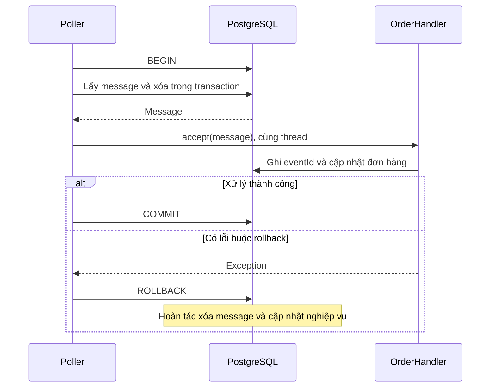

# Chọn message store theo failure model

## 1. Bắt đầu từ điều phải còn đúng sau sự cố

Trong chương **Message store** của module **SPRING_INTEGRATION_CORE**, việc chọn nơi lưu message gắn trực tiếp với cách thiết kế luồng bằng `Message`, `MessageChannel`, endpoint, gateway và Java DSL. Một transformer có thể tính lại đầu ra từ đầu vào, nhưng một aggregator đang chờ hai phần còn thiếu phải giữ được những phần đã nhận. Một `QueueChannel` có thể nhận message thành công trong khi service activator chưa kịp xử lý.

**Failure model** là tập các sự cố mà thiết kế cam kết chịu được, kèm giả định về những thành phần vẫn hoạt động. Chẳng hạn, “chịu được JVM bị dừng đột ngột, với điều kiện database còn nguyên và các giao dịch đã commit không bị mất” cụ thể hơn nhiều so với “dùng persistent store”.

Bài này giúp bạn:

- Phân biệt độ bền dữ liệu, tính nguyên tử, khả năng phục hồi và chống xử lý trùng.
- Chọn implementation phù hợp cho hàng đợi và cho nhóm message của aggregator.
- Xác định ranh giới transaction giữa việc lấy message và tác động nghiệp vụ.
- Thiết kế kiểm thử gây lỗi để kiểm chứng đúng cam kết đã đặt ra.

Các ví dụ Java dùng API được đối chiếu với Spring Integration 6.5. Dự án thực tế cần dùng bộ phiên bản Spring tương thích do BOM hoặc Spring Boot quản lý; không sao chép một số phiên bản riêng lẻ vào dự án đang dùng bộ dependency khác.

### Tình huống xuyên suốt

Một hệ thống nhận sự kiện `OrderApproved`, đệm chúng rồi cập nhật bảng trạng thái đơn hàng. Nhóm phát triển đặt ra các yêu cầu giả định:

1. Sau khi xác nhận đã tiếp nhận bền vững, sự kiện phải còn sau khi JVM chết.
2. Nếu cập nhật nghiệp vụ thất bại, công việc phải có thể thực hiện lại.
3. Nguồn có thể gửi lại cùng sự kiện khi không nhận được phản hồi.
4. Một số luồng khác cần gom nhiều sự kiện theo `orderId`.
5. Khi kho lưu không truy cập được, hệ thống phải thể hiện rõ việc chưa tiếp nhận thành công.

Những yêu cầu này dẫn đến nhiều quyết định khác nhau: loại store, transaction manager, định danh sự kiện, cách xác nhận với nguồn và cách phục hồi. Chỉ thay một bean store chưa giải quyết được toàn bộ bài toán.

## 2. Xác định đúng trạng thái cần lưu

Trong Spring Integration, cần phân biệt các trách nhiệm sau:

| Thành phần | Trạng thái hoặc trách nhiệm liên quan |
| --- | --- |
| `Message` | Payload và các header cần cho lần xử lý tiếp theo |
| `QueueChannel` | Message đang chờ consumer lấy |
| Aggregator | Các message thuộc cùng nhóm và trạng thái nhóm |
| `MessageStore` | Lưu và truy xuất từng message |
| `MessageGroupStore` | Quản lý message theo nhóm, phù hợp với thành phần có trạng thái nhóm |
| `ChannelMessageStore` | Hợp đồng chuyên cho thao tác của hàng đợi message |

`QueueChannel` mặc định dùng hàng đợi trong bộ nhớ. Aggregator mặc định cũng có trạng thái trong bộ nhớ. Khi cần lưu bền vững, phải cấu hình store tại chính thành phần giữ trạng thái. Đặc biệt, dữ liệu được tuần tự hóa gồm cả payload lẫn header; không phải mọi đối tượng trong header đều có thể phục hồi hữu ích ở một JVM khác. Xem [Message Store](https://docs.spring.io/spring-integration/reference/message-store.html).

Đừng suy luận rằng hai class cùng chứa chữ `MessageStore` thì thay thế được cho nhau. Ví dụ, một store tối ưu cho queue có thể không cung cấp đầy đủ thao tác nhóm mà aggregator cần. Hãy kiểm tra interface và mục đích của implementation trước khi xét hiệu năng.

Một flow có thể cần hai store:

```text
Nguồn -> QueueChannel có store cho queue
      -> transformer/router/filter
      -> aggregator có store cho nhóm
      -> service activator
```

Store của queue bảo vệ thời gian chờ trước consumer; store của aggregator bảo vệ thời gian chờ đủ các thành viên trong nhóm. Nếu chỉ cấu hình một trong hai, điểm đệm còn lại vẫn có failure model riêng.

## 3. Chuyển yêu cầu thành bảng sự cố

Một failure model hữu ích phải nêu thời điểm lỗi, trạng thái còn lại và cách tiếp tục.

| Sự cố | Rủi ro quan sát được | Điều kiện thiết kế cần kiểm chứng |
| --- | --- | --- |
| JVM chết khi message còn trong RAM | Mất phần đệm | Dùng store bên ngoài JVM nếu không thể phát lại từ nguồn |
| JVM chết sau khi enqueue đã commit | Consumer chưa xử lý | Khởi động lại phải dùng đúng kho và đúng định danh queue |
| Handler ném lỗi sau khi lấy message | Message đã bị xóa khỏi queue | Thao tác lấy phải nằm trong transaction có thể rollback |
| Database đã commit nhưng client bị timeout | Bên gửi không biết đã ghi hay chưa | Gửi lại với cùng định danh nghiệp vụ và xử lý idempotent |
| HTTP bên ngoài thành công, transaction cục bộ rollback | Lần thử lại có thể gọi HTTP lần nữa | Đích hỗ trợ idempotency hoặc có cơ chế đối soát |
| Store bị mất kết nối | Không thể ghi hoặc lấy message | Timeout hữu hạn, xác nhận nguồn đúng thời điểm, kiểm soát tải |
| Storage đầy | Ghi mới thất bại, backlog tăng | Giám sát dung lượng, cơ chế từ chối hoặc giảm tiếp nhận |
| Chuyển sang replica chưa có đủ dữ liệu | Có thể mất ghi đã được node trước xác nhận | Chính sách replication và failover phù hợp với RPO |
| Hai instance cập nhật cùng nhóm aggregator | Trạng thái nhóm có thể bị xử lý đồng thời | Phối hợp khóa và transaction trên toàn bộ các instance |
| Deploy phiên bản payload mới | Không đọc được message cũ còn trong store | Hợp đồng dữ liệu có phiên bản, kiểm thử tương thích |
| Xóa nhầm vùng dữ liệu hoặc khôi phục backup cũ | Mất trạng thái hoặc xử lý lại công việc cũ | Quy trình restore, đối soát, retention và phát lại có kiểm soát |

Không có một dòng “persistent = an toàn” thay thế được bảng này. JVM chết, máy database mất điện và mất cả vùng lưu trữ là ba phạm vi sự cố khác nhau.

### RPO và RTO cần gắn với phạm vi lỗi

- **RPO**: lượng dữ liệu gần thời điểm sự cố có thể chấp nhận bị mất. Có thể diễn đạt bằng thời gian hoặc bằng số sự kiện, miễn là đo được.
- **RTO**: thời gian tối đa chấp nhận được để khôi phục mức phục vụ đã cam kết.

Ví dụ, “RPO bằng 0 khi application restart” không đồng nghĩa “RPO bằng 0 khi mất toàn bộ database”. Với phạm vi thứ hai, phải xét cả cơ chế ghi bền, replica, backup và quá trình phục hồi.

## 4. Bốn thuộc tính cần đánh giá riêng

### 4.1. Durability: dữ liệu còn hay mất?

Durability trả lời liệu dữ liệu đã được xác nhận lưu có còn sau một sự cố xác định. Với store nằm ngoài ứng dụng, application restart có thể không làm mất dữ liệu; nhưng nếu chính store mất dữ liệu thì ứng dụng cũng mất trạng thái tương ứng.

Ngay cả với RDBMS, độ bền vẫn phụ thuộc cấu hình và tầng lưu trữ. Tài liệu PostgreSQL giải thích rằng cam kết chống mất điện liên quan đến việc dữ liệu thực sự đi qua các lớp cache tới vùng lưu không mất khi mất nguồn. Vì vậy, “đã commit” phải được hiểu trong cấu hình durability cụ thể. Xem [PostgreSQL Reliability](https://www.postgresql.org/docs/current/wal-reliability.html).

### 4.2. Atomicity: thao tác nào cùng thành công hoặc cùng thất bại?

Đối với queue, câu hỏi quan trọng là việc lấy message và cập nhật nghiệp vụ có cùng transaction hay không.

```text
BEGIN
  lấy và xóa message khỏi queue JDBC
  ghi dấu event đã xử lý
  cập nhật dữ liệu nghiệp vụ trên cùng DataSource
COMMIT
```

Nếu các thao tác cùng tham gia transaction và có lỗi buộc rollback, cả việc xóa message lẫn thay đổi nghiệp vụ được hoàn tác. Nếu chỉ đặt transaction trong phương thức nghiệp vụ sau khi message đã bị lấy ngoài transaction, rollback nghiệp vụ không đưa message trở lại queue.

### 4.3. Delivery và tác động nghiệp vụ: message có thể được xử lý mấy lần?

- Với thao tác lấy mang tính phá hủy và không có khôi phục khi lỗi, công việc có thể bị mất trước khi xử lý xong.
- Với rollback rồi thử lại, message có thể đi vào handler nhiều lần trước khi hoàn tất.
- Với nguồn gửi lại sau timeout, cùng một sự kiện nghiệp vụ có thể tồn tại dưới nhiều `Message` khác nhau.

Thiết kế chịu gửi lại cần một `eventId` ổn định từ nguồn. `MessageHeaders.ID` không nên được dùng thay cho định danh nghiệp vụ: dựng lại message khi gửi lại có thể tạo ID kỹ thuật mới.

Một transaction cục bộ phối hợp với unique constraint có thể bảo vệ tác động trong cùng database. Đây chưa phải bằng chứng rằng mọi tác động từ đầu đến cuối, gồm HTTP, email hoặc database khác, chỉ xảy ra một lần.

### 4.4. Recoverability: còn dữ liệu thì có chạy tiếp được không?

Khả năng phục hồi còn cần:

- Queue hoặc group có định danh ổn định qua lần khởi động lại.
- Phiên bản ứng dụng mới đọc được dữ liệu cũ.
- Cấu hình correlation, routing và release vẫn hiểu được message đang chờ.
- Công việc bị lỗi vĩnh viễn có đường xử lý riêng.
- Backlog có thể được giải phóng trong thời gian yêu cầu.

Đặc biệt, đổi tên bean, region hoặc group ID có thể khiến ứng dụng nhìn thấy một hàng đợi mới rỗng trong khi dữ liệu cũ vẫn còn ở kho lưu.

## 5. So sánh các lựa chọn theo nhu cầu

| Lựa chọn | Nhu cầu phù hợp | Giả định phải làm rõ |
| --- | --- | --- |
| Queue trong RAM, `SimpleMessageStore` cho trạng thái nhóm | Thử nghiệm, dữ liệu có thể tái tạo, chấp nhận mất phần đệm | Nguồn phát lại được hoặc nghiệp vụ chấp nhận mất |
| `JdbcChannelMessageStore` | Queue cần gắn việc lấy message với transaction JDBC | Schema, query provider, cùng DataSource và ranh giới transaction |
| `JdbcMessageStore` | Aggregator hoặc lưu từng message theo nhu cầu tổng quát | Vòng đời group, khóa khi dùng nhiều instance, tương thích dữ liệu |
| `RedisChannelMessageStore` | Queue sử dụng Redis | Persistence, failover và khoảng trống giữa lấy message với xử lý |
| `RedisMessageStore` | Lưu nhóm trên Redis | Kiểu tuần tự hóa và phối hợp cập nhật nhóm |
| `MongoDbChannelMessageStore` / `MongoDbMessageStore` | Queue / nhóm trong hệ thống sử dụng MongoDB | Mapping, write concern, session và transaction thực sự tham gia |

Đây là bảng định hướng kiến trúc, không phải thứ hạng tuyệt đối về tốc độ hay độ tin cậy.

### JDBC: có lợi khi cần một ranh giới transaction cục bộ rõ ràng

Spring Integration phân biệt `JdbcMessageStore` cho các nhu cầu như aggregator, claim check và `JdbcChannelMessageStore` chuyên cho channel. Store cho channel cần `ChannelMessageStoreQueryProvider` phù hợp database; schema phải được chuẩn bị từ các script đi kèm đúng phiên bản thư viện. Tài liệu cũng khuyến nghị cân nhắc JMS hoặc AMQP nếu nhu cầu chính là hạ tầng hàng đợi. Xem [JDBC Message Store](https://docs.spring.io/spring-integration/reference/6.5/jdbc/message-store.html).

Trong tình huống đơn hàng của bài, JDBC đáng cân nhắc vì queue và bảng nghiệp vụ có thể cùng tham gia một local transaction. Nếu mỗi consumer phải giữ transaction trong lúc chờ một API ngoài trong nhiều giây, lợi thế này có thể đi kèm thời gian giữ connection và khóa lớn. Khi đó cần xem lại cách chia công việc.

### Redis: đánh giá cả persistence lẫn ngữ nghĩa lấy message

`RedisChannelMessageStore` dùng Redis list, với thao tác đẩy khi gửi và lấy phần tử khi nhận. Nó được thiết kế cho queue; các store channel Redis không cung cấp đầy đủ `MessageGroupStore` để dùng như store nhóm của aggregator. Xem [Redis Channel Message Stores](https://docs.spring.io/spring-integration/reference/6.5/redis.html#redis-channel-message-stores).

Nếu lấy phần tử thành công rồi JVM chết trước khi hoàn tất nghiệp vụ, độ bền của Redis không tự làm phần tử quay lại. Phải kiểm chứng cơ chế khôi phục của thiết kế; không suy ra tính năng acknowledgement hoặc redelivery của broker chỉ từ tên store.

Redis có các chính sách persistence khác nhau. Snapshot có thể bỏ lỡ thay đổi sau snapshot gần nhất; AOF với `appendfsync everysec` vẫn có cửa sổ mất dữ liệu gần một giây trong tình huống sự cố được tài liệu mô tả. Chính sách failover cần được đánh giá thêm. Xem [Redis persistence](https://redis.io/docs/latest/operate/oss_and_stack/management/persistence/).

Redis transaction cũng không có cùng ngữ nghĩa rollback như transaction SQL. Việc cấu hình `@Transactional` ở một phương thức không đủ chứng minh rằng thao tác trên store Redis cùng tham gia transaction với cập nhật JDBC. Xem [Spring Data Redis Transactions](https://docs.spring.io/spring-data/redis/reference/redis/transactions.html).

### MongoDB: xác minh cả mapping lẫn phạm vi transaction

`MongoDbMessageStore` phục vụ lưu message và nhóm; `MongoDbChannelMessageStore` tối ưu cho queue. Các implementation có cách ánh xạ hoặc tuần tự hóa khác nhau, cần kiểm tra với payload và header thực tế. Xem [MongoDB Message Store](https://docs.spring.io/spring-integration/reference/6.5/mongodb.html#mongodb-message-store).

MongoDB có tính nguyên tử ở mức một document và hỗ trợ transaction nhiều document theo điều kiện triển khai. Việc database hỗ trợ transaction chưa chứng minh rằng store, handler và mọi thao tác liên quan đã dùng cùng transaction/session. Cần kiểm thử trên cấu hình triển khai thực tế. Xem [MongoDB Transactions](https://www.mongodb.com/docs/manual/core/transactions/).

### Bộ nhớ phân tán không tự đồng nghĩa với lưu bền

Nếu cân nhắc một store dựa trên bộ nhớ phân tán, hãy tách hai phạm vi: một node ứng dụng chết và toàn bộ cụm lưu trữ khởi động lại. Có thêm bản sao trong RAM giúp được một số sự cố, nhưng cam kết qua mất toàn bộ RAM cần một cơ chế lưu bền đã cấu hình và kiểm chứng.

## 6. Quy trình chọn store

### Bước 1: gọi tên dữ liệu không được mất

Viết cụ thể: “message đã tiếp nhận”, “thành viên group đã nhận”, hay “tác động nghiệp vụ đã hoàn thành”. Ba đối tượng này có thời điểm tồn tại khác nhau.

Một consumer có thể hoàn thành xử lý nhưng message còn trong queue do transaction chưa commit. Ngược lại, message có thể đã rời queue nhưng tác động bên ngoài chưa xảy ra.

### Bước 2: xác định nguồn phục hồi

Nếu mất store, có thể phát lại từ đâu? Một luồng có nguồn lưu lịch sử đầy đủ sẽ có lựa chọn khác một webhook không thể lấy lại. Khả năng phát lại phải bao gồm khoảng lưu lịch sử, định danh ổn định và cách tránh tạo tác động trùng.

### Bước 3: xác định đơn vị nguyên tử

Vẽ rõ các tài nguyên phải cùng commit:

```text
queue JDBC + bảng chống trùng + bảng nghiệp vụ
```

hoặc:

```text
queue Redis + API đối tác + bảng nghiệp vụ JDBC
```

Trường hợp thứ hai có nhiều hệ thống độc lập. Hãy thiết kế retry, idempotency và đối soát cho từng khoảng trống thay vì giả định một annotation bao trùm được tất cả.

### Bước 4: loại bỏ ứng viên không đáp ứng hợp đồng

Nếu bắt buộc khôi phục group sau restart, loại cấu hình chỉ giữ group trong RAM. Nếu cần store cho aggregator, loại implementation chỉ cung cấp thao tác queue. Nếu yêu cầu rollback việc lấy message, loại cấu hình mà kiểm thử cho thấy receive không thể hoàn tác.

### Bước 5: đánh giá chi phí vận hành và hiệu năng

So sánh với payload, backlog và số consumer dự kiến. Đo cả thời gian ghi, lấy, commit, độ trễ khóa, tài nguyên database và thời gian phục hồi. Hạ tầng đang sẵn có là lợi thế vận hành; nó không thay thế được bằng chứng về failure model.

### Bước 6: ghi quyết định cùng điều kiện có hiệu lực

Ví dụ: “Chọn JDBC cho queue vì cần nguyên tử với bảng nghiệp vụ trên cùng DataSource. Cam kết chịu được application crash sau enqueue commit; sự cố mất database nằm trong quy trình phục hồi dữ liệu riêng. Tác động HTTP sẽ dùng idempotency key và được kiểm chứng riêng.”

## 7. Ví dụ Java DSL: queue JDBC và cập nhật nghiệp vụ cùng transaction

### 7.1. Điều kiện để áp dụng ví dụ

Ví dụ sử dụng PostgreSQL và giả định:

- Đã có một bean `DataSource` trỏ đến PostgreSQL; queue và bảng nghiệp vụ đều dùng bean này.
- Có dependency `spring-integration-core`, `spring-integration-jdbc`, Spring JDBC/transaction và PostgreSQL driver, với phiên bản tương thích.
- Schema channel store đã được tạo bằng DDL tương ứng trong dependency Spring Integration JDBC đang sử dụng.
- Ví dụ chỉ có một transaction manager được khai báo dưới đây; dự án có nhiều manager cần chỉ định bean bằng qualifier.
- Handler chạy đồng bộ trên thread của poller, không chuyển sang `ExecutorChannel` hay tự tạo thread.
- Mỗi `eventId` đại diện bất biến cho đúng một sự kiện và một đơn hàng.

DDL sau chỉ dành cho **bảng nghiệp vụ minh họa**, không thay thế DDL message store của framework:

```sql
create table order_projection (
    order_id varchar(100) primary key,
    status varchar(32) not null
);

create table processed_order_event (
    event_id varchar(100) primary key,
    order_id varchar(100) not null,
    processed_at timestamptz not null default current_timestamp
);

insert into order_projection(order_id, status)
values ('ORD-1001', 'NEW');
```

### 7.2. Cấu hình store, channel và poller

```java
import javax.sql.DataSource;

import org.springframework.context.annotation.Bean;
import org.springframework.context.annotation.Configuration;
import org.springframework.integration.channel.QueueChannel;
import org.springframework.integration.config.EnableIntegration;
import org.springframework.integration.dsl.IntegrationFlow;
import org.springframework.integration.dsl.Pollers;
import org.springframework.integration.jdbc.store.JdbcChannelMessageStore;
import org.springframework.integration.jdbc.store.channel
        .PostgresChannelMessageStoreQueryProvider;
import org.springframework.integration.store.MessageGroupQueue;
import org.springframework.jdbc.core.JdbcTemplate;
import org.springframework.jdbc.datasource.DataSourceTransactionManager;
import org.springframework.messaging.Message;
import org.springframework.transaction.PlatformTransactionManager;

@Configuration
@EnableIntegration
public class DurableOrderFlow {

    @Bean
    public PlatformTransactionManager integrationTransactionManager(
            DataSource dataSource) {
        return new DataSourceTransactionManager(dataSource);
    }

    @Bean
    public JdbcChannelMessageStore orderChannelStore(DataSource dataSource) {
        JdbcChannelMessageStore store = new JdbcChannelMessageStore(dataSource);
        store.setChannelMessageStoreQueryProvider(
                new PostgresChannelMessageStoreQueryProvider());
        store.setRegion("orders.vi.lab.v1");
        return store;
    }

    @Bean
    public QueueChannel pendingOrders(JdbcChannelMessageStore orderChannelStore) {
        MessageGroupQueue queue = new MessageGroupQueue(
                orderChannelStore, "pending-orders.v1");
        return new QueueChannel(queue);
    }

    @Bean
    public OrderHandler orderHandler(DataSource dataSource) {
        return new OrderHandler(new JdbcTemplate(dataSource));
    }

    @Bean
    public IntegrationFlow orderWorker(
            QueueChannel pendingOrders,
            OrderHandler orderHandler,
            PlatformTransactionManager integrationTransactionManager) {

        return IntegrationFlow.from(pendingOrders)
                .handle(orderHandler, "accept", endpoint -> endpoint
                        .id("orderConsumer")
                        .poller(Pollers.fixedDelay(500)
                                .maxMessagesPerPoll(1)
                                .transactional(integrationTransactionManager)))
                .get();
    }

    public static class OrderHandler {

        private final JdbcTemplate jdbc;

        public OrderHandler(JdbcTemplate jdbc) {
            this.jdbc = jdbc;
        }

        public void accept(Message<String> message) {
            String eventId = message.getHeaders().get("eventId", String.class);
            String orderId = message.getPayload();

            if (eventId == null || eventId.isBlank() || orderId.isBlank()) {
                throw new IllegalArgumentException("Missing eventId or orderId");
            }

            int inserted = jdbc.update("""
                    insert into processed_order_event(event_id, order_id)
                    values (?, ?)
                    on conflict (event_id) do nothing
                    """, eventId, orderId);

            if (inserted == 0) {
                return;
            }

            int updated = jdbc.update("""
                    update order_projection
                    set status = 'READY'
                    where order_id = ?
                    """, orderId);

            if (updated != 1) {
                throw new IllegalStateException("Order not found: " + orderId);
            }
        }
    }
}
```

`MessageGroupQueue` nối queue với store bằng một group ID. ID phải ổn định để tiếp tục dùng queue sau restart; ở đây là `pending-orders.v1`. Xem [MessageGroupQueue API](https://docs.spring.io/spring-integration/docs/6.5.0/api/org/springframework/integration/store/MessageGroupQueue.html).

`Pollers.transactional(...)` đặt transaction quanh polling task. `maxMessagesPerPoll(1)` được chọn để mỗi lượt minh họa chỉ lấy một message; nó không phải giới hạn tổng số message còn trong store. Xem [PollerSpec API](https://docs.spring.io/spring-integration/docs/6.5.0/api/org/springframework/integration/dsl/PollerSpec.html).

### 7.3. Gửi message và xác định thời điểm tiếp nhận

Đoạn sau chạy ở phía producer, với `pendingOrders` và `integrationTransactionManager` được inject từ cấu hình trên:

```java
import org.springframework.integration.channel.QueueChannel;
import org.springframework.messaging.support.MessageBuilder;
import org.springframework.transaction.PlatformTransactionManager;
import org.springframework.transaction.support.TransactionTemplate;

public class OrderIngress {

    private final QueueChannel pendingOrders;
    private final TransactionTemplate transactions;

    public OrderIngress(QueueChannel pendingOrders,
            PlatformTransactionManager integrationTransactionManager) {
        this.pendingOrders = pendingOrders;
        this.transactions = new TransactionTemplate(integrationTransactionManager);
    }

    public void enqueue(String eventId, String orderId) {
        transactions.executeWithoutResult(status -> {
            boolean accepted = pendingOrders.send(MessageBuilder
                    .withPayload(orderId)
                    .setHeader("eventId", eventId)
                    .build());

            if (!accepted) {
                throw new IllegalStateException("Queue did not accept message");
            }
        });
    }
}
```

Đây là class minh họa cần được đăng ký/inject ở lớp gọi. Với lời gọi không nằm trong transaction bên ngoài, `enqueue` chỉ trả về bình thường sau khi transaction của template hoàn tất. Nếu đã có transaction bên ngoài, cấu hình mặc định tham gia transaction đó; thời điểm commit thực tế nằm ở chủ sở hữu transaction bên ngoài.

Do đó, lời xác nhận bền vững với nguồn phải gắn với **commit thực tế**, không chỉ với giá trị `true` của `send`. Nếu client mất phản hồi sau commit và gửi lại `eventId` cũ, bảng `processed_order_event` bảo vệ cập nhật nghiệp vụ trong ví dụ.

### 7.4. Vì sao rollback có thể đưa message trở lại?



Store bền vững có hỗ trợ transaction chỉ giữ được message khi receive thực sự nằm trong transaction. Đây là điểm được mô tả trong [Persistent QueueChannel Configuration](https://docs.spring.io/spring-integration/reference/6.5/channel/configuration.html#channel-configuration-queuechannel).

Trong ví dụ, việc ghi dấu chống trùng và cập nhật trạng thái cùng commit với việc lấy message. Nếu cập nhật đơn hàng thất bại, dấu chống trùng cũng rollback, cho phép lần thử tiếp theo làm lại công việc.

Nếu lưu dấu chống trùng trước trong một transaction độc lập, rồi nghiệp vụ thất bại, lần thử sau có thể bỏ qua công việc chưa hoàn thành. Ngược lại, nếu chỉ ghi dấu sau tác động không thể rollback, JVM chết trước khi ghi dấu có thể dẫn tới tác động lặp lại.

### 7.5. Những giới hạn phải giữ rõ

- Ví dụ minh họa tác động trong một PostgreSQL; nó không thực hiện gửi email hoặc gọi API đối tác.
- Điều kiện `eventId` bất biến là một phần hợp đồng. Nếu cùng ID có thể mang nội dung khác, cần phát hiện xung đột thay vì bỏ qua vô điều kiện.
- Không có cơ chế xử lý message lỗi vĩnh viễn trong đoạn code này; lỗi thiếu đơn hàng sẽ tiếp tục rollback cho tới khi dữ liệu được sửa hoặc có chính sách cách ly.
- Không có giới hạn backlog được triển khai trong ví dụ. Giới hạn tiếp nhận và dung lượng phải được thiết kế riêng.
- Tránh chuyển thread giữa receive và xử lý nếu đang dựa vào local transaction này. Transaction của poller không tự truyền sang một task bất đồng bộ. Xem [Transaction Boundaries](https://docs.spring.io/spring-integration/reference/6.5/transactions.html#transaction-boundaries).

## 8. Aggregator cần một failure model khác queue

Queue giữ các công việc độc lập đang chờ. Aggregator giữ tập thành viên và trạng thái của một nhóm. Vì vậy, tiêu chí chọn store cho aggregator còn bao gồm vòng đời nhóm và điều kiện release.

Ví dụ nhóm `ORD-1001` cần ba loại thông tin: đơn hàng, thanh toán và tồn kho. Sau khi đã nhận hai loại, ứng dụng restart. Các điều kiện phục hồi mong muốn là:

1. Hai thành viên đã ghi bền vẫn truy xuất được.
2. `orderId` vẫn được dùng làm correlation key của đúng nhóm cũ.
3. Khi thành viên còn thiếu đến, release strategy nhận biết đủ ba loại.
4. Gửi lại một thành viên không làm nhóm được coi là đủ chỉ nhờ số lượng bản sao.
5. Việc phát kết quả và cập nhật trạng thái nhóm có chính sách phục hồi rõ ràng.

Với failure model cho phép gửi lại, release strategy cần xét tập định danh hoặc loại thành viên theo nghiệp vụ. Điều kiện đơn giản `size() == 3` có thể nhận nhầm ba bản sao là ba thành viên khác nhau. Đây là quyết định trong thiết kế correlation/release, không phải tính năng được tự động bổ sung bởi store.

Khi nhiều instance cùng thao tác một group, khóa mặc định trong RAM không phối hợp được giữa các JVM. Spring Integration yêu cầu shared lock registry khi chia sẻ `MessageGroupStore` giữa các server. Đồng thời cần thiết kế expiry và xử lý message đến muộn; xóa mọi dấu vết nhóm ngay khi release có thể làm một phần gửi lại tạo nhóm mới. Xem [Aggregator: Lock Registry và vòng đời group](https://docs.spring.io/spring-integration/reference/6.5/aggregator.html#aggregator-lock-registry).

### Trạng thái bền và lịch chạy là hai việc khác nhau

Lưu được group không có nghĩa mọi lịch timeout trong bộ nhớ tự sống qua restart. Thiết kế cần xác minh cách phát hiện lại các group quá hạn, chẳng hạn cơ chế quét/reaper phù hợp với store và chính sách expiry của aggregator.

Nếu nhóm giữ hai trong ba thành viên vô thời hạn, store bền vững sẽ giữ cả nhóm thiếu đó qua nhiều lần restart. Muốn tránh tích lũy, cần quy định hạn chờ, hành động khi hết hạn và thời gian giữ dấu nhóm hoàn tất để xử lý message đến muộn.

Một cam kết hữu ích là: “Nhóm thiếu được phục hồi sau restart; các nhóm quá hạn được tìm và xử lý trong một chu kỳ quét đã định.” Cam kết này có thể đo được bằng kiểm thử.

## 9. Xử lý lỗi, retry và message lỗi vĩnh viễn

### 9.1. Phân biệt thông báo lỗi với giữ lại công việc

Một `ErrorMessage` trên `errorChannel` giúp định tuyến lỗi đến nơi quan sát hoặc xử lý. Nó không tự chứng minh rằng message gốc còn trong queue hoặc sẽ được chạy lại. Cần xem exception xuất hiện ở đâu so với transaction boundary. Spring Integration cũng phân biệt lỗi trong flow đồng bộ với lỗi ở luồng bất đồng bộ. Xem [Error Handling](https://docs.spring.io/spring-integration/reference/6.5/error-handling.html).

Nếu handler bắt exception, chỉ ghi log rồi trả về bình thường, poller có thể coi lần xử lý là thành công và commit việc lấy message. Muốn rollback, lỗi phải được truyền ra hoặc transaction phải được đánh dấu rollback theo thiết kế.

### 9.2. Retry phải có điều kiện dừng

Một deadlock tạm thời và một payload sai định dạng cần hai chính sách khác nhau. Nếu mọi lỗi đều rollback rồi đọc lại ngay, một message lỗi vĩnh viễn có thể chiếm phần lớn lượt xử lý.

Chính sách nên chỉ rõ:

- Loại lỗi có thể thử lại và lỗi cần cách ly.
- Backoff, thời hạn xử lý và giới hạn số lần thử.
- Nơi lưu số lần thử qua restart.
- Nơi cách ly, người hoặc quy trình xử lý và cách phát lại bằng ID ban đầu.

Nếu tăng bộ đếm trong cùng transaction đang rollback, mức tăng cũng bị hoàn tác. Nếu chỉ tăng header của đối tượng đang nằm trong RAM, lần đọc lại có thể nhận phiên bản cũ từ store. Cần kiểm chứng bộ đếm thực tế được lưu ở đâu và khi nào commit.

### 9.3. Cách ly cũng cần tránh khoảng trống mất dữ liệu

Chuyển message khỏi queue chính sang nơi cách ly gồm ít nhất hai thay đổi. Nếu hai nơi nằm trong cùng database và cùng transaction, có thể thiết kế ghi bản cách ly rồi hoàn tất việc lấy trong một lần commit.

Nếu nơi cách ly là một hệ thống khác, cần xét lỗi giữa hai thao tác. Có thể dùng thiết kế trung gian như outbox để lưu ý định chuyển giao trong transaction cục bộ, sau đó phát đi với retry và chống trùng. Không xóa công việc gốc chỉ vì đã ghi một dòng log lỗi.

## 10. Các chi tiết dễ làm thất bại phục hồi

### Payload và header phải có hợp đồng lưu trữ

Một message có payload là chuỗi vẫn có thể gặp vấn đề nếu header giữ một đối tượng không tuần tự hóa được hoặc không có nghĩa sau restart. Hãy giữ những dữ liệu cần cho lần xử lý sau: `eventId`, `orderId`, thời điểm nghiệp vụ, loại sự kiện, phiên bản dữ liệu và correlation key.

Đừng dựa vào connection, session hoặc một tham chiếu đối tượng trong JVM để tiếp tục xử lý sau phục hồi. Với dữ liệu còn tồn đọng khi deploy, cần kiểm thử cả chiều phiên bản mới đọc dữ liệu cũ và khả năng rollback ứng dụng nếu có yêu cầu đó.

### Gateway đồng bộ có thời gian sống của người chờ

Một lời gọi gateway có thể chờ phản hồi trong RAM của process gọi. Giữ bền request trong queue không kéo dài sự sống của caller sau khi process đã chết. Tài liệu Spring Integration lưu ý hạn chế của temporary reply channel khi message đi qua persistent store. Xem [Message Store: payload và header](https://docs.spring.io/spring-integration/reference/message-store.html).

Nếu công việc cần sống qua restart, một lựa chọn kiến trúc là trả mã tiếp nhận sau commit, xử lý nền rồi cho phép tra cứu kết quả bằng mã đó. Việc lưu kết quả và cập nhật trạng thái tiếp nhận trở thành phần của hợp đồng phục hồi.

### Định danh kho phải ổn định và được phân vùng rõ

Trong ví dụ JDBC, `orders.vi.lab.v1` và `pending-orders.v1` là những giá trị cấu hình có ý nghĩa dữ liệu. Tạo UUID ngẫu nhiên làm group ID khi startup sẽ làm queue mới không thấy dữ liệu cũ.

Tách môi trường, tenant hoặc ứng dụng có thể giúp tránh việc consumer đọc nhầm dữ liệu. Khi chủ động đổi region hoặc định danh queue, phải có kế hoạch xử lý backlog cũ và kiểm tra sau chuyển đổi.

### Filter và router quyết định số phận của message

Một filter loại message mà không ném lỗi có thể là một lần xử lý thành công về mặt transaction. Router đưa message sang một channel khác cũng tạo thêm câu hỏi về độ bền ở điểm đến. Phải xác định rõ các kết quả “xử lý xong”, “loại hợp lệ”, “cách ly” và “cần thử lại” trước khi dùng chúng trong flow có store.

Nếu các endpoint phía sau chỉ đưa công việc vào một queue RAM rồi trả về, transaction trước đó có thể commit dù công việc mới chưa có độ bền tương ứng.

## 11. Kiểm thử failure model bằng điểm gây lỗi

Mục tiêu kiểm thử là kiểm chứng cam kết nghiệp vụ, không chỉ gọi thành công API của store. Các bước dưới đây là kế hoạch thực hành; chúng chưa được thực thi trong phạm vi bài viết.

| Thử nghiệm | Điểm gây lỗi | Tiêu chí quan sát |
| --- | --- | --- |
| Rollback enqueue | Ghi message rồi buộc transaction producer rollback | Không có message đã commit để consumer xử lý |
| Restart khi đang chờ | Dừng consumer, enqueue commit, kết thúc process | Process mới với cùng kho và ID đọc được sự kiện |
| Rollback receive | Lấy message trong transaction rồi ném lỗi | Sự kiện có thể được lấy lại sau rollback |
| Lỗi sau cập nhật nghiệp vụ | Ném lỗi trước commit của poller | Queue, dấu chống trùng và bảng nghiệp vụ cùng rollback |
| Gửi lại sau timeout | Gửi hai message có cùng `eventId` | Một tác động nghiệp vụ hợp lệ trong phạm vi đã thiết kế |
| Mất kết nối store | Chặn đường kết nối trong lúc ghi/lấy | Không báo tiếp nhận thành công khi chưa xác định commit |
| Khả năng phục hồi nhóm | Ghi hai thành viên, restart, gửi thành viên còn thiếu | Nhóm cũ hoàn tất theo tập thành viên đúng |
| Xử lý cùng group trên hai node | Gửi đồng thời cùng correlation key | Không có hai lần release do thiếu phối hợp |
| Phiên bản dữ liệu cũ | Tạo backlog bằng bản ứng dụng trước | Bản mới đọc và xử lý theo hợp đồng tương thích |
| Message lỗi vĩnh viễn | Payload không hợp lệ qua nhiều lần thử | Được cách ly có kiểm soát; luồng không bị retry vô hạn |
| Backlog lớn | Nạp mức tồn đọng dự kiến sau outage | Độ trễ và thời gian bắt kịp đáp ứng mục tiêu |

### Thực hành tối thiểu cho receive có rollback

1. Dùng database kiểm thử thực và dừng endpoint `orderConsumer` để nó không tranh lấy message.
2. Gửi một sự kiện bằng `OrderIngress.enqueue` và để transaction producer commit.
3. Mở một `TransactionTemplate` với đúng manager; gọi `pendingOrders.receive(0)`.
4. Xác nhận có message rồi ném một `RuntimeException` trước khi transaction hoàn tất.
5. Sau rollback, mở transaction mới và lấy lại message.
6. Kiểm tra `eventId` và payload nghiệp vụ giống sự kiện ban đầu.

Không để transaction của phương thức kiểm thử bao cả bước enqueue và bước cố tình rollback: nếu message chưa từng commit, phép thử không đại diện cho phục hồi một công việc đã tiếp nhận bền vững.

Với thử nghiệm restart, phải tách hai process hoặc hai lần chạy ứng dụng, giữ nguyên database, region và group ID. Tạo lại một bean trong cùng process không kiểm chứng đầy đủ việc mất RAM do process chết. Với sự cố mất điện hoặc failover của store, cần một nhóm thử nghiệm riêng; application restart không thay thế được nhóm đó.

Một phép kiểm tra đối soát nên theo dõi tập `eventId` đã tiếp nhận, đã hoàn tất, còn chờ và đã cách ly. Với aggregator, cần tính cả thành viên đang nằm trong group. Chỉ nhìn queue rỗng không cho biết tất cả sự kiện đã có kết quả đúng.

## 12. Dung lượng và thời gian phục hồi cũng là tiêu chí chọn store

Giả sử các con số sau là dữ liệu đầu vào của một bài tính, chưa phải kết quả benchmark:

- Tốc độ vào: 500 message/giây.
- Consumer ngừng xử lý trong 120 giây, producer vẫn tiếp nhận được.
- Kích thước message sau tuần tự hóa trung bình: 2 KB.
- Sau khi phục hồi, consumer xử lý bền vững 900 message/giây trong khi nguồn vẫn gửi 500 message/giây.

Backlog phát sinh trong khoảng dừng:

```text
500 × 120 = 60.000 message
```

Dung lượng dữ liệu message xấp xỉ 120 MB nếu tính 1 KB bằng 1.000 byte. Đây mới là phần dữ liệu message; database còn cần dung lượng cho index, metadata, log giao dịch, dữ liệu cách ly và phần dự phòng.

Tốc độ giảm backlog sau phục hồi:

```text
900 - 500 = 400 message/giây
```

Thời gian bắt kịp xấp xỉ:

```text
60.000 / 400 = 150 giây
```

Kết quả này giả định tốc độ ổn định và không phát sinh thêm lỗi. Nếu consumer chỉ xử lý được 450 message/giây, backlog tiếp tục tăng dù store không làm mất message nào. Tùy định nghĩa RTO của hệ thống, thời gian bắt kịp có thể cần tính cùng thời gian phát hiện, khởi động và kết nối lại.

Các phép đo hữu ích gồm số message chờ, tuổi message cũ nhất, số group thiếu/quá hạn, thời gian commit, tỷ lệ rollback, số lần thử lại, số message cách ly, thời gian chờ khóa và dung lượng lưu trữ. Cách thu thập phụ thuộc implementation và hạ tầng giám sát; không giả định tất cả là metric tự có cùng một tên.

Đặc biệt, phải thử lại hiệu năng khi consumer xử lý backlog lớn. Benchmark một queue gần rỗng có thể bỏ sót chi phí truy vấn, tranh chấp và ảnh hưởng đến workload nghiệp vụ dùng chung database.

## 13. Mẫu quyết định cho tình huống đơn hàng

Một quyết định có thể kiểm chứng cho tình huống đầu bài như sau:

| Nội dung | Quyết định và điều kiện |
| --- | --- |
| Dữ liệu phải giữ | Sự kiện đã được xác nhận sau enqueue commit |
| Queue store | `JdbcChannelMessageStore` trên PostgreSQL |
| Lý do | Có thể phối hợp receive và cập nhật nghiệp vụ bằng cùng local transaction |
| Transaction | Poller, dấu chống trùng và bảng nghiệp vụ dùng cùng `DataSource` và manager |
| Phục hồi | Giữ nguyên region, group ID và hợp đồng message qua restart |
| Chống trùng | `eventId` ổn định, unique constraint; ghi dấu cùng transaction nghiệp vụ |
| Aggregator | Store nhóm riêng theo đúng hợp đồng, correlation/release rõ ràng; phối hợp khóa khi nhiều instance |
| Khi store không ghi được | Không xác nhận tiếp nhận bền vững; nguồn thử lại bằng cùng ID |
| Tác động bên ngoài | Thiết kế idempotency, outbox hoặc đối soát theo từng đích |
| Phạm vi lỗi cam kết | Application crash với database đã commit còn bền; sự cố database có chính sách RPO/RTO riêng |
| Bằng chứng cần có | Kết quả thử rollback, restart, gửi lại, tương thích phiên bản và xử lý backlog |

Nếu nhu cầu chuyển sang hàng đợi liên ứng dụng với routing, acknowledgement, redelivery và cách ly do hạ tầng messaging quản lý, cần đánh giá JMS hoặc AMQP như một phương án kiến trúc. Nếu chỉ cần một nhóm tổng hợp ngắn hạn và nguồn có thể dựng lại đầy đủ, một store trong RAM có thể phù hợp với failure model đơn giản hơn.

Hãy chốt lựa chọn bằng một câu có đủ ba phần: **trạng thái nào cần sống sót, sự cố nào được chịu và cơ chế nào bảo vệ khoảng trống giữa lưu, lấy, xử lý và xác nhận**. Sau đó dùng các điểm gây lỗi để biến câu đó thành bằng chứng vận hành.
