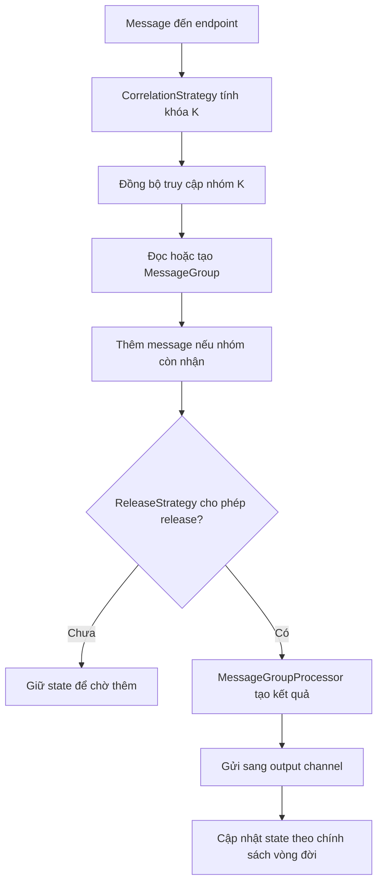

# CorrelationStrategy

## 1. Correlation trong một luồng thông điệp có trạng thái

Trong Spring Integration Core, `CorrelationStrategy` xác định những thông điệp nào thuộc cùng một nhóm xử lý. Đây là quyết định nền tảng của các endpoint có trạng thái như aggregator và resequencer: trước khi chờ đủ kết quả hoặc sắp xếp lại thông điệp, endpoint phải biết thông điệp đang thuộc nhóm nào.

Xét một hệ thống xử lý đơn hàng. Nhánh thanh toán phát ra kết quả `PAYMENT`, nhánh kho phát ra kết quả `STOCK`. Các kết quả có thể đến xen kẽ:

```text
PAYMENT của tenant-A / order-42 / run-1
STOCK   của tenant-B / order-42 / run-1
STOCK   của tenant-A / order-42 / run-1
PAYMENT của tenant-B / order-42 / run-1
```

Nếu chỉ nhóm theo `order-42`, hệ thống có thể ghép thanh toán của khách hàng này với tồn kho của khách hàng khác. Nếu mỗi thông điệp có một khóa ngẫu nhiên riêng, các kết quả cần ghép lại luôn nằm ở những nhóm khác nhau.

Bài học thuộc chương **Correlation và state** của module `SPRING_INTEGRATION_CORE`, tập trung vào cách chọn, triển khai và kiểm thử khóa correlation trong luồng Java DSL. Sau khi học, bạn cần có thể:

- Giải thích hợp đồng `getCorrelationKey(Message<?>)`.
- Phân biệt khóa correlation, định danh thông điệp và điều kiện release.
- Chọn giữa header, payload, SpEL và strategy viết bằng Java.
- Thiết kế khóa cho nhiều tenant, retry và nhiều lần chạy nghiệp vụ.
- Nhìn ra ảnh hưởng của khóa đến state, thông điệp đến muộn và khả năng vận hành.

Các ví dụ Java dùng cú pháp Java 17 và API Java DSL có trong Spring Integration 6.5. Dự án cần có `spring-integration-core`; phiên bản thư viện nên do dependency management của dự án quản lý. Ví dụ kiểm thử dùng JUnit Jupiter. Nội dung giả định bạn đã biết `Message`, `MessageChannel` và aggregator ở mức cơ bản.

## 2. Hợp đồng của CorrelationStrategy

Interface nằm trong package `org.springframework.integration.aggregator`:

```java
import org.springframework.messaging.Message;

@FunctionalInterface
public interface CorrelationStrategy {

    Object getCorrelationKey(Message<?> message);
}
```

Đầu vào là toàn bộ `Message<?>` nên strategy có thể đọc payload và headers. Đầu ra là một đối tượng đại diện cho nhóm, thường là `String`, `UUID` hoặc một value object bất biến. Đây là functional interface, vì vậy có thể triển khai bằng lambda hoặc method reference. Không tìm được khóa hợp lệ thì strategy do ứng dụng viết nên ném ngoại lệ, thay vì trả về `null`. Xem [hợp đồng CorrelationStrategy](https://docs.spring.io/spring-integration/docs/6.5.0/api/org/springframework/integration/aggregator/CorrelationStrategy.html).

Có thể mô tả quy tắc mong muốn bằng hàm `K`:

```text
K(message) = định danh nhóm nghiệp vụ

Cùng nhóm nghiệp vụ  => các khóa phải bằng nhau.
Khác nhóm nghiệp vụ => các khóa phải phân biệt được nhau.
```

“Bằng nhau” ở đây cần tuân thủ `equals()` và `hashCode()`, không phải cùng một object reference. Hai message khác nhau hoàn toàn có thể có hai đối tượng khóa được tạo riêng nhưng cùng giá trị.

```java
record OrderRunKey(String tenantId, String orderId, String runId) {
}

var first = new OrderRunKey("tenant-A", "order-42", "run-1");
var second = new OrderRunKey("tenant-A", "order-42", "run-1");

assert first != second;
assert first.equals(second);
assert first.hashCode() == second.hashCode();
```

Đây mới là điều kiện về bình đẳng của khóa. Khi dùng persistent store hoặc distributed lock, còn phải kiểm tra cách implementation biểu diễn, chuyển đổi và khôi phục khóa; một object chạy đúng trong bộ nhớ chưa tự động phù hợp với mọi store.

Strategy nên thực hiện một phép tính ngắn và ổn định. Tránh gọi HTTP, truy vấn dữ liệu biến động hoặc cập nhật trạng thái nghiệp vụ trong `getCorrelationKey()`. Một lần retry phải tiếp tục tính ra cùng khóa nếu vẫn thuộc cùng lần xử lý.

## 3. Correlation đứng ở đâu trong quá trình xử lý?

Sơ đồ sau là mô hình khái niệm cho đường xử lý bình thường của một aggregator, chưa thể hiện các nhánh timeout, discard và lỗi:



Mã nguồn [AbstractCorrelatingMessageHandler của phiên bản 6.5.0](https://github.com/spring-projects/spring-integration/blob/v6.5.0/spring-integration-core/src/main/java/org/springframework/integration/aggregator/AbstractCorrelatingMessageHandler.java) cho thấy khóa được tính trước khi endpoint thực hiện phần xử lý có khóa bảo vệ nhóm. Vì vậy, strategy dùng chung cần an toàn khi được nhiều thread gọi đồng thời; lock của nhóm không bảo vệ một `HashMap` tự quản lý bên trong strategy.

Các thành phần có trách nhiệm riêng:

| Thành phần | Quyết định hoặc dữ liệu mà nó quản lý |
| --- | --- |
| `CorrelationStrategy` | Message thuộc nhóm nào? |
| `ReleaseStrategy` | Nhóm hiện tại đã đủ điều kiện để phát kết quả chưa? |
| `MessageGroupStore` | Lưu các message và trạng thái của nhóm. |
| `MessageGroupProcessor` | Biến nhóm được release thành kết quả gì? |
| `LockRegistry` | Điều phối quyền cập nhật nhóm trong phạm vi registry hỗ trợ. |

Ví dụ, khóa `(tenant-A, order-42, run-1)` chỉ xác định nơi lưu kết quả. Nó không nói rằng đã có đủ cả `PAYMENT` và `STOCK`.

Tương tự, chọn đúng nhóm không tạo ra thứ tự nghiệp vụ. Aggregator ghép kết quả; resequencer dùng thông tin sequence để phát lại các message theo thứ tự. Xem [Resequencer](https://docs.spring.io/spring-integration/reference/resequencer.html).

## 4. Phân biệt các định danh thường gặp

| Giá trị | Ý nghĩa trong ví dụ đơn hàng | Có nên tự động dùng làm khóa nhóm? |
| --- | --- | --- |
| `MessageHeaders.ID` | Định danh của một message Spring. | Thường không, vì các phần của đơn có message ID khác nhau. |
| `eventId` | Định danh sự kiện nghiệp vụ để nhận diện redelivery hoặc bản trùng. | Thường dùng cho idempotency, không dùng để ghép các sự kiện khác nhau. |
| `orderId` | Định danh đơn hàng. | Chỉ đủ khi không có khác biệt về tenant hoặc lần chạy. |
| `runId` | Một lần xử lý nghiệp vụ của đơn. | Là một thành phần hữu ích của khóa ghép. |
| `correlationId` | Header correlation của Spring Integration. | Phù hợp khi upstream đã tạo đúng ngữ nghĩa nhóm. |
| `traceId` | Liên kết các hoạt động phục vụ quan sát hệ thống. | Chỉ dùng nếu hợp đồng nghiệp vụ thực sự trùng với ranh giới trace. |
| `sequenceNumber` | Vị trí của phần trong một chuỗi. | Không nên đưa vào khóa của cả chuỗi. |
| `sequenceSize` | Kích thước được công bố của chuỗi. | Thường phục vụ release, không phải định danh nhóm. |

Khóa correlation xác định **ranh giới gom nhóm**. Khóa idempotency xác định **một phần tử đã được xử lý hay chưa**. Một nhóm đơn hàng có thể chứa nhiều `eventId` nhưng chỉ có một `OrderRunKey`.

Cũng cần phân biệt giá trị khóa với header mang tên `correlationId`. Khi cấu hình strategy đọc `payload.key()` hoặc một custom header, giá trị trả về từ strategy mới quyết định nhóm. Đừng suy ra rằng header `correlationId` luôn bằng khóa thực tế, hoặc strategy sẽ tự cập nhật header đó.

## 5. Thiết kế khóa từ ranh giới nghiệp vụ

### 5.1. Chọn các chiều cần phân biệt

Với bài toán đang xét, dùng khóa:

```text
OrderRunKey = (tenantId, orderId, runId)
```

Ý nghĩa của từng trường:

- `tenantId` tách dữ liệu các khách hàng hoặc tổ chức.
- `orderId` xác định thực thể nghiệp vụ.
- `runId` tách các lần xử lý khác nhau của cùng đơn.

Cả nhánh thanh toán và nhánh kho phải nhận được cùng `runId` từ điểm bắt đầu của lần chạy. Nếu mỗi nhánh tự sinh `runId`, chúng không thể ghép lại.

| Kết quả thứ nhất | Kết quả thứ hai | Mong muốn |
| --- | --- | --- |
| A / 42 / R1 / PAYMENT | A / 42 / R1 / STOCK | Cùng nhóm. |
| A / 42 / R1 / PAYMENT | B / 42 / R1 / STOCK | Khác nhóm vì khác tenant. |
| A / 42 / R1 / PAYMENT | A / 42 / R2 / STOCK | Khác nhóm vì khác lần chạy. |
| A / 42 / R1 / PAYMENT | A / 43 / R1 / STOCK | Khác nhóm vì khác đơn. |

`PAYMENT` và `STOCK` là loại phần tử cần chờ, không phải thành phần của khóa nhóm. Đưa loại nhánh vào khóa sẽ tạo hai nhóm riêng, mỗi nhóm thiếu một nhánh.

### 5.2. Phân biệt retry kỹ thuật và một lần chạy mới

Retry do timeout mạng hoặc redelivery của broker vẫn thuộc `run-1` nếu đang tiếp tục cùng công việc. Tạo khóa mới ở mỗi retry sẽ bỏ lại các nhóm thiếu kết quả.

Ngược lại, khi người dùng chủ động chạy lại toàn bộ quy trình sau một lần hoàn tất, hệ thống có thể tạo `run-2`. Đó là một quyết định của nghiệp vụ tại đầu vào, cần được truyền xuyên suốt các nhánh.

Đặc biệt, một yêu cầu khởi tạo bị gửi lại do client retry cũng cần quy tắc nhận diện. Nếu mỗi lần nhận request đều sinh một run mới, aggregator ở phía sau không thể tự biết các run đó thực ra bắt nguồn từ một yêu cầu bị lặp.

### 5.3. Tránh khóa chuỗi nhập nhằng

Phép nối đơn giản này có thể gây trùng:

```text
tenant = "ab", order = "c"  => "abc"
tenant = "a",  order = "bc" => "abc"
```

Dùng dấu phân cách cũng cần quy định escaping nếu dữ liệu có thể chứa chính dấu đó. Trong Java, một `record` với các trường bất biến giúp biểu diễn rõ cấu trúc. Khi chuyển qua HTTP, broker hoặc lưu trữ, cần định nghĩa cách mã hóa ổn định, chẳng hạn một object JSON hoặc chuỗi có định dạng đã thống nhất.

Không nên dùng toàn bộ entity JPA, danh sách có thể thay đổi hoặc object mặc định so sánh bằng identity làm khóa. Chỉ sửa một trường tham gia `hashCode()` sau khi đưa khóa vào cấu trúc lưu trữ cũng có thể phá vỡ khả năng tìm lại nhóm.

Quy tắc chuẩn hóa phải do nghiệp vụ quyết định. Không tự `trim()`, đổi chữ hoa/thường hoặc chuyển mọi ID sang số nếu những thao tác đó có thể làm hai định danh hợp lệ trở thành một.

## 6. Các cách cấu hình CorrelationStrategy

### 6.1. Mặc định: dùng header correlationId

Nếu không chỉ định strategy riêng, aggregator dùng `HeaderAttributeCorrelationStrategy` đọc header `IntegrationMessageHeaderAccessor.CORRELATION_ID`. Với một chuỗi split–process–aggregate, splitter có thể tạo các headers `correlationId`, `sequenceNumber` và `sequenceSize` để liên kết các phần. Xem [Aggregator](https://docs.spring.io/spring-integration/reference/aggregator.html) và [Splitter](https://docs.spring.io/spring-integration/reference/splitter.html).

Cách biểu diễn strategy mặc định bằng Java:

```java
import org.springframework.integration.IntegrationMessageHeaderAccessor;
import org.springframework.integration.aggregator.CorrelationStrategy;
import org.springframework.integration.aggregator.HeaderAttributeCorrelationStrategy;

CorrelationStrategy byDefaultHeader =
        new HeaderAttributeCorrelationStrategy(
                IntegrationMessageHeaderAccessor.CORRELATION_ID);
```

Một message tự tạo không đương nhiên có đầy đủ headers correlation và sequence. Ví dụ sau chỉ cung cấp khóa nhóm:

```java
import org.springframework.integration.IntegrationMessageHeaderAccessor;
import org.springframework.messaging.support.MessageBuilder;

var message = MessageBuilder.withPayload("payment-result")
        .setHeader(IntegrationMessageHeaderAccessor.CORRELATION_ID, "run-42")
        .build();
```

Bạn vẫn phải bảo đảm điều kiện release phù hợp. Chỉ thêm `correlationId` không đủ để một release strategy dựa trên sequence biết nhóm cần chờ bao nhiêu phần.

### 6.2. Dùng custom header

Nếu upstream đã chuẩn hóa khóa vào header `orderRunKey`:

```java
CorrelationStrategy byBusinessHeader =
        new HeaderAttributeCorrelationStrategy("orderRunKey");
```

Khi gắn vào một aggregator trong Java DSL:

```java
.aggregate(a -> a
        .correlationStrategy(byBusinessHeader)
        .releaseStrategy(group -> group.size() == 2))
```

Đoạn trên chỉ minh họa cấu hình, với giả định mỗi nhóm có đúng hai message hợp lệ và không có bản trùng. Nếu hai message đều là kết quả thanh toán, `size() == 2` vẫn trả về `true`. Ví dụ hoàn chỉnh ở phần sau dùng loại nhánh để quyết định release.

Lớp [HeaderAttributeCorrelationStrategy](https://docs.spring.io/spring-integration/api/org/springframework/integration/aggregator/HeaderAttributeCorrelationStrategy.html) chỉ lấy giá trị từ header được cấu hình; các yêu cầu như chuỗi không rỗng, kiểu dữ liệu hợp lệ hoặc tenant bắt buộc cần được ứng dụng kiểm tra.

### 6.3. Dùng SpEL cho biểu thức ngắn

Nếu header đã được kiểm tra trước endpoint:

```java
.aggregate(a -> a
        .correlationExpression("headers['orderRunKey']")
        .releaseStrategy(group -> group.size() == 2))
```

Ở biểu thức correlation này, root object là message nên có thể truy cập `headers` hoặc `payload`. `correlationExpression(...)` cấu hình một `ExpressionEvaluatingCorrelationStrategy`; xem [API CorrelationHandlerSpec](https://docs.spring.io/spring-integration/docs/6.5.0/api/org/springframework/integration/dsl/CorrelationHandlerSpec.html).

SpEL phù hợp khi quy tắc ngắn và rõ. Nếu biểu thức bắt đầu chứa nhiều nhánh fallback, chuẩn hóa chuỗi và ghép nhiều trường, chuyển sang Java sẽ giúp việc kiểm tra dữ liệu và viết unit test dễ hơn.

Đừng dùng fallback kiểu `headers['orderRunKey'] ?: 'UNKNOWN'` để che giấu dữ liệu thiếu. Mọi message lỗi sẽ bị gom vào cùng nhóm `UNKNOWN`.

### 6.4. Dùng method của một POJO

Có thể để một object chịu trách nhiệm chọn khóa:

```java
public final class OrderCorrelationRules {

    public Object selectKey(org.springframework.messaging.Message<?> message) {
        Object key = message.getHeaders().get("orderRunKey");
        if (key == null) {
            throw new IllegalArgumentException("Missing orderRunKey");
        }
        return key;
    }
}
```

Gắn method vào DSL bằng overload:

```java
var rules = new OrderCorrelationRules();

.aggregate(a -> a
        .correlationStrategy(rules, "selectKey")
        .releaseStrategy(group -> group.size() == 2))
```

Framework dùng adapter `MethodInvokingCorrelationStrategy` để gọi method của object. Cách này hữu ích khi tái sử dụng một bean nghiệp vụ; xem [MethodInvokingCorrelationStrategy](https://docs.spring.io/spring-integration/api/org/springframework/integration/aggregator/MethodInvokingCorrelationStrategy.html).

Đoạn `.aggregate(...)` ở trên là phần nối vào một flow, không phải một Java statement độc lập sau khai báo `rules`.

## 7. Ví dụ hoàn chỉnh: gom hai nhánh theo tenant, đơn hàng và lần chạy

Ví dụ này thu các kết quả của hai nhánh `PAYMENT` và `STOCK`. Một nhóm được release khi đã thấy cả hai loại, bất kể thứ tự đến.

Các quyết định của ví dụ:

- Khóa nằm trong payload bất biến.
- Strategy chỉ chấp nhận payload `BranchResult` và trả về `result.key()`.
- Release kiểm tra tập loại nhánh, nên hai kết quả `PAYMENT` không làm nhóm hoàn tất.
- Output chứa các kết quả đã thu; không tự diễn giải trạng thái nhánh thành “đơn hàng thành công”.
- Nhóm hoàn tất giữ metadata để nhận diện thông điệp đến muộn trong vòng đời store hiện tại.

Đặt cấu hình sau trong một ứng dụng có Spring context và Spring Integration Core:

```java
package example.integration.correlation;

import java.io.Serializable;
import java.util.Comparator;
import java.util.EnumSet;
import java.util.List;
import java.util.Objects;

import org.springframework.context.annotation.Bean;
import org.springframework.context.annotation.Configuration;
import org.springframework.integration.aggregator.CorrelationStrategy;
import org.springframework.integration.channel.DirectChannel;
import org.springframework.integration.channel.QueueChannel;
import org.springframework.integration.config.EnableIntegration;
import org.springframework.integration.dsl.IntegrationFlow;
import org.springframework.integration.store.MessageGroup;

@Configuration
@EnableIntegration
public class CorrelationFlowConfig {

    public enum PartType {
        PAYMENT, STOCK
    }

    public record OrderRunKey(
            String tenantId,
            String orderId,
            String runId) implements Serializable {

        public OrderRunKey {
            requireText(tenantId, "tenantId");
            requireText(orderId, "orderId");
            requireText(runId, "runId");
        }
    }

    public record BranchResult(
            OrderRunKey key,
            PartType partType,
            String eventId,
            String value) implements Serializable {

        public BranchResult {
            Objects.requireNonNull(key, "key");
            Objects.requireNonNull(partType, "partType");
            requireText(eventId, "eventId");
            Objects.requireNonNull(value, "value");
        }
    }

    public record OrderRunCollected(
            OrderRunKey key,
            List<BranchResult> results) {

        public OrderRunCollected {
            Objects.requireNonNull(key, "key");
            results = List.copyOf(results);
        }
    }

    @Bean
    public DirectChannel orderPartsInput() {
        return new DirectChannel();
    }

    @Bean
    public QueueChannel orderRunsOutput() {
        return new QueueChannel();
    }

    @Bean
    public QueueChannel orderPartsDiscard() {
        return new QueueChannel();
    }

    @Bean
    public CorrelationStrategy orderRunCorrelationStrategy() {
        return message -> {
            if (!(message.getPayload() instanceof BranchResult result)) {
                throw new IllegalArgumentException(
                        "Expected BranchResult payload");
            }
            return result.key();
        };
    }

    @Bean
    public IntegrationFlow orderRunFlow(
            CorrelationStrategy orderRunCorrelationStrategy) {

        return IntegrationFlow.from(orderPartsInput())
                .aggregate(a -> a
                        .correlationStrategy(orderRunCorrelationStrategy)
                        .releaseStrategy(CorrelationFlowConfig::hasBothParts)
                        .outputProcessor(CorrelationFlowConfig::collectParts)
                        .expireGroupsUponCompletion(false)
                        .discardChannel(orderPartsDiscard()))
                .channel(orderRunsOutput())
                .get();
    }

    private static boolean hasBothParts(MessageGroup group) {
        EnumSet<PartType> received = EnumSet.noneOf(PartType.class);

        for (var message : group.getMessages()) {
            BranchResult part = (BranchResult) message.getPayload();
            received.add(part.partType());
        }

        return received.contains(PartType.PAYMENT)
                && received.contains(PartType.STOCK);
    }

    private static OrderRunCollected collectParts(MessageGroup group) {
        List<BranchResult> parts = group.getMessages().stream()
                .map(message -> (BranchResult) message.getPayload())
                .sorted(Comparator.comparing(BranchResult::partType)
                        .thenComparing(BranchResult::eventId))
                .toList();

        return new OrderRunCollected(parts.get(0).key(), parts);
    }

    private static void requireText(String value, String field) {
        if (value == null || value.isBlank()) {
            throw new IllegalArgumentException(field + " must not be blank");
        }
    }
}
```

`outputProcessor(...)` nhận một `MessageGroupProcessor` để tạo kết quả từ nhóm; `expireGroupsUponCompletion(...)` là cấu hình của aggregator. Các method được mô tả trong [API AggregatorSpec](https://docs.spring.io/spring-integration/docs/6.5.0/api/org/springframework/integration/dsl/AggregatorSpec.html).

### 7.1. Chạy thử trong một Spring context

Đoạn sau có thể đặt trong một method chạy thử. Các nested types của `CorrelationFlowConfig` được tham chiếu bằng tên đầy đủ để thấy rõ nguồn khai báo:

```java
import org.springframework.context.annotation.AnnotationConfigApplicationContext;
import org.springframework.integration.channel.DirectChannel;
import org.springframework.integration.channel.QueueChannel;
import org.springframework.messaging.support.MessageBuilder;

try (var context =
        new AnnotationConfigApplicationContext(CorrelationFlowConfig.class)) {

    DirectChannel input =
            context.getBean("orderPartsInput", DirectChannel.class);
    QueueChannel output =
            context.getBean("orderRunsOutput", QueueChannel.class);

    var key = new CorrelationFlowConfig.OrderRunKey(
            "tenant-A", "order-42", "run-1");

    input.send(MessageBuilder.withPayload(
            new CorrelationFlowConfig.BranchResult(
                    key,
                    CorrelationFlowConfig.PartType.PAYMENT,
                    "payment-event-1",
                    "AUTHORIZED"))
            .build());

    if (output.receive(0) != null) {
        throw new AssertionError("Group must still wait for STOCK");
    }

    input.send(MessageBuilder.withPayload(
            new CorrelationFlowConfig.BranchResult(
                    key,
                    CorrelationFlowConfig.PartType.STOCK,
                    "stock-event-1",
                    "RESERVED"))
            .build());

    var reply = output.receive(1000);
    if (reply == null) {
        throw new AssertionError("Expected collected result");
    }

    var collected =
            (CorrelationFlowConfig.OrderRunCollected) reply.getPayload();

    System.out.println(collected.key());
    System.out.println(collected.results().size()); // 2
}
```

Vì input là `DirectChannel`, việc xử lý và đưa kết quả vào output queue xảy ra trên thread gọi `send()`. Queue ở đầu ra giúp quan sát kết quả bằng `receive()` mà không cần tạo thêm một consumer.

### 7.2. Giới hạn có chủ đích của ví dụ

Đây là luồng minh họa việc gom nhóm, không phải toàn bộ quy trình đặt hàng:

- `hasBothParts()` không kiểm tra `value` là thành công hay thất bại. Hai nhánh đã trả lời không đồng nghĩa nghiệp vụ đã thành công.
- `eventId` được mang theo để nhận diện sự kiện, nhưng chưa có bước idempotent receiver.
- Nếu nhận hai sự kiện thanh toán khác nhau trước khi kho trả lời, cả hai có thể nằm trong output. Ví dụ không tự chọn “bản mới nhất”.
- Chưa cấu hình timeout cho nhóm thiếu nhánh và chưa có tác vụ dọn metadata.
- State của cấu hình này nằm trong bộ nhớ; khởi động lại ứng dụng không giữ các nhóm cũ.
- Các queue đầu ra và discard cần consumer hoặc cơ chế đọc phù hợp trong một ứng dụng thực tế.

Không có headers sequence trong ví dụ vì release đã được định nghĩa bằng loại nhánh. Các bản tin đến sau khi nhóm hoàn tất được xử lý theo chính sách completed group, thay vì tham gia một kết quả thứ hai.

## 8. Quan sát thông điệp xen kẽ và bản trùng

Giả sử tất cả sự kiện dưới đây cùng `run-1`:

| Bước | Message đến | State hoặc kết quả mong đợi |
| --- | --- | --- |
| 1 | A / 42 / PAYMENT / event-P1 | Nhóm A-42 chờ STOCK. |
| 2 | B / 42 / STOCK / event-S2 | Nhóm B-42 chờ PAYMENT. |
| 3 | A / 42 / PAYMENT / event-P3 | Nhóm A-42 vẫn chờ STOCK. |
| 4 | A / 42 / STOCK / event-S4 | Release A-42; output có các kết quả đã thu của A. |
| 5 | B / 42 / PAYMENT / event-P5 | Release B-42. |
| 6 | A / 42 / STOCK / event-S6 | Đến sau hoàn tất; chuyển discard theo cấu hình ví dụ. |

Bước 3 cho thấy kiểm tra loại nhánh chặt chẽ hơn kiểm tra `group.size() == 2`. Tuy nhiên, bước 4 cũng cho thấy correlation và release không thay thế idempotency.

Trước khi xử lý duplicate trong một hệ thống thật, cần định nghĩa bản trùng là:

1. Cùng `eventId` được giao lại.
2. Cùng `OrderRunKey` và cùng loại nhánh nhưng có `eventId` mới.
3. Một kết quả điều chỉnh hợp lệ thay thế kết quả trước đó.

Ba tình huống này có thể cần ba quy tắc khác nhau. Chẳng hạn, bỏ bản giao lại ở mục 1 là hợp lý, nhưng bỏ mọi kết quả điều chỉnh ở mục 3 có thể làm mất cập nhật nghiệp vụ.

Không nên chữa duplicate bằng cách đổi correlation key. Đổi khóa làm dữ liệu đi sang nhóm khác và có thể để lại cả hai nhóm dang dở.

## 9. Bảo toàn khóa khi đi qua transformer, router, filter và transport

### Transformer

Một transformer đổi payload cần duy trì thông tin đủ để strategy phía sau tính đúng khóa. Trong ví dụ, đổi `BranchResult` thành một chuỗi thuần túy trước aggregator sẽ làm strategy từ chối payload đó.

Nếu hệ thống có nhiều dạng payload, có thể chuẩn hóa khóa vào custom header ở biên luồng. Sau đó, mọi transformer phải tuân thủ hợp đồng giữ hoặc tái tạo header.

Cần đặc biệt chú ý những đoạn tự dựng `new GenericMessage<>(newPayload)`: nếu không truyền headers cần thiết, metadata ở message trước không còn hiện diện trong message mới do đoạn mã đó tạo.

### Router

Router chọn nhánh đi; nó không mặc nhiên tạo ra một định danh lần chạy dùng chung cho tất cả kết quả. Tạo `runId` trước khi phân nhánh và truyền lại trong mọi response.

Nếu nhận kết quả từ hai hệ thống độc lập, hãy quy định chúng phải trả về cùng bộ định danh hoặc có bước ánh xạ về cùng khóa nội bộ.

### Filter

Nếu loại bỏ nhánh `STOCK` mà release vẫn bắt buộc phải có `STOCK`, nhóm sẽ chờ mãi khi không có timeout.

Cần xác định nghiệp vụ của việc loại bỏ: phát một kết quả như `STOCK_SKIPPED`, thay đổi tập nhánh cần chờ, hay kết thúc nhóm qua đường timeout. Chỉ giữ correlation key đúng không giải quyết được việc thiếu phần tử.

### Splitter và chuỗi lồng nhau

Một splitter có thể tạo một phạm vi correlation mới cho các phần mà nó sinh ra. Khi có nhiều tầng split–aggregate, cần xác định aggregator đang đóng nhóm của tầng nào. Không ghi đè các headers sequence của framework một cách tùy tiện.

Dùng custom header như `businessRunKey` giúp phân biệt ranh giới nghiệp vụ với ranh giới của một lần split. Hãy kiểm tra riêng hành vi sequence của mỗi tầng nếu cần giữ cơ chế split–aggregate mặc định.

### Gateway và transport

Gateway tạo ranh giới gọi vào flow, nhưng không tự quyết định khóa nghiệp vụ cho các sự kiện phản hồi độc lập. Một gateway request–reply cũng cần timeout phù hợp nếu kết quả phụ thuộc vào nhiều nhánh bất đồng bộ.

Khi qua HTTP, Kafka, AMQP hoặc một dịch vụ khác, object header Java không tự động được giữ nguyên. Hợp đồng transport phải quy định tên trường, kiểu dữ liệu và cách ánh xạ. Ví dụ, phía gửi dùng `Long 42` còn phía nhận trả về `String "42"` thì hai giá trị không bằng nhau trong Java.

Thực tế nên chọn một biểu diễn chuẩn tại biên hệ thống, kiểm tra dữ liệu rồi mới cho vào aggregator. Đừng cho dữ liệu tự khai báo tenant đi thẳng thành khóa nếu nó chưa được xác thực theo ngữ cảnh truy cập.

## 10. Dữ liệu thiếu khóa và đường xử lý lỗi

Không nên trả về `null`, khóa ngẫu nhiên hoặc hằng `UNKNOWN` khi message thiếu định danh:

| Cách xử lý sai | Hậu quả có thể xảy ra |
| --- | --- |
| Trả về `null` | Endpoint không thể xác định nhóm và báo lỗi. |
| Sinh UUID mới cho từng message lỗi | Sinh nhiều nhóm không bao giờ đủ phần. |
| Trả về `UNKNOWN` | Gom nhầm mọi message thiếu khóa vào một nhóm. |
| Dùng `message.getHeaders().getId()` làm fallback | Tách riêng từng phần cần được ghép. |
| Thêm retry không giới hạn | Lặp lại lỗi dữ liệu mà không tạo được khóa hợp lệ. |

Ở ví dụ đầy đủ, constructor `OrderRunKey` chặn trường rỗng và strategy chặn sai kiểu payload. Nếu đọc từ header, có thể kiểm tra tương tự:

```java
import org.springframework.integration.aggregator.CorrelationStrategy;

CorrelationStrategy checkedHeaderStrategy = message -> {
    Object value = message.getHeaders().get("orderRunKey");

    if (!(value instanceof CorrelationFlowConfig.OrderRunKey key)) {
        throw new IllegalArgumentException(
                "orderRunKey must be an OrderRunKey");
    }

    return key;
};
```

Cần tách hai loại đường đi:

- **Lỗi validation hoặc lỗi tính khóa:** lỗi xử lý message, xảy ra trước khi có thể thêm message vào nhóm.
- **Discard của aggregator:** áp dụng cho các tình huống như message đến một nhóm đã hoàn tất hoặc nhóm bị loại khi hết thời gian theo cấu hình.

Vì vậy, đặt `discardChannel` không biến mọi lỗi thiếu khóa thành một message discard.

Với `DirectChannel`, exception truyền trên call stack về bên gọi. Với luồng có executor, poller hoặc message producer bất đồng bộ, việc đưa lỗi vào `errorChannel` phụ thuộc vào cơ chế error handling của thành phần đó. Không giả định rằng khai báo header `errorChannel` luôn tự bắt được exception của một lời gọi `send()` đồng bộ. Xem [Error Handling](https://docs.spring.io/spring-integration/reference/error-handling.html).

Với dữ liệu không sửa được bằng retry, nên có nhánh kiểm tra và chuyển sang kênh xử lý dữ liệu lỗi. Giữ lại định danh sự kiện, nguồn và nguyên nhân để có thể sửa rồi phát lại đúng lần chạy.

## 11. Khóa correlation quyết định vòng đời state như thế nào?

### 11.1. Nhóm hoàn tất và thông điệp đến muộn

Với aggregator thông thường, `expireGroupsUponCompletion(false)` giữ trạng thái hoàn tất sau khi nhóm đã release. Các message đến muộn cùng khóa có thể được nhận diện và chuyển discard. Nếu bật `true`, toàn bộ nhóm bị xóa; message cùng khóa đến sau có thể khởi tạo nhóm mới.

Đây là lựa chọn nghiệp vụ, không chỉ là tối ưu bộ nhớ:

- Giữ metadata thích hợp khi muốn chặn kết quả cũ quay lại trong một khoảng thời gian.
- Xóa metadata cần đi cùng quy tắc về duplicate, replay và khả năng mở lại nhóm.
- Muốn xử lý một lần chạy mới, dùng `runId` mới thay vì trông chờ việc xóa nhóm cũ.

Trong ví dụ, giữ metadata mà không dọn sẽ làm số nhóm hoàn tất tăng dần. Khi metadata được dọn hoặc ứng dụng dùng store bộ nhớ bị khởi động lại, khả năng nhận diện message cũ từ state đó cũng biến mất.

### 11.2. Nhóm thiếu kết quả

Có thể bổ sung các dòng sau vào cấu hình `aggregate` của ví dụ:

```java
.groupTimeout(30_000L)
.sendPartialResultOnExpiry(false)
.expireGroupsUponTimeout(false)
```

`groupTimeout(30_000L)` là khoảng chờ không có message mới của nhóm trong cấu hình này; không phải deadline tuyệt đối tính từ lúc bắt đầu nghiệp vụ. Một message mới chưa làm nhóm release có thể khiến lịch timeout được đặt lại.

`sendPartialResultOnExpiry(false)` tránh phát một kết quả không đủ nhánh như kết quả thông thường. `expireGroupsUponTimeout(false)` giữ metadata sau khi nhóm bị hoàn tất do timeout để hạn chế việc message đến muộn mở lại nhóm ngay. Xem phần timeout và vòng đời trong [hướng dẫn Aggregator](https://docs.spring.io/spring-integration/reference/aggregator.html).

Nếu nghiệp vụ chấp nhận kết quả một phần, hãy thiết kế kiểu output thể hiện rõ trạng thái thiếu. Bật `sendPartialResultOnExpiry(true)` cần đi cùng việc `outputProcessor` có thể xử lý nhóm chưa đủ nhánh; processor không nên mặc định rằng mọi phần đều tồn tại.

Timeout của gateway hoặc HTTP client cũng không tự xóa nhóm đang chờ trong aggregator. Đây là các vòng đời khác nhau và cần được cấu hình cùng một mục tiêu nghiệp vụ.

### 11.3. Đặt thời gian giữ state theo cửa sổ giao lại

Ví dụ broker có thể giao lại sự kiện cũ trong nhiều giờ nhưng metadata nhóm chỉ được giữ vài phút: một sự kiện đến rất muộn vẫn có thể tạo nhóm mới sau khi metadata đã bị xóa.

Vì vậy cần thống nhất:

- Thời gian tối đa chờ các nhánh.
- Khoảng giữ trạng thái hoàn tất.
- Cửa sổ redelivery hoặc replay của nguồn.
- Cách xử lý replay có chủ đích: bỏ qua, dùng run mới hay xây dựng một luồng riêng.

Nếu yêu cầu là “sự kiện này không bao giờ được áp dụng hai lần”, chỉ giữ metadata aggregator trong một khoảng ngắn là chưa đủ. Cần cơ chế idempotency hoặc ràng buộc dữ liệu phù hợp với yêu cầu đó.

## 12. State bền vững, nhiều instance và chi phí của khóa

### Store bền vững

State trong bộ nhớ phù hợp cho việc quan sát ví dụ, nhưng không giữ nhóm qua restart. Spring Integration có các message store bền vững; việc lựa chọn store cần tính cả dữ liệu payload, headers và yêu cầu serialization. Xem [Message Store](https://docs.spring.io/spring-integration/reference/message-store.html).

`OrderRunKey` và `BranchResult` trong ví dụ có `implements Serializable`, nhưng điều đó chưa phải một cấu hình persistence hoàn chỉnh. Còn cần chọn store, namespace dữ liệu, transaction, serializer và quy tắc tương thích khi nâng cấp ứng dụng.

Nếu đổi schema khóa từ `(tenantId, orderId)` sang `(tenantId, orderId, runId)` trong lúc có nhóm đang mở, message mới có thể đi vào khóa khác và không nối tiếp state cũ. Cần kế hoạch chuyển tiếp, chẳng hạn hoàn tất nhóm cũ trước khi đổi hoặc duy trì hai đường xử lý theo phiên bản hợp đồng.

Nếu nhiều endpoint dùng chung một store, phải kiểm tra cơ chế namespace hoặc region của store. Đừng mặc định rằng tên bean aggregator luôn được đưa vào group key. Có thể dành store riêng hoặc thêm định danh loại quy trình vào hợp đồng khóa khi cần cách ly.

### Nhiều instance

Chia sẻ một database không tự bảo đảm mọi cập nhật nhóm được phối hợp đúng. Cần kiểm tra đồng bộ giữa các instance, khả năng của store và một cơ chế lock có cùng phạm vi với state dùng chung.

Nếu hai instance tự lưu các nửa của cùng nhóm trong hai store bộ nhớ riêng, không instance nào thấy đủ kết quả. Nếu cùng store nhưng khóa hoặc namespace khác nhau do cấu hình lệch, vấn đề vẫn tương tự.

Khóa đúng và persistence cũng không bảo đảm exactly-once cho side effect. Trường hợp đã gọi dịch vụ ngoài nhưng ứng dụng dừng trước khi hoàn tất transaction vẫn cần thiết kế retry và idempotency riêng.

### Cardinality và nhóm quá lớn

Khóa quá rộng, chẳng hạn chỉ dùng `tenantId`, làm nhiều công việc không liên quan dồn vào một nhóm. Hệ quả có thể là kết quả sai, nhóm lớn và tranh chấp cập nhật.

Khóa quá hẹp, chẳng hạn chứa `eventId`, tạo một nhóm cho từng phần. Hệ quả là nhiều nhóm dang dở và nhiều state giữ lại.

Với hệ thống ổn định, có thể ước lượng ban đầu:

```text
Số nhóm đang chờ ≈ số lần chạy mới mỗi giây × thời gian chờ trung bình
```

Đây là ước lượng theo giả định tải tương đối ổn định, không phải công thức dung lượng đầy đủ. Còn phải tính số message mỗi nhóm, kích thước payload, metadata nhóm hoàn tất và các đợt tăng tải.

Release strategy ở ví dụ duyệt các message để nhận biết loại nhánh. Với một nhóm nhỏ điều này dễ hiểu; với hàng chục nghìn phần, duyệt lại toàn bộ nhóm ở mỗi lần đến có thể trở thành chi phí lớn. Khi tối ưu, phải giữ đúng quy tắc nghiệp vụ thay vì chỉ đổi sang đếm số message cho nhanh.

## 13. Kiểm thử hợp đồng correlation

Nên kiểm thử strategy riêng và kiểm thử hành vi của cả flow. Chỉ chứng minh hai khóa bằng nhau chưa đủ để phát hiện release sớm hoặc state của các lần chạy bị trộn.

### 13.1. Unit test cho strategy

Đặt test sau trong cùng package với `CorrelationFlowConfig`. Test không mở Spring context:

```java
package example.integration.correlation;

import org.junit.jupiter.api.Test;
import org.springframework.messaging.support.MessageBuilder;

import static org.junit.jupiter.api.Assertions.*;

class OrderRunCorrelationStrategyTest {

    private final org.springframework.integration.aggregator.CorrelationStrategy
            strategy =
            new CorrelationFlowConfig().orderRunCorrelationStrategy();

    @Test
    void separatesTenantAndRunButCombinesDifferentParts() {
        Object payment = keyOf(
                "tenant-A", "order-42", "run-1",
                CorrelationFlowConfig.PartType.PAYMENT);

        Object stock = keyOf(
                "tenant-A", "order-42", "run-1",
                CorrelationFlowConfig.PartType.STOCK);

        assertEquals(payment, stock);

        assertNotEquals(payment, keyOf(
                "tenant-B", "order-42", "run-1",
                CorrelationFlowConfig.PartType.STOCK));

        assertNotEquals(payment, keyOf(
                "tenant-A", "order-42", "run-2",
                CorrelationFlowConfig.PartType.STOCK));

        assertNotEquals(payment, keyOf(
                "tenant-A", "order-43", "run-1",
                CorrelationFlowConfig.PartType.STOCK));
    }

    @Test
    void rejectsPayloadWithoutTheRequiredContract() {
        var message = MessageBuilder.withPayload("invalid").build();

        assertThrows(IllegalArgumentException.class,
                () -> strategy.getCorrelationKey(message));
    }

    @Test
    void rejectsBlankKeyComponent() {
        assertThrows(IllegalArgumentException.class,
                () -> new CorrelationFlowConfig.OrderRunKey(
                        "tenant-A", "order-42", " "));
    }

    private Object keyOf(
            String tenantId,
            String orderId,
            String runId,
            CorrelationFlowConfig.PartType type) {

        var key = new CorrelationFlowConfig.OrderRunKey(
                tenantId, orderId, runId);

        var part = new CorrelationFlowConfig.BranchResult(
                key, type, "event-" + type.name(), "OK");

        return strategy.getCorrelationKey(
                MessageBuilder.withPayload(part).build());
    }
}
```

`assertEquals` ở test đầu kiểm tra hai key có cùng giá trị dù loại nhánh khác nhau. `assertNotEquals` kiểm tra các ranh giới cách ly; không nên kiểm tra rằng hash code của mọi khóa khác nhau phải khác nhau, vì hash collision hợp lệ trong hợp đồng Java.

### 13.2. Integration test cho message đến xen kẽ

Test này tạo context mới cho mỗi lần chạy, tránh dùng lại completed group từ test khác:

```java
package example.integration.correlation;

import org.junit.jupiter.api.Test;
import org.springframework.context.annotation.AnnotationConfigApplicationContext;
import org.springframework.integration.channel.DirectChannel;
import org.springframework.integration.channel.QueueChannel;
import org.springframework.messaging.support.MessageBuilder;

import static org.junit.jupiter.api.Assertions.*;

class OrderCorrelationFlowTest {

    @Test
    void releasesOnlyTheMatchingTenantAndDiscardsLateMessages() {
        try (var context =
                new AnnotationConfigApplicationContext(
                        CorrelationFlowConfig.class)) {

            var input = context.getBean(
                    "orderPartsInput", DirectChannel.class);
            var output = context.getBean(
                    "orderRunsOutput", QueueChannel.class);
            var discard = context.getBean(
                    "orderPartsDiscard", QueueChannel.class);

            var a = new CorrelationFlowConfig.OrderRunKey(
                    "tenant-A", "order-42", "run-1");
            var b = new CorrelationFlowConfig.OrderRunKey(
                    "tenant-B", "order-42", "run-1");

            send(input, a,
                    CorrelationFlowConfig.PartType.PAYMENT, "p-A");
            send(input, b,
                    CorrelationFlowConfig.PartType.STOCK, "s-B");

            assertNull(output.receive(0));

            send(input, a,
                    CorrelationFlowConfig.PartType.STOCK, "s-A");

            var first = output.receive(1000);
            assertNotNull(first);

            var collectedA =
                    (CorrelationFlowConfig.OrderRunCollected)
                            first.getPayload();

            assertEquals(a, collectedA.key());
            assertEquals(2, collectedA.results().size());
            assertTrue(collectedA.results().stream()
                    .allMatch(part -> part.key().equals(a)));
            assertNull(output.receive(0));

            send(input, b,
                    CorrelationFlowConfig.PartType.PAYMENT, "p-B");

            var second = output.receive(1000);
            assertNotNull(second);
            assertEquals(b,
                    ((CorrelationFlowConfig.OrderRunCollected)
                            second.getPayload()).key());

            send(input, a,
                    CorrelationFlowConfig.PartType.STOCK, "late-s-A");

            assertNotNull(discard.receive(1000));
            assertNull(output.receive(0));
        }
    }

    private static void send(
            DirectChannel input,
            CorrelationFlowConfig.OrderRunKey key,
            CorrelationFlowConfig.PartType type,
            String eventId) {

        var part = new CorrelationFlowConfig.BranchResult(
                key, type, eventId, "OK");

        assertTrue(input.send(
                MessageBuilder.withPayload(part).build()));
    }
}
```

Các mốc `receive(0)` phù hợp ở đây vì đường vào aggregator chạy đồng bộ qua `DirectChannel`. Khi thay bằng executor hoặc broker, cần cách chờ có giới hạn phù hợp với luồng bất đồng bộ, không dùng một lệnh sleep cố định để đoán thời điểm xử lý xong.

Các tình huống nên bổ sung khi áp dụng vào hệ thống thực tế:

| Tình huống | Điều cần chứng minh |
| --- | --- |
| Hai PAYMENT đến trước STOCK | Không release trước khi có STOCK. |
| Cùng order nhưng khác run | Hai nhóm độc lập. |
| Retry một event | Chính sách duplicate hoạt động như hợp đồng đã chọn. |
| Header mất hoặc sai kiểu sau transport | Message bị từ chối hoặc đi đúng nhánh dữ liệu lỗi. |
| Một nhánh không bao giờ tới | Timeout không phát kết quả hoàn chỉnh giả. |
| Message đến sau khi metadata đã dọn | Hành vi mở nhóm mới hoặc loại bỏ được xác định rõ. |
| Restart khi nhóm đang mở | Kết quả đúng với loại store được chọn. |
| Hai instance xử lý cùng khóa | Không ghép sai hoặc phát kết quả do race condition. |

Các code test trên là ví dụ để đưa vào dự án phù hợp; chúng không thay thế việc chạy kiểm thử với dependency và hạ tầng thực tế của dự án.

## 14. Chẩn đoán lỗi từ triệu chứng

| Triệu chứng | Câu hỏi cần kiểm tra |
| --- | --- |
| Nhóm không bao giờ đủ | Hai nhánh có tính ra cùng khóa, cùng kiểu dữ liệu không? Có filter làm mất phần không? |
| Dữ liệu hai khách hàng bị ghép | Khóa có tenant hoặc phạm vi sở hữu phù hợp chưa? |
| Chạy lại đơn nhưng không có output | Có dùng lại khóa của nhóm đã hoàn tất không? |
| Một đơn phát nhiều kết quả | Nhóm có bị xóa sớm, retry tạo run mới hoặc metadata bị mất sau restart không? |
| Bộ nhớ tăng dần | Có quá nhiều nhóm thiếu nhánh hoặc metadata hoàn tất chưa được dọn không? |
| Chỉ lỗi khi chạy nhiều instance | Store, lock và namespace có cùng phạm vi không? |
| Release khi vẫn thiếu nhánh | Có đang dùng số message thay cho tập phần cần chờ không? |
| Log correlationId khác group thực tế | Strategy có đang đọc payload hoặc custom header không? |

Khi ghi log, nên ghi rõ tên flow, `eventId`, khóa nhóm đã tính và loại nhánh. Tránh chỉ ghi header `correlationId` khi strategy dùng một nguồn khác.

Các metric hữu ích gồm số nhóm đang mở, tuổi nhóm, thời gian chờ release và số message bị discard. Không nên dùng từng `orderId` hoặc `runId` làm nhãn metric nếu điều đó tạo cardinality không giới hạn; để các định danh chi tiết trong log hoặc trace phù hợp.

## 15. Những điểm cần giữ trong thiết kế

Một `CorrelationStrategy` tốt biểu diễn chính xác ranh giới của công việc cần gom, trả về khóa ổn định và phát hiện sớm dữ liệu không hợp lệ.

Với ví dụ đơn hàng, bộ `(tenantId, orderId, runId)` tách đúng khách hàng và lần chạy, còn `PAYMENT`/`STOCK` phục vụ quyết định release. `eventId` phục vụ nhận diện sự kiện và xử lý duplicate. Mỗi loại định danh có một vai trò riêng.

Sau khi chọn được khóa, cần ghép nó với hợp đồng release, chính sách timeout, giữ state, persistence và kiểm thử hành vi xen kẽ. Đó là cách đưa một hàm `Message<?> -> Object` nhỏ vào một luồng tích hợp có trạng thái và vận hành được.

