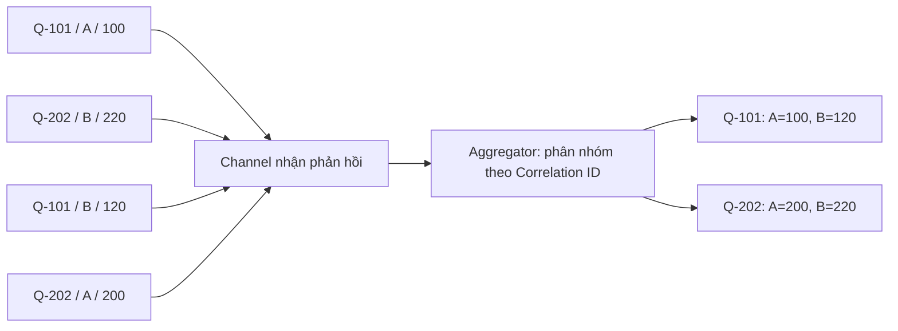

# Correlation ID

## 1. Vấn đề: phản hồi nào thuộc về yêu cầu nào?

Một dịch vụ so sánh báo giá gửi mỗi yêu cầu đến hai nhà cung cấp A và B. Hai khách hàng yêu cầu báo giá gần như đồng thời. Phản hồi trở về theo thứ tự:

```text
Yêu cầu Q-101 → A trả 100
Yêu cầu Q-202 → B trả 220
Yêu cầu Q-101 → B trả 120
Yêu cầu Q-202 → A trả 200
```

Nếu cứ lấy hai phản hồi liên tiếp để ghép, hệ thống sẽ tạo báo giá gồm dữ liệu của hai khách hàng. Thứ tự đến không biểu diễn quan hệ nghiệp vụ; cùng thread, cùng channel hay thời điểm xử lý gần nhau cũng không chứng minh các message thuộc cùng yêu cầu.

**Correlation ID là giá trị định danh một quan hệ giữa các message trong một phạm vi xử lý đã xác định.** Với ví dụ trên, hai phản hồi của Q-101 mang cùng một khóa; hai phản hồi của Q-202 mang khóa khác.



Trong phạm vi Spring Integration Core, cần hiểu cả hai công dụng: giữ liên hệ để theo dõi một cuộc trao đổi và cung cấp khóa cho endpoint có state, điển hình là aggregator. Hai công dụng có thể dùng các header khác nhau.

Sau bài này, bạn có thể chọn khóa tương quan, đặt và đọc header bằng API, bảo toàn khóa qua luồng, nhận diện tác động của splitter, và kiểm thử việc ghép nhóm khi phản hồi đến xen kẽ.

## 2. Correlation ID trong mô hình Message

Spring Integration sử dụng hằng số `IntegrationMessageHeaderAccessor.CORRELATION_ID`, có tên header là `correlationId`. Giá trị có kiểu `Object`; `String` và `UUID` là hai lựa chọn thường thuận tiện. `MessageHeaders.ID` định danh một message cụ thể, còn Correlation ID liên kết nhiều message. Header map của message không cho sửa trực tiếp. Tham khảo [mô hình Message và các header chuẩn](https://docs.spring.io/spring-integration/reference/message.html).

Ví dụ quan hệ giữa các định danh:

| Định danh | Ví dụ | Ý nghĩa trong luồng báo giá |
| --- | --- | --- |
| Message ID | `m-01`, `m-02` | Hai message phản hồi riêng biệt; nhãn ở đây được rút gọn cho dễ đọc |
| Correlation ID | `quote:T1:Q-101:run-1` | Hai phản hồi thuộc cùng một lần yêu cầu báo giá |
| Business ID | `Q-101` | Đối tượng nghiệp vụ đang được báo giá |
| Event ID | `provider-A-event-888` | Một sự kiện cụ thể, có thể được giao lại nhiều lần |
| Trace ID | Một giá trị do hệ thống tracing quản lý | Liên hệ các span để quan sát thực thi |
| Reply channel | `quoteResults` | Đích nhận kết quả |

Các hàng có thể có quan hệ nhưng không tự thay thế nhau. Đơn Q-101 có thể được báo giá nhiều lần; mỗi lần cần một nhóm phản hồi riêng. Một event giao lại vẫn có thể thuộc cùng cuộc trao đổi. Trace có thể bao trùm nhiều nhóm con.

Đặc biệt, **Correlation ID không phải tín hiệu “đã đủ phản hồi”**. Trong aggregator, `CorrelationStrategy` chọn nhóm, còn `ReleaseStrategy` quyết định thời điểm phát kết quả. Mặc định, aggregator lấy khóa từ header `correlationId` và sử dụng chiến lược release dựa trên kích thước sequence. Xem [nguyên lý correlation và release](https://docs.spring.io/spring-integration/reference/aggregator.html).

## 3. Chọn khóa theo ranh giới của cuộc trao đổi

### 3.1. Xác định điều gì phải giống nhau

Với dịch vụ báo giá, hãy xác định một nhóm bằng:

```text
tenant + thao tác + yêu cầu nghiệp vụ + lần thực hiện nghiệp vụ
```

Một hợp đồng minh họa:

```text
quote:tenant-01:Q-101:run-1
quote:tenant-01:Q-101:run-2
quote:tenant-02:Q-101:run-1
```

Ba khóa khác nhau vì ba lần xử lý phải độc lập. Đây là quyết định thiết kế của ví dụ; Spring Integration không bắt buộc cấu trúc chuỗi này.

Trong thực tế có thể dùng một UUID ngẫu nhiên cho cuộc trao đổi rồi lưu tenant, business ID và operation trong các header riêng. Cách đó tránh phải phân tích chuỗi và giảm nguy cơ ghép chuỗi không rõ ranh giới. Nếu dùng khóa ghép, cần quy định cách escape dấu phân cách hoặc dùng dạng mã hóa có cấu trúc.

### 3.2. Phân biệt retry với một yêu cầu mới

| Tình huống | Chính sách đề xuất cho ví dụ |
| --- | --- |
| Giao lại cùng phản hồi do broker chưa nhận acknowledgment | Giữ Correlation ID và Event ID |
| Gọi lại một nhà cung cấp trong cùng lần báo giá còn hiệu lực | Giữ Correlation ID; quản lý trùng theo nhà cung cấp/sự kiện |
| Khách hàng chủ động yêu cầu báo giá lại | Tạo một lần thực hiện mới và Correlation ID mới |
| Phản hồi của lần cũ đến sau khi lần mới đã bắt đầu | Giữ khóa cũ để không nhập vào nhóm mới |

Không tạo UUID mới tại mỗi transformer hoặc khi nhận từng phản hồi. Nếu A và B tự tạo khóa riêng, aggregator chỉ thấy hai nhóm thiếu dữ liệu.

Ngược lại, một giá trị cố định như `quote` sẽ gom mọi yêu cầu vào cùng nhóm. Dùng riêng mã khách hàng cũng quá rộng nếu khách hàng gửi nhiều yêu cầu đồng thời.

### 3.3. Dùng giá trị ổn định và thống nhất kiểu

Khóa phải có `equals()` và `hashCode()` phù hợp, không thay đổi trong thời gian nhóm còn tồn tại. Hai phía phải thống nhất kiểu: một `UUID` và chuỗi biểu diễn của UUID đó không bằng nhau theo Java.

Khi tự triển khai `CorrelationStrategy`, hãy trả về khóa xác định được hoặc báo lỗi rõ ràng khi không xác định được. Không dùng `null` làm nhóm chung cho mọi message thiếu khóa. Hợp đồng API được mô tả tại [CorrelationStrategy](https://docs.spring.io/spring-integration/api/org/springframework/integration/aggregator/CorrelationStrategy.html).

## 4. Tạo, đọc và bảo toàn Correlation ID

### 4.1. Tạo một lần tại đầu cuộc trao đổi

Đoạn mã sau minh họa việc tạo request, chưa phải cấu hình một flow hoàn chỉnh:

```java
import java.util.UUID;

import org.springframework.integration.IntegrationMessageHeaderAccessor;
import org.springframework.messaging.Message;
import org.springframework.messaging.support.MessageBuilder;

String conversationId = UUID.randomUUID().toString();

Message<String> request = MessageBuilder
        .withPayload("Yêu cầu báo giá Q-101")
        .setHeader("businessCorrelationId", conversationId)
        .setHeader("quoteRequestId", "Q-101")
        .setHeader(IntegrationMessageHeaderAccessor.CORRELATION_ID,
                conversationId)
        .build();

Object groupKey = request.getHeaders().get(
        IntegrationMessageHeaderAccessor.CORRELATION_ID);

IntegrationMessageHeaderAccessor accessor =
        new IntegrationMessageHeaderAccessor(request);

Object sameGroupKey = accessor.getCorrelationId();
```

Trong ví dụ, `businessCorrelationId` do ứng dụng quản lý để nhận diện toàn bộ cuộc trao đổi. Header chuẩn `correlationId` ban đầu bằng giá trị đó để có thể ghép phản hồi trực tiếp. Khi flow có splitter, hai giá trị có thể khác nhau như phần 6 giải thích.

Nếu hợp đồng quy định header phải là chuỗi, có thể đọc bằng `get(CORRELATION_ID, String.class)`. Trước khi dùng cần kiểm tra thiếu hoặc sai kiểu tại ranh giới đầu vào.

### 4.2. Tạo message mới từ message hiện có

Một transformer tự viết có thể làm mất metadata nếu chỉ tạo message từ payload mới. Khi cần giữ các header của cùng luồng xử lý nội bộ, có thể viết:

```java
import org.springframework.messaging.Message;
import org.springframework.messaging.support.MessageBuilder;

public final class TextNormalizer {

    public Message<String> normalize(Message<String> input) {
        return MessageBuilder
                .withPayload(input.getPayload().trim())
                .copyHeaders(input.getHeaders())
                .build();
    }
}
```

`copyHeaders()` sao chép metadata nhưng không ghi đè các header dành riêng `id` và `timestamp`. Không sử dụng Message ID để yêu cầu định danh xuyên suốt sau những bước tạo message mới. Các thao tác builder được mô tả tại [MessageBuilder](https://docs.spring.io/spring-framework/docs/current/javadoc-api/org/springframework/messaging/support/MessageBuilder.html).

Đây là ví dụ sao chép trong cùng ứng dụng. Tại ranh giới gửi ra hệ thống khác, nên chọn rõ các trường được truyền đi thay vì chuyển mọi header nội bộ.

Khi transformer của framework trả về một payload thông thường, endpoint có cơ chế truyền header từ request. Khi tự trả về một `Message`, hãy chủ động kiểm tra hợp đồng header của kết quả; việc tạo một message mới không tự chứng minh Correlation ID được giữ đúng. Tham khảo [cấu hình và hành vi transformer](https://docs.spring.io/spring-integration/reference/transformer.html).

### 4.3. Enrich header mà không ghi đè tùy tiện

Header enricher phù hợp khi cần khởi tạo khóa nếu header chưa tồn tại. Đoạn DSL độc lập dưới đây dùng header chuẩn:

```java
// Đoạn nối trong một IntegrationFlow.
.enrichHeaders(headers -> headers
        .correlationIdFunction(
                message -> java.util.UUID.randomUUID().toString(),
                false))
```

Tham số `false` thể hiện chính sách không ghi đè header đã có. Cần đặt bước này ở đầu một cuộc trao đổi hợp lệ. Nếu một phản hồi đáng lẽ phải mang khóa từ request nhưng lại thiếu, tự sinh khóa tại điểm nhận phản hồi sẽ che mất lỗi giao thức và tạo nhóm mồ côi. Xem [API correlationIdFunction](https://docs.spring.io/spring-integration/api/org/springframework/integration/dsl/HeaderEnricherSpec.html).

## 5. Truyền khóa qua endpoint, channel và giao thức

Correlation ID là dữ liệu được đọc theo hợp đồng, không phải cơ chế tự điều phối mọi thành phần. Bảng dưới đây là hướng dẫn thiết kế cho flow báo giá:

| Thành phần/ranh giới | Điều cần giữ rõ |
| --- | --- |
| MessageChannel | Các message của nhiều yêu cầu có thể cùng đi qua một channel; channel không xác định cuộc trao đổi |
| Transformer | Payload có thể đổi kiểu nhưng khóa vẫn phải nhận diện cùng yêu cầu |
| Router | Việc chọn nhánh không thay thế việc xác định nhóm ở điểm hội tụ |
| Filter | Nếu loại một phần của sequence, phải xem lại điều kiện hoàn tất nhóm |
| Gateway | Ánh xạ tham số và header theo hợp đồng; không suy luận reply channel chính là Correlation ID |
| Adapter gửi ra ngoài | Mã hóa khóa vào trường mà giao thức và đối tác đã thống nhất |
| Adapter nhận phản hồi | Đọc trường bên ngoài, kiểm tra và ánh xạ lại đúng header nội bộ |

Ví dụ hợp đồng giữa ứng dụng và nhà cung cấp:

```text
Request nội bộ:
  correlationId = "quote:T1:Q-101:run-1"

Request gửi đối tác:
  requestCorrelation = "quote:T1:Q-101:run-1"

Response đối tác:
  requestCorrelation = "quote:T1:Q-101:run-1"

Message phản hồi nội bộ:
  correlationId = "quote:T1:Q-101:run-1"
```

Tên `requestCorrelation` ở đây là hợp đồng minh họa, không phải header chuẩn của HTTP, JMS hay AMQP. Cấu hình mapper cụ thể phụ thuộc adapter. Chỉ đặt header trong Java chưa đủ để bảo đảm đối tác nhận được nó hoặc gửi trả lại.

Với một gateway nhận phản hồi, có thể khai báo ánh xạ rõ ràng:

```java
package example.integration.correlation;

import org.springframework.integration.annotation.MessagingGateway;
import org.springframework.messaging.handler.annotation.Header;

import example.integration.correlation.QuoteCorrelationConfig.QuoteReply;

import static org.springframework.integration.IntegrationMessageHeaderAccessor.*;

@MessagingGateway(defaultRequestChannel = "quoteReplies")
public interface QuoteReplyGateway {

    void accept(
            QuoteReply reply,
            @Header(CORRELATION_ID) String correlationId,
            @Header(SEQUENCE_NUMBER) int sequenceNumber,
            @Header(SEQUENCE_SIZE) int sequenceSize);
}
```

Interface này sử dụng model ở phần 7. Để Spring tạo proxy gateway, cần bật `@IntegrationComponentScan` cho package chứa interface, hoặc đăng ký gateway bằng cấu hình tương đương. Phương thức `void` chỉ gửi từng phản hồi vào flow; kết quả tổng hợp được nhận ở channel riêng. Cơ chế đăng ký và ánh xạ header của gateway được mô tả tại [Messaging Gateways](https://docs.spring.io/spring-integration/reference/gateway.html).

## 6. Correlation ID của splitter có phạm vi riêng

### 6.1. Từ một message thành một sequence

Khi bật `applySequence`, splitter bổ sung metadata cho các phần được tạo ra: `correlationId`, `sequenceNumber`, `sequenceSize`. Với collection xác định được kích thước, thông tin này hỗ trợ việc ghép lại. Với iterator/stream không biết kích thước, không nên mặc định rằng chiến lược đếm đủ sequence sẽ luôn hoạt động. Xem [Splitter và metadata sequence](https://docs.spring.io/spring-integration/reference/splitter.html).

Trong triển khai splitter tiêu chuẩn, khóa của tầng split được lấy từ Message ID của message đầu vào, không đơn thuần giữ nguyên Correlation ID nghiệp vụ đã gán trước đó. Có thể xem trực tiếp phương thức chuẩn bị message con trong [AbstractMessageSplitter](https://raw.githubusercontent.com/spring-projects/spring-integration/v6.4.0/spring-integration-core/src/main/java/org/springframework/integration/splitter/AbstractMessageSplitter.java).

Ví dụ ký hiệu:

```text
Trước split:
  id                    = M-ROOT
  businessCorrelationId = C-QUOTE
  correlationId         = C-QUOTE
  payload               = [item-A, item-B]

Sau split:
  message A:
    id                    = M-A
    businessCorrelationId = C-QUOTE
    correlationId         = M-ROOT
    sequenceNumber        = 1
    sequenceSize          = 2

  message B:
    id                    = M-B
    businessCorrelationId = C-QUOTE
    correlationId         = M-ROOT
    sequenceNumber        = 2
    sequenceSize          = 2
```

`M-ROOT`, `M-A`, `M-B` chỉ là nhãn dễ đọc cho Message ID. Kết quả cho thấy hai ranh giới: toàn cuộc báo giá là C-QUOTE; nhóm ghép lại của lần split này là M-ROOT.

### 6.2. Tại sao không nên ép mọi tầng dùng cùng một header?

Xét luồng:

```text
đơn hàng
  → split theo kiện hàng
  → split từng kiện theo mặt hàng
  → aggregate kết quả mặt hàng thành kiện
  → aggregate kết quả kiện thành đơn
```

Nếu ép mọi message ở mọi tầng mang cùng một `correlationId` của đơn hàng, aggregator bên trong có thể trộn các mặt hàng của nhiều kiện. Header nghiệp vụ riêng giúp theo dõi toàn đơn, trong khi metadata sequence diễn tả đúng nhóm ở từng tầng.

Spring Integration có cơ chế lưu correlation lồng nhau và khôi phục metadata khi ra khỏi một tầng aggregate. Thuộc tính `popSequence` điều khiển việc bỏ metadata của tầng vừa xử lý; mặc định là `true`. Không vô hiệu hóa chỉ để giữ lại một giá trị dùng cho log. Xem [API setPopSequence](https://docs.spring.io/spring-integration/api/org/springframework/integration/aggregator/AbstractCorrelatingMessageHandler.html#setPopSequence(boolean)).

Với publish-subscribe channel hoặc recipient list router tạo các nhánh cần ghép theo sequence, cần chủ động bật `applySequence`; không giả định chúng luôn có cùng mặc định với splitter. Tham khảo [lưu ý sequence trước aggregator](https://docs.spring.io/spring-integration/reference/aggregator.html).

## 7. Ví dụ Java DSL: ghép hai báo giá theo khóa

### 7.1. Hợp đồng và phạm vi ví dụ

Ví dụ sử dụng Java 17, API Java DSL của Spring Integration 6.x và JUnit Jupiter cho phần kiểm thử. Cần có `spring-integration-core` cùng các dependency Spring tương thích và JUnit Jupiter trong dự án. Phiên bản cụ thể nên do BOM/dependency management của dự án quản lý.

Đây là cấu hình Spring độc lập, không yêu cầu Spring Boot. Các phản hồi được tạo giả lập để tập trung vào correlation; chưa có adapter gọi nhà cung cấp.

| Dữ liệu | Quy ước |
| --- | --- |
| Payload | `QuoteReply(provider, amount)` |
| `correlationId` | Chuỗi không rỗng, duy nhất cho một lần báo giá |
| `sequenceNumber` | A là 1, B là 2 |
| `sequenceSize` | Luôn là 2 |
| Delivery trong ví dụ | Mỗi nhà cung cấp gửi đúng một phản hồi hợp lệ trước khi nhóm hoàn tất |
| Đơn vị amount | Nghìn đồng, dùng số nguyên để ví dụ gọn |

Flow sử dụng filter để tách message thiếu khóa ra khỏi aggregator. Filter này kiểm tra sự hiện diện của khóa theo hợp đồng chuỗi; nó chưa kiểm tra mọi điều kiện về payload, sequence hoặc quyền truy cập.

### 7.2. Cấu hình đầy đủ

Đặt mã sau trong `QuoteCorrelationConfig.java`:

```java
package example.integration.correlation;

import java.util.Map;
import java.util.stream.Collectors;

import org.springframework.context.annotation.Bean;
import org.springframework.context.annotation.Configuration;
import org.springframework.integration.channel.DirectChannel;
import org.springframework.integration.channel.QueueChannel;
import org.springframework.integration.config.EnableIntegration;
import org.springframework.integration.dsl.IntegrationFlow;
import org.springframework.integration.store.SimpleMessageStore;
import org.springframework.messaging.Message;

import static org.springframework.integration.IntegrationMessageHeaderAccessor
        .CORRELATION_ID;

@Configuration
@EnableIntegration
public class QuoteCorrelationConfig {

    public record QuoteReply(String provider, long amount) {
    }

    public record QuoteSummary(
            String correlationId,
            Map<String, Long> amounts) {
    }

    @Bean
    public DirectChannel quoteReplies() {
        return new DirectChannel();
    }

    @Bean
    public QueueChannel quoteResults() {
        return new QueueChannel();
    }

    @Bean
    public QueueChannel invalidQuoteReplies() {
        return new QueueChannel();
    }

    @Bean
    public QueueChannel discardedQuoteReplies() {
        return new QueueChannel();
    }

    @Bean
    public SimpleMessageStore quoteGroupStore() {
        return new SimpleMessageStore();
    }

    @Bean
    public IntegrationFlow quoteRepliesFlow() {
        return IntegrationFlow.from(quoteReplies())
                .filter(
                        "headers['correlationId'] instanceof T(java.lang.String)"
                                + " and !headers['correlationId'].isBlank()",
                        filter -> filter.discardChannel(invalidQuoteReplies()))
                .aggregate(aggregator -> aggregator
                        .messageStore(quoteGroupStore())
                        .outputProcessor(group -> {
                            Message<?> first = group.getOne();
                            String key = first.getHeaders()
                                    .get(CORRELATION_ID, String.class);

                            Map<String, Long> amounts = group.getMessages()
                                    .stream()
                                    .map(message ->
                                            (QuoteReply) message.getPayload())
                                    .collect(Collectors.toUnmodifiableMap(
                                            QuoteReply::provider,
                                            QuoteReply::amount));

                            return new QuoteSummary(key, amounts);
                        })
                        .groupTimeout(30_000)
                        .sendPartialResultOnExpiry(false)
                        .expireGroupsUponCompletion(false)
                        .expireGroupsUponTimeout(false)
                        .discardChannel(discardedQuoteReplies()))
                .channel(quoteResults())
                .get();
    }
}
```

`@Configuration` ở đây giữ chế độ proxy mặc định nên các lời gọi giữa những phương thức `@Bean` tham chiếu cùng các bean channel/store. Nếu chuyển sang `proxyBeanMethods = false`, hãy đổi sang tiêm dependency thay vì giữ nguyên các lời gọi trực tiếp.

### 7.3. Đọc cấu hình theo trách nhiệm

Flow không khai báo `correlationStrategy`, nên dùng header chuẩn để phân nhóm. Không khai báo `releaseStrategy`, nên dùng cơ chế sequence mặc định. `outputProcessor` chỉ tạo dữ liệu đầu ra từ nhóm đã được release; nó không chọn nhóm. API tạo output được mô tả tại [AggregatorSpec](https://docs.spring.io/spring-integration/api/org/springframework/integration/dsl/AggregatorSpec.html).

`QuoteSummary` lưu khóa vào payload để hợp đồng kết quả không phụ thuộc việc header sequence được giữ, loại bỏ hay khôi phục sau aggregate. Trong ví dụ này, bên nhận đọc `summary.correlationId()`.

`groupTimeout(30_000)` là thời gian chờ khi nhóm chưa thể release, được tính lại theo message đến gần nhất. `sendPartialResultOnExpiry(false)` chọn bỏ phần chưa đủ thay vì công bố như một báo giá hoàn chỉnh. Hai cờ `expireGroupsUpon...` được đặt `false` để giữ dấu nhóm đã đóng và chuyển phản hồi muộn sang discard channel. Đây là chính sách của ví dụ. Xem [timeout và vòng đời nhóm](https://docs.spring.io/spring-integration/reference/aggregator.html#aggregator-and-group-timeout).

Store trong bộ nhớ và việc giữ nhóm đã đóng phù hợp cho minh họa. Khi chạy dài hạn, cần chính sách dọn metadata và giới hạn tài nguyên; khi cần khôi phục sau restart, cần store bền vững. Không coi cấu hình này là bảo đảm hoàn tất nghiệp vụ sau mọi sự cố.

## 8. Kiểm thử correlation bằng phản hồi xen kẽ

Một kiểm thử chỉ gửi toàn bộ dữ liệu Q-101 rồi mới gửi Q-202 dễ bỏ sót lỗi dùng khóa chung. Ca quan trọng là để cả hai nhóm cùng mở và gửi phản hồi xen kẽ.

Mã dưới đây đặt trong `QuoteCorrelationTest.java`, cùng package với cấu hình:

```java
package example.integration.correlation;

import java.util.Map;

import org.junit.jupiter.api.Test;
import org.springframework.context.annotation.AnnotationConfigApplicationContext;
import org.springframework.integration.channel.QueueChannel;
import org.springframework.messaging.Message;
import org.springframework.messaging.MessageChannel;
import org.springframework.messaging.support.MessageBuilder;

import example.integration.correlation.QuoteCorrelationConfig.QuoteReply;
import example.integration.correlation.QuoteCorrelationConfig.QuoteSummary;

import static org.junit.jupiter.api.Assertions.*;
import static org.springframework.integration.IntegrationMessageHeaderAccessor.*;

class QuoteCorrelationTest {

    @Test
    void interleavedRepliesRemainInSeparateGroups() {
        try (var context = new AnnotationConfigApplicationContext(
                QuoteCorrelationConfig.class)) {

            MessageChannel input = context.getBean(
                    "quoteReplies", MessageChannel.class);
            QueueChannel output = context.getBean(
                    "quoteResults", QueueChannel.class);

            assertTrue(input.send(reply("Q-101-run-1", "A", 100, 1)));
            assertTrue(input.send(reply("Q-202-run-1", "B", 220, 2)));
            assertNull(output.receive(0));

            assertTrue(input.send(reply("Q-101-run-1", "B", 120, 2)));
            QuoteSummary first = summary(output.receive(0));
            assertEquals("Q-101-run-1", first.correlationId());
            assertEquals(Map.of("A", 100L, "B", 120L), first.amounts());
            assertNull(output.receive(0));

            assertTrue(input.send(reply("Q-202-run-1", "A", 200, 1)));
            QuoteSummary second = summary(output.receive(0));
            assertEquals("Q-202-run-1", second.correlationId());
            assertEquals(Map.of("A", 200L, "B", 220L), second.amounts());
            assertNull(output.receive(0));
        }
    }

    @Test
    void missingCorrelationIdIsRejectedBeforeAggregation() {
        try (var context = new AnnotationConfigApplicationContext(
                QuoteCorrelationConfig.class)) {

            MessageChannel input = context.getBean(
                    "quoteReplies", MessageChannel.class);
            QueueChannel invalid = context.getBean(
                    "invalidQuoteReplies", QueueChannel.class);
            QueueChannel output = context.getBean(
                    "quoteResults", QueueChannel.class);

            Message<QuoteReply> malformed = MessageBuilder
                    .withPayload(new QuoteReply("A", 100))
                    .setHeader(SEQUENCE_NUMBER, 1)
                    .setHeader(SEQUENCE_SIZE, 2)
                    .build();

            assertTrue(input.send(malformed));
            assertNotNull(invalid.receive(0));
            assertNull(output.receive(0));
        }
    }

    @Test
    void lateReplyDoesNotStartAnotherGroupWhileCompletionIsRetained() {
        try (var context = new AnnotationConfigApplicationContext(
                QuoteCorrelationConfig.class)) {

            MessageChannel input = context.getBean(
                    "quoteReplies", MessageChannel.class);
            QueueChannel output = context.getBean(
                    "quoteResults", QueueChannel.class);
            QueueChannel discarded = context.getBean(
                    "discardedQuoteReplies", QueueChannel.class);

            assertTrue(input.send(reply("Q-101-run-1", "A", 100, 1)));
            assertTrue(input.send(reply("Q-101-run-1", "B", 120, 2)));
            assertNotNull(output.receive(0));

            assertTrue(input.send(reply("Q-101-run-1", "A", 100, 1)));
            assertNotNull(discarded.receive(0));
            assertNull(output.receive(0));
        }
    }

    private static Message<QuoteReply> reply(
            String correlationId,
            String provider,
            long amount,
            int sequenceNumber) {

        return MessageBuilder
                .withPayload(new QuoteReply(provider, amount))
                .setHeader(CORRELATION_ID, correlationId)
                .setHeader(SEQUENCE_NUMBER, sequenceNumber)
                .setHeader(SEQUENCE_SIZE, 2)
                .build();
    }

    private static QuoteSummary summary(Message<?> message) {
        assertNotNull(message);
        return assertInstanceOf(QuoteSummary.class, message.getPayload());
    }
}
```

Đường nhận phản hồi trong cấu hình dùng `DirectChannel`, vì vậy các bước filter và aggregate xử lý đồng bộ trên thread gửi. `receive(0)` chỉ kiểm tra queue ngay lập tức sau khi `send()` trả về; không chờ timer của group timeout. Khi thay bằng xử lý bất đồng bộ, cần chờ có giới hạn hoặc điều kiện đồng bộ phù hợp, tránh thêm `Thread.sleep()` tùy ý.

Ba ca kiểm thử kiểm tra ba thuộc tính khác nhau: không trộn nhóm, chặn message thiếu khóa và chặn phản hồi muộn khi dấu hoàn tất còn tồn tại. Chúng không kiểm tra persistence, timeout, duplicate trước khi nhóm hoàn tất hoặc adapter bên ngoài.

Một `send()` trả về `true` cho biết channel đã chấp nhận việc gửi theo cơ chế của nó; trong ca thiếu khóa, message vẫn đi vào discard channel của filter. Không lấy giá trị trả về đó làm bằng chứng đã tạo một báo giá hợp lệ.

## 9. Dùng header nghiệp vụ làm khóa ghép nhóm

Có luồng cần nhóm theo `quoteRequestCorrelation`, còn header `correlationId` đang phục vụ một sequence nội bộ khác. Có thể cấu hình aggregator đọc header nghiệp vụ:

```java
import org.springframework.integration.aggregator
        .HeaderAttributeCorrelationStrategy;

// Đoạn cấu hình thay thế trong một IntegrationFlow.
.aggregate(aggregator -> aggregator
        .correlationStrategy(new HeaderAttributeCorrelationStrategy(
                "quoteRequestCorrelation"))
        .releaseStrategy(group -> group.getMessages().stream()
                .map(message -> ((QuoteCorrelationConfig.QuoteReply)
                        message.getPayload()).provider())
                .collect(java.util.stream.Collectors.toSet())
                .containsAll(java.util.Set.of("A", "B"))))
```

Đây là biến thể độc lập để giải thích hai chiến lược, không phải đoạn bổ sung bắt buộc vào cấu hình phần 7. Trước aggregator, phải kiểm tra header `quoteRequestCorrelation` có giá trị hợp lệ và payload đúng hợp đồng. `HeaderAttributeCorrelationStrategy` lấy khóa từ tên header được cấu hình; tham khảo [API của chiến lược theo header](https://docs.spring.io/spring-integration/api/org/springframework/integration/aggregator/HeaderAttributeCorrelationStrategy.html).

Trong biến thể này, điều kiện release yêu cầu có cả A và B. Nó không kết luận “đủ” chỉ vì đã nhận hai message. Tuy nhiên, release theo tập nhà cung cấp **chưa phải deduplication**: nhóm vẫn có thể chứa nhiều phản hồi A. Nếu giữ `outputProcessor` của phần 7, cần xử lý phản hồi trùng trước đó hoặc quy định cách chọn phản hồi hợp lệ, vì `toUnmodifiableMap()` sẽ báo lỗi khi trùng key.

Việc chọn khóa nghiệp vụ cũng phải bảo đảm không ghép nhầm các sequence con có cùng business ID. Chỉ thay chiến lược sau khi đã xác định rõ ranh giới của nhóm và điều kiện hoàn tất mới.

## 10. Correlation không giải quyết mọi vấn đề về state

### 10.1. Duplicate và sequence không hợp lệ

`SimpleSequenceSizeReleaseStrategy` so sánh số lượng message trong nhóm với `sequenceSize`; nó không kiểm tra trùng `sequenceNumber`. Bởi vậy, hai phản hồi A có Message ID khác nhau có thể làm nhóm đạt số lượng 2 dù chưa có B. Xem [SimpleSequenceSizeReleaseStrategy](https://docs.spring.io/spring-integration/api/org/springframework/integration/aggregator/SimpleSequenceSizeReleaseStrategy.html).

Theo hợp đồng báo giá, nên xử lý riêng các vấn đề:

| Vấn đề | Thông tin cần dùng |
| --- | --- |
| Phản hồi thuộc cuộc trao đổi nào? | Correlation ID |
| Đây có phải lần giao lại cùng event? | Event ID và trạng thái đã nhận |
| Đã có đủ các nguồn bắt buộc chưa? | Danh sách nhà cung cấp kỳ vọng và release strategy |
| Hai phản hồi A khác nhau thì chọn cái nào? | Version, thời điểm hiệu lực hoặc quy tắc nghiệp vụ |
| Kết quả đã tạo có được ghi lặp không? | Ràng buộc idempotency ở nơi ghi kết quả |

Không loại trùng chỉ theo Correlation ID: hai phản hồi A và B hợp lệ vốn có cùng giá trị này.

### 10.2. Timeout và phản hồi muộn

Giả sử A đã trả lời nhưng B mất kết nối. Nhóm vẫn phải có lối kết thúc theo thời gian và có cách xử lý phần thiếu. Với bài toán báo giá, có thể chọn thất bại toàn bộ hoặc công bố kết quả thiếu kèm trạng thái rõ ràng; hai chính sách dẫn đến output khác nhau.

Nếu sau khi đóng nhóm bạn xóa toàn bộ dấu vết, phản hồi muộn mang cùng khóa có thể tạo nhóm mới. Nếu giữ dấu hoàn tất mãi, metadata sẽ tăng dần. Vì vậy, thiết kế retention phải bao gồm cả thời hạn chấp nhận phản hồi, khoảng thời gian giao lại và chính sách replay.

Trong ví dụ phần 7, dấu nhóm được giữ trong store để minh họa việc chặn phản hồi muộn. Khi bổ sung dọn nhóm đã hoàn tất, cần kiểm thử lại hành vi sau thời điểm dọn, thay vì mặc định rằng tác dụng chặn muộn tồn tại vĩnh viễn.

### 10.3. Persistence và nhiều instance

Header chỉ mang định danh; dữ liệu đang chờ ghép nằm trong message group store. Store trong bộ nhớ không giữ được nhóm sau khi tiến trình khởi động lại. Lựa chọn store bền vững cần phù hợp kiểu payload/header và chiến lược khôi phục của luồng. Tham khảo [Message Store](https://docs.spring.io/spring-integration/reference/message-store.html).

Nếu hai instance cùng xử lý một cuộc trao đổi mà mỗi instance có store riêng, chúng có thể cùng giữ những nhóm thiếu khác nhau. Một thiết kế triển khai cần xác định rõ phân vùng xử lý hoặc state dùng chung. Khi cùng cập nhật nhóm qua nhiều instance, cần cơ chế khóa phù hợp; API `lockRegistry` phục vụ đồng bộ theo group ID. Xem [CorrelationHandlerSpec.lockRegistry](https://docs.spring.io/spring-integration/api/org/springframework/integration/dsl/CorrelationHandlerSpec.html#lockRegistry(org.springframework.integration.support.locks.LockRegistry)).

Đây là các quyết định bổ sung quanh state. Chúng không thay đổi ý nghĩa rằng cùng một nhóm phải được xác định bằng cùng một khóa ổn định.

## 11. Correlation trong xử lý lỗi và quan sát luồng

### 11.1. Tìm khóa từ message gây lỗi

Một lỗi được biểu diễn bằng `ErrorMessage` là một message khác. Không giả định `ErrorMessage.getHeaders().getId()` là ID của message thất bại, hoặc header `correlationId` luôn được sao chép lên message lỗi.

Khi payload lỗi là `MessagingException`, có thể tìm message thất bại qua `getFailedMessage()`. Một số đường tạo lỗi còn cung cấp `ErrorMessage.getOriginalMessage()`. Cần xử lý cả trường hợp không có message gốc. Sau đó đọc khóa từ đúng message để ghi log, chuyển kênh xử lý hoặc báo trạng thái thất bại.

Với luồng đồng bộ trên `DirectChannel`, exception có thể được ném về bên gửi. Với xử lý bất đồng bộ, cần cấu hình đường lỗi tương ứng. Không giả định mọi exception tự động trở thành một message trên global `errorChannel`. Tham khảo [Error Handling](https://docs.spring.io/spring-integration/reference/error-handling.html).

### 11.2. Log đủ để truy ngược một nhóm

Một bản ghi có thể gồm:

```text
stage=quote-reply-received
businessCorrelationId=quote:T1:Q-101:run-1
groupCorrelationId=quote:T1:Q-101:run-1
messageId=...
provider=A
sequenceNumber=1
sequenceSize=2
eventId=provider-A-event-888
```

Sau một tầng split, `groupCorrelationId` có thể khác `businessCorrelationId`; ghi cả hai giúp giải thích quan hệ này. Hãy ghi thêm sự kiện group mở, release, timeout và late discard nếu cần điều tra vòng đời.

Không đưa từng Correlation ID thành nhãn metric vì mỗi yêu cầu tạo một giá trị mới. Metric nên đếm số nhóm đang mở, số nhóm timeout hoặc số phản hồi bị loại; ID cụ thể phù hợp với log/trace có khả năng tìm kiếm.

Ở đầu vào bên ngoài, kiểm tra độ dài, định dạng và phạm vi tenant của khóa theo hợp đồng. Một chuỗi correlation do đối tác gửi không phải bằng chứng xác thực hoặc quyền đọc kết quả.

## 12. Chẩn đoán các lỗi thường gặp

| Hiện tượng | Giả thuyết cần kiểm tra | Cách xử lý theo hợp đồng |
| --- | --- | --- |
| Nhóm không bao giờ đủ | Mỗi phản hồi tự tạo khóa mới | Truyền lại khóa từ cùng request |
| Kết quả trộn nhiều yêu cầu | Khóa cố định hoặc business ID quá rộng | Thêm phạm vi tenant/lần thực hiện, hoặc dùng conversation ID riêng |
| Message bị từ chối trước aggregator | Thiếu/sai kiểu header | Kiểm tra mapper và hợp đồng nhận phản hồi |
| Trông như cùng UUID nhưng nhóm khác | Một bên là UUID, bên kia là String | Chuẩn hóa kiểu tại ranh giới |
| Correlation ID đổi sau splitter | Đang quan sát khóa sequence của tầng split | Giữ business correlation trong header riêng |
| Nhận đủ số lượng nhưng thiếu B | Có duplicate A với Message ID mới | Deduplicate và release theo nguồn bắt buộc |
| Nhóm không đủ sau filter | Filter loại message nhưng `sequenceSize` vẫn như cũ | Đổi release strategy hoặc phát kết quả bù theo thiết kế |
| Phản hồi muộn tạo nhóm mới | Dấu nhóm đã bị xóa | Điều chỉnh retention, khóa của lần chạy và chính sách late reply |
| Restart làm mất tiến độ | Store nằm trong bộ nhớ | Chọn persistence và kế hoạch phục hồi |
| Gateway chờ hết hạn dù khóa đúng | Đường reply hoặc timeout chưa đúng | Kiểm tra riêng hợp đồng trả lời và cấu hình gateway |

Nên điều tra bằng một cuộc trao đổi cụ thể: lần theo khóa nghiệp vụ từ đầu vào, xem khóa nhóm ngay trước aggregator, kiểm tra số lượng/nguồn phản hồi rồi xem sự kiện đóng nhóm. Cách này tách được lỗi truyền khóa khỏi lỗi điều kiện release hoặc quản lý state.

## 13. Thực hành mở rộng

Từ cấu hình phần 7, thực hiện lần lượt:

1. Gửi hai phản hồi có cùng Business ID nhưng hai Correlation ID của hai lần chạy khác nhau; xác nhận chúng không tạo chung một kết quả.
2. Gửi hai phản hồi A với Message ID khác nhau trước khi B đến; quan sát hạn chế của release theo số lượng, rồi bổ sung quy tắc nhận diện sự kiện trùng.
3. Chỉ gửi A, dùng timeout ngắn hơn trong cấu hình kiểm thử và chờ discard với giới hạn thời gian; xác nhận không có kết quả hoàn chỉnh trên `quoteResults`.
4. Chèn transformer đổi payload trước điểm aggregate và giữ hợp đồng header; kiểm tra khóa trước/sau bước biến đổi.
5. Tạo một luồng split–aggregate riêng, đặt `businessCorrelationId` trước split và quan sát đồng thời hai loại khóa.

Với phần mở rộng có timer hoặc nhiều thread, kiểm thử bằng điều kiện có thời hạn và tách cấu hình thời gian kiểm thử khỏi thời gian vận hành. Mục tiêu là chứng minh quan hệ giữa message và vòng đời nhóm, thay vì chỉ xác nhận có một kết quả được phát ra.
