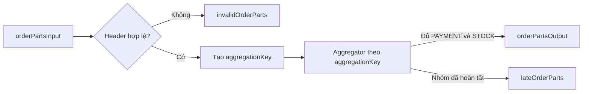

# Correlation key expression

## 1. Biểu thức correlation giải quyết vấn đề gì?

Trong chương **Correlation và state** của module **SPRING_INTEGRATION_CORE**, correlation key expression là biểu thức xác định một thông điệp thuộc nhóm trạng thái nào. Khi nhiều thông điệp đi qua các `MessageChannel`, đến từ nhiều nguồn hoặc xuất hiện xen kẽ, aggregator cần biết thông điệp nào phải chờ nhau để tạo một kết quả chung.

Ví dụ, luồng xử lý đơn hàng nhận hai loại kết quả: `PAYMENT` và `STOCK`. Kết quả thanh toán của đơn `O-42` phải được ghép với kết quả tồn kho của chính đơn đó, cùng tenant và cùng lần xử lý. Nếu biểu thức chỉ dùng `orderId`, hai tenant có mã đơn trùng nhau có thể bị gộp nhầm.

Bài học tập trung vào thiết kế biểu thức và khóa nhóm; các ví dụ sử dụng Message, header, filter, header enricher, aggregator và Java DSL để nối quy tắc correlation với một luồng tích hợp cụ thể. Sau bài này, người học có thể:

- Chọn dữ liệu đầu vào và kiểu kết quả cho biểu thức correlation.
- Phân biệt correlation với release, định danh thông điệp và chống xử lý trùng.
- Cấu hình biểu thức bằng Java DSL hoặc XML.
- Thiết kế khóa ghép có phạm vi tenant và lần xử lý rõ ràng.
- Xác định hành vi khi thiếu khóa, thông điệp đến muộn hoặc ứng dụng khởi động lại.
- Viết kiểm thử chứng minh rằng các thông điệp cần ghép được ghép đúng và các nhóm độc lập không bị trộn.

## 2. Mô hình: từ một Message đến một khóa nhóm

Có thể mô hình hóa biểu thức correlation như sau:

```text
E: Message<?> -> correlationKey

message A --E--> key K --+
                        +--> nhóm K --> kiểm tra release --> kết quả
message B --E--> key K --+

message C --E--> key L -----> nhóm L --> tiếp tục chờ
```

`E` chạy với **từng Message đầu vào**, không chạy với cả nhóm. Giá trị trả về là khóa dùng để tìm hoặc tạo nhóm trong phạm vi lưu trữ của endpoint.

Hợp đồng của `CorrelationStrategy` được biểu diễn bằng phương thức `Object getCorrelationKey(Message<?> message)`. Một strategy không xác định được khóa hợp lệ nên ném ngoại lệ; không thiết kế luồng dựa vào một khóa `null`. Xem [hợp đồng CorrelationStrategy](https://docs.spring.io/spring-integration/api/org/springframework/integration/aggregator/CorrelationStrategy.html).

Một hợp đồng khóa tốt cần thỏa mãn các điều kiện thiết kế sau:

| Điều kiện | Ý nghĩa trong luồng đơn hàng |
| --- | --- |
| Đầy đủ | Mọi thông điệp hợp lệ đều xác định được khóa |
| Nhất quán | PAYMENT và STOCK của cùng lần xử lý cho cùng khóa |
| Tách biệt | Khác tenant, đơn hàng hoặc lần xử lý cho khóa khác |
| Ổn định | Retry của cùng sự kiện không tự tạo khóa mới |
| So sánh được | `equals()` và `hashCode()` phản ánh đúng danh tính nhóm |
| Phù hợp nơi lưu trữ | Kiểu khóa, độ dài và cách mã hóa tương thích với store được chọn |

Không dùng `hashCode()` làm chính khóa nhóm: hai khóa khác nhau có thể có cùng hash. Cũng không dùng một đối tượng mutable rồi thay đổi các thuộc tính tham gia `equals()` hoặc `hashCode()` sau khi nó đã được dùng làm khóa.

### 2.1. Những định danh dễ bị nhầm

| Giá trị | Định danh cho | Có phù hợp làm khóa nhóm không? |
| --- | --- | --- |
| `headers['id']` | Một Message cụ thể | Thường không; mỗi Message có ID riêng |
| `headers['correlationId']` | Quan hệ correlation do luồng thiết lập | Có, khi quan hệ đó đúng với nhóm đang cần |
| `orderId` | Đơn hàng nghiệp vụ | Có thể, nhưng phải xét tenant và lần xử lý |
| `eventId` | Sự kiện phục vụ deduplication | Thường dùng để chống trùng trong nhóm |
| `traceId` | Phạm vi quan sát của distributed tracing | Chỉ dùng nếu có hợp đồng chứng minh trùng với phạm vi nhóm |
| `aggregationKey` | Header nghiệp vụ do ứng dụng quy ước | Có, nếu được tạo và bảo toàn đúng |

Tên `aggregationKey` trong bài là header tùy chọn của ứng dụng, không phải tên header bắt buộc của Spring Integration. Gateway hoặc adapter không thể tự suy ra khóa nghiệp vụ chỉ từ việc chúng tiếp nhận một request.

## 3. Biểu thức được đánh giá trên đối tượng nào?

Với correlation expression, đối tượng gốc là Message đang được xử lý. Vì vậy có thể truy cập `payload`, `headers` hoặc dùng `#root` để chỉ rõ Message đó. Spring Integration cũng hỗ trợ tham chiếu bean trong biểu thức; xem [SpEL trong Spring Integration](https://docs.spring.io/spring-integration/reference/spel.html).

| Biểu thức | Giả định về dữ liệu | Giá trị mong muốn |
| --- | --- | --- |
| `headers['orderId']` | Header đã chứa mã đơn | `"O-42"` |
| `#root.headers['aggregationKey']` | Header đã chứa khóa chuẩn hóa | Chuỗi khóa ghép |
| `payload.orderId` | Payload có property `orderId` đọc được | Mã đơn từ JavaBean |
| `payload['orderId']` | Payload là `Map` | Giá trị ứng với khóa `orderId` |
| `@orderPartPolicy.keyFor(#root)` | Bean có phương thức nhận Message | Khóa theo quy tắc nghiệp vụ |

Nếu payload là JavaBean, `payload.orderId` thường dựa vào getter `getOrderId()`. Nếu payload là một chuỗi JSON, đừng mặc định rằng `payload.orderId` tự phân tích JSON. Hãy chuyển payload về DTO/Map hoặc cấu hình cơ chế truy cập JSON phù hợp trước khi sử dụng biểu thức.

### 3.1. Ba loại biểu thức có ba trách nhiệm

| Cấu hình | Câu hỏi cần trả lời | Ngữ cảnh cần hiểu |
| --- | --- | --- |
| Correlation expression | Message này thuộc nhóm nào? | Một `Message<?>` |
| Release expression | Nhóm đã đủ điều kiện phát kết quả chưa? | Một `MessageGroup` |
| Output processor | Kết quả của nhóm có hình dạng gì? | Các thông điệp đã được chọn để tổng hợp |

Trong ví dụ XML, `correlation-strategy-expression="headers['orderId']"` chọn nhóm theo header của Message, còn `release-strategy-expression="size() == 2"` kiểm tra kích thước MessageGroup. Hai biểu thức không có cùng đối tượng gốc. Đây là điểm cần đối chiếu khi đọc [cấu hình aggregator](https://docs.spring.io/spring-integration/reference/aggregator.html).

Một biểu thức correlation đúng vẫn có thể đi kèm release strategy sai. Chẳng hạn, hai thông điệp PAYMENT trùng nhau có cùng khóa nhưng chưa chứng minh rằng STOCK đã đến.

### 3.2. Chuỗi biểu thức khác chuỗi literal

Trong Java DSL:

```java
.correlationExpression("headers['orderId']")
```

Dấu ngoặc kép thuộc cú pháp Java. Nội dung bên trong là SpEL để đọc header.

Ngược lại:

```java
.correlationExpression("'orderId'")
```

Biểu thức thứ hai trả về hằng chuỗi `orderId` cho mọi Message. Mọi thông điệp đi vào endpoint sẽ dùng cùng khóa đó.

Không bọc biểu thức thành `"#{headers['orderId']}"` theo thói quen viết Spring bean expression. API `correlationExpression(...)` nhận trực tiếp nội dung SpEL.

## 4. Cấu hình cơ bản bằng Java DSL và XML

### 4.1. Java DSL

Đoạn cấu hình sau giả định các Message đã có header `aggregationKey` hợp lệ và mỗi nhóm có đúng hai thông điệp phân biệt:

```java
@Bean
IntegrationFlow aggregatePairs() {
    return IntegrationFlow.from("partsInput")
            .aggregate(a -> a
                    .correlationExpression("headers['aggregationKey']")
                    .releaseExpression("size() == 2"))
            .channel("pairsOutput")
            .get();
}
```

Trong `AggregatorSpec`, tên phương thức là `correlationExpression(...)`. API này cấu hình một `ExpressionEvaluatingCorrelationStrategy`; không có bước bắt buộc phải tự tạo strategy bean chỉ để đọc một header. Xem [CorrelationHandlerSpec](https://docs.spring.io/spring-integration/api/org/springframework/integration/dsl/CorrelationHandlerSpec.html).

`size() == 2` ở đây chỉ là điều kiện minh họa khi hợp đồng đầu vào bảo đảm đủ và không trùng. Phần thực hành phía sau dùng loại kết quả để xác định release.

### 4.2. XML

Cấu hình tương ứng, dùng namespace `int`:

```xml
<beans xmlns="http://www.springframework.org/schema/beans"
       xmlns:xsi="http://www.w3.org/2001/XMLSchema-instance"
       xmlns:int="http://www.springframework.org/schema/integration"
       xsi:schemaLocation="
         http://www.springframework.org/schema/beans
         https://www.springframework.org/schema/beans/spring-beans.xsd
         http://www.springframework.org/schema/integration
         https://www.springframework.org/schema/integration/spring-integration.xsd">

    <int:channel id="partsInput"/>

    <int:aggregator id="aggregatePairs"
                    input-channel="partsInput"
                    output-channel="pairsOutput"
                    correlation-strategy-expression="headers['aggregationKey']"
                    release-strategy-expression="size() == 2"/>

    <int:channel id="pairsOutput">
        <int:queue/>
    </int:channel>
</beans>
```

Chọn một cách cấu hình correlation cho endpoint: biểu thức hoặc strategy tham chiếu. Không đặt đồng thời `correlation-strategy` và `correlation-strategy-expression` trong XML.

### 4.3. Khi nào dùng mặc định?

Nếu không cấu hình correlation strategy riêng, aggregator sử dụng header `IntegrationMessageHeaderAccessor.CORRELATION_ID`, có tên `correlationId`. Luồng splitter thường tạo correlation và sequence header để các phần có thể được ghép lại. Release mặc định liên quan đến thông tin sequence; việc có cùng correlation ID chưa đủ để bảo đảm nhóm sẽ được giải phóng. Các cơ chế mặc định này được mô tả trong [tài liệu aggregator](https://docs.spring.io/spring-integration/reference/aggregator.html).

Khi tự tạo Message từ các nguồn độc lập, hãy quyết định rõ:

- Dùng hợp đồng sequence của splitter nếu các Message thực sự thuộc cùng một phép chia.
- Dùng khóa nghiệp vụ và release strategy riêng nếu đang ghép các sự kiện nghiệp vụ độc lập.

Với luồng có splitter lồng nhau hoặc nhiều giai đoạn aggregation, cần theo dõi phạm vi correlation tại từng giai đoạn. Một khóa đơn hàng có thể quá rộng cho nhóm con đang đại diện cho một lô hoặc một lần thử cụ thể.

## 5. Thiết kế khóa ghép theo phạm vi nghiệp vụ

Giả sử một nhóm phải đại diện chính xác cho bộ ba:

```text
(tenantId, orderId, attemptId)
```

`attemptId` ở đây là mã của **một lần xử lý nghiệp vụ**, được nguồn điều phối cấp và truyền cho cả PAYMENT lẫn STOCK. Retry vận chuyển của cùng sự kiện phải giữ nguyên mã này. Nếu mỗi producer tự tạo attemptId ngẫu nhiên, hai kết quả sẽ không gặp nhau.

### 5.1. Vì sao chỉ dùng orderId là thiếu?

| Message | tenantId | orderId | attemptId | partType |
| --- | --- | --- | --- | --- |
| m1 | T-A | O-42 | A-1 | PAYMENT |
| m2 | T-B | O-42 | A-1 | STOCK |
| m3 | T-A | O-42 | A-2 | STOCK |
| m4 | T-A | O-42 | A-1 | STOCK |

Kết quả thiết kế mong muốn:

- `m1` và `m4` cùng nhóm.
- `m2` tách riêng vì khác tenant.
- `m3` tách riêng vì khác lần xử lý.

Nếu dùng `headers['orderId']`, cả bốn Message đều cho khóa `O-42`. Nếu chỉ thêm tenant, `m1` vẫn có thể bị ghép với `m3`.

### 5.2. Dấu phân cách có thể tạo va chạm

Biểu thức nối chuỗi ngắn gọn:

```text
headers['tenantId'] + ':' + headers['orderId']
```

chỉ đủ an toàn khi hợp đồng dữ liệu cấm hoặc escape dấu phân cách. Nếu dữ liệu được phép chứa dấu `:`:

```text
tenantId = "a:b", orderId = "c"   -> "a:b:c"
tenantId = "a",   orderId = "b:c" -> "a:b:c"
```

Hai định danh khác nhau tạo ra cùng chuỗi. Đây là va chạm do cách mã hóa, dù `String.equals()` hoạt động hoàn toàn đúng.

Một cách mã hóa có ranh giới rõ ràng là đặt độ dài trước từng thành phần:

```text
encode(x) = length(x) + ":" + x

key = "order-parts:v1:"
      + encode(tenantId)
      + encode(orderId)
      + encode(attemptId)
```

Ví dụ:

```text
("T-A", "O-42", "A-1")
-> order-parts:v1:3:T-A4:O-423:A-1
```

Quy ước này là lựa chọn thiết kế của ví dụ, không phải định dạng do Spring Integration yêu cầu. Nếu cần nhiều ngôn ngữ cùng tạo khóa, hãy đặc tả chính xác cách đo độ dài và mã hóa ký tự; `String.length()` của Java tính theo UTF-16 code unit. Với ví dụ trong bài, một bean Java duy nhất chịu trách nhiệm tạo khóa.

### 5.3. Chuẩn hóa có thể làm thay đổi danh tính

Không tự động gọi `trim()` hoặc chuyển chữ thường nếu chưa có quy tắc nghiệp vụ. `O-42` và `o-42` có thể là hai mã khác nhau. Chuyển UUID sang String hoặc chuyển số sang chuỗi cũng phải được thực hiện nhất quán ở mọi nguồn.

Một hợp đồng dễ kiểm soát là: ba thành phần đều là String không blank, được cấp từ nguồn có thẩm quyền và giữ nguyên trong suốt một lần xử lý.

## 6. Ví dụ hoàn chỉnh: ghép PAYMENT và STOCK

Ví dụ dành cho Java 17+ và dự án đã có `spring-integration-core` cùng các dependency Spring tương thích. Có thể dùng cấu hình này trực tiếp trong một ứng dụng Spring; không cần Spring Boot để tạo ApplicationContext.

Luồng xử lý:



### 6.1. Bean chứa hợp đồng đầu vào và quy tắc tạo khóa

```java
package example.correlation;

import org.springframework.messaging.Message;

public class OrderPartPolicy {

    public boolean isValid(Message<?> message) {
        return hasTextHeader(message, "tenantId")
                && hasTextHeader(message, "orderId")
                && hasTextHeader(message, "attemptId")
                && isExpectedPart(message.getHeaders().get("partType"));
    }

    public String keyFor(Message<?> message) {
        if (!isValid(message)) {
            throw new IllegalArgumentException("Invalid order-part headers");
        }

        String tenantId = message.getHeaders().get("tenantId", String.class);
        String orderId = message.getHeaders().get("orderId", String.class);
        String attemptId = message.getHeaders().get("attemptId", String.class);

        return "order-parts:v1:"
                + segment(tenantId)
                + segment(orderId)
                + segment(attemptId);
    }

    private boolean hasTextHeader(Message<?> message, String name) {
        Object value = message.getHeaders().get(name);
        return value instanceof String text && !text.isBlank();
    }

    private boolean isExpectedPart(Object value) {
        return "PAYMENT".equals(value) || "STOCK".equals(value);
    }

    private String segment(String value) {
        return value.length() + ":" + value;
    }
}
```

`keyFor(...)` kiểm tra lại hợp đồng để khi được gọi trực tiếp từ vị trí khác, nó không âm thầm tạo khóa cho dữ liệu thiếu. Trong ví dụ, filter giúp đưa dữ liệu sai vào kênh riêng trước khi tạo state.

`tenantId` phải được xác thực tại biên hệ thống. Một header có đúng kiểu và không blank chưa chứng minh rằng người gửi có quyền gửi dữ liệu cho tenant đó.

### 6.2. Java DSL

```java
package example.correlation;

import java.util.Set;
import java.util.stream.Collectors;

import org.springframework.context.annotation.Bean;
import org.springframework.context.annotation.Configuration;
import org.springframework.integration.channel.DirectChannel;
import org.springframework.integration.channel.QueueChannel;
import org.springframework.integration.config.EnableIntegration;
import org.springframework.integration.dsl.IntegrationFlow;

@Configuration
@EnableIntegration
public class CorrelationKeyConfig {

    @Bean
    public DirectChannel orderPartsInput() {
        return new DirectChannel();
    }

    @Bean
    public QueueChannel orderPartsOutput() {
        return new QueueChannel();
    }

    @Bean
    public QueueChannel invalidOrderParts() {
        return new QueueChannel();
    }

    @Bean
    public QueueChannel lateOrderParts() {
        return new QueueChannel();
    }

    @Bean
    public OrderPartPolicy orderPartPolicy() {
        return new OrderPartPolicy();
    }

    @Bean
    public IntegrationFlow orderPartsFlow() {
        return IntegrationFlow.from("orderPartsInput")
                .filter("@orderPartPolicy.isValid(#root)",
                        f -> f.discardChannel("invalidOrderParts"))
                .enrichHeaders(h -> h.headerExpression(
                        "aggregationKey",
                        "@orderPartPolicy.keyFor(#root)",
                        true))
                .aggregate(a -> a
                        .correlationExpression("headers['aggregationKey']")
                        .releaseStrategy(group -> group.getMessages().stream()
                                .map(message -> message.getHeaders()
                                        .get("partType", String.class))
                                .collect(Collectors.toSet())
                                .containsAll(Set.of("PAYMENT", "STOCK")))
                        .expireGroupsUponCompletion(false)
                        .discardChannel("lateOrderParts"))
                .channel("orderPartsOutput")
                .get();
    }
}
```

Các điểm cần đọc cùng nhau:

1. Filter kiểm tra hợp đồng trước khi aggregator nhận Message.
2. Header enricher tính lại `aggregationKey` từ các thành phần đã kiểm tra.
3. Tham số `true` cho phép ghi đè một `aggregationKey` đã có, tránh giữ lại khóa do nguồn bên ngoài gửi sai. Ý nghĩa tham số này nằm trong [HeaderEnricherSpec](https://docs.spring.io/spring-integration/api/org/springframework/integration/dsl/HeaderEnricherSpec.html).
4. Correlation expression chỉ đọc khóa đã chuẩn bị, nên có thể quan sát header ngay trước aggregator.
5. Release strategy chờ đủ hai loại kết quả; hai PAYMENT không thể thay cho PAYMENT và STOCK.
6. Cấu hình giữ dấu vết nhóm hoàn tất để Message đến sau với cùng khóa đi vào `lateOrderParts`. Nếu xóa nhóm khi hoàn tất, cùng khóa có thể tạo nhóm mới; đây là hành vi của [expireGroupsUponCompletion](https://docs.spring.io/spring-integration/api/org/springframework/integration/dsl/AggregatorSpec.html).

Trong cấu hình này, kết quả aggregation dùng processor mặc định. Khi hai kết quả không trùng đã đến, payload đầu ra là danh sách payload của chúng; không dựa vào thứ tự PAYMENT/STOCK trong danh sách. Nếu nghiệp vụ cần một DTO tổng hợp có trường cố định, hãy bổ sung output processor riêng.

Đây là ví dụ về khóa và ranh giới nhóm. Nó chưa cấu hình timeout, persistent store, giới hạn dung lượng queue hoặc cơ chế chống trùng sự kiện. Những phần đó cần được xác định trước khi dùng luồng cho tải vận hành thực tế.

### 6.3. Diễn tiến của các Message

Gửi lần lượt `m1`, `m2`, `m3`, `m4` trong bảng ở phần 5:

| Thời điểm | Nhóm được cập nhật | Các loại kết quả trong nhóm | Đầu ra |
| --- | --- | --- | --- |
| m1 | T-A / O-42 / A-1 | PAYMENT | Chưa có |
| m2 | T-B / O-42 / A-1 | STOCK | Chưa có |
| m3 | T-A / O-42 / A-2 | STOCK | Chưa có |
| m4 | T-A / O-42 / A-1 | PAYMENT, STOCK | Một kết quả tổng hợp |

Hai nhóm còn lại vẫn thiếu thành phần. Một PAYMENT khác cho `T-A/O-42/A-1` sau khi nhóm đó hoàn tất đi vào `lateOrderParts` trong khi dấu vết hoàn tất còn tồn tại.

Nếu PAYMENT bị giao trùng trước khi STOCK đến, release strategy vẫn chờ STOCK. Tuy nhiên, khi STOCK đến, danh sách đầu ra có thể chứa cả hai PAYMENT. Muốn mỗi loại chỉ xuất hiện đúng một lần trong kết quả, phải bổ sung deduplication hoặc quy tắc output phù hợp; correlation expression không cung cấp bảo đảm đó.

## 7. Chọn biểu thức hay strategy Java?

Với quy tắc đọc một header, biểu thức đủ ngắn và dễ nhìn:

```java
.correlationExpression("headers['aggregationKey']")
```

Khi cần validation, phiên bản hóa hoặc mã hóa khóa, có thể dùng bean như ví dụ trên. Một lựa chọn khác là bỏ bước tạo header và gọi trực tiếp bean trong correlation expression:

```java
.correlationExpression("@orderPartPolicy.keyFor(#root)")
```

Cách này giảm một bước trong flow nhưng không lưu sẵn khóa trên header để quan sát.

Nếu đội ngũ muốn kiểm tra kiểu khi biên dịch, có thể cấu hình strategy bằng method reference trong một bean nhận policy qua tham số:

```java
@Bean
IntegrationFlow typedCorrelationFlow(OrderPartPolicy policy) {
    return IntegrationFlow.from("typedPartsInput")
            .aggregate(a -> a
                    .correlationStrategy(policy::keyFor)
                    .releaseExpression("size() == 2"))
            .channel("typedPartsOutput")
            .get();
}
```

Đoạn này chỉ minh họa cách thay correlation expression bằng strategy; giả định đầu vào đã được validation và có đúng hai thông điệp cần ghép. Nó là flow thay thế để tham khảo, không phải phần bắt buộc thêm vào cấu hình ở phần 6.

Dù chọn cách nào, hàm tạo khóa nên là phép tính nhanh và không có side effect. Tránh gọi HTTP hoặc truy vấn dữ liệu dễ thay đổi để tạo khóa cho mỗi Message. Nếu lookup trả kết quả khác nhau giữa PAYMENT và STOCK, chúng có thể đi vào hai nhóm dù cùng một lần xử lý.

## 8. Khóa thiếu, khóa sai và ranh giới xử lý lỗi

### 8.1. Không dùng khóa mặc định chung để che dữ liệu thiếu

Biểu thức:

```text
headers['orderId'] ?: 'UNKNOWN'
```

có thể đẩy mọi Message thiếu mã đơn vào cùng một nhóm `UNKNOWN`. Một fallback giúp biểu thức trả về giá trị nhưng phá vỡ ranh giới nghiệp vụ.

Tương tự, trả về chuỗi rỗng hoặc tạo UUID mới tại aggregator đều không giải quyết dữ liệu thiếu: chuỗi rỗng gom dữ liệu lỗi lại, còn UUID mới khiến các thành phần liên quan bị tách ra.

Các lựa chọn cần gắn với hợp đồng đầu vào:

- Filter chuyển Message không hợp lệ đến kênh kiểm tra dữ liệu.
- Validation ném ngoại lệ nếu yêu cầu phía gọi sửa dữ liệu.
- Bổ sung metadata trước aggregator khi có nguồn xác định đáng tin cậy.

Trong ví dụ phần 6, `invalidOrderParts` là kênh discard do filter cấu hình, không phải `errorChannel` tự động.

### 8.2. Ngoại lệ SpEL khác với dữ liệu bị filter loại

Lỗi cú pháp biểu thức thường xuất hiện khi cấu hình được phân tích. Lỗi truy cập property hoặc kiểu dữ liệu có thể chỉ xuất hiện khi một Message cụ thể được đánh giá. Biểu thức trả `null` cũng không tạo ra một nhóm nghiệp vụ hợp lệ.

Với `DirectChannel` và gửi trực tiếp bằng `send(...)`, xử lý chạy trên thread của bên gửi; ngoại lệ từ handler thường truyền về bên gọi. Không giả định rằng mọi lỗi expression đều tự biến thành ErrorMessage trên global `errorChannel`. Luồng bất đồng bộ, poller và messaging gateway có cơ chế định tuyến lỗi riêng; xem [Error Handling](https://docs.spring.io/spring-integration/reference/error-handling.html).

Khi ghi nhận lỗi, nên giữ đủ thông tin để xác định endpoint, trường thiếu và phiên bản khóa. Nếu một lớp retry được thêm phía ngoài, lỗi dữ liệu cố định cần được phân loại để tránh retry lặp lại vô ích.

## 9. Khóa nhóm và vòng đời state

Biểu thức quyết định danh tính nhóm, nhưng tuổi thọ của nhóm là một quyết định riêng. Nếu thiếu STOCK mãi mãi, chọn đúng khóa vẫn không tự làm nhóm hoàn tất.

### 9.1. Những quyết định phải đi kèm

| Quyết định | Câu hỏi cần trả lời |
| --- | --- |
| Release | Những loại kết quả nào chứng minh nghiệp vụ đã đủ dữ liệu? |
| Timeout | Chờ bao lâu, tính từ mốc nào và xử lý nhóm thiếu ra sao? |
| Hoàn tất | Giữ dấu vết hoàn tất bao lâu để nhận diện thông điệp đến muộn? |
| Tái sử dụng khóa | Một lần xử lý mới có attemptId mới hay dùng lại khóa cũ? |
| Retry | Giao lại cùng sự kiện có giữ nguyên tenant/order/attempt không? |
| Khôi phục | Sau restart, nhóm đang chờ và dấu vết hoàn tất được lưu ở đâu? |

Có thể bổ sung `groupTimeout(...)` và chính sách gửi kết quả thiếu hoặc discard, nhưng phải đọc đúng ngữ nghĩa timer của endpoint. Đừng suy từ một con số timeout rằng đó là deadline tuyệt đối của nghiệp vụ. Cũng cần một chính sách dọn nhóm và dấu vết hoàn tất phù hợp với cửa sổ giao lại.

### 9.2. Lưu state và triển khai nhiều instance

Mặc định, `SimpleMessageStore` lưu trong bộ nhớ. Nếu cần khôi phục nhóm sau restart, hãy chọn MessageGroupStore bền vững và kiểm tra cách store lưu payload, header và khóa; các implementation có cơ chế serialization khác nhau. Xem [Message Store](https://docs.spring.io/spring-integration/reference/message-store.html).

Một khóa có `equals()` đúng trong JVM chưa đủ để kết luận mọi store đều lưu và tìm lại nó đúng như mong muốn. Cần kiểm thử round trip với implementation thật, nhất là khi dùng đối tượng khóa tự định nghĩa.

Nếu nhiều instance cùng cập nhật một store, thiết kế phải phối hợp cơ chế khóa đồng bộ giữa các instance, transaction và chính sách giao lại. Correlation expression không tự tạo ra bảo đảm xử lý đúng một lần.

Prefix `order-parts:v1:` trong ví dụ giúp phân biệt hợp đồng khóa. Khi đổi sang `v2`, phải lên kế hoạch cho các nhóm `v1` đang chờ. Đổi biểu thức ngay trong khi luồng còn state có thể khiến một nửa nhóm ở khóa cũ và nửa còn lại ở khóa mới.

Nếu hai endpoint dùng chung store, hãy xác định rõ chúng có dùng chung không gian nhóm hay không. Chọn store hoặc namespace khóa riêng khi chúng đại diện cho hai nghiệp vụ độc lập; trùng khóa giữa hai endpoint có thể trở thành xung đột state.

## 10. Kiểm thử correlation expression

Kiểm thử cần kiểm tra **ranh giới nghiệp vụ**, không chỉ chứng minh SpEL đọc được một header. Các đoạn bên dưới là mã minh họa để đưa vào dự án học tập; chúng không phải kết quả chạy kiểm thử sẵn có.

### 10.1. Kiểm tra biểu thức và các cặp dữ liệu

Ví dụ JUnit Jupiter sau dùng API Message của Spring và strategy đánh giá expression:

```java
package example.correlation;

import org.junit.jupiter.api.Test;
import org.springframework.integration.aggregator.ExpressionEvaluatingCorrelationStrategy;
import org.springframework.messaging.Message;
import org.springframework.messaging.support.MessageBuilder;

import static org.junit.jupiter.api.Assertions.*;

class CorrelationExpressionTest {

    private final OrderPartPolicy policy = new OrderPartPolicy();

    private final ExpressionEvaluatingCorrelationStrategy strategy =
            new ExpressionEvaluatingCorrelationStrategy(
                    "headers['aggregationKey']");

    @Test
    void relatedPartsHaveSameKeyButOtherScopesDoNot() {
        Object payment = key("T-A", "O-42", "A-1", "PAYMENT");
        Object stock = key("T-A", "O-42", "A-1", "STOCK");

        assertEquals(payment, stock);
        assertNotEquals(payment, key("T-B", "O-42", "A-1", "STOCK"));
        assertNotEquals(payment, key("T-A", "O-42", "A-2", "STOCK"));
        assertNotEquals(payment, key("T-A", "O-43", "A-1", "STOCK"));
    }

    @Test
    void separatorsInsideValuesDoNotCreateSameKey() {
        assertNotEquals(
                key("a:b", "c", "A-1", "PAYMENT"),
                key("a", "b:c", "A-1", "STOCK"));
    }

    @Test
    void missingBusinessIdentityIsRejected() {
        Message<String> invalid = MessageBuilder.withPayload("payment-ok")
                .setHeader("orderId", "O-42")
                .setHeader("attemptId", "A-1")
                .setHeader("partType", "PAYMENT")
                .build();

        assertFalse(policy.isValid(invalid));
        assertThrows(IllegalArgumentException.class,
                () -> policy.keyFor(invalid));
    }

    private Object key(
            String tenant, String order, String attempt, String part) {

        Message<String> source = MessageBuilder.withPayload(part)
                .setHeader("tenantId", tenant)
                .setHeader("orderId", order)
                .setHeader("attemptId", attempt)
                .setHeader("partType", part)
                .build();

        Message<?> prepared = MessageBuilder.fromMessage(source)
                .setHeader("aggregationKey", policy.keyFor(source))
                .build();

        return strategy.getCorrelationKey(prepared);
    }
}
```

`ExpressionEvaluatingCorrelationStrategy` là implementation dùng để đánh giá biểu thức trên Message; constructor nhận chuỗi expression được mô tả trong [API của strategy](https://docs.spring.io/spring-integration/api/org/springframework/integration/aggregator/ExpressionEvaluatingCorrelationStrategy.html).

### 10.2. Kiểm tra flow bằng dữ liệu xen kẽ

Kiểm thử này dùng lại hai lớp ở phần 6. Mỗi test tạo ApplicationContext mới để các nhóm chưa đủ dữ liệu không làm ảnh hưởng test khác.

```java
package example.correlation;

import java.util.List;

import org.junit.jupiter.api.Test;
import org.springframework.context.annotation.AnnotationConfigApplicationContext;
import org.springframework.integration.channel.QueueChannel;
import org.springframework.messaging.Message;
import org.springframework.messaging.MessageChannel;
import org.springframework.messaging.support.MessageBuilder;

import static org.junit.jupiter.api.Assertions.*;

class CorrelationKeyFlowTest {

    @Test
    void interleavedMessagesReleaseOnlyTheirOwnGroup() {
        try (var context =
                     new AnnotationConfigApplicationContext(
                             CorrelationKeyConfig.class)) {

            MessageChannel input =
                    context.getBean("orderPartsInput", MessageChannel.class);
            QueueChannel output =
                    context.getBean("orderPartsOutput", QueueChannel.class);
            QueueChannel late =
                    context.getBean("lateOrderParts", QueueChannel.class);
            QueueChannel invalid =
                    context.getBean("invalidOrderParts", QueueChannel.class);

            assertTrue(input.send(part("T-A", "A-1", "PAYMENT", "a-payment")));
            assertTrue(input.send(part("T-B", "A-1", "STOCK", "b-stock")));
            assertTrue(input.send(part("T-A", "A-2", "STOCK", "a2-stock")));
            assertNull(output.receive(0));

            assertTrue(input.send(part("T-A", "A-1", "STOCK", "a-stock")));

            Message<?> result = output.receive(0);
            assertNotNull(result);
            List<?> payloads = assertInstanceOf(List.class, result.getPayload());
            assertEquals(2, payloads.size());
            assertTrue(payloads.containsAll(List.of("a-payment", "a-stock")));
            assertNull(output.receive(0));

            assertTrue(input.send(
                    part("T-A", "A-1", "PAYMENT", "late-a-payment")));
            assertNotNull(late.receive(0));
            assertNull(output.receive(0));

            assertTrue(input.send(MessageBuilder.withPayload("bad").build()));
            assertNotNull(invalid.receive(0));
        }
    }

    private Message<String> part(
            String tenant, String attempt, String type, String payload) {

        return MessageBuilder.withPayload(payload)
                .setHeader("tenantId", tenant)
                .setHeader("orderId", "O-42")
                .setHeader("attemptId", attempt)
                .setHeader("partType", type)
                .build();
    }
}
```

`receive(0)` phù hợp ở đây vì input là DirectChannel và xử lý đồng bộ. Khi thay bằng executor hoặc poller, kiểm thử phải chờ có giới hạn theo mô hình bất đồng bộ; không chuyển nguyên các giả định thời gian này sang flow khác.

Các tình huống mở rộng cần được kiểm tra khi triển khai cơ chế tương ứng:

| Tình huống | Điều cần chứng minh |
| --- | --- |
| Giao lại PAYMENT trước STOCK | Không release chỉ vì đã có hai Message cùng loại |
| Header `aggregationKey` đầu vào bị đặt sai | Header enricher tính lại khóa từ danh tính đã xác thực |
| Giá trị là `Long` ở nguồn A, String ở nguồn B | Hợp đồng kiểu bị từ chối hoặc được chuẩn hóa thống nhất |
| Không nhận được STOCK | Nhóm được xử lý theo chính sách timeout đã chọn |
| Restart sau PAYMENT | Store bền vững khôi phục được nhóm và nhận tiếp STOCK |
| Dọn dấu vết hoàn tất rồi nhận Message cũ | Hành vi mở lại nhóm hoặc chặn replay khớp với thiết kế |
| Đổi phiên bản khóa khi còn nhóm chờ | Không chia cắt một lần xử lý giữa hai định dạng |

## 11. Chẩn đoán lỗi từ biểu hiện của nhóm

| Biểu hiện | Khả năng liên quan đến khóa | Hướng kiểm tra |
| --- | --- | --- |
| Nhiều nhóm chỉ có một Message | Dùng message ID, UUID mới hoặc attemptId không thống nhất | So sánh giá trị và kiểu khóa của hai Message phải ghép |
| Kết quả chứa dữ liệu tenant khác | Thiếu tenant trong khóa hoặc header chưa được xác thực | Đối chiếu nguồn tenant và quy tắc tạo khóa |
| PAYMENT của lần cũ ghép với STOCK của lần mới | Thiếu định danh lần xử lý | Theo dõi nơi cấp và truyền attemptId |
| Mọi Message đi vào một nhóm lớn | Biểu thức là literal hoặc dùng fallback chung | Kiểm tra dấu nháy và dữ liệu thiếu |
| Có đủ sự kiện theo log nhưng nhóm không đủ | Khác kiểu, khoảng trắng hoặc phiên bản khóa | Log các thành phần và phiên bản tại điểm trước aggregator |
| Message mới bị discard dù mã đơn đúng | Khóa trùng nhóm đã hoàn tất | Kiểm tra attemptId và thời gian giữ dấu vết hoàn tất |
| Nhóm chỉ lỗi sau restart | Khóa hoặc header không được lưu/khôi phục như dự kiến | Kiểm tra store, serializer và hợp đồng kiểu |

Điểm quan sát hữu ích là ngay sau header enricher: endpoint, phiên bản khóa, tenant và attempt đã xác thực, loại Message và khóa đã tạo. Nếu khóa chứa dữ liệu cần bảo vệ, ghi dấu vết đã che hoặc fingerprint phù hợp với chính sách log.

Không dùng correlation key làm nhãn metric không giới hạn vì số lượng khóa có thể rất lớn. Các metric tổng hợp như số nhóm đang chờ, tuổi nhóm, số Message thiếu metadata và số Message đến muộn thường dễ vận hành hơn.

Một khóa quá rộng khiến nhiều sự kiện độc lập cùng tranh chấp một nhóm. Một khóa quá hẹp khiến dữ liệu cần ghép bị phân tán thành nhiều nhóm không hoàn tất. Vì vậy, chất lượng khóa ảnh hưởng cả tính đúng của nghiệp vụ và lượng state phải giữ.

## 12. Quy tắc áp dụng

Một correlation key expression tốt là cách biểu diễn ngắn gọn của một hợp đồng danh tính đã được xác định rõ. Bắt đầu từ câu hỏi “những Message nào phải cùng chờ nhau trong đúng một lần xử lý?”, xác định các thành phần danh tính, kiểm tra chúng ở đầu vào rồi mới chọn biểu thức.

Trong luồng minh họa, hợp đồng đó là `tenantId + orderId + attemptId` với cách mã hóa không mơ hồ. Filter bảo vệ dữ liệu đầu vào, header enricher tạo khóa để quan sát, aggregator nhóm theo khóa và release strategy chờ đủ PAYMENT/STOCK. Timeout, lưu state, chống trùng và xử lý thông điệp đến muộn tiếp tục được thiết kế như những phần riêng của cùng một luồng tích hợp.
