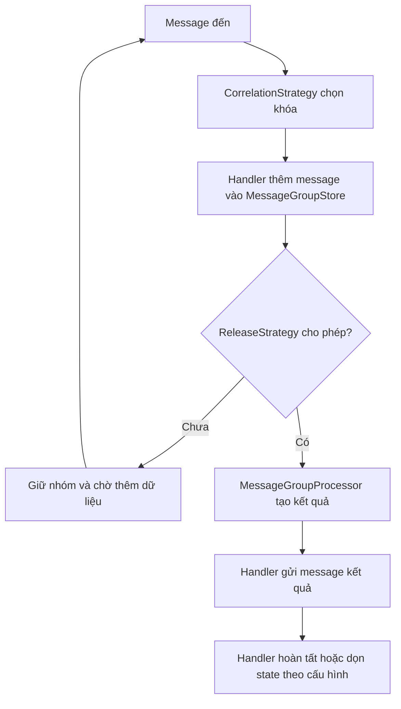

# MessageGroupProcessor

## 1. Mục tiêu và phạm vi

Trong chương **Correlation và state** của module **SPRING_INTEGRATION_CORE**, `MessageGroupProcessor` là điểm mở rộng để chuyển một nhóm thông điệp liên quan thành kết quả mà luồng cần phát ra. Với aggregator, kết quả thường là một thông điệp tổng hợp: nhiều dòng đơn hàng trở thành một bản tổng kết, nhiều phản hồi dịch vụ trở thành một quyết định, hoặc nhiều mảnh dữ liệu trở thành một tài liệu.

Sau bài học, bạn có thể:

- Phân biệt trách nhiệm của correlation strategy, release strategy, message store và group processor.
- Cài đặt processor có hợp đồng đầu vào, đầu ra và chính sách header rõ ràng.
- Gắn processor vào aggregator bằng Java DSL.
- Giải thích tác động của message trùng, message đến muộn, timeout và việc giữ state.
- Thiết kế kiểm thử cho thuật toán tổng hợp và cho luồng tích hợp.

Bạn cần biết `Message<T>`, payload, header, `MessageChannel`, bean Spring và cấu trúc một `IntegrationFlow`. Ví dụ dùng **Java 17 trở lên** và API **Spring Integration 6.5.x**; đây là mốc minh họa, không phải khẳng định phiên bản của dự án. Các đoạn mã là nội dung để thực hành trong ứng dụng có dependency `org.springframework.integration:spring-integration-core`; bài học không yêu cầu tạo thêm cấu hình build.

## 2. Vị trí của processor trong một luồng có state

Một luồng tổng hợp phải trả lời bốn câu hỏi khác nhau:

| Câu hỏi | Thành phần chịu trách nhiệm | Ví dụ với đơn hàng |
| --- | --- | --- |
| Message thuộc nhóm nào? | `CorrelationStrategy` | Cùng tenant, mã đơn và revision |
| Khi nào nhóm đủ điều kiện xử lý? | `ReleaseStrategy` | Đã nhận đủ các số dòng khác nhau |
| Message đang chờ được giữ ở đâu? | `MessageGroupStore` | Store trong bộ nhớ hoặc store bền vững |
| Từ nhóm hiện có, tạo ra kết quả gì? | `MessageGroupProcessor` | Một bản tổng kết và tổng tiền |

Handler điều phối các thành phần này; processor tập trung vào phép biến đổi của cả nhóm. Hợp đồng điều phối được thể hiện trong [API của AbstractCorrelatingMessageHandler](https://docs.spring.io/spring-integration/docs/6.5.0/api/org/springframework/integration/aggregator/AbstractCorrelatingMessageHandler.html).



Sơ đồ mô tả đường xử lý bình thường. Timeout là một đường kích hoạt hoàn tất riêng; nó được trình bày ở phần sau.

Với ví dụ đơn hàng, đặt phép cộng tổng tiền trong release strategy sẽ làm thuật toán tổng hợp chạy mỗi khi một dòng mới đến. Đặt việc chờ đủ dòng bên trong processor bằng vòng lặp hoặc `sleep` lại giữ luồng xử lý quá lâu. Hãy để release strategy quyết định sự sẵn sàng và để processor tính kết quả từ dữ liệu đã được giao.

## 3. Hợp đồng của MessageGroupProcessor

Interface có một phương thức chức năng:

```java
Object processMessageGroup(MessageGroup group);
```

Đầu vào là `MessageGroup`, không phải một `Message<?>` riêng lẻ. Kiểu trả về `Object` cho phép triển khai trả một payload, một `Message<?>` hoặc dạng kết quả phù hợp với handler sử dụng nó. Có thể cài đặt bằng class, lambda hoặc method reference. Processor cũng được dùng trong ngữ cảnh resequencer, vì vậy cách phát đầu ra phải được hiểu cùng handler cụ thể. Xem [hợp đồng MessageGroupProcessor](https://docs.spring.io/spring-integration/docs/6.5.0/api/org/springframework/integration/aggregator/MessageGroupProcessor.html).

Một lambda tối giản, giả sử mọi payload đều là `BigDecimal`:

```java
import java.math.BigDecimal;
import org.springframework.integration.aggregator.MessageGroupProcessor;

MessageGroupProcessor sumProcessor = group ->
        group.getMessages().stream()
                .map(message -> (BigDecimal) message.getPayload())
                .reduce(BigDecimal.ZERO, BigDecimal::add);
```

Đoạn này chỉ minh họa thuật toán. Nó chưa kiểm tra kiểu payload, loại tiền hay tính đầy đủ của dữ liệu. Trả về tổng bằng không cho một nhóm rỗng cũng là một lựa chọn nghiệp vụ cần cân nhắc, không phải hành vi luôn đúng.

### Đọc MessageGroup đúng cách

| API | Cách dùng trong processor |
| --- | --- |
| `getGroupId()` | Nhận diện nhóm khi ghi log; không mặc định ép thành `String` |
| `getMessages()` | Đọc các message hiện có để xây kết quả |
| `size()` | Đếm message vật lý trong nhóm |
| `getOne()` | Lấy một message đại diện sau khi đã kiểm tra nhóm không rỗng |
| `getTimestamp()`, `getLastModified()` | Quan sát thời điểm tạo và cập nhật nhóm |

`getOne()` không biểu diễn “dòng nghiệp vụ số 1”. `size()` cũng không tự đếm các dòng nghiệp vụ duy nhất. Các API và tính khả biến của nhóm được mô tả trong [MessageGroup](https://docs.spring.io/spring-integration/docs/6.5.0/api/org/springframework/integration/store/MessageGroup.html).

Trong bài này, processor chỉ đọc nhóm, tạo collection cục bộ rồi trả kết quả mới. Nó không gọi `clear()`, `complete()` hay sửa collection của nhóm. Cách làm này giữ việc quản lý vòng đời ở handler và giúp thuật toán có thể kiểm thử độc lập.

## 4. Kiểu kết quả và số message đầu ra

Đừng suy số message được phát chỉ từ tên kiểu Java:

| Processor và kết quả | Ý nghĩa trong aggregator |
| --- | --- |
| `DefaultAggregatingMessageGroupProcessor` | Gom các payload thành collection trong một message |
| Processor trả một DTO | DTO là payload của message kết quả |
| Processor trả `Message<DTO>` | Processor chủ động xây payload và các header của kết quả |
| Processor tùy chỉnh trả `Collection<Message<?>>` trên 6.5.x | Collection nằm trong payload của một message |
| `SimpleMessageGroupProcessor` | Dùng aggregator như barrier rồi thả từng message của nhóm |

Hành vi mặc định được mô tả ở [DefaultAggregatingMessageGroupProcessor](https://docs.spring.io/spring-integration/docs/6.5.0/api/org/springframework/integration/aggregator/DefaultAggregatingMessageGroupProcessor.html); trường hợp barrier có implementation riêng là [SimpleMessageGroupProcessor](https://docs.spring.io/spring-integration/docs/6.5.0/api/org/springframework/integration/aggregator/SimpleMessageGroupProcessor.html).

Cần lưu ý phiên bản: từ **6.0**, một collection message do processor tùy chỉnh trả về không mặc nhiên bị tách thành nhiều đầu ra; từ **6.5**, processor thuần có thể trả collection payload trực tiếp. Khi cần tương thích với phiên bản cũ hơn hoặc cần tổng hợp header, hãy dùng `AbstractAggregatingMessageGroupProcessor` hoặc chủ động trả một `Message`. Các thay đổi này được nêu trong [tài liệu Aggregator 6.5](https://docs.spring.io/spring-integration/reference/6.5/aggregator.html).

Ví dụ chính dưới đây trả `Message<Summary>`, nên hợp đồng đầu ra được thể hiện trực tiếp trong mã.

## 5. Bài toán: tổng hợp các dòng đơn hàng

Giả sử hệ thống nhận các kết quả xử lý dòng hàng từ một nguồn có thể gửi lại dữ liệu. Một đơn gồm ba dòng nhưng thứ tự đến có thể là `3, 3, 1, 2`.

Hợp đồng nghiệp vụ của ví dụ:

- Khóa nhóm là `(tenantId, orderId, revision)`. Hai tenant được phép dùng cùng mã đơn.
- Mỗi message mang `expectedLines`, số dòng `number`, tiền của dòng và loại tiền.
- Các số dòng hợp lệ nằm trong `1..expectedLines`.
- Message lặp có cùng số dòng và cùng giá trị tiền chỉ được tính một lần.
- Cùng số dòng nhưng khác giá trị tiền là xung đột dữ liệu.
- Mọi dòng trong một nhóm phải thống nhất khóa, số dòng dự kiến và loại tiền.
- Chỉ tạo bản tổng kết đầy đủ; dữ liệu thiếu khi timeout đi sang nhánh discard.

| Dữ liệu đến | Dòng nghiệp vụ đã có | Có kết quả? |
| --- | --- | --- |
| Dòng 3: 30000 VND | 3 | Chưa |
| Gửi lại dòng 3: 30000 VND | 3 | Chưa |
| Dòng 1: 100000 VND | 1, 3 | Chưa |
| Dòng 2: 70000 VND | 1, 2, 3 | Có, tổng 200000 VND |

Nếu dùng `group.size() == 3`, ba message đầu đã thỏa điều kiện mặc dù chưa có dòng 2. Đây là lý do release strategy và processor phải cùng hiểu định danh dòng nghiệp vụ.

`revision` đại diện cho một lần chụp dữ liệu đơn hàng. Một bản điều chỉnh phải dùng revision mới; không trộn dòng của bản cũ và bản mới rồi chọn giá trị đến sau bằng cách ngầm định.

## 6. Cài đặt processor và quy tắc kiểm tra nhóm

Các class trong ví dụ dùng chung package `demo.integration`. Class đầu tiên chứa mô hình dữ liệu, quy tắc đọc nhóm và thuật toán tổng hợp:

```java
package demo.integration;

import java.math.BigDecimal;
import java.util.Currency;
import java.util.List;
import java.util.Objects;
import java.util.TreeMap;

import org.springframework.integration.aggregator.MessageGroupProcessor;
import org.springframework.integration.store.MessageGroup;
import org.springframework.messaging.Message;
import org.springframework.messaging.support.MessageBuilder;

public final class OrderGroupProcessor implements MessageGroupProcessor {

    public record OrderKey(String tenantId, String orderId, long revision) {
        public OrderKey {
            Objects.requireNonNull(tenantId, "tenantId");
            Objects.requireNonNull(orderId, "orderId");
            if (tenantId.isBlank() || orderId.isBlank() || revision < 0) {
                throw new IllegalArgumentException("Invalid order key");
            }
        }
    }

    public record Line(
            OrderKey key,
            int number,
            int expectedLines,
            BigDecimal amount,
            Currency currency) {

        public Line {
            Objects.requireNonNull(key, "key");
            Objects.requireNonNull(amount, "amount");
            Objects.requireNonNull(currency, "currency");
            if (expectedLines <= 0 || number < 1 || number > expectedLines) {
                throw new IllegalArgumentException("Invalid line number");
            }
            if (amount.signum() < 0) {
                throw new IllegalArgumentException("Negative line amount");
            }
        }
    }

    public record Summary(
            OrderKey key,
            List<Integer> lineNumbers,
            BigDecimal total,
            Currency currency) {

        public Summary {
            lineNumbers = List.copyOf(lineNumbers);
        }
    }

    private record Snapshot(
            OrderKey key,
            int expectedLines,
            Currency currency,
            List<Line> lines) {

        boolean complete() {
            return lines.size() == expectedLines;
        }
    }

    public static boolean canRelease(MessageGroup group) {
        return group.size() > 0 && snapshot(group).complete();
    }

    @Override
    public Message<Summary> processMessageGroup(MessageGroup group) {
        Snapshot snapshot = snapshot(group);
        if (!snapshot.complete()) {
            throw new IllegalStateException("Incomplete order group");
        }

        BigDecimal total = snapshot.lines().stream()
                .map(Line::amount)
                .reduce(BigDecimal.ZERO, BigDecimal::add);

        List<Integer> numbers = snapshot.lines().stream()
                .map(Line::number)
                .toList();

        Summary summary = new Summary(
                snapshot.key(), numbers, total, snapshot.currency());

        return MessageBuilder.withPayload(summary)
                .setHeader("tenantId", snapshot.key().tenantId())
                .setHeader("orderId", snapshot.key().orderId())
                .setHeader("revision", snapshot.key().revision())
                .setHeader("aggregatedLineCount", numbers.size())
                .build();
    }

    private static Snapshot snapshot(MessageGroup group) {
        if (group.size() == 0) {
            throw new IllegalArgumentException("Empty order group");
        }

        Line first = asLine(group.getOne());
        TreeMap<Integer, Line> unique = new TreeMap<>();

        for (Message<?> message : group.getMessages()) {
            Line line = asLine(message);

            if (!line.key().equals(first.key())
                    || line.expectedLines() != first.expectedLines()
                    || !line.currency().equals(first.currency())) {
                throw new IllegalStateException("Inconsistent order group");
            }

            Line previous = unique.putIfAbsent(line.number(), line);
            if (previous != null
                    && previous.amount().compareTo(line.amount()) != 0) {
                throw new IllegalStateException(
                        "Conflicting amount for line " + line.number());
            }
        }

        return new Snapshot(
                first.key(),
                first.expectedLines(),
                first.currency(),
                List.copyOf(unique.values()));
    }

    private static Line asLine(Message<?> message) {
        if (!(message.getPayload() instanceof Line line)) {
            throw new IllegalArgumentException("Expected Line payload");
        }
        return line;
    }
}
```

### Vì sao tổ chức như vậy?

`snapshot()` là quy tắc dùng chung cho release strategy và processor. Nếu một bên đếm dòng duy nhất nhưng bên còn lại cộng tất cả message, luồng vẫn có thể phát tổng tiền sai. Dùng chung quy tắc giúp hai bước thống nhất.

`TreeMap` vừa khử trùng theo số dòng, vừa cho đầu ra có thứ tự tăng dần. Thứ tự này do nghiệp vụ lựa chọn, không phụ thuộc thứ tự message đến hay thứ tự collection bên trong store.

Với các số dòng khác nhau thuộc `1..expectedLines`, có đúng `expectedLines` phần tử đồng nghĩa đã có đủ mọi số dòng. Điều kiện này sẽ không còn đúng nếu định danh dòng là chuỗi tùy ý; khi đó cần biết tập định danh được chờ hoặc dùng một giao thức hoàn tất khác.

`BigDecimal.compareTo()` coi `30000` và `30000.00` là cùng giá trị tiền. Ví dụ chỉ cộng tiền dòng đã được tính sẵn; chính sách thuế, quy đổi tiền tệ và làm tròn phải được xác định riêng nếu bài toán có chúng.

Mọi cấu trúc thay đổi đều là biến cục bộ. Không có `currentOrder`, `runningTotal` hay map dùng chung giữa các lần gọi. Một bean processor vì thế có thể xử lý các nhóm khác nhau mà không vô tình trộn state.

Các record không có `implements Serializable`, vì ví dụ dùng store trong bộ nhớ. Khi đổi sang store bền vững, cần thiết kế serialization cho khóa, payload và header theo store đã chọn.

## 7. Gắn vào luồng bằng Java DSL

```java
package demo.integration;

import org.springframework.context.annotation.Bean;
import org.springframework.context.annotation.Configuration;
import org.springframework.integration.channel.DirectChannel;
import org.springframework.integration.channel.QueueChannel;
import org.springframework.integration.config.EnableIntegration;
import org.springframework.integration.dsl.IntegrationFlow;
import org.springframework.integration.store.SimpleMessageStore;

@Configuration
@EnableIntegration
public class OrderAggregationConfig {

    @Bean
    public DirectChannel orderLinesInput() {
        return new DirectChannel();
    }

    @Bean
    public QueueChannel orderSummaryOutput() {
        return new QueueChannel();
    }

    @Bean
    public QueueChannel orderDiscardChannel() {
        return new QueueChannel();
    }

    @Bean
    public SimpleMessageStore orderGroupStore() {
        return new SimpleMessageStore();
    }

    @Bean
    public OrderGroupProcessor orderGroupProcessor() {
        return new OrderGroupProcessor();
    }

    @Bean
    public IntegrationFlow orderAggregationFlow(
            OrderGroupProcessor processor,
            SimpleMessageStore orderGroupStore) {

        return IntegrationFlow.from("orderLinesInput")
                .aggregate(aggregator -> aggregator
                        .messageStore(orderGroupStore)
                        .correlationStrategy(message ->
                                ((OrderGroupProcessor.Line)
                                        message.getPayload()).key())
                        .releaseStrategy(OrderGroupProcessor::canRelease)
                        .outputProcessor(processor)
                        .groupTimeout(30_000)
                        .sendPartialResultOnExpiry(false)
                        .expireGroupsUponCompletion(false)
                        .expireGroupsUponTimeout(false)
                        .discardChannel("orderDiscardChannel"))
                .channel("orderSummaryOutput")
                .get();
    }
}
```

`.outputProcessor(processor)` chọn thuật toán tạo kết quả; `.channel("orderSummaryOutput")` chọn nơi nhận kết quả. Hai quyết định này độc lập. API gắn processor được mô tả tại [AggregatorSpec.outputProcessor](https://docs.spring.io/spring-integration/docs/6.5.0/api/org/springframework/integration/dsl/AggregatorSpec.html).

Ví dụ dùng correlation strategy lấy khóa từ payload, nên không cần thiết lập header `correlationId`. Nó cũng dùng release strategy riêng, nên không phụ thuộc `sequenceSize` của splitter. Khi dùng chiến lược mặc định trong một luồng khác, phải cung cấp đúng các header tương ứng.

Các lựa chọn store, timeout và discard thuộc [CorrelationHandlerSpec](https://docs.spring.io/spring-integration/docs/6.5.0/api/org/springframework/integration/dsl/CorrelationHandlerSpec.html). Hai cờ `expireGroupsUponCompletion(false)` và `expireGroupsUponTimeout(false)` được đặt có chủ đích để giữ dấu nhóm đã hoàn tất; hệ quả của chúng được giải thích ở phần state.

Ở đầu vào, ví dụ giả định chỉ nhận `Line` đã dựng thành công. Với adapter nhận JSON hoặc dữ liệu bên ngoài, nên đặt bước chuyển đổi và kiểm tra schema trước aggregator. Cast trong correlation strategy sẽ thất bại nếu payload sai kiểu; đó là lỗi đầu vào cần xử lý, không phải tín hiệu “nhóm chưa đủ”.

## 8. Chạy thử luồng và quan sát kết quả

Có thể chạy đoạn sau trong cùng ứng dụng đã có Spring Integration trên classpath:

```java
package demo.integration;

import java.math.BigDecimal;
import java.util.Currency;
import java.util.Objects;

import org.springframework.context.annotation.AnnotationConfigApplicationContext;
import org.springframework.messaging.Message;
import org.springframework.messaging.MessageChannel;
import org.springframework.messaging.PollableChannel;
import org.springframework.messaging.support.MessageBuilder;

public final class OrderAggregationDemo {

    public static void main(String[] args) {
        try (var context = new AnnotationConfigApplicationContext(
                OrderAggregationConfig.class)) {

            MessageChannel input = context.getBean(
                    "orderLinesInput", MessageChannel.class);
            PollableChannel output = context.getBean(
                    "orderSummaryOutput", PollableChannel.class);

            var key = new OrderGroupProcessor.OrderKey(
                    "tenant-a", "ORD-42", 1);
            Currency vnd = Currency.getInstance("VND");

            input.send(message(key, 3, "30000", vnd));
            input.send(message(key, 3, "30000.00", vnd));
            input.send(message(key, 1, "100000", vnd));

            if (output.receive(0) != null) {
                throw new AssertionError("Released before line 2 arrived");
            }

            input.send(message(key, 2, "70000", vnd));

            Message<?> reply = Objects.requireNonNull(output.receive(1_000));
            var summary = (OrderGroupProcessor.Summary) reply.getPayload();

            System.out.println(summary.key());
            System.out.println(summary.lineNumbers());
            System.out.println(summary.total() + " " + summary.currency());
            System.out.println(reply.getHeaders().get("aggregatedLineCount"));
        }
    }

    private static Message<OrderGroupProcessor.Line> message(
            OrderGroupProcessor.OrderKey key,
            int number,
            String amount,
            Currency currency) {

        return MessageBuilder.withPayload(
                new OrderGroupProcessor.Line(
                        key, number, 3, new BigDecimal(amount), currency))
                .build();
    }
}
```

Kết quả mong đợi về nghiệp vụ:

```text
OrderKey[tenantId=tenant-a, orderId=ORD-42, revision=1]
[1, 2, 3]
200000 VND
3
```

Mỗi lần gọi `MessageBuilder` tạo một message mới. Hai message dòng 3 vẫn mang cùng định danh nghiệp vụ; thuật toán không dựa vào message ID để phát hiện chúng là cùng dòng.

Giá trị `true` từ `input.send(...)` cho biết thao tác gửi được chấp nhận theo channel và handler đang dùng. Nó không có nghĩa một đơn hàng đã có bản tổng kết. Trong ví dụ, chỉ sau khi nhận dòng 2 mới có dữ liệu ở output.

Luồng dùng output channel cố định. Nếu thay bằng gateway request/reply, cần thiết kế rõ yêu cầu nào chờ câu trả lời cuối cùng, thời gian chờ của gateway và cách bảo toàn hoặc chọn `replyChannel`. Một lời gọi cho từng dòng mà đều chờ một kết quả tổng hợp có thể tạo các lời gọi bị timeout trước khi đủ nhóm.

## 9. Header của kết quả là một phần của hợp đồng

Processor chính chủ động trả một `Message<Summary>` với các header nghiệp vụ: tenant, mã đơn, revision và số dòng đã tổng hợp. Không có thao tác sao chép toàn bộ header của một dòng ngẫu nhiên.

Hãy xác định chính sách cho từng loại header:

| Loại header | Quyết định cần có |
| --- | --- |
| Định danh đơn và tenant | Phải thống nhất giữa các dòng và xuất hiện trong kết quả |
| Tiền tệ | Phải thống nhất; không chọn tùy ý một giá trị |
| Trace hoặc mã yêu cầu của từng nhánh | Chọn trace cha hoặc ghi danh sách nguồn theo quy ước quan sát |
| `replyChannel`, `errorChannel` | Giữ hoặc chọn theo mô hình định tuyến của toàn luồng |
| Sequence header | Tôn trọng ngữ cảnh splitter/aggregator, nhất là luồng lồng nhau |

Nếu muốn framework tổng hợp header, có thể kế thừa `AbstractAggregatingMessageGroupProcessor` và cài đặt `aggregatePayloads(MessageGroup, Map<String, Object>)`. Mặc định, header có giá trị xung đột bị loại; việc một message không có header không tự được coi là xung đột. Có thể thay bằng `setHeadersFunction(...)`. Xem [AbstractAggregatingMessageGroupProcessor](https://docs.spring.io/spring-integration/docs/6.5.0/api/org/springframework/integration/aggregator/AbstractAggregatingMessageGroupProcessor.html).

Một processor tối giản chỉ để minh họa cách tạo payload dạng danh sách:

```java
package demo.integration;

import java.util.Map;

import org.springframework.integration.aggregator.AbstractAggregatingMessageGroupProcessor;
import org.springframework.integration.store.MessageGroup;

public final class PayloadListProcessor
        extends AbstractAggregatingMessageGroupProcessor {

    @Override
    protected Object aggregatePayloads(
            MessageGroup group, Map<String, Object> defaultHeaders) {

        return group.getMessages().stream()
                .map(message -> message.getPayload())
                .toList();
    }
}
```

Class này không thay thế quy tắc khử trùng hay kiểm tra đơn hàng của ví dụ chính. Nó minh họa việc base class xây message bao ngoài collection payload.

Với processor tùy chỉnh đã trả `Message`, không nên mong `headersFunction` tự bổ sung các header còn thiếu: cơ chế delegate coi message đó là kết quả đã được processor xây xong. Hành vi này được mô tả trong [DelegatingMessageGroupProcessor](https://docs.spring.io/spring-integration/docs/6.5.0/api/org/springframework/integration/aggregator/DelegatingMessageGroupProcessor.html).

## 10. State, message đến muộn và việc dùng lại khóa

### State nằm ở store và handler

`SimpleMessageStore` là store trong bộ nhớ, phù hợp để chạy ví dụ. Khởi động lại tiến trình sẽ làm mất các nhóm đang chờ và dấu nhóm đã hoàn tất. Constructor không tham số cũng không đặt giới hạn dung lượng. Xem [SimpleMessageStore](https://docs.spring.io/spring-integration/docs/6.5.0/api/org/springframework/integration/store/SimpleMessageStore.html).

Với yêu cầu phục hồi sau sự cố, có thể chọn store bền vững. Khả năng serialize payload, header và khóa phụ thuộc implementation. Việc đổi store cũng không tự giải quyết định tuyến tới reply channel tạm của một tiến trình đã mất. Xem [Message Store](https://docs.spring.io/spring-integration/reference/message-store.html).

Trong ví dụ, không nên thêm một map nhóm thứ hai bên trong `OrderGroupProcessor`. Nếu map đó không có cùng vòng đời và giao dịch với store, dữ liệu hai nơi có thể lệch nhau sau retry hoặc restart.

### Hoàn tất nhóm khác với xóa dấu nhóm

Với `expireGroupsUponCompletion(false)`, aggregator hoàn tất nhóm và loại các message đã xử lý nhưng giữ dấu nhóm hoàn tất. Message đến muộn với cùng khóa được nhận diện để loại bỏ. Nếu bật `true`, nhóm bị xóa hoàn toàn và message cùng khóa có thể bắt đầu nhóm mới. Xem [vòng đời trong AggregatingMessageHandler](https://docs.spring.io/spring-integration/docs/6.5.0/api/org/springframework/integration/aggregator/AggregatingMessageHandler.html).

Điều này dẫn đến các quyết định nghiệp vụ cụ thể:

- Gửi lại dòng của `ORD-42/revision=1` sau khi đơn hoàn tất: xem là dữ liệu đến muộn.
- Điều chỉnh đơn: dùng `revision=2`, tạo một nhóm có danh tính khác.
- Dọn dấu hoàn tất sau một thời hạn: chấp nhận rằng message cũ hơn thời hạn đó có thể mở lại nhóm, trừ khi có cơ chế chống phát lại khác.

Ví dụ cố ý chưa cấu hình dọn dấu hoàn tất để hành vi đến muộn dễ quan sát. Trong hệ thống chạy lâu, cần đặt thời gian lưu dấu theo cửa sổ gửi lại thực tế; nếu giữ mọi khóa mãi mãi thì metadata vẫn tăng dù payload đã được dọn.

### Khử trùng trong nhóm chưa phải idempotency đầu cuối

Processor bỏ qua bản lặp của cùng một dòng trong nhóm hiện tại. Điều này không bảo đảm bản tổng kết chỉ được ghi vào hệ thống đích một lần.

Ví dụ, hệ thống đích đã lưu bản tổng kết nhưng kết nối đứt trước khi phía gửi biết thao tác thành công. Khi xử lý lại, cùng kết quả có thể được gửi thêm lần nữa. Một lựa chọn là dùng khóa `(tenantId, orderId, revision)` làm khóa duy nhất ở bảng đích hoặc làm idempotency key cho thao tác ghi.

Không dùng `MessageHeaders.ID` của message đầu ra làm định danh nghiệp vụ bền vững: tạo lại message có thể tạo ID khác. Việc bảo vệ thao tác ghi cần gắn với danh tính của kết quả nghiệp vụ.

## 11. Timeout, dữ liệu thiếu và lỗi

### Timeout của nhóm không phải timeout của phép tính

Trong cấu hình trên, `groupTimeout(30_000)` chờ khoảng 30 giây không có message mới cho nhóm chưa được release. Message mới có thể làm lịch chờ được đặt lại; đây không mặc nhiên là hạn chót 30 giây từ lúc nhận dòng đầu.

Khi timeout, handler kiểm tra lại release strategy. Nếu nhóm vẫn chưa sẵn sàng, cờ `sendPartialResultOnExpiry(false)` khiến dữ liệu bị discard thay vì tạo tổng kết thiếu. `expireGroupsUponTimeout(false)` giữ dấu nhóm đã hoàn tất do timeout. Xem [cấu hình timeout của Aggregator](https://docs.spring.io/spring-integration/reference/6.5/aggregator.html#aggregator-and-group-timeout).

Trong ví dụ đơn hàng, nếu mới có dòng 1 và 3:

1. Không phát `Summary`.
2. Dữ liệu bị loại đi tới `orderDiscardChannel`.
3. Nếu sau đó dòng 2 đến với cùng khóa còn được giữ dấu, nó không làm hồi sinh đơn đó.
4. Muốn xử lý lại, cần quy trình nghiệp vụ rõ ràng: cấp revision mới hoặc phục hồi có kiểm soát.

Chỉ bật `sendPartialResultOnExpiry(true)` chưa làm processor hiện tại hỗ trợ dữ liệu thiếu. Nó vẫn ném lỗi khi `Snapshot` chưa đầy đủ. Nếu cần kết quả tạm, hãy đổi hợp đồng thành một kiểu phân biệt rõ trạng thái, chẳng hạn `PartialSummary` kèm danh sách dòng còn thiếu; hệ thống đích phải hiểu và xử lý kiểu đó.

### Xung đột dữ liệu là lỗi, không phải discard do timeout

Trong `snapshot()`, các trường hợp khác tiền tệ, khác số dòng dự kiến hoặc một dòng có hai số tiền đều ném exception. Nhánh discard của aggregator không tự đóng vai trò nơi nhận mọi exception.

Với `DirectChannel`, lỗi xử lý xảy ra trên luồng gọi và được truyền về bên gửi, có thể qua exception bọc của framework. Với poller hoặc xử lý bất đồng bộ, cần kiểm tra cơ chế xuất `ErrorMessage` và cấu hình error handler tương ứng. Header `errorChannel` không tự biến mọi lời gọi đồng bộ thành xử lý lỗi bất đồng bộ. Xem [Error Handling](https://docs.spring.io/spring-integration/reference/error-handling.html).

Một điểm cần hiểu trong ví dụ: handler đã thêm message vào nhóm trước khi release strategy kiểm tra cả nhóm. Vì vậy, khi phát hiện xung đột, đừng giả định message gây lỗi tự bị gỡ khỏi store hoặc cả nhóm đã rollback. Hành vi rollback phụ thuộc giao dịch và store.

Trong ứng dụng thực tế, hãy phân biệt:

| Trường hợp | Hướng xử lý cần thiết kế |
| --- | --- |
| Payload sai schema | Loại hoặc chuyển sang kênh kiểm tra trước aggregator |
| Một dòng có hai giá trị mâu thuẫn | Cách ly batch và điều tra nguồn dữ liệu |
| Thiếu dòng quá thời gian chờ | Discard, ghi nhận batch chưa đủ và quyết định xử lý lại |
| Store hoặc hệ thống đích tạm thời lỗi | Retry có giới hạn, xét giao dịch và idempotency |
| Lỗi khi xử lý từ scheduler timeout | Theo dõi error handler của scheduler |

Retry vô hạn một nhóm có dữ liệu mâu thuẫn không thể làm hai số tiền trở nên nhất quán. Tương tự, trả `null` để giấu lỗi không tạo ra một kết quả nghiệp vụ có thể kiểm soát.

## 12. Kiểm thử thuật toán và luồng

### Kiểm thử processor không cần khởi động Spring

`SimpleMessageGroup` có thể được dựng trực tiếp để thử thuật toán; constructor và thao tác thêm message được mô tả tại [API SimpleMessageGroup](https://docs.spring.io/spring-integration/docs/6.5.0/api/org/springframework/integration/store/SimpleMessageGroup.html).

Ví dụ dùng JUnit Jupiter:

```java
package demo.integration;

import java.math.BigDecimal;
import java.util.Currency;
import java.util.List;

import org.junit.jupiter.api.Test;
import org.springframework.integration.store.SimpleMessageGroup;
import org.springframework.messaging.Message;
import org.springframework.messaging.support.MessageBuilder;

import static org.junit.jupiter.api.Assertions.*;

class OrderGroupProcessorTest {

    private final OrderGroupProcessor processor = new OrderGroupProcessor();
    private final OrderGroupProcessor.OrderKey key =
            new OrderGroupProcessor.OrderKey("tenant-a", "ORD-42", 1);

    @Test
    void repeatedLineDoesNotReleaseEarlyOrIncreaseTotal() {
        var group = new SimpleMessageGroup(key);
        group.add(line(2, "70000"));
        group.add(line(2, "70000.00"));

        assertFalse(OrderGroupProcessor.canRelease(group));

        group.add(line(1, "100000"));
        assertTrue(OrderGroupProcessor.canRelease(group));

        var result = processor.processMessageGroup(group);
        var summary = result.getPayload();

        assertEquals(List.of(1, 2), summary.lineNumbers());
        assertEquals(0, summary.total().compareTo(new BigDecimal("170000")));
        assertEquals(2, result.getHeaders().get("aggregatedLineCount"));
        assertEquals(3, group.size());
    }

    @Test
    void conflictingAmountsFailInsteadOfChoosingAnArbitraryWinner() {
        var group = new SimpleMessageGroup(key);
        group.add(line(1, "100000"));
        group.add(line(1, "110000"));

        assertThrows(IllegalStateException.class,
                () -> OrderGroupProcessor.canRelease(group));
    }

    @Test
    void incompleteGroupCannotProduceACompleteSummary() {
        var group = new SimpleMessageGroup(key);
        group.add(line(1, "100000"));

        assertThrows(IllegalStateException.class,
                () -> processor.processMessageGroup(group));
    }

    private Message<OrderGroupProcessor.Line> line(int number, String amount) {
        return MessageBuilder.withPayload(new OrderGroupProcessor.Line(
                        key,
                        number,
                        2,
                        new BigDecimal(amount),
                        Currency.getInstance("VND")))
                .build();
    }
}
```

Ở test đầu, nhóm vẫn có ba message sau khi processor được gọi trực tiếp. Assertion này thể hiện processor không tự dọn state. Việc handler có dọn state đúng cấu hình hay không cần được kiểm thử ở cấp luồng.

### Những tình huống phải kiểm tra ở cấp tích hợp

| Tình huống | Điều cần xác nhận |
| --- | --- |
| Đủ dòng nhưng đến sai thứ tự | Chỉ một bản tổng kết, danh sách số dòng được sắp xếp |
| Có bản lặp trước khi đủ nhóm | Không release sớm, tổng không tăng |
| Hai tenant có cùng `orderId` | Kết quả không trộn dữ liệu |
| Hai revision của cùng đơn | Hai nhóm độc lập |
| Message đến sau khi hoàn tất | Đi đúng chính sách message đến muộn |
| Thiếu một dòng đến hết timeout | Không có tổng kết đầy đủ; có dữ liệu discard |
| Sai loại tiền hoặc mâu thuẫn số dòng dự kiến | Lỗi được quan sát ở đúng đường xử lý |
| Nhiều luồng gửi vào cùng khóa | Kết quả nhất quán, không tổng hợp hai lần ngoài dự kiến |
| Ghi kết quả rồi xảy ra retry | Hệ thống đích xử lý lặp theo idempotency key |
| Restart khi đang có nhóm chờ | Hành vi khôi phục phù hợp với store được chọn |

Kiểm thử timeout nên cấu hình khoảng chờ riêng cho test và nhận từ channel với thời gian chờ có giới hạn. Tránh chỉ `sleep` một khoảng cố định rồi mặc định lịch scheduler đã chạy. Khi kiểm thử lại với cùng Spring context, dùng khóa đơn khác nhau hoặc dọn state có chủ đích, vì ví dụ giữ dấu nhóm hoàn tất.

Các đoạn kiểm thử trên là hướng dẫn thực hành; chúng không phải báo cáo rằng test đã được chạy trong repository.

## 13. Hiệu năng và đồng thời

Cách `snapshot()` quét nhóm dễ đọc nhưng có chi phí. Với `m` message vật lý và `u` số dòng duy nhất, một lần dựng `TreeMap` tốn khoảng `O(m log u)` và bộ nhớ cục bộ `O(u)`. Release strategy gọi lại phép quét khi có message mới; tổng chi phí cho một nhóm lớn có thể tăng gần bậc hai theo số message đến.

Trước khi dùng cho batch lớn, cần đánh giá:

- Số dòng tối đa và số bản gửi lại được chấp nhận cho một đơn.
- Số nhóm mở đồng thời, dung lượng payload và thời gian giữ dữ liệu.
- Chi phí tải toàn bộ nhóm nếu dùng store ngoài tiến trình.
- Tốc độ thoát của output channel và nhánh discard.
- Thời gian khóa một nhóm khi tổng hợp.

Bản lặp bị bỏ qua trong phép cộng vẫn có thể chiếm chỗ trong store cho đến khi nhóm hoàn tất. Khử trùng ở processor không thay thế việc kiểm soát lưu lượng hoặc idempotent receiver ở đầu vào.

Processor nên thực hiện một phép tính có giới hạn trên dữ liệu nhóm. Các lệnh HTTP chậm, gửi email hoặc ghi nhiều hệ thống ngay trong processor làm việc thử lại và kiểm soát tác dụng phụ khó hơn. Có thể phát một kết quả bất biến trước, sau đó dùng endpoint phía sau để thực hiện tác vụ có retry và idempotency riêng.

Handler cung cấp khóa theo group ID; DSL cho phép chọn `lockRegistry`. Với nhiều tiến trình cùng dùng store, phải thiết kế khóa và giao dịch phù hợp với mô hình triển khai. Khóa trong bộ nhớ của một tiến trình không phối hợp được với khóa ở tiến trình khác. API cấu hình được nêu trong [CorrelationHandlerSpec.lockRegistry](https://docs.spring.io/spring-integration/docs/6.5.0/api/org/springframework/integration/dsl/CorrelationHandlerSpec.html).

## 14. Chọn cách mở rộng phù hợp

| Nhu cầu | Cách tiếp cận |
| --- | --- |
| Chỉ cần collection các payload | Bắt đầu với processor mặc định |
| Biến đổi đơn giản, đầu vào đã được đảm bảo | Lambda hoặc `outputExpression` phù hợp |
| Quy tắc miền có khử trùng và kiểm tra nhất quán | Class cài đặt `MessageGroupProcessor` |
| Cần framework tổng hợp header và payload tùy chỉnh | Kế thừa `AbstractAggregatingMessageGroupProcessor` |
| Chờ nhóm đủ rồi thả từng message gốc | `SimpleMessageGroupProcessor` |
| Phát lại message theo thứ tự sequence | Xem resequencer và processor dành cho resequencing |

Khi xây processor riêng, hãy chốt ba hợp đồng trước: một nhóm được nhận diện thế nào, thế nào là đủ dữ liệu, và một kết quả hợp lệ chứa gì. Sau đó đặt mỗi quy tắc vào đúng thành phần, kiểm tra rõ header và thiết kế vòng đời state. Với cách phân chia này, thuật toán tổng hợp đơn hàng có thể giữ nhỏ và dễ kiểm thử trong khi Java DSL thể hiện rõ cách luồng chờ, phát kết quả, xử lý timeout và message đến muộn.
