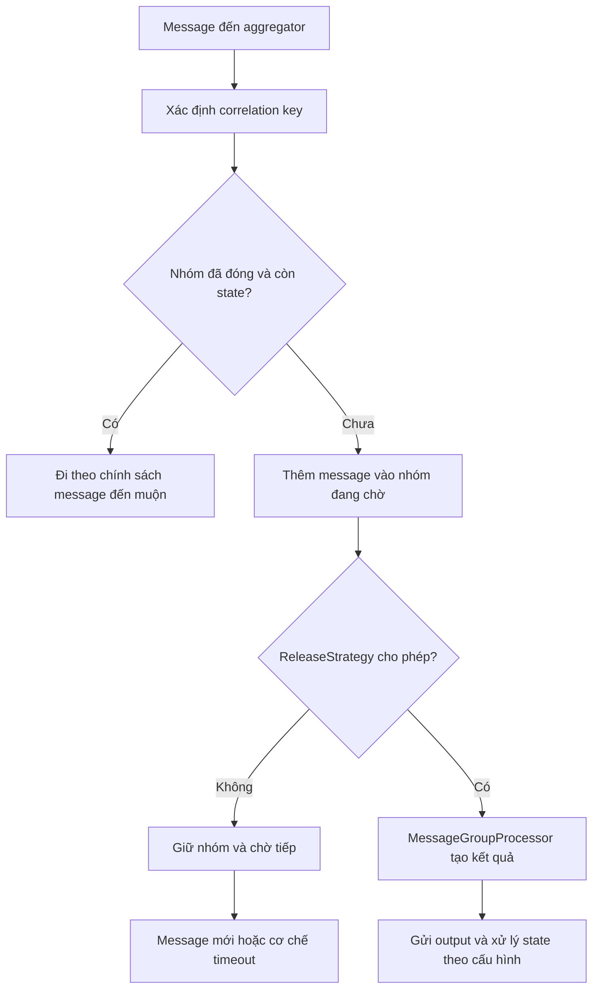

# ReleaseStrategy

> **Module:** SPRING_INTEGRATION_CORE  
> **Chương:** Correlation và state

Trong Spring Integration, một aggregator có thể nhận nhiều thông điệp thuộc cùng một nghiệp vụ nhưng đến ở những thời điểm khác nhau. `ReleaseStrategy` quyết định **khi nào trạng thái hiện có của một nhóm cho phép tiếp tục tổng hợp**. Quyết định này phải phản ánh dữ liệu mà nghiệp vụ thực sự cần.

Bài học sử dụng luồng ghép các tín hiệu hoàn tất cho một đơn hàng để giải thích hợp đồng của strategy, cách cấu hình bằng Java DSL, quan hệ với timeout và state, cùng cách kiểm thử các tình huống đến sai thứ tự, trùng lặp và đến muộn.

## 1. Mục tiêu và kiến thức nền

Sau bài học, bạn có thể:

- Phân biệt trách nhiệm của `CorrelationStrategy`, `ReleaseStrategy` và `MessageGroupProcessor`.
- Chọn điều kiện giải phóng theo sequence, số lượng hoặc tập điều kiện nghiệp vụ.
- Viết strategy có thể gọi nhiều lần mà không gây tác dụng phụ.
- Cấu hình aggregator không phát kết quả thành công khi mới nhận một phần dữ liệu.
- Thiết kế kiểm thử cho nhóm chưa đủ, nhóm đủ và các đường timeout, discard.

Bạn cần biết `Message<?>` chứa payload và headers, `MessageChannel` vận chuyển message, endpoint xử lý message và aggregator giữ các message liên quan trong một `MessageGroup`. Các ví dụ sử dụng cú pháp Java 17 trở lên và Java DSL thuộc thư viện `spring-integration-core`; không cần adapter HTTP, Kafka hoặc AMQP để hiểu cơ chế.

## 2. Từ correlation đến release

Giả sử việc xác nhận một đơn hàng cần ba tín hiệu tích cực:

1. `PAYMENT`: thanh toán đã được chấp thuận.
2. `INVENTORY`: hàng đã được giữ.
3. `DELIVERY`: phương án giao hàng đã được chuẩn bị.

Các tín hiệu của đơn `ORD-701` cùng một nhóm, còn tín hiệu của `ORD-702` thuộc nhóm khác. Khi nhận hai lần `PAYMENT` và một lần `INVENTORY`, hệ thống vẫn chưa có `DELIVERY`, dù đã nhận ba message.

| Thành phần | Câu hỏi cần trả lời | Ví dụ trong luồng đơn hàng |
| --- | --- | --- |
| `CorrelationStrategy` | Message thuộc nhóm nào? | Khóa nhóm là `orderId`. |
| `MessageGroupStore` | Trạng thái nhóm được giữ ở đâu? | Giữ các tín hiệu đang chờ tổng hợp. |
| `ReleaseStrategy` | Nhóm hiện tại đã sẵn sàng chưa? | Đã có đủ ba loại tín hiệu bắt buộc? |
| `MessageGroupProcessor` | Tạo kết quả gì từ nhóm được giải phóng? | Tạo `ReadyOrder`. |
| Chính sách timeout và cleanup | Nhóm thiếu dữ liệu chờ đến khi nào, state giữ bao lâu? | Chuyển nhóm thiếu sang discard; giữ dấu vết nhóm đã đóng trong thời hạn phù hợp. |

Hợp đồng của `ReleaseStrategy` nhận một `MessageGroup` và trả về boolean; đây là functional interface nên có thể triển khai bằng lớp, lambda hoặc method reference. [API ReleaseStrategy](https://docs.spring.io/spring-integration/api/org/springframework/integration/aggregator/ReleaseStrategy.html)

```java
import org.springframework.integration.aggregator.ReleaseStrategy;
import org.springframework.integration.store.MessageGroup;

public final class ThreeMessagesReleaseStrategy implements ReleaseStrategy {
    @Override
    public boolean canRelease(MessageGroup group) {
        return group.size() >= 3;
    }
}
```

Ví dụ trên chỉ diễn tả ngưỡng số lượng. Nó phù hợp nếu hợp đồng đầu vào bảo đảm ba message bất kỳ đều đủ, nhưng chưa đáp ứng bài toán đơn hàng.

`false` có nghĩa là chưa giải phóng theo điều kiện đang xét. Nó không có nghĩa message bị từ chối, không phải exception và không phải yêu cầu gửi lại message. `true` cho phép aggregator tiếp tục tạo output; bản thân boolean này không xác nhận giao dịch nghiệp vụ phía sau đã thành công.

## 3. Diễn tiến của một nhóm

Sơ đồ dưới đây mô tả nhánh xử lý thông thường ở mức khái niệm, không phải cam kết thứ tự transaction hoặc thao tác nội bộ của từng loại store:



Một nhóm có thể được đánh giá nhiều lần. Đừng viết strategy với giả định nó chỉ chạy đúng một lần khi đủ dữ liệu. Các callback liên quan đến timeout còn có thể dẫn đến một lần đánh giá khác mà không có message mới.

Đối với `ORD-701`, một diễn tiến mong muốn là:

| Lần nhận | Loại tín hiệu | Các loại đã thấy | Cho phép release? |
| --- | --- | --- | --- |
| 1 | `INVENTORY` | `INVENTORY` | Không |
| 2 | `PAYMENT` | `INVENTORY`, `PAYMENT` | Không |
| 3 | `PAYMENT` gửi lại | `INVENTORY`, `PAYMENT` | Không |
| 4 | `DELIVERY` | `INVENTORY`, `PAYMENT`, `DELIVERY` | Có |

Quy tắc dựa trên tập loại tín hiệu giải thích rõ tính đầy đủ của dữ liệu, độc lập với thứ tự đến.

## 4. Những cách xác định điều kiện release

### 4.1. Dựa trên sequence do luồng tạo ra

Một splitter có thể tách một message thành nhiều phần và gắn thông tin sequence. Các header thường gặp gồm `correlationId`, `sequenceNumber` và `sequenceSize`. Khi dùng chiến lược mặc định dựa trên kích thước sequence, luồng phải duy trì hợp đồng header này qua các bước trung gian.

`SimpleSequenceSizeReleaseStrategy` so sánh kích thước nhóm với `sequenceSize` dự kiến; nó không phát hiện số thứ tự trùng và không hỗ trợ giải phóng từng phần của sequence. Vì vậy, kiểm tra kích thước không tương đương với xác nhận đã có đủ các phần khác nhau. [API SimpleSequenceSizeReleaseStrategy](https://docs.spring.io/spring-integration/api/org/springframework/integration/aggregator/SimpleSequenceSizeReleaseStrategy.html)

Ví dụ minh họa việc tạo một phần của sequence:

```java
import org.springframework.integration.IntegrationMessageHeaderAccessor;
import org.springframework.messaging.Message;
import org.springframework.messaging.support.MessageBuilder;

Message<String> firstPart = MessageBuilder.withPayload("part-A")
        .setHeader(IntegrationMessageHeaderAccessor.CORRELATION_ID, "batch-701")
        .setHeader(IntegrationMessageHeaderAccessor.SEQUENCE_NUMBER, 1)
        .setHeader(IntegrationMessageHeaderAccessor.SEQUENCE_SIZE, 3)
        .build();
```

Phần `1/3` chỉ mô tả một thành viên. Không nên xem việc nhận phần có `sequenceNumber = 3` là bằng chứng rằng phần 1 và 2 đã tới. Với luồng cho phép đảo thứ tự, phần cuối có thể đến trước.

Trong bài toán ghép sự kiện từ ba hệ thống độc lập, có thể không tồn tại một splitter chung biết trước sequence. Khi đó, điều kiện nghiệp vụ tường minh thường dễ hiểu hơn việc tự gắn `sequenceSize = 3` lên mọi message.

### 4.2. Dựa trên số lượng

Java DSL cho phép biểu diễn quy tắc ngắn bằng lambda hoặc SpEL:

```java
// Hai lựa chọn tương đương cho một ví dụ chỉ xét ngưỡng số lượng.
// Chọn một lựa chọn khi cấu hình aggregator.
.releaseStrategy(group -> group.size() >= 50)

// Hoặc:
.releaseExpression("size() >= 50")
```

Đây là các đoạn cấu hình rút gọn, không phải hai câu lệnh Java độc lập. `releaseExpression` được đánh giá dựa trên `MessageGroup`. [API CorrelationHandlerSpec](https://docs.spring.io/spring-integration/api/org/springframework/integration/dsl/CorrelationHandlerSpec.html)

Ngưỡng `>=` tránh bỏ lỡ trường hợp kích thước đã vượt mức mong đợi, nhưng không giải quyết trùng lặp. Chuyển `== 3` thành `>= 3` vẫn không biến ba message `PAYMENT` thành ba điều kiện khác nhau.

### 4.3. Dựa trên tập thành phần bắt buộc

Với mỗi nhóm, đặt:

- `R`: tập loại tín hiệu bắt buộc.
- `S(G)`: tập loại tín hiệu quan sát được trong nhóm `G`.

Điều kiện release là:

```text
R ⊆ S(G)
```

Trong ví dụ này, `R = {PAYMENT, INVENTORY, DELIVERY}`. Một loại tín hiệu lặp lại không làm tăng tập `S(G)`. Quy tắc vẫn trả về cùng một kết quả khi thay đổi thứ tự message.

### 4.4. Dựa trên marker kết thúc hoặc quorum

| Cách chọn | Hợp đồng dữ liệu cần có | Điểm dễ sai |
| --- | --- | --- |
| Marker kết thúc | Marker biểu diễn một ranh giới có ý nghĩa, chẳng hạn số phần mong đợi hoặc watermark đã xác thực. | Marker đến sớm do xử lý song song không chứng minh các phần trước đã đến. |
| Quorum | Có danh tính nguồn bỏ phiếu và số nguồn tối thiểu cần đồng thuận. | Đếm message thay vì đếm nguồn khác nhau khiến retry tạo quorum giả. |
| Tập bước bắt buộc | Biết các bước hợp lệ của từng phiên nghiệp vụ. | Trộn hai phiên thực hiện của cùng đơn làm nhóm có vẻ đầy đủ. |
| Tổng khối lượng | Đơn vị đo rõ ràng, dữ liệu không trùng và cách xử lý vượt ngưỡng. | Trùng message cộng hai lần vào tổng. |

Không có strategy chung đúng cho mọi luồng. Trước khi chọn biểu thức, hãy viết thành câu nghiệp vụ: “Cho phép tiếp tục khi đã có bằng chứng nào, thuộc đúng phiên nào?”.

## 5. Các tính chất nên giữ khi viết strategy

### 5.1. Đọc state, hạn chế tác dụng phụ

`canRelease()` nên quan sát nhóm và tính một quyết định. Không nên gọi API thanh toán, gửi email, ghi nhận đơn thành công hoặc tự xóa message ngay trong phương thức này.

Lý do nằm ở hợp đồng gọi lại: cùng một nhóm có thể được kiểm tra nhiều lần. Nếu mỗi lần kiểm tra đều thực hiện nghiệp vụ, một phép thử điều kiện có thể trở thành nguồn tạo tác động trùng.

Ví dụ không phù hợp:

```java
// Minh họa lỗi thiết kế; không dùng trong luồng thực tế.
public boolean canRelease(MessageGroup group) {
    paymentClient.capture(group.getGroupId());
    return group.size() >= 3;
}
```

Việc thu tiền nên nằm trong endpoint xử lý nghiệp vụ có cơ chế idempotency và xử lý lỗi phù hợp. Strategy chỉ trả lời nhóm có đủ điều kiện đi tiếp hay chưa.

### 5.2. Không giữ một bộ đếm chung cho mọi nhóm

Tránh biến thành viên như `int received` rồi tăng mỗi lần gọi strategy. Một bean có thể phục vụ nhiều nhóm, nhiều luồng thực thi và nhiều lần đánh giá cùng dữ liệu. Số lần gọi không phải số message nghiệp vụ duy nhất.

Trong ví dụ dưới đây, toàn bộ tập quan sát được tạo trong biến cục bộ. Khi triển khai nhiều instance, quyết định vẫn cần dựa trên state nhóm nhất quán, thay vì bộ nhớ đệm riêng của một instance.

### 5.3. Quy tắc nên dễ giải thích khi dữ liệu tăng

Quy tắc “đã đủ các bước bắt buộc” có tính chất thuận lợi: thêm một tín hiệu tích cực hợp lệ không làm mất điều kiện đã đạt. Ngược lại, “message cuối cùng đang là `DELIVERY`” phụ thuộc thứ tự đến và có thể đổi kết quả chỉ vì một bản retry.

Tuy vậy, tính đầy đủ không đồng nghĩa tính đúng của mọi nghiệp vụ. Nếu có sự kiện hủy đơn hoặc thu hồi xác nhận, cần mô hình trạng thái và quy tắc ưu tiên riêng. Ví dụ trong bài chỉ nhận các tín hiệu hoàn tất tích cực; không dùng cùng mô hình để suy ra cách xử lý hủy hoặc bù trừ.

## 6. Ví dụ hoàn chỉnh bằng Java DSL

### 6.1. Quy ước của ví dụ

Mỗi `CheckoutEvent` chứa `orderId`, loại bước đã hoàn tất và `eventId` nghiệp vụ. Mỗi đơn chỉ có một phiên checkout trong ví dụ. Dữ liệu được nhóm theo `orderId`, release khi đủ ba loại bước và tạo một `ReadyOrder` có tập bước bất biến.

Nhóm thiếu dữ liệu sau khoảng im lặng được đưa sang discard, không được biến thành `ReadyOrder`. Các nhóm đã hoàn tất giữ lại metadata để nhận biết message đến muộn trong thời gian state còn tồn tại.

Đặt mã cấu hình trong package `vn.example.integration`. Ứng dụng cần thư viện `spring-integration-core` cùng môi trường Spring được khởi tạo; ví dụ kiểm thử phía sau sử dụng JUnit Jupiter và Spring Test. Việc chọn phiên bản dependency nên theo dependency management của dự án.

```java
package vn.example.integration;

import java.util.EnumSet;
import java.util.Objects;
import java.util.Set;

import org.springframework.context.annotation.Bean;
import org.springframework.context.annotation.Configuration;
import org.springframework.integration.aggregator.ReleaseStrategy;
import org.springframework.integration.channel.DirectChannel;
import org.springframework.integration.channel.QueueChannel;
import org.springframework.integration.config.EnableIntegration;
import org.springframework.integration.dsl.IntegrationFlow;
import org.springframework.integration.store.MessageGroup;
import org.springframework.messaging.Message;

@Configuration
@EnableIntegration
public class CheckoutAggregationConfig {

    private static final Set<Step> REQUIRED =
            Set.of(Step.PAYMENT, Step.INVENTORY, Step.DELIVERY);

    public enum Step {
        PAYMENT, INVENTORY, DELIVERY
    }

    public record CheckoutEvent(String orderId, Step step, String eventId) {
        public CheckoutEvent {
            Objects.requireNonNull(orderId, "orderId");
            Objects.requireNonNull(step, "step");
            Objects.requireNonNull(eventId, "eventId");
            if (orderId.isBlank() || eventId.isBlank()) {
                throw new IllegalArgumentException(
                        "orderId và eventId không được rỗng");
            }
        }
    }

    public record ReadyOrder(String orderId, Set<Step> completedSteps) {
        public ReadyOrder {
            Objects.requireNonNull(orderId, "orderId");
            completedSteps = Set.copyOf(completedSteps);
        }
    }

    public static final class RequiredStepsReleaseStrategy
            implements ReleaseStrategy {

        @Override
        public boolean canRelease(MessageGroup group) {
            if (group.size() == 0) {
                return false;
            }

            EnumSet<Step> observed = EnumSet.noneOf(Step.class);
            String orderId = null;

            for (Message<?> message : group.getMessages()) {
                CheckoutEvent event = requireEvent(message);
                if (orderId == null) {
                    orderId = event.orderId();
                } else if (!orderId.equals(event.orderId())) {
                    throw new IllegalArgumentException(
                            "Nhóm chứa nhiều orderId");
                }
                observed.add(event.step());
            }

            return observed.containsAll(REQUIRED);
        }
    }

    @Bean
    public ReleaseStrategy checkoutReleaseStrategy() {
        return new RequiredStepsReleaseStrategy();
    }

    @Bean
    public DirectChannel checkoutEvents() {
        return new DirectChannel();
    }

    @Bean
    public QueueChannel readyOrders() {
        return new QueueChannel();
    }

    @Bean
    public QueueChannel discardedCheckoutEvents() {
        return new QueueChannel();
    }

    @Bean
    public IntegrationFlow checkoutFlow(
            ReleaseStrategy checkoutReleaseStrategy) {
        return IntegrationFlow.from("checkoutEvents")
                .aggregate(aggregator -> aggregator
                        .correlationStrategy(message ->
                                requireEvent(message).orderId())
                        .releaseStrategy(checkoutReleaseStrategy)
                        .outputProcessor(CheckoutAggregationConfig::toReadyOrder)
                        .groupTimeout(30_000L)
                        .sendPartialResultOnExpiry(false)
                        .expireGroupsUponCompletion(false)
                        .expireGroupsUponTimeout(false)
                        .discardChannel("discardedCheckoutEvents"))
                .channel("readyOrders")
                .get();
    }

    private static CheckoutEvent requireEvent(Message<?> message) {
        if (!(message.getPayload() instanceof CheckoutEvent event)) {
            throw new IllegalArgumentException(
                    "Payload phải là CheckoutEvent");
        }
        return event;
    }

    private static ReadyOrder toReadyOrder(MessageGroup group) {
        EnumSet<Step> completed = EnumSet.noneOf(Step.class);
        String orderId = null;

        for (Message<?> message : group.getMessages()) {
            CheckoutEvent event = requireEvent(message);
            if (orderId == null) {
                orderId = event.orderId();
            } else if (!orderId.equals(event.orderId())) {
                throw new IllegalStateException("Sai correlation trong nhóm");
            }
            completed.add(event.step());
        }

        if (orderId == null || !completed.containsAll(REQUIRED)) {
            throw new IllegalStateException(
                    "Không thể tạo ReadyOrder từ nhóm chưa đủ bước");
        }

        return new ReadyOrder(orderId, completed);
    }
}
```

`releaseStrategy(...)` quyết định thời điểm đi tiếp, còn `outputProcessor(...)` xây dựng payload kết quả. Hai trách nhiệm này là các điểm cấu hình riêng của aggregator. [API AggregatorSpec](https://docs.spring.io/spring-integration/api/org/springframework/integration/dsl/AggregatorSpec.html)

### 6.2. Những quyết định có chủ đích trong cấu hình

- **Đếm loại bước:** `EnumSet` khiến nhiều message `PAYMENT` chỉ đóng góp một điều kiện.
- **Kiểm tra correlation:** nếu strategy nhận một nhóm trộn hai đơn, nó báo lỗi thay vì tạo kết quả có vẻ hợp lệ.
- **Không cần sequence headers:** correlation và release đều đã được cấu hình tường minh theo payload.
- **Không release dữ liệu thiếu khi hết hạn:** `sendPartialResultOnExpiry(false)` giữ ý nghĩa chặt chẽ cho output thành công.
- **Có discard channel:** các message đi theo đường discard có một nơi để quan sát và xử lý.
- **Giữ dấu vết nhóm đóng:** hai tùy chọn `expireGroupsUpon...` được đặt `false` để tránh xóa nhóm ngay tại các ranh giới đó.

`eventId` được giữ trong mô hình để minh họa danh tính nghiệp vụ của sự kiện. Strategy chưa dùng nó để khử trùng state. Tập loại bước chỉ làm quyết định đầy đủ dữ liệu không bị retry cùng bước đánh lừa; các message lặp vẫn có thể chiếm dung lượng trong store.

Hàm `toReadyOrder()` giữ thêm một kiểm tra bất biến. Nếu cấu hình sau này bị đổi để đưa nhóm thiếu dữ liệu vào output processor, việc tạo `ReadyOrder` sẽ thất bại rõ ràng. Đây là lớp kiểm tra của ví dụ, không thay thế thiết kế timeout đúng.

### 6.3. Dùng channel và gateway như thế nào?

Luồng bắt đầu từ `checkoutEvents`, một `DirectChannel`. Có thể gửi một `Message<CheckoutEvent>` trực tiếp để thực hành, hoặc đặt một gateway trước channel đó để bên gọi sử dụng interface nghiệp vụ.

Vì một kết quả được tạo từ nhiều sự kiện, API đầu vào dạng gửi một chiều thường dễ hiểu hơn việc bắt mỗi lần gửi chờ một `ReadyOrder`. Nếu dùng gateway kiểu request/reply, phải xác định lời gọi nào nhận kết quả, reply channel tồn tại bao lâu và thời gian chờ của caller. Tăng timeout của gateway không làm nhóm thiếu dữ liệu trở nên đầy đủ.

`QueueChannel` đầu ra giúp kiểm thử lấy kết quả chủ động. Trong ứng dụng thật, các channel này cần consumer phù hợp; nếu dùng queue, cần poller cho endpoint đọc queue. Queue của ví dụ không được giới hạn dung lượng và không phải cấu hình vận hành hoàn chỉnh.

## 7. Timeout: điều kiện chờ khác với chính sách hết hạn

`ReleaseStrategy` dựa trên dữ liệu không tự tạo lịch đánh thức. Một strategy trả về `false` có thể giữ nhóm chờ mãi nếu không còn message đến và không có cơ chế hết hạn.

Với `groupTimeout`, cơ chế forced completion kiểm tra lại điều kiện release. Nếu điều kiện vẫn chưa đạt, cấu hình `sendPartialResultOnExpiry` quyết định tổng hợp phần đang có hay discard. Không nên suy ra rằng `false` từ strategy sẽ chặn mọi đường tạo partial output. [Spring Integration: Aggregator and Group Timeout](https://docs.spring.io/spring-integration/reference/aggregator.html#aggregator-and-group-timeout)

Trong ví dụ, chính sách nghiệp vụ là:

| Trạng thái khi xử lý | Kết quả mong muốn |
| --- | --- |
| Đủ `PAYMENT`, `INVENTORY`, `DELIVERY` | Tạo một `ReadyOrder`. |
| Chỉ có `PAYMENT` và `INVENTORY` khi timeout | Không có `ReadyOrder`; message của nhóm đi theo discard. |
| Message đến sau khi nhóm đã đóng và state vẫn còn | Đi theo chính sách message đến muộn, không hoàn tất lại cùng phiên. |

### 7.1. Khoảng im lặng và hạn chót tuyệt đối

`groupTimeout(30_000L)` thể hiện khoảng chờ gắn với tiến trình nhận message của nhóm; message mới có thể làm lịch timeout được đặt lại. Nó không diễn đạt yêu cầu “đơn phải kết thúc trong 30 giây kể từ tín hiệu đầu tiên”.

Giả sử có một message mỗi 20 giây, nhóm có thể tiếp tục chờ vượt quá 30 giây kể từ lúc được tạo. Nếu yêu cầu là một hạn chót tuyệt đối, cần tính thời điểm hết hạn từ mốc cố định. Handler có các điểm cấu hình riêng cho timeout, đánh giá timeout và xử lý nhóm bị ép hoàn tất. [API AbstractCorrelatingMessageHandler](https://docs.spring.io/spring-integration/api/org/springframework/integration/aggregator/AbstractCorrelatingMessageHandler.html)

Ví dụ thay dòng `.groupTimeout(30_000L)` bằng biểu thức thời điểm dựa trên timestamp tạo nhóm:

```java
.groupTimeoutExpression("new java.util.Date(timestamp + 30000L)")
```

Đây là hai lựa chọn thay thế trong ví dụ, không phải hai đồng hồ cấu hình đồng thời. Với SLA tính từ thời điểm sự kiện nghiệp vụ phát sinh, timestamp tạo nhóm trên consumer còn chưa đủ: cần truyền và kiểm tra một deadline nghiệp vụ nhất quán.

### 7.2. Partial output phải có kiểu dữ liệu đúng ý nghĩa

Nếu nghiệp vụ thực sự cho phép trả kết quả một phần, nên tạo một kiểu riêng như `CheckoutProgress(orderId, completedSteps, missingSteps, timedOut)`. Downstream có thể kiểm tra rõ ràng trạng thái còn thiếu.

Không bật partial output rồi tiếp tục gửi payload có tên `ReadyOrder` cho nhóm thiếu `DELIVERY`. Khi thay đổi chính sách này, cần thay đổi cả output processor, hợp đồng channel đầu ra và kiểm thử.

## 8. State, message đến muộn và vòng đời correlation key

### 8.1. Hoàn tất khác với xóa mọi dấu vết

Aggregator có thể hoàn tất nhóm, loại bỏ message đã tổng hợp và giữ metadata của nhóm đã đóng. Việc xóa cả nhóm phụ thuộc vào cấu hình như `expireGroupsUponCompletion`. [API AggregatingMessageHandler](https://docs.spring.io/spring-integration/api/org/springframework/integration/aggregator/AggregatingMessageHandler.html)

Giữ metadata giúp phân biệt message đến muộn với message bắt đầu một nhóm mới. Nếu xóa state quá sớm, ba bản retry đến sau đó có thể tạo một nhóm khác với cùng khóa và làm phát sinh thêm một kết quả.

Ví dụ chọn giữ metadata để minh họa hành vi này. Tuy nhiên, đó không phải chiến lược lưu trữ vô thời hạn. Cần có chính sách cleanup riêng, chẳng hạn reaper phù hợp với store và thời hạn chấp nhận message đến muộn. Không bật ngay một tùy chọn xóa nhóm chỉ để giảm bộ nhớ mà chưa đánh giá khả năng mở lại khóa.

### 8.2. Khóa nhóm cần mô tả đúng phiên nghiệp vụ

`orderId` là đủ cho giả định một phiên của ví dụ. Nếu cùng đơn được checkout lại, có nhiều tenant hoặc có nhiều phiên bản quy trình, khóa nên chứa các chiều cần thiết:

```text
correlation key = tenantId + orderId + checkoutAttempt
```

Nên dùng một kiểu khóa có cấu trúc hoặc cách mã hóa không nhập nhằng, thay vì nối chuỗi tùy ý có thể va chạm dấu phân cách.

Tương tự, nếu dùng một store cho nhiều aggregator, phải phân biệt không gian khóa của từng luồng. Đừng để nhóm của luồng giữ hàng vô tình dùng chung khóa với nhóm của luồng đối soát.

### 8.3. Khử trùng nghiệp vụ và idempotency ở downstream

Có ít nhất ba khái niệm cần tách biệt:

| Khái niệm | Ví dụ | Giới hạn |
| --- | --- | --- |
| Danh tính message | Header `id` của một message Spring. | Bản phát lại có thể mang message ID khác. |
| Danh tính sự kiện | `eventId` do nguồn nghiệp vụ cấp. | Cần chính sách ổn định khi nguồn retry. |
| Danh tính kết quả | `orderId` và `checkoutAttempt` của lần xác nhận. | Downstream cần bảo vệ tác động trùng theo khóa kết quả. |

Strategy tập bước bảo vệ điều kiện “đã đủ thành phần”. Nó không bảo đảm mỗi sự kiện chỉ lưu một lần và không tạo cam kết exactly-once cho toàn bộ hệ thống.

Nếu bước sau khi tổng hợp thực hiện xác nhận đơn hoặc ghi ledger, nên dùng khóa idempotency tương ứng với phiên nghiệp vụ. Việc đọc đủ một nhóm và việc gửi kết quả ra hệ thống ngoài còn có ranh giới lỗi, retry và transaction cần thiết kế riêng.

### 8.4. Store và triển khai nhiều instance

Store trong bộ nhớ thuận tiện cho bài thực hành, nhưng state chưa hoàn tất có thể mất khi tiến trình dừng. Với store bền vững, cần quan tâm khả năng lưu payload, headers và khôi phục dữ liệu sau restart. [Spring Integration: Message Store](https://docs.spring.io/spring-integration/reference/message-store.html)

Trong mô hình nhiều instance, một store dùng chung chưa tự giải quyết mọi cạnh tranh cập nhật cùng nhóm. Thiết kế phải xét cả cơ chế khóa theo nhóm, transaction, phân vùng xử lý và tính nhất quán của store. Strategy trong ví dụ không có biến đếm dùng chung, nhưng điều đó không thay thế phối hợp state giữa các tiến trình.

## 9. Lỗi xử lý khác với nhóm chưa đủ

Cần phân biệt ba tình huống:

- **Nhóm thiếu bước hợp lệ:** strategy trả `false`, tiếp tục chờ theo chính sách timeout.
- **Nhóm sai hợp đồng:** payload không hợp lệ hoặc trộn `orderId`; ví dụ ném exception.
- **Nhóm hết hạn chưa đủ:** đi theo nhánh expiry/discard đã cấu hình.

`discardChannel` không tự trở thành nơi nhận mọi exception của aggregator. Đó là một đường xử lý khác với cơ chế `errorChannel`.

Với `DirectChannel`, exception trong chuỗi xử lý đồng bộ thường truyền về bên gửi. Với các tác vụ bất đồng bộ có hỗ trợ cơ chế lỗi của Spring Integration, lỗi có thể được đóng gói thành `ErrorMessage` và đưa tới error channel tương ứng. [Spring Integration: Error Handling](https://docs.spring.io/spring-integration/reference/error-handling.html)

Vì vậy, khi thử gửi payload sai kiểu vào `checkoutEvents`, đừng chỉ chờ message ở `discardedCheckoutEvents`. Luồng ví dụ không có filter chuyển payload sai vào discard; lỗi phát sinh từ kiểm tra đầu vào.

Ở ranh giới vận hành, nên phân loại riêng lỗi dữ liệu, lỗi store và lỗi gửi output. Retry một payload sai cấu trúc thường không làm nó đúng; retry lỗi hạ tầng tạm thời có thể có ích nhưng vẫn cần bảo vệ tác động nghiệp vụ bị lặp.

## 10. Kiểm thử strategy bằng nhóm nhỏ

Không cần khởi động toàn bộ ứng dụng để kiểm tra điều kiện đầy đủ dữ liệu. Có thể tạo `SimpleMessageGroup`, thêm message rồi gọi strategy trực tiếp. `getMessages()` và `size()` cho phép quan sát nội dung nhóm tại lúc đánh giá. [API SimpleMessageGroup](https://docs.spring.io/spring-integration/api/org/springframework/integration/store/SimpleMessageGroup.html)

Ví dụ sau đặt trong cùng package với cấu hình:

```java
package vn.example.integration;

import org.junit.jupiter.api.Test;
import org.springframework.integration.store.SimpleMessageGroup;
import org.springframework.messaging.support.MessageBuilder;

import vn.example.integration.CheckoutAggregationConfig.CheckoutEvent;
import vn.example.integration.CheckoutAggregationConfig.RequiredStepsReleaseStrategy;
import vn.example.integration.CheckoutAggregationConfig.Step;

import static org.junit.jupiter.api.Assertions.assertFalse;
import static org.junit.jupiter.api.Assertions.assertTrue;

class RequiredStepsReleaseStrategyTest {

    private final RequiredStepsReleaseStrategy strategy =
            new RequiredStepsReleaseStrategy();

    @Test
    void repeatedStepDoesNotMakeTheGroupComplete() {
        SimpleMessageGroup group = new SimpleMessageGroup("ORD-701");
        assertFalse(strategy.canRelease(group));

        add(group, Step.PAYMENT, "evt-pay-1");
        add(group, Step.PAYMENT, "evt-pay-retry");
        add(group, Step.INVENTORY, "evt-stock-1");

        // Ba message nhưng mới có hai loại bước.
        assertFalse(strategy.canRelease(group));
        assertFalse(strategy.canRelease(group));

        add(group, Step.DELIVERY, "evt-delivery-1");
        assertTrue(strategy.canRelease(group));
        assertTrue(strategy.canRelease(group));
    }

    @Test
    void completionDoesNotRequireArrivalOrder() {
        SimpleMessageGroup group = new SimpleMessageGroup("ORD-701");

        add(group, Step.DELIVERY, "evt-delivery-1");
        assertFalse(strategy.canRelease(group));
        add(group, Step.INVENTORY, "evt-stock-1");
        assertFalse(strategy.canRelease(group));
        add(group, Step.PAYMENT, "evt-pay-1");
        assertTrue(strategy.canRelease(group));
    }

    private static void add(
            SimpleMessageGroup group, Step step, String eventId) {
        group.add(MessageBuilder.withPayload(
                new CheckoutEvent("ORD-701", step, eventId)).build());
    }
}
```

Hai lần gọi liên tiếp trên cùng nhóm là một phép kiểm tra hữu ích cho ví dụ: kết quả không phụ thuộc số lần gọi. Ca kiểm thử ba message nhưng thiếu một loại bước trực tiếp phát hiện lỗi thiết kế đếm message.

## 11. Kiểm thử luồng và các ranh giới state

Unit test strategy chưa kiểm tra correlation, output processor và message đến muộn. Đoạn sau dùng Spring Test với cấu hình ở trên để kiểm tra đường xử lý đồng bộ:

```java
package vn.example.integration;

import java.util.Set;

import org.junit.jupiter.api.Test;
import org.springframework.beans.factory.annotation.Autowired;
import org.springframework.beans.factory.annotation.Qualifier;
import org.springframework.integration.channel.DirectChannel;
import org.springframework.integration.channel.QueueChannel;
import org.springframework.messaging.Message;
import org.springframework.messaging.support.MessageBuilder;
import org.springframework.test.context.junit.jupiter.SpringJUnitConfig;

import vn.example.integration.CheckoutAggregationConfig.CheckoutEvent;
import vn.example.integration.CheckoutAggregationConfig.ReadyOrder;
import vn.example.integration.CheckoutAggregationConfig.Step;

import static org.junit.jupiter.api.Assertions.*;

@SpringJUnitConfig(CheckoutAggregationConfig.class)
class CheckoutFlowTest {

    @Autowired
    @Qualifier("checkoutEvents")
    DirectChannel input;

    @Autowired
    @Qualifier("readyOrders")
    QueueChannel output;

    @Autowired
    @Qualifier("discardedCheckoutEvents")
    QueueChannel discarded;

    @Test
    void emitsOnceAfterAllStepsAndDiscardsLateMessages() {
        send(Step.DELIVERY, "delivery-1");
        send(Step.PAYMENT, "payment-1");
        send(Step.PAYMENT, "payment-retry");
        assertNull(output.receive(0));

        send(Step.INVENTORY, "inventory-1");

        Message<?> result = output.receive(1_000);
        assertNotNull(result);
        ReadyOrder ready = assertInstanceOf(ReadyOrder.class, result.getPayload());
        assertEquals("ORD-701", ready.orderId());
        assertEquals(Set.of(Step.PAYMENT, Step.INVENTORY, Step.DELIVERY),
                ready.completedSteps());
        assertNull(output.receive(0));

        send(Step.DELIVERY, "late-delivery");
        assertNull(output.receive(0));

        Message<?> late = discarded.receive(1_000);
        assertNotNull(late);
        CheckoutEvent event =
                assertInstanceOf(CheckoutEvent.class, late.getPayload());
        assertEquals("late-delivery", event.eventId());
    }

    private void send(Step step, String eventId) {
        assertTrue(input.send(MessageBuilder.withPayload(
                new CheckoutEvent("ORD-701", step, eventId)).build()));
    }
}
```

`receive(0)` phù hợp để khẳng định chưa có kết quả trong ví dụ dùng `DirectChannel`, vì lần gửi trước đã xử lý đồng bộ xong. Khi thay đầu vào bằng channel bất đồng bộ, cần cơ chế chờ có giới hạn hoặc đồng bộ hóa quan sát; kiểm tra tức thời có thể đi qua trước khi message được xử lý.

Các ca kiểm thử mở rộng nên tập trung vào hợp đồng:

| Ca kiểm thử | Dữ liệu hoặc kích hoạt | Điều cần khẳng định |
| --- | --- | --- |
| Hai đơn xen kẽ | Gửi các bước của `ORD-701` và `ORD-702` lẫn nhau. | Mỗi kết quả chỉ chứa dữ liệu của một đơn. |
| Đảo thứ tự | Hoán vị thứ tự ba bước bắt buộc. | Mỗi hoán vị đều release sau khi đủ tập bước. |
| Timeout thiếu bước | Chỉ gửi `PAYMENT`; cấu hình timeout ngắn riêng cho test. | Không có `ReadyOrder`; quan sát được discard. |
| Timeout do im lặng | Gửi thêm message trước khi hết khoảng chờ. | Hành vi đặt lại lịch khớp chính sách đã chọn. |
| Nhóm sai dữ liệu | Tạo nhóm trộn hai `orderId` khi gọi strategy trực tiếp. | Có lỗi rõ ràng, không trả về hoàn tất. |
| Cleanup rồi replay | Xóa state theo chính sách và gửi lại bộ sự kiện. | Cơ chế idempotency nghiệp vụ bảo vệ kết quả sau khi state nhóm không còn. |
| Khôi phục store | Dừng và khởi động lại với một nhóm đang chờ trong store bền vững. | Không mất các điều kiện đã nhận; nhóm không bị kẹt vô hạn. |

Với timeout, tránh kiểm thử bằng một lần ngủ dài cố định rồi suy đoán kết quả. Dùng timeout ngắn trong cấu hình kiểm thử và chờ hữu hạn trên channel cần quan sát. Khi kiểm tra vòng đời state, dùng correlation key mới hoặc làm mới context để dấu vết từ ca trước không ảnh hưởng ca sau.

Các đoạn kiểm thử trong bài là mẫu để tích hợp vào dự án; chúng không thay thế việc chạy test với dependency, store và cấu hình concurrency thực tế của dự án đó.

## 12. Hiệu năng và khả năng quan sát

Strategy duyệt toàn bộ message có chi phí phụ thuộc kích thước nhóm. Với một nhóm tăng dần từ 1 đến `n` message, việc quét lại sau mỗi lần thêm có thể tạo tổng số lần xem xét xấp xỉ:

```text
1 + 2 + ... + n = n(n + 1) / 2
```

Ví dụ ba bước có số loại nhỏ, nhưng số message lưu thực tế vẫn có thể lớn nếu nguồn retry liên tục. Bộ đếm theo loại bước hoặc state rút gọn có thể giúp tối ưu, nhưng phải được cập nhật nhất quán với store và vòng đời nhóm. Một cache ngoài store, không được khôi phục sau restart, có thể làm quyết định nhanh hơn nhưng sai.

Trước khi tối ưu, nên quan sát:

- Số nhóm đang mở và tuổi nhóm lâu nhất.
- Số message được giữ trong từng nhóm, đặc biệt các nhóm có nhiều tín hiệu lặp.
- Thời gian từ tín hiệu đầu tiên đến lúc đủ tập bước.
- Số nhóm timeout, số message discard và loại bước thường bị thiếu.
- Thời gian thực thi strategy và thời gian xử lý output.

Đây là các chỉ số đề xuất theo nghiệp vụ, không phải danh sách tên metric tự động có sẵn. Tránh dùng `orderId` làm nhãn metric có quá nhiều giá trị; dùng nó trong log hoặc trace được kiểm soát. Khi log timeout, thông tin “thiếu `DELIVERY`” hữu ích hơn chỉ ghi “nhóm chưa đủ”.

## 13. Những lỗi thiết kế thường gặp

| Lỗi | Hậu quả | Hướng sửa |
| --- | --- | --- |
| Dùng `group.size() == 3` cho ba bước khác nhau. | Bản lặp làm đủ số lượng giả hoặc nhóm vượt ngưỡng rồi không bao giờ khớp. | Đếm tập điều kiện nghiệp vụ hoặc khử trùng theo hợp đồng phù hợp. |
| Release khi nhận message mang số thứ tự cuối. | Các phần trước có thể chưa đến. | Kiểm tra tính đầy đủ của tập phần hoặc hợp đồng watermark. |
| Chỉ kiểm tra thời gian bên trong `canRelease()`. | Không có message mới thì không có lần gọi để tự thức dậy. | Cấu hình timeout hoặc cơ chế quét hết hạn. |
| Bật partial output cho kiểu kết quả thành công đầy đủ. | Downstream thực hiện nghiệp vụ khi dữ liệu còn thiếu. | Tách kiểu kết quả partial và quy tắc xử lý của nó. |
| Xóa state ngay sau release mà không có bảo vệ replay. | Message đến muộn có thể mở lại nhóm cùng khóa. | Thiết kế thời gian giữ state và idempotency theo phiên nghiệp vụ. |
| Giữ state mọi nhóm vĩnh viễn. | Dung lượng store tăng liên tục. | Cleanup theo khoảng chấp nhận message đến muộn và chính sách lưu vết. |
| Thực hiện tác động bên ngoài trong strategy. | Một lần kiểm tra lại có thể gây xử lý nghiệp vụ trùng. | Đưa tác động vào endpoint có cơ chế phục hồi rõ ràng. |
| Mong mọi lỗi đi vào discard channel. | Bỏ sót exception từ đường đồng bộ hoặc hạ tầng. | Phân biệt discard, error flow và lỗi trả về caller. |

## 14. Bài thực hành

### Bài 1: Thêm một điều kiện bắt buộc

Thêm `FRAUD_CHECK` vào mô hình. Cập nhật tập bước bắt buộc và kiểm thử để ba bước cũ chưa tạo `ReadyOrder`, còn đủ bốn bước mới tạo kết quả.

**Điểm cần chứng minh:** điều kiện release mô tả tập bước của nghiệp vụ, không dựa vào con số cố định rải rác trong code.

### Bài 2: Hỗ trợ nhiều lần checkout

Bổ sung `checkoutAttempt` vào sự kiện và kết quả. Đổi correlation key để các sự kiện của hai lần thực hiện trên cùng đơn không trộn lẫn.

**Điểm cần chứng minh:** một `PAYMENT` của lần 1 không thể kết hợp với `INVENTORY` và `DELIVERY` của lần 2 để tạo kết quả.

### Bài 3: Chọn lại chính sách hết hạn

Viết yêu cầu cho hai sản phẩm: một sản phẩm chỉ chấp nhận kết quả đầy đủ; sản phẩm kia cho phép hiển thị tiến độ một phần khi hết hạn. Xác định kiểu output, channel và điều kiện downstream tương ứng trước khi đổi cấu hình.

**Điểm cần chứng minh:** timeout là một quyết định nghiệp vụ có biểu diễn dữ liệu rõ ràng.

### Bài 4: Thử giới hạn của state

Mô phỏng thời điểm metadata nhóm đã được cleanup rồi các sự kiện cũ được phát lại. Thiết kế khóa idempotency cho endpoint ghi kết quả.

**Điểm cần chứng minh:** bảo vệ bằng state aggregator có một khoảng hiệu lực; tác động nghiệp vụ cần hợp đồng chống lặp phù hợp với vòng đời của chính nó.

## 15. Tự kiểm tra

1. Vì sao ba message có thể vẫn chưa đủ ba điều kiện?
2. Khi `canRelease()` trả `false`, message mới có mặc nhiên bị discard không?
3. Khác biệt giữa `releaseStrategy(...)` và `outputProcessor(...)` là gì?
4. Vì sao marker cuối đến trước chưa chứng minh nhóm đầy đủ?
5. Strategy chỉ đọc đồng hồ có tự giải phóng nhóm lúc không còn message đến không?
6. Vì sao cần xem lại `sendPartialResultOnExpiry` khi output mang nghĩa thành công đầy đủ?
7. Nếu một đơn có hai phiên checkout, correlation key cần thay đổi thế nào?
8. Đếm `Step` khác nhau đã khử trùng toàn bộ message trong store chưa?
9. Nếu metadata nhóm bị xóa, điều gì ngăn replay tạo tác động nghiệp vụ lần nữa?
10. Với đầu vào `DirectChannel`, exception có nhất thiết xuất hiện ở `discardChannel` không?

Một thiết kế có thể giải thích rõ các câu trả lời này đã gắn quyết định release với hợp đồng dữ liệu, chính sách chờ và vòng đời state của luồng.

