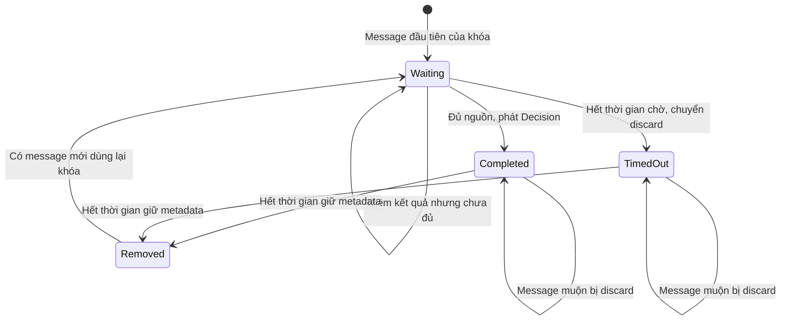

# Stateful endpoint

## 1. Mục tiêu và phạm vi

Trong chương **Correlation và state** của module **SPRING_INTEGRATION_CORE**, stateful endpoint là điểm xử lý cần nhớ thông tin giữa nhiều lần nhận message để đưa ra quyết định. Bài học này nối các khái niệm `Message`, `MessageChannel`, endpoint và Java DSL với bài toán phối hợp nhiều kết quả bất đồng bộ.

Sau bài học, bạn có thể:

- Nhận biết state thuộc message, endpoint, kho lưu trữ hay hệ thống nghiệp vụ.
- Thiết kế khóa correlation và điều kiện hoàn tất cho một cuộc hội thoại.
- Cấu hình aggregator bằng Java DSL, quan sát state trước và sau khi release.
- Giải thích tác động của timeout, lưu trữ bền vững, xử lý đồng thời và retry.
- Xây dựng các kịch bản kiểm thử cho vòng đời state.

Ví dụ dùng **Java 17 và API Spring Integration 6.5** làm mốc. Dự án thực hành cần `spring-integration-core` cùng các thư viện Spring tương thích do dependency management của dự án quản lý. Ví dụ lưu state trong bộ nhớ để dễ quan sát; phần triển khai thực tế sẽ chỉ ra những quyết định cần bổ sung khi chạy nhiều instance.

## 2. Khi nào một endpoint là stateful?

### 2.1. Quyết định có phụ thuộc các message trước đó không?

Một transformer đổi mã tiền tệ thành chữ hoa có thể xử lý độc lập từng message:

```text
output = transform(currentMessage)
```

Một endpoint chờ đủ kết quả kiểm tra đơn hàng cần cả message hiện tại lẫn thông tin đã nhận:

```text
(nextState, optionalOutput) = handle(currentMessage, currentState)
```

Ví dụ, nhận kết quả `ADDRESS` có thể chưa sinh đầu ra nếu chưa có `PAYMENT`. Cùng một payload `ADDRESS`, nhưng khi nhóm đã có `PAYMENT` và `STOCK`, endpoint có thể lập tức phát quyết định.

| Thành phần hoặc hành vi | Thông tin được giữ | Ý nghĩa đối với state |
| --- | --- | --- |
| Transformer chuẩn hóa một payload | Biến cục bộ trong một lần gọi | Có thể thiết kế stateless |
| Router chọn nhánh theo header của message hiện tại | Header trên message | Không bắt buộc nhớ các message trước |
| Aggregator chờ đủ kết quả | Các message cùng nhóm và metadata nhóm | Stateful theo cuộc hội thoại |
| Resequencer chờ message bị thiếu | Nhóm message và vị trí trong chuỗi | Stateful để duy trì thứ tự |
| Service activator ghi đơn hàng vào database | State nghiệp vụ ở database | Phải xét cả hợp đồng của service được gọi |
| Channel có bộ đệm | Message đang chờ nhận | Có state vận chuyển, khác state tổng hợp nghiệp vụ |

Resequencer giữ rồi phát các message theo thứ tự; aggregator tạo kết quả tổng hợp từ một nhóm. Hai pattern có mục tiêu khác nhau dù đều cần thông tin qua nhiều lần nhận. Xem [Resequencer trong Spring Integration](https://docs.spring.io/spring-integration/reference/resequencer.html).

### 2.2. Singleton không đồng nghĩa với stateful

Một bean singleton có thể chỉ chứa cấu hình bất biến và xử lý mọi message độc lập. Ngược lại, một handler không có `Map` nội bộ vẫn thực hiện một pattern stateful nếu nó phối hợp state trong kho dùng chung.

Không dùng số field của class để kết luận. Hãy xác định **thông tin nào phải tồn tại sau khi một lần xử lý kết thúc** và **lần xử lý sau có cần thông tin ấy hay không**.

Một poller chỉ quy định cách lấy message theo lịch. Việc sử dụng poller, gateway hoặc channel bất đồng bộ không tự xác định endpoint có state nghiệp vụ hay không. Tương tự, đối tượng `Message` có headers bất biến không khiến payload hay các đối tượng được tham chiếu bên trong tự động bất biến.

## 3. Bài toán: chờ ba kết quả kiểm tra đơn hàng

Giả sử mỗi lần xử lý đơn hàng cần ba nguồn xác nhận:

- `PAYMENT`: trạng thái kiểm tra thanh toán.
- `STOCK`: trạng thái kiểm tra tồn kho.
- `ADDRESS`: trạng thái kiểm tra địa chỉ.

Endpoint chỉ phát `Decision` khi nhận đủ ba nguồn. Đơn hàng được chấp thuận khi tất cả kết quả đều đạt. Một kết quả không đạt vẫn là dữ liệu nghiệp vụ hợp lệ và tham gia tổng hợp.

Khóa nhóm được thiết kế như sau:

```text
OrderKey = (tenantId, orderId, attempt)
```

`tenantId` tách các khách hàng dùng chung hệ thống. `attempt` tách những lần kiểm tra lại cùng một đơn hàng. Ví dụ, `("shop-a", "O-42", 1)` và `("shop-a", "O-42", 2)` là hai cuộc hội thoại khác nhau.

Hợp đồng đầu vào của ví dụ:

1. Mỗi message chứa một `CheckResult` có khóa đầy đủ và nguồn thuộc tập đã biết.
2. Trong cùng một khóa, bản phát lại của cùng nguồn biểu diễn cùng kết quả; kết quả được sửa phải dùng lần xử lý mới.
3. Thứ tự nhận không có ý nghĩa nghiệp vụ.
4. Bản phát lại không được tính thành một nguồn mới.
5. Nếu thiếu một nguồn quá lâu, endpoint đưa dữ liệu đang chờ sang nhánh xử lý quá hạn.
6. Sau khi hoàn tất, message đến muộn của cùng khóa được chuyển sang nhánh discard trong thời gian metadata hoàn tất còn được giữ.

Các quy tắc này là lựa chọn thiết kế của ví dụ. Trong ứng dụng khác, tập nguồn có thể thay đổi theo loại đơn hàng; khi ấy cần lưu hoặc tra cứu tập nguồn kỳ vọng theo một hợp đồng nhất quán.

### Vì sao không release bằng `group.size() == 3`?

Chuỗi `PAYMENT, PAYMENT, STOCK` có thể chứa ba message nhưng chỉ có hai nguồn. Đếm message không chứng minh đã có đủ bằng chứng nghiệp vụ.

Điều kiện đúng cho ví dụ là:

```text
receivedSources chứa toàn bộ {PAYMENT, STOCK, ADDRESS}
```

Điều kiện này ngăn release sớm do bản phát lại. Nó chưa loại bản phát lại khỏi kho; lưu trữ và khử trùng là hai trách nhiệm cần phân biệt.

## 4. Hợp đồng state của một endpoint

### 4.1. Phân chia trách nhiệm

Với aggregator, nên tách bốn phần:

| Phần | Câu hỏi được trả lời | Lựa chọn trong ví dụ |
| --- | --- | --- |
| `CorrelationStrategy` | Message thuộc nhóm nào? | Lấy `OrderKey` từ payload |
| `MessageGroupStore` | State của nhóm được giữ ở đâu? | `SimpleMessageStore` |
| `ReleaseStrategy` | Nhóm đã đủ điều kiện xử lý chưa? | Đủ ba nguồn khác nhau |
| `MessageGroupProcessor` | Tạo đầu ra gì khi nhóm được release? | Một `Decision` |

State nhóm được quản lý qua `MessageGroupStore`; các strategy có thể chỉ đọc đầu vào rồi trả kết quả. Mô hình này giúp tránh một bean nghiệp vụ tự giữ nhiều danh sách đang chờ. Xem [mô hình Aggregator](https://docs.spring.io/spring-integration/reference/6.5/aggregator.html).

### 4.2. Vòng đời cần phân biệt



Sơ đồ giả định giữ metadata sau hoàn tất hoặc timeout. Việc chuyển sang `Removed` cần một chính sách dọn dẹp được cấu hình; nó không diễn ra chỉ vì sơ đồ có mũi tên.

**Hoàn tất** nghĩa là cuộc hội thoại đã kết thúc. **Xóa** nghĩa là kho không còn bằng chứng về cuộc hội thoại ấy. Nếu xóa toàn bộ nhóm, một message đến sau với cùng khóa có thể mở nhóm mới.

Vì thế, retention không chỉ phục vụ tiết kiệm tài nguyên. Nó còn xác định khoảng thời gian hệ thống nhận biết các cuộc hội thoại đã xử lý.

## 5. Ví dụ Java DSL hoàn chỉnh

### 5.1. Cấu hình và mô hình dữ liệu

Listing sau là nội dung minh họa cho `demo.OrderChecksConfig`. Các channel kết quả là `QueueChannel` để chương trình thực hành chủ động nhận và quan sát đầu ra. Ví dụ không cần poller vì không khai báo consumer tự động đọc các queue này.

```java
package demo;

import java.io.Serializable;
import java.util.List;
import java.util.Set;
import java.util.stream.Collectors;

import org.springframework.context.annotation.Bean;
import org.springframework.context.annotation.Configuration;
import org.springframework.integration.channel.DirectChannel;
import org.springframework.integration.channel.QueueChannel;
import org.springframework.integration.config.EnableIntegration;
import org.springframework.integration.dsl.IntegrationFlow;
import org.springframework.integration.store.MessageGroup;
import org.springframework.integration.store.SimpleMessageStore;

@Configuration
@EnableIntegration
public class OrderChecksConfig {

    private static final Set<String> REQUIRED_SOURCES =
            Set.of("PAYMENT", "STOCK", "ADDRESS");

    public record OrderKey(
            String tenantId,
            String orderId,
            long attempt
    ) implements Serializable {
    }

    public record CheckResult(
            OrderKey key,
            String source,
            boolean passed
    ) implements Serializable {
    }

    public record Decision(
            OrderKey key,
            boolean approved
    ) implements Serializable {
    }

    @Bean
    public DirectChannel checkResultsInput() {
        return new DirectChannel();
    }

    @Bean
    public QueueChannel decisions() {
        return new QueueChannel();
    }

    @Bean
    public QueueChannel invalidChecks() {
        return new QueueChannel();
    }

    @Bean
    public QueueChannel lateOrExpiredChecks() {
        return new QueueChannel();
    }

    @Bean
    public SimpleMessageStore orderCheckStore() {
        return new SimpleMessageStore();
    }

    @Bean
    public IntegrationFlow orderChecks(
            SimpleMessageStore orderCheckStore) {

        return IntegrationFlow.from("checkResultsInput")
                .<CheckResult>filter(
                        OrderChecksConfig::isValid,
                        filter -> filter.discardChannel("invalidChecks"))
                .aggregate(aggregator -> aggregator
                        .messageStore(orderCheckStore)
                        .correlationStrategy(message ->
                                ((CheckResult) message.getPayload()).key())
                        .releaseStrategy(OrderChecksConfig::hasAllSources)
                        .outputProcessor(OrderChecksConfig::toDecision)
                        .groupTimeout(30_000L)
                        .sendPartialResultOnExpiry(false)
                        .expireGroupsUponCompletion(false)
                        .expireGroupsUponTimeout(false)
                        .discardChannel("lateOrExpiredChecks"))
                .channel("decisions")
                .get();
    }

    private static boolean isValid(CheckResult result) {
        OrderKey key = result.key();
        return key != null
                && key.tenantId() != null
                && !key.tenantId().isBlank()
                && key.orderId() != null
                && !key.orderId().isBlank()
                && key.attempt() > 0
                && result.source() != null
                && REQUIRED_SOURCES.contains(result.source());
    }

    private static boolean hasAllSources(MessageGroup group) {
        Set<String> receivedSources = group.getMessages().stream()
                .map(message -> (CheckResult) message.getPayload())
                .map(CheckResult::source)
                .collect(Collectors.toSet());

        return receivedSources.containsAll(REQUIRED_SOURCES);
    }

    private static Decision toDecision(MessageGroup group) {
        List<CheckResult> results = group.getMessages().stream()
                .map(message -> (CheckResult) message.getPayload())
                .toList();

        OrderKey key = results.get(0).key();
        boolean approved = results.stream()
                .allMatch(CheckResult::passed);

        return new Decision(key, approved);
    }
}
```

`@EnableIntegration` đăng ký hạ tầng Spring Integration cho application context của ví dụ. Việc dùng `Serializable` ở các record chuẩn bị cho thảo luận về persistence; `SimpleMessageStore` vẫn là kho trong bộ nhớ.

Filter giả định payload đúng kiểu `CheckResult`. Payload sai kiểu là vi phạm hợp đồng kiểu dữ liệu và có thể gây lỗi chuyển đổi hoặc xử lý, không phải trường hợp được hàm `isValid` chuyển sang `invalidChecks`. Ở biên hệ thống, nên dùng transformer hoặc bước kiểm tra schema để tạo đúng mô hình đầu vào.

Các API DSL dùng ở đây được mô tả trong [AggregatorSpec](https://docs.spring.io/spring-integration/docs/6.5.0/api/org/springframework/integration/dsl/AggregatorSpec.html) và [CorrelationHandlerSpec](https://docs.spring.io/spring-integration/docs/6.5.0/api/org/springframework/integration/dsl/CorrelationHandlerSpec.html).

### 5.2. Điểm cần đọc kỹ trong cấu hình

`correlationStrategy` trả về một record có `equals()` và `hashCode()` theo các thành phần của khóa. Không dùng một đối tượng khóa có các trường có thể bị sửa sau khi đã đưa vào nhóm.

`hasAllSources` sử dụng một tập hợp cục bộ. Hàm không giữ state giữa các lần gọi. Hai nhóm đang chạy đồng thời không chia sẻ biến “đơn hàng hiện tại”.

`toDecision` được gọi khi nhóm đủ điều kiện release trong luồng thông thường. Do cấu hình không phát partial result khi expiry, ví dụ không gọi processor để tạo một quyết định từ nhóm thiếu nguồn trong nhánh timeout.

Cả hai cờ `expireGroupsUponCompletion(false)` và `expireGroupsUponTimeout(false)` thể hiện chủ đích giữ dấu vết nhóm đã đóng. Ví dụ học tập chưa cài chính sách dọn metadata và chưa có consumer cho các queue; chạy lâu cần bổ sung cả hai.

### 5.3. Gửi các kết quả xen kẽ và quan sát state

Listing sau minh họa `demo.OrderChecksDemo`, dùng cùng các record ở cấu hình trên.

```java
package demo;

import demo.OrderChecksConfig.CheckResult;
import demo.OrderChecksConfig.Decision;
import demo.OrderChecksConfig.OrderKey;

import org.springframework.context.annotation.AnnotationConfigApplicationContext;
import org.springframework.integration.channel.QueueChannel;
import org.springframework.messaging.Message;
import org.springframework.messaging.MessageChannel;
import org.springframework.messaging.support.MessageBuilder;

public class OrderChecksDemo {

    public static void main(String[] args) {
        try (var context =
                     new AnnotationConfigApplicationContext(
                             OrderChecksConfig.class)) {

            MessageChannel input = context.getBean(
                    "checkResultsInput", MessageChannel.class);
            QueueChannel decisions = context.getBean(
                    "decisions", QueueChannel.class);
            QueueChannel late = context.getBean(
                    "lateOrExpiredChecks", QueueChannel.class);

            OrderKey first = new OrderKey("shop-a", "O-42", 1);
            OrderKey second = new OrderKey("shop-a", "O-43", 1);

            send(input, first, "PAYMENT", true);
            send(input, second, "STOCK", true);
            send(input, first, "PAYMENT", true); // Bản phát lại.
            send(input, first, "STOCK", true);

            require(decisions.receive(0) == null,
                    "Chưa có ADDRESS thì chưa được release");

            send(input, first, "ADDRESS", true);

            Message<?> firstMessage = decisions.receive(1_000);
            require(firstMessage != null, "Thiếu kết quả cho O-42");
            require(firstMessage.getPayload().equals(
                            new Decision(first, true)),
                    "Sai quyết định cho O-42");

            send(input, first, "ADDRESS", true); // Đến sau hoàn tất.
            require(late.receive(1_000) != null,
                    "Message muộn phải đi vào discard");
            require(decisions.receive(0) == null,
                    "Không được có thêm Decision cho O-42");

            send(input, second, "PAYMENT", true);
            send(input, second, "ADDRESS", false);

            Message<?> secondMessage = decisions.receive(1_000);
            require(secondMessage != null, "Thiếu kết quả cho O-43");
            require(secondMessage.getPayload().equals(
                            new Decision(second, false)),
                    "Một nguồn không đạt phải cho approved=false");

            System.out.println(firstMessage.getPayload());
            System.out.println(secondMessage.getPayload());
        }
    }

    private static void send(
            MessageChannel input,
            OrderKey key,
            String source,
            boolean passed) {

        boolean sent = input.send(MessageBuilder
                .withPayload(new CheckResult(key, source, passed))
                .build());

        require(sent, "Không gửi được message");
    }

    private static void require(boolean condition, String message) {
        if (!condition) {
            throw new IllegalStateException(message);
        }
    }
}
```

Kết quả nghiệp vụ mong đợi:

```text
Decision[key=OrderKey[tenantId=shop-a, orderId=O-42, attempt=1], approved=true]
Decision[key=OrderKey[tenantId=shop-a, orderId=O-43, attempt=1], approved=false]
```

Trong ví dụ này, gửi vào `DirectChannel` thực thi handler ngay trên thread gửi. Các khoảng chờ `receive(1_000)` là giới hạn chờ đọc kết quả từ queue, không phải thời gian sống của nhóm.

Diễn tiến quan trọng:

| Lượt nhận | Nhóm | Nguồn đã có | Đầu ra |
| --- | --- | --- | --- |
| `O-42/PAYMENT` | O-42, lần 1 | PAYMENT | Chưa có |
| `O-43/STOCK` | O-43, lần 1 | STOCK | Chưa có |
| `O-42/PAYMENT` phát lại | O-42, lần 1 | PAYMENT | Chưa có |
| `O-42/STOCK` | O-42, lần 1 | PAYMENT, STOCK | Chưa có |
| `O-42/ADDRESS` | O-42, lần 1 | Đủ ba nguồn | Decision cho O-42 |
| `O-42/ADDRESS` đến muộn | Nhóm đã đóng | Không mở lại khi metadata còn | Discard |
| `O-43/PAYMENT`, rồi `ADDRESS=false` | O-43, lần 1 | Đủ ba nguồn | Decision từ chối O-43 |

Không cần gateway chờ trả lời từng `CheckResult`: hai message đầu tiên của một nhóm vốn chưa tạo `Decision`. Một gateway đồng bộ có reply timeout riêng; timeout đó không thay thế chính sách đóng nhóm. Nếu API cần xác nhận tiếp nhận ngay, hãy thiết kế acknowledgement và cơ chế nhận quyết định sau đó bằng khóa cuộc hội thoại.

## 6. Timeout, completion và retention

### 6.1. Timeout chờ im lặng khác deadline của cuộc hội thoại

Trong cấu hình trên, `groupTimeout(30_000L)` là thời gian chờ tính lại khi có message mới vào nhóm chưa release. Nếu các message phát lại liên tục đến trước khi hết khoảng chờ, tổng thời gian tồn tại nhóm có thể vượt 30 giây.

Ví dụ:

```text
t=0s   PAYMENT vào nhóm
t=20s  STOCK vào nhóm, lịch chờ được tính lại
t=40s  PAYMENT phát lại, lịch chờ tiếp tục được tính lại
```

Nếu yêu cầu nghiệp vụ là “tối đa 30 giây kể từ lúc tạo nhóm”, có thể thay `groupTimeout(...)` bằng biểu thức deadline:

```java
.groupTimeoutExpression(
        "timestamp + 30000 - T(System).currentTimeMillis()")
```

Đây là một lựa chọn cấu hình thay thế, không đặt đồng thời hai tùy chọn. Trong biểu thức, `timestamp` là thời điểm tạo `MessageGroup`; cần phân biệt với thời điểm phát sinh sự kiện ở hệ thống nguồn.

Lịch timeout vẫn phụ thuộc khả năng thực thi của scheduler. Không xem nó như một đồng hồ thời gian thực có độ chính xác tuyệt đối.

### 6.2. Nhóm thiếu dữ liệu được đưa đi đâu?

Với `sendPartialResultOnExpiry(false)`, nhóm chưa đủ điều kiện không tạo `Decision` khi timeout. Dữ liệu bị discard được chuyển tới `lateOrExpiredChecks`. Nhánh này cần consumer để ghi nhận, cảnh báo hoặc điều phối xử lý bù.

Không được hiểu timeout là bằng chứng rằng thanh toán thất bại. Nó chỉ chứng minh endpoint chưa có đủ dữ liệu theo chính sách chờ đã chọn. Nếu hệ thống cần kết quả “chưa xác định” hoặc “cần đối soát”, hãy mô hình hóa trạng thái đó riêng.

Trong ví dụ, discard đang nhận cả dữ liệu quá hạn lẫn message đến sau khi nhóm đóng. Nếu vận hành cần phân biệt hai nguyên nhân, phải bổ sung metadata hoặc cơ chế quan sát phù hợp; không suy ra nguyên nhân chỉ từ tên channel.

### 6.3. Giữ metadata bao lâu?

Một chính sách tham khảo:

| Loại thông tin | Mục đích giữ | Gợi ý quyết định |
| --- | --- | --- |
| Message của nhóm đang chờ | Đủ dữ liệu để tổng hợp | Giới hạn bằng timeout/deadline |
| Metadata nhóm đã đóng | Chặn message muộn mở lại nhóm | Dựa trên cửa sổ phát lại của nguồn |
| Dấu vết kết quả nghiệp vụ | Tra cứu, đối soát, idempotency | Theo yêu cầu nghiệp vụ |
| Dữ liệu discard | Điều tra và xử lý lại | Theo thời gian xử lý sự cố |

Nếu nguồn có thể phát lại trong 24 giờ, giữ dấu vết nhóm trong một phút thường không đủ để đạt mục tiêu chống xử lý lại trong toàn bộ cửa sổ ấy.

`minimumTimeoutForEmptyGroups` có thể hỗ trợ dọn các nhóm rỗng được giữ sau release. Với reaper, cần xét cả lịch quét và timeout của reaper. Đọc phần lifecycle và expiration trong [AbstractCorrelatingMessageHandler](https://docs.spring.io/spring-integration/docs/6.5.0/api/org/springframework/integration/aggregator/AbstractCorrelatingMessageHandler.html).

Khi một khóa đã bị xóa, lần phát lại tiếp theo có thể tạo nhóm mới. Vì vậy, retention của aggregator cần thống nhất với chính sách idempotency và khóa nghiệp vụ.

## 7. State được lưu ở đâu và phục hồi thế nào?

### 7.1. Bộ nhớ và persistent store

`SimpleMessageStore` phù hợp cho bài thực hành: cấu hình ngắn và dễ quan sát. State trong bộ nhớ không phải cơ chế phục hồi sau khi tiến trình bị mất.

| Tình huống | Kho trong bộ nhớ | Kho bền vững được cấu hình phù hợp |
| --- | --- | --- |
| Tiến trình bị dừng đột ngột | Mất state đang giữ | Có thể đọc lại state đã lưu thành công |
| Nhiều instance cần truy cập một nhóm | Mỗi JVM có state riêng | Có thể dùng chung dữ liệu |
| Payload lớn và nhiều nhóm | Tăng áp lực heap | Chuyển một phần áp lực sang datastore |
| Nâng cấp mô hình payload | Không có dữ liệu cũ sau restart | Phải tính tương thích dữ liệu đã lưu |

Message và header cần phù hợp chiến lược serialization của store. Không đưa kết nối database, stream đang mở hoặc đối tượng service vào payload rồi kỳ vọng chúng có thể phục hồi nguyên trạng. Xem [Message Store](https://docs.spring.io/spring-integration/reference/6.5/message-store.html).

Đối với JDBC, dùng `JdbcMessageStore` cho state của aggregator. `JdbcChannelMessageStore` phục vụ việc lưu message cho channel, có hợp đồng khác. Cần có dependency `spring-integration-jdbc`, `DataSource` và schema tương ứng trước khi sử dụng. Xem [JDBC Message Store](https://docs.spring.io/spring-integration/reference/6.5/jdbc/message-store.html).

### 7.2. Chuyển sang JDBC là một thay đổi cấu hình

Đoạn sau là phương án thay thế bean store của ví dụ, không thêm song song với bean `SimpleMessageStore`:

```java
import javax.sql.DataSource;

import org.springframework.context.annotation.Bean;
import org.springframework.integration.jdbc.store.JdbcMessageStore;
import org.springframework.integration.store.MessageGroupStore;

@Bean
public MessageGroupStore orderCheckStore(DataSource dataSource) {
    return new JdbcMessageStore(dataSource);
}
```

Đồng thời đổi kiểu tham số của phương thức `orderChecks` sang `MessageGroupStore`, giữ lời gọi `.messageStore(orderCheckStore)`. Đoạn này minh họa thay đổi ở store; schema, transaction và locking vẫn cần cấu hình theo môi trường.

Một application context mới không khôi phục các tác vụ scheduler chỉ vì database còn các nhóm đang chờ. Cần lập chính sách nhận diện nhóm cũ sau restart, chẳng hạn cơ chế purge nhóm mồ côi của correlating handler hoặc reaper được lên lịch.

Purge phải biết nhóm nào thực sự đã quá hạn. Nếu nhiều instance cùng dùng kho, không được xem mọi nhóm do instance khác tạo là nhóm bỏ rơi.

### 7.3. Kho state khác kho kết quả nghiệp vụ

Aggregator giữ các kết quả kiểm tra để phối hợp một lần quyết định. Database đơn hàng lưu quyết định chính thức và các trạng thái như `APPROVED`, `REJECTED`, `REVIEW_REQUIRED`.

Một nhóm đã release không chứng minh quyết định đã được ghi thành công ở mọi hệ thống đích. Hãy xác định ranh giới commit và trạng thái có thể quan sát ở từng bước.

Nếu kho vật lý phục vụ nhiều endpoint, cần phân vùng hoặc namespace riêng. Đặc biệt, không tùy tiện dùng chung một đối tượng `MessageGroupStore` cho nhiều correlating handler có cơ chế expiration: callback của handler này có thể tác động nhóm của handler khác. Dùng store dành riêng cho endpoint hoặc cơ chế phân vùng được implementation hỗ trợ.

## 8. Xử lý đồng thời và triển khai nhiều instance

### 8.1. State phải gắn với nhóm

Một cách tự giữ state dễ sai:

```java
// Minh họa lỗi thiết kế, không sử dụng.
private String currentOrder;
private final List<CheckResult> received = new java.util.ArrayList<>();

public void accept(CheckResult result) {
    currentOrder = result.key().orderId();
    received.add(result);
}
```

Khi message của O-42 và O-43 đến xen kẽ, danh sách bị trộn ngay cả trên một thread. Khi có nhiều thread, còn xuất hiện truy cập đồng thời không được đồng bộ.

Thay `ArrayList` bằng collection an toàn luồng chưa giải quyết được sự thiếu tách biệt theo khóa. Thay bằng `ConcurrentHashMap` cũng chưa tự làm cho chuỗi “thêm message, kiểm tra đủ, phát đầu ra, đóng nhóm” trở thành một thao tác nguyên tử.

### 8.2. Đồng bộ trong một JVM và giữa nhiều JVM

Aggregator sử dụng `LockRegistry` theo khóa correlation để bảo vệ thao tác trên nhóm. Khóa mặc định ở bộ nhớ không phối hợp các JVM khác nhau. Khi nhiều instance cùng cập nhật một nhóm trong store dùng chung, cần lock registry dùng chung phù hợp. Xem [Lock Registry của Aggregator](https://docs.spring.io/spring-integration/reference/7.0/aggregator.html#aggregator-lock-registry).

Các nhóm khác nhau có thể được xử lý đồng thời tùy hạ tầng thực thi; một nhóm nóng vẫn có thể trở thành điểm nghẽn. Vì vậy, chọn một khóa quá rộng như “ngày hiện tại” cho toàn bộ đơn hàng có thể làm giảm khả năng mở rộng.

Khi các aggregator gọi nối tiếp trên cùng thread và giữ khóa trong lúc gửi tiếp, cần xem xét thứ tự lấy khóa. Có thể cân nhắc tách ranh giới thực thi hoặc `releaseLockBeforeSend` sau khi phân tích tác động lên thứ tự và transaction.

### 8.3. Chọn cách phân phối message theo hợp đồng hệ thống

Có hai hướng kiến trúc phổ biến:

- **Phân phối có affinity theo khóa:** các message của một cuộc hội thoại về cùng consumer. Cần xác định điều gì xảy ra khi consumer chết hoặc partition được chuyển giao.
- **Nhiều consumer dùng state chung:** chia sẻ kho nhóm và cơ chế khóa tương ứng. Cần tính thêm độ trễ datastore, tranh chấp và hoạt động cleanup.

Không có lựa chọn nào tự cung cấp đầy đủ khả năng phục hồi. Affinity không thay thế lưu trữ bền vững; persistent store không thay thế đồng bộ khi có nhiều writer.

## 9. Lỗi, retry và tính đúng đắn nghiệp vụ

### 9.1. Phân biệt nhánh nghiệp vụ với lỗi kỹ thuật

| Sự kiện | Cách hiểu trong ví dụ | Hướng xử lý |
| --- | --- | --- |
| `ADDRESS=false` | Kiểm tra hợp lệ nhưng không đạt | Tổng hợp thành `approved=false` |
| Thiếu tenant hoặc nguồn không hợp lệ | Dữ liệu không đủ hợp đồng | `invalidChecks` |
| Thiếu một nguồn đến hết thời gian chờ | Cuộc hội thoại chưa đủ dữ liệu | Nhánh discard/đối soát |
| Store không truy cập được | Lỗi hạ tầng | Retry có giới hạn hoặc phục hồi |
| Ghi quyết định downstream thất bại | Kết quả chưa hoàn tất ở hệ thống đích | Idempotency và chính sách giao lại |

Trong flow đồng bộ qua `DirectChannel`, exception có thể truyền về bên gửi. Khi xử lý chạy qua executor hoặc scheduler, cần cơ chế xuất bản lỗi phù hợp với ranh giới bất đồng bộ. Không giả định chỉ cần tạo bean `errorChannel` là mọi exception đều tự chuyển vào đó. Với scheduler tùy chỉnh, cần xét `MessagePublishingErrorHandler`. Xem [Error Handling](https://docs.spring.io/spring-integration/reference/6.5/error-handling.html).

### 9.2. Retry có thể phát lại cả kết quả

Xét tình huống sau:

```text
1. Aggregator tạo Decision.
2. Hệ thống đích đã nhận và ghi Decision.
3. Bên gửi không nhận được xác nhận thành công.
4. Cơ chế phục hồi gửi lại Decision.
```

Không thể quyết định kết quả cuối cùng chỉ từ việc “lần gửi bị lỗi”. Hệ thống đích nên nhận diện lệnh bằng một khóa nghiệp vụ ổn định, chẳng hạn `OrderKey` kết hợp loại thao tác, rồi thực hiện hiệu ứng theo hợp đồng idempotent.

Trong chiều đầu vào, `MessageHeaders.ID` thường nhận diện một message cụ thể. Một sự kiện nghiệp vụ được tạo lại thành message mới có thể có ID mới. Do đó, cần phân biệt:

- **Correlation key:** xác định cuộc hội thoại.
- **Event identity:** xác định sự kiện cần khử trùng.
- **Operation identity:** xác định hiệu ứng đầu ra cần tránh thực hiện hai lần.

Ví dụ đã dùng tập nguồn để bảo vệ điều kiện release, nhưng chưa triển khai một kho deduplication riêng. Một luồng phát lại lớn vẫn có thể làm tăng số message đang giữ và kéo dài thời gian chờ im lặng.

### 9.3. Persistence không tự tạo exactly-once

Lưu state vào database không tự biến việc nhận message, cập nhật nhóm và gọi API bên ngoài thành một transaction duy nhất.

Khi quyết định cần đi tới hệ thống khác, có thể cân nhắc:

1. Ghi kết quả nghiệp vụ và bản ghi outbox trong cùng transaction cục bộ.
2. Giao bản ghi outbox bằng cơ chế có retry.
3. Cho bên nhận xử lý idempotent theo operation identity.
4. Đối soát các bản ghi chưa được xác nhận.

Đây là gợi ý thiết kế, không phải hành vi được ví dụ tự động cung cấp. Aggregator cũng không tự thực hiện các bước bù như hoàn tiền hoặc giải phóng tồn kho; các bước ấy thuộc quy trình nghiệp vụ cần mô hình hóa riêng.

## 10. Kiểm thử theo vòng đời state

Đoạn demo kiểm tra luồng cơ bản trong bộ nhớ. Khi áp dụng vào dự án, mở rộng kiểm thử dựa trên hành vi quan sát được, không dựa vào số lần gọi phương thức nội bộ.

| Kịch bản | Dữ liệu đưa vào | Điều cần chứng minh |
| --- | --- | --- |
| Chưa đủ nguồn | PAYMENT, STOCK | Chưa có Decision |
| Đủ nguồn, đảo thứ tự | ADDRESS, STOCK, PAYMENT | Có đúng Decision mong đợi |
| Nhóm xen kẽ | Message của O-42 và O-43 | Không trộn kết quả |
| Cùng orderId, khác tenant | Hai tenant có O-42 | Hai cuộc hội thoại tách biệt |
| Cùng orderId, khác attempt | Lần 1 và lần 2 | State của hai lần không lẫn nhau |
| Bản phát lại trước completion | PAYMENT, PAYMENT, STOCK | Chưa release vì thiếu ADDRESS |
| Một nguồn không đạt | Ba nguồn, STOCK=false | Decision có approved=false |
| Đến muộn sau completion | Thêm ADDRESS cùng khóa đã đóng | Đi discard khi metadata còn |
| Timeout | Chỉ PAYMENT, hết thời gian chờ | Không có Decision đầy đủ |
| Sau khi metadata bị xóa | Phát lại toàn bộ một khóa cũ | Nhận biết nguy cơ tạo nhóm và kết quả mới |
| Restart với persistent store | Lưu nhóm thiếu, khởi động lại | Có thể tiếp tục hoặc xử lý quá hạn theo chính sách |
| Hai writer đồng thời | Hai instance cùng nhận một khóa | Không có kết quả sai do cập nhật cạnh tranh |

Với test timeout, dùng cấu hình timeout nhỏ dành riêng cho test và chờ có giới hạn. Không dùng một khoảng `sleep` tùy ý làm bằng chứng rằng nhóm đã hoàn tất đúng thời điểm.

Với test restart, đóng application context rồi tạo context mới với cùng datastore. Chỉ tái sử dụng cùng một đối tượng `SimpleMessageStore` trong test không chứng minh dữ liệu sống sót khi JVM mất.

Đối với nhánh timeout, không mặc định số message discard bằng số nhóm timeout. Granularity của discard cần được xác định theo cấu hình; nên kiểm tra khóa và nội dung để khẳng định nhóm cần xử lý đã được nhận diện.

## 11. Quan sát và quản lý tài nguyên

State không bị quên nhưng không được dọn vẫn là một lỗi vận hành. Những tín hiệu hữu ích gồm:

- Số nhóm đang mở và tuổi nhóm lâu nhất.
- Số message đang được giữ trong các nhóm.
- Tỷ lệ hoàn tất, timeout và message đến muộn.
- Số metadata nhóm đã đóng còn được giữ.
- Độ trễ thao tác store và thời gian chờ khóa.
- Độ sâu các queue đầu ra, discard và hàng đợi lỗi.

Các con số phải được diễn giải cùng nhau. Ít nhóm nhưng mỗi nhóm rất lớn vẫn có thể gây áp lực bộ nhớ. Nhiều nhóm mở với một nguồn thường xuyên thiếu có thể chỉ ra lỗi ở một nhánh upstream.

Trong log, gắn `tenantId`, `orderId`, `attempt` để điều tra từng cuộc hội thoại. Với metrics, tránh dùng mọi orderId làm label vì số giá trị tăng theo lưu lượng nghiệp vụ.

Một ước lượng ban đầu cho nhóm đang chờ:

```text
số nhóm đang mở ≈ số cuộc hội thoại mới mỗi giây × thời gian chờ trung bình
```

Ví dụ, 200 cuộc hội thoại/giây và thời gian chờ trung bình 15 giây tương ứng khoảng 3.000 nhóm đang mở trong trạng thái ổn định. Đây là ước lượng quy hoạch, chưa tính metadata đã đóng, bản phát lại, payload lớn hoặc nhóm bất thường không hoàn tất.

Thay queue không giới hạn của ví dụ bằng queue có capacity chỉ là một phần của quản lý tải. Cần xác định thêm hành vi khi đầy, thời gian chờ gửi, tốc độ consumer và cách phục hồi. Không dọn hoặc sửa trực tiếp collection của `MessageGroup` trong khi aggregator đang dùng nó.

## 12. Bài thực hành củng cố

### Bài 1: chứng minh correlation tách biệt

Tạo hai `OrderKey` có cùng `orderId` nhưng khác `tenantId`. Gửi `PAYMENT` và `STOCK` cho tenant thứ nhất, `ADDRESS` cho tenant thứ hai.

Kết quả mong đợi: chưa nhóm nào đủ nguồn; không có `Decision`. Sau đó bổ sung phần thiếu cho từng nhóm và đối chiếu khóa trên hai quyết định.

### Bài 2: quan sát timeout

Dùng một cấu hình thực hành riêng với khoảng chờ ngắn, gửi chỉ một kết quả `PAYMENT` rồi chờ nhận ở `lateOrExpiredChecks` với giới hạn thời gian.

Kết quả mong đợi: dữ liệu quá hạn xuất hiện ở nhánh discard; không xuất hiện quyết định chấp thuận từ nhóm thiếu nguồn. Giữ context hoạt động trong suốt lúc chờ để scheduler còn thực thi.

### Bài 3: xác định cửa sổ chống xử lý lại

Mô tả nguồn có thể phát lại trong hai giờ. Chọn retention cho metadata đã đóng, quyết định vị trí lưu operation identity và mô tả kết quả khi phát lại xảy ra sau thời gian retention.

Tiêu chí đạt: phân biệt được việc chặn mở lại nhóm với việc chặn hiệu ứng nghiệp vụ lặp tại hệ thống đích.

### Bài 4: thay đổi điều kiện nghiệp vụ

Giả sử đơn hàng kỹ thuật số chỉ cần `PAYMENT` và `ADDRESS`, còn hàng vật lý cần thêm `STOCK`. Thiết kế vị trí lưu tập nguồn kỳ vọng và cách bảo đảm mọi message cùng khóa nhìn thấy một phiên bản quy tắc.

Tiêu chí đạt: không dùng một biến “loại đơn hàng hiện tại” dùng chung; nêu rõ cách xử lý khi hai message cùng khóa mang thông tin kỳ vọng mâu thuẫn.

Sau các bài thực hành, bạn cần giải thích được với một khóa cụ thể: state đang ở đâu, message nào còn thiếu, khi nào nhóm đóng, bằng chứng hoàn tất được giữ bao lâu và điều gì xảy ra khi hệ thống phải xử lý lại.
