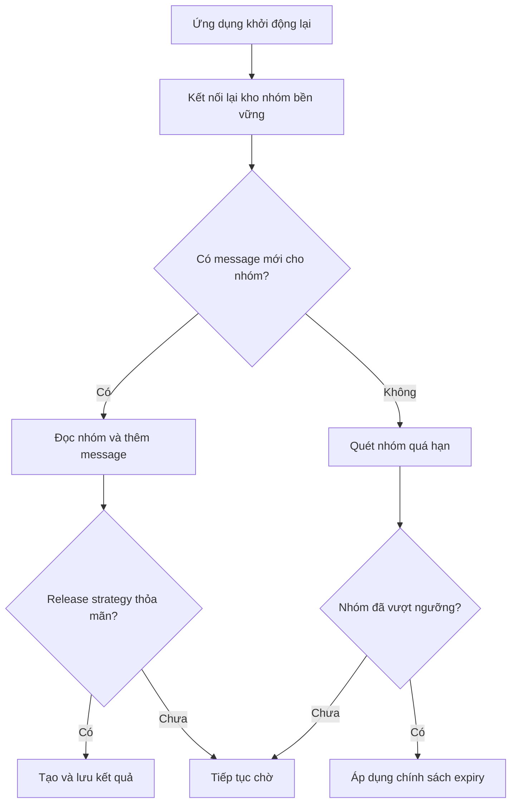

# State recovery sau restart

## Mục tiêu của bài học

Trong chương **Correlation và state** của module **SPRING_INTEGRATION_CORE**, bài này giải thích cách tiếp tục một luồng thông điệp có trạng thái sau khi tiến trình dừng và khởi động lại. Trọng tâm là aggregator, nơi nhiều `Message` cùng correlation key được giữ lại để chờ một quyết định release.

Sau bài học, bạn có thể:

- Xác định dữ liệu nào phải tồn tại ngoài JVM để luồng phục hồi được.
- Cấu hình `MessageGroupStore` bền vững bằng JDBC và giữ correlation key ổn định qua các lần chạy.
- Xử lý nhóm còn thiếu thông điệp và nhóm quá hạn sau restart.
- Đặt ranh giới transaction giữa nhận thông điệp, cập nhật nhóm và lưu kết quả.
- Thiết kế phép thử restart phân biệt mất dữ liệu, xử lý lặp và kết quả chưa được chuyển tiếp.

Các kiến thức nền cần có là `Message`, `MessageChannel`, aggregator, correlation strategy, release strategy và Java DSL. Ví dụ dùng các API có trong Spring Integration 6.5, Java 17 trở lên và PostgreSQL; dependency Spring phải được quản lý bằng một BOM tương thích của dự án.

## 1. Restart đặt ra vấn đề gì?

Một dịch vụ duyệt đơn hàng chờ ba kết quả kiểm tra:

- `PAYMENT`: kiểm tra thanh toán.
- `STOCK`: kiểm tra tồn kho.
- `FRAUD`: kiểm tra gian lận.

Mỗi kết quả có `orderId`, `attempt`, `checkType` và `passed`. Ba loại kiểm tra của cùng một lần duyệt tạo thành một nhóm. Chỉ khi đủ ba loại, dịch vụ mới phát sinh quyết định cuối cùng.

Giả sử dịch vụ đã nhận `PAYMENT` và `STOCK` cho `ORD-9001|1`, rồi bị dừng trước khi `FRAUD` đến:

```text
Trước khi dừng:
  ORD-9001|1 -> {PAYMENT, STOCK}
  Chưa đủ điều kiện release

Sau khi khởi động lại:
  Nếu mất nhóm cũ:
    FRAUD -> {FRAUD}                 -> tiếp tục chờ sai

  Nếu đọc lại được nhóm cũ:
    FRAUD -> {PAYMENT, STOCK, FRAUD} -> tạo quyết định
```

**State recovery** là tái lập đủ dữ kiện để luồng tiếp tục theo hợp đồng nghiệp vụ. Tái tạo các bean từ cấu hình chỉ khôi phục cấu trúc luồng; dữ liệu đã tích lũy cần một cơ chế riêng.

Phải phân biệt hai tình huống:

| Tình huống | Điều có thể dựa vào | Điều còn phải xử lý |
| --- | --- | --- |
| Dừng có kiểm soát | Có thể ngừng nhận mới và chờ công việc đang chạy | Một số nhóm vẫn đang chờ thông điệp chưa đến |
| JVM bị kill, máy mất điện | Chỉ dữ liệu đã được hệ lưu trữ cam kết bền vững | Transaction chưa commit, message đang xử lý, ack chưa gửi, lịch timeout trong RAM |

Một shutdown hook giúp dừng có trật tự nhưng không chứng minh được khả năng phục hồi khi tiến trình chết đột ngột.

## 2. Lập bản đồ trạng thái cần phục hồi

Đừng chỉ hỏi “đã lưu payload chưa”. Một luồng tích hợp có thể có nhiều loại trạng thái với chủ sở hữu khác nhau:

| Loại trạng thái | Ví dụ | Nơi lưu phù hợp |
| --- | --- | --- |
| Thông điệp đang đệm trước endpoint | Message chưa được poll | Broker bền vững hoặc channel có persistent store |
| Thành viên và metadata của nhóm | Hai kết quả đã nhận, cờ hoàn tất, thời điểm cập nhật | Persistent `MessageGroupStore` |
| Dấu vết chống xử lý lặp | Event nghiệp vụ đã được tiếp nhận | Kho khóa nghiệp vụ có thao tác nguyên tử hoặc persistent metadata store |
| Kết quả chờ chuyển đi | Quyết định đã tạo nhưng chưa publish | Outbox hoặc hàng đợi bền vững |
| Trạng thái ở hệ ngoài | Giao dịch thanh toán đã được thực hiện | Hệ đích và khóa idempotency của thao tác |
| Tài nguyên trong JVM | Thread, lock cục bộ, tác vụ scheduler, temporary reply channel | Được tạo lại; không xem là dữ liệu nghiệp vụ đã lưu |

Trong Spring Integration, `MessageStore` hỗ trợ lưu thông điệp, còn `MessageGroupStore` phục vụ thành viên và trạng thái nhóm. Kho mặc định trong bộ nhớ không bảo vệ dữ liệu khi JVM biến mất. Xem [Message Store](https://docs.spring.io/spring-integration/reference/7.0/message-store.html).

Một điểm dễ nhầm là `MetadataStore`: đây là hợp đồng khóa–giá trị cho metadata, không thay thế kho chứa các `Message` đang chờ aggregation. `JdbcMetadataStore` là một lựa chọn cho metadata cần tồn tại sau restart; nó cần transaction management để sử dụng đúng hợp đồng của implementation. Xem [JdbcMetadataStore](https://docs.spring.io/spring-integration/api/org/springframework/integration/jdbc/metadata/JdbcMetadataStore.html).

### Khi nào chỉ cần replay?

Nếu nguồn sự kiện có thể phát lại đầy đủ, bạn có thể xây dựng lại một số trạng thái từ lịch sử. Tuy nhiên, cần biết chính xác mốc phát lại và phải tránh thực hiện lại tác dụng phụ đã hoàn tất.

Với ví dụ duyệt đơn, replay từ đầu có thể tạo lại tập kết quả kiểm tra. Nó không tự trả lời được liệu quyết định cuối cùng đã được hệ nhận áp dụng hay chưa. Vì vậy, thiết kế phục hồi phải bao gồm cả đầu vào, trạng thái trung gian và đầu ra.

## 3. Khôi phục nhóm dựa trên định danh ổn định

Để một aggregator mới tiếp tục nhóm cũ, các lần chạy phải dùng cùng hợp đồng định danh:

```text
Nhóm logic được nhận diện bởi:
  kho dữ liệu + namespace/region + correlation key

Ví dụ:
  database = integration_lab
  region   = order-checks-v1
  key      = ORD-9001|1
```

Ở đây `attempt` là một lần duyệt nghiệp vụ, không phải số lần broker giao lại cùng sự kiện. Redelivery của lần duyệt số 1 vẫn phải dùng `attempt = 1`.

Các quy tắc thực hành:

1. **Tái sử dụng database và region.** Nếu mỗi lần boot sinh region ngẫu nhiên, dữ liệu cũ còn trong database nhưng endpoint mới nhìn vào một vùng khác.
2. **Không sinh correlation key từ thời gian boot hoặc message UUID mới.** Một sự kiện phát lại phải tìm đúng nhóm trước đó.
3. **Tách các vòng nghiệp vụ.** Nếu đơn được duyệt lại hợp lệ, dùng `attempt = 2` để không nhập vào nhóm của lần 1.
4. **Phân vùng theo ngữ cảnh cần thiết.** Hệ đa tenant thường cần cả `tenantId`; các aggregator có mục đích khác nhau cần namespace riêng.
5. **Giữ tương thích khi triển khai.** Đổi cách ghép key, package payload hoặc serializer có thể làm phiên bản mới không tiếp tục được dữ liệu phiên bản cũ.

Đối với JDBC, `JdbcMessageStore.setRegion(...)` phân vùng dữ liệu logic trong các bảng dùng chung. Giá trị này phải là cấu hình có chủ đích và ổn định. Xem [JdbcMessageStore](https://docs.spring.io/spring-integration/api/org/springframework/integration/jdbc/store/JdbcMessageStore.html).

Không chia sẻ tùy tiện cùng một store instance cho nhiều aggregator có callback expiry. Một endpoint có thể xử lý nhầm nhóm của endpoint khác. Khi cần chung database, hãy dùng store và vùng dữ liệu riêng cho từng mục đích. Quy tắc sở hữu nhóm được mô tả trong [quản lý trạng thái của Aggregator](https://docs.spring.io/spring-integration/reference/7.0/aggregator.html#_managing_state_in_an_aggregator_messagegroupstore).

## 4. Phục hồi dữ liệu khác với phục hồi việc thực thi

Khi restart, aggregator không tiếp tục từ dòng lệnh Java đang chạy trước lúc dừng. Endpoint mới được tạo, rồi dùng kho đã cấu hình để truy cập nhóm liên quan.

Có ba đường tiếp tục thường gặp:



Việc giữ được nhóm trong database không có nghĩa mọi nhóm tự được phát lại ngay khi boot. Với nhóm chưa quá hạn và chưa có message mới, hệ thống có thể tiếp tục chờ. Nếu nghiệp vụ cần chủ động tiếp tục một bước đã bị gián đoạn, phải định nghĩa cơ chế reconciliation hoặc replay tương ứng.

Một thiết kế dễ kiểm tra nên có trạng thái mong đợi rõ ràng: nhóm đang chờ, nhóm hoàn tất, nhóm quá hạn cần đối soát và kết quả đang chờ publish.

## 5. Ví dụ: aggregator JDBC và kết quả lưu trong outbox

Ví dụ dưới đây minh họa hai tiến trình chạy nối tiếp trên cùng PostgreSQL. Mỗi lần chỉ có một instance hoạt động; các lời gọi thử nghiệm được thực hiện tuần tự. Cấu hình nhiều replica được bàn riêng ở phần sau.

Luồng xử lý là:

```text
Adapter hoặc code gọi vào
       |
       v
CheckIngress.accept(...)       <- bắt đầu JDBC transaction
       |
       v
checksInput: DirectChannel
       |
       v
Aggregator + JdbcMessageStore
       |
       +-- đủ ba loại kiểm tra --> decisions --> INSERT order_decision_outbox
       |
       +-- hết hạn/message muộn --> checksReview --> INSERT order_check_review
```

`DirectChannel` truyền tiếp trong cùng thread, nên các thao tác JDBC trong đường đi đồng bộ có thể tham gia transaction do ingress mở. Transaction context thông thường không tự đi theo một thread mới khi đổi sang `ExecutorChannel` hoặc một consumer poll ở bước sau. Xem [Transaction Boundaries](https://docs.spring.io/spring-integration/reference/7.0/transactions.html#_transaction_boundaries).

### 5.1. Chuẩn bị dependency và schema

Trong dự án Spring Boot có BOM tương thích, cần các dependency sau. Đây là đoạn khai báo minh họa để đưa vào dự án thực hành:

```xml
<dependencies>
    <dependency>
        <groupId>org.springframework.boot</groupId>
        <artifactId>spring-boot-starter-integration</artifactId>
    </dependency>
    <dependency>
        <groupId>org.springframework.boot</groupId>
        <artifactId>spring-boot-starter-jdbc</artifactId>
    </dependency>
    <dependency>
        <groupId>org.springframework.integration</groupId>
        <artifactId>spring-integration-jdbc</artifactId>
    </dependency>
    <dependency>
        <groupId>org.postgresql</groupId>
        <artifactId>postgresql</artifactId>
        <scope>runtime</scope>
    </dependency>
</dependencies>
```

Cấu hình `DataSource` trỏ tới PostgreSQL tồn tại ngoài vòng đời ứng dụng. Khi thực hành bằng container, cần giữ volume database giữa hai lần chạy.

Tạo schema Spring Integration tương ứng với PostgreSQL từ script được đóng gói trong `spring-integration-jdbc`, dưới package `org/springframework/integration/jdbc`. Áp dụng qua migration phù hợp với phiên bản thư viện; không chạy script drop hoặc tạo lại bảng mỗi lần boot. `JdbcMessageStore` dành cho nhóm; `JdbcChannelMessageStore` là lựa chọn chuyên biệt khi cần backing store cho channel. Xem [JDBC Message Store](https://docs.spring.io/spring-integration/reference/7.0/jdbc/message-store.html).

Tạo thêm hai bảng nghiệp vụ của ví dụ:

```sql
CREATE TABLE order_decision_outbox (
    event_key    VARCHAR(200) PRIMARY KEY,
    order_id     VARCHAR(100) NOT NULL,
    attempt      INTEGER NOT NULL,
    approved     BOOLEAN NOT NULL,
    created_at   TIMESTAMPTZ NOT NULL DEFAULT CURRENT_TIMESTAMP,
    published_at TIMESTAMPTZ
);

CREATE TABLE order_check_review (
    review_key   VARCHAR(200) PRIMARY KEY,
    group_key    VARCHAR(120) NOT NULL,
    check_type   VARCHAR(20) NOT NULL,
    passed       BOOLEAN NOT NULL,
    noted_at     TIMESTAMPTZ NOT NULL DEFAULT CURRENT_TIMESTAMP
);
```

Outbox ở đây lưu một sự kiện quyết định tối giản, gồm đơn hàng, lần duyệt và kết quả. Một relay đọc những bản ghi chưa publish và chuyển tới hệ nhận; phần relay không thuộc đoạn cấu hình aggregator này.

### 5.2. Payload có hợp đồng rõ ràng

Đặt các kiểu dưới đây trong cùng package của ví dụ, mỗi kiểu public là một lớp riêng trong dự án thực hành:

```java
package example.recovery;

import java.io.Serial;
import java.io.Serializable;
import java.util.Set;

public record CheckResult(
        String orderId,
        int attempt,
        String checkType,
        boolean passed) implements Serializable {

    @Serial
    private static final long serialVersionUID = 1L;

    public CheckResult {
        if (orderId == null || orderId.length() > 100
                || !orderId.matches("[A-Z0-9-]+")) {
            throw new IllegalArgumentException("Invalid orderId");
        }
        if (attempt < 1) {
            throw new IllegalArgumentException("Invalid attempt");
        }
        if (checkType == null
                || !Set.of("PAYMENT", "STOCK", "FRAUD").contains(checkType)) {
            throw new IllegalArgumentException("Invalid checkType");
        }
    }

    public String correlationKey() {
        return orderId + "|" + attempt;
    }
}
```

```java
package example.recovery;

public record Decision(String orderId, int attempt, boolean approved) {

    public String eventKey() {
        return "decision:" + orderId + "|" + attempt;
    }
}
```

Hợp đồng của ví dụ là kết quả cho một bộ `(orderId, attempt, checkType)` bất biến. Nếu nguồn sửa kết quả kiểm tra, nó cần một quy trình nghiệp vụ hoặc một lần duyệt mới. Hai sự kiện cùng khóa nhưng trái nội dung phải được nhận diện để đối soát, không xem là retry thông thường.

`Serializable` giúp payload phù hợp với cơ chế serialization mặc định của kho JDBC. Không đưa connection, HTTP request, stream hoặc bean Spring vào payload. Các header không serializable có thể bị loại trước khi lưu; vì vậy hãy lưu dữ liệu cần phục hồi dưới dạng giá trị có hợp đồng rõ ràng. Xem [giới hạn serialization của Message Store](https://docs.spring.io/spring-integration/reference/7.0/message-store.html).

### 5.3. Cấu hình Java DSL

```java
package example.recovery;

import java.time.Duration;
import java.util.Set;
import java.util.stream.Collectors;
import javax.sql.DataSource;

import org.springframework.context.annotation.Bean;
import org.springframework.context.annotation.Configuration;
import org.springframework.integration.channel.DirectChannel;
import org.springframework.integration.dsl.IntegrationFlow;
import org.springframework.integration.jdbc.store.JdbcMessageStore;
import org.springframework.integration.store.MessageGroup;
import org.springframework.integration.transaction.TransactionInterceptorBuilder;
import org.springframework.jdbc.core.JdbcTemplate;
import org.springframework.jdbc.datasource.DataSourceTransactionManager;
import org.springframework.messaging.MessageHandler;
import org.springframework.transaction.PlatformTransactionManager;
import org.springframework.transaction.annotation.EnableTransactionManagement;

@Configuration
@EnableTransactionManagement
public class RecoveryFlowConfig {

    private static final Set<String> REQUIRED =
            Set.of("PAYMENT", "STOCK", "FRAUD");

    @Bean
    public PlatformTransactionManager integrationTransactionManager(
            DataSource dataSource) {
        return new DataSourceTransactionManager(dataSource);
    }

    @Bean
    public JdbcMessageStore orderChecksStore(DataSource dataSource) {
        JdbcMessageStore store = new JdbcMessageStore(dataSource);
        store.setRegion("order-checks-v1");
        store.setTimeoutOnIdle(true);
        return store;
    }

    @Bean
    public DirectChannel checksInput() {
        return new DirectChannel();
    }

    @Bean
    public DirectChannel decisions() {
        return new DirectChannel();
    }

    @Bean
    public DirectChannel checksReview() {
        return new DirectChannel();
    }

    @Bean
    public IntegrationFlow collectChecks(
            JdbcMessageStore orderChecksStore,
            PlatformTransactionManager integrationTransactionManager) {

        return IntegrationFlow.from("checksInput")
                .aggregate(a -> a
                        .id("orderChecksAggregator")
                        .phase(100)
                        .messageStore(orderChecksStore)
                        .correlationStrategy(message ->
                                ((CheckResult) message.getPayload())
                                        .correlationKey())
                        .releaseStrategy(RecoveryFlowConfig::hasAllChecks)
                        .outputProcessor(RecoveryFlowConfig::makeDecision)
                        .groupTimeout(120_000L)
                        .expireTimeout(120_000L)
                        .expireDuration(Duration.ofSeconds(15))
                        .expireGroupsUponCompletion(false)
                        .expireGroupsUponTimeout(false)
                        .minimumTimeoutForEmptyGroups(86_400_000L)
                        .sendPartialResultOnExpiry(false)
                        .discardIndividuallyOnExpiry(true)
                        .discardChannel("checksReview")
                        .forceReleaseAdvice(
                                new TransactionInterceptorBuilder()
                                        .transactionManager(
                                                integrationTransactionManager)
                                        .build()))
                .channel("decisions")
                .get();
    }

    @Bean
    public IntegrationFlow persistDecision(JdbcTemplate jdbcTemplate) {
        return IntegrationFlow.from("decisions")
                .handle((MessageHandler) message -> {
                    Decision decision = (Decision) message.getPayload();
                    jdbcTemplate.update("""
                            INSERT INTO order_decision_outbox
                                (event_key, order_id, attempt, approved)
                            VALUES (?, ?, ?, ?)
                            ON CONFLICT (event_key) DO NOTHING
                            """,
                            decision.eventKey(),
                            decision.orderId(),
                            decision.attempt(),
                            decision.approved());
                }, endpoint -> endpoint.phase(0))
                .get();
    }

    @Bean
    public IntegrationFlow persistReview(JdbcTemplate jdbcTemplate) {
        return IntegrationFlow.from("checksReview")
                .handle((MessageHandler) message -> {
                    CheckResult result = (CheckResult) message.getPayload();
                    jdbcTemplate.update("""
                            INSERT INTO order_check_review
                                (review_key, group_key, check_type, passed)
                            VALUES (?, ?, ?, ?)
                            ON CONFLICT (review_key) DO NOTHING
                            """,
                            "review:" + result.correlationKey()
                                    + ":" + result.checkType(),
                            result.correlationKey(),
                            result.checkType(),
                            result.passed());
                }, endpoint -> endpoint.phase(0))
                .get();
    }

    private static boolean hasAllChecks(MessageGroup group) {
        Set<String> actual = group.getMessages().stream()
                .map(message ->
                        ((CheckResult) message.getPayload()).checkType())
                .collect(Collectors.toSet());
        return actual.equals(REQUIRED);
    }

    private static Decision makeDecision(MessageGroup group) {
        CheckResult first = (CheckResult) group.getMessages()
                .iterator().next().getPayload();

        boolean approved = group.getMessages().stream()
                .map(message -> (CheckResult) message.getPayload())
                .allMatch(CheckResult::passed);

        return new Decision(first.orderId(), first.attempt(), approved);
    }
}
```

Release strategy kiểm tra **đủ ba loại khác nhau**, nên hai bản sao của `PAYMENT` và một `STOCK` chưa tạo thành bộ hoàn chỉnh. Tuy vậy, việc dùng tập loại kiểm tra chỉ bảo vệ điều kiện release; nó không loại thông điệp trùng khỏi kho và không phát hiện mọi xung đột nội dung.

Hai consumer ghi database có phase thấp hơn aggregator để sẵn sàng trước khi aggregator khởi động và xử lý nhóm cũ quá hạn. Cấu hình này cũng để consumer đầu ra dừng sau aggregator khi shutdown theo thứ tự phase.

Các phương thức `expireTimeout`, `expireDuration` và `forceReleaseAdvice` thuộc DSL của correlation handler. Advice cuối cùng áp dụng cho đường `forceComplete()`; transaction của đường nhận message bình thường được mở ở ingress bên dưới. Xem [CorrelationHandlerSpec](https://docs.spring.io/spring-integration/docs/6.5.0/api/org/springframework/integration/dsl/CorrelationHandlerSpec.html).

### 5.4. Mở transaction ở điểm tiếp nhận

```java
package example.recovery;

import org.springframework.beans.factory.annotation.Qualifier;
import org.springframework.messaging.MessageChannel;
import org.springframework.messaging.support.MessageBuilder;
import org.springframework.stereotype.Service;
import org.springframework.transaction.annotation.Transactional;

@Service
public class CheckIngress {

    private final MessageChannel input;

    public CheckIngress(
            @Qualifier("checksInput") MessageChannel input) {
        this.input = input;
    }

    @Transactional("integrationTransactionManager")
    public void accept(CheckResult result) {
        boolean sent = input.send(
                MessageBuilder.withPayload(result).build());
        if (!sent) {
            throw new IllegalStateException("Cannot deliver check result");
        }
    }
}
```

Gọi `accept()` qua bean do Spring quản lý để transaction proxy có hiệu lực. Trong ví dụ Spring Boot, đặt cấu hình và các lớp này trong phạm vi component scan; `DataSource` và `JdbcTemplate` được cung cấp từ cấu hình JDBC của ứng dụng.

Với cùng `DataSource`, transaction bình thường bao phủ việc thêm message, xử lý nhóm và ghi outbox nếu đủ điều kiện. Ngoại lệ JDBC phải được truyền ngược để transaction rollback. Nếu một error handler bắt lỗi rồi trả thành công, cần xem lại hợp đồng vì caller có thể tưởng thông điệp đã được tiếp nhận bền vững.

Nếu nguồn là broker, chỉ ack theo cơ chế của adapter sau khi xử lý đã commit thành công. Ack broker và commit database không tự trở thành một transaction nguyên tử chỉ vì method có `@Transactional`. Thiết kế cần cho phép broker giao lại khi database đã commit nhưng ack chưa tới broker.

## 6. Timeout sau restart: dữ liệu còn nhưng lịch chạy đã mất

Một tác vụ timeout được lên lịch trong JVM không phải là dữ liệu phục hồi. Sau restart, nếu nhóm không nhận thêm message thì không thể chỉ trông chờ lần nhận tiếp theo để tạo lại lịch.

Ví dụ cấu hình dùng hai cơ chế bổ sung:

| Cấu hình | Vai trò trong ví dụ |
| --- | --- |
| `groupTimeout(120_000)` | Buộc xử lý nhóm không có message mới trong khoảng chờ khi endpoint đang hoạt động |
| `expireTimeout(120_000)` | Ngưỡng để tìm nhóm cũ trong persistent store |
| `expireDuration(15 giây)` | Chạy lại phép quét định kỳ |
| `setTimeoutOnIdle(true)` | Phép expiry của store xét thời gian không được cập nhật thay vì chỉ tuổi từ lúc tạo nhóm |

Correlation handler hỗ trợ quét nhóm cũ khi khởi động và theo chu kỳ nếu được cấu hình. Cơ chế này gọi đường force completion, rồi áp dụng chính sách release/discard; nó không khôi phục từng `ScheduledFuture` cũ. Xem [khôi phục nhóm mồ côi của AbstractCorrelatingMessageHandler](https://docs.spring.io/spring-integration/docs/6.5.0/api/org/springframework/integration/aggregator/AbstractCorrelatingMessageHandler.html).

Thời gian dựa vào tuổi nhóm và thời gian dựa vào lần cập nhật cuối là hai hợp đồng khác nhau. Trong ví dụ, store được đặt `timeoutOnIdle = true` để phép quét gần với chính sách chờ thêm message. API này và giá trị mặc định được mô tả tại [AbstractMessageGroupStore](https://docs.spring.io/spring-integration/docs/6.5.0/api/org/springframework/integration/store/AbstractMessageGroupStore.html).

Ví dụ diễn biến:

```text
10:00:00 nhận PAYMENT
10:00:10 nhận STOCK
10:00:20 tiến trình dừng

Nếu chạy lại lúc 10:00:50:
  Nhóm chưa vượt 120 giây không cập nhật.
  FRAUD đến kịp -> nhóm hoàn tất.

Nếu chạy lại lúc 10:05:00:
  Nhóm đã vượt ngưỡng.
  Phép quét có thể chuyển các phần đang chờ sang review ngay khi startup.
```

Thời gian ứng dụng ngừng chạy vẫn nằm trong khoảng thời gian đã trôi qua. Nếu nghiệp vụ muốn tạm dừng đồng hồ trong thời gian downtime, đó phải là một quy tắc được mô hình hóa riêng.

Phép quét định kỳ không bảo đảm xử lý đúng một mili giây tại deadline. Độ trễ còn phụ thuộc chu kỳ, tải scheduler, thời gian truy vấn và khả năng lấy lock. Đồng hồ của các node cũng cần nhất quán khi quyết định dựa trên timestamp.

### Một lựa chọn khác: MessageGroupStoreReaper

Có thể dùng `MessageGroupStoreReaper` để quét cùng loại store. Đây là một `Runnable`; cần thực sự có scheduler gọi `run()`, không chỉ khai báo bean rồi mặc định coi như đã chạy định kỳ.

```java
MessageGroupStoreReaper reaper =
        new MessageGroupStoreReaper(orderChecksStore);
reaper.setTimeout(120_000L);
reaper.setExpireOnDestroy(false);

// Đăng ký với scheduler của ứng dụng để gọi reaper.run() định kỳ.
```

Đoạn trên minh họa API, không thay thế cấu hình scheduler đầy đủ. `setExpireOnDestroy(false)` tránh chủ động expiry khi đóng context nếu mục tiêu là giữ nhóm chờ cho lần chạy sau. Xem [MessageGroupStoreReaper](https://docs.spring.io/spring-integration/api/org/springframework/integration/store/MessageGroupStoreReaper.html).

Thông thường chọn một cơ chế quét chính và theo dõi được hoạt động của nó. Không thêm cả reaper lẫn lịch purge khác chỉ để tăng số lần quét mà chưa xác định rõ hợp đồng thời gian và chủ sở hữu nhóm.

## 7. Chính sách hoàn tất, hết hạn và message đến muộn

Trong ví dụ, một quyết định chỉ hợp lệ khi đủ ba loại kiểm tra. Vì vậy, nhóm thiếu dữ liệu khi hết hạn đi vào review, thay vì tạo quyết định như thể đã hoàn chỉnh.

Các lựa chọn được đặt có chủ đích:

| Tùy chọn | Giá trị ví dụ | Ý nghĩa cần giữ khi phục hồi |
| --- | --- | --- |
| `sendPartialResultOnExpiry` | `false` | Không tạo kết quả một phần cho nhóm còn thiếu điều kiện release |
| `expireGroupsUponCompletion` | `false` | Giữ dấu vết nhóm hoàn tất để chặn message đến muộn |
| `expireGroupsUponTimeout` | `false` | Giữ metadata theo chính sách sau khi timeout thay vì lập tức xóa toàn bộ nhóm |
| `minimumTimeoutForEmptyGroups` | 24 giờ | Đặt thời gian giữ tối thiểu cho nhóm rỗng phục vụ nhận diện message muộn |
| `discardIndividuallyOnExpiry` | `true` | Đường review nhận từng message của nhóm hết hạn |

Sau khi nhóm hoàn tất, payload có thể đã được dọn khỏi nhóm nhưng metadata hoàn tất vẫn còn. Metadata này thường được gọi là **tombstone**: một dấu vết cho biết correlation key đã kết thúc. Xóa hoàn toàn nhóm làm mất dấu vết đó; message cũ với cùng key có thể mở một nhóm mới.

Đây là sự đánh đổi giữa giữ lịch sử và dung lượng. Mốc 24 giờ chỉ là lựa chọn minh họa, phải điều chỉnh theo thời gian redelivery/replay thực tế. Việc dọn nhóm rỗng còn phụ thuộc cơ chế quét và timeout; không xem đây là cam kết xóa chính xác sau 24 giờ.

Giữ tombstone và xóa nhóm là hai hành vi khác nhau của aggregator; xem [Aggregator: hoàn tất và expiry](https://docs.spring.io/spring-integration/reference/7.0/aggregator.html). Khi cần tombstone dài hạn hơn cửa sổ giữ nhóm, lưu thêm trạng thái nghiệp vụ có khóa duy nhất.

Một chi tiết của ví dụ là `checksReview` có thể nhận cả phần của nhóm hết hạn lẫn message đến sau khi nhóm đã hoàn tất. Bảng `order_check_review` chỉ ghi “cần xem xét”, không tự suy ra nguyên nhân. Muốn phân biệt timeout với message muộn, cần bổ sung ngữ cảnh ở đường xử lý thích hợp hoặc mô hình audit rõ ràng.

## 8. Bền vững không tự đồng nghĩa với exactly once

Hãy xét ba cửa sổ lỗi:

| Điểm tiến trình dừng | Khả năng xảy ra | Cách thiết kế để phục hồi |
| --- | --- | --- |
| Sau ack đầu vào, trước commit nhóm | Nguồn không giao lại nhưng state chưa có | Chỉ xác nhận theo hợp đồng sau commit; bảo đảm nguồn có cơ chế retry |
| Sau commit nhóm/outbox, trước ack | Sự kiện đầu vào được giao lại | Dùng khóa nghiệp vụ ổn định và xử lý lặp có chủ đích |
| Sau publish đầu ra, trước cập nhật `published_at` | Relay gửi lại cùng sự kiện | Hệ nhận xử lý idempotent theo `event_key` |

Để ghi nhận một quyết định, ví dụ dùng khóa duy nhất:

```text
decision:ORD-9001|1
```

Nếu thao tác tạo cùng quyết định bị lặp, database giữ tối đa một hàng outbox cho khóa đó. Điều này không bảo đảm relay chỉ gửi một lần. Relay phải dùng lại `event_key` khi retry, và hệ nhận cần bảo vệ tác dụng phụ theo khóa này.

`ON CONFLICT DO NOTHING` phù hợp với hợp đồng kết quả bất biến của ví dụ. Nếu cùng khóa có thể đi kèm kết quả khác, không được bỏ qua xung đột một cách im lặng: phải so sánh, báo lỗi hoặc đưa vào đối soát.

### Ranh giới cần bảo vệ

Đường hoàn tất bình thường nên giữ các thao tác sau trong cùng transaction khi chúng thuộc cùng database:

```text
BEGIN
  lưu message đầu vào vào nhóm
  kiểm tra điều kiện release
  ghi quyết định vào outbox nếu đủ dữ liệu
  cập nhật/dọn state nhóm tương ứng
COMMIT
```

Đường timeout chạy từ scheduler cũng cần transaction riêng, vì nó không đi qua `CheckIngress.accept()`. Đó là lý do ví dụ cấu hình `forceReleaseAdvice` với transaction interceptor, thay vì giả định annotation ở ingress bao phủ mọi đường xử lý. API builder được mô tả trong [TransactionInterceptorBuilder](https://docs.spring.io/spring-integration/docs/6.5.0/api/org/springframework/integration/transaction/TransactionInterceptorBuilder.html).

Nếu đầu ra là lời gọi HTTP, transaction JDBC không rollback được tác dụng phụ mà HTTP server đã thực hiện. Tách việc ghi nhận quyết định và việc gửi ra bằng outbox giúp xác định lại công việc cần chuyển tiếp sau restart.

Nếu thêm channel bất đồng bộ ở giữa aggregator và thao tác ghi outbox, phải thiết kế lại ranh giới này. Chỉ giữ nguyên `@Transactional` ở đầu luồng là chưa đủ.

## 9. Khi có nhiều instance hoặc rolling restart

Lưu chung database giải quyết nơi chứa state, nhưng chưa tự giải quyết quyền cập nhật cùng nhóm.

Tình huống:

```text
Instance A nhận STOCK cho ORD-9001|1
Instance B nhận FRAUD cho ORD-9001|1

Cả hai đều truy cập cùng nhóm trong cùng database.
```

Aggregator mặc định dùng lock trong bộ nhớ. Lock đó không đồng bộ hai JVM. Với nhóm chia sẻ giữa nhiều instance, cần cơ chế khóa phân tán phù hợp hoặc cách phân công duy nhất một chủ sở hữu cho mỗi key.

Spring Integration cung cấp `JdbcLockRegistry`, dựa trên `DefaultLockRepository`, cho các endpoint dùng chung `MessageGroupStore`. Các instance phải dùng cùng không gian khóa cho cùng nhóm; owner/client của từng instance phải được phân biệt. Xem [JDBC Lock Registry](https://docs.spring.io/spring-integration/reference/7.0/jdbc/lock-registry.html).

Khi mở rộng ví dụ, cần kiểm tra toàn bộ vòng đời cập nhật: phạm vi lock, thời điểm transaction commit, timeout/TTL của lock và hành vi của node sau khi mất quyền sở hữu. Không mặc định rằng chỉ thêm bảng khóa là mọi race đã được loại bỏ. Cũng phải kiểm tra độ tương thích serialization giữa hai phiên bản cùng hoạt động trong rolling deployment.

Khóa phân tán là cơ chế phối hợp thực thi, không phải bằng chứng message đã được xử lý. Sau khi node chết và khóa được lấy lại, node khác vẫn cần state đã commit, chính sách replay và đầu ra idempotent để tiếp tục.

## 10. Kiểm tra recovery bằng hai lần chạy thực sự

Kiểm tra lại trong cùng một `ApplicationContext` chỉ chứng minh được việc gom nhóm, chưa chứng minh dữ liệu tồn tại sau restart.

### 10.1. Nhóm còn thiếu được tiếp tục

Dùng database ngoài tiến trình, giữ nguyên schema và volume:

1. Khởi động tiến trình A.
2. Qua bean `CheckIngress`, gửi lần lượt:

```java
ingress.accept(new CheckResult("ORD-9001", 1, "PAYMENT", true));
ingress.accept(new CheckResult("ORD-9001", 1, "STOCK", true));
```

3. Đợi hai lời gọi trả thành công và transaction đã commit.
4. Xác nhận `orderChecksStore.getMessageGroup("ORD-9001|1").size()` là `2`; bảng outbox chưa có quyết định cho đơn này.
5. Dừng tiến trình A, rồi khởi động tiến trình B với cùng database, region và kiểu payload. Thực hiện đủ nhanh để nhóm chưa vượt ngưỡng 120 giây tính từ lần cập nhật cuối.
6. Trước khi gửi thêm, đọc lại nhóm và xác nhận vẫn có hai message.
7. Gửi:

```java
ingress.accept(new CheckResult("ORD-9001", 1, "FRAUD", true));
```

8. Xác nhận bảng outbox có đúng một quyết định:

```sql
SELECT event_key, order_id, attempt, approved
FROM order_decision_outbox
WHERE event_key = 'decision:ORD-9001|1';
```

Kết quả mong đợi:

```text
event_key             | order_id | attempt | approved
decision:ORD-9001|1    | ORD-9001 | 1       | true
```

Hãy kiểm tra cả metadata hoàn tất, không chỉ số message còn trong nhóm. Một nhóm rỗng nhưng đã complete là trạng thái khác với chưa từng tồn tại nhóm.

### 10.2. Nhóm mồ côi vẫn được xử lý khi không có message mới

Với đơn khác, ví dụ `ORD-9002`:

1. Chỉ gửi `PAYMENT` và `STOCK`, chờ commit rồi dừng.
2. Để thời gian không cập nhật vượt 120 giây.
3. Khởi động lại, không gửi thêm `FRAUD`.
4. Chờ quá trình startup hoặc lần quét định kỳ.
5. Xác nhận các phần thiếu được ghi vào `order_check_review`, và không xuất hiện quyết định đầy đủ trong outbox.

Phép thử này phát hiện cấu hình chỉ dựa vào message mới hoặc chỉ giữ timer trong RAM.

### 10.3. Các điểm lỗi cần thử riêng

| Phép thử | Tiêu chí quan sát |
| --- | --- |
| Gửi lặp một loại trước khi đủ nhóm | Không release chỉ vì có ba message nhưng thiếu một loại |
| Gửi lại sau khi nhóm hoàn tất rồi restart | Không tạo thêm hàng outbox cho cùng `event_key`; xử lý message muộn theo chính sách |
| Gây lỗi khi INSERT outbox | Ngoại lệ đến caller; transaction không để nhóm kết thúc mà thiếu bản ghi quyết định |
| Ngắt tiến trình sau commit nhưng trước ack | Nguồn được phép giao lại; kết quả nghiệp vụ vẫn nhất quán |
| Ngắt relay sau publish trước khi đánh dấu | Có thể publish lặp; hệ nhận không áp dụng tác dụng phụ lần hai |
| Kill cưỡng bức sau commit hai phần | Sau restart đọc lại đúng các phần đã commit, không dựa vào shutdown hook |

Dùng điều kiện chờ có giới hạn thay cho một khoảng sleep cố định khi tự động hóa. Mỗi phép thử nên có correlation key riêng để không nhầm tombstone và dữ liệu của lần chạy trước. Với phép thử restart, không để tiện ích test tự dọn database giữa hai context/tiến trình.

Các bước trên là kịch bản thực hành và tiêu chí xác nhận; đoạn cấu hình trong bài chưa bao gồm một ứng dụng chạy hoàn chỉnh, adapter broker hoặc bộ kiểm thử đã thực thi.

## 11. Những lỗi khiến state còn nhưng luồng không phục hồi

| Triệu chứng | Nguyên nhân cần kiểm tra | Hướng xử lý |
| --- | --- | --- |
| Sau restart nhóm luôn rỗng | Dùng store RAM, database tạm hoặc mất volume | Kiểm tra cấu hình thực tế và nơi lưu dữ liệu |
| Database còn nhóm nhưng endpoint không thấy | Region, datasource hoặc cách tạo correlation key thay đổi | Đối chiếu hợp đồng định danh giữa hai lần chạy |
| Nhóm cũ nằm mãi trong store | Không có message mới và không có cơ chế quét hiệu lực | Kiểm tra startup purge hoặc scheduler của reaper |
| Không deserialize được payload | Kiểu Java/serializer thay đổi không tương thích | Triển khai bản đọc được dữ liệu cũ hoặc migration đã kiểm chứng |
| Gateway không nhận được phản hồi sau restart | Caller và temporary reply channel cũ đã biến mất | Dùng tương tác bất đồng bộ với định danh và nơi nhận kết quả bền vững |
| Nhóm kết thúc nhưng không có quyết định | Ranh giới transaction bị tách hoặc kết quả đi vào channel RAM | Ghi outbox trong transaction phù hợp |
| Có hai tác dụng phụ ở hệ đích | Retry/redelivery chưa được bảo vệ bằng khóa nghiệp vụ | Dùng khóa idempotency ổn định tại nơi thực hiện tác dụng phụ |
| Hai replica release cùng một nhóm | Chỉ có lock cục bộ hoặc phạm vi lock không phù hợp | Kiểm tra phối hợp giữa node và thời điểm commit |
| Nhóm cũ biến thành nhóm mới | Tombstone đã bị xóa hoặc key được tái sử dụng | Điều chỉnh retention và đưa lần nghiệp vụ vào key |

Với gateway, ngay cả khi đổi header channel sang một tên có thể lưu được, thread đang chờ của lần chạy trước cũng không sống lại. Các callback hoặc registry chỉ có trong RAM không trở thành bền vững nhờ serialization. Khi tác vụ phải sống qua restart, caller thường cần một mã công việc để truy vấn hoặc nhận sự kiện kết quả về sau.

## 12. Quy trình phục hồi khi vận hành

Một lần khởi động có thể được tổ chức theo các bước:

1. **Xác nhận kho lưu trữ.** Đúng datasource, schema, region và phiên bản payload có thể đọc được.
2. **Chuẩn bị đường nhận kết quả và review.** Chúng phải hoạt động trước khi cho phép xử lý các nhóm quá hạn.
3. **Bật cơ chế phục hồi.** Khởi động endpoint, lịch quét và cơ chế phối hợp khóa nếu có nhiều node.
4. **Mở lại đầu vào theo thứ tự phù hợp.** Theo dõi backlog, tốc độ hồi phục và áp lực lên database.
5. **Đối soát đầu ra.** Relay tiếp tục các bản ghi outbox chưa xác nhận và hệ nhận xử lý lại theo cùng khóa.
6. **Theo dõi bất thường.** Điều tra nhóm quá cũ, lỗi deserialize, lỗi lock, lỗi ghi review hoặc outbox bị kẹt.

Nên quan sát tối thiểu số nhóm đang chờ, tuổi nhóm cũ nhất, số nhóm hết hạn, số message muộn, số sự kiện lặp, thời điểm quét thành công gần nhất và độ trễ outbox. Log cần có correlation key, attempt và event key để nối các dấu vết qua hai tiến trình.

Khi gặp dữ liệu nghi ngờ, dừng hoặc cô lập đúng luồng liên quan và kiểm tra trạng thái nghiệp vụ trước khi can thiệp. Không xóa trực tiếp các hàng nội bộ để “cho chạy lại”: thao tác đó có thể làm mất tombstone hoặc phá mối liên hệ giữa group và message.

Khả năng recovery được chứng minh khi hệ thống tiếp tục được công việc đã cam kết, xử lý rõ phần chưa hoàn tất và kiểm soát được việc gửi lại. Một persistent store là nền tảng; hợp đồng định danh, expiry, transaction và đầu ra bền vững quyết định luồng tiếp tục có đúng hay không.
