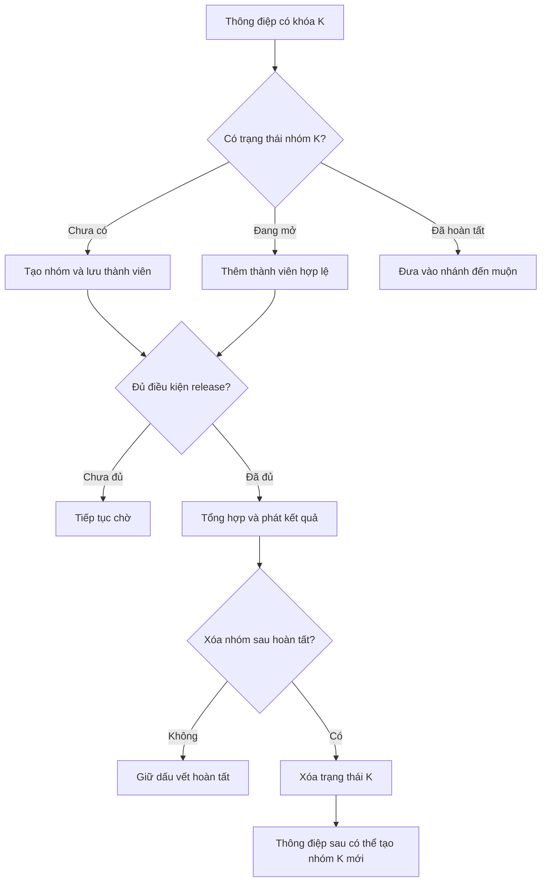

# Duplicate correlation key

## 1. Mục tiêu bài học

Trong chương **Correlation và state** của **SPRING_INTEGRATION_CORE**, bài học này giải thích cách nhận diện và xử lý việc nhiều thông điệp có cùng correlation key. Chủ đề gắn trực tiếp với thiết kế luồng bằng `Message`, `MessageChannel`, filter, aggregator và Java DSL: khóa tương quan quyết định dữ liệu nào được phép chia sẻ trạng thái.

Sau bài học, bạn có thể:

- Phân biệt khóa tương quan dùng chung hợp lệ với thông điệp trùng và va chạm khóa giữa các yêu cầu.
- Thiết kế khóa có phạm vi tenant, yêu cầu và lần thực hiện nghiệp vụ.
- Kết hợp correlation strategy, điều kiện release và chống xử lý trùng mà không loại nhầm các thành viên hợp lệ.
- Giải thích ảnh hưởng của nhóm đã hoàn tất, thông điệp đến muộn, timeout và chính sách dọn trạng thái.
- Xác định các tình huống cần kiểm thử khi có retry, restart hoặc nhiều instance.

Ví dụ xuyên suốt là dịch vụ tổng hợp báo giá. Mỗi yêu cầu cần kết quả từ hai đối tác `A` và `B`; cùng một yêu cầu có thể được thực hiện lại ở một vòng báo giá mới.

## 2. Cùng correlation key có phải là lỗi?

### 2.1. Trường hợp hợp lệ: nhiều thành viên của một nhóm

Gọi `K(m)` là khóa tương quan của thông điệp `m`. Nếu hai thông điệp thuộc cùng một lần tổng hợp, ta cần:

```text
K(phản hồi từ A) = K(phản hồi từ B)
```

Aggregator sử dụng correlation strategy để xác định nhóm. Theo mặc định, Spring Integration lấy khóa từ header `IntegrationMessageHeaderAccessor.CORRELATION_ID`; có thể cung cấp strategy khác. [Spring Integration: Aggregator](https://docs.spring.io/spring-integration/reference/aggregator.html).

Ví dụ:

| Thông điệp | Tenant | Request | Round | Đối tác | Ý nghĩa |
| --- | --- | --- | --- | --- | --- |
| m1 | shop-vn | req-42 | round-1 | A | Thành viên đầu tiên |
| m2 | shop-vn | req-42 | round-1 | B | Thành viên thứ hai |
| m3 | shop-vn | req-42 | round-2 | A | Thuộc lần tổng hợp khác |

`m1` và `m2` phải dùng chung khóa. `m3` phải có khóa khác nếu `round-2` là một lần thực hiện nghiệp vụ mới.

### 2.2. Ba loại “duplicate” cần phân biệt

| Tình huống | Khóa nhóm | Danh tính sự kiện | Cách xử lý |
| --- | --- | --- | --- |
| Hai đối tác trả lời cùng yêu cầu | Giống nhau | Khác nhau | Chấp nhận cả hai |
| Broker giao lại một sự kiện | Giống nhau | Giống nhau | Áp dụng idempotency |
| Hai yêu cầu độc lập bị ghép chung | Giống nhau do thiết kế sai | Thường khác nhau | Sửa phạm vi khóa |
| Phản hồi đến sau khi nhóm hoàn tất | Trùng khóa nhóm cũ | Có thể cũ hoặc mới | Áp dụng chính sách thông điệp đến muộn |

Cụm từ **duplicate correlation key** trong quá trình chẩn đoán chưa đủ để kết luận có dữ liệu trùng. Cần xác định hai thông điệp có thực sự thuộc cùng một lần tổng hợp hay không.

Đây cũng không phải tên của một ngoại lệ chung mà mọi aggregator đều phải ném ra khi gặp khóa đã tồn tại. Việc thêm nhiều thông điệp vào cùng một nhóm là hoạt động bình thường của aggregator.

### 2.3. Những danh tính không nên đánh đồng

- **Correlation key** trả lời: “Thông điệp thuộc lần tổng hợp nào?”
- **Event ID hoặc idempotency key** trả lời: “Sự kiện này đã được tiếp nhận/xử lý chưa?”
- **Partner ID hoặc part ID** trả lời: “Đây là thành viên nào trong nhóm?”
- **Message ID** nhận diện một `Message` kỹ thuật; không nên mặc định dùng nó thay cho danh tính sự kiện nghiệp vụ khi có tái tạo message.

Một phản hồi có thể được đóng gói thành hai `Message` khác nhau sau retry. Nếu `eventId` vẫn giữ nguyên, ứng dụng có cơ sở nhận ra đây là cùng sự kiện, dù message kỹ thuật được tạo lại.

## 3. Va chạm khóa gây sai dữ liệu như thế nào?

Giả sử correlation strategy chỉ trả về `requestId`:

```java
.correlationStrategy(message ->
        ((PartnerReply) message.getPayload()).key().requestId())
```

Đoạn cấu hình này chỉ đúng nếu `requestId` đã duy nhất trong toàn bộ phạm vi trạng thái liên quan và không bị tái sử dụng cho các vòng độc lập. Với hệ thống nhiều tenant, giả định ấy thường không phù hợp.

Xét thứ tự đến:

```text
1. shop-vn / req-42 / round-1 / A
2. shop-us / req-42 / round-1 / B
```

Nếu khóa chỉ là `req-42` và điều kiện release là “đã có A và B”, aggregator có thể tạo một báo giá ghép từ hai khách hàng khác nhau. Điều kiện release đúng theo số lượng thành viên vẫn không sửa được việc chọn sai nhóm.

Một lỗi khác xuất hiện khi khóa chỉ gồm tenant và request:

```text
1. shop-vn / req-42 / round-1 / A
2. shop-vn / req-42 / round-2 / B
```

Hai vòng báo giá bị trộn. Nếu nhóm vòng trước đã hoàn tất và trạng thái vẫn còn, phản hồi hợp lệ của vòng sau còn có thể bị xem là đến muộn.

Vì vậy, khóa nhóm cần biểu diễn **một lần tổng hợp nghiệp vụ**, thay vì chỉ biểu diễn một đối tượng như đơn hàng hoặc khách hàng.

## 4. Thiết kế khóa tương quan

### 4.1. Xác định phạm vi trước khi chọn kiểu dữ liệu

Với ví dụ báo giá, hợp đồng khóa là:

```text
CorrelationKey = (tenantId, requestId, roundId)

Một lần gửi lại do lỗi vận chuyển:
    giữ nguyên cả ba thành phần.

Một lần lấy báo giá mới:
    giữ tenantId, requestId;
    tạo roundId mới một lần tại nơi bắt đầu nghiệp vụ.
```

Không tạo `roundId` mới ở mỗi đối tác. Các đối tác phải nhận và trả lại cùng định danh vòng do bên khởi tạo cung cấp.

Nếu `requestId` đã là định danh duy nhất cho từng lần tổng hợp, có thể không cần `roundId`. Việc thêm thành phần nào phải xuất phát từ hợp đồng nghiệp vụ, không phải cứ ghép thật nhiều trường là tốt.

### 4.2. Bốn thuộc tính cần có

1. **Ổn định:** retry cùng sự kiện vẫn suy ra cùng khóa.
2. **Tách biệt:** hai lần tổng hợp độc lập có khóa khác nhau.
3. **Bất biến:** giá trị khóa không đổi sau khi đưa thông điệp vào luồng.
4. **Xác định:** các instance tạo cùng biểu diễn cho cùng một danh tính.

Khóa rỗng hoặc thiếu thành phần bắt buộc nên được phát hiện ở biên nhận thông điệp. Gán mọi khóa thiếu thành chuỗi `UNKNOWN` sẽ gom các dữ liệu hỏng vào chung một nhóm.

Một đối tượng khóa tự định nghĩa cần có `equals()` và `hashCode()` theo giá trị; Java `record` phù hợp cho mô hình này. Đừng dùng kết quả `hashCode()` làm định danh nghiệp vụ: hai giá trị khác nhau có thể có cùng hash.

### 4.3. Phân biệt khóa nhóm với khóa chống trùng

Ví dụ:

```text
Khóa nhóm:
    (shop-vn, req-42, round-1)

Khóa chống trùng sự kiện:
    (quote-events-v1, shop-vn, req-42, round-1, A, event-a-7)
```

Nếu chống trùng chỉ dựa trên khóa nhóm, phản hồi A được chấp nhận trước sẽ khiến phản hồi B bị loại. Nhóm không thể hoàn tất.

Nếu dùng UUID ngẫu nhiên mới cho khóa nhóm ở mỗi phản hồi, A và B lại vào hai nhóm riêng. Nhóm cũng không thể hoàn tất.

Khi mã hóa nhiều thành phần thành chuỗi, phải tránh phép ghép mơ hồ. Chẳng hạn `("ab", "c")` và `("a", "bc")` không được cùng trở thành `"abc"`. Có thể dùng cấu trúc dữ liệu, JSON chuẩn hóa hoặc mã hóa có độ dài từng thành phần.

## 5. Điều kiện release phải đếm đúng thứ cần chờ

Giả sử đang chờ hai đối tác:

```text
A(event-1), A(event-1 được gửi lại)
```

Điều kiện `group.size() == 2` nhìn thấy hai thông điệp nhưng chưa hề có B. Nếu hai bản sao được giữ thành các message riêng, điều kiện này có thể giải phóng nhóm quá sớm.

`SimpleSequenceSizeReleaseStrategy` so sánh số message với `sequenceSize` và không kiểm tra trùng `sequenceNumber`. Vì vậy, không nên suy rằng dùng sequence headers mặc nhiên bảo đảm tính duy nhất của thành viên. [Javadoc: SimpleSequenceSizeReleaseStrategy](https://docs.spring.io/spring-integration/api/org/springframework/integration/aggregator/SimpleSequenceSizeReleaseStrategy.html).

Với hợp đồng “chờ A và B”, điều kiện sát nghiệp vụ hơn là:

```text
tập partnerId đã nhận = {A, B}
```

Điều kiện ấy tránh việc hai phản hồi từ A thay thế cho B. Tuy nhiên, nó chưa giải quyết toàn bộ vấn đề:

- Hai yêu cầu khác nhau bị dùng chung khóa vẫn có thể tạo đủ tập `{A, B}`.
- Hai sự kiện khác nhau từ A có thể chứa hai mức giá mâu thuẫn.
- Sau khi nhóm phát kết quả, một bộ bản sao khác có thể tạo lại nhóm nếu trạng thái đã bị xóa.

Thiết kế đúng cần đồng thời có khóa nhóm đúng, danh tính sự kiện rõ ràng và chính sách vòng đời trạng thái.

## 6. Ví dụ Java DSL: tách nhóm và lọc sự kiện gửi lại

Ví dụ dưới đây sử dụng Java 17 và API Spring Integration 6.5. Ứng dụng cần `spring-integration-core` cùng các thư viện Spring tương thích; nếu dùng Spring Boot, để dependency management của Boot quản lý bộ phiên bản.

Hợp đồng của ví dụ:

- Mỗi vòng cần một báo giá cuối cùng từ A và một từ B.
- `eventId` do nguồn phát cấp và được giữ nguyên khi gửi lại cùng sự kiện.
- Một `eventId` không được đại diện cho nhiều nội dung khác nhau.
- Giá sử dụng cùng đơn vị tiền tệ đã được chuẩn hóa trước luồng này.
- Đây là mô hình một JVM, dùng store trong bộ nhớ để quan sát hành vi.

### 6.1. Cấu hình và mô hình dữ liệu

```java
import java.io.Serializable;
import java.math.BigDecimal;
import java.util.Map;
import java.util.Objects;
import java.util.Set;
import java.util.TreeMap;
import java.util.stream.Collectors;

import org.springframework.context.annotation.Bean;
import org.springframework.context.annotation.Configuration;
import org.springframework.integration.channel.DirectChannel;
import org.springframework.integration.channel.QueueChannel;
import org.springframework.integration.config.EnableIntegration;
import org.springframework.integration.dsl.IntegrationFlow;
import org.springframework.integration.metadata.ConcurrentMetadataStore;
import org.springframework.integration.metadata.SimpleMetadataStore;
import org.springframework.integration.selector.MetadataStoreSelector;
import org.springframework.integration.store.MessageGroup;
import org.springframework.integration.store.MessageGroupStore;
import org.springframework.integration.store.SimpleMessageStore;
import org.springframework.messaging.Message;

@Configuration
@EnableIntegration
public class DuplicateCorrelationConfig {

    private static final Set<String> EXPECTED_PARTNERS = Set.of("A", "B");

    public record RequestKey(
            String tenantId,
            String requestId,
            String roundId) implements Serializable {

        public RequestKey {
            requireText(tenantId, "tenantId");
            requireText(requestId, "requestId");
            requireText(roundId, "roundId");
        }
    }

    public record PartnerReply(
            RequestKey key,
            String partnerId,
            String eventId,
            BigDecimal price) implements Serializable {

        public PartnerReply {
            Objects.requireNonNull(key, "key");
            requireText(partnerId, "partnerId");
            requireText(eventId, "eventId");
            Objects.requireNonNull(price, "price");

            if (!EXPECTED_PARTNERS.contains(partnerId)) {
                throw new IllegalArgumentException("Đối tác không hợp lệ");
            }
            if (price.signum() < 0) {
                throw new IllegalArgumentException("Giá không được âm");
            }
        }
    }

    public record QuoteResult(
            RequestKey key,
            Map<String, BigDecimal> prices) implements Serializable {
    }

    @Bean
    public DirectChannel replyInput() {
        return new DirectChannel();
    }

    @Bean
    public QueueChannel completedQuotes() {
        return new QueueChannel();
    }

    @Bean
    public QueueChannel duplicateReplies() {
        return new QueueChannel();
    }

    @Bean
    public QueueChannel lateOrExpiredReplies() {
        return new QueueChannel();
    }

    @Bean
    public MessageGroupStore quoteGroupStore() {
        return new SimpleMessageStore();
    }

    @Bean
    public ConcurrentMetadataStore seenQuoteEvents() {
        return new SimpleMetadataStore();
    }

    @Bean
    public MetadataStoreSelector quoteEventSelector() {
        return new MetadataStoreSelector(
                message -> eventKey(asReply(message)),
                message -> "seen",
                seenQuoteEvents());
    }

    @Bean
    public IntegrationFlow quoteFlow() {
        MetadataStoreSelector selector = quoteEventSelector();

        return IntegrationFlow.from(replyInput())
                .filter(
                        Message.class,
                        message -> selector.accept(message),
                        endpoint -> endpoint
                                .discardChannel("duplicateReplies"))
                .aggregate(aggregator -> aggregator
                        .correlationStrategy(message -> asReply(message).key())
                        .releaseStrategy(group -> group.getMessages().stream()
                                .map(DuplicateCorrelationConfig::asReply)
                                .map(PartnerReply::partnerId)
                                .collect(Collectors.toSet())
                                .equals(EXPECTED_PARTNERS))
                        .outputProcessor(DuplicateCorrelationConfig::combine)
                        .messageStore(quoteGroupStore())
                        .expireGroupsUponCompletion(false)
                        .expireGroupsUponTimeout(false)
                        .groupTimeout(30_000)
                        .sendPartialResultOnExpiry(false)
                        .discardChannel("lateOrExpiredReplies"))
                .channel(completedQuotes())
                .get();
    }

    private static PartnerReply asReply(Message<?> message) {
        if (message.getPayload() instanceof PartnerReply reply) {
            return reply;
        }
        throw new IllegalArgumentException("Payload phải là PartnerReply");
    }

    private static String eventKey(PartnerReply reply) {
        RequestKey key = reply.key();
        return "quote-events-v1/"
                + encode(key.tenantId())
                + encode(key.requestId())
                + encode(key.roundId())
                + encode(reply.partnerId())
                + encode(reply.eventId());
    }

    private static String encode(String value) {
        return value.length() + ":" + value;
    }

    private static QuoteResult combine(MessageGroup group) {
        RequestKey key = null;
        Map<String, BigDecimal> prices = new TreeMap<>();

        for (Message<?> message : group.getMessages()) {
            PartnerReply reply = asReply(message);

            if (key == null) {
                key = reply.key();
            }
            else if (!key.equals(reply.key())) {
                throw new IllegalStateException("Nhóm chứa khóa không đồng nhất");
            }

            BigDecimal previous = prices.putIfAbsent(
                    reply.partnerId(), reply.price());

            if (previous != null
                    && previous.compareTo(reply.price()) != 0) {
                throw new IllegalStateException(
                        "Có hai giá khác nhau từ cùng đối tác trong một vòng");
            }
        }

        if (key == null || !prices.keySet().equals(EXPECTED_PARTNERS)) {
            throw new IllegalStateException("Nhóm chưa đủ đối tác");
        }

        return new QuoteResult(key, Map.copyOf(prices));
    }

    private static void requireText(String value, String field) {
        if (value == null || value.isBlank()) {
            throw new IllegalArgumentException(field + " không được rỗng");
        }
    }
}
```

Các lời gọi giữa các phương thức `@Bean` ở đây đi qua cơ chế proxy của `@Configuration` mặc định. Nếu chuyển sang `proxyBeanMethods = false`, cần truyền dependency vào tham số của phương thức bean để không vô tình tạo thêm store và channel.

### 6.2. Những quyết định quan trọng trong cấu hình

**Lọc theo toàn bộ message.** `Message.class` cho phép selector truy cập message thay vì chỉ payload. API DSL có overload tương ứng cho filter. [Javadoc: BaseIntegrationFlowDefinition.filter](https://docs.spring.io/spring-integration/docs/6.5.0/api/org/springframework/integration/dsl/BaseIntegrationFlowDefinition.html).

**Chống trùng theo sự kiện.** `MetadataStoreSelector` đặt khóa vào `ConcurrentMetadataStore` bằng `putIfAbsent`; khóa mới được chấp nhận, khóa đã tồn tại bị từ chối theo cấu hình mặc định không có `compareValues`. [Javadoc: MetadataStoreSelector](https://docs.spring.io/spring-integration/api/org/springframework/integration/selector/MetadataStoreSelector.html).

**Tách vòng nghiệp vụ.** Correlation strategy trả về `RequestKey`. Khác tenant hoặc khác round sẽ tạo khóa khác. Store `quoteGroupStore` được dành cho aggregator báo giá này.

**Release theo tập đối tác.** Hai sự kiện khác nhau từ A không thể làm nhóm hoàn tất khi B chưa đến.

**Phát hiện mâu thuẫn khi tổng hợp.** Nếu hai sự kiện khác nhau của cùng đối tác có giá khác nhau, `combine` báo lỗi khi nhóm được release. Đây là một chính sách nghiệp vụ minh họa; hệ thống thực tế có thể chọn phiên bản mới nhất, nhưng phải quy định rõ thứ tự phiên bản.

**Tách hai nhánh loại bỏ.** `duplicateReplies` nhận sự kiện đã thấy ở filter. `lateOrExpiredReplies` nhận thông điệp bị aggregator loại do trạng thái nhóm hoặc timeout. Hai nhánh có nguyên nhân khác nhau, dù có thể dùng chung hệ thống giám sát.

### 6.3. Giới hạn của mẫu

`SimpleMessageStore` và `SimpleMetadataStore` giữ trạng thái trong bộ nhớ. Store thông điệp và store chống trùng phục vụ hai mục đích khác nhau; store bền vững là một lựa chọn khi cần phục hồi trạng thái sau sự cố. [Spring Integration: Message Store](https://docs.spring.io/spring-integration/reference/message-store.html).

Các queue trong ví dụ dùng để quan sát đầu ra. Khi xây dựng dịch vụ, cần consumer phù hợp để xử lý hoặc lưu các thông điệp ở nhánh duplicate và late/expired.

Mẫu chưa triển khai transaction phối hợp giữa đánh dấu sự kiện và cập nhật nhóm. Vì vậy, không được xem filter này là bảo đảm xử lý nghiệp vụ đúng một lần. Phần về retry và phục hồi phía dưới phân tích điểm này.

Mẫu cũng chủ ý chưa dọn các khóa `seen` hoặc nhóm rỗng đã hoàn tất. Cần bổ sung chính sách lưu giữ khi áp dụng vào hệ thống chạy lâu.

## 7. Theo dõi một chuỗi thông điệp cụ thể

Có thể dùng lớp sau trong cùng package với cấu hình để gửi thông điệp thủ công. Đây là mã thực hành minh họa, không phải một bộ kiểm thử đã được thực thi.

```java
import java.math.BigDecimal;
import java.util.Objects;

import org.springframework.context.annotation.AnnotationConfigApplicationContext;
import org.springframework.integration.channel.QueueChannel;
import org.springframework.messaging.Message;
import org.springframework.messaging.MessageChannel;
import org.springframework.messaging.support.MessageBuilder;

public class QuoteFlowDemo {

    public static void main(String[] args) {
        try (var context = new AnnotationConfigApplicationContext(
                DuplicateCorrelationConfig.class)) {

            MessageChannel input = context.getBean(
                    "replyInput", MessageChannel.class);
            QueueChannel output = context.getBean(
                    "completedQuotes", QueueChannel.class);
            QueueChannel duplicates = context.getBean(
                    "duplicateReplies", QueueChannel.class);
            QueueChannel late = context.getBean(
                    "lateOrExpiredReplies", QueueChannel.class);

            var r1 = new DuplicateCorrelationConfig.RequestKey(
                    "shop-vn", "req-42", "round-1");
            var r2 = new DuplicateCorrelationConfig.RequestKey(
                    "shop-vn", "req-42", "round-2");

            send(input, r1, "A", "event-a-1", "100");
            send(input, r1, "A", "event-a-1", "100");
            send(input, r2, "A", "event-a-2", "105");
            send(input, r1, "B", "event-b-1", "110");
            send(input, r2, "B", "event-b-2", "115");
            send(input, r1, "A", "event-a-late", "100");

            printOne("Kết quả vòng 1", output);
            printOne("Kết quả vòng 2", output);
            printOne("Sự kiện gửi lại", duplicates);
            printOne("Phản hồi đến muộn", late);
        }
    }

    private static void send(
            MessageChannel input,
            DuplicateCorrelationConfig.RequestKey key,
            String partnerId,
            String eventId,
            String price) {

        var reply = new DuplicateCorrelationConfig.PartnerReply(
                key, partnerId, eventId, new BigDecimal(price));

        input.send(MessageBuilder.withPayload(reply).build());
    }

    private static void printOne(String label, QueueChannel channel) {
        Message<?> message = Objects.requireNonNull(
                channel.receive(0), "Thiếu thông điệp: " + label);
        System.out.println(label + ": " + message.getPayload());
    }
}
```

Diễn tiến mong đợi khi thực hiện các lệnh gửi liên tiếp trước timeout:

| Bước | Thông điệp | Kết quả |
| --- | --- | --- |
| 1 | round-1, A, event-a-1 | Tạo nhóm vòng 1, chờ B |
| 2 | Gửi lại đúng sự kiện ở bước 1 | Vào `duplicateReplies`, không thêm thành viên |
| 3 | round-2, A, event-a-2 | Tạo nhóm vòng 2 riêng biệt |
| 4 | round-1, B, event-b-1 | Phát kết quả vòng 1 gồm A=100, B=110 |
| 5 | round-2, B, event-b-2 | Phát kết quả vòng 2 gồm A=105, B=115 |
| 6 | round-1, A, event-a-late | Qua filter vì event mới, nhưng vào `lateOrExpiredReplies` vì nhóm đã hoàn tất |

Bước 2 và bước 6 cho thấy hai tầng kiểm tra độc lập: một bản sao có thể bị chặn trước aggregator; một sự kiện mới vẫn có thể đến quá muộn đối với nhóm của nó.

Thứ tự hiển thị các phần tử trong `Map` kết quả không phải là hợp đồng cần kiểm tra. Điều cần kiểm tra là đúng khóa vòng và đúng giá của từng đối tác.

## 8. Vòng đời nhóm quyết định khả năng tái sử dụng khóa

### 8.1. Hoàn tất khác với xóa trạng thái

Với aggregator, `expireGroupsUponCompletion(false)` giữ dấu vết nhóm hoàn tất để xử lý thông điệp đến muộn. Nếu đặt `true`, nhóm bị xóa sau hoàn tất; thông điệp mới cùng khóa có thể mở một nhóm mới. [Javadoc: AggregatingMessageHandler](https://docs.spring.io/spring-integration/api/org/springframework/integration/aggregator/AggregatingMessageHandler.html).

Có thể hình dung hai chính sách bằng sơ đồ:



Ví dụ suy ra từ chính sách trên:

```text
T0: A1 và B1 làm nhóm K phát kết quả.
T1: Trạng thái K bị xóa.
T2: Broker giao lại A1.
T3: Broker giao lại B1.

Nếu không còn lớp chống trùng hiệu lực:
    T2 tạo nhóm mới;
    T3 có thể làm phát kết quả lần nữa.
```

Vì thế, bật xóa nhóm sau hoàn tất không phải cách xử lý va chạm khóa giữa hai vòng báo giá. Nó cho phép tái sử dụng khóa, nhưng không giúp phân biệt phản hồi cũ và phản hồi của vòng mới.

### 8.2. Timeout có chính sách riêng

`groupTimeout(30_000)` trong ví dụ là thời gian không nhận thêm thông điệp vào nhóm chưa release, không phải một cam kết deadline nghiệp vụ cố định tính từ lúc người dùng bắt đầu yêu cầu. [Spring Integration: Aggregator, Group Timeout](https://docs.spring.io/spring-integration/reference/aggregator.html#aggregator-group-timeout).

Nếu các bản sao đã bị filter chặn, chúng không đến aggregator để tác động vào lịch chờ của nhóm. Đây là một hệ quả cần tính đến khi phân tích log retry.

`expireGroupsUponTimeout` điều khiển việc xóa nhóm do timeout; mặc định là `true`. Ví dụ đặt rõ `false` để tránh chủ động xóa dấu vết ngay tại nhánh timeout. [Javadoc: setExpireGroupsUponTimeout](https://docs.spring.io/spring-integration/docs/6.5.0/api/org/springframework/integration/aggregator/AbstractCorrelatingMessageHandler.html#setExpireGroupsUponTimeout(boolean)).

Vì `sendPartialResultOnExpiry(false)`, mẫu không phát báo giá thiếu đối tác như một kết quả thành công. Các message của nhóm bị timeout được đưa sang nhánh discard đã cấu hình. Ứng dụng cần chuyển tình huống đó thành trạng thái nghiệp vụ phù hợp, chẳng hạn “hết hạn chờ đối tác”.

Một deadline nghiệp vụ tuyệt đối nên được mang bằng dữ liệu như `expiresAt` và được kiểm tra khi nhận phản hồi. Timeout ở một endpoint không thay thế toàn bộ trạng thái yêu cầu.

### 8.3. Giữ dấu vết bao lâu?

Có ít nhất ba thời hạn khác nhau:

| Loại trạng thái | Vai trò | Căn cứ chọn thời hạn |
| --- | --- | --- |
| Nhóm đang chờ | Giữ phản hồi cho tới lúc release | Thời gian chờ nghiệp vụ |
| Dấu vết nhóm đã hoàn tất | Chặn thông điệp đến muộn mở lại nhóm | Độ trễ đến muộn, chính sách replay |
| Khóa sự kiện đã thấy | Nhận ra cùng sự kiện được giao lại | Cửa sổ redelivery/retry và phạm vi replay |

Ví dụ thiết kế giả định hệ thống cho phép retry trong 10 phút và có thể chậm thêm 2 phút. Khi ấy, giữ dấu vết 30 giây không đủ bao phủ cửa sổ 12 phút vừa giả định. Đây là phép suy luận từ yêu cầu vận hành, không phải một giá trị mặc định của Spring Integration.

DSL có `minimumTimeoutForEmptyGroups(...)` cho thời gian giữ tối thiểu của nhóm rỗng; cần phối hợp cơ chế dọn nhóm và scheduler. Không được hiểu giá trị này là TTL chung cho mọi loại trạng thái. [Javadoc: CorrelationHandlerSpec](https://docs.spring.io/spring-integration/docs/6.5.0/api/org/springframework/integration/dsl/CorrelationHandlerSpec.html#minimumTimeoutForEmptyGroups(long)).

Nếu dùng `MessageGroupStoreReaper`, chỉ áp dụng việc dọn trên phạm vi store phù hợp với endpoint. Với một hệ thống cần replay sau nhiều ngày, có thể phải dùng sổ trạng thái nghiệp vụ bền vững thay vì chỉ kéo dài thời gian giữ nhóm trong bộ nhớ.

Xóa nhóm và xóa khóa chống trùng là hai công việc riêng. Một cơ chế dọn message group không mặc nhiên dọn `ConcurrentMetadataStore`.

## 9. Retry, lỗi giữa chừng và bảo đảm idempotency

### 9.1. Đánh dấu “đã thấy” chưa có nghĩa là “đã xử lý xong”

Trong mẫu, selector ghi `seen` trước khi message đi vào aggregator. Xét trình tự:

```text
1. Selector đặt khóa sự kiện E vào metadata store.
2. Tiến trình lỗi trước khi E được thêm vào nhóm.
3. Nguồn phát gửi lại E.
4. Selector thấy E đã tồn tại và từ chối.
```

Nếu trạng thái `seen` vẫn tồn tại nhưng việc thêm vào nhóm chưa được ghi nhận, nhóm có thể thiếu thành viên mãi mãi. Trường hợp tương tự xảy ra khi output processor báo lỗi sau khi sự kiện đã được đánh dấu.

Với hai store trong bộ nhớ, restart thường làm mất cả hai; nhưng nếu chỉ thay một store bằng loại bền vững, hai phía có thể lệch trạng thái. Không nên nâng cấp từng store mà bỏ qua tính nhất quán giữa chúng.

Một thiết kế phục hồi cần trả lời rõ:

- Mốc nào có nghĩa là sự kiện đã được tiếp nhận bền vững?
- Mốc nào có nghĩa là sự kiện đã đóng góp vào nhóm?
- Khi lỗi, nguồn nào sẽ gửi lại hoặc phục hồi phần công việc còn thiếu?
- Việc phát kết quả và tác động nghiệp vụ cuối cùng được bảo vệ bằng cơ chế nào?

Các hướng triển khai có thể gồm transaction chung khi store hỗ trợ cùng ranh giới giao dịch, inbox bền vững với trạng thái xử lý, hoặc cơ chế phục hồi có thể chạy lại an toàn. Nếu kết quả cần được gửi ra hệ thống khác cùng với cập nhật cơ sở dữ liệu, có thể dùng outbox.

Không tự động xóa khóa `seen` mỗi khi có exception. Một phần tác động phía sau có thể đã xảy ra; việc xóa khóa và chạy lại thiếu kiểm soát có thể tạo thêm kết quả.

### 9.2. Cùng eventId nhưng nội dung khác

Giả sử nhận:

```text
E1: round-1, A, event-7, price=100
E2: round-1, A, event-7, price=150
```

Filter hiện tại loại E2 vì cùng danh tính sự kiện. Nó không phát hiện được việc nguồn phát đã thay đổi nội dung dưới cùng `eventId`.

Nếu cần nhận diện vi phạm này, có thể lưu fingerprint của nội dung nghiệp vụ đã chuẩn hóa cùng khóa sự kiện:

```text
Khóa chưa tồn tại:
    ghi fingerprint và tiếp nhận theo ranh giới giao dịch đã chọn.

Khóa đã tồn tại, fingerprint giống nhau:
    bản sao cùng nội dung.

Khóa đã tồn tại, fingerprint khác nhau:
    xung đột danh tính sự kiện, đưa sang xử lý lỗi.
```

Fingerprint nên dựa trên trường nghiệp vụ ổn định, không gồm timestamp nhận hoặc message ID được tạo lại. Cần dùng phép ghi/so sánh nguyên tử của store hoặc transaction phù hợp để tránh race condition.

### 9.3. IdempotentReceiverInterceptor là một lựa chọn khác

Ngoài filter minh họa, Spring Integration có `IdempotentReceiverInterceptor` để gắn hành vi idempotency vào endpoint. Nếu không cấu hình loại bỏ hoặc ném lỗi khi từ chối, message trùng có thể tiếp tục đi tới handler với header `duplicateMessage=true`. Vì vậy, chỉ gắn interceptor chưa đồng nghĩa bản sao đã bị chặn. [Spring Integration: Idempotent Receiver](https://docs.spring.io/spring-integration/reference/handler-advice/idempotent-receiver.html).

Chọn filter hay advice không làm mất yêu cầu thiết kế event key, trạng thái bền vững và cách phục hồi khi lỗi.

## 10. Nhiều instance và phạm vi lưu trạng thái

Trong một ứng dụng có nhiều instance, khóa hợp lệ vẫn có thể bị xử lý sai nếu trạng thái bị chia tách.

Ví dụ A đến instance 1, B đến instance 2. Nếu mỗi instance có một `SimpleMessageStore` riêng, cả hai đều chỉ thấy một nửa nhóm. Khóa giống nhau không giúp hai vùng nhớ tự hợp nhất.

Cần xem xét đồng thời:

- **Message group store:** các instance cần cùng nhìn thấy trạng thái của nhóm, hoặc có chiến lược định tuyến giữ toàn bộ nhóm tại một nơi với cơ chế phục hồi rõ ràng.
- **Metadata store:** nếu chống trùng trên toàn cụm, thao tác ghi nhận sự kiện cũng phải có phạm vi toàn cụm.
- **Khóa đồng thời:** khi chia sẻ store giữa các server, cần lock registry dùng chung phù hợp để đồng bộ thao tác trên nhóm. Lock mặc định của aggregator là trong bộ nhớ. [Spring Integration: Aggregator, Lock Registry](https://docs.spring.io/spring-integration/reference/aggregator.html#aggregator-lock-registry).
- **Định dạng khóa:** các phiên bản ứng dụng phải thống nhất cách chuẩn hóa tenant, request và round.
- **Dọn trạng thái:** các instance phải tuân thủ cùng quy tắc lưu giữ và quyền quản lý store.

Một distributed lock chỉ tuần tự hóa cập nhật. Nếu hai yêu cầu không liên quan đã bị ánh xạ vào cùng khóa, lock không thể nhận ra và tách chúng.

Cũng cần phân biệt **không gian khóa của các endpoint**. Hai aggregator khác nghiệp vụ dùng cùng store vật lý có thể va chạm nếu cùng tạo khóa `req-42`. Nên dùng store hoặc namespace tách biệt; không dùng chung miền dữ liệu cho cơ chế quét dọn khi endpoint có thể tác động vào nhóm của nhau.

Trong ví dụ, `quoteGroupStore` dành riêng cho luồng báo giá; tiền tố `quote-events-v1/` dành riêng cho khóa metadata. Nếu store bền vững cần serialize đối tượng `RequestKey`, phải cấu hình và kiểm tra serializer phù hợp. Việc record có `Serializable` không thay thế cấu hình của từng backend.

## 11. Chẩn đoán duplicate correlation key

### 11.1. Thu thập đúng dữ liệu

Khi log một thông điệp ở biên nhận và trước aggregator, nên có các trường:

```text
flow=quote-aggregation
tenantId=shop-vn
requestId=req-42
roundId=round-1
partnerId=A
eventId=event-a-1
resolvedCorrelationKey=(shop-vn,req-42,round-1)
instanceId=quote-02
decision=accepted | duplicate | late | expired | conflict
```

Có thể bổ sung message ID để theo dõi từng lần nhận. Tránh ghi toàn bộ payload nếu không cần thiết; đối chiếu các trường định danh thường đủ để khoanh vùng việc ghép nhầm.

### 11.2. Quy trình khoanh vùng

1. **So sánh danh tính nghiệp vụ.** Hai message có cùng tenant, request và round thực sự không?
2. **So sánh sự kiện và thành viên.** Cùng event, cùng partner hay hai partner khác nhau?
3. **Quan sát khóa đã giải quyết.** Đừng chỉ nhìn trường đầu vào; kiểm tra chính giá trị correlation strategy tạo ra.
4. **Xem trạng thái nhóm.** Nhóm đang chờ, đã hoàn tất, đã timeout hay đã bị xóa?
5. **Đối chiếu store và instance.** Hai message có đi vào cùng phạm vi trạng thái không?
6. **Kiểm tra release và output processor.** Đang đếm message, đếm thành viên duy nhất hay chọn phiên bản?
7. **Đối chiếu lỗi và retry.** Sự kiện đã bị đánh dấu trước một bước thất bại nào?

Các dấu hiệu thường gặp:

| Dấu hiệu | Giả thuyết cần kiểm tra |
| --- | --- |
| Nhóm đủ số message nhưng thiếu B | Đếm bản sao của A như thành viên độc lập |
| Kết quả chứa dữ liệu của hai tenant | Khóa thiếu tenant hoặc nguồn phát gán sai tenant |
| Vòng mới bị đưa vào nhánh đến muộn | Tái sử dụng khóa của vòng cũ |
| Mỗi instance đều chờ một partner | Store cục bộ hoặc định tuyến chia nhóm |
| Phát kết quả lặp sau một khoảng thời gian | Dấu vết hoàn tất hoặc metadata đã bị dọn |
| Retry bị loại nhưng nhóm vẫn thiếu sự kiện | Đánh dấu seen trước một bước thất bại |
| Nhiều request không liên quan đều dùng UNKNOWN | Giá trị mặc định đang gom khóa thiếu |

Các chỉ số hữu ích gồm số nhóm đang mở, tuổi nhóm lâu nhất, tỷ lệ duplicate/late/expired, số xung đột nội dung và thời gian hoàn tất nhóm. Không nên đưa từng request ID thành nhãn metric nếu nó tạo số lượng chuỗi thời gian quá lớn; giữ chi tiết đó trong log hoặc trace.

## 12. Các tình huống thực hành và kiểm thử

Khi kiểm thử luồng này, cần quan sát cả đầu ra thành công, nhánh duplicate, nhánh late/expired và trạng thái lưu nhóm.

| Tình huống đầu vào | Điều cần xác nhận |
| --- | --- |
| A rồi B của cùng vòng | Một kết quả chứa đúng hai partner |
| B rồi A của cùng vòng | Kết quả không phụ thuộc thứ tự đến |
| A được gửi lại cùng eventId trước khi có B | Không release sớm; bản sao vào nhánh duplicate |
| A gửi hai eventId khác nhau, cùng giá | Chưa release nếu chưa có B; kết quả chỉ có một giá cho A |
| A gửi hai eventId khác nhau, khác giá, rồi B | Phát hiện xung đột theo chính sách của output processor |
| Cùng requestId nhưng khác tenant | Không trộn nhóm |
| Cùng tenant/request nhưng khác round | Hai nhóm độc lập |
| Event mới đến sau khi nhóm hoàn tất | Vào nhánh late khi dấu vết còn hiệu lực |
| Chỉ A đến, không có B | Timeout theo chính sách; không phát báo giá thành công thiếu B |
| Dọn dấu vết rồi replay dữ liệu cũ | Xác minh cơ chế nào còn ngăn tái mở và phát lại |
| Hai luồng gửi đồng thời cùng một event | Chỉ một lần tiếp nhận theo thao tác nguyên tử của metadata store |
| Lỗi sau ghi seen, trước thêm vào nhóm | Có cách phục hồi sự kiện, không bị mất đóng góp |
| Restart hoặc chuyển instance | Trạng thái phù hợp với loại store và cam kết phục hồi |

Với kiểm thử timeout, nên dùng thời gian chờ có giới hạn và cơ chế đồng bộ phù hợp. Không dựa vào một lệnh sleep dài rồi mặc định trạng thái phải đúng.

Ba bài tập tự thực hành:

1. Thay khóa nhóm bằng `requestId` rồi gửi hai tenant có cùng request. Quan sát cách dữ liệu có thể bị ghép sai; sau đó khôi phục khóa đầy đủ.
2. Thay điều kiện release bằng `group.size() == 2`, bỏ filter và gửi hai message mới từ A. Giải thích vì sao số message không đại diện cho số đối tác đã phản hồi.
3. Chọn một cửa sổ retry giả định cho hệ thống của bạn. Thiết kế riêng thời gian giữ nhóm đang chờ, dấu vết hoàn tất và khóa sự kiện; chỉ ra hành vi mong muốn khi replay ngoài cửa sổ đó.

Khi đánh giá lời giải, hãy kiểm tra ba bất biến:

```text
Một nhóm chỉ chứa dữ liệu của một lần tổng hợp nghiệp vụ.

Một sự kiện gửi lại không được tính thành một đóng góp mới.

Việc dọn trạng thái không được âm thầm phá vỡ cam kết
về phản hồi đến muộn, replay và xử lý trùng.
```

Một thiết kế correlation tốt bắt đầu từ việc xác định đúng “một lần tổng hợp”. Từ đó mới chọn khóa, điều kiện release, cơ chế chống trùng và thời hạn giữ trạng thái phù hợp.
