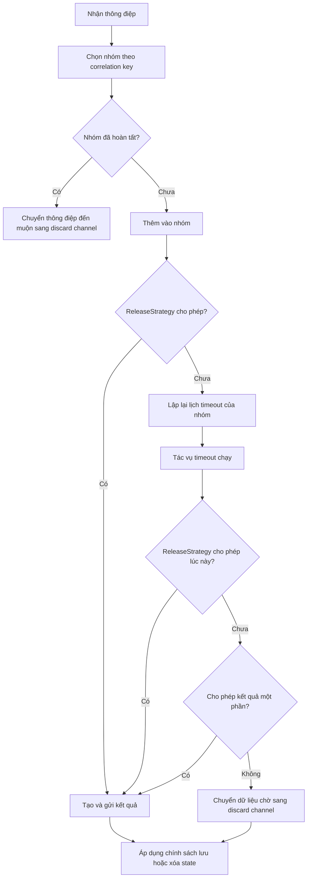

# Group timeout

## 1. Mục tiêu và bối cảnh

Trong chương **Correlation và state** của **SPRING_INTEGRATION_CORE**, group timeout giải quyết một câu hỏi thiết kế: một nhóm thông điệp chưa đủ điều kiện phát kết quả được phép chờ đến bao giờ?

Sau bài này, bạn có thể:

- Giải thích vì sao aggregator cần cả điều kiện hoàn tất và giới hạn thời gian chờ.
- Phân biệt timeout tính từ lần nhận thông điệp cuối với deadline cố định của nhóm.
- Cấu hình Java DSL để phát kết quả một phần hoặc chuyển thông điệp sang kênh loại bỏ.
- Chọn chính sách giữ trạng thái nhóm để xử lý thông điệp đến muộn.
- Thiết kế các tình huống kiểm thử cho timeout, correlation và vòng đời state.

Bài sử dụng các thành phần cốt lõi của Spring Integration: `Message`, `MessageChannel`, aggregator endpoint, `MessageGroupStore` và Java DSL. Bạn nên biết một thông điệp gồm payload và headers, cũng như vai trò của correlation key trong việc đưa các thông điệp vào cùng nhóm.

## 2. Vì sao nhóm có thể chờ vô hạn?

Giả sử một dịch vụ thu thập báo giá từ ba nguồn `KHO`, `GIA` và `VAN_CHUYEN`. Mỗi lần yêu cầu có một `requestId` riêng. Aggregator gom những phản hồi cùng `requestId`, rồi tạo một kết quả chung.

Điều kiện hoàn tất thông thường là: **đã có phản hồi từ cả ba nguồn**.

Nếu `VAN_CHUYEN` bị gián đoạn, hai phản hồi còn lại đã nằm trong store nhưng điều kiện hoàn tất vẫn sai. Không có thông điệp mới nào bảo đảm sẽ đến để thay đổi quyết định này. Nhóm tiếp tục giữ state, còn nơi gọi vẫn chưa nhận kết quả cuối.

Group timeout bổ sung một lối kết thúc có giới hạn: sau khoảng chờ được cấu hình, framework chủ động xem xét hoàn tất nhóm. Nghiệp vụ phải quyết định có chấp nhận hai báo giá hiện có hay cần chuyển chúng sang một luồng xử lý khác.

Hai chính sách hợp lý cho hai sản phẩm khác nhau:

| Nghiệp vụ | Khi thiếu một nguồn sau thời hạn |
| --- | --- |
| Màn hình tham khảo giá | Hiển thị dữ liệu hiện có, đánh dấu chưa đầy đủ |
| Chốt giao dịch cần đủ chi phí | Chuyển sang xử lý thiếu dữ liệu, không coi là báo giá hợp lệ |

Timeout chỉ tạo cơ hội kết thúc chờ; ý nghĩa thành công hay thất bại do hợp đồng nghiệp vụ quy định.

## 3. Mô hình thời gian của group timeout

### 3.1. Timeout theo khoảng im lặng của từng nhóm

Với `.groupTimeout(1500L)`, giá trị được hiểu theo mili giây. Khi một thông điệp mới được nhận vào nhóm và release strategy chưa cho phép phát kết quả, tác vụ timeout được lập lịch lại. Vì vậy, đây là giới hạn khoảng im lặng sau lần nhận mới nhất của nhóm, không phải một cửa sổ cố định kể từ thông điệp đầu tiên. [Tham chiếu aggregator](https://docs.spring.io/spring-integration/reference/7.0/aggregator.html).

Ví dụ cùng nhóm `REQ-101`, timeout 1,5 giây:

| Thời điểm tương đối | Sự kiện | Mốc dự kiến xem xét timeout |
| --- | --- | --- |
| `t = 0,0 s` | Nhận `KHO`; chưa đủ nguồn | `t = 1,5 s` |
| `t = 0,8 s` | Nhận `GIA`; vẫn chưa đủ | Dời sang `t = 2,3 s` |
| `t = 1,5 s` | Không có sự kiện mới | Chưa timeout theo lịch mới |
| `t ≈ 2,3 s` | Vẫn thiếu `VAN_CHUYEN` | Thực hiện xử lý timeout |

Nhóm `REQ-202` có lịch riêng. Một thông điệp của `REQ-202` không kéo dài thời gian chờ của `REQ-101`.

Đây là mô hình thời gian xử lý tại aggregator. Timestamp do hệ thống nguồn gắn vào payload không tự biến cấu hình trên thành một cửa sổ theo thời gian sự kiện.

### 3.2. Luồng quyết định khi đến hạn

Khi tác vụ timeout chạy, release strategy được hỏi lại. Nếu vẫn không thể release bình thường, lựa chọn `sendPartialResultOnExpiry` quyết định phát kết quả một phần hay loại bỏ các thông điệp đang chờ. [Cơ chế group timeout](https://docs.spring.io/spring-integration/reference/aggregator.html#aggregator-and-group-timeout).



Sơ đồ mô tả đường đi logic khi các thao tác thành công; lỗi gửi kết quả cần được xử lý riêng. Với cấu hình dùng số dương, tác vụ timeout thường chạy trên thread của scheduler, còn release do thông điệp đến có thể chạy ngay trên thread gửi qua `DirectChannel`.

Mốc hẹn không phải cam kết thời gian thực cứng. Thread scheduler bận, tranh chấp khóa nhóm hoặc một thành phần xử lý chậm có thể khiến kết quả xuất hiện muộn hơn mốc dự kiến.

## 4. Ba quyết định cấu hình cần tách biệt

### 4.1. Có cho phép kết quả một phần không?

| Cấu hình | Khi timeout và release strategy vẫn trả về `false` |
| --- | --- |
| `sendPartialResultOnExpiry(true)` | Gọi bộ xử lý tổng hợp với các thông điệp hiện có và gửi kết quả ra luồng kết quả |
| `sendPartialResultOnExpiry(false)` | Không tạo kết quả tổng hợp một phần; xử lý loại bỏ, có thể gửi dữ liệu vào `discardChannel` |

Nếu chọn nhánh loại bỏ, hãy cấu hình kênh nhận rõ ràng để có nơi theo dõi hoặc phục hồi dữ liệu. Đừng giả định việc timeout tự tạo ra một ngoại lệ nghiệp vụ.

Nhánh kết quả một phần sử dụng cùng bộ xử lý tổng hợp. Do đó, `outputProcessor` phải xử lý được cả nhóm đủ dữ liệu và nhóm còn thiếu. Việc truy cập cố định phần tử thứ ba trong một danh sách chỉ có hai phần tử sẽ làm đường timeout thất bại.

### 4.2. Có xóa hoàn toàn nhóm sau timeout không?

`expireGroupsUponTimeout(true)` cho phép xóa hoàn toàn nhóm khi xử lý timeout kết thúc. Nếu cùng correlation key xuất hiện sau đó, thông điệp có thể mở một nhóm mới.

Đặt `expireGroupsUponTimeout(false)` cùng chính sách giữ nhóm sau completion cho phép giữ metadata đã hoàn tất để chặn thông điệp muộn. Trong ví dụ này, cả hai cờ được đặt `false` để hành vi giữ state nhất quán giữa nhánh đủ dữ liệu và nhánh timeout. [API correlation handler](https://docs.spring.io/spring-integration/api/org/springframework/integration/dsl/CorrelationHandlerSpec.html).

### 4.3. Có xóa nhóm sau release thông thường không?

`expireGroupsUponCompletion` điều khiển việc xóa nhóm sau release. Khi đặt `false`, aggregator có thể dọn các thông điệp đã xử lý nhưng vẫn giữ metadata nhóm đã hoàn tất. Metadata này giúp nhận ra cùng correlation key không được mở lại ngay. [Vòng đời nhóm trong AggregatingMessageHandler](https://raw.githubusercontent.com/spring-projects/spring-integration/v7.0.0/spring-integration-core/src/main/java/org/springframework/integration/aggregator/AggregatingMessageHandler.java).

Cần cấu hình chủ đích cả hai cờ:

| Mục tiêu của ví dụ | `expireGroupsUponCompletion` | `expireGroupsUponTimeout` |
| --- | --- | --- |
| Giữ dấu hoàn tất sau cả release đủ dữ liệu và timeout | `false` | `false` |
| Cho phép cùng key mở nhóm mới sau khi kết thúc | `true` | `true` |

Nếu nghiệp vụ cần chính sách khác nhau cho hai đường kết thúc, hãy mô tả và kiểm thử từng đường. Không suy ra toàn bộ vòng đời chỉ từ một tên thuộc tính.

Giữ metadata không có nghĩa giữ toàn bộ payload vô thời hạn. Tuy nhiên, số lượng metadata vẫn tăng theo số nhóm; cần một chính sách dọn dẹp riêng phù hợp khoảng chấp nhận thông điệp muộn.

## 5. Ví dụ Java DSL: tổng hợp báo giá có kết quả một phần

### 5.1. Hợp đồng dữ liệu

Mỗi phản hồi mang:

- `requestId`: định danh duy nhất của một lần thu thập báo giá.
- `source`: một trong ba nguồn đã biết.
- `amount`: số tiền biểu diễn bằng đơn vị nhỏ nhất đã thống nhất, chẳng hạn đồng.

Kết quả trả ra gồm bản đồ báo giá, tập nguồn còn thiếu và cờ `complete`. Cờ này thể hiện độ đầy đủ dữ liệu; nó không khẳng định nguyên nhân kỹ thuật nào đã kích hoạt việc phát kết quả.

Ví dụ giả định đầu vào đã được kiểm tra kiểu dữ liệu, `requestId` không rỗng và số tiền hợp lệ. Filter trong flow chỉ minh họa việc loại nguồn ngoài hợp đồng.

Cần có `spring-integration-core` trong ứng dụng. Nếu dùng Spring Boot, hãy dùng phiên bản được bộ quản lý dependency của dự án chọn. Mã dùng Java 17 trở lên vì có `record`, cùng Java DSL `IntegrationFlow.from(...)`.

### 5.2. Cấu hình hoàn chỉnh

```java
import java.util.HashSet;
import java.util.Map;
import java.util.Set;
import java.util.stream.Collectors;

import org.springframework.context.annotation.Bean;
import org.springframework.context.annotation.Configuration;
import org.springframework.integration.channel.DirectChannel;
import org.springframework.integration.channel.QueueChannel;
import org.springframework.integration.config.EnableIntegration;
import org.springframework.integration.dsl.IntegrationFlow;
import org.springframework.integration.store.MessageGroup;
import org.springframework.integration.store.SimpleMessageStore;

@Configuration
@EnableIntegration
public class GroupTimeoutConfig {

    private static final Set<String> EXPECTED_SOURCES =
            Set.of("KHO", "GIA", "VAN_CHUYEN");

    public record QuotePart(
            String requestId,
            String source,
            long amount) {
    }

    public record QuoteBundle(
            String requestId,
            Map<String, Long> amounts,
            Set<String> missingSources,
            boolean complete) {
    }

    @Bean
    public DirectChannel quoteParts() {
        return new DirectChannel();
    }

    @Bean
    public QueueChannel quoteResults() {
        return new QueueChannel();
    }

    @Bean
    public QueueChannel quoteDiscarded() {
        return new QueueChannel();
    }

    @Bean
    public SimpleMessageStore quoteStore() {
        return new SimpleMessageStore();
    }

    @Bean
    public IntegrationFlow quoteFlow() {
        return IntegrationFlow.from(quoteParts())
                .<QuotePart>filter(
                        part -> EXPECTED_SOURCES.contains(part.source()),
                        spec -> spec.discardChannel(quoteDiscarded()))
                .aggregate(spec -> spec
                        .messageStore(quoteStore())
                        .correlationStrategy(message ->
                                ((QuotePart) message.getPayload()).requestId())
                        .releaseStrategy(GroupTimeoutConfig::hasAllSources)
                        .groupTimeout(1500L)
                        .sendPartialResultOnExpiry(true)
                        .expireGroupsUponCompletion(false)
                        .expireGroupsUponTimeout(false)
                        .discardChannel(quoteDiscarded())
                        .outputProcessor(GroupTimeoutConfig::toBundle))
                .channel(quoteResults())
                .get();
    }

    private static boolean hasAllSources(MessageGroup group) {
        Set<String> received = group.getMessages().stream()
                .map(message -> (QuotePart) message.getPayload())
                .map(QuotePart::source)
                .collect(Collectors.toSet());

        return received.containsAll(EXPECTED_SOURCES);
    }

    private static QuoteBundle toBundle(MessageGroup group) {
        Map<String, Long> amounts = group.getMessages().stream()
                .map(message -> (QuotePart) message.getPayload())
                .collect(Collectors.toMap(
                        QuotePart::source,
                        QuotePart::amount,
                        Long::min));

        Set<String> missing = new HashSet<>(EXPECTED_SOURCES);
        missing.removeAll(amounts.keySet());

        QuotePart first = (QuotePart) group.getOne().getPayload();
        return new QuoteBundle(
                first.requestId(),
                Map.copyOf(amounts),
                Set.copyOf(missing),
                missing.isEmpty());
    }
}
```

Các quyết định trong ví dụ có mục đích cụ thể:

1. Correlation lấy từ payload nên không phụ thuộc header `correlationId`. Nếu bỏ chiến lược này, không được mặc nhiên cho rằng aggregator sẽ tự biết `requestId`.
2. Release dựa trên tập nguồn phân biệt. Ba phản hồi đều từ `KHO` không thể giả làm ba nguồn khác nhau.
3. Nếu một nguồn gửi nhiều giá trong cùng lần yêu cầu, ví dụ giữ giá nhỏ nhất bằng `Long::min`. Đây là quy tắc minh họa có chủ đích; sản phẩm cần chọn quy tắc phù hợp dữ liệu thực tế.
4. Kết quả chứa `missingSources`, vì chỉ trả một danh sách ngắn hơn sẽ khiến nơi nhận khó biết dữ liệu nào còn thiếu.
5. Hai cờ expiration cùng `false` giữ dấu hoàn tất để thông điệp muộn không tự tạo một kết quả thứ hai trong lúc metadata còn tồn tại.
6. `QueueChannel` làm nơi quan sát kết quả trong bài học. Ứng dụng thực tế phải có consumer và giới hạn dung lượng phù hợp.

`outputProcessor` là điểm tạo payload nghiệp vụ từ `MessageGroup`; `expireGroupsUponCompletion` là cấu hình riêng của aggregator. [API AggregatorSpec](https://docs.spring.io/spring-integration/api/org/springframework/integration/dsl/AggregatorSpec.html).

### 5.3. Gửi hai nguồn và quan sát timeout

Lớp sau có thể đặt cùng package với `GroupTimeoutConfig` trong một dự án thực hành đã có dependency phù hợp:

```java
import org.springframework.context.annotation.AnnotationConfigApplicationContext;
import org.springframework.integration.channel.DirectChannel;
import org.springframework.integration.channel.QueueChannel;
import org.springframework.messaging.Message;
import org.springframework.messaging.support.MessageBuilder;

public class GroupTimeoutDemo {

    public static void main(String[] args) {
        try (var context = new AnnotationConfigApplicationContext(
                GroupTimeoutConfig.class)) {

            DirectChannel input = context.getBean(
                    "quoteParts", DirectChannel.class);
            QueueChannel output = context.getBean(
                    "quoteResults", QueueChannel.class);
            QueueChannel discarded = context.getBean(
                    "quoteDiscarded", QueueChannel.class);

            input.send(MessageBuilder.withPayload(
                    new GroupTimeoutConfig.QuotePart(
                            "REQ-101", "KHO", 120_000L)).build());
            input.send(MessageBuilder.withPayload(
                    new GroupTimeoutConfig.QuotePart(
                            "REQ-101", "GIA", 118_000L)).build());

            Message<?> resultMessage = output.receive(5000L);
            if (resultMessage == null) {
                throw new IllegalStateException("Chưa nhận kết quả trong demo");
            }

            var result = (GroupTimeoutConfig.QuoteBundle)
                    resultMessage.getPayload();
            System.out.println(result);

            input.send(MessageBuilder.withPayload(
                    new GroupTimeoutConfig.QuotePart(
                            "REQ-101", "VAN_CHUYEN", 25_000L)).build());

            Message<?> lateMessage = discarded.receive(1000L);
            System.out.println("Đã nhận thông điệp muộn: "
                    + (lateMessage != null));
        }
    }
}
```

Kỳ vọng trong điều kiện scheduler hoạt động bình thường:

- Sau khoảng 1,5 giây im lặng của `REQ-101`, đầu ra có `complete=false` và `missingSources` chứa `VAN_CHUYEN`.
- Bản đồ `amounts` có hai khóa `KHO`, `GIA`; thứ tự hiển thị không phải hợp đồng của ví dụ.
- Phản hồi `VAN_CHUYEN` gửi sau khi đã nhận kết quả đi vào `quoteDiscarded`, vì metadata nhóm hoàn tất vẫn còn.

`receive(5000L)` chỉ là giới hạn thời gian demo đợi ở kênh kết quả. Nó không đổi timeout 1.500 mili giây của aggregator.

Nếu muốn thử đường loại bỏ, đổi duy nhất lựa chọn nghiệp vụ trong cấu hình minh họa thành `.sendPartialResultOnExpiry(false)`. Khi vẫn thiếu nguồn, không mong đợi `QuoteBundle` ở `quoteResults`; hãy quan sát các thông điệp chờ ở `quoteDiscarded`. Với cách discard từng thông điệp mặc định, hai đầu vào đang chờ tương ứng hai thông điệp trên kênh loại bỏ.

## 6. Deadline cố định và timeout động

### 6.1. Khi khoảng im lặng chưa đáp ứng yêu cầu

Một nhóm nhận thông điệp mỗi giây có thể liên tục dời timeout 1,5 giây. Nếu hợp đồng yêu cầu trả kết quả trong khoảng bốn giây kể từ khi tạo nhóm, chỉ dùng timeout theo lần đến cuối là chưa đủ.

Có hai câu hỏi độc lập:

- Đã quá lâu mà không có phản hồi mới chưa?
- Tổng thời gian tồn tại của lần thu thập đã vượt ngân sách chưa?

Bạn có thể chọn một trong hai hoặc áp dụng cả hai.

### 6.2. Dùng mốc `Date` gắn với thời điểm tạo nhóm

Thay lời gọi `.groupTimeout(1500L)` trong flow bằng:

```java
.groupTimeoutExpression("new java.util.Date(timestamp + 4000L)")
```

`timestamp` là thuộc tính của `MessageGroup`, không phải header của một thông điệp. Trả về `Date` biểu thị mốc tuyệt đối; số dương biểu thị khoảng trễ tính từ lúc đánh giá. Khi có đầu vào mới, biểu thức trên vẫn tính về cùng mốc tạo nhóm cộng bốn giây. [API groupTimeoutExpression](https://docs.spring.io/spring-integration/api/org/springframework/integration/dsl/CorrelationHandlerSpec.html#groupTimeoutExpression(java.lang.String)).

Metadata nhóm được tái sử dụng có thể khiến thời điểm tạo nhóm khác với thời điểm thông điệp đầu tiên của một lần nghiệp vụ mới. Vì thế, nếu mỗi lần yêu cầu có deadline riêng, nên dùng correlation key riêng cho lần đó hoặc truyền deadline nghiệp vụ rõ ràng.

### 6.3. Kết hợp khoảng im lặng với tuổi tối đa

Một lựa chọn khác là thay timeout bằng hàm:

```java
.groupTimeout(group -> new java.util.Date(
        Math.min(
                System.currentTimeMillis() + 1500L,
                group.getTimestamp() + 4000L)))
```

Đây là chính sách của ví dụ: lấy mốc sớm hơn giữa 1,5 giây kể từ lần đánh giá hiện tại và bốn giây kể từ lúc tạo nhóm. Nó phù hợp khi muốn kết thúc nhanh nếu im lặng nhưng vẫn chặn việc kéo dài do thông điệp nhỏ giọt.

Ví dụ suy luận với nhóm bắt đầu ở `t=0`:

| Lần nhận gần nhất | Theo khoảng im lặng | Theo tuổi tối đa | Mốc được chọn |
| --- | --- | --- | --- |
| `t=0,0 s` | `1,5 s` | `4,0 s` | `1,5 s` |
| `t=1,0 s` | `2,5 s` | `4,0 s` | `2,5 s` |
| `t=2,0 s` | `3,5 s` | `4,0 s` | `3,5 s` |
| `t=3,0 s` | `4,5 s` | `4,0 s` | `4,0 s` |

Khi mốc tuyệt đối đã nằm trong quá khứ, hãy xem nó như công việc cần thực hiện sớm, không kỳ vọng scheduler quay ngược thời gian. Nếu cần từ chối mọi dữ liệu quá deadline nghiệp vụ, phải kiểm tra deadline trên đường nhận thông điệp; lịch scheduler tự nó không bảo đảm điều đó.

### 6.4. Ý nghĩa của `null` và `0`

Có thể cấu hình có điều kiện:

```java
.groupTimeoutExpression("size() >= 2 ? 1500L : null")
```

Ở đây, nhóm chỉ có một thông điệp không được lập lịch timeout bởi biểu thức này. Nếu không bao giờ có thông điệp thứ hai, nhóm đó cần một cơ chế dọn dẹp khác.

- `null`: không lập lịch force-complete cho lần đánh giá đó.
- `0`: force-complete ngay trên thread hiện tại.
- Giá trị số dương: khoảng trễ theo mili giây.
- `Date`: mốc thời gian tuyệt đối.

Không dùng số âm như một quy ước tùy ý cho “chờ vô hạn”; dùng `null` khi chủ đích là không lập lịch. Các cách xử lý này có thể quan sát trong cơ chế lập lịch của handler. [Mã nguồn AbstractCorrelatingMessageHandler](https://raw.githubusercontent.com/spring-projects/spring-integration/v7.0.0/spring-integration-core/src/main/java/org/springframework/integration/aggregator/AbstractCorrelatingMessageHandler.java).

Chỉ chọn một cách cấu hình timeout cho một endpoint. Không ghép nhiều lời gọi `groupTimeout` và `groupTimeoutExpression` với kỳ vọng framework tự kết hợp các giới hạn; hãy viết rõ phép kết hợp trong một hàm như ví dụ trên.

## 7. Thông điệp muộn, thông điệp trùng và state

### 7.1. Correlation key cần đại diện đúng một lần xử lý

Nếu chỉ dùng mã đơn hàng `ORDER-88`, lần báo giá thứ hai có thể đụng metadata hoàn tất của lần thứ nhất. Một correlation key phù hợp hơn có thể gồm:

```text
merchantId + orderId + quoteAttemptId
```

Cần giữ cùng key xuyên suốt các nhánh của một lần thu thập. Một lần thử mới dùng `quoteAttemptId` mới; một lần gửi lại kỹ thuật của cùng phản hồi vẫn giữ định danh nghiệp vụ phù hợp để phát hiện trùng.

### 7.2. Bỏ metadata sớm có thể mở nhóm mới

Tình huống suy luận khi chọn xóa nhóm sau timeout:

1. `REQ-101` nhận hai nguồn rồi timeout.
2. Một kết quả một phần đã được gửi cho nơi nhận.
3. State của nhóm bị xóa hoàn toàn.
4. Phản hồi còn lại với key `REQ-101` đến trễ và mở một nhóm mới.
5. Nhóm mới có thể tiếp tục timeout, tạo thêm một kết quả liên quan cùng yêu cầu.

Nếu sản phẩm chỉ cho phép một kết quả cuối, cần cơ chế phù hợp: giữ dấu hoàn tất trong khoảng bảo vệ, lưu trạng thái kết thúc ở tầng nghiệp vụ hoặc áp dụng idempotency khi nhận kết quả. Timeout không tự cung cấp bảo đảm exactly-once.

### 7.3. Một phản hồi trùng vẫn có thể ảnh hưởng thời gian chờ

Release strategy của ví dụ đếm nguồn phân biệt nên tránh release sớm do ba thông điệp cùng nguồn. Tuy nhiên, một phản hồi trùng được nhận vào nhóm vẫn có thể khiến timeout theo khoảng im lặng được lập lại.

Nếu producer thường xuyên gửi lại, có thể đặt bước lọc idempotent trước aggregator, dùng khóa gồm `requestId` và định danh phản hồi. Phải quyết định trước việc hai báo giá khác nhau từ cùng nguồn là bản cập nhật hợp lệ hay dữ liệu trùng; không gộp hai ý nghĩa này thành một quy tắc kỹ thuật.

### 7.4. Giữ metadata cần có thời hạn

`SimpleMessageStore` trong bài là store trong bộ nhớ; không nên kỳ vọng state sống qua lần khởi động lại. Đây là lựa chọn để minh họa hành vi trong một tiến trình. [API SimpleMessageStore](https://docs.spring.io/spring-integration/api/org/springframework/integration/store/SimpleMessageStore.html).

Ví dụ cố ý chưa dọn metadata để có thể quan sát việc chặn thông điệp muộn. Trong hệ thống hoạt động lâu dài, cần chọn khoảng bảo vệ theo thời gian gửi lại và trễ tối đa mà nghiệp vụ chấp nhận, rồi dọn nhóm rỗng đã hoàn tất. Sau khi metadata bị dọn, khả năng nhận ra key cũ ở aggregator cũng kết thúc; nếu cần bảo vệ lâu hơn, trạng thái nghiệp vụ phải đảm nhiệm phần đó.

## 8. Group timeout khác reaper và các loại timeout khác

### 8.1. Group timeout và MessageGroupStoreReaper

`MessageGroupStoreReaper` là một thành phần `Runnable` có phương thức `run()` để thực hiện expiration trên store. Khai báo bean chưa thay cho việc lập lịch gọi `run()` định kỳ. [API MessageGroupStoreReaper](https://docs.spring.io/spring-integration/api/org/springframework/integration/store/MessageGroupStoreReaper.html).

| Khía cạnh | Group timeout | Reaper |
| --- | --- | --- |
| Cách kích hoạt | Lập lịch theo từng nhóm đang xử lý | Quét store theo lịch bên ngoài |
| Trường hợp tiêu biểu | Nhóm đang chờ bị im lặng quá lâu | Nhóm cũ hoặc metadata cần được xem xét dọn |
| Cần nghĩ đến | Lập lịch lại khi có thông điệp, scheduler bị chậm | Ngưỡng expiration và khoảng cách giữa các lần quét |

Ví dụ thiết kế: ngưỡng được xem xét là 60 giây, tác vụ quét chạy mỗi 10 giây. Một nhóm vừa đạt ngưỡng sau một lần quét có thể phải chờ gần 10 giây nữa mới được xem xét, cộng thời gian xử lý. Đừng dùng thời điểm quét như một deadline chính xác cho phản hồi người dùng.

Khi dùng reaper, cần kiểm tra chính sách timestamp của store, các cờ expiration và thời gian bảo vệ nhóm rỗng. Không cấu hình reaper để vô tình xóa dấu hoàn tất sớm hơn khoảng trễ mà nghiệp vụ đang muốn chặn.

### 8.2. Các timeout thường bị nhầm

| Khái niệm | Phạm vi | Khi hết hạn có tự đóng nhóm aggregator không? |
| --- | --- | --- |
| Group timeout | Một nhóm correlation tại endpoint | Có kích hoạt xử lý hoàn tất theo cấu hình |
| Gateway reply timeout | Thời gian nơi gọi đợi phản hồi | Không tự động |
| `receive(timeout)` của `QueueChannel` | Một lần chờ lấy thông điệp | Không |
| Send timeout | Một lần gửi vào kênh có thể bị chặn | Không phải cơ chế giới hạn tuổi nhóm |
| TTL hoặc header expiration của message | Vòng đời của từng thông điệp theo thành phần sử dụng | Không được mặc nhiên xem là timeout của nhóm |
| Thời gian giữ metadata rỗng | Cửa sổ nhận diện nhóm đã kết thúc | Không thay thế thời gian chờ dữ liệu ban đầu |

Một gateway ngừng chờ không có nghĩa công việc nền đã bị hủy. Nếu nhóm được phép trả kết quả sau khi người gọi rời đi, cần nơi nhận kết quả ổn định hoặc một trạng thái để người gọi truy vấn lại.

## 9. Scheduler, lỗi và khởi động lại

### 9.1. Đường timeout có thể phát lỗi ở thread khác

Với release do thông điệp đến qua `DirectChannel`, lỗi có thể quay về thread gửi. Khi scheduler kích hoạt timeout sau đó, `try/catch` quanh lần gửi ban đầu không bắt được ngoại lệ phát sinh ở thời điểm này.

Nếu tự cung cấp `TaskScheduler`, hãy cấu hình `MessagePublishingErrorHandler` khi muốn lỗi của tác vụ được đưa vào luồng `errorChannel`. Việc có một bean scheduler không tự bảo đảm mọi lỗi sẽ được xuất bản đúng kênh mong muốn. [Xử lý lỗi trong Spring Integration](https://docs.spring.io/spring-integration/reference/error-handling.html).

Phân biệt hai loại kết quả:

- Thiếu nguồn theo chính sách thời gian: một tình huống nghiệp vụ dự kiến, có thể biểu diễn bằng `complete=false`.
- Bộ tổng hợp ném ngoại lệ, kênh kết quả không nhận được hoặc serializer thất bại: sự cố xử lý cần đường lỗi và theo dõi riêng.

Không biến mọi lỗi hạ tầng thành “báo giá một phần” vì như vậy có thể che mất lỗi phát kết quả.

### 9.2. Đừng để công việc chậm chiếm scheduler

Nếu kết quả timeout đi qua một `DirectChannel` đến handler gọi dịch vụ ngoài lâu, thread scheduler có thể bị giữ trong toàn bộ thao tác đó. Khi tải tăng, những nhóm khác cũng bị ảnh hưởng.

Một phương án thiết kế là đưa công việc chậm sang một biên bất đồng bộ phù hợp, với hàng đợi có giới hạn và đường lỗi rõ ràng. Khi thêm biên này, cần thiết kế lại việc xác nhận tiếp nhận, phục hồi và idempotency; việc đổi channel không tự tạo ra giao dịch nguyên tử cho cả luồng.

### 9.3. Persistent store không đồng nghĩa persistent timer

Một tác vụ đang chờ trong scheduler thuộc tiến trình đang chạy. Lưu thông điệp vào database không đồng nghĩa đã lưu toàn bộ tác vụ hẹn giờ để tự chạy tiếp sau khi ứng dụng khởi động lại.

Khi chuyển ví dụ sang persistent store, hãy thiết kế đường xử lý nhóm mồ côi: kiểm tra nhóm cũ khi khởi động, lập lịch quét hoặc dùng cơ chế purge được endpoint hỗ trợ. Đồng thời kiểm thử việc ứng dụng dừng giữa lúc lưu state và phát kết quả.

Nếu nhiều instance có thể chạm vào cùng nhóm, cần phối hợp quyền xử lý và khóa phù hợp với store. Một correlation key đúng không thay thế cơ chế đồng bộ truy cập state.

## 10. Thiết kế kiểm thử theo hành vi

Bảng sau là các tiêu chí kiểm thử cho ví dụ, không phải kết quả đã chạy:

| Tình huống | Dữ liệu và thao tác | Hành vi cần chứng minh |
| --- | --- | --- |
| Đủ ba nguồn | Gửi ba nguồn hợp lệ cùng key trước hạn | Có một kết quả `complete=true`, không thiếu nguồn |
| Thiếu một nguồn | Chỉ gửi `KHO`, `GIA` | Sau timeout có kết quả một phần, thiếu `VAN_CHUYEN` |
| Phân biệt nhóm | Gửi các nguồn xen kẽ cho hai key | Không trộn dữ liệu giữa hai yêu cầu |
| Nguồn lặp | Gửi ba thông điệp đều từ `KHO` | Không release như nhóm đủ ba nguồn |
| Đến muộn | Đợi kết quả một phần rồi mới gửi nguồn cuối | Đi vào discard khi metadata vẫn được giữ |
| Tắt kết quả một phần | Cấu hình `sendPartialResultOnExpiry(false)` | Không có bundle một phần; dữ liệu chờ đi vào discard |
| Giới hạn tuổi nhóm | Gửi liên tục nhưng dùng deadline cố định | Không kéo deadline theo từng lần nhận |
| Không có đầu vào | Không thông điệp nào đến aggregator cho một key | Không có nhóm tự sinh chỉ vì đã chờ lâu |
| Phục hồi | Dừng và khởi động lại với persistent store | Nhóm cũ được xử lý theo chính sách phục hồi đã chọn |

Ví dụ JUnit 5 dưới đây kiểm tra trường hợp thiếu nguồn bằng cấu hình đã trình bày:

```java
import static org.junit.jupiter.api.Assertions.assertEquals;
import static org.junit.jupiter.api.Assertions.assertFalse;
import static org.junit.jupiter.api.Assertions.assertNotNull;
import static org.junit.jupiter.api.Assertions.assertTrue;

import java.util.Set;

import org.junit.jupiter.api.Test;
import org.springframework.context.annotation.AnnotationConfigApplicationContext;
import org.springframework.integration.channel.DirectChannel;
import org.springframework.integration.channel.QueueChannel;
import org.springframework.messaging.Message;
import org.springframework.messaging.support.MessageBuilder;

class GroupTimeoutTest {

    @Test
    void emitsPartialBundleWhenOneSourceIsMissing() {
        try (var context = new AnnotationConfigApplicationContext(
                GroupTimeoutConfig.class)) {

            DirectChannel input = context.getBean(
                    "quoteParts", DirectChannel.class);
            QueueChannel output = context.getBean(
                    "quoteResults", QueueChannel.class);

            assertTrue(input.send(MessageBuilder.withPayload(
                    new GroupTimeoutConfig.QuotePart(
                            "REQ-TEST", "KHO", 120_000L)).build()));
            assertTrue(input.send(MessageBuilder.withPayload(
                    new GroupTimeoutConfig.QuotePart(
                            "REQ-TEST", "GIA", 118_000L)).build()));

            Message<?> message = output.receive(5000L);
            assertNotNull(message);

            var result = (GroupTimeoutConfig.QuoteBundle)
                    message.getPayload();
            assertEquals("REQ-TEST", result.requestId());
            assertFalse(result.complete());
            assertEquals(Set.of("VAN_CHUYEN"), result.missingSources());
            assertEquals(Set.of("KHO", "GIA"), result.amounts().keySet());
        }
    }
}
```

Chờ trực tiếp ở kênh đầu ra giúp kiểm thử đồng bộ theo sự kiện quan sát được. Đừng dùng `Thread.sleep(1500)` rồi giả định scheduler chắc chắn đã chạy đúng thời điểm đó.

Kiểm thử trên xác nhận hình dạng kết quả trong một khoảng đợi rộng hơn timeout; nó chưa chứng minh chính xác cơ chế dời lịch. Để kiểm tra việc lập lịch lại, nên dùng một scheduler kiểm soát được, ghi nhận tác vụ cũ bị hủy và mốc của tác vụ mới. Với kiểm thử dùng thời gian thực, cần khoảng đệm hợp lý và tránh gửi thông điệp ngay sát ranh giới deadline.

Một trường hợp dễ bỏ sót là **không nhận được bất kỳ thông điệp nào**. Group timeout chỉ áp dụng khi đã có nhóm. Nếu tất cả dịch vụ phụ đều im lặng từ đầu, aggregator không tự biết có một `requestId` đang cần chờ; muốn phát kết quả “không có nguồn nào” cần đăng ký yêu cầu hoặc cơ chế deadline bên ngoài.

## 11. Chọn timeout theo nhu cầu nghiệp vụ

Bắt đầu bằng ngân sách thời gian của toàn yêu cầu. Ví dụ minh họa một giao diện có khoảng ba giây để phản hồi:

| Công đoạn | Ngân sách giả định |
| --- | --- |
| Tiếp nhận và phân phối yêu cầu | 200 ms |
| Thu thập dữ liệu | 1.800 ms |
| Xử lý kết quả và truyền về | 500 ms |
| Khoảng đệm | 500 ms |

Đây là số liệu giả định để thiết kế, không phải giá trị khuyến nghị chung. Nếu yêu cầu cần giới hạn tổng thời gian thu thập ở 1.800 ms, hãy dùng deadline tương ứng; một timeout im lặng 1.800 ms vẫn có thể bị dời nhiều lần.

Khi vận hành, nên quan sát:

- Tỷ lệ kết quả đủ nguồn và một phần, phân theo nguồn bị thiếu.
- Thời gian chờ thực tế của nhóm và độ trễ giữa mốc hẹn với lúc tác vụ bắt đầu.
- Số nhóm đang mở, số metadata hoàn tất còn được giữ và tốc độ dọn dẹp.
- Số thông điệp đến muộn hoặc trùng.
- Lỗi khi tạo hoặc gửi kết quả.

Tránh dùng toàn bộ `requestId` làm nhãn metric có số lượng giá trị tăng không giới hạn; để định danh chi tiết trong log hoặc trace. Nếu tỷ lệ timeout tăng, cần phân biệt nguồn chậm với scheduler hoặc downstream quá tải trước khi tăng thời hạn chờ.

## 12. Thực hành tự triển khai

Thực hiện lần lượt trên một dự án thực hành riêng:

1. Chạy flow với ba nguồn để quan sát release bình thường.
2. Bỏ `VAN_CHUYEN` và kiểm tra `missingSources` của kết quả một phần.
3. Chuyển sang không cho phép kết quả một phần, rồi đếm thông điệp ở kênh discard.
4. Gửi thông điệp muộn với chính sách giữ metadata; sau đó thử chính sách xóa nhóm và so sánh khả năng mở nhóm mới.
5. Gửi phản hồi cùng nguồn theo nhịp đều để quan sát sự khác nhau giữa timeout im lặng và deadline cố định.
6. Viết ra khoảng bảo vệ thông điệp muộn mà sản phẩm cần, cùng cơ chế dọn state tương ứng.

Kết quả cần đạt là một hợp đồng rõ ràng cho mỗi nhóm: điều kiện đủ dữ liệu, thời điểm ngừng chờ, hình dạng kết quả khi còn thiếu và cách xử lý dữ liệu đến sau khi nhóm đã kết thúc.
