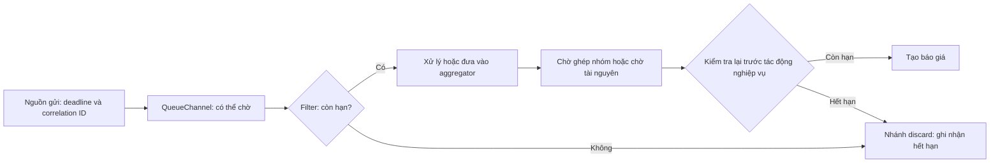

# Discard expired message — Loại bỏ thông điệp hết hạn

## 1. Mục tiêu và bối cảnh

Trong chương **Correlation và state** của **SPRING_INTEGRATION_CORE**, “discard expired message” là việc nhận diện thông điệp đã hết giá trị xử lý và đưa nó ra khỏi luồng nghiệp vụ. Hành động discard có thể là gửi sang một nhánh ghi nhận, lưu để đối soát hoặc kết thúc xử lý theo chính sách đã xác định.

Sau bài này, bạn có thể:

- Biểu diễn hạn xử lý bằng header `expirationDate` và lọc bằng `UnexpiredMessageSelector`.
- Đặt filter đúng vị trí trong luồng Java DSL, đặc biệt sau thời gian chờ ở channel.
- Phân biệt hạn của một message, timeout của nhóm và thời gian giữ metadata của nhóm.
- Xử lý message đến muộn, lỗi kỹ thuật và tình huống retry mà không vô tình kéo dài hạn.
- Thiết kế kiểm thử cho mốc thời gian, nhánh discard và state sau khi nhóm kết thúc.

Ví dụ xuyên suốt: hệ thống báo giá cần ghép phản hồi từ ba nguồn **giá**, **tồn kho** và **vận chuyển**. Người dùng chỉ chấp nhận báo giá trong năm giây. Một phản hồi đến sau hạn không còn được dùng để tạo báo giá, dù nội dung phản hồi hoàn toàn hợp lệ.

Các ví dụ dùng Java 17 trở lên, Spring Integration Core và Java DSL với các API có trong Spring Integration 6.x. Kiểm thử minh họa dùng JUnit Jupiter. Ứng dụng cần có dependency `org.springframework.integration:spring-integration-core` và quản lý phiên bản tương thích với Spring Framework hoặc BOM của Spring Boot đang sử dụng.

## 2. Xác định chính xác điều gì hết hạn

Đừng dùng một giá trị “timeout” duy nhất để giải quyết mọi vòng đời.

| Khái niệm | Câu hỏi cần trả lời | Cơ chế thường dùng |
|---|---|---|
| Hạn của message | Phản hồi này còn giá trị nghiệp vụ lúc được xử lý không? | Header `expirationDate` và filter |
| Timeout của nhóm | Đã chờ đủ lâu mà vẫn chưa có đủ các phần chưa? | `groupTimeout` hoặc cơ chế hết hạn nhóm |
| Thời gian giữ state | Cần nhớ nhóm đã kết thúc bao lâu để chặn message đến muộn? | Metadata trong `MessageGroupStore` và chính sách dọn dẹp |
| Timeout chờ reply | Bên gọi còn chờ kết quả bao lâu? | Cấu hình gateway hoặc cơ chế chờ của bên gọi |
| TTL tại broker | Broker giữ bản tin chưa được tiêu thụ bao lâu? | Cấu hình và ngữ nghĩa của broker, adapter tương ứng |

Đây là các lớp chính sách độc lập. Trong thiết kế báo giá, bên gọi ngừng chờ không tự động chứng minh rằng mọi bước xử lý phía sau đã bị hủy. Tương tự, việc gán header hết hạn không tạo ra một tiến trình tự quét và xóa message trong mọi channel.

Một message có thể hết hạn trong khi nhóm của nó vẫn đang chờ. Ngược lại, nhóm có thể bị timeout vì thiếu một nguồn phản hồi, dù những message đã nhận vẫn còn hạn riêng.

### Ví dụ theo dòng thời gian

Giả sử tất cả phản hồi của yêu cầu `Q-81:attempt-1` có deadline chung `D = t0 + 5 giây`:

| Thời điểm | Sự kiện | Quyết định mong muốn |
|---|---|---|
| `t0` | Gửi yêu cầu lấy báo giá | Gắn cùng deadline và mã lần yêu cầu |
| `t0 + 1 giây` | Nhận phản hồi giá | Đưa vào nhóm |
| `t0 + 2 giây` | Nhận phản hồi tồn kho | Đưa vào nhóm |
| `t0 + 5 giây` | Chạm deadline nghiệp vụ | Không tạo báo giá mới từ kết quả quá hạn |
| `t0 + 7 giây` | Nhận phản hồi vận chuyển | Đưa vào nhánh message hết hạn |

Nếu aggregator chỉ dùng `groupTimeout(5000)`, timeout được tính lại khi có message mới mà nhóm chưa được release. Sau phản hồi tại `t0 + 2 giây`, tác vụ timeout có thể được đặt tới khoảng `t0 + 7 giây`. Vì vậy timeout không hoạt động như deadline tuyệt đối `t0 + 5 giây`. Đây là khác biệt được mô tả trong [cơ chế timeout của aggregator](https://docs.spring.io/spring-integration/reference/aggregator.html#aggregator-and-group-timeout).

## 3. Hợp đồng của header expirationDate

Spring Integration cung cấp hằng `IntegrationMessageHeaderAccessor.EXPIRATION_DATE`. Accessor tương ứng đọc giá trị dưới dạng `Long`; ứng dụng nên dùng hằng thay vì tự gõ tên header. Xem [IntegrationMessageHeaderAccessor](https://docs.spring.io/spring-integration/api/org/springframework/integration/IntegrationMessageHeaderAccessor.html).

Quy ước sử dụng trong bài:

- Giá trị là một **mốc thời gian tuyệt đối**, tính bằng mili giây từ Unix epoch.
- `5000L` chỉ là năm nghìn mili giây sau Unix epoch; nó không có nghĩa “còn năm giây”.
- Với deadline `D` và thời điểm kiểm tra `t`, chỉ chấp nhận khi `t < D`.
- Khi `t == D`, message đã hết hạn.

Tạo một message có hạn năm giây:

```java
import java.time.Clock;

import org.springframework.integration.IntegrationMessageHeaderAccessor;
import org.springframework.messaging.Message;
import org.springframework.messaging.support.MessageBuilder;

Clock clock = Clock.systemUTC();
long deadline = Math.addExact(clock.millis(), 5_000L);

Message<String> request = MessageBuilder.withPayload("Lấy báo giá cho đơn O-81")
        .setHeader(IntegrationMessageHeaderAccessor.CORRELATION_ID, "Q-81:attempt-1")
        .setHeader(IntegrationMessageHeaderAccessor.EXPIRATION_DATE, deadline)
        .build();
```

Deadline nên được xác lập tại ranh giới tiếp nhận yêu cầu nghiệp vụ, rồi truyền xuyên suốt những nhánh có liên quan. Nếu yêu cầu phải hoàn tất trong năm giây kể từ lúc tiếp nhận, từng service không được tự cấp thêm năm giây khi nhận message.

Ở ranh giới HTTP, JSON hoặc broker, cần chuẩn hóa kiểu dữ liệu. Chuỗi `"1790000000000"`, đối tượng `Instant` và số nguyên `Long` không phải cùng một hợp đồng header. Trường hợp sai kiểu cần được xử lý như dữ liệu đầu vào không hợp lệ; không nên mặc nhiên tính vào số message đã hết hạn.

### Hành vi của UnexpiredMessageSelector

`UnexpiredMessageSelector` chấp nhận message nếu deadline còn ở tương lai; **thiếu header hết hạn thì message được chấp nhận**. Selector sử dụng đồng hồ hệ thống khi kiểm tra. Đây là hành vi của [selector có sẵn](https://docs.spring.io/spring-integration/docs/current/api/org/springframework/integration/selector/UnexpiredMessageSelector.html) và [mã nguồn triển khai](https://raw.githubusercontent.com/spring-projects/spring-integration/main/spring-integration-core/src/main/java/org/springframework/integration/selector/UnexpiredMessageSelector.java).

Do đó, hãy quyết định trước chính sách khi thiếu deadline:

| Chính sách | Khi nào phù hợp? | Cách triển khai |
|---|---|---|
| Cho phép không có hạn | Có loại message thực sự không hết hạn | Dùng selector có sẵn |
| Bắt buộc phải có hạn | Mọi phản hồi báo giá phải thuộc một cửa sổ xử lý | Xác thực tại đầu vào hoặc dùng selector riêng |
| Gán hạn mặc định | Hệ thống có quy ước rõ cho nguồn chưa cung cấp deadline | Gán một lần tại ranh giới tiếp nhận |

Nếu bên gửi không đáng tin cậy, ranh giới tiếp nhận còn phải kiểm tra deadline tối đa cho phép. Một deadline quá xa có thể làm thông điệp cũ tồn tại lâu hơn chính sách nghiệp vụ.

## 4. Thiết kế luồng lọc sau thời gian chờ

`UnexpiredMessageSelector` chỉ trả về quyết định; `MessageFilter` là endpoint thực thi quyết định đó. Filter chuyển message được chấp nhận sang bước tiếp theo và chuyển message bị từ chối sang `discardChannel` nếu đã cấu hình. Xem [Message Filter](https://docs.spring.io/spring-integration/reference/filter.html).



Vị trí filter quyết định nó bảo vệ được giai đoạn nào:

1. Filter trước queue giảm dữ liệu không hợp lệ đi vào hàng chờ.
2. Filter sau queue phát hiện message đã hết hạn trong lúc chờ.
3. Kiểm tra sau aggregator hoặc ngay trước gọi dịch vụ bên ngoài bảo vệ bước tạo tác động nghiệp vụ.

Chỉ kiểm tra tại bước đầu sẽ bỏ sót message hết hạn trong queue, trong message store hoặc khi chờ một tài nguyên khác. Chỉ kiểm tra tại bước cuối có thể tiêu tốn tài nguyên không cần thiết cho message vốn đã hết hạn từ đầu.

Filter không thu hồi một HTTP request đã gửi và không rollback một thay đổi đã commit. Nếu yêu cầu là “không được ghi nhận báo giá sau deadline”, bước ghi dữ liệu phải thực thi điều kiện đó tại nơi quyết định cập nhật, cùng với chính sách nhất quán và idempotency phù hợp.

## 5. Ví dụ Java DSL hoàn chỉnh: QueueChannel và nhánh discard

Cấu hình sau minh họa một ranh giới xử lý: message được lấy khỏi `quoteInbox` rồi mới kiểm tra hạn. Hai output queue giúp quan sát kết quả mà chưa cần tích hợp hệ thống bên ngoài.

```java
import org.springframework.context.annotation.Bean;
import org.springframework.context.annotation.Configuration;
import org.springframework.integration.channel.QueueChannel;
import org.springframework.integration.config.EnableIntegration;
import org.springframework.integration.dsl.IntegrationFlow;
import org.springframework.integration.dsl.Pollers;
import org.springframework.integration.selector.UnexpiredMessageSelector;

@Configuration
@EnableIntegration
public class ExpiredQuoteFlowConfig {

    @Bean
    public QueueChannel quoteInbox() {
        return new QueueChannel(100);
    }

    @Bean
    public QueueChannel acceptedQuotes() {
        return new QueueChannel();
    }

    @Bean
    public QueueChannel expiredQuotes() {
        return new QueueChannel();
    }

    @Bean
    public IntegrationFlow discardExpiredQuotesFlow() {
        return IntegrationFlow.from(quoteInbox())
                .filter(new UnexpiredMessageSelector(), endpoint -> endpoint
                        .poller(Pollers.fixedDelay(100).maxMessagesPerPoll(50))
                        .discardChannel(expiredQuotes())
                        .throwExceptionOnRejection(false))
                .channel(acceptedQuotes())
                .get();
    }
}
```

Những điểm cần hiểu:

- `quoteInbox` là channel có thể poll, nên endpoint đầu tiên cần poller.
- Hạn được kiểm tra khi endpoint xử lý message, sau khi message rời queue.
- `throwExceptionOnRejection(false)` biểu diễn việc hết hạn là một kết quả nghiệp vụ được dự kiến.
- `expiredQuotes` chứa message bị từ chối; filter không tự thay payload thành exception.
- `acceptedQuotes` chỉ chứng minh message còn hạn tại filter, chưa chứng minh nghiệp vụ đã hoàn tất.
- Hai queue đầu ra không giới hạn dung lượng chỉ phục vụ ví dụ; luồng thực tế cần consumer và chính sách dung lượng phù hợp.

Các tùy chọn `discardChannel`, `throwExceptionOnRejection` và cấu hình endpoint được cung cấp qua [FilterEndpointSpec](https://docs.spring.io/spring-integration/api/org/springframework/integration/dsl/FilterEndpointSpec.html).

Gửi một phản hồi đã hết hạn:

```java
Message<String> lateQuote = MessageBuilder.withPayload("Giá cũ: 120000")
        .setHeader(IntegrationMessageHeaderAccessor.CORRELATION_ID, "Q-81:attempt-1")
        .setHeader(
                IntegrationMessageHeaderAccessor.EXPIRATION_DATE,
                System.currentTimeMillis() - 60_000L)
        .build();

boolean enqueued = quoteInbox.send(lateQuote, 1_000L);
```

Trong đoạn trên, `quoteInbox` là bean `QueueChannel` đã được inject hoặc lấy từ application context. `enqueued == true` nghĩa là message được nhận vào queue. Quyết định đưa sang `acceptedQuotes` hay `expiredQuotes` được thực hiện sau đó.

## 6. Discard, error và phản hồi cho bên gọi

Cần định nghĩa rõ hợp đồng của từng nhánh:

| Nhánh | Dữ liệu điển hình | Mục đích |
|---|---|---|
| `expiredQuotes` | Message gốc đã hết hạn | Đếm, ghi nhận, đối soát |
| `errorChannel` | `ErrorMessage` chứa lỗi xử lý | Giám sát và xử lý lỗi kỹ thuật |
| Reply của gateway | Kết quả theo hợp đồng gọi | Trả lời bên gọi về kết quả nghiệp vụ |

Message hết hạn không tự động trở thành `ErrorMessage`. Nếu bật `throwExceptionOnRejection(true)`, filter có thể ném `MessageRejectedException`. Với đồng thời một discard channel, message được gửi sang discard trước rồi exception vẫn được ném; cần tránh cấu hình này nếu hệ thống retry mọi exception. Hành vi được nêu trong [MessageFilter](https://raw.githubusercontent.com/spring-projects/spring-integration/v6.5.0/spring-integration-core/src/main/java/org/springframework/integration/filter/MessageFilter.java).

Với xử lý đồng bộ trên `DirectChannel`, exception thường quay về luồng gọi. Với xử lý qua poller, exception phải được xử lý trong cơ chế lỗi bất đồng bộ tương ứng; không thể trông chờ lệnh `send()` trước đó bắt được lỗi phát sinh sau này. Xem [Error Handling](https://docs.spring.io/spring-integration/reference/error-handling.html).

Nếu gateway chờ reply, đưa message vào một discard channel độc lập không tự tạo reply cho gateway. Với API báo giá, nên thiết kế kết quả như `QUOTE_EXPIRED` hoặc trạng thái hết hạn trong một kênh truy vấn; bên gọi cần biết cách nhận kết quả đó. Timeout chờ reply chỉ giải quyết thời gian chờ của bên gọi.

Khi làm việc với broker, việc filter từ chối message cũng không tự xác định ACK, NACK hay requeue. Hành vi này phụ thuộc adapter, transaction và cấu hình listener. Cần kiểm tra hợp đồng của đầu nối đang dùng trước khi gắn retry hay dead-letter vào nhánh hết hạn.

## 7. Kết hợp với aggregator: hết hạn message và hết hạn nhóm

Một filter trước aggregator chỉ kiểm tra các message đi qua nó. Nó không duyệt lại từng message đang nằm trong `MessageGroupStore` khi thời gian trôi qua.

Hệ quả trong ví dụ báo giá:

1. Phản hồi giá và tồn kho còn hạn được lưu vào nhóm.
2. Phản hồi vận chuyển đến sau deadline và bị filter loại.
3. Nhóm thiếu phần vận chuyển sẽ không đủ điều kiện release.
4. Cần cơ chế kết thúc nhóm để giải phóng các phần đã giữ.
5. Nếu có đủ ba phần nhưng tác vụ sau aggregator chạy quá muộn, vẫn cần kiểm tra deadline đầu ra.

Các tùy chọn chính có vai trò khác nhau:

| Tùy chọn | Vai trò |
|---|---|
| `groupTimeout(...)` | Lập lịch xử lý nhóm đang chờ |
| `sendPartialResultOnExpiry(false)` | Khi nhóm hết thời gian mà vẫn không được release, không phát kết quả từng phần |
| `discardChannel(...)` | Nhận dữ liệu bị loại của endpoint tương quan |
| `expireGroupsUponCompletion(false)` | Giữ metadata sau khi hoàn tất thông thường |
| `expireGroupsUponTimeout(false)` | Giữ metadata sau khi kết thúc vì timeout |
| `minimumTimeoutForEmptyGroups(...)` | Đặt ngưỡng tối thiểu trước khi xóa metadata nhóm rỗng |

Các tên phương thức Java DSL có thể tra trong [CorrelationHandlerSpec](https://docs.spring.io/spring-integration/api/org/springframework/integration/dsl/CorrelationHandlerSpec.html). Hai cờ `expireGroupsUpon...` điều khiển xóa nhóm, không đại diện cho deadline của từng message.

Đoạn cấu hình sau có thể **bổ sung vào `ExpiredQuoteFlowConfig`** ở phần trước. Cần thêm import `org.springframework.integration.channel.DirectChannel` và `org.springframework.integration.store.SimpleMessageStore`.

```java
@Bean
public DirectChannel quoteParts() {
    return new DirectChannel();
}

@Bean
public QueueChannel rejectedQuoteGroups() {
    return new QueueChannel();
}

@Bean
public QueueChannel completeQuoteGroups() {
    return new QueueChannel();
}

@Bean
public SimpleMessageStore quoteGroupStore() {
    return new SimpleMessageStore();
}

@Bean
public IntegrationFlow collectQuotePartsFlow() {
    return IntegrationFlow.from(quoteParts())
            .filter(new UnexpiredMessageSelector(), endpoint -> endpoint
                    .discardChannel(expiredQuotes())
                    .throwExceptionOnRejection(false))
            .aggregate(aggregator -> aggregator
                    .messageStore(quoteGroupStore())
                    .groupTimeout(5_000L)
                    .sendPartialResultOnExpiry(false)
                    .expireGroupsUponCompletion(false)
                    .expireGroupsUponTimeout(false)
                    .minimumTimeoutForEmptyGroups(60_000L)
                    .discardChannel(rejectedQuoteGroups()))
            .channel(completeQuoteGroups())
            .get();
}
```

Đầu vào của ví dụ dùng hợp đồng sequence mặc định:

- Ba phần của một lần yêu cầu có cùng `CORRELATION_ID`.
- Mỗi phần có `SEQUENCE_NUMBER` phù hợp và `SEQUENCE_SIZE = 3`.
- Các phần dùng chung một deadline nghiệp vụ.
- Nguồn gửi hoặc bước trước aggregator đã xử lý trùng lặp theo hợp đồng nghiệp vụ; correlation không thay thế cơ chế idempotency.

Ví dụ tạo phần phản hồi thứ nhất:

```java
Message<String> pricePart = MessageBuilder.withPayload("price=120000")
        .setHeader(IntegrationMessageHeaderAccessor.CORRELATION_ID, "Q-81:attempt-1")
        .setHeader(IntegrationMessageHeaderAccessor.SEQUENCE_NUMBER, 1)
        .setHeader(IntegrationMessageHeaderAccessor.SEQUENCE_SIZE, 3)
        .setHeader(IntegrationMessageHeaderAccessor.EXPIRATION_DATE, deadline)
        .build();
```

Ví dụ aggregator này dùng timeout khi không có phần mới trong năm giây. Nó minh họa dọn nhóm và chặn message đến muộn; nó chưa thực thi đầy đủ deadline tuyệt đối của báo giá.

Nếu muốn kết thúc nhóm theo deadline chung, có thể dùng timeout expression được tính từ deadline và thời điểm hiện tại. Phải xử lý rõ trường hợp deadline đã qua; không truyền tùy tiện giá trị âm vì ý nghĩa lập lịch có thể khác với “hết hạn ngay”. Dù tác vụ được lập lịch theo deadline, kiểm tra ngay trước tác động nghiệp vụ vẫn cần thiết vì scheduler có thể chạy trễ.

Ngoài ra, khi timeout chạy, release strategy có thể được đánh giá lại trước khi framework chọn nhánh hết hạn. Vì vậy `sendPartialResultOnExpiry(false)` không nên được hiểu là “mọi lần tác vụ timeout chạy đều bắt buộc discard”.

## 8. Giữ state để chặn message đến muộn

Xét hai tình huống:

- Nhóm đã ghép đủ và phát báo giá; một bản sao của phần phản hồi đến sau đó.
- Nhóm đã timeout; một nguồn phản hồi rất chậm gửi kết quả tới.

Trong cả hai trường hợp, nhận lại cùng correlation key không nên vô tình mở một vòng báo giá mới.

State cần phân biệt:

```text
Nhóm đang mở
    ├── đủ phần → hoàn tất → giữ metadata đã kết thúc
    └── hết thời gian → discard → giữ metadata đã kết thúc

Message đến cùng key trong thời gian giữ metadata
    └── bị loại thay vì tạo nhóm mới

Metadata đã bị xóa
    └── endpoint không còn dấu vết cũ để chặn bằng state nhóm
```

Giữ metadata giống như giữ một “dấu đã kết thúc”. Xóa cả nhóm sẽ giải phóng tài nguyên, nhưng đồng thời bỏ dấu này. Nếu sau đó một message còn vượt qua được filter đầu vào, nó có thể tạo nhóm mới.

Trong cấu hình ví dụ:

- Message đã hết deadline bị chặn tại filter và vào `expiredQuotes`.
- Message còn hạn nhưng thuộc nhóm đã kết thúc đi tới aggregator rồi vào `rejectedQuoteGroups`.
- Các phần còn giữ khi nhóm timeout cũng đi vào `rejectedQuoteGroups` theo cấu hình discard.

Vì vậy, **không gắn nhãn mọi message của discard channel ở aggregator là “message hết hạn riêng”**. Chúng có thể bị loại do nhóm đã hoàn tất hoặc do cả nhóm bị timeout.

Nên dùng correlation key chứa định danh lần yêu cầu, chẳng hạn `orderId + ":" + attemptId`. Một yêu cầu báo giá mới cho cùng đơn hàng phải có lần yêu cầu mới; nếu chỉ dùng `orderId`, metadata cũ có thể chặn cả công việc mới hợp lệ.

Khi có nhiều instance hoặc cần khôi phục sau restart, ví dụ `SimpleMessageStore` trong bộ nhớ không đủ. Cần lựa chọn store bền vững, định tuyến hoặc khóa tương thích với mô hình triển khai và cơ chế khôi phục nhóm. Không giả định dữ liệu được lưu bền đồng nghĩa mọi tác vụ timeout trong bộ nhớ được phục hồi tự động.

## 9. Dọn state bằng MessageGroupStoreReaper

Giữ metadata mãi mãi có thể làm message store tăng liên tục. Cần một chính sách dọn state có giới hạn nhưng đủ dài để bao phủ độ trễ và khả năng phát lại của nguồn.

`MessageGroupStoreReaper` là thành phần `Runnable` yêu cầu store xử lý các nhóm đã đủ điều kiện hết hạn. Chỉ khai báo bean không thay thế việc lập lịch gọi `run()`. API có constructor nhận store và thuộc tính timeout theo mili giây; xem [MessageGroupStoreReaper](https://docs.spring.io/spring-integration/api/org/springframework/integration/store/MessageGroupStoreReaper.html).

Ví dụ bổ sung vào cấu hình aggregator ở trên:

```java
// Thêm @EnableScheduling cho lớp cấu hình.
// Import:
// org.springframework.integration.store.MessageGroupStoreReaper
// org.springframework.scheduling.annotation.EnableScheduling
// org.springframework.scheduling.annotation.Scheduled

@Bean
public MessageGroupStoreReaper quoteGroupReaper() {
    MessageGroupStoreReaper reaper =
            new MessageGroupStoreReaper(quoteGroupStore());
    reaper.setTimeout(120_000L);
    return reaper;
}

@Scheduled(fixedDelay = 10_000L)
public void reapQuoteGroups() {
    quoteGroupReaper().run();
}
```

Ở đây `groupTimeout` xử lý nhóm đang chờ trong điều kiện thông thường. Reaper bổ sung việc dọn các nhóm đủ cũ; `minimumTimeoutForEmptyGroups` bảo vệ một khoảng giữ metadata tối thiểu. Mốc xóa thực tế phụ thuộc tiêu chí chọn nhóm của store, thời gian sửa nhóm, ngưỡng cấu hình và lịch quét. Không diễn giải `60_000L` thành cam kết “xóa chính xác sau 60 giây”.

Các quyết định vận hành cần xác định:

- Nguồn có thể gửi chậm hoặc phát lại tối đa bao lâu?
- Sau restart, hệ thống còn cần chặn phản hồi của yêu cầu cũ không?
- Yêu cầu mới có correlation key khác yêu cầu cũ không?
- Nếu metadata đã bị xóa, deadline hoặc kho trạng thái nghiệp vụ nào tiếp tục chặn kết quả cũ?
- Scheduler và nhánh discard xử lý thế nào khi lỗi ghi log, ghi audit hoặc gửi message?

Store dùng cho callback hết hạn cần được dành riêng cho endpoint tương quan theo thiết kế; không dùng tùy tiện cùng một instance store cho nhiều aggregator rồi để một reaper xử lý lẫn các nhóm.

Với cấu hình lịch quét riêng, cần chủ động xử lý exception của tác vụ. Nếu muốn chuyển lỗi thành `ErrorMessage`, phải cấu hình cơ chế công bố lỗi tương ứng; một phương thức `@Scheduled` tự nó không bảo đảm gửi lỗi vào `errorChannel`.

## 10. Kiểm thử deadline mà không phụ thuộc Thread.sleep

Selector có sẵn đọc thời gian hệ thống. Khi kiểm thử nó, hãy dùng mốc cách xa hiện tại cho hai trường hợp “đã hết hạn” và “còn hạn”. Để kiểm tra chính xác tại biên `t == D`, có thể viết selector nhỏ cho phép inject `Clock`.

Đây là lựa chọn của ứng dụng để làm chính sách thời gian và chính sách thiếu header rõ ràng:

```java
import java.time.Clock;
import java.util.Objects;

import org.springframework.integration.IntegrationMessageHeaderAccessor;
import org.springframework.integration.core.MessageSelector;
import org.springframework.messaging.Message;

public final class DeadlineSelector implements MessageSelector {

    private final Clock clock;
    private final boolean requireDeadline;

    public DeadlineSelector(Clock clock, boolean requireDeadline) {
        this.clock = Objects.requireNonNull(clock);
        this.requireDeadline = requireDeadline;
    }

    @Override
    public boolean accept(Message<?> message) {
        Object raw = message.getHeaders().get(
                IntegrationMessageHeaderAccessor.EXPIRATION_DATE);

        if (raw == null) {
            return !requireDeadline;
        }
        if (!(raw instanceof Long deadline)) {
            throw new IllegalArgumentException(
                    "expirationDate phải là Long biểu diễn epoch millis");
        }
        return clock.millis() < deadline;
    }
}
```

Để dùng nó trong DSL, thay `new UnexpiredMessageSelector()` bằng `new DeadlineSelector(clock, true)`, với `clock` là dependency của cấu hình. Chính sách `requireDeadline = true` làm message thiếu hạn bị từ chối; nếu cần phân loại riêng lý do “thiếu hạn”, nên xác thực và định tuyến trước filter.

Ví dụ JUnit Jupiter cho chính sách bắt buộc deadline:

```java
import java.time.Clock;
import java.time.Instant;
import java.time.ZoneOffset;

import org.junit.jupiter.api.Test;
import org.springframework.integration.IntegrationMessageHeaderAccessor;
import org.springframework.messaging.Message;
import org.springframework.messaging.support.MessageBuilder;

import static org.junit.jupiter.api.Assertions.*;

class DeadlineSelectorTest {

    private static final long NOW =
            Instant.parse("2026-11-19T03:00:00Z").toEpochMilli();

    private final DeadlineSelector selector = new DeadlineSelector(
            Clock.fixed(Instant.ofEpochMilli(NOW), ZoneOffset.UTC), true);

    @Test
    void acceptsOnlyBeforeDeadline() {
        assertTrue(selector.accept(message(NOW + 1L)));
        assertFalse(selector.accept(message(NOW)));
        assertFalse(selector.accept(message(NOW - 1L)));
    }

    @Test
    void rejectsMissingDeadlineWhenRequired() {
        Message<String> message = MessageBuilder.withPayload("quote").build();
        assertFalse(selector.accept(message));
    }

    @Test
    void treatsInvalidTypeAsInvalidInput() {
        Message<String> invalid = MessageBuilder.withPayload("quote")
                .setHeader(
                        IntegrationMessageHeaderAccessor.EXPIRATION_DATE,
                        "2026-11-19T03:00:00Z")
                .build();

        assertThrows(IllegalArgumentException.class,
                () -> selector.accept(invalid));
    }

    private Message<String> message(long deadline) {
        return MessageBuilder.withPayload("quote")
                .setHeader(
                        IntegrationMessageHeaderAccessor.EXPIRATION_DATE,
                        deadline)
                .build();
    }
}
```

Kiểm thử trên xác minh **chính sách selector tự viết**. Nó không chứng minh cấu hình queue, poller hoặc aggregator đã được nối đúng.

### Kiểm thử nhánh discard trong cấu hình thực

Kiểm thử sau khởi tạo cấu hình ở phần 5, gửi một message chắc chắn đã hết hạn và chờ nhánh discard bằng API `receive(timeout)`:

```java
import org.junit.jupiter.api.Test;
import org.springframework.context.annotation.AnnotationConfigApplicationContext;
import org.springframework.integration.IntegrationMessageHeaderAccessor;
import org.springframework.integration.channel.QueueChannel;
import org.springframework.messaging.Message;
import org.springframework.messaging.support.MessageBuilder;

import static org.junit.jupiter.api.Assertions.*;

class ExpiredQuoteFlowTest {

    @Test
    void expiredQuoteGoesToDiscardChannel() {
        try (var context = new AnnotationConfigApplicationContext(
                ExpiredQuoteFlowConfig.class)) {

            QueueChannel inbox =
                    context.getBean("quoteInbox", QueueChannel.class);
            QueueChannel accepted =
                    context.getBean("acceptedQuotes", QueueChannel.class);
            QueueChannel expired =
                    context.getBean("expiredQuotes", QueueChannel.class);

            Message<String> input = MessageBuilder.withPayload("old quote")
                    .setHeader(
                            IntegrationMessageHeaderAccessor.EXPIRATION_DATE,
                            System.currentTimeMillis() - 60_000L)
                    .build();

            assertTrue(inbox.send(input, 1_000L));

            Message<?> discarded = expired.receive(2_000L);
            assertNotNull(discarded);
            assertEquals(input.getHeaders().getId(),
                    discarded.getHeaders().getId());
            assertNull(accepted.receive(0L));
        }
    }
}
```

`receive(2_000L)` là giới hạn chờ cho tác vụ bất đồng bộ, không phải cách tạo message hết hạn. Deadline đã ở quá khứ trước khi gửi nên bài kiểm thử không cần `Thread.sleep` để thay đổi quyết định.

Các tình huống tích hợp nên bao phủ thêm:

| Tình huống | Kết quả cần xác minh |
|---|---|
| Message có deadline còn xa | Đến nhánh xử lý, không đến discard |
| Thiếu deadline với selector có sẵn | Được chấp nhận theo hợp đồng mặc định |
| Message còn hạn lúc gửi nhưng hết hạn lúc được poll | Bị loại sau queue |
| Nhóm thiếu một phần | Timeout không phát báo giá từng phần nếu chính sách cấm |
| Message còn hạn đến sau khi nhóm đã kết thúc | Bị aggregator loại nhờ metadata |
| Metadata đã được dọn | Không còn dựa vào dấu nhóm để chặn; kiểm tra deadline và state nghiệp vụ |
| Gửi lại cùng message | Deadline giữ nguyên, không được cấp thêm hạn |

Để kiểm thử message hết hạn trong queue bằng selector có `Clock`, giữ endpoint chưa chạy, đưa message vào queue, điều khiển clock của bài kiểm thử sang sau deadline rồi mới cho endpoint xử lý. Cách này kiểm tra đúng vị trí của filter mà không cần chờ thời gian thực.

## 11. Retry, đồng hồ và quan sát hệ thống

### Không gia hạn bằng retry

Retry một message cũ cần giữ nguyên deadline nghiệp vụ ban đầu. Mỗi lần xử lý lại có thể tính:

```text
remainingBudget = deadline - currentTime
```

Nếu ngân sách đã hết, chuyển sang kết quả hết hạn. Nếu ngân sách còn quá ít cho một lần gọi tiếp theo, chính sách có thể từ chối sớm hoặc giảm timeout của lời gọi đó. Không đặt lại `expirationDate = now + 5000` ở mỗi lần retry.

Nếu người dùng chủ động tạo yêu cầu mới, đó là một lần yêu cầu mới với deadline và correlation key mới. Cần phân biệt trường hợp này với việc hệ thống tự phát lại message của lần cũ.

### Đồng bộ đồng hồ

Deadline tuyệt đối được so sánh với đồng hồ của nơi xử lý. Chênh lệch đồng hồ giữa các máy có thể khiến bên nhận từ chối sớm hoặc chấp nhận muộn so với ý định của bên gửi.

Thiết kế nên có đồng bộ thời gian và quy ước rõ về sai lệch cho phép. Nếu áp dụng khoảng dung sai, cần coi nó là một phần của hợp đồng nghiệp vụ. `Clock` giúp kiểm thử chính sách; nó không tự giải quyết đồng bộ đồng hồ giữa các máy.

### Ghi nhận đủ để giải thích quyết định

Nhánh discard nên lưu những thông tin cần thiết:

| Thuộc tính | Giá trị phục vụ vận hành |
|---|---|
| Message ID | Tra cứu lần xử lý cụ thể |
| Correlation key và attempt ID | Xác định nhóm, phân biệt lần yêu cầu |
| Deadline và thời điểm loại | Tính độ trễ so với hạn |
| Endpoint quyết định | Biết message hết hạn sau queue hay sau ghép nhóm |
| Lý do | Phân biệt `MESSAGE_EXPIRED`, `GROUP_TIMEOUT`, `LATE_AFTER_COMPLETION` |

Các mã lý do trên là quy ước ứng dụng đề xuất, không phải header do filter hoặc aggregator tự thêm. Nếu một discard channel nhận nhiều nguyên nhân, cần bổ sung cách xác định nguyên nhân tại nơi ra quyết định hoặc tách nhánh phù hợp.

Có thể theo dõi số message hết hạn, số nhóm timeout, số phản hồi đến muộn và kích thước state còn giữ. Không dùng correlation ID riêng lẻ làm nhãn metric vì số lượng nhãn có thể tăng không giới hạn; giữ định danh chi tiết trong log hoặc trace.

Nhánh audit cũng cần consumer, giới hạn lưu trữ và xử lý lỗi. Đưa message sang một queue trong bộ nhớ không tạo ra bảo đảm lưu bền cho đối soát.

## 12. Lỗi thường gặp và cách sửa

| Lỗi | Hệ quả | Cách sửa |
|---|---|---|
| Gán `expirationDate = 5000L` | Message đã hết hạn từ lâu | Tính epoch millis của deadline |
| Dùng chuỗi hoặc đơn vị giây | Sai kiểu hoặc sai mốc hạn | Chuẩn hóa `Long` theo mili giây tại đầu vào |
| Chỉ gắn header | Message vẫn có thể tiếp tục qua các bước không kiểm tra hạn | Thêm filter tại ranh giới xử lý cần bảo vệ |
| Chỉ lọc trước queue | Message hết hạn khi chờ vẫn được dùng | Kiểm tra sau queue |
| Dùng `groupTimeout` làm deadline tuyệt đối | Nhóm có thể tiếp tục chờ sau hạn nghiệp vụ | Dùng deadline độc lập và lịch kết thúc nhóm phù hợp |
| Lọc một phần nhưng không dọn nhóm | Aggregator giữ các phần còn lại vô thời hạn | Thêm cơ chế kết thúc và dọn state |
| Xóa metadata ngay rồi chỉ dựa vào correlation | Message đến muộn có thể mở nhóm mới | Giữ dấu kết thúc đủ lâu, dùng attempt ID và kiểm tra deadline |
| Giữ metadata mãi | Store tăng liên tục | Có chính sách retention và tác vụ dọn |
| Đưa hết hạn vào retry vô hạn | Tăng tải nhưng không phục hồi giá trị nghiệp vụ | Kết thúc theo chính sách hết hạn |
| Tự gia hạn ở từng service | Yêu cầu sống lâu hơn hợp đồng ban đầu | Truyền deadline xuyên suốt |
| Coi discard là reply của gateway | Bên gọi vẫn có thể chờ tới timeout | Thiết kế hợp đồng phản hồi rõ ràng |

## 13. Thực hành thiết kế

Với luồng lấy ba phần báo giá trong năm giây, hãy triển khai theo trình tự:

1. Tại đầu vào, xác lập deadline chung và correlation key cho từng lần yêu cầu.
2. Truyền deadline qua các nhánh lấy giá, tồn kho và vận chuyển.
3. Lọc các phản hồi hết hạn sau các ranh giới có thể chờ.
4. Ghép nhóm theo correlation key; xác định chính sách đủ phần, thiếu phần và trùng lặp.
5. Kết thúc nhóm chờ quá lâu; giữ metadata đủ để nhận diện phản hồi đến muộn.
6. Kiểm tra deadline trước khi ghi nhận hoặc gửi báo giá cuối cùng.
7. Ghi nhận lý do discard và dọn state theo chính sách retention.
8. Kiểm thử riêng quyết định thời gian, đường đi qua channel và vòng đời nhóm.

Một chính sách hoàn chỉnh phải trả lời được: message còn hạn khi nào, nhóm kết thúc theo điều kiện nào, dấu kết thúc được giữ bao lâu và bên gọi nhận kết quả hết hạn bằng cách nào. Khi bốn câu trả lời này nhất quán, luồng Spring Integration có thể loại dữ liệu cũ mà vẫn kiểm soát được correlation, state và khả năng quan sát.
