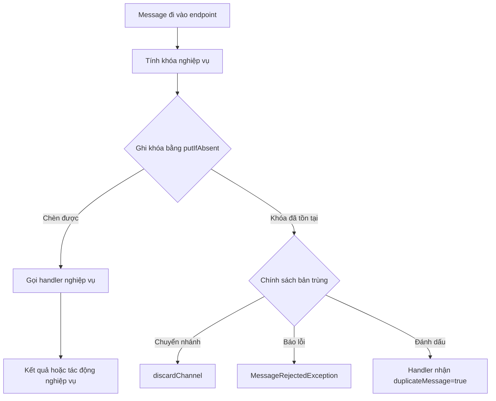

# Idempotent receiver

## 1. Mục tiêu và bối cảnh

Trong chương **Correlation và state** của module **SPRING_INTEGRATION_CORE**, bài học này trình bày cách thiết kế phía nhận thông điệp để việc giao lại cùng một yêu cầu không tạo thêm tác động nghiệp vụ. Nội dung nối các thành phần `Message`, `MessageChannel`, endpoint và Java DSL với một mẫu tích hợp doanh nghiệp có trạng thái: **Idempotent Receiver**.

Sau bài học, bạn có thể:

- Phân biệt thông điệp được giao nhiều lần với nghiệp vụ được thực hiện nhiều lần.
- Thiết kế khóa chống trùng theo sự kiện, tenant và consumer.
- Gắn `IdempotentReceiverInterceptor` vào endpoint bằng Java DSL.
- Chọn cách xử lý bản trùng: bỏ qua, chuyển nhánh hoặc tiếp tục với cờ nhận diện.
- Giải thích vì sao lưu khóa chống trùng chưa đồng nghĩa nghiệp vụ đã thành công.
- Thiết kế lưu trạng thái bền vững, ranh giới transaction và kiểm thử tình huống lỗi.

Bạn nên biết cách tạo `IntegrationFlow`, dùng `DirectChannel`, đọc payload/header và gọi service activator. Ví dụ sử dụng Java 17 trở lên và API của Spring Integration 6.x trở lên; phiên bản thư viện cần đồng bộ theo BOM của ứng dụng. Các đoạn SQL PostgreSQL được ghi rõ ở phần tương ứng.

## 2. Vì sao phía nhận cần có tính lũy đẳng?

Giả sử dịch vụ bán hàng phát sự kiện `OrderPlaced`, còn dịch vụ báo cáo cộng giá trị đơn hàng vào tổng doanh thu. Một sự kiện mang số tiền 500.000 đồng chỉ được cộng một lần.

Kịch bản thường gặp:

1. Consumer nhận sự kiện `evt-1001` và cập nhật báo cáo thành công.
2. Kết nối bị ngắt trước khi phía gửi hoặc broker nhận xác nhận.
3. Sự kiện `evt-1001` được giao lại.
4. Nếu consumer tiếp tục cộng 500.000 đồng, báo cáo bị tăng sai.

Retry là cần thiết để phục hồi lỗi tạm thời, nhưng retry cũng làm xuất hiện bản giao lại. Consumer không thể suy ra rằng một thông điệp là mới chỉ vì nó vừa đến.

**Idempotency**, thường gọi là tính lũy đẳng, nghĩa là thực hiện lại cùng một thao tác không làm thay đổi thêm kết quả nghiệp vụ sau lần thực hiện thành công đầu tiên. Với trạng thái `s`, thông điệp `m` và hàm xử lý `F`, có thể mô tả mục tiêu bằng:

```text
F(F(s, m), m) = F(s, m)
```

Công thức chỉ xét tác động nghiệp vụ cần bảo vệ. Hệ thống vẫn có thể ghi thêm log hoặc tăng bộ đếm số lần giao khi nhận bản trùng.

| Thao tác | Khi nhận lại cùng yêu cầu | Nhận xét |
| --- | --- | --- |
| Gán trạng thái đơn hàng thành `CONFIRMED` | Trạng thái vẫn là `CONFIRMED` | Có thể lũy đẳng nếu không kèm tác động phụ khác |
| Cộng thêm số tiền vào tổng doanh thu | Tổng bị tăng thêm | Cần bảo vệ khỏi bản giao lại |
| Gửi email xác nhận | Người dùng có thể nhận hai email | Cần khóa cho tác động gửi email hoặc hỗ trợ từ phía nhà cung cấp |
| Ghi dòng có khóa nghiệp vụ duy nhất | Bản ghi thứ hai có thể bị từ chối | Cần xử lý xung đột thành kết quả nghiệp vụ phù hợp |

Một consumer có khả năng chống trùng không làm broker ngừng giao lại thông điệp. Mục tiêu là kiểm soát tác động của các lần giao đó trong phạm vi trạng thái và thời gian đã thiết kế.

## 3. Phân biệt correlation, identity và khóa chống trùng

Correlation trả lời: **Các thông điệp nào thuộc cùng một quy trình hoặc nhóm?** Khóa chống trùng trả lời: **Thao tác cụ thể này đã được consumer này tiếp nhận hoặc hoàn tất chưa?**

Ví dụ đơn `order-42` có ba sự kiện:

```text
OrderPlaced        eventId=evt-1001, correlationId=order-42
PaymentCaptured    eventId=evt-1002, correlationId=order-42
ShipmentCreated    eventId=evt-1003, correlationId=order-42
```

Nếu dùng riêng `correlationId=order-42` làm khóa cho cả luồng, hai sự kiện hợp lệ phía sau có thể bị coi là trùng.

| Giá trị | Vai trò | Điều cần kiểm tra trước khi dùng chống trùng |
| --- | --- | --- |
| Header `id` của Spring Message | Định danh đối tượng thông điệp | Khi dựng lại message, ID có thể khác dù sự kiện nghiệp vụ không đổi |
| Header `correlationId` | Gom nhóm thông điệp | Một nhóm thường có nhiều thông điệp hợp lệ |
| `orderId` | Định danh đơn hàng | Một đơn có nhiều thao tác và nhiều sự kiện |
| `eventId` do producer cấp | Định danh một sự kiện | Producer phải giữ nguyên qua retry và redelivery |
| Idempotency key của command | Định danh một yêu cầu thực hiện | Client phải tái sử dụng khi gửi lại cùng yêu cầu |
| Hash nội dung | Dấu vân tay dữ liệu | Cần quy tắc chuẩn hóa; dữ liệu giống nhau vẫn có thể là hai thao tác hợp lệ |

### 3.1. Khóa phải bao gồm phạm vi consumer

Một cấu trúc khóa có thể là:

```text
<consumer>:<key-schema-version>:<tenantId>:<eventId>

orders-projection:v1:tenant-a:evt-1001
email-confirmation:v1:tenant-a:evt-1001
```

Cùng một sự kiện có thể vừa cập nhật báo cáo vừa gửi email. Mỗi tác động có phạm vi chống trùng riêng. Chia sẻ một khóa giữa hai consumer có thể khiến consumer đầu tiên ngăn consumer còn lại chạy.

`v1` biểu thị phiên bản quy ước tạo khóa. Thay đổi thành `v2` làm các khóa cũ không còn khớp; vì vậy đây là thay đổi dữ liệu cần kế hoạch chuyển đổi, không phải cách sửa tên tùy ý khi triển khai.

Các thành phần khóa cần được mã hóa để không nhập nhằng. Ví dụ trong bài chỉ cho phép chữ, số, `_` và `-`, nên dấu `:` có thể dùng làm dấu phân cách an toàn. Với ID tự do, dùng encoding hoặc cấu trúc có độ dài từng phần.

### 3.2. Cùng khóa nhưng khác nội dung

Hợp đồng mong muốn là: một `eventId` luôn đại diện cho cùng nội dung nghiệp vụ bất biến. Nếu producer phát lại `evt-1001` nhưng đổi số tiền, đây là xung đột cần điều tra.

Khi cần phát hiện xung đột, lưu thêm dấu vân tay của payload nghiệp vụ đã chuẩn hóa. Khi khóa tồn tại, so sánh dấu vân tay để phân biệt bản giao lại hợp lệ với dữ liệu bất nhất. Không đưa các header thay đổi giữa các lần giao, như timestamp tiếp nhận, vào dấu vân tay.

Chỉ dùng selector mặc định theo sự tồn tại của khóa sẽ không tự thực hiện quy tắc đối chiếu payload này. Hệ thống cần bổ sung logic rõ ràng nếu đó là yêu cầu nghiệp vụ.

## 4. Cơ chế trong Spring Integration

Ba thành phần chính phối hợp với nhau:

| Thành phần | Trách nhiệm |
| --- | --- |
| `IdempotentReceiverInterceptor` | Áp dụng quyết định chống trùng quanh lời gọi handler của endpoint |
| `MetadataStoreSelector` | Tính khóa và quyết định chấp nhận thông điệp dựa trên metadata |
| `ConcurrentMetadataStore` | Cung cấp thao tác cập nhật nguyên tử cho trạng thái khóa |

Đối với selector mặc định theo sự tồn tại của khóa, thao tác quan trọng là `putIfAbsent(key, value)`: chỉ thêm giá trị nếu khóa chưa tồn tại. Giá trị trả về `null` nghĩa là lần gọi đó đã chèn được khóa; giá trị cũ nghĩa là khóa đã có. Giao diện cũng có thao tác thay thế có điều kiện. Xem [hợp đồng ConcurrentMetadataStore](https://docs.spring.io/spring-integration/api/org/springframework/integration/metadata/ConcurrentMetadataStore.html).



Không tự thay cơ chế nguyên tử bằng hai bước `get` rồi `put`:

```text
Worker A: get(key) -> chưa có
Worker B: get(key) -> chưa có
Worker A: xử lý nghiệp vụ
Worker B: xử lý nghiệp vụ
```

Cả hai worker đều quan sát trạng thái cũ và cùng thực hiện thao tác. Khóa Java cục bộ cũng không bảo vệ được hai JVM độc lập; các instance phải thống nhất backend và không gian khóa.

### 4.1. Bản trùng không mặc nhiên bị bỏ

Hành vi cần lựa chọn rõ:

| Cấu hình interceptor | Khi selector từ chối thông điệp |
| --- | --- |
| Không đặt discard channel, cờ ném lỗi là `false` | Tiếp tục vào handler với header `duplicateMessage=true` |
| Có discard channel, cờ ném lỗi là `false` | Gửi sang discard channel, không gọi handler đích |
| Không có discard channel, cờ ném lỗi là `true` | Ném `MessageRejectedException`, không gọi handler đích |
| Có discard channel và cờ ném lỗi là `true` | Chuyển sang discard channel rồi ném lỗi nếu bước gửi hoàn tất |

Để bỏ bản trùng một cách im lặng, có thể dùng `nullChannel`. Nếu chọn tiếp tục vào handler, chính handler phải đọc cờ và bảo vệ tác động nghiệp vụ. Các chế độ này được quy định trong [Javadoc IdempotentReceiverInterceptor](https://docs.spring.io/spring-integration/api/org/springframework/integration/handler/advice/IdempotentReceiverInterceptor.html).

Không nên coi mọi lần giao lại là lỗi cần retry. Nếu bản đầu đã hoàn tất, liên tục ném lỗi với bản trùng có thể tạo vòng giao lại vô ích.

### 4.2. Selector ghi trạng thái trước handler

Với `MetadataStoreSelector`, quyết định chấp nhận thành công đã đồng thời đặt giá trị vào store. Khóa có thể tồn tại trước khi handler chạy xong. Chi tiết này nằm trong [hợp đồng MetadataStoreSelector](https://docs.spring.io/spring-integration/api/org/springframework/integration/selector/MetadataStoreSelector.html).

Vì vậy phải đọc ý nghĩa khóa theo thiết kế thực tế. Trong một store bộ nhớ độc lập với transaction nghiệp vụ, khóa thường chỉ chứng minh **đã giành quyền xử lý**, chưa chứng minh **đã hoàn tất nghiệp vụ**.

## 5. Ví dụ hoàn chỉnh: chặn bản trùng tại endpoint bằng Java DSL

### 5.1. Phạm vi ví dụ

Ví dụ sử dụng:

- `DirectChannel` làm đầu vào đồng bộ.
- `SimpleMetadataStore` giữ khóa trong bộ nhớ.
- `QueueChannel` giữ bản trùng để có thể quan sát trong bài thực hành.
- Một recorder trong bộ nhớ đại diện cho tác động nghiệp vụ.

Cần dependency `org.springframework.integration:spring-integration-core`. Bài kiểm thử bên dưới cần thêm JUnit Jupiter. Java DSL nằm trong thư viện core của các phiên bản được nêu ở đầu bài.

Đây là cấu hình học cơ chế chống trùng trong một tiến trình. `SimpleMetadataStore` mất trạng thái khi application context khởi động lại; việc chọn store bền vững được trình bày ở phần sau. Xem [Metadata Store](https://docs.spring.io/spring-integration/reference/meta-data-store.html).

### 5.2. Cấu hình

Đặt nội dung sau trong một lớp Java khi thực hành trên dự án học:

```java
package demo;

import java.math.BigDecimal;
import java.util.List;
import java.util.Objects;
import java.util.concurrent.CopyOnWriteArrayList;

import org.springframework.beans.factory.annotation.Qualifier;
import org.springframework.context.annotation.Bean;
import org.springframework.context.annotation.Configuration;
import org.springframework.integration.channel.DirectChannel;
import org.springframework.integration.channel.QueueChannel;
import org.springframework.integration.config.EnableIntegration;
import org.springframework.integration.dsl.IntegrationFlow;
import org.springframework.integration.handler.advice.IdempotentReceiverInterceptor;
import org.springframework.integration.metadata.ConcurrentMetadataStore;
import org.springframework.integration.metadata.SimpleMetadataStore;
import org.springframework.integration.selector.MetadataStoreSelector;
import org.springframework.messaging.MessageChannel;

@Configuration
@EnableIntegration
public class IdempotentReceiverLessonConfiguration {

    public record OrderPlaced(
            String tenantId,
            String eventId,
            String orderId,
            BigDecimal amount) {

        public OrderPlaced {
            tenantId = requireToken(tenantId);
            eventId = requireToken(eventId);
            orderId = requireToken(orderId);
            Objects.requireNonNull(amount, "amount");
            if (amount.signum() <= 0) {
                throw new IllegalArgumentException("amount phải dương");
            }
        }
    }

    private static String requireToken(String value) {
        if (value == null || !value.matches("[A-Za-z0-9_-]+")) {
            throw new IllegalArgumentException("ID không hợp lệ: " + value);
        }
        return value;
    }

    @Bean
    public MessageChannel orderEventsInput() {
        return new DirectChannel();
    }

    @Bean
    public QueueChannel orderDuplicates() {
        return new QueueChannel();
    }

    @Bean
    public ConcurrentMetadataStore seenOrderEvents() {
        return new SimpleMetadataStore();
    }

    @Bean
    public IdempotentReceiverInterceptor orderIdempotentAdvice(
            ConcurrentMetadataStore seenOrderEvents,
            @Qualifier("orderDuplicates") MessageChannel duplicates) {

        MetadataStoreSelector selector = new MetadataStoreSelector(
                message -> {
                    OrderPlaced event = (OrderPlaced) message.getPayload();
                    return "orders-projection:v1:"
                            + event.tenantId() + ":" + event.eventId();
                },
                seenOrderEvents);

        IdempotentReceiverInterceptor advice =
                new IdempotentReceiverInterceptor(selector);
        advice.setDiscardChannel(duplicates);
        advice.setThrowExceptionOnRejection(false);
        return advice;
    }

    @Bean
    public OrderRecorder orderRecorder() {
        return new OrderRecorder();
    }

    @Bean
    public IntegrationFlow orderFlow(
            OrderRecorder recorder,
            IdempotentReceiverInterceptor orderIdempotentAdvice) {

        return IntegrationFlow.from("orderEventsInput")
                .handle(OrderPlaced.class, (event, headers) -> {
                    recorder.record(event);
                    return null;
                }, endpoint -> endpoint.advice(orderIdempotentAdvice))
                .get();
    }

    public static class OrderRecorder {

        private final List<OrderPlaced> recorded =
                new CopyOnWriteArrayList<>();

        public void record(OrderPlaced event) {
            recorded.add(event);
        }

        public List<OrderPlaced> snapshot() {
            return List.copyOf(recorded);
        }
    }
}
```

`OrderPlaced` kiểm tra các trường cần thiết trước khi có thao tác nhận khóa. Khi tiếp nhận JSON hoặc thông điệp ngoài hệ thống, đặt bước chuyển đổi và validation tương ứng trước endpoint tạo tác động nghiệp vụ.

Lời gọi `endpoint.advice(...)` gắn interceptor vào endpoint đang xử lý đơn hàng. Đây là cách cấu hình hành vi tại handler trong Java DSL; có thể đối chiếu ví dụ tại [Idempotent Receiver EIP](https://docs.spring.io/spring-integration/reference/7.0/handler-advice/idempotent-receiver.html).

Handler trả `null` vì đây là luồng nhận một chiều. Không có lời hứa sẽ gửi phản hồi cho request-reply gateway.

### 5.3. Diễn tiến khi gửi thông điệp

| Thông điệp đến | Khóa tính được | Kết quả |
| --- | --- | --- |
| `tenant-a`, `evt-1001`, `order-42` | `orders-projection:v1:tenant-a:evt-1001` | Ghi khóa và gọi recorder |
| Giao lại sự kiện trên bằng Spring Message mới | Không đổi | Đi vào `orderDuplicates` |
| `tenant-a`, `evt-1002`, `order-43` | Khóa có `evt-1002` | Được xử lý |
| `tenant-b`, `evt-1001`, `order-42` | Khóa có `tenant-b` | Được xử lý trong phạm vi tenant khác |

Không dùng `headers.id` trong khóa, nên việc dựng lại Spring Message không làm mất khả năng nhận diện bản trùng.

`QueueChannel` ở ví dụ dùng hàng đợi bộ nhớ với dung lượng mặc định rất lớn và không tự tiêu thụ thông điệp. Khi vận hành, cần consumer cho nhánh trùng hoặc một chính sách bỏ qua có chủ đích. Nếu giới hạn dung lượng, cần cả chính sách khi đầy và timeout gửi. Tham khảo [Message Channel Implementations](https://docs.spring.io/spring-integration/reference/channel/implementations.html).

## 6. Lưu state khi khởi động lại và khi có nhiều instance

Chọn backend theo ranh giới cần bảo vệ:

| Cách lưu | Qua restart | Nhiều instance | Điểm cần thiết kế |
| --- | --- | --- | --- |
| `SimpleMetadataStore` riêng từng JVM | Không | Không chia sẻ trạng thái | Phù hợp minh họa và thử nghiệm cục bộ |
| Store bền vững dùng chung | Theo cấu hình backend | Có thể phối hợp | Tính nguyên tử, độ bền, không gian khóa, phục hồi |
| `JdbcMetadataStore` với cùng cơ sở dữ liệu | Có khi dữ liệu đã commit | Có | Schema, region và transaction |
| Inbox nghiệp vụ trong database | Có khi transaction đã commit | Qua ràng buộc duy nhất | Đồng bộ việc ghi nhận sự kiện với cập nhật nghiệp vụ |

Một store nằm trong bộ nhớ nhưng thread-safe chỉ phối hợp các luồng truy cập cùng vùng nhớ. Hai bản `SimpleMetadataStore` ở hai instance vẫn có thể cùng chấp nhận một sự kiện.

### 6.1. Thay store bằng JDBC

Trong biến thể dùng JDBC, thay bean `seenOrderEvents` bằng:

```java
import javax.sql.DataSource;

import org.springframework.context.annotation.Bean;
import org.springframework.integration.jdbc.metadata.JdbcMetadataStore;
import org.springframework.integration.metadata.ConcurrentMetadataStore;

@Bean
public ConcurrentMetadataStore seenOrderEvents(DataSource dataSource) {
    JdbcMetadataStore store = new JdbcMetadataStore(dataSource);
    store.setRegion("orders-projection-v1");
    return store;
}
```

Cần thêm `spring-integration-jdbc`, JDBC driver và `DataSource`. Khởi tạo schema theo script phù hợp database do Spring Integration cung cấp; khai báo bean không tự thay cho migration. Các instance cùng consumer phải thống nhất bảng và region. [Tài liệu JDBC Metadata Store](https://docs.spring.io/spring-integration/reference/jdbc/metadata-store.html) mô tả schema và khả năng chia sẻ giữa nhiều instance.

Chỉ thay store chưa đủ để bảo đảm metadata và nghiệp vụ commit cùng nhau. Transaction phải bắt đầu **trước khi selector ghi khóa**, bao trùm cả cập nhật nghiệp vụ, và dùng tài nguyên được transaction manager tương ứng quản lý. Với `JdbcMetadataStore`, dữ liệu tham gia transaction chỉ hiện hữu sau commit; rollback sẽ không giữ phần thêm mới của transaction đó. Xem [quy tắc transaction của JDBC Metadata Store](https://docs.spring.io/spring-integration/reference/jdbc/metadata-store.html).

Nếu chỉ đặt `@Transactional` trên service được gọi sau selector, transaction của service có thể bắt đầu quá muộn. Với poller, có thể cấu hình transaction ở biên poll; với đầu vào khác phải thiết kế biên tương ứng. Không suy ra ranh giới transaction từ vị trí dòng code trong DSL.

## 7. Cửa sổ lỗi giữa nhận khóa và hoàn tất nghiệp vụ

Xét cấu hình bộ nhớ ở phần 5:

```text
T1: selector thêm khóa evt-1001 thành công
T2: handler bắt đầu xử lý
T3: handler ném lỗi trước khi ghi kết quả nghiệp vụ
T4: thông điệp được gửi lại
T5: selector thấy khóa cũ -> chuyển bản gửi lại sang nhánh trùng
```

Kết quả là nghiệp vụ có thể chưa thành công lần nào, dù bản gửi lại bị chặn. Interceptor không tự biến state bộ nhớ thành dữ liệu cùng transaction với database, cũng không tự xác nhận kết quả của API ngoài hệ thống.

Chiều ngược lại cũng có rủi ro:

```text
T1: gọi cổng thanh toán thành công
T2: tiến trình dừng trước khi lưu trạng thái hoàn tất
T3: tiến trình phục hồi và nhận lại yêu cầu
T4: gọi cổng thanh toán lần nữa
```

Một local transaction không thể rollback khoản tiền đã bị trừ ở hệ thống khác. Muốn bảo vệ tác động đó, phía nhận của API thanh toán phải hỗ trợ cùng idempotency key hoặc có cơ chế đối soát kết quả.

| Giải pháp | Điều kiện để có hiệu lực |
| --- | --- |
| Khóa và cập nhật dữ liệu trong một transaction | Hai thao tác dùng tài nguyên cùng tham gia transaction |
| Inbox với unique key | Bản ghi inbox và nghiệp vụ commit hoặc rollback cùng nhau |
| API ngoài hệ thống nhận idempotency key | Nhà cung cấp giữ hợp đồng chống trùng và thời hạn khóa phù hợp |
| Outbox để phát sự kiện tiếp | Ghi dữ liệu nghiệp vụ và outbox cùng transaction; consumer tiếp theo vẫn xử lý được redelivery |
| Trạng thái `PROCESSING`/`DONE` cùng lease | Có cơ chế chủ sở hữu, thời hạn, phục hồi và bảo vệ worker cũ |

### 7.1. Không xóa khóa ngay khi gặp mọi exception

Một timeout không cho biết chắc phía ngoài đã thực hiện nghiệp vụ hay chưa. Xóa khóa rồi chạy lại có thể nhân đôi tác động đã xảy ra.

Ngoài ra, sau khi lease hết hạn, worker khác có thể đã giành quyền xử lý khóa. Worker cũ xóa khóa một cách vô điều kiện sẽ phá state của worker mới. Nếu chọn mô hình lease, cần token chủ sở hữu, cập nhật có điều kiện và cơ chế fencing phù hợp với tài nguyên bị tác động.

Vì vậy, xử lý lỗi phải dựa vào kết quả xác định được: chưa thực hiện, đã commit, đang chạy hoặc chưa rõ kết quả. Trạng thái chưa rõ thường cần truy vấn lại, đối soát hoặc can thiệp có kiểm soát.

## 8. Biến thể nghiệp vụ: transactional inbox với PostgreSQL

Khi toàn bộ tác động cần bảo vệ nằm trong cùng database, có thể dùng inbox làm bằng chứng hoàn tất. Ví dụ sau cập nhật số đơn đã nhận và tổng giá trị theo tenant.

Đây là **phương án thay thế đường xử lý có advice bộ nhớ ở phần 5**. Không đặt interceptor dùng `SimpleMetadataStore` ở trước phương án này, vì khóa bộ nhớ vẫn có thể chặn lần thử lại sau một lần rollback. Khi thực hành, chỉ kích hoạt một consumer nghiệp vụ cho cùng đầu vào.

### 8.1. Schema minh họa

```sql
CREATE TABLE consumer_inbox (
    consumer_name VARCHAR(100) NOT NULL,
    tenant_id     VARCHAR(100) NOT NULL,
    event_id      VARCHAR(100) NOT NULL,
    received_at   TIMESTAMPTZ NOT NULL DEFAULT CURRENT_TIMESTAMP,
    PRIMARY KEY (consumer_name, tenant_id, event_id)
);

CREATE TABLE order_totals (
    tenant_id       VARCHAR(100) PRIMARY KEY,
    accepted_orders BIGINT NOT NULL,
    gross_amount    NUMERIC(19, 2) NOT NULL
);
```

Ràng buộc chính của inbox ngăn hai transaction cùng commit một khóa. Chúng ta dùng `ON CONFLICT DO NOTHING` để xử lý khóa đã có thay vì bắt mọi lỗi unique constraint. Ngữ nghĩa câu lệnh được mô tả trong [PostgreSQL INSERT](https://www.postgresql.org/docs/current/sql-insert.html).

### 8.2. Ghi inbox và cập nhật tổng trong cùng transaction

Đoạn service dưới đây dùng lại `OrderPlaced` của phần 5. `JdbcTemplate` và transaction manager truyền vào phải được cấu hình cho cùng `DataSource`.

```java
package demo;

import demo.IdempotentReceiverLessonConfiguration.OrderPlaced;

import org.springframework.jdbc.core.JdbcTemplate;
import org.springframework.transaction.PlatformTransactionManager;
import org.springframework.transaction.support.TransactionTemplate;

public class TransactionalOrderReceiver {

    private final JdbcTemplate jdbc;
    private final TransactionTemplate transactions;

    public TransactionalOrderReceiver(
            JdbcTemplate jdbc,
            PlatformTransactionManager jdbcTransactionManager) {
        this.jdbc = jdbc;
        this.transactions = new TransactionTemplate(jdbcTransactionManager);
    }

    public void accept(OrderPlaced event) {
        transactions.executeWithoutResult(status -> {
            int inserted = jdbc.update("""
                    INSERT INTO consumer_inbox
                        (consumer_name, tenant_id, event_id)
                    VALUES (?, ?, ?)
                    ON CONFLICT (consumer_name, tenant_id, event_id)
                    DO NOTHING
                    """,
                    "orders-projection-v1",
                    event.tenantId(),
                    event.eventId());

            if (inserted == 0) {
                return;
            }

            jdbc.update("""
                    INSERT INTO order_totals
                        (tenant_id, accepted_orders, gross_amount)
                    VALUES (?, 1, ?)
                    ON CONFLICT (tenant_id) DO UPDATE
                    SET accepted_orders = order_totals.accepted_orders + 1,
                        gross_amount = order_totals.gross_amount
                            + EXCLUDED.gross_amount
                    """,
                    event.tenantId(),
                    event.amount());
        });
    }
}
```

Luồng tích hợp của phương án này gọi `receiver.accept(event)` trong handler. Không cần thêm selector chống trùng độc lập ở phía trước; transaction của service bắt đầu trước câu lệnh chèn inbox.

Thiết kế này giả định mỗi `eventId` là một `OrderPlaced` bất biến, số tiền cùng đơn vị tiền tệ báo cáo và có thang đo phù hợp cột `NUMERIC(19, 2)`. Trong hệ thống nhiều loại tiền, khóa tổng hợp cần có thêm mã tiền tệ. Nếu cần phát hiện cùng khóa nhưng khác payload, mở rộng inbox bằng dấu vân tay và kiểm tra xung đột.

Diễn tiến cần hiểu:

- Chèn inbox được và cập nhật tổng được: transaction commit cả hai.
- Cập nhật tổng thất bại: exception thoát ra, transaction rollback cả dòng inbox.
- Giao lại sau rollback: có thể chèn lại inbox và thử xử lý.
- Giao lại sau commit: không chèn thêm inbox, nên không cộng tổng lần nữa.
- Hai instance nhận cùng khóa: ràng buộc duy nhất và transaction phân xử việc chèn; cần chính sách retry phù hợp nếu có lỗi khóa hoặc lỗi serialization.

Consumer của broker chỉ nên xác nhận thành công sau khi phần transaction cần thiết đã commit. Nếu tiến trình dừng sau commit nhưng trước xác nhận, bản giao lại được inbox nhận diện. Mã ví dụ không cấu hình broker hay cơ chế acknowledgment; phần đó thuộc inbound adapter thực tế.

Không bắt mọi exception rồi trả về bình thường: hành vi đó có thể khiến tầng tiếp nhận xác nhận một nghiệp vụ đã rollback. Cũng không đưa lời gọi HTTP thanh toán vào ví dụ rồi cho rằng database rollback có thể hoàn tác HTTP.

## 9. Bản trùng trong gateway, router, filter và aggregator

### 9.1. Gateway request-reply

Nhánh discard không gọi handler nghiệp vụ, nên đường trả lời thông thường có thể không chạy. Nếu một request-reply gateway đang chờ kết quả, chỉ bỏ bản trùng có thể khiến caller chờ đến timeout.

Cần xác định hợp đồng phản hồi:

- Với lệnh một chiều: bản trùng hợp lệ có thể được tiếp nhận mà không tạo thêm tác động.
- Với yêu cầu phải trả kết quả: lưu và phát lại kết quả đã commit, hoặc trả trạng thái nghiệp vụ đã quy định.
- Với yêu cầu đang xử lý: trả trạng thái đang xử lý hoặc cung cấp cách tra cứu theo khóa.

Lưu dấu “đã thấy khóa” không đủ để tạo lại response. Nếu cần trả đúng kết quả cũ, kết quả và trạng thái hoàn tất cũng là một phần dữ liệu idempotency cần quản lý.

### 9.2. Filter và router

Đặt validation/filter cho dữ liệu không hợp lệ trước vị trí nhận khóa nghiệp vụ khi phù hợp. Nếu ghi khóa rồi mới loại vì dữ liệu sai, lần gửi đã sửa có thể bị coi là trùng; producer cũng cần hợp đồng rõ về việc sửa dữ liệu và cấp ID mới.

Router có thể đưa một sự kiện đến các consumer có tác động khác nhau. Mỗi consumer cần namespace khóa riêng. Tránh lấy trạng thái “consumer A đã xử lý” để suy ra “consumer B đã xử lý”.

### 9.3. Aggregator

Aggregator dùng correlation để gom nhóm; cơ chế đó không mặc nhiên loại bản giao lại của từng thành viên. Nếu mỗi phần tử đến hai lần và phép aggregate cộng tiền, tổng có thể bị sai.

Cần xác định danh tính phần tử như `(batchId, itemId)` hoặc event ID ổn định, rồi bảo vệ việc cập nhật nhóm theo yêu cầu. Lưu ý không chống trùng cả nhóm bằng một khóa duy nhất trước khi các phần tử hợp lệ còn lại tới nơi.

Ví dụ `groupId=batch-7` có `item-1`, `item-2`, `item-3`: correlation key là `batch-7`, còn khóa chống trùng của từng phần tử cần phân biệt cả ba item.

## 10. So sánh version không thay thế mọi cơ chế chống trùng

`MetadataStoreSelector` hỗ trợ `compareValues` để so sánh giá trị cũ và mới. Ví dụ này chỉ phù hợp khi mỗi message là **snapshot đầy đủ** và nghiệp vụ cho phép bỏ snapshot cũ:

```java
MetadataStoreSelector selector = new MetadataStoreSelector(
        message -> "customer-snapshot:"
                + message.getHeaders().get("customerId", String.class),
        message -> Long.toString(
                message.getHeaders().get("snapshotVersion", Long.class)),
        store);

selector.setCompareValues((oldValue, newValue) ->
        Long.parseLong(newValue) > Long.parseLong(oldValue));
```

Đoạn cấu hình này giả định `customerId` đã có tenant/namespace thích hợp và hai header đã được kiểm tra kiểu, giá trị. Tham số đầu là giá trị cũ; chấp nhận giá trị mới sẽ thay state tương ứng. Xem [MetadataStoreSelector.setCompareValues](https://docs.spring.io/spring-integration/api/org/springframework/integration/selector/MetadataStoreSelector.html).

Ví dụ version 12 đến trước version 11:

- Nếu cả hai là snapshot đầy đủ và quy tắc là giữ bản mới nhất, bỏ version 11 có thể đúng.
- Nếu version 11 là “cộng 100” và version 12 là “trừ 20”, bỏ version 11 làm mất một thay đổi hợp lệ.

Selector không tự đảm bảo thứ tự hoàn tất của các handler. Hai version cùng được nhận có thể xử lý song song và ghi kết quả ngược thứ tự. Việc áp dụng snapshot vẫn cần cập nhật có điều kiện theo version trong tài nguyên nghiệp vụ hoặc cơ chế tuần tự hóa tương ứng.

## 11. Kiểm thử khả năng nhận diện bản trùng

### 11.1. Bài kiểm thử cấu hình bộ nhớ

Đoạn JUnit sau tạo application context cho cấu hình phần 5. Hai Spring Message có ID khác nhau nhưng cùng sự kiện phải chỉ tạo một lần ghi recorder.

```java
package demo;

import java.math.BigDecimal;

import demo.IdempotentReceiverLessonConfiguration.OrderPlaced;
import demo.IdempotentReceiverLessonConfiguration.OrderRecorder;
import org.junit.jupiter.api.Test;
import org.springframework.context.annotation.AnnotationConfigApplicationContext;
import org.springframework.integration.channel.QueueChannel;
import org.springframework.messaging.Message;
import org.springframework.messaging.MessageChannel;
import org.springframework.messaging.support.MessageBuilder;

import static org.junit.jupiter.api.Assertions.*;

class IdempotentReceiverLessonTest {

    @Test
    void sameEventWithNewMessageIdIsNotAppliedTwice() {
        try (var context = new AnnotationConfigApplicationContext(
                IdempotentReceiverLessonConfiguration.class)) {

            MessageChannel input = context.getBean(
                    "orderEventsInput", MessageChannel.class);
            QueueChannel duplicates = context.getBean(
                    "orderDuplicates", QueueChannel.class);
            OrderRecorder recorder = context.getBean(OrderRecorder.class);

            OrderPlaced event = new OrderPlaced(
                    "tenant-a", "evt-1001", "order-42",
                    new BigDecimal("500000.00"));

            Message<OrderPlaced> first =
                    MessageBuilder.withPayload(event).build();
            Message<OrderPlaced> replay =
                    MessageBuilder.withPayload(event).build();

            assertNotEquals(first.getHeaders().getId(),
                    replay.getHeaders().getId());

            assertTrue(input.send(first));
            assertTrue(input.send(replay));

            assertEquals(1, recorder.snapshot().size());
            Message<?> discarded = duplicates.receive(0);
            assertNotNull(discarded);
            assertEquals(event, discarded.getPayload());
            assertNull(duplicates.receive(0));

            input.send(MessageBuilder.withPayload(new OrderPlaced(
                    "tenant-a", "evt-1002", "order-43",
                    new BigDecimal("100000.00"))).build());

            assertEquals(2, recorder.snapshot().size());
        }
    }
}
```

`send()` thành công với bản trùng chỉ chứng tỏ luồng tiếp nhận và chính sách chuyển nhánh đã chạy thành công. Nó không có nghĩa handler nghiệp vụ đã được gọi lần thứ hai.

### 11.2. Các tình huống cần kiểm chứng khi triển khai

| Tình huống | Kết quả cần quan sát |
| --- | --- |
| Gửi lại cùng event bằng Message mới | Một tác động nghiệp vụ; bản sau vào nhánh trùng |
| Hai event khác nhau | Cả hai được xử lý |
| Cùng event ID, khác tenant | Không chặn nhầm nếu tenant là phạm vi độc lập |
| Thiếu hoặc sai khóa | Bị từ chối có chủ đích trước khi tạo tác động |
| Cùng khóa, payload khác | Áp dụng chính sách xung đột nếu đã thiết kế |
| Nhiều luồng gửi đồng thời | Chỉ một lần giành được cùng khóa trong store dùng chung |
| Hai application instance | Kiểm chứng backend thật, không chỉ cùng một đối tượng Java |
| Restart sau lần thành công | Store bền vững vẫn nhận ra bản giao lại |
| Handler lỗi sau khi selector bộ nhớ đã chèn khóa | Quan sát khóa vẫn có; xác nhận giới hạn của cấu hình demo |
| Inbox đã chèn nhưng cập nhật nghiệp vụ lỗi | Cả hai rollback; lần gửi lại còn cơ hội xử lý |
| Commit xong nhưng chưa acknowledgment | Redelivery không cộng nghiệp vụ thêm |
| Request-reply nhận bản trùng | Có response theo hợp đồng, không chờ vô hạn |

Với JDBC/inbox, dùng database mục tiêu khi kiểm chứng transaction, isolation và tranh chấp khóa. Một fake store trong bộ nhớ không chứng minh được tính đúng của SQL hay hành vi rollback.

## 12. Thời hạn giữ khóa và vận hành

### 12.1. Thời gian giữ khóa là một phần hợp đồng

Nếu xóa khóa sau 24 giờ nhưng thông điệp có thể được replay từ kho lưu trữ sau một tuần, replay đó có thể tạo tác động mới. Cần tính cả retry, dead-letter replay, phục hồi từ backup và thao tác gửi lại thủ công.

Có thể ước lượng số khóa đang giữ bằng:

```text
Số khóa ≈ số sự kiện mới mỗi giây × số giây giữ khóa
```

Với 100 sự kiện/giây và 7 ngày:

```text
100 × 7 × 24 × 60 × 60 = 60.480.000 khóa
```

Dung lượng thực tế còn gồm chỉ mục, chuỗi khóa, metadata và overhead của backend. Không nên lấy dung lượng payload làm ước lượng duy nhất.

Giao diện metadata store không có nghĩa mọi backend tự động hết hạn khóa. Cần xác định cách lưu thời điểm, cơ chế dọn dữ liệu và ảnh hưởng của việc xóa khóa đến replay. Nếu dùng inbox, việc dọn inbox cũng phải tôn trọng khoảng thời gian có thể phát lại sự kiện.

### 12.2. Theo dõi kết quả nghiệp vụ và state

Các chỉ số hữu ích gồm số sự kiện mới, số bản giao lại, số xung đột payload, độ trễ truy cập store, lỗi store và độ sâu nhánh trùng. Nếu tự thiết kế `PROCESSING`/`DONE`, theo dõi thêm khóa đang xử lý quá hạn.

Ghi khóa hoặc event ID vào log có cấu trúc để điều tra từng trường hợp. Tránh đưa ID riêng lẻ thành nhãn metric vì số lượng giá trị có thể tăng không giới hạn.

Khi store không truy cập được, cho xử lý tiếp hay dừng phải dựa vào nghiệp vụ. Với tác động như ghi nợ, tiếp tục mà không có cơ chế bảo vệ có thể gây trùng giao dịch; với một số dữ liệu có thể tái tạo, chính sách khác có thể phù hợp. Quyết định này cần được cấu hình và kiểm thử trước khi xảy ra sự cố.

## 13. Lỗi thiết kế thường gặp

| Sai lầm | Hệ quả | Cách xử lý |
| --- | --- | --- |
| Dùng Message ID mới cho mỗi lần nhận | Redelivery bị coi là sự kiện mới | Giữ event ID ổn định từ producer |
| Dùng correlation ID cho toàn bộ quy trình | Chặn các sự kiện khác nhau trong cùng nhóm | Phân biệt nhóm với danh tính thao tác |
| Bỏ namespace tenant hoặc consumer | Chặn nhầm dữ liệu hợp lệ | Định nghĩa phạm vi khóa rõ ràng |
| Chỉ tạo interceptor, không gắn vào endpoint | Luồng không được bảo vệ | Cấu hình advice tại handler cần áp dụng |
| Quên chọn chính sách bản trùng | Handler vẫn có thể chạy với cờ trùng | Dùng discard hoặc tự xử lý cờ đúng hợp đồng |
| `get` rồi `put` để kiểm tra khóa | Race condition | Dùng thao tác nguyên tử hoặc unique constraint |
| Mỗi instance có store bộ nhớ riêng | Nhiều instance cùng xử lý | Dùng backend chung và cùng namespace |
| Giả định có khóa là đã hoàn tất | Mất cơ hội retry sau lỗi | Gắn state với kết quả và transaction |
| Xóa khóa khi timeout chưa rõ kết quả | Nhân đôi tác động ngoài hệ thống | Tra cứu kết quả, idempotency key phía đích, đối soát |
| Đặt transaction bắt đầu sau selector | Metadata không rollback cùng nghiệp vụ | Bao transaction từ trước bước nhận khóa |
| Dùng version cao nhất cho sự kiện delta | Bỏ mất thay đổi hợp lệ | Chọn chiến lược theo ngữ nghĩa snapshot/delta |
| Bỏ bản trùng trong gateway cần response | Caller timeout | Lưu hoặc tạo phản hồi theo hợp đồng |

## 14. Bài thực hành

1. Dùng cấu hình phần 5, gửi hai Message khác ID nhưng cùng `eventId`; kiểm tra recorder và nhánh trùng.
2. Gửi cùng `eventId` cho hai tenant để chứng minh khóa không chặn nhầm phạm vi.
3. Cho handler thất bại sau khi selector đã nhận khóa, rồi gửi lại. Giải thích state quan sát được mà chưa thêm cơ chế xóa khóa tự động.
4. Với phương án inbox, gây lỗi cập nhật `order_totals` sau câu lệnh chèn inbox. Kiểm tra rollback rồi gửi lại sự kiện.
5. Mô tả cách trả kết quả cũ nếu thay luồng một chiều bằng request-reply gateway; nêu dữ liệu cần lưu bổ sung.

Khi lựa chọn thiết kế, hãy trả lời được bốn câu hỏi: khóa đại diện cho thao tác nào, state tồn tại ở đâu, điều gì được commit cùng state, và bản giao lại phải nhận kết quả gì. Bốn câu trả lời đó xác định ranh giới thực tế của idempotent receiver.
