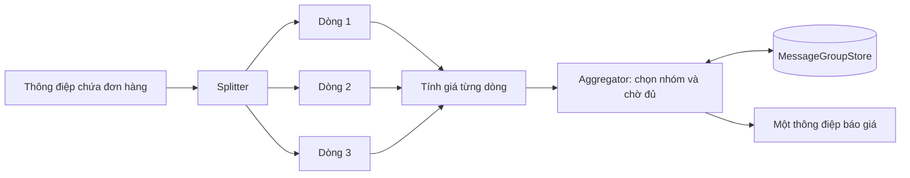

# Correlation trong splitter-aggregator

## 1. Mục tiêu và bối cảnh

Trong chương **Correlation và state** của `SPRING_INTEGRATION_CORE`, bài này giải thích cách liên kết các thông điệp con sau khi tách, xử lý chúng độc lập và tổng hợp lại thành đúng kết quả của yêu cầu ban đầu. Trọng tâm là hợp đồng giữa `Message`, các header của chuỗi, `MessageChannel` và endpoint aggregator; Java DSL được dùng để thể hiện luồng xử lý.

Sau bài học, bạn có thể:

- Phân biệt định danh thông điệp, khóa correlation và định danh nghiệp vụ.
- Giải thích vai trò của `correlationId`, `sequenceNumber`, `sequenceSize` trong một lần splitter-aggregator.
- Xây dựng luồng tính giá từng dòng hàng rồi ghép thành một báo giá.
- Lựa chọn khóa nhóm khi có nhiều đơn hàng, nhiều tenant hoặc nhiều lần xử lý cùng một đơn.
- Nhận diện các nguyên nhân nhóm bị treo, bị ghép sai hoặc phát kết quả quá sớm.
- Đề xuất chính sách xử lý thiếu kết quả, kết quả đến muộn và trạng thái tích lũy.

Bạn nên biết trước cấu trúc `Message<T>`, sự khác nhau giữa payload và headers, transformer, channel và cấu hình một `IntegrationFlow`. Phần thực hành dùng Java 17 trở lên và API Java DSL có trong Spring Integration 6.x/7.x; ví dụ chính dùng bộ nhớ trong một tiến trình.

## 2. Bài toán: nhiều đơn hàng đi qua cùng một luồng

Giả sử hệ thống nhận hai đơn hàng:

| Đơn hàng | Các dòng cần tính giá | Kết quả cần phát |
| --- | --- | --- |
| `DH-101` | `L1`, `L2`, `L3` | Một báo giá cho `DH-101` |
| `DH-102` | `L1`, `L2` | Một báo giá cho `DH-102` |

Splitter tách từng đơn thành các thông điệp chứa một dòng hàng. Transformer hoặc service activator tính tiền từng dòng. Khi xử lý có độ trễ khác nhau, kết quả có thể đến aggregator theo thứ tự:

```text
DH-101/L2 → DH-102/L1 → DH-101/L1 → DH-102/L2 → DH-101/L3
```

Ghép mọi kết quả đến trong cùng một khoảng thời gian sẽ trộn hai đơn. Ghép theo `lineId` cũng sai vì cả hai đơn đều có `L1`. Vì vậy, mỗi kết quả phải mang thông tin cho biết nó thuộc **lần xử lý nào**, đồng thời cung cấp căn cứ để biết lần xử lý đó đã đủ kết quả chưa.



Sơ đồ thể hiện các phần độc lập về logic. Để chúng chạy đồng thời, cần thêm ranh giới thực thi như executor hoặc hệ thống hàng đợi. Riêng việc khai báo splitter không có nghĩa là đã tạo thêm luồng Java.

## 3. Hợp đồng header của một lần tách

### 3.1. Những giá trị cần phân biệt

| Giá trị | Câu hỏi nó trả lời | Ví dụ |
| --- | --- | --- |
| `MessageHeaders.ID` | Đây là thông điệp cụ thể nào? | UUID của một kết quả dòng hàng |
| `correlationId` | Kết quả thuộc nhóm tách nào? | Khóa của lần tách đơn `DH-101` |
| `sequenceNumber` | Đây là phần thứ mấy trong lần tách? | `2` |
| `sequenceSize` | Lần tách dự kiến có bao nhiêu phần? | `3` |
| Header nghiệp vụ `orderId` | Dữ liệu thuộc đơn hàng nào? | `DH-101` |

Trong Java, ba hằng header của chuỗi là `IntegrationMessageHeaderAccessor.CORRELATION_ID`, `SEQUENCE_NUMBER` và `SEQUENCE_SIZE`. Dùng hằng hoặc accessor giúp tránh lỗi gõ tên header. Xem [API IntegrationMessageHeaderAccessor](https://docs.spring.io/spring-integration/api/org/springframework/integration/IntegrationMessageHeaderAccessor.html).

Với splitter tiêu chuẩn bật `applySequence`, các phần của cùng lần tách nhận chung correlation; số thứ tự bắt đầu từ `1`. Khi tách một `List` gồm ba phần, kích thước chuỗi là `3`. Spring Integration bật cơ chế bổ sung sequence cho splitter theo mặc định. Xem [mô hình lập trình Splitter](https://docs.spring.io/spring-integration/reference/splitter.html).

Trong trường hợp thông thường, correlation do splitter tạo dựa trên ID của **thông điệp đi vào splitter**. Vì endpoint trước splitter có thể đã tạo thông điệp mới, không nên mặc định đó là ID ban đầu tại gateway. Cũng không nên ghi đè `correlationId` bằng `orderId` chỉ để log dễ đọc; hãy giữ một header nghiệp vụ riêng.

### 3.2. Lần theo một nhóm cụ thể

Gọi khóa correlation của lần tách `DH-101` là `C101`, còn của `DH-102` là `C102`:

| Thứ tự đến aggregator | Payload | Correlation | Sequence | Trạng thái sau khi nhận |
| --- | --- | --- | --- | --- |
| 1 | Giá của `DH-101/L2` | `C101` | `2/3` | `C101` có 1 phần |
| 2 | Giá của `DH-102/L1` | `C102` | `1/2` | `C102` có 1 phần |
| 3 | Giá của `DH-101/L1` | `C101` | `1/3` | `C101` có 2 phần |
| 4 | Giá của `DH-102/L2` | `C102` | `2/2` | `C102` đủ, phát báo giá `DH-102` |
| 5 | Giá của `DH-101/L3` | `C101` | `3/3` | `C101` đủ, phát báo giá `DH-101` |

Đơn đến trước có thể hoàn tất sau. Đó là kết quả hợp lệ vì hai nhóm không phụ thuộc nhau.

`sequenceNumber = sequenceSize` chỉ nói một thông điệp là phần cuối theo thứ tự nguồn. Nếu phần `3/3` đến đầu tiên, vẫn còn thiếu `1/3` và `2/3`. Không dùng điều kiện “đã thấy phần cuối” thay cho điều kiện “đã có đủ các phần”.

## 4. Ba quyết định riêng của aggregator

Aggregator cần tách bạch ba quyết định:

| Quyết định | Thành phần | Áp dụng vào báo giá |
| --- | --- | --- |
| Thông điệp thuộc nhóm nào? | `CorrelationStrategy` | Nhóm theo khóa của một lần tách |
| Nhóm đã được phép phát chưa? | `ReleaseStrategy` | Chờ đủ kết quả cần thiết |
| Kết quả tổng hợp là gì? | `MessageGroupProcessor` | Tạo `OrderQuote` và cộng tiền |

Mặc định, aggregator nhóm theo header correlation. Các thông điệp đã nhận được giữ trong `MessageGroupStore` trong khi chờ release. Có thể tùy biến từng chiến lược mà không thay toàn bộ endpoint. Xem [Aggregator](https://docs.spring.io/spring-integration/reference/aggregator.html).

Với chuỗi thông thường, `SimpleSequenceSizeReleaseStrategy` so sánh số thông điệp trong nhóm với `sequenceSize`. Chiến lược này không kiểm tra trùng `sequenceNumber`; vì vậy, một luồng có khả năng giao lại cần thiết kế chống trùng riêng. Xem [API SimpleSequenceSizeReleaseStrategy](https://docs.spring.io/spring-integration/api/org/springframework/integration/aggregator/SimpleSequenceSizeReleaseStrategy.html).

Trong ví dụ báo giá, hợp đồng đầu vào được đặt như sau:

1. Mỗi dòng của đơn tạo đúng một thông điệp con.
2. Mỗi thông điệp con tạo đúng một kết quả tính giá.
3. Mọi kết quả giữ nguyên thông tin correlation và sequence.
4. Không loại bỏ âm thầm dòng hàng giữa splitter và aggregator.
5. Một lần xử lý không nhận hai kết quả cho cùng một dòng.

Nếu điều kiện 5 không đúng, số lượng thông điệp không còn đại diện chắc chắn cho số dòng đã hoàn tất. Ví dụ `L1`, `L1`, `L2` là ba thông điệp nhưng vẫn thiếu `L3`.

## 5. Ví dụ Java DSL: tách đơn, tính giá, ghép báo giá

### 5.1. Mô hình và cấu hình hoàn chỉnh

Ví dụ dùng `spring-integration-core` và Spring Context trên classpath. Nếu dùng Spring Boot, có thể lấy các thư viện cần thiết qua `spring-boot-starter-integration`; để cơ chế quản lý dependency của dự án chọn các phiên bản tương thích.

Toàn bộ lớp dưới đây dùng các record lồng nhau để tập trung vào luồng. `pricingInput` là `DirectChannel`; `pricedOrders` và `pricingDiscards` là `QueueChannel` để người học chủ động lấy kết quả.

```java
package example.correlation;

import java.math.BigDecimal;
import java.util.Comparator;
import java.util.List;
import java.util.Objects;

import org.springframework.context.annotation.AnnotationConfigApplicationContext;
import org.springframework.context.annotation.Bean;
import org.springframework.context.annotation.Configuration;
import org.springframework.integration.IntegrationMessageHeaderAccessor;
import org.springframework.integration.channel.DirectChannel;
import org.springframework.integration.channel.QueueChannel;
import org.springframework.integration.config.EnableIntegration;
import org.springframework.integration.dsl.IntegrationFlow;
import org.springframework.integration.store.MessageGroup;
import org.springframework.integration.store.SimpleMessageStore;
import org.springframework.integration.support.MessageBuilder;
import org.springframework.messaging.Message;
import org.springframework.messaging.MessageChannel;

@Configuration
@EnableIntegration
public class OrderPricingConfiguration {

    public record OrderLine(
            String lineId, BigDecimal unitPrice, int quantity) {
        public OrderLine {
            Objects.requireNonNull(lineId, "lineId");
            Objects.requireNonNull(unitPrice, "unitPrice");
            if (quantity <= 0 || unitPrice.signum() < 0) {
                throw new IllegalArgumentException("Invalid price or quantity");
            }
        }
    }

    public record PriceOrder(String orderId, List<OrderLine> lines) {
        public PriceOrder {
            if (orderId == null || orderId.isBlank()) {
                throw new IllegalArgumentException("orderId is required");
            }
            lines = List.copyOf(lines);
            if (lines.isEmpty()) {
                throw new IllegalArgumentException("At least one line is required");
            }
        }
    }

    public record PricedLine(String lineId, BigDecimal amount) {}

    public record OrderQuote(
            String orderId, List<PricedLine> lines, BigDecimal total) {}

    @Bean
    public MessageChannel pricingInput() {
        return new DirectChannel();
    }

    @Bean
    public QueueChannel pricedOrders() {
        return new QueueChannel();
    }

    @Bean
    public QueueChannel pricingDiscards() {
        return new QueueChannel();
    }

    @Bean
    public SimpleMessageStore pricingGroups() {
        return new SimpleMessageStore();
    }

    @Bean
    public IntegrationFlow pricingFlow(SimpleMessageStore pricingGroups) {
        return IntegrationFlow.from("pricingInput")
                .enrichHeaders(h -> h.headerFunction(
                        "orderId",
                        m -> ((PriceOrder) m.getPayload()).orderId()))
                .split(PriceOrder.class, PriceOrder::lines)
                .<OrderLine, PricedLine>transform(line -> new PricedLine(
                        line.lineId(),
                        line.unitPrice().multiply(
                                BigDecimal.valueOf(line.quantity()))))
                .aggregate(a -> a
                        .messageStore(pricingGroups)
                        .outputProcessor(OrderPricingConfiguration::toQuote)
                        .groupTimeout(5_000L)
                        .sendPartialResultOnExpiry(false)
                        .expireGroupsUponCompletion(false)
                        .expireGroupsUponTimeout(false)
                        .discardChannel("pricingDiscards"))
                .channel("pricedOrders")
                .get();
    }

    private static OrderQuote toQuote(MessageGroup group) {
        String orderId = group.getOne()
                .getHeaders().get("orderId", String.class);

        List<PricedLine> lines = group.getMessages().stream()
                .sorted(Comparator.comparingInt(
                        OrderPricingConfiguration::sequenceNumber))
                .map(message -> (PricedLine) message.getPayload())
                .toList();

        BigDecimal total = lines.stream()
                .map(PricedLine::amount)
                .reduce(BigDecimal.ZERO, BigDecimal::add);

        return new OrderQuote(orderId, List.copyOf(lines), total);
    }

    private static int sequenceNumber(Message<?> message) {
        return new IntegrationMessageHeaderAccessor(message)
                .getSequenceNumber();
    }

    public static void main(String[] args) {
        try (var context = new AnnotationConfigApplicationContext(
                OrderPricingConfiguration.class)) {
            MessageChannel input = context.getBean(
                    "pricingInput", MessageChannel.class);
            QueueChannel output = context.getBean(
                    "pricedOrders", QueueChannel.class);

            PriceOrder order = new PriceOrder("DH-101", List.of(
                    new OrderLine("L1", new BigDecimal("120000"), 2),
                    new OrderLine("L2", new BigDecimal("60000"), 1)));

            if (!input.send(MessageBuilder.withPayload(order).build())) {
                throw new IllegalStateException("Request was not accepted");
            }

            Message<?> reply = output.receive(2_000L);
            if (reply == null) {
                throw new IllegalStateException("No quote received");
            }

            OrderQuote quote = (OrderQuote) reply.getPayload();
            System.out.println(quote.orderId() + " total=" + quote.total());
        }
    }
}
```

Kết quả dự kiến của `main`:

```text
DH-101 total=300000
```

Đây là ví dụ để chạy trong dự án có các dependency nêu trên. Các đoạn thực hành trong bài không thay thế cấu hình build hoặc bộ kiểm thử của dự án.

### 5.2. Giải thích các bước quan trọng

Header `orderId` được thêm **trước** khi tách, vì payload sau splitter chỉ còn là `OrderLine`. Nhờ vậy, `toQuote` vẫn lấy được mã đơn dù payload con không chứa mã đó.

Splitter lấy `List<OrderLine>` và tạo hai thông điệp. Hai kết quả từ transformer mang chung correlation và lần lượt có sequence `1/2`, `2/2`. Transformer trả về POJO `PricedLine`, để endpoint xử lý việc tạo reply message và truyền tiếp các header phù hợp.

Không khai báo `.correlationStrategy(...)` hoặc `.releaseStrategy(...)` trong ví dụ vì hợp đồng một dòng/một kết quả phù hợp với cơ chế mặc định. `.outputProcessor(...)` tạo một đối tượng `OrderQuote` duy nhất; đây là nơi áp dụng phép cộng tiền. Các điểm tùy biến này được cung cấp trong [API AggregatorSpec](https://docs.spring.io/spring-integration/api/org/springframework/integration/dsl/AggregatorSpec.html).

`toQuote` chủ động sắp theo `sequenceNumber`, nên danh sách dòng trong báo giá theo thứ tự đơn gốc ngay cả khi kết quả về khác thứ tự. Phép cộng tiền không cần thứ tự, nhưng hiển thị báo giá thường cần. Không suy ra rằng collection bên trong store luôn giữ thứ tự nghiệp vụ.

`List.copyOf(lines)` tách danh sách kết quả khỏi cấu trúc lưu trữ của nhóm. Đầu ra chứa dữ liệu giá trị phục vụ nghiệp vụ, không cung cấp collection nội bộ của store cho bước sau.

Ví dụ chạy đồng bộ qua `DirectChannel`, vì vậy phép tính giá được thực hiện ngay trong lời gọi gửi. Hai `QueueChannel` đầu ra chỉ là chỗ giữ thông điệp để đọc; chúng không tự tạo consumer. Trong ứng dụng chạy lâu dài cần consumer cho cả kết quả thành công lẫn thông điệp bị loại.

## 6. Giữ correlation xuyên suốt các endpoint

### 6.1. Khi tự xây dựng thông điệp

Giả sử một hàm nhận `Message<OrderLine>` rồi tự tạo kết quả bằng:

```java
return MessageBuilder.withPayload(pricedLine).build();
```

Thông điệp mới này tự nó không chứa các header từ đầu vào. Đừng đặt tính đúng đắn của correlation vào giả định rằng mọi đường gửi thủ công hoặc mọi endpoint sẽ bổ sung lại chúng.

Khi cần trả về một `Message<PricedLine>`, hãy thể hiện rõ hợp đồng giữ header:

```java
private static Message<PricedLine> price(Message<OrderLine> input) {
    OrderLine line = input.getPayload();
    PricedLine result = new PricedLine(
            line.lineId(),
            line.unitPrice().multiply(BigDecimal.valueOf(line.quantity())));

    return MessageBuilder.withPayload(result)
            .copyHeaders(input.getHeaders())
            .build();
}
```

Đoạn này dùng các record của ví dụ trước. Việc sao chép header phục vụ liên kết nhóm; không yêu cầu ép thông điệp kết quả dùng lại `id` hay `timestamp` của đầu vào. `withPayload` tạo builder cho payload mới, còn `copyHeaders` bổ sung các header được phép sao chép. Xem [MessageBuilder](https://docs.spring.io/spring-integration/api/org/springframework/integration/support/MessageBuilder.html) và [BaseMessageBuilder](https://docs.spring.io/spring-integration/api/org/springframework/integration/support/BaseMessageBuilder.html).

### 6.2. Khi đi qua transport hoặc hệ thống ngoài

Trong thiết kế tách tính giá sang một dịch vụ khác, hợp đồng yêu cầu/phản hồi nên nêu rõ:

- Khóa lần xử lý phải đi ra và quay về không thay đổi.
- Định danh phần phải đủ để nhận biết kết quả trùng.
- Số phần dự kiến hoặc dấu hiệu hoàn tất phải có ý nghĩa nhất quán.
- Header nghiệp vụ như `tenantId`, `orderId`, `attemptId` phải được ánh xạ nếu dùng chúng để nhóm.

Chẳng hạn, nếu request gửi `sequenceSize` dưới dạng số nhưng response đưa lại thành chuỗi, code đọc header bằng `Integer.class` có thể không còn hoạt động. Khi dựng thông điệp nội bộ từ response, hãy chuẩn hóa kiểu theo hợp đồng.

Không mặc định việc serialize payload sang JSON sẽ mang theo toàn bộ Spring Message headers. Payload và metadata truyền tải cần được thiết kế đồng thời. Với quy trình qua broker, một cấu trúc envelope có `attemptId`, `partId`, `expectedParts` thường dễ mô tả rõ trong hợp đồng giữa các dịch vụ.

## 7. Chọn correlation theo nghiệp vụ và theo lần xử lý

### 7.1. Khi correlation do splitter tạo là phù hợp

Một yêu cầu vào, tách thành N phần, nhận đủ N kết quả rồi kết thúc là tình huống phù hợp với correlation của splitter. Hai yêu cầu chứa cùng `orderId` nhưng là hai thông điệp mới đi vào splitter thường thuộc hai lần tách riêng.

Ngược lại, giao lại đúng thông điệp cha với cùng ID có thể tạo lại cùng khóa tách. Do đó, muốn phân biệt một lần chạy mới với việc giao lại, hệ thống cần một khái niệm lần xử lý rõ ràng; không chỉ dựa vào thời điểm nhận request.

### 7.2. Khi cần khóa tùy biến

Giả sử một aggregator nhận kết quả từ nhiều nguồn, trong đó có hai tenant đều sử dụng mã đơn `DH-101`. Cũng có thể một người dùng yêu cầu tính lại đơn sau khi bảng giá thay đổi. Khóa chỉ gồm `orderId` có nguy cơ trộn cả tenant lẫn hai lần tính.

Một lựa chọn thiết kế là:

```text
khóa nhóm = (tên luồng, tenantId, orderId, attemptId)
```

`attemptId` do nơi khởi tạo sinh **một lần cho cả lần xử lý**, rồi truyền xuống mọi nhánh. Nếu mỗi nhánh tự sinh `attemptId`, các kết quả sẽ rơi vào các nhóm khác nhau.

Trong cấu hình aggregator, có thể thay cơ chế lấy khóa bằng:

```java
// Đặt record và hàm hỗ trợ trong lớp cấu hình.
public record PricingGroupKey(
        String flow, String tenantId, String orderId, String attemptId) {}

private static String requiredTextHeader(Message<?> message, String name) {
    String value = message.getHeaders().get(name, String.class);
    if (value == null || value.isBlank()) {
        throw new IllegalArgumentException("Missing header: " + name);
    }
    return value;
}

// Thêm đoạn này vào AggregatorSpec khi đầu vào đã có đủ các header.
// .correlationStrategy(message -> new PricingGroupKey(
//         "order-pricing",
//         requiredTextHeader(message, "tenantId"),
//         requiredTextHeader(message, "orderId"),
//         requiredTextHeader(message, "attemptId")))
```

Đây là phương án thay thế cho chiến lược correlation trong ví dụ chính, không phải yêu cầu thêm cả ba header vào mọi luồng đơn giản. Record cung cấp `equals()` và `hashCode()` theo các trường, phù hợp với vai trò khóa giá trị. Với store lưu bền, cần kiểm tra thêm cách store biểu diễn khóa và serialize dữ liệu.

Khóa correlation quyết định thành viên nhóm; nó không tự xác nhận nhóm đã đủ. Nếu các kết quả đến từ nhiều lần split khác nhau, mỗi lần có `sequenceSize` riêng, không được dùng lại chiến lược đếm mặc định mà chưa xác định tổng số kết quả của nhóm nghiệp vụ.

Ví dụ nhóm chờ `STOCK`, `PRICE`, `SHIPPING` nên hoàn tất khi đủ **ba loại kết quả khác nhau**. Ba phản hồi `PRICE` không tương đương với đủ ba loại.

## 8. State, timeout và kết quả đến muộn

### 8.1. Nhóm chưa hoàn tất là trạng thái cần quản lý

Aggregator phải nhớ những kết quả đã nhận, nên nó là endpoint có trạng thái. `SimpleMessageStore` trong ví dụ là store trong bộ nhớ; trạng thái chưa hoàn tất không được giữ qua việc kết thúc tiến trình. Khi yêu cầu phục hồi sau restart, cần chọn store lưu bền phù hợp, chẳng hạn JDBC, đồng thời xét khả năng serialize payload và headers. Xem [Message Store](https://docs.spring.io/spring-integration/reference/message-store.html).

Giả sử mỗi đơn có 50 dòng, mỗi kết quả giữ khoảng 2 KB và có 10.000 đơn đang chờ. Riêng payload đã xấp xỉ:

```text
50 × 2 KB × 10.000 ≈ 1 GB
```

Đó còn chưa tính object, headers, index và cấu trúc nhóm. Vì vậy, chỉ tăng bộ nhớ không giải quyết được việc một dòng luôn bị mất mà nhóm không bao giờ kết thúc.

### 8.2. Chính sách của ví dụ báo giá

| Cấu hình | Ý định trong ví dụ |
| --- | --- |
| `groupTimeout(5_000L)` | Không để nhóm thiếu kết quả chờ vô hạn khi không có phần mới đến |
| `sendPartialResultOnExpiry(false)` | Không phát báo giá thiếu dòng như một kết quả bình thường |
| `discardChannel("pricingDiscards")` | Có nơi nhận thông điệp bị loại để xử lý tiếp |
| `expireGroupsUponCompletion(false)` | Giữ dấu vết nhóm đã hoàn tất để xử lý phần đến muộn |
| `expireGroupsUponTimeout(false)` | Giữ dấu vết cả nhóm thiếu đã kết thúc vì timeout |

`groupTimeout` dạng hằng là khoảng chờ tính lại khi có thông điệp mới đến nhóm chưa được release. Nó không tự tạo deadline tổng tính từ đầu request. Các lựa chọn timeout, store và khóa nằm trong [API CorrelationHandlerSpec](https://docs.spring.io/spring-integration/api/org/springframework/integration/dsl/CorrelationHandlerSpec.html).

Trong nghiệp vụ này, nếu `L3` không có kết quả thì tổng của `L1 + L2` chưa phải tổng đơn. Do đó, nhánh timeout nên dẫn đến theo dõi thất bại hoặc yêu cầu tính lại. `pricingDiscards` nhận thông điệp bị loại, không tự biến chúng thành một sự kiện “báo giá thất bại” hoàn chỉnh; consumer cần bổ sung ngữ cảnh và quy tắc nghiệp vụ.

Nếu một sản phẩm cho phép trả kết quả một phần, hãy dùng kiểu kết quả nói rõ trạng thái, chẳng hạn `PARTIAL`, số phần đã nhận và số phần mong đợi. Chỉ bật phát một phần là chưa đủ để người nhận hiểu rằng dữ liệu đang thiếu.

### 8.3. Hoàn tất khác với xóa toàn bộ nhóm

Với ví dụ `C101`, sau khi báo giá được phát, việc giữ dấu vết “đã hoàn tất” giúp nhận ra một kết quả `L2` đến muộn vẫn thuộc lần xử lý cũ. Nếu xóa toàn bộ nhóm ngay lập tức, thông điệp đó có thể tạo nhóm mới với cùng khóa.

Ngược lại, giữ dấu vết mãi sẽ làm số nhóm tăng theo số yêu cầu từng chạy. Cần chọn thời gian giữ phù hợp với khoảng giao lại dự kiến. Ví dụ, nếu dịch vụ ngoài có thể gửi lại trong 15 phút, xóa dấu vết sau vài giây sẽ quá sớm; nếu lưu mãi, state sẽ tăng liên tục.

`MessageGroupStoreReaper` là thành phần có thể gọi định kỳ để hết hạn các nhóm theo cấu hình store. Cần bố trí lịch chạy; chỉ có một đối tượng reaper chưa có nghĩa đã có công việc quét định kỳ. Xem [API MessageGroupStoreReaper](https://docs.spring.io/spring-integration/api/org/springframework/integration/store/MessageGroupStoreReaper.html).

Ví dụ chính giữ state để minh họa thông điệp muộn, chưa cấu hình lịch dọn dẹp. Khi đưa vào dịch vụ chạy lâu dài, hãy xác định cả tuổi nhóm thiếu, thời gian giữ nhóm đã đóng và hành động sau khi bị loại.

### 8.4. Khi có nhiều instance

Nếu các phần của `C101` có thể tới hai instance, hai store trong bộ nhớ riêng sẽ tạo hai nhóm thiếu riêng. Thiết kế cần đưa toàn bộ phần của nhóm về cùng nơi xử lý hoặc sử dụng state dùng chung.

Khi nhiều aggregator cùng thao tác trên state dùng chung, cần cơ chế khóa tương thích theo group ID để tránh cập nhật đồng thời sai lệch. Cấu hình lưu trữ và khóa phải đi cùng nhau; chỉ đổi sang cơ sở dữ liệu không tự chứng minh toàn bộ luồng đã an toàn khi chạy nhiều instance. Xem các điểm cấu hình trong [AbstractCorrelatingMessageHandler](https://docs.spring.io/spring-integration/api/org/springframework/integration/aggregator/AbstractCorrelatingMessageHandler.html).

## 9. Các tình huống dễ phá hợp đồng splitter-aggregator

### 9.1. Filter bỏ một phần sau splitter

Một đơn có ba dòng nên từng phần mang `sequenceSize = 3`. Nếu filter loại `L2`, aggregator chỉ nhận hai phần. Việc filter hoạt động đúng không làm thay đổi lời hứa ban đầu rằng nhóm có ba kết quả.

Tùy nghiệp vụ, có thể:

- Lọc danh sách trong payload **trước khi tách**, để số phần được tính trên danh sách thực sự cần xử lý.
- Giữ một kết quả đại diện cho từng dòng, ví dụ `SUCCESS`, `REJECTED`, `FAILED`, để aggregator biết mọi dòng đã kết thúc.
- Thay điều kiện release bằng hợp đồng hoàn tất khác có thể chứng minh được, kèm xử lý nhóm thiếu.

Ví dụ với báo giá, dòng bị từ chối vì số lượng không hợp lệ thường phải làm cả báo giá thất bại. Âm thầm bỏ dòng rồi trả tổng thấp hơn có thể khiến người mua hiểu nhầm.

### 9.2. Transformer trả `null` hoặc nhánh xử lý lỗi không có kết quả

Nếu một nhánh không phát phản hồi, aggregator không tự biết nhánh đó đã thất bại. Nó chỉ thấy nhóm thiếu phần. Với luồng đồng bộ trong ví dụ, exception có thể đi ngược về người gửi; với ranh giới bất đồng bộ, cần thiết kế đường xử lý lỗi tương ứng.

Một `ErrorMessage` được gửi vào `errorChannel` không mặc nhiên trở thành `PricedLine` cho nhóm đang chờ. Nếu chọn tổng hợp cả kết quả thành công và thất bại, hãy chuyển lỗi thành một kiểu kết quả nghiệp vụ thống nhất và giữ correlation cùng định danh phần.

Trong trường hợp `L1` đã được lưu trước khi `L2` lỗi, việc gửi lại toàn bộ đơn có thể lặp lại cả xử lý `L1`. Vì vậy, cần xác định retry theo phần hay retry cả lần xử lý, và có cho phép tác dụng phụ bị thực hiện lại hay không.

### 9.3. Kết quả trùng có ID thông điệp mới

Giả sử chuỗi mong đợi ba phần, nhưng kết quả được giao lại thành:

```text
L1/sequence=1 → L1/sequence=1 → L2/sequence=2
```

Nếu lần giao lại được bọc trong một message mới, không nên trông chờ store loại bỏ chỉ vì payload giống nhau. Nhóm có thể đạt số lượng cần thiết trước khi `L3` đến.

Khóa chống trùng có thể là `(attemptId, lineId)` hoặc `(correlationId, sequenceNumber)` nếu giao thức đảm bảo chúng ổn định. Dùng idempotent receiver hoặc cơ chế dedup phù hợp trước aggregator. Hợp đồng cũng cần nói rõ nếu hai kết quả có cùng khóa phần nhưng giá khác nhau thì giữ bản nào hay báo lỗi.

Một release strategy nghiêm ngặt có thể kiểm tra tập số thứ tự có đủ `1..N` và mọi phần thống nhất về `N`. Tuy nhiên, chỉ kiểm tra mà vẫn giữ bản trùng trong group chưa giải quyết được phép cộng: output processor cũng phải tránh cộng hai lần. Với báo giá, đơn giản hơn là ngăn bản trùng đi vào nhóm ngay từ đầu.

### 9.4. Splitter trả tập rỗng hoặc không biết kích thước

Một đơn không có dòng không tạo ra “nhóm kích thước 0 tự hoàn tất”. Không có thông điệp con nghĩa là aggregator không được gọi cho lần tách đó. Ví dụ chính từ chối đơn rỗng ngay tại constructor để có hành vi rõ ràng.

Với iterator hoặc nguồn mà splitter không xác định được số phần, `sequenceSize` có thể là `0`. Khi đó, không dùng cơ chế chờ đủ kích thước như đối với `List`. Cần hợp đồng hoàn tất riêng hoặc chính sách hết hạn phù hợp; tham khảo [phần Iterators của Splitter](https://docs.spring.io/spring-integration/reference/splitter.html#_iterators).

### 9.5. Nhiều tầng splitter-aggregator

Ví dụ đơn hàng được tách thành kiện, mỗi kiện lại tách thành sản phẩm. Aggregator tầng trong phải ghép sản phẩm thành kiện; tầng ngoài mới ghép kiện thành đơn.

Spring Integration có cơ chế lưu và khôi phục chi tiết sequence cho các tầng lồng nhau. Khi dùng các component tiêu chuẩn, hãy giữ các header đó xuyên suốt các endpoint; việc cấu hình `popSequence` liên quan đến khôi phục thông tin tầng trước. Nếu tự dựng header hoặc tự tạo output message, cần kiểm tra rõ thông tin tầng nào đang được dùng. Xem [API popSequence](https://docs.spring.io/spring-integration/api/org/springframework/integration/aggregator/AbstractCorrelatingMessageHandler.html#setPopSequence(boolean)).

Đừng coi correlation ở tầng sản phẩm là mã nhóm cố định của cả đơn. Một thao tác tách sâu hơn cần ngữ cảnh nhóm riêng, rồi trả kết quả về đúng nhóm cha.

## 10. Thực hành kiểm chứng hành vi

### 10.1. Quan sát những gì cần thiết

Tại đầu ra splitter và đầu vào aggregator, nên quan sát cùng một bộ giá trị:

```text
orderId=DH-101 attemptId=A7 correlationId=C101 sequence=2/3 partId=L2
```

Đây là định dạng log đề xuất, không phải toàn bộ các trường đều được ví dụ tự sinh. Log của ví dụ chính có thể lấy `orderId`, correlation và sequence; `attemptId`, `partId` chỉ thêm khi hợp đồng ứng dụng sử dụng chúng.

Khi debug nhóm thiếu, hãy so sánh danh sách phần dự kiến với phần thực tế đã nhận, rồi lần về endpoint làm mất hoặc đổi metadata. Chỉ nhìn tổng số request thành công của service tính giá không đủ để biết từng nhóm có đủ kết quả hay chưa.

### 10.2. Các trường hợp cần kiểm tra

| Đầu vào hoặc sự cố | Kỳ vọng cần chứng minh |
| --- | --- |
| Một đơn có hai dòng | Một báo giá, tổng đúng, hai dòng đúng thứ tự |
| Hai đơn xen kẽ kết quả | Mỗi báo giá chỉ chứa dòng của đúng đơn |
| Kết quả `3/3` về trước | Chưa phát cho đến khi đủ các phần còn lại |
| Thiếu một phần | Nhóm đi theo chính sách timeout, không phát báo giá đầy đủ giả |
| Hai kết quả cùng định danh phần | Không cộng tiền hai lần |
| Một phần tới sau khi nhóm đóng | Được xử lý theo chính sách thông điệp muộn |
| Cùng `orderId`, hai `attemptId` | Không trộn hai lần tính |
| Đơn rỗng | Bị từ chối hoặc có phản hồi riêng theo hợp đồng |

Ví dụ chính minh họa trường hợp một đơn và hợp đồng không có bản trùng. Các trường hợp còn lại là tiêu chí để mở rộng thiết kế và kiểm thử, không phải tuyên bố rằng cấu hình tối giản đã thực hiện chống trùng hoặc phục hồi phân tán.

Để kiểm tra out-of-order một cách xác định, có thể cô lập aggregator trong một flow thử nghiệm có channel đầu vào riêng, rồi gửi thủ công các phần:

```java
import org.springframework.integration.support.MessageBuilder;
import org.springframework.messaging.Message;

// Payload có thể là PricedLine nếu dùng lại output processor của ví dụ.
static <T> Message<T> part(
        String correlation, String orderId, int number, int size, T payload) {
    return MessageBuilder.withPayload(payload)
            .setCorrelationId(correlation)
            .setSequenceNumber(number)
            .setSequenceSize(size)
            .setHeader("orderId", orderId)
            .build();
}
```

Gửi phần `3`, kiểm tra output còn rỗng; gửi phần `1`, kiểm tra vẫn chưa có kết quả; gửi phần `2`, kiểm tra có đúng một báo giá. Không gửi các thông điệp con này vào `pricingInput`, vì channel đó nhận `PriceOrder` và sẽ chạy splitter thêm lần nữa.

Với timeout, dùng nhận thông điệp có giới hạn thời gian và kiểm tra nhánh discard. Cần tách khoảng chờ của phép kiểm tra khỏi cấu hình timeout nghiệp vụ để tránh một giá trị bị hiểu thành cả hai vai trò.

### 10.3. Bài tập áp dụng

Mở rộng báo giá để mỗi dòng tạo `LineOutcome` chứa `lineId`, trạng thái và số tiền nếu thành công. Đặt quy tắc mỗi dòng luôn có một outcome, kể cả khi bị từ chối. Báo giá cuối chỉ có trạng thái `COMPLETE` khi mọi outcome thành công; nếu có dòng thất bại, trả trạng thái thể hiện rõ điều đó.

Trước khi viết code, hãy lập một bảng cho ba dòng gồm một dòng thành công, một dòng bị từ chối và một dòng bị giao lại. Xác định khóa nhóm, khóa chống trùng và kết quả tổng hợp mong đợi. Bảng này buộc bạn phân biệt “đã kết thúc xử lý mọi phần” với “mọi phần đều xử lý thành công”.

## 11. Những điểm cần ghi nhớ

- Correlation cho biết các thông điệp thuộc cùng một nhóm; định danh nghiệp vụ và định danh lần xử lý phục vụ các mục đích khác nhau.
- `sequenceNumber` biểu diễn vị trí, `sequenceSize` biểu diễn số phần mong đợi. Phần cuối đến không chứng minh mọi phần đã đến.
- Hợp đồng một phần/một kết quả giúp cơ chế mặc định hoạt động rõ ràng. Filter, lỗi, bản trùng hoặc nguồn không biết kích thước có thể phá hợp đồng đó.
- Tổng hợp đúng còn phụ thuộc cách giữ metadata, chống trùng, sắp thứ tự và xây dựng kết quả nghiệp vụ.
- State của nhóm cần chính sách cho hoàn tất, hết hạn, thông điệp muộn và dọn dẹp; thời gian chờ của gateway là một quyết định riêng.
- Khi kiểm chứng luồng, hãy chủ động thử kết quả xen kẽ và sai thứ tự, thay vì chỉ thử các phần đến đúng thứ tự nguồn.
