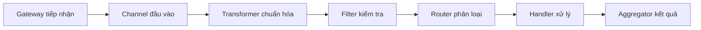
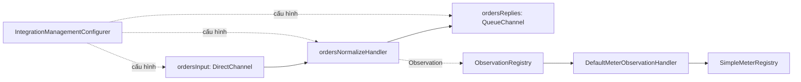

# IntegrationManagement: quan sát và quản lý thành phần Spring Integration

## 1. Mục tiêu và phạm vi

Trong chương **System management** của module **SPRING_INTEGRATION_CORE**, bài này trình bày cách theo dõi một luồng thông điệp ở cấp channel và handler bằng `IntegrationManagement`. Kiến thức gắn với các thành phần cốt lõi đã dùng để thiết kế luồng: `Message`, `MessageChannel`, endpoint, gateway và Java DSL.

Sau bài học, bạn có thể:

- Giải thích vai trò của `IntegrationManagement` và `@EnableIntegrationManagement`.
- Cấu hình logging, metrics và Observation đúng mục đích.
- Đặt tên component để tìm được số đo và khoanh vùng sự cố.
- Đọc kết quả đo mà không nhầm thao tác gửi thông điệp với kết quả nghiệp vụ.
- Phân biệt khả năng quan sát với điều khiển vòng đời endpoint, JMX và xử lý lỗi.

Các ví dụ dùng **Java 17 trở lên, Spring Integration 6.5 và Micrometer**. Phiên bản trong ví dụ Maven là mốc minh họa cố định, giúp đọc API nhất quán. Khi đưa mã vào dự án có sẵn, dùng bộ phiên bản do BOM của dự án quản lý.

## 2. Bài toán vận hành: luồng vẫn chạy nhưng hệ thống đang chậm

Một luồng tiếp nhận đơn hàng có thể được tổ chức như sau:



Khi thời gian phản hồi tăng, chỉ biết ứng dụng vẫn hoạt động là chưa đủ. Người vận hành cần xác định:

- Thông điệp đã đến channel đầu vào chưa?
- Handler nào đang tốn nhiều thời gian?
- Có lỗi tại bước chuyển đổi hay tại dịch vụ phía sau?
- Queue có đang tích tụ thông điệp?
- Thông điệp bị filter loại là hành vi dự kiến hay dữ liệu đầu vào bất thường?

`IntegrationManagement` tạo nền tảng để những component của Spring Integration tham gia cơ chế quản lý chung. Dữ liệu quan sát vẫn cần được diễn giải theo cấu trúc và quy tắc nghiệp vụ của từng luồng.

Ví dụ, filter loại một đơn hàng thiếu địa chỉ có thể là một nhánh xử lý hợp lệ. Không nên mặc định mỗi thông điệp bị loại đều tương ứng với exception, hoặc mọi lời gọi handler thành công đều tương ứng với một đơn hàng đã được lưu.

## 3. IntegrationManagement là gì?

`org.springframework.integration.support.management.IntegrationManagement` là interface nền cho các component được quản lý. Nó kế thừa `NamedComponent` và `DisposableBean`; nhiều channel, handler, message source và gateway của framework triển khai hợp đồng này.

Các nhóm API đáng biết gồm:

| Nhóm | API tiêu biểu | Mục đích |
| --- | --- | --- |
| Logging | `setLoggingEnabled(boolean)`, `isLoggingEnabled()` | Điều khiển logging của component trong luồng |
| Định danh quản lý | `setManagedName(String)`, `setManagedType(String)` | Cung cấp tên và loại phục vụ quản lý |
| Metrics | `registerMetricsCaptor(MetricsCaptor)` | Nhận bộ thu thập số đo |
| Observation | `registerObservationRegistry(ObservationRegistry)`, `isObserved()` | Tham gia cơ chế quan sát |
| Cấu hình ghi đè | `getOverrides()` | Cho hạ tầng biết cấu hình nào đã được đặt trực tiếp |

Đây là API hạ tầng. Trong ứng dụng thông thường, ưu tiên annotation và bean cấu hình thay vì tự gọi các phương thức đăng ký trên từng component. Danh sách API và các lớp triển khai được mô tả trong [Javadoc IntegrationManagement 6.5](https://docs.spring.io/spring-integration/docs/6.5.0/api/org/springframework/integration/support/management/IntegrationManagement.html).

### 3.1. Những khái niệm dễ nhầm

| Khái niệm | Vai trò |
| --- | --- |
| `IntegrationManagement` | Hợp đồng quản lý trên component |
| `@EnableIntegrationManagement` | Kích hoạt hạ tầng cấu hình quản lý trong application context |
| `IntegrationManagementConfigurer` | Áp dụng cấu hình lên các bean phù hợp |
| `MeterRegistry` | Lưu và xuất các meter Micrometer |
| `ObservationRegistry` | Điều phối vòng đời Observation và các handler quan sát |
| `Lifecycle` / `SmartLifecycle` | Hợp đồng khởi động, dừng component |
| `IntegrationMBeanExporter` | Xuất component qua JMX khi được cấu hình |

`IntegrationManagementConfigurer` phụ trách cấu hình logging, `MetricsCaptor` và `ObservationRegistry` cho các bean triển khai hợp đồng quản lý. Đây là lý do channel và handler cần nằm trong Spring context để nhận cấu hình chung. Xem [Javadoc IntegrationManagementConfigurer](https://docs.spring.io/spring-integration/docs/6.5.0/api/org/springframework/integration/config/IntegrationManagementConfigurer.html).

## 4. Kích hoạt quản lý và chọn phạm vi quan sát

Cấu hình cơ bản:

```java
import org.springframework.context.annotation.Configuration;
import org.springframework.integration.config.EnableIntegration;
import org.springframework.integration.config.EnableIntegrationManagement;

@Configuration
@EnableIntegration
@EnableIntegrationManagement(
        defaultLoggingEnabled = "false",
        observationPatterns = {"orders*"}
)
public class IntegrationOperationsConfiguration {
}
```

`@EnableIntegrationManagement` tạo hạ tầng quản lý với bean configurer mang tên `integrationManagementConfigurer`. `defaultLoggingEnabled` có kiểu `String`, nên ví dụ sử dụng `"false"`.

Danh sách `observationPatterns` mặc định rỗng. Vì vậy, chỉ có annotation và một `ObservationRegistry` chưa có nghĩa mọi component đã được chọn để instrument bằng Observation. Có thể dùng `"*"` để chọn tất cả, hoặc mẫu tên để giới hạn phạm vi. Xem [Javadoc EnableIntegrationManagement](https://docs.spring.io/spring-integration/docs/6.5.0/api/org/springframework/integration/config/EnableIntegrationManagement.html).

### 4.1. Pattern dùng tên component

Ví dụ:

```java
@EnableIntegrationManagement(
        observationPatterns = {"!ordersInternal*", "orders*"}
)
```

Với cấu hình này:

| Tên component | Kết quả chọn theo pattern |
| --- | --- |
| `ordersInput` | Được chọn |
| `ordersNormalizeHandler` | Được chọn |
| `ordersInternalAudit` | Bị loại |
| `paymentsInput` | Không được chọn |

Quy tắc là **mẫu khớp đầu tiên quyết định kết quả**, kể cả mẫu phủ định bắt đầu bằng `!`. Vì vậy, đặt mẫu loại trừ trước mẫu bao quát. Nếu đặt `"orders*"` trước, tên `ordersInternalAudit` đã khớp và mẫu loại trừ phía sau không còn tác dụng. Đây là quy tắc của [PatternMatchUtils.smartMatch](https://docs.spring.io/spring-integration/docs/6.5.0/api/org/springframework/integration/support/utils/PatternMatchUtils.html).

Không suy tên handler chỉ từ tên biến Java. Với Java DSL, endpoint và handler có thể là hai bean khác nhau. Khi cần tên dễ dự đoán, khai báo channel và handler thành bean có tên rõ ràng như ví dụ thực hành ở phần sau.

## 5. Logging, metrics và Observation

### 5.1. Logging trong luồng thông điệp

Có hai điều kiện cần xét khi chờ log debug của một component:

1. Component cho phép logging qua cấu hình quản lý.
2. Hệ thống logging, chẳng hạn Logback, cho phép mức log tương ứng.

`defaultLoggingEnabled = "true"` không tự nâng log level lên DEBUG. Ngược lại, giá trị `"false"` có thể bỏ qua logging thông thường trong luồng dù logger đã bật DEBUG.

Cấu hình mặc định không ghi đè lựa chọn đã đặt trực tiếp trên bean. Chẳng hạn:

```java
@Bean
public DirectChannel ordersInput() {
    DirectChannel channel = new DirectChannel();
    channel.setLoggingEnabled(true);
    return channel;
}
```

Cấu hình này hữu ích khi chỉ cần khảo sát một channel. Vẫn phải đặt log level thích hợp trong hệ thống logging.

### 5.2. Hai đường tạo số đo

Cần phân biệt metrics Micrometer trực tiếp và metrics đi qua Observation:

| Cách đo | Thành phần cấu hình chính | Ví dụ tên meter |
| --- | --- | --- |
| Micrometer trực tiếp của Spring Integration | `MeterRegistry`, hạ tầng metrics | `spring.integration.send`, `spring.integration.receive` |
| Observation có handler metrics | `ObservationRegistry`, pattern và `ObservationHandler` | `spring.integration.producer`, `spring.integration.handler`, `spring.integration.gateway` |

Với component sử dụng Observation, việc tạo meter cho thao tác được quan sát được giao cho handler thích hợp. Không nên mặc định cùng một thao tác luôn phát sinh cả hai bộ timer. Các gauge hoặc meter của component khác vẫn có thể xuất hiện trong cùng registry.

Logging thông thường trong luồng và logging exception cũng cần được phân biệt: tắt nhóm logging luồng qua cấu hình quản lý không đồng nghĩa tắt mọi log exception. Các cơ chế này được mô tả trong [Metrics and Management](https://docs.spring.io/spring-integration/reference/6.5/metrics.html).

### 5.3. ObservationRegistry cần có handler làm việc

Trong một context Spring thuần, có thể nối Observation với metrics như sau:

```java
@Bean
public ObservationRegistry observationRegistry(MeterRegistry meterRegistry) {
    ObservationRegistry registry = ObservationRegistry.create();
    registry.observationConfig()
            .observationHandler(
                    new DefaultMeterObservationHandler(meterRegistry));
    return registry;
}
```

`DefaultMeterObservationHandler` chuyển vòng đời Observation thành số đo. Một timer hoàn tất được ghi khi Observation dừng; long task timer có hậu tố `.active` theo dõi thao tác đang diễn ra.

Handler metrics không tự tạo tracing. Muốn có trace và span gửi tới hệ thống theo dõi, cần handler, bridge và cấu hình tracing phù hợp. Vì vậy, `isObserved()` không chứng minh trace đã tới backend. Nó cũng không chứng minh ứng dụng đã cấu hình đầy đủ việc xuất metrics. Xem [Micrometer Observation Components](https://docs.micrometer.io/micrometer/reference/observation/components.html).

## 6. Thực hành: quản lý luồng chuẩn hóa đơn hàng

### 6.1. Thiết kế và điều kiện chạy

Ví dụ gồm ba component chính:



Payload là mã đơn hàng. Transformer bỏ khoảng trắng ở hai đầu, chuyển chữ sang dạng viết hoa và từ chối dữ liệu trống. Queue đầu ra giúp chương trình nhận kết quả một cách rõ ràng.

Dùng một dự án Maven độc lập với `pom.xml` minh họa sau. Các khối mã là nội dung để người học tạo trong dự án thực hành riêng.

```xml
<project xmlns="http://maven.apache.org/POM/4.0.0"
         xmlns:xsi="http://www.w3.org/2001/XMLSchema-instance"
         xsi:schemaLocation="http://maven.apache.org/POM/4.0.0 https://maven.apache.org/xsd/maven-4.0.0.xsd">
    <modelVersion>4.0.0</modelVersion>

    <parent>
        <groupId>org.springframework.boot</groupId>
        <artifactId>spring-boot-starter-parent</artifactId>
        <version>3.5.0</version>
        <relativePath/>
    </parent>

    <groupId>vn.example</groupId>
    <artifactId>integration-management-demo</artifactId>
    <version>1.0.0</version>

    <properties>
        <java.version>17</java.version>
    </properties>

    <dependencies>
        <dependency>
            <groupId>org.springframework.integration</groupId>
            <artifactId>spring-integration-core</artifactId>
        </dependency>
        <dependency>
            <groupId>io.micrometer</groupId>
            <artifactId>micrometer-core</artifactId>
        </dependency>
        <dependency>
            <groupId>io.micrometer</groupId>
            <artifactId>micrometer-observation</artifactId>
        </dependency>
    </dependencies>
</project>
```

Parent Spring Boot ở đây quản lý phiên bản dependency. Chương trình tạo `AnnotationConfigApplicationContext` trực tiếp; không khởi động Boot auto-configuration và không cần HTTP server.

### 6.2. Chương trình hoàn chỉnh

Đặt lớp sau trong package `vn.example`, rồi chạy phương thức `main` bằng IDE:

```java
package vn.example;

import java.util.Comparator;
import java.util.List;
import java.util.Locale;
import java.util.concurrent.TimeUnit;

import io.micrometer.core.instrument.MeterRegistry;
import io.micrometer.core.instrument.Timer;
import io.micrometer.core.instrument.observation.DefaultMeterObservationHandler;
import io.micrometer.core.instrument.simple.SimpleMeterRegistry;
import io.micrometer.observation.ObservationRegistry;

import org.springframework.context.annotation.AnnotationConfigApplicationContext;
import org.springframework.context.annotation.Bean;
import org.springframework.context.annotation.Configuration;
import org.springframework.integration.channel.DirectChannel;
import org.springframework.integration.channel.QueueChannel;
import org.springframework.integration.config.EnableIntegration;
import org.springframework.integration.config.EnableIntegrationManagement;
import org.springframework.integration.dsl.IntegrationFlow;
import org.springframework.integration.support.management.IntegrationManagement;
import org.springframework.integration.transformer.MessageTransformingHandler;
import org.springframework.messaging.Message;
import org.springframework.messaging.MessagingException;
import org.springframework.messaging.support.MessageBuilder;

public class IntegrationManagementDemo {

    public static void main(String[] args) {
        try (var context =
                     new AnnotationConfigApplicationContext(FlowConfiguration.class)) {

            DirectChannel input =
                    context.getBean("ordersInput", DirectChannel.class);
            QueueChannel replies =
                    context.getBean("ordersReplies", QueueChannel.class);
            MeterRegistry meterRegistry = context.getBean(MeterRegistry.class);

            context.getBeansOfType(IntegrationManagement.class)
                    .entrySet()
                    .stream()
                    .filter(entry -> entry.getKey().startsWith("orders"))
                    .sorted(Comparator.comparing(entry -> entry.getKey()))
                    .forEach(entry -> {
                        IntegrationManagement component = entry.getValue();
                        System.out.printf(
                                "%s: observed=%s, logging=%s%n",
                                entry.getKey(),
                                component.isObserved(),
                                component.isLoggingEnabled());
                    });

            for (String raw : List.of(" dh-001 ", "dh-002", " Dh-003 ")) {
                boolean accepted = input.send(
                        MessageBuilder.withPayload(raw)
                                .setHeader("sourceSystem", "web")
                                .build(),
                        1_000);

                if (!accepted) {
                    throw new IllegalStateException("Không gửi được thông điệp");
                }

                Message<?> reply = replies.receive(1_000);
                if (reply == null) {
                    throw new IllegalStateException("Không nhận được kết quả");
                }
                System.out.println("Kết quả: " + reply.getPayload());
            }

            try {
                input.send(MessageBuilder.withPayload("   ").build(), 1_000);
                throw new IllegalStateException("Dữ liệu trống phải bị từ chối");
            }
            catch (MessagingException exception) {
                System.out.println(
                        "Lỗi dự kiến: " + exception.getClass().getSimpleName());
            }

            meterRegistry.getMeters()
                    .stream()
                    .filter(meter -> meter.getId().getName()
                            .startsWith("spring.integration."))
                    .sorted(Comparator.comparing(
                            meter -> meter.getId().getName()
                                    + meter.getId().getTags()))
                    .forEach(meter -> {
                        System.out.println(meter.getId());

                        if (meter instanceof Timer timer) {
                            System.out.printf(
                                    "  count=%d, totalMs=%.3f%n",
                                    timer.count(),
                                    timer.totalTime(TimeUnit.MILLISECONDS));
                        }
                    });
        }
    }

    @Configuration
    @EnableIntegration
    @EnableIntegrationManagement(
            defaultLoggingEnabled = "false",
            observationPatterns = {"orders*"}
    )
    public static class FlowConfiguration {

        @Bean
        public MeterRegistry meterRegistry() {
            return new SimpleMeterRegistry();
        }

        @Bean
        public ObservationRegistry observationRegistry(MeterRegistry meterRegistry) {
            ObservationRegistry registry = ObservationRegistry.create();
            registry.observationConfig()
                    .observationHandler(
                            new DefaultMeterObservationHandler(meterRegistry));
            return registry;
        }

        @Bean
        public DirectChannel ordersInput() {
            return new DirectChannel();
        }

        @Bean
        public QueueChannel ordersReplies() {
            return new QueueChannel(8);
        }

        @Bean
        public MessageTransformingHandler ordersNormalizeHandler() {
            return new MessageTransformingHandler(message -> {
                if (!(message.getPayload() instanceof String raw)
                        || raw.isBlank()) {
                    throw new IllegalArgumentException(
                            "Mã đơn hàng phải là chuỗi không rỗng");
                }

                return MessageBuilder
                        .withPayload(raw.strip().toUpperCase(Locale.ROOT))
                        .copyHeaders(message.getHeaders())
                        .build();
            });
        }

        @Bean
        public IntegrationFlow ordersFlow(
                DirectChannel ordersInput,
                MessageTransformingHandler ordersNormalizeHandler,
                QueueChannel ordersReplies) {

            return IntegrationFlow.from(ordersInput)
                    .handle(ordersNormalizeHandler,
                            endpoint -> endpoint.id("ordersNormalizeEndpoint"))
                    .channel(ordersReplies)
                    .get();
        }
    }
}
```

`MessageTransformingHandler` là handler nhận message, giao việc chuyển đổi cho `Transformer`, rồi gửi kết quả tới output channel. Ví dụ dùng lambda triển khai hợp đồng transformer và dùng `.handle(...)` để gắn chính bean đã đặt tên vào DSL. Xem [Javadoc MessageTransformingHandler](https://docs.spring.io/spring-integration/docs/6.5.0/api/org/springframework/integration/transformer/MessageTransformingHandler.html).

### 6.3. Diễn giải kết quả

Ba payload đầu tạo ra:

```text
Kết quả: DH-001
Kết quả: DH-002
Kết quả: DH-003
```

Lần gửi chuỗi chỉ có khoảng trắng phát sinh exception thuộc nhóm `MessagingException` sau khi được framework bao bọc. Tên exception cụ thể và thời gian đo không nên được coi là đầu ra cố định của bài thực hành.

Các bean `ordersInput`, `ordersNormalizeHandler` và `ordersReplies` khớp pattern quan sát. Logging thông thường của chúng theo mặc định đã đặt thành `false`. Tên `ordersNormalizeEndpoint` dùng để định danh endpoint kết nối handler với channel.

Khi đọc registry, tìm timer `spring.integration.handler` có tag tên component tương ứng với `ordersNormalizeHandler`. Nếu số liệu được tách theo lỗi hoặc tag khác, cần cộng các timer phù hợp khi muốn đếm tổng số lần gọi. Đừng chỉ đọc timer của nhánh thành công rồi kết luận handler mới được gọi ba lần.

Thông điệp lỗi không tạo kết quả chuẩn hóa trong queue. Quan sát được lỗi cũng không khiến framework tự sửa payload, retry hay chuyển nó sang dead-letter channel.

## 7. Đọc số đo đúng ranh giới

### 7.1. Một đơn hàng có thể tạo nhiều số đo

Trong ví dụ, một lần gửi có thể đi qua timer của channel đầu vào, timer của handler và timer của thao tác gửi đầu ra. Đây là các điểm đo khác nhau trong một lần xử lý.

Vì vậy:

- Không cộng count của mọi meter `spring.integration.*` để tính tổng đơn hàng.
- Không cộng thời gian của mọi timer để tính độ trễ đầu cuối.
- Khi thống kê thông lượng, chọn một điểm vào hoặc một sự kiện hoàn tất nghiệp vụ có định nghĩa rõ ràng.

Giả sử một khoảng quan sát có 100 lời gọi ở channel đầu vào và 100 lời gọi ở handler. Tổng hai count là 200 thao tác được đo, trong khi luồng có thể chỉ nhận 100 thông điệp.

### 7.2. DirectChannel và QueueChannel có ý nghĩa thời gian khác nhau

`DirectChannel` gọi subscriber trong thread của bên gửi. Do đó, thời gian `send()` có thể bao gồm xử lý đồng bộ ở các bước phía sau, thay vì chỉ là chi phí chuyển message. Xem [Javadoc DirectChannel](https://docs.spring.io/spring-integration/docs/6.5.0/api/org/springframework/integration/channel/DirectChannel.html).

Với `QueueChannel`, một lần gửi thành công có thể chỉ cho biết message đã được đưa vào queue. Consumer có thể xử lý nó sau đó hoặc gặp lỗi ở một thread khác.

Có thể hình dung thời gian chờ phản hồi của một yêu cầu qua queue gồm:

```text
thời gian đầu cuối
  = thời gian trước khi vào queue
  + thời gian chờ trong queue
  + thời gian xử lý phía consumer
  + thời gian trả kết quả
```

Đây là cách phân tích phục vụ thiết kế phép đo. Timer của một handler riêng lẻ không tự chứa mọi khoảng thời gian trong biểu thức đó.

Nếu cần đo từ lúc tiếp nhận tới lúc hoàn tất nghiệp vụ, hãy xác định rõ mốc bắt đầu, mốc kết thúc và cách tương quan message qua các bước.

### 7.3. Tính thông lượng và thời gian trung bình

Một `Timer` cung cấp count và tổng thời gian. Đơn vị thời gian khi xuất ra phụ thuộc backend; trong Java nên chỉ rõ `TimeUnit`. Xem [Micrometer Timers](https://docs.micrometer.io/micrometer/reference/concepts/timers.html).

Với số liệu của cùng một timer trong khoảng 60 giây:

| Đại lượng | Đầu khoảng | Cuối khoảng |
| --- | --- | --- |
| Count | 1.000 | 1.240 |
| Tổng thời gian xử lý | 80 giây | 92 giây |

Ta có:

```text
số thao tác trong khoảng = 1.240 - 1.000 = 240
thông lượng trung bình = 240 / 60 = 4 thao tác/giây
thời gian trung bình = (92 - 80) / 240 = 0,05 giây = 50 ms
```

Phép tính này giả định cùng tập tag, cùng tiến trình và không có lần reset số đo giữa khoảng. Nếu có restart hoặc nhiều instance, dùng truy vấn backend có xử lý counter reset và aggregation phù hợp.

Giá trị trung bình 50 ms không chứng minh mọi thao tác đều nhanh. Một số yêu cầu vẫn có thể rất chậm; percentile hoặc histogram cần được cấu hình và diễn giải riêng.

## 8. Tùy chỉnh phạm vi đo và chi phí quan sát

### 8.1. Bắt đầu từ một quy ước tên

Một quy ước đơn giản cho luồng đơn hàng:

| Vai trò | Ví dụ |
| --- | --- |
| Channel vào | `ordersInput` |
| Handler chuyển đổi | `ordersNormalizeHandler` |
| Endpoint gắn handler | `ordersNormalizeEndpoint` |
| Channel kết quả | `ordersReplies` |
| Nhánh xử lý lỗi | `ordersErrors` |

Tên thể hiện trách nhiệm thường hữu ích hơn số thứ tự như `handler1`. Khi đổi tên component, cũng cần rà lại dashboard và pattern đang dựa vào tên cũ.

Không dùng mã đơn hàng hoặc UUID làm tên component. Những giá trị biến đổi theo từng message nên nằm trong dữ liệu tương quan của log hoặc trace theo thiết kế của ứng dụng.

### 8.2. Kiểm soát cardinality

Cardinality là số tổ hợp giá trị tag tạo thành các chuỗi số liệu riêng biệt. Ví dụ sau minh họa lựa chọn thiết kế:

| Thông tin | Cách dùng gợi ý |
| --- | --- |
| Nhóm nguồn `web/mobile/batch` | Có thể dùng làm tag hữu hạn nếu thật sự cần |
| Loại kết quả `accepted/rejected` | Phù hợp với metric nghiệp vụ có định nghĩa rõ |
| `orderId`, email, UUID | Dùng để tra cứu từng sự kiện trong log/trace thích hợp |
| Nội dung exception tùy biến | Tránh biến thành tag có số giá trị không giới hạn |

Một triệu đơn hàng với một triệu giá trị `orderId` không giúp dashboard tổng hợp tốt hơn. Nó khiến số chuỗi số liệu tăng mạnh, dù luồng chỉ có vài component.

Đặt câu hỏi trước khi thêm tag: cần so sánh các nhóm ổn định, hay cần tìm một sự kiện cụ thể? Hai nhu cầu này thường dẫn đến hai cách lưu dữ liệu quan sát khác nhau.

### 8.3. Dùng MeterFilter khi cần lọc meter

Ví dụ chỉ từ chối meter kiểu producer của một channel nội bộ trong chế độ Observation:

```java
import io.micrometer.core.instrument.MeterRegistry;
import io.micrometer.core.instrument.config.MeterFilter;

public static void configureMeterFilters(MeterRegistry registry) {
    registry.config().meterFilter(MeterFilter.deny(id ->
            id.getName().startsWith("spring.integration.producer")
                    && "ordersInternalAudit".equals(
                            id.getTag("spring.integration.name"))));
}
```

Đăng ký filter trước khi các meter được tạo. Với metrics trực tiếp, phải dùng tên meter và khóa tag tương ứng của đường đo đó.

`MeterFilter` có thể từ chối, biến đổi meter ID hoặc cấu hình thống kê phân phối. Lọc meter không thay thế việc chọn component qua `observationPatterns`; cũng không tự tắt tracing hay xử lý thông điệp. Xem [Micrometer Meter Filters](https://docs.micrometer.io/micrometer/reference/concepts/meter-filters.html).

## 9. Quan sát không thay thế xử lý lỗi và điều khiển endpoint

### 9.1. Exception, errorChannel và retry

Trong ví dụ, chương trình gọi `DirectChannel.send()` trực tiếp và xử lý đồng bộ. Exception từ transformer được trả về cho bên gọi dưới dạng lỗi messaging.

Nếu thay cấu trúc thành xử lý bất đồng bộ, phía producer có thể đã kết thúc trước khi consumer gặp lỗi. Khi đó phải thiết kế đường xử lý lỗi phù hợp với endpoint, executor hoặc poller đang dùng.

Ba trách nhiệm cần xác định rõ:

| Trách nhiệm | Ví dụ cơ chế |
| --- | --- |
| Ghi nhận thao tác bị lỗi | Observation, metrics, log |
| Quyết định thử lại hay bù trừ | Advice retry, service nghiệp vụ, cơ chế transaction thích hợp |
| Vận chuyển lỗi tới nhánh xử lý | `errorChannel`, error handler, dead-letter flow theo cấu hình |

Việc một meter ghi nhận lỗi không chứng minh thông điệp đã tới `errorChannel`. Tương tự, một lần retry thành công cuối cùng có thể đi kèm nhiều lần gọi handler trước đó.

Với aggregator, cần theo dõi thêm quy tắc hoàn tất nhóm, timeout và trạng thái message group. Một handler xử lý từng message thành công vẫn có thể để lại nhóm chưa đủ điều kiện release.

### 9.2. Endpoint và handler có vòng đời riêng

Trong DSL:

```java
.handle(ordersNormalizeHandler,
        endpoint -> endpoint.id("ordersNormalizeEndpoint"))
```

`ordersNormalizeHandler` thực hiện chuyển đổi; endpoint kết nối handler với channel. `ConsumerEndpointSpec` hỗ trợ các tùy chọn vòng đời như `autoStartup`, `phase`, cùng cấu hình advice và poller thích hợp. Xem [Javadoc ConsumerEndpointSpec](https://docs.spring.io/spring-integration/docs/6.5.0/api/org/springframework/integration/dsl/ConsumerEndpointSpec.html).

Một đoạn minh họa riêng để điều khiển endpoint trong context đã tạo ở phần thực hành:

```java
import org.springframework.context.Lifecycle;

Lifecycle endpoint =
        context.getBean("ordersNormalizeEndpoint", Lifecycle.class);

endpoint.stop();
System.out.println("Đang chạy: " + endpoint.isRunning());

endpoint.start();
```

`EventDrivenConsumer` là endpoint kết nối `MessageHandler` với `SubscribableChannel` và có cơ chế start/stop. Xem [Javadoc EventDrivenConsumer](https://docs.spring.io/spring-integration/docs/6.5.0/api/org/springframework/integration/endpoint/EventDrivenConsumer.html).

Dừng endpoint không đồng nghĩa drain toàn bộ queue hoặc đợi mọi nghiệp vụ trong hệ thống hoàn tất. Với ví dụ chỉ có một subscriber trên `DirectChannel`, dừng endpoint rồi tiếp tục gửi có thể khiến channel không còn subscriber tiếp nhận.

### 9.3. JMX là một lựa chọn quản lý bổ sung

`@EnableIntegrationManagement` không tự xuất mọi component thành MBean. Khi cần quản lý qua JMX, Spring Integration cung cấp `IntegrationMBeanExporter` và annotation `@EnableIntegrationMBeanExport`; tính năng này thuộc hỗ trợ JMX và cần dependency phù hợp.

Chọn JMX khi công cụ vận hành cần đọc thuộc tính hoặc gọi thao tác quản lý qua MBean. Chọn metrics backend khi cần lịch sử, biểu đồ và cảnh báo tổng hợp theo thời gian. Hai cơ chế có thể phục vụ các nhu cầu khác nhau trong cùng hệ thống. Xem [Spring Integration JMX Support](https://docs.spring.io/spring-integration/reference/6.5/jmx.html#mbean-exporter).

## 10. Tích hợp với Spring Boot Actuator

Trong một ứng dụng Spring Boot đang chạy bằng `SpringApplication`, có thể bổ sung:

```xml
<dependency>
    <groupId>org.springframework.boot</groupId>
    <artifactId>spring-boot-starter-actuator</artifactId>
</dependency>
<dependency>
    <groupId>io.micrometer</groupId>
    <artifactId>micrometer-registry-prometheus</artifactId>
</dependency>
```

Nếu ứng dụng đã có HTTP server và cần xem meter qua HTTP trong môi trường thực hành:

```yaml
management:
  endpoints:
    web:
      exposure:
        include: health,metrics,prometheus
```

Boot Actuator cấu hình hạ tầng Micrometer theo dependency hiện diện. Spring Integration cung cấp metrics dưới tiền tố `spring.integration.`. Xem [Spring Boot Metrics](https://docs.spring.io/spring-boot/3.5/reference/actuator/metrics.html#actuator.metrics.supported.spring-integration).

Khi chuyển từ ví dụ Spring thuần sang Boot, dùng registry đã được auto-configure để tránh tách số đo sang một `SimpleMeterRegistry` riêng. Chỉ thêm cấu hình Observation hoặc handler còn thiếu sau khi xác định hạ tầng Boot đã cung cấp.

Các endpoint có thể dùng để khảo sát:

```text
GET /actuator/metrics
GET /actuator/metrics/spring.integration.handler
GET /actuator/prometheus
```

Tên và tập meter xuất hiện phụ thuộc đường đo đang dùng, component đã thực sự được gọi và cấu hình registry. Khối cấu hình trên không tự tạo HTTP server cho chương trình `main` Spring thuần ở phần 6.

## 11. Khoanh vùng sự cố thường gặp

| Hiện tượng | Kiểm tra trước | Hướng xử lý |
| --- | --- | --- |
| Không thấy meter dự kiến | Đã có message đi qua chưa; đang tìm tên của đường đo nào? | Gửi dữ liệu mẫu và liệt kê meter ID thực tế |
| `isObserved()` là `false` | Registry, annotation, pattern và tên component | Kiểm tra bean thực sự được chọn |
| `isObserved()` là `true` nhưng dashboard trống | Handler metrics, registry xuất dữ liệu, kết nối backend | Theo dõi từng bước từ Observation tới backend |
| Không có debug log | Cờ logging trên bean và log level | Điều chỉnh đúng component cần khảo sát |
| Count lớn hơn số đơn hàng | Đang cộng nhiều component hoặc có retry? | Chọn một điểm đếm và định nghĩa đơn vị đo |
| `send()` thành công nhưng chưa có kết quả | Message đang trong queue, nhánh filter hoặc aggregator? | Kiểm tra trạng thái và điều kiện hoàn tất từng bước |
| Latency tăng nhưng handler vẫn nhanh | Có thời gian chờ queue hoặc chờ nhóm không? | Bổ sung phép đo thời gian chờ và đầu cuối |
| Exception không tới nhánh lỗi | Đường gọi có đồng bộ không; ai chịu trách nhiệm chuyển lỗi? | Cấu hình xử lý lỗi theo endpoint thực tế |
| Dừng endpoint làm gửi thất bại | Channel còn subscriber nào không? | Điều phối producer và consumer theo thiết kế bảo trì |

Một trình tự chẩn đoán thực tế:

1. Xác định component và ranh giới thao tác cần khảo sát.
2. Xác nhận thông điệp đã đi tới ranh giới đó.
3. Kiểm tra cấu hình quản lý trên đúng bean.
4. Xem meter trong registry tại ứng dụng.
5. Sau đó kiểm tra xuất dữ liệu, truy vấn và dashboard.

Trình tự này giúp phân biệt lỗi instrument với lỗi vận chuyển số liệu ra ngoài ứng dụng.

## 12. Bài tập thực hành và kết quả mong đợi

### Bài tập 1: thu hẹp phạm vi quan sát

Đổi pattern thành `{"ordersInput"}`, rồi chạy lại chương trình.

Kết quả cần giải thích: channel đầu vào được chọn cho Observation; handler không còn được chọn theo pattern này. Nếu xuất hiện meter Micrometer trực tiếp cho component còn lại, đó là đường đo khác cần nhận diện bằng meter ID. Payload hợp lệ vẫn được chuẩn hóa như trước.

### Bài tập 2: thay đổi ranh giới bất đồng bộ

Thay channel đầu vào bằng `QueueChannel`, bổ sung consumer có poller phù hợp và điều chỉnh phần lấy bean trong chương trình.

Quan sát: gửi thành công có thể xảy ra trước lúc transformer chạy. Đo thời gian chờ queue và thời gian handler riêng, rồi giải thích vì sao chỉ xem timer phía producer có thể bỏ sót độ trễ.

### Bài tập 3: khảo sát nhánh lỗi

Gửi ba message hợp lệ và một message trống. Ghi lại kết quả đầu ra, exception và các timer ứng với handler.

Kết quả mong đợi: ba kết quả hợp lệ, một lần xử lý lỗi, không có kết quả chuẩn hóa cho message trống. Tổng count phải được tính trên đúng các chuỗi số liệu của handler, thay vì cộng cả channel lẫn handler.

### Bài tập 4: phân biệt kết quả kỹ thuật và nghiệp vụ

Thêm một filter loại mã đơn hàng theo quy tắc nghiệp vụ, kèm discard channel rõ ràng. Xác định chỉ số bạn muốn báo cáo: số message đi vào, số message bị loại hay số đơn hàng hoàn tất.

Giải thích được trường hợp handler/filter thực thi bình thường nhưng không sinh kết quả ở nhánh chính. Từ đó chọn điểm đo phù hợp cho từng chỉ số.

## 13. Các điểm cần nhớ

- `IntegrationManagement` là hợp đồng quản lý component; annotation và configurer cung cấp cách cấu hình chung.
- Observation cần đúng component, registry và handler; dữ liệu tới backend còn phụ thuộc cấu hình xuất.
- Tên channel, handler và endpoint nên thể hiện trách nhiệm và ổn định giữa các lần triển khai.
- Mỗi meter đo một ranh giới kỹ thuật cụ thể. Cần định nghĩa riêng thông lượng nghiệp vụ và thời gian đầu cuối.
- Logging, metrics, tracing, xử lý lỗi và vòng đời endpoint là các cơ chế có liên hệ nhưng có trách nhiệm riêng.

Khi thiết kế một luồng Spring Integration, hãy xác định đồng thời đường đi của message và các điểm cần quan sát. Một luồng dễ vận hành là luồng mà người đọc số liệu có thể nối từng chỉ số với một thao tác cụ thể và một ý nghĩa nghiệp vụ rõ ràng.
