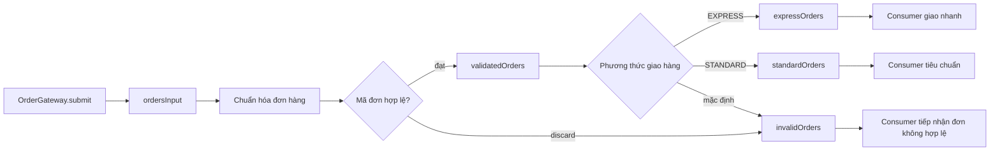

# IntegrationGraph: quan sát cấu trúc luồng Spring Integration

## 1. IntegrationGraph giải quyết vấn đề gì?

Trong một ứng dụng Spring Integration, một yêu cầu nghiệp vụ có thể đi qua gateway, nhiều `MessageChannel`, transformer, filter và router trước khi đến bộ xử lý cuối. Khi số lượng luồng tăng lên, việc nhìn từng phương thức `@Bean` không còn đủ để trả lời nhanh: “Đầu vào này đang nối đến đâu?” hoặc “Thông điệp bị loại sẽ được gửi sang kênh nào?”.

**Integration Graph** biểu diễn các thành phần tích hợp và quan hệ kết nối của chúng trong ứng dụng đang chạy. Thành phần trung tâm là `IntegrationGraphServer`; dữ liệu kết quả là đối tượng `Graph`, thường được xuất thành JSON để kiểm tra hoặc vẽ sơ đồ. Đây là một công cụ của nhóm **System management** trong phạm vi **SPRING_INTEGRATION_CORE**.

Ví dụ, đội vận hành cần xác nhận nhánh giao hàng nhanh đã được triển khai cùng nhánh giao hàng tiêu chuẩn. Graph giúp kiểm tra sự hiện diện của các channel, router và consumer liên quan. Để biết đơn hàng cụ thể đã đi qua nhánh nào và mất bao lâu, cần kết hợp log, tracing hoặc metrics.

Sau bài học này, bạn có thể:

- Đọc ba phần `contentDescriptor`, `nodes` và `links` của graph.
- Liên hệ graph với gateway, channel và endpoint được khai báo bằng Java DSL.
- Đăng ký `IntegrationGraphServer` và lấy graph trong Java hoặc qua Spring Boot Actuator.
- Phân biệt đọc graph với dựng lại graph khi cấu trúc ứng dụng thay đổi.
- Dùng graph để kiểm tra kết nối, đồng thời nhận biết giới hạn khi chẩn đoán lỗi và hiệu năng.

Các ví dụ chọn **Java 17, Spring Boot 3.5.x và Spring Integration 6.5.x** làm mốc minh họa. Dependency của Spring Integration nên theo phiên bản do Spring Boot quản lý. Không cần coi mốc minh họa này là yêu cầu nâng cấp ứng dụng hiện có.

## 2. Graph mô tả cấu trúc, metrics và tracing bổ sung hành vi

Hãy phân biệt các câu hỏi vận hành:

| Câu hỏi | Nguồn thông tin phù hợp |
| --- | --- |
| `validatedOrders` có nối đến một router không? | Integration Graph |
| Nhánh giao hàng nhanh có đang xử lý ít thông điệp hơn bình thường không? | Metrics và dữ liệu nghiệp vụ |
| Đơn hàng `A-101` đã qua những bước nào? | Log có correlation ID hoặc tracing |
| Consumer có thực sự chạy sau khi bị dừng thủ công không? | Trạng thái lifecycle của endpoint |
| Aggregator đang giữ những nhóm thông điệp nào? | Message store, cơ chế quản lý aggregator và dữ liệu chẩn đoán liên quan |

Graph biểu diễn các thành phần được framework nhận biết trong application context. Một node vẫn có thể tồn tại khi endpoint tương ứng đang dừng. Một liên kết cũng không chứng minh đã có thông điệp chạy qua liên kết đó.

Đặc biệt, không suy ra rằng:

- Một `DirectChannel` có node nghĩa là đã có consumer hoạt động đúng.
- Router có hai nhánh nghĩa là cả hai nhánh đã được sử dụng.
- Aggregator có đầu ra nghĩa là mọi nhóm thông điệp đã đủ điều kiện release.
- Có `errorChannel` trong graph nghĩa là mọi exception đều được chuyển đến đó.
- Mọi đường trả lời tạm thời của gateway đều được vẽ thành kết nối cố định.

Tư duy hữu ích khi xử lý sự cố là: **graph giúp tìm vị trí cần quan sát; dữ liệu thực thi giúp xác định chuyện gì đã xảy ra tại vị trí đó**.

## 3. Mô hình dữ liệu của graph

### 3.1. Ba phần cấp cao nhất

Đối tượng `Graph` cung cấp `getContentDescriptor()`, `getNodes()` và `getLinks()`. Khi được serialize thành JSON, ba tập dữ liệu này tạo nên mô hình để công cụ phía client phân tích hoặc hiển thị. [API Graph 6.5](https://docs.spring.io/spring-integration/docs/6.5.0/api/org/springframework/integration/graph/Graph.html)

Đoạn JSON dưới đây là **mô hình rút gọn để giải thích**, không phải bản chụp nguyên văn của ứng dụng ví dụ. ID, tên endpoint và các trường bổ sung trong kết quả thực tế có thể khác.

```json
{
  "contentDescriptor": {
    "provider": "spring-integration",
    "providerVersion": "6.5.x",
    "providerFormatVersion": 1.2,
    "name": "order-routing-demo"
  },
  "nodes": [
    {
      "nodeId": 10,
      "name": "validatedOrders",
      "componentType": "channel",
      "properties": {}
    },
    {
      "nodeId": 11,
      "name": "shippingRouter",
      "componentType": "router",
      "properties": {}
    },
    {
      "nodeId": 12,
      "name": "expressOrders",
      "componentType": "channel",
      "properties": {}
    }
  ],
  "links": [
    { "from": 10, "to": 11, "type": "input" },
    { "from": 11, "to": 12, "type": "route" }
  ]
}
```

Cách đọc ví dụ: node `10` là kênh đầu vào của node `11`; node `11` có một nhánh định tuyến sang node `12`.

### 3.2. Descriptor: nhận biết nguồn và định dạng

`contentDescriptor` giúp nhận biết ứng dụng cung cấp graph:

| Trường | Ý nghĩa |
| --- | --- |
| `provider` | Nhà cung cấp mô hình, ở đây là Spring Integration |
| `providerVersion` | Phiên bản framework cung cấp dữ liệu |
| `providerFormatVersion` | Phiên bản định dạng graph |
| `name` | Tên ứng dụng được cấu hình cho graph |

Tên có thể lấy từ `spring.application.name` hoặc được đặt bằng `setApplicationName(...)` trên server. Đừng dùng `providerVersion` làm mã phiên bản nghiệp vụ của dịch vụ; hãy quản lý phiên bản triển khai bằng metadata vận hành riêng.

### 3.3. Node: một thành phần trong mô hình runtime

`IntegrationNode` có các thuộc tính cơ bản như `nodeId`, `name`, `componentType` và `properties`; API cũng cung cấp loại EIP, nhóm EIP và trạng thái `observed`. `observed` cho biết thành phần có được instrument bằng observation hay không, không phải trạng thái khỏe mạnh của thành phần. [API IntegrationNode 6.5](https://docs.spring.io/spring-integration/docs/6.5.0/api/org/springframework/integration/graph/IntegrationNode.html)

Khi đọc node, nên ưu tiên:

1. `name` để liên hệ với tên bean hoặc tên thành phần trong ứng dụng.
2. `componentType` để hiểu vai trò kỹ thuật.
3. `integrationPatternType` nếu cần phân loại theo Enterprise Integration Patterns.
4. Các trường phụ như `input`, `output` hoặc `properties` nếu loại node đó cung cấp.

`nodeId` là khóa nối bên trong một graph. Khi so sánh hai lần khởi động hoặc hai bản triển khai, hãy ghép theo tên thành phần và vai trò trước; không thiết kế dashboard dựa vào giả định “router giao hàng luôn có ID 11”.

Một bước Java DSL có thể tạo cả handler, endpoint và channel trung gian. Vì vậy, số node không nhất thiết bằng số lời gọi `transform()`, `filter()` hoặc `handle()` trong mã nguồn. Gateway có nhiều phương thức cũng có thể tạo nhiều node tương ứng.

### 3.4. Link: mối quan hệ có hướng

`LinkNode` chứa `from`, `to` và `type`. Hai giá trị đầu tham chiếu đến `nodeId` của node nguồn và node đích. [API LinkNode 6.5](https://docs.spring.io/spring-integration/docs/6.5.0/api/org/springframework/integration/graph/LinkNode.html)

Các loại liên kết thường gặp:

| `type` | Hướng diễn giải |
| --- | --- |
| `input` | Từ channel đến thành phần nhận thông điệp |
| `output` | Từ thành phần phát hoặc tạo đầu ra đến channel |
| `route` | Từ router đến channel được định tuyến |
| `discard` | Từ thành phần có cơ chế loại thông điệp đến discard channel |
| `error` | Từ thành phần có cơ chế chuyển lỗi được graph nhận diện đến error channel |

Chẳng hạn, `discard` của filter dẫn tới nơi nhận thông điệp bị loại. Nó không đồng nghĩa với lỗi xử lý. Với `error`, chỉ đọc các liên kết framework thực sự xuất ra; đừng tự thêm một cạnh từ mọi handler đến `errorChannel`. [Mô hình Integration Graph](https://docs.spring.io/spring-integration/reference/6.5/graph.html)

## 4. Đăng ký IntegrationGraphServer và hiểu vòng đời

Trong ứng dụng Spring thuần đã bật hạ tầng Spring Integration, khai báo server dưới dạng Spring bean:

```java
import org.springframework.context.annotation.Bean;
import org.springframework.context.annotation.Configuration;
import org.springframework.integration.graph.IntegrationGraphServer;

@Configuration
public class GraphConfiguration {

    @Bean
    public IntegrationGraphServer integrationGraphServer() {
        IntegrationGraphServer server = new IntegrationGraphServer();
        server.setApplicationName("order-routing-demo");
        return server;
    }
}
```

Việc để Spring quản lý bean giúp server nhận application context và sự kiện context refresh. Chỉ gọi `new IntegrationGraphServer()` trong một hàm tiện ích rồi dùng ngay sẽ thiếu vòng đời này.

Hai phương thức chính có mục đích khác nhau:

| Phương thức | Khi dùng |
| --- | --- |
| `getGraph()` | Đọc graph đang được cache |
| `rebuild()` | Dựng lại mô hình từ các thành phần hiện có, cập nhật cache và trả graph mới |

Server xử lý `ContextRefreshedEvent` của context chứa nó. Khi ứng dụng đăng ký hoặc gỡ luồng động sau đó, cần chủ động dựng lại graph để phản ánh cấu trúc mới. [API IntegrationGraphServer 6.5](https://docs.spring.io/spring-integration/docs/6.5.0/api/org/springframework/integration/graph/IntegrationGraphServer.html)

`rebuild()` không khởi động lại endpoint, không gửi lại thông điệp và không sửa cấu hình router. Nó dựng lại **mô hình quan sát**. Một biến Java đang giữ `Graph` cũ cũng không tự chuyển sang đối tượng mới sau khi server thay cache.

Trong Spring Boot có Actuator, auto-configuration có thể cung cấp cả server và endpoint khi đủ điều kiện. Bean server tự khai báo sẽ được ưu tiên vì cấu hình tự động có điều kiện `@ConditionalOnMissingBean`. Không cần tạo hai server cho cùng một mục đích. [Auto-configuration của IntegrationGraph endpoint](https://docs.spring.io/spring-boot/3.5/api/java/org/springframework/boot/actuate/autoconfigure/integration/IntegrationGraphEndpointAutoConfiguration.html)

## 5. Ví dụ hoàn chỉnh: kiểm tra luồng định tuyến đơn hàng

Ứng dụng sau nhận `Order` qua messaging gateway, chuẩn hóa dữ liệu, loại đơn thiếu mã và định tuyến theo phương thức giao hàng. Các đoạn mã là nội dung minh họa để đưa vào một dự án Spring Boot riêng.

### 5.1. Luồng nghiệp vụ cần nhìn thấy



Sơ đồ thể hiện ý nghĩa nghiệp vụ. Graph thực tế có thể chứa thêm channel trung gian và thành phần hạ tầng như `nullChannel` hoặc `errorLogger`.

### 5.2. Dependency

Trong dự án đã sử dụng parent hoặc BOM Spring Boot 3.5.x, thêm các dependency sau vào phần `dependencies` của `pom.xml`. Java DSL nằm trong Spring Integration Core, không cần một artifact Java DSL riêng.

```xml
<dependency>
    <groupId>org.springframework.boot</groupId>
    <artifactId>spring-boot-starter-integration</artifactId>
</dependency>

<dependency>
    <groupId>org.springframework.boot</groupId>
    <artifactId>spring-boot-starter-web</artifactId>
</dependency>

<dependency>
    <groupId>org.springframework.boot</groupId>
    <artifactId>spring-boot-starter-actuator</artifactId>
</dependency>

<dependency>
    <groupId>org.springframework.boot</groupId>
    <artifactId>spring-boot-starter-test</artifactId>
    <scope>test</scope>
</dependency>
```

Đặt `java.version` là `17` hoặc dùng JDK tương thích với phiên bản Boot của dự án. Ví dụ sử dụng MVC để phục vụ Actuator qua HTTP; cơ chế dựng graph không đòi hỏi bản thân luồng nghiệp vụ phải nhận thông điệp qua HTTP.

### 5.3. Lớp khởi động, payload và gateway

Đặt các lớp dưới cùng package `com.example.integrationgraph`.

```java
package com.example.integrationgraph;

import org.springframework.boot.SpringApplication;
import org.springframework.boot.autoconfigure.SpringBootApplication;
import org.springframework.integration.annotation.IntegrationComponentScan;

@SpringBootApplication
@IntegrationComponentScan
public class GraphDemoApplication {

    public static void main(String[] args) {
        SpringApplication.run(GraphDemoApplication.class, args);
    }
}
```

```java
package com.example.integrationgraph;

public record Order(String id, String shippingMethod) {
}
```

```java
package com.example.integrationgraph;

import org.springframework.integration.annotation.MessagingGateway;

@MessagingGateway(defaultRequestChannel = "ordersInput")
public interface OrderGateway {

    void submit(Order order);
}
```

`@IntegrationComponentScan` giúp phát hiện interface gateway. `submit()` trả về `void` vì ví dụ dùng thao tác gửi một chiều, không thiết kế một chuỗi request/reply trả kết quả nghiệp vụ.

### 5.4. Cấu hình Java DSL

```java
package com.example.integrationgraph;

import java.util.Locale;

import org.slf4j.Logger;
import org.slf4j.LoggerFactory;
import org.springframework.boot.ApplicationRunner;
import org.springframework.context.annotation.Bean;
import org.springframework.context.annotation.Configuration;
import org.springframework.integration.channel.DirectChannel;
import org.springframework.integration.dsl.IntegrationFlow;
import org.springframework.integration.graph.IntegrationGraphServer;
import org.springframework.messaging.MessageChannel;

@Configuration
public class OrderFlows {

    private static final Logger log =
            LoggerFactory.getLogger(OrderFlows.class);

    @Bean
    public MessageChannel ordersInput() {
        return new DirectChannel();
    }

    @Bean
    public MessageChannel validatedOrders() {
        return new DirectChannel();
    }

    @Bean
    public MessageChannel expressOrders() {
        return new DirectChannel();
    }

    @Bean
    public MessageChannel standardOrders() {
        return new DirectChannel();
    }

    @Bean
    public MessageChannel invalidOrders() {
        return new DirectChannel();
    }

    @Bean
    public IntegrationGraphServer integrationGraphServer() {
        IntegrationGraphServer server = new IntegrationGraphServer();
        server.setApplicationName("order-routing-demo");
        return server;
    }

    @Bean
    public IntegrationFlow orderRoutingFlow() {
        return IntegrationFlow.from("ordersInput")
                .transform(Order.class, order -> new Order(
                        order.id() == null ? "" : order.id().trim(),
                        order.shippingMethod() == null
                                ? "STANDARD"
                                : order.shippingMethod().trim()
                                        .toUpperCase(Locale.ROOT)),
                        endpoint -> endpoint.id("normalizeOrder"))
                .filter(Order.class, order -> !order.id().isBlank(),
                        filter -> filter.id("validateOrder")
                                .discardChannel("invalidOrders"))
                .channel("validatedOrders")
                .route(Order.class, Order::shippingMethod,
                        router -> router.id("routeByShipping")
                                .channelMapping("EXPRESS", "expressOrders")
                                .channelMapping("STANDARD", "standardOrders")
                                .channelKeyFallback(false)
                                .defaultOutputChannel("invalidOrders"))
                .get();
    }

    @Bean
    public IntegrationFlow expressFlow() {
        return IntegrationFlow.from("expressOrders")
                .handle(message -> log.info("EXPRESS: {}",
                                message.getPayload()),
                        endpoint -> endpoint.id("expressConsumer"))
                .get();
    }

    @Bean
    public IntegrationFlow standardFlow() {
        return IntegrationFlow.from("standardOrders")
                .handle(message -> log.info("STANDARD: {}",
                                message.getPayload()),
                        endpoint -> endpoint.id("standardConsumer"))
                .get();
    }

    @Bean
    public IntegrationFlow invalidFlow() {
        return IntegrationFlow.from("invalidOrders")
                .handle(message -> log.info("INVALID: {}",
                                message.getPayload()),
                        endpoint -> endpoint.id("invalidConsumer"))
                .get();
    }

    @Bean
    public ApplicationRunner sendDemoOrders(OrderGateway gateway) {
        return args -> {
            gateway.submit(new Order("  A-101  ", " express "));
            gateway.submit(new Order("A-102", "STANDARD"));
            gateway.submit(new Order("   ", "STANDARD"));
            gateway.submit(new Order("A-103", "DRONE"));
        };
    }
}
```

Ở đây:

- Transformer chuẩn hóa mã đơn và phương thức giao hàng.
- Filter đưa đơn thiếu mã sang `invalidOrders` bằng cơ chế discard.
- Router dùng mapping tường minh cho `EXPRESS` và `STANDARD`.
- `channelKeyFallback(false)` ngăn việc lấy một giá trị nghiệp vụ không có mapping làm tên channel để phân giải.
- `defaultOutputChannel("invalidOrders")` tiếp nhận phương thức giao hàng chưa hỗ trợ.
- Các handler cuối chỉ tiếp nhận thông điệp và ghi log trong ví dụ.

API `RouterSpec` cung cấp các tùy chọn mapping và fallback được dùng trong cấu hình trên. [API RouterSpec 6.5](https://docs.spring.io/spring-integration/docs/6.5.0/api/org/springframework/integration/dsl/RouterSpec.html)

Kết quả nghiệp vụ mong đợi:

| Dữ liệu gửi | Kết quả sau chuẩn hóa | Nhánh nhận |
| --- | --- | --- |
| `"  A-101  ", " express "` | `A-101, EXPRESS` | `expressOrders` |
| `"A-102", "STANDARD"` | `A-102, STANDARD` | `standardOrders` |
| Mã đơn chỉ chứa khoảng trắng | Mã đơn rỗng | `invalidOrders` qua filter |
| `"A-103", "DRONE"` | Không có mapping tương ứng | `invalidOrders` qua đầu ra mặc định của router |

Tất cả channel trong ví dụ là `DirectChannel`. Handler được gọi trong luồng gửi tương ứng; việc có nhiều channel không tự tạo bất đồng bộ. Nếu handler ném exception trong đường gọi đồng bộ này, exception có thể quay về bên gọi gateway.

Các ID như `normalizeOrder` và `routeByShipping` giúp tìm endpoint trong ứng dụng. Tên node có thể dựa trên handler được gắn với endpoint và có thêm hậu tố do DSL tạo. Khi mở graph lần đầu, hãy xác nhận tên thực tế trước khi viết bộ lọc dashboard.

## 6. Lấy graph qua Java

Nếu cần đọc cấu trúc trong một tiện ích nội bộ, có thể inject server và duyệt dữ liệu trực tiếp. Ví dụ sau là một phương thức `@Bean` bổ sung trong lớp cấu hình, với các import tương ứng:

```java
import org.springframework.boot.ApplicationRunner;
import org.springframework.context.annotation.Bean;
import org.springframework.integration.graph.Graph;
import org.springframework.integration.graph.IntegrationGraphServer;

@Bean
public ApplicationRunner inspectGraph(IntegrationGraphServer server) {
    return args -> {
        Graph graph = server.getGraph();

        System.out.println(graph.getContentDescriptor());

        graph.getNodes().forEach(node ->
                System.out.printf("%d | %s | %s%n",
                        node.getNodeId(),
                        node.getName(),
                        node.getComponentType()));

        graph.getLinks().forEach(link ->
                System.out.printf("%d -> %d [%s]%n",
                        link.getFrom(),
                        link.getTo(),
                        link.getType()));
    };
}
```

`ApplicationRunner` được thực hiện sau khi application context được khởi tạo. Cách này phù hợp hơn việc cố duyệt toàn bộ graph ngay trong constructor của bean cấu hình.

Để diễn giải một cạnh, tạo bảng tra `nodeId -> node` rồi đổi ID sang tên. Khi xây giao diện, giữ màu hoặc kiểu đường khác nhau cho `input`, `route`, `discard` và `error` để người xem hiểu ý nghĩa của từng kết nối.

Đừng dùng `Graph` như một API thay đổi topology. Muốn thêm luồng động, thực hiện qua cơ chế đăng ký `IntegrationFlow` thích hợp; muốn start/stop endpoint, dùng cơ chế quản lý lifecycle thích hợp.

## 7. Lấy graph qua Spring Boot Actuator

### 7.1. Cấu hình truy cập trong môi trường thực hành

Trong `application.yml` của ứng dụng minh họa:

```yaml
spring:
  application:
    name: order-routing-demo

management:
  endpoints:
    web:
      exposure:
        include: health,integrationgraph
```

Bean trong `OrderFlows` đã đặt cùng tên ứng dụng cho graph. Có thể bỏ `setApplicationName(...)` để dùng tên từ môi trường.

Việc endpoint có được tạo, được cho phép truy cập và được expose qua HTTP là các điều kiện khác nhau. Với cấu hình thực hành mặc định, `include` ở trên mở HTTP exposure cho graph; cấu hình access hoặc security bổ sung của dự án vẫn có thể giới hạn thao tác.

### 7.2. Đọc và dựng lại

Trong terminal Windows, dùng `curl.exe` để gọi đúng chương trình curl:

```powershell
curl.exe -i http://localhost:8080/actuator/integrationgraph

curl.exe -i -X POST http://localhost:8080/actuator/integrationgraph
```

Với base path và cổng mặc định:

| Thao tác | HTTP | Kết quả mong đợi |
| --- | --- | --- |
| Đọc graph | `GET /actuator/integrationgraph` | `200` và JSON graph |
| Dựng lại graph | `POST /actuator/integrationgraph` | `204 No Content` |
| Đọc sau khi dựng lại | `GET /actuator/integrationgraph` | JSON của graph đã cập nhật |

`POST` không trả JSON graph trong response thành công; client cần gọi `GET` tiếp nếu muốn hiển thị dữ liệu. [Spring Boot Actuator: integrationgraph](https://docs.spring.io/spring-boot/3.5/api/rest/actuator/integrationgraph.html)

Có thể đọc tên và loại các node bằng PowerShell mà không lưu response thành file:

```powershell
$graph = Invoke-RestMethod -Uri 'http://localhost:8080/actuator/integrationgraph'

$graph.nodes |
    Select-Object nodeId, name, componentType

$graph.links |
    Select-Object from, to, type
```

Khi áp dụng vào môi trường vận hành, bảo vệ endpoint bằng chính sách xác thực và phân quyền quản trị của dịch vụ. Tên thành phần, biểu thức hoặc metadata tùy biến có thể tiết lộ cấu trúc nội bộ. Không đưa secret, payload đơn hàng hoặc thông tin khách hàng vào properties của graph.

### 7.3. Phân biệt với IntegrationGraphController

Spring Integration còn có controller riêng, được bật bằng `@EnableIntegrationGraphController` khi có module HTTP và hạ tầng web tương ứng. Ví dụ:

```java
import org.springframework.context.annotation.Configuration;
import org.springframework.integration.http.config.EnableIntegrationGraphController;

@Configuration
@EnableIntegrationGraphController(path = "/internal/integration")
public class GraphHttpConfiguration {
}
```

Nếu chọn cách này, cần dependency `org.springframework.integration:spring-integration-http` và cấu hình web tương thích. Ví dụ Boot Actuator phía trên không cần thêm controller này.

Annotation cho phép tùy chỉnh path; path mặc định là `/integration`. [API EnableIntegrationGraphController](https://docs.spring.io/spring-integration/docs/6.5.0/api/org/springframework/integration/http/config/EnableIntegrationGraphController.html)

Hai giao diện có quy ước HTTP khác nhau:

| Giao diện | Đọc | Dựng lại |
| --- | --- | --- |
| Spring Boot Actuator | `GET /actuator/integrationgraph` | `POST /actuator/integrationgraph` |
| Controller riêng, path trong ví dụ | `GET /internal/integration` | `GET /internal/integration/refresh` |

Controller riêng có phương thức `refreshGraph()` với mapping `GET /refresh` và trả về `Graph`. Không áp dụng quy ước `POST` của Actuator cho controller này. [API IntegrationGraphController](https://docs.spring.io/spring-integration/docs/6.5.0/api/org/springframework/integration/http/management/IntegrationGraphController.html)

Với ứng dụng Boot đã có Actuator, chọn một giao diện quản trị chính để tránh phải cấu hình và bảo vệ nhiều đường truy cập tương đương.

## 8. Khi nào cần rebuild?

### 8.1. Cấu trúc không thay đổi

Nếu chỉ gửi thêm một nghìn đơn hàng qua các bean đã có, không cần `rebuild()` để “ghi nhận một nghìn đường đi”. Graph không lưu lịch sử từng thông điệp.

Tương tự, không gọi rebuild trong mỗi request nghiệp vụ. Việc dựng lại cần duyệt các thành phần; đặt nó trên đường xử lý chính vừa không đúng mục đích vừa tạo công việc quản lý không cần thiết.

### 8.2. Có thay đổi topology hoặc dữ liệu mô tả

Những thời điểm phù hợp để chủ động dựng lại gồm:

- Sau khi đăng ký một flow động mới.
- Sau khi gỡ một flow động khỏi context.
- Sau thay đổi mapping mà bạn cần phản ánh lại trên mô hình.
- Khi cần chụp lại các properties tùy biến được tính tại lúc dựng node.

Trình tự thao tác:

```text
Hoàn tất thay đổi thành phần hoặc cấu hình được hỗ trợ
    -> gọi server.rebuild() hoặc endpoint refresh
    -> lấy graph mới
    -> kiểm tra node và liên kết mong đợi
```

Với router có đích phân giải động, graph còn phụ thuộc những đích router đã biết và giới hạn thông tin báo cáo. Không coi một snapshot là danh mục đầy đủ mọi đích nghiệp vụ có thể xuất hiện trong tương lai. `dynamicChannelLimit` điều khiển số channel động được giữ cho mục đích báo cáo. [Tùy chọn dynamicChannelLimit](https://docs.spring.io/spring-integration/docs/6.5.0/api/org/springframework/integration/dsl/RouterSpec.html)

### 8.3. Rebuild và lifecycle là hai việc riêng

Dừng consumer, sau đó gọi `rebuild()`, không làm consumer tự chạy lại. Ngược lại, thấy node consumer sau khi rebuild cũng không chứng minh consumer đang chạy.

Nếu ứng dụng có context cha/con hoặc management context riêng, xác nhận server đang quan sát context mong muốn. Không mặc định một server trong một context sẽ gom toàn bộ thành phần của mọi context và mọi tiến trình khác.

Graph của một replica cũng không tự trở thành graph tổng của cả cụm dịch vụ. Khi tổng hợp nhiều replica, cần giữ danh tính ứng dụng, instance và thời điểm thu thập.

## 9. Bổ sung metadata để hỗ trợ vận hành

Callback `setAdditionalPropertiesCallback(...)` cho phép thêm properties cho các thành phần `NamedComponent`. Ví dụ dưới đây **thay thế phương thức bean server hiện có**, không khai báo thêm một bean trùng tên:

```java
import java.util.LinkedHashMap;
import java.util.Map;

import org.springframework.context.SmartLifecycle;
import org.springframework.context.annotation.Bean;
import org.springframework.integration.graph.IntegrationGraphServer;

@Bean
public IntegrationGraphServer integrationGraphServer() {
    IntegrationGraphServer server = new IntegrationGraphServer();
    server.setApplicationName("order-routing-demo");

    server.setAdditionalPropertiesCallback(component -> {
        Map<String, Object> properties = new LinkedHashMap<>();
        properties.put("module", "SPRING_INTEGRATION_CORE");
        properties.put("ownerTeam", "order-platform");

        if (component instanceof SmartLifecycle lifecycle) {
            properties.put("runningAtBuild", lifecycle.isRunning());
            properties.put("autoStartup", lifecycle.isAutoStartup());
        }

        return properties;
    });

    return server;
}
```

Hai thuộc tính nghiệp vụ trong ví dụ giúp người vận hành biết phạm vi và nhóm phụ trách. Chúng không thay đổi cách gửi `Message` hay lựa chọn `MessageChannel`.

Những giá trị boolean do callback tính ra là dữ liệu tại lúc tạo node. Nếu endpoint thay đổi lifecycle sau đó, `runningAtBuild` không tự trở thành giá trị trực tiếp chỉ vì client gọi `getGraph()`. Muốn đọc trạng thái hiện tại, dùng API quản lý lifecycle; muốn lấy lại snapshot properties, dựng lại graph. Callback được gọi trong quá trình xây node của server. [Mã nguồn IntegrationGraphServer 6.5](https://raw.githubusercontent.com/spring-projects/spring-integration/v6.5.0/spring-integration-core/src/main/java/org/springframework/integration/graph/IntegrationGraphServer.java)

Callback nên ngắn, có chi phí nhỏ và trả giá trị có thể serialize. Không gọi dịch vụ từ xa hoặc truy vấn dữ liệu nặng cho từng node.

## 10. Metrics và observation: đọc đúng theo phiên bản

Một số ví dụ cũ trên Internet có trường thống kê legacy trong JSON. Các thống kê legacy đã bị loại bỏ từ Spring Integration 5.4; không viết công cụ theo giả định mọi node đều có `stats`. [Ghi chú về metrics trong Integration Graph](https://docs.spring.io/spring-integration/reference/6.5/graph.html)

Trong hệ thống dùng Micrometer, khả năng instrument, meter registry và các tùy chọn quản lý quyết định dữ liệu metrics sẵn có. Hãy quan sát response của chính ứng dụng đang chạy trước khi lập trình bộ đọc các trường tùy chọn.

Khi cần chẩn đoán hiệu năng, kết hợp các góc nhìn:

- Graph: xác định channel và handler tạo nên nhánh cần kiểm tra.
- Metrics: đo throughput, lỗi, thời gian xử lý hoặc độ sâu hàng đợi bằng công cụ phù hợp.
- Tracing: theo dấu một yêu cầu xuyên qua các thành phần và ranh giới tiến trình.
- Trạng thái endpoint: xác định consumer có đang chạy, poller có hoạt động hay không.

Ví dụ, `expressOrders` vẫn có đầy đủ cạnh đến consumer nhưng lượng xử lý giảm. Từ graph, bạn biết consumer nào cần kiểm tra; sau đó xác minh trạng thái chạy, lỗi downstream và dữ liệu thời gian xử lý. Chỉ refresh graph sẽ không giải quyết nguyên nhân.

## 11. Kiểm thử cấu trúc bằng Graph API

Kiểm thử graph có ích khi nhóm muốn giữ một số kết nối quan trọng, chẳng hạn “luồng luôn có channel nhận đơn không hợp lệ” và “filter vẫn gửi discard đến đúng channel”.

Ví dụ JUnit 5 dưới đây sử dụng ứng dụng và dependency test ở trên. Nó kiểm tra tên các channel đã chủ động đặt và một cạnh discard, không khóa toàn bộ graph vào thứ tự node hoặc số ID cụ thể.

```java
package com.example.integrationgraph;

import java.util.Map;
import java.util.stream.Collectors;

import org.junit.jupiter.api.Test;
import org.springframework.beans.factory.annotation.Autowired;
import org.springframework.boot.test.context.SpringBootTest;
import org.springframework.integration.graph.Graph;
import org.springframework.integration.graph.IntegrationGraphServer;
import org.springframework.integration.graph.IntegrationNode;

import static org.assertj.core.api.Assertions.assertThat;

@SpringBootTest(webEnvironment = SpringBootTest.WebEnvironment.NONE)
class IntegrationGraphStructureTest {

    @Autowired
    private IntegrationGraphServer server;

    @Test
    void exposesOrderChannelsAndInvalidDiscardPath() {
        Graph graph = server.getGraph();

        Map<String, Integer> idsByName = graph.getNodes().stream()
                .collect(Collectors.toMap(
                        IntegrationNode::getName,
                        IntegrationNode::getNodeId));

        assertThat(idsByName).containsKeys(
                "ordersInput",
                "validatedOrders",
                "expressOrders",
                "standardOrders",
                "invalidOrders");

        int invalidChannelId = idsByName.get("invalidOrders");

        assertThat(graph.getLinks()).anySatisfy(link -> {
            assertThat(link.getTo()).isEqualTo(invalidChannelId);
            assertThat(link.getType().name())
                    .isEqualToIgnoringCase("discard");
        });
    }
}
```

Bean server được khai báo tường minh trong `OrderFlows`, nên bài kiểm thử cấu trúc không cần mở HTTP server. Bài test này xác nhận hợp đồng kết nối; cần bài kiểm thử hành vi riêng nếu muốn chứng minh dữ liệu `EXPRESS` thực sự đến đúng handler hoặc exception được xử lý đúng.

Với luồng đăng ký động, kiểm thử theo thứ tự: đăng ký flow, gọi `rebuild()`, xác minh cấu trúc mới và dọn flow theo vòng đời test. Không dùng tổng số node cố định làm kết quả mong đợi nếu số lượng thành phần hạ tầng có thể đổi theo cấu hình.

## 12. Chẩn đoán các tình huống thường gặp

| Hiện tượng | Điểm cần kiểm tra | Cách xử lý theo bằng chứng |
| --- | --- | --- |
| `404` khi gọi endpoint | HTTP exposure, base path, cổng quản trị, điều kiện tạo endpoint | Xác minh dependency và cấu hình Actuator; dùng đúng URL |
| `401` hoặc `403` | Xác thực, phân quyền; với `POST` còn có thể liên quan CSRF | Dùng chính sách truy cập quản trị đã cấu hình cho ứng dụng |
| `405` khi refresh | Đang gọi Actuator hay controller riêng? | Dùng đúng HTTP method của giao diện được bật |
| `POST` thành công nhưng không có JSON | Mã phản hồi có phải `204` không? | Gọi `GET` tiếp để lấy graph |
| Flow động chưa xuất hiện | Graph cache có trước lúc đăng ký flow | Rebuild sau khi việc đăng ký hoàn tất |
| Chỉ thấy vài node hạ tầng | Flow chưa được scan hoặc server quan sát context khác | Kiểm tra package scan và context chứa bean |
| Tên node khác tên endpoint | Handler và thành phần do DSL tạo có tên riêng | Tra graph thực tế và đối chiếu tên bean liên quan |
| Có node nhưng thông điệp không được xử lý | Lifecycle, subscriber, poller hoặc lỗi handler | Kết hợp trạng thái runtime, log và kiểm thử hành vi |
| Không thấy cạnh lỗi mong đợi | Đường xử lý có thực sự publish `ErrorMessage` không? | Kiểm tra mô hình đồng bộ/bất đồng bộ và cấu hình error channel |
| Client lỗi khi thiếu trường thống kê | Client phụ thuộc schema của ví dụ cũ | Tách trường bắt buộc và tùy chọn; đối chiếu phiên bản nguồn |

Trong ví dụ dùng `DirectChannel`, lỗi của handler có thể truyền ngược về bên gửi. Muốn thiết kế xử lý lỗi qua channel, phải chọn và cấu hình cơ chế xử lý lỗi phù hợp với endpoint hoặc ranh giới bất đồng bộ. Việc chỉ khai báo bean tên `errorChannel` không thay thế thiết kế đó.

## 13. Thực hành mở rộng

1. **Khảo sát graph ban đầu.** Chạy ứng dụng ví dụ, lấy graph và tìm năm channel do bạn đặt tên. Xác nhận có đường discard đến `invalidOrders`. Ghi nhận tên handler thực tế thay vì đoán tên từ `.id(...)`.
2. **Thêm một loại giao hàng.** Tạo channel và consumer cho `PICKUP`, bổ sung mapping, khởi động ứng dụng và kiểm tra nhánh mới. Gửi một đơn `PICKUP` để xác minh cả hành vi.
3. **Tách câu hỏi cấu trúc và trạng thái.** Dừng một consumer bằng cơ chế lifecycle trong môi trường thử nghiệm. So sánh graph với trạng thái endpoint và phản ứng khi gửi thông điệp.
4. **Quan sát queue và poller.** Thay một nhánh `DirectChannel` bằng `QueueChannel` và cấu hình poller cho consumer của nhánh đó. Xác minh graph vẫn thể hiện kết nối, rồi dùng phép đo hàng đợi để kiểm tra backlog.
5. **Thử properties tùy biến.** Thêm `ownerTeam` và `runningAtBuild`, thay đổi trạng thái endpoint, so sánh kết quả trước và sau rebuild để hiểu dữ liệu snapshot.

Khi hoàn thành, bạn cần giải thích được mỗi kết luận dựa trên graph, dữ liệu thực thi hay trạng thái quản lý. Đó là nền tảng để dùng IntegrationGraph hiệu quả trong vận hành các luồng Spring Integration có transformer, router, filter, gateway và aggregator.
