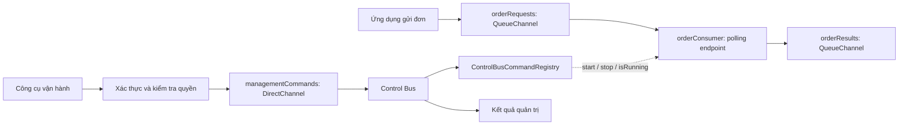

# Control Bus

Trong chương **System management** của module **SPRING_INTEGRATION_CORE**, Control Bus giúp điều khiển các thành phần tích hợp bằng chính mô hình `Message` và `MessageChannel`. Thay vì để một công cụ vận hành gọi trực tiếp vào mọi endpoint, ta gửi thông điệp quản trị đến một luồng chuyên trách; luồng đó phân giải lệnh và gọi thao tác được phép trên Spring bean.

Bài học sử dụng Java DSL và Control Bus dựa trên command registry của **Spring Integration 6.5.x**. Những khác biệt với cơ chế SpEL của các phiên bản cũ được nêu riêng để tránh trộn hai cách cấu hình.

## 1. Vấn đề cần giải quyết

Một hệ thống nhận đơn hàng vào hàng đợi, sau đó polling consumer lấy từng đơn để gửi sang đối tác. Khi đối tác bảo trì, đội vận hành cần:

- Xem consumer đang chạy hay đã dừng.
- Dừng việc lấy đơn mới mà vẫn giữ các đơn chưa xử lý trong hàng đợi.
- Khởi động consumer sau khi đối tác hoạt động trở lại.
- Ghi nhận người thực hiện, lý do và kết quả của thao tác.

Nếu mỗi yêu cầu đều phải thay cấu hình và triển khai lại ứng dụng, việc vận hành sẽ chậm và khó tự động hóa. Nếu phát tán lời gọi `start()` hoặc `stop()` khắp các controller và service, ranh giới quản trị cũng khó kiểm soát.

Control Bus cung cấp một điểm tiếp nhận lệnh quản trị theo mô hình thông điệp. Theo mẫu Enterprise Integration Patterns, luồng nghiệp vụ và luồng quản trị sử dụng cùng cơ chế messaging nhưng có các kênh riêng. [Nguồn: EIP — Control Bus](https://www.enterpriseintegrationpatterns.com/patterns/messaging/ControlBus.html).

Sau bài học, người học có thể thiết kế kênh quản trị, gọi lệnh lifecycle, truyền đối số có kiểu, nhận kết quả và kiểm thử ảnh hưởng của lệnh lên luồng thông điệp.

## 2. Luồng nghiệp vụ và luồng quản trị

Luồng nghiệp vụ mang dữ liệu như đơn hàng, hóa đơn hoặc sự kiện. Luồng quản trị mang yêu cầu thay đổi hay truy vấn trạng thái thành phần xử lý các dữ liệu đó.



Các mũi tên `start`, `stop`, `isRunning` biểu diễn lời gọi quản trị vào endpoint; chúng không đưa thêm đơn hàng vào `orderRequests`.

| Thành phần | Vai trò trong ví dụ |
| --- | --- |
| `Message<?>` quản trị | Chứa tên lệnh, đối số và thông tin phục vụ phản hồi hoặc theo dõi |
| `managementCommands` | Điểm vào của luồng quản trị |
| Control Bus endpoint | Nhận thông điệp và thực thi thao tác quản trị |
| `ControlBusCommandRegistry` | Phân giải lệnh thành phương thức hợp lệ trên bean |
| `orderConsumer` | Endpoint nghiệp vụ được điều khiển |
| `replyChannel` | Đường về cho kết quả của phương thức có giá trị trả về |

Trong thiết kế này, một đơn hàng không bao giờ được dùng như tên lệnh quản trị. Một yêu cầu dừng consumer cũng không đi qua transformer hay router chuyên xử lý đơn hàng.

Việc tách kênh còn giúp giữ khả năng quản trị khi luồng nghiệp vụ đang ùn tắc. Trong một hệ thống lớn, cần xem xét tách cả tài nguyên thực thi; hai kênh khác tên nhưng cùng phụ thuộc vào một thread pool đã cạn vẫn có thể cùng bị chậm.

## 3. Chọn đúng mô hình theo phiên bản

Control Bus từng nhận biểu thức SpEL làm payload. Từ phiên bản 6.4, Spring Integration bổ sung command registry; đến 6.5, các thành phần Control Bus dựa trên biểu thức SpEL cũ đã được loại bỏ. [Nguồn: thay đổi 6.3–6.4](https://docs.spring.io/spring-integration/reference/changes-6.3-6.4.html), [thay đổi 6.4–6.5](https://docs.spring.io/spring-integration/reference/7.2/changes-6.4-6.5.html).

| Dòng phiên bản | Cách cần nhận biết khi đọc tài liệu |
| --- | --- |
| 6.3 và trước đó | Thường gặp payload SpEL như `@orderConsumer.stop()` |
| 6.4 | Registry được giới thiệu; Java DSL có `controlBusOnRegistry()` để chọn mô hình mới |
| 6.5 | Dùng `.controlBus()` với command registry; `controlBusOnRegistry()` bị deprecated |

Các ví dụ bên dưới chọn dòng **6.5.x**, với payload dạng `orderConsumer.stop`, không thêm dấu `@` hoặc cặp ngoặc gọi hàm. Không dùng ví dụ của bài này để kết luận rằng một Control Bus cũ tự hỗ trợ cùng giao thức.

Registry vẫn có cơ chế ánh xạ nội bộ phục vụ việc gọi phương thức. Điểm cần nhớ ở phía gửi là hợp đồng **tên lệnh và danh sách đối số**, không phải khả năng gửi một biểu thức tùy ý.

## 4. Hợp đồng của thông điệp quản trị

### 4.1. Payload và đối số

Với mô hình registry, payload là chuỗi `beanName.methodName`. Đối số được đặt trong một `List<?>` ở header `IntegrationMessageHeaderAccessor.CONTROL_BUS_ARGUMENTS`; kiểu của từng phần tử tham gia việc chọn phương thức. [Nguồn: Spring Integration — Control Bus](https://docs.spring.io/spring-integration/reference/6.5/control-bus.html).

Ví dụ minh họa:

```java
Message<String> stopCommand = MessageBuilder
        .withPayload("orderConsumer.stop")
        .build();

Message<String> changeLimitCommand = MessageBuilder
        .withPayload("batchSettings.changeLimit")
        .setHeader(
                IntegrationMessageHeaderAccessor.CONTROL_BUS_ARGUMENTS,
                List.of(50))
        .build();
```

Trong ví dụ thứ hai, `50` là một `Integer` dùng cho phương thức nhận `int`. Chuỗi `"50"` không thể được coi là tương đương một cách mặc định. Đặc biệt khi có nhiều phương thức trùng tên, danh sách đối số sai kiểu có thể khiến registry không tìm được phương thức phù hợp.

Nên ưu tiên tên thao tác không nhập nhằng và các kiểu dữ liệu đơn giản. Ví dụ `changeLimit(int)` dễ vận hành hơn một nhóm phương thức `configure(...)` được overload với nhiều kiểu gần nhau.

### 4.2. Những phương thức nào được gọi?

Control Bus không biến toàn bộ public API của mọi Spring bean thành API quản trị. `ControlBusMethodFilter` giới hạn các phương thức liên quan đến `Lifecycle`, `Pausable`, một số phương thức quản lý thread executor/scheduler và những phương thức có `@ManagedAttribute` hoặc `@ManagedOperation`. [Nguồn: ControlBusMethodFilter Javadoc](https://docs.spring.io/spring-integration/docs/6.5.0/api/org/springframework/integration/support/management/ControlBusMethodFilter.html).

Với bean quản trị tự viết, bài này dùng `@ManagedResource` trên lớp và annotation quản trị trên từng phương thức. Registry yêu cầu bean thuộc nhóm có thể quản trị, chẳng hạn triển khai `Lifecycle` hoặc được đánh dấu `@ManagedResource`. [Nguồn: ControlBusCommandRegistry Javadoc](https://docs.spring.io/spring-integration/docs/6.5.0/api/org/springframework/integration/support/management/ControlBusCommandRegistry.html).

Các annotation này mô tả khả năng quản trị. Chúng không tự xác thực người gọi và không tự cấp quyền cho người dùng cuối. Trong ví dụ, cũng không cần dựng một kết nối JMX từ xa để gửi lệnh qua channel nội bộ.

### 4.3. Thông tin bổ sung của ứng dụng

Ngoài các header do framework hiểu, hệ thống vận hành có thể định nghĩa thông tin riêng:

| Dữ liệu | Mục đích | Nơi sử dụng |
| --- | --- | --- |
| `requestId` | Liên kết yêu cầu với log và kết quả | Gateway hoặc lớp audit |
| `reason` | Ghi nhận lý do thao tác | Lớp kiểm tra yêu cầu và audit |
| `targetInstance` | Xác định node đích trong cụm | Lớp định tuyến quản trị |
| `expiresAt` | Ngăn lệnh quá hạn tiếp tục có hiệu lực | Lớp kiểm tra trước Control Bus |

Đây là hợp đồng do ứng dụng xây dựng. Chỉ thêm những header này vào message không làm Control Bus tự có audit, chống lặp, định tuyến theo node hay kiểm tra thời hạn.

## 5. Ví dụ hoàn chỉnh bằng Java DSL

### 5.1. Môi trường và hành vi mong đợi

Ví dụ dùng JDK 17 trở lên, `spring-integration-core` dòng 6.5.x và các dependency Spring tương thích do dependency management của dự án quản lý. Không cần broker, HTTP server hoặc cơ sở dữ liệu.

Toàn bộ mã Java bên dưới nằm trong một lớp minh họa tên `ControlBusLesson`. Khi áp dụng vào một ứng dụng, có thể tách cấu hình, chương trình chạy thử và bean quản trị thành các lớp riêng.

Ứng dụng có ba channel:

- `orderRequests`: hàng đợi đơn chờ xử lý, sức chứa 100.
- `orderResults`: hàng đợi kết quả của bài thực hành, sức chứa 100.
- `managementCommands`: kênh đồng bộ nhận lệnh quản trị.

Endpoint `orderConsumer` được đặt `autoStartup(false)`. Vì vậy, chương trình có thể gửi một đơn vào hàng đợi trước khi ra lệnh bắt đầu xử lý.

### 5.2. Cấu hình và chương trình chạy thử

```java
import java.util.List;
import java.util.concurrent.atomic.AtomicInteger;

import org.springframework.beans.factory.annotation.Qualifier;
import org.springframework.context.annotation.AnnotationConfigApplicationContext;
import org.springframework.context.annotation.Bean;
import org.springframework.context.annotation.Configuration;
import org.springframework.integration.IntegrationMessageHeaderAccessor;
import org.springframework.integration.annotation.EnableIntegration;
import org.springframework.integration.channel.DirectChannel;
import org.springframework.integration.channel.QueueChannel;
import org.springframework.integration.core.MessagingTemplate;
import org.springframework.integration.dsl.IntegrationFlow;
import org.springframework.integration.dsl.Pollers;
import org.springframework.jmx.export.annotation.ManagedAttribute;
import org.springframework.jmx.export.annotation.ManagedOperation;
import org.springframework.jmx.export.annotation.ManagedResource;
import org.springframework.messaging.Message;
import org.springframework.messaging.MessageChannel;
import org.springframework.messaging.support.GenericMessage;
import org.springframework.messaging.support.MessageBuilder;

@Configuration
@EnableIntegration
public class ControlBusLesson {

    @Bean
    public DirectChannel managementCommands() {
        return new DirectChannel();
    }

    @Bean
    public QueueChannel orderRequests() {
        return new QueueChannel(100);
    }

    @Bean
    public QueueChannel orderResults() {
        return new QueueChannel(100);
    }

    @Bean
    public IntegrationFlow controlBusFlow(
            DirectChannel managementCommands) {

        return IntegrationFlow.from(managementCommands)
                .controlBus()
                .get();
    }

    @Bean
    public IntegrationFlow orderProcessingFlow(
            @Qualifier("orderRequests") QueueChannel requests,
            @Qualifier("orderResults") QueueChannel results) {

        return IntegrationFlow.from(requests)
                .handle(String.class,
                        (orderId, headers) -> "processed:" + orderId,
                        endpoint -> endpoint
                                .id("orderConsumer")
                                .autoStartup(false)
                                .poller(Pollers.fixedDelay(100)
                                        .maxMessagesPerPoll(1)))
                .channel(results)
                .get();
    }

    @Bean
    public BatchSettings batchSettings() {
        return new BatchSettings();
    }

    @ManagedResource
    public static class BatchSettings {

        private final AtomicInteger limit = new AtomicInteger(25);

        @ManagedAttribute
        public int getLimit() {
            return this.limit.get();
        }

        @ManagedOperation
        public int changeLimit(int newLimit) {
            if (newLimit < 1 || newLimit > 200) {
                throw new IllegalArgumentException(
                        "Limit must be between 1 and 200");
            }
            this.limit.set(newLimit);
            return newLimit;
        }

        // Phương thức public nhưng không được công bố để quản trị.
        public void resetInternal() {
            this.limit.set(25);
        }
    }

    static Message<String> command(String name, List<?> arguments) {
        return MessageBuilder.withPayload(name)
                .setHeader(
                        IntegrationMessageHeaderAccessor.CONTROL_BUS_ARGUMENTS,
                        arguments)
                .build();
    }

    static Object query(
            MessagingTemplate template,
            MessageChannel commands,
            String name,
            List<?> arguments) {

        Message<?> reply = template.sendAndReceive(
                commands, command(name, arguments));

        if (reply == null) {
            throw new IllegalStateException("No reply for " + name);
        }
        return reply.getPayload();
    }

    public static void main(String[] args) {
        try (var context = new AnnotationConfigApplicationContext(
                ControlBusLesson.class)) {

            MessageChannel commands = context.getBean(
                    "managementCommands", MessageChannel.class);
            QueueChannel requests = context.getBean(
                    "orderRequests", QueueChannel.class);
            QueueChannel results = context.getBean(
                    "orderResults", QueueChannel.class);

            MessagingTemplate template = new MessagingTemplate();
            template.setSendTimeout(2_000);
            template.setReceiveTimeout(2_000);

            System.out.println("running.before=" + query(
                    template, commands,
                    "orderConsumer.isRunning", List.of()));

            boolean accepted = requests.send(
                    new GenericMessage<>("ORD-1001"), 1_000);
            if (!accepted) {
                throw new IllegalStateException("Order queue is full");
            }

            System.out.println("queued=" + requests.getQueueSize());

            // start() trả void: gửi một chiều, không chờ payload phản hồi.
            template.send(commands,
                    command("orderConsumer.start", List.of()));

            System.out.println("running.started=" + query(
                    template, commands,
                    "orderConsumer.isRunning", List.of()));

            Message<?> processed = results.receive(2_000);
            if (processed == null) {
                throw new IllegalStateException("Order was not processed");
            }
            System.out.println("result=" + processed.getPayload());

            template.send(commands,
                    command("orderConsumer.stop", List.of()));

            System.out.println("running.stopped=" + query(
                    template, commands,
                    "orderConsumer.isRunning", List.of()));

            System.out.println("limit.changed=" + query(
                    template, commands,
                    "batchSettings.changeLimit", List.of(50)));

            System.out.println("limit.current=" + query(
                    template, commands,
                    "batchSettings.getLimit", List.of()));
        }
    }
}
```

Bỏ qua log khởi tạo và đóng context, đầu ra mong đợi là:

```text
running.before=false
queued=1
running.started=true
result=processed:ORD-1001
running.stopped=false
limit.changed=50
limit.current=50
```

Đây là đầu ra mô tả hành vi của ví dụ. Thời gian chờ hai giây là giới hạn dành cho bài thực hành trên máy cục bộ; khi đưa vào một môi trường thực, cần chọn timeout theo thời gian xử lý và tài nguyên của môi trường đó.

### 5.3. Vì sao ví dụ hoạt động?

`@EnableIntegration` đăng ký hạ tầng tích hợp trong Spring context. Java DSL tạo endpoint, liên kết channel và cấu hình poller. Trong DSL, `.handle(...)` biểu diễn service activator; đối tượng `IntegrationFlow` mô tả cách các thành phần được ghép lại. [Nguồn: Java DSL Basics](https://docs.spring.io/spring-integration/reference/6.5/dsl/java-basics.html).

Những lựa chọn cụ thể trong bài thực hành có ý nghĩa như sau:

1. `.id("orderConsumer")` đặt tên ổn định cho endpoint cần quản lý. Tên này được dùng trong các lệnh của ví dụ.
2. `autoStartup(false)` giữ consumer ở trạng thái chưa chạy khi context khởi động; lệnh `start` vẫn có thể khởi động nó sau đó.
3. `orderRequests` là `QueueChannel`, nên đơn có thể nằm chờ trong lúc consumer chưa chạy.
4. Poller được cấu hình ngay trên consumer của hàng đợi. Không cần khai báo một default poller cho consumer này.
5. Kết quả nghiệp vụ đi vào `orderResults`; kết quả quản trị quay về bên gọi qua cơ chế request–reply.

`BatchSettings` minh họa một bean quản trị tùy chỉnh, với kiểm tra giá trị ngay tại thao tác thay đổi. Thuộc tính `limit` của bean này **không được nối vào poller** trong ví dụ. Lệnh `changeLimit(50)` không thay đổi `maxMessagesPerPoll(1)` đã khai báo trên `orderConsumer`.

Nếu cần dùng giá trị đó trong nghiệp vụ thật, thành phần xử lý batch phải chủ động đọc hoặc áp dụng nó theo hợp đồng đã thiết kế. Việc thay đổi một biến quản trị không tự tái cấu hình mọi endpoint.

## 6. Gửi một chiều và nhận phản hồi

### 6.1. Thao tác trả `void`

Các lệnh như `orderConsumer.start` và `orderConsumer.stop` không có payload kết quả từ phương thức lifecycle. Ví dụ dùng `MessagingTemplate.send(...)` cho các lệnh này.

Không nên dùng helper `query(...)` để gọi `stop`: helper được viết với kỳ vọng có phản hồi. Nếu không có phản hồi, nó sẽ báo lỗi hết thời gian chờ dù thao tác dừng có thể đã được thực hiện.

Nếu API quản trị bên ngoài bắt buộc có phản hồi cho mọi lệnh, hãy xây dựng lớp điều phối trả một kết quả rõ ràng, chẳng hạn:

```json
{
  "requestId": "maint-20261119-001",
  "instance": "orders-worker-02",
  "target": "orderConsumer",
  "requestedState": "STOPPED",
  "observedRunning": false,
  "status": "SUCCEEDED"
}
```

Đây là mẫu DTO do ứng dụng định nghĩa, không phải định dạng phản hồi tự động của Control Bus.

### 6.2. Phương thức có giá trị trả về

`isRunning`, `getLimit` và `changeLimit` trong ví dụ đều có kết quả. `MessagingTemplate.sendAndReceive(...)` tạo đường phản hồi tạm để nhận message kết quả; không cần đặt một output channel cố định trên Control Bus flow của ví dụ. [Nguồn: MessagingTemplate Javadoc](https://docs.spring.io/spring-integration/docs/6.5.0/api/org/springframework/integration/core/MessagingTemplate.html).

Nếu đã cấu hình output channel cố định cho Control Bus, cần thiết kế bên nhận trên channel đó. Không nên mặc định rằng một lời gọi request–reply sẽ đồng thời lấy được kết quả đã được định tuyến sang một kênh khác.

Khi phương thức trả giá trị mà bên gửi dùng `send(...)` không kèm nơi nhận, lỗi có thể phát sinh ở bước gửi phản hồi. Lúc đó, phương thức đích có thể đã chạy xong. Vì vậy, lỗi giao nhận phản hồi không đủ để kết luận rằng trạng thái chưa thay đổi.

### 6.3. Ý nghĩa của timeout

Trong ví dụ, Control Bus được nối bằng `DirectChannel`. Lời gọi vào bean chạy trên thread của bên gửi. Đặt `receiveTimeout` không tạo cơ chế cưỡng bức ngắt một phương thức đồng bộ đang chạy lâu.

Với luồng bất đồng bộ, hết thời gian chờ chỉ cho biết bên gọi chưa nhận kết quả đúng hạn. Lệnh có thể đang chờ, đang thực thi hoặc đã thực thi nhưng phản hồi đến muộn. Trước khi gửi lại lệnh thay đổi trạng thái, cần truy vấn trạng thái hoặc đối chiếu hồ sơ thực thi.

## 7. Hiểu đúng đối tượng và trạng thái lifecycle

### 7.1. Endpoint, handler và toàn bộ flow

Một flow có thể tạo ra nhiều bean: channel, handler, consumer endpoint và các thành phần hỗ trợ. Tên phương thức `@Bean` của flow không nhất thiết là tên endpoint nhỏ mà ta muốn dừng.

Trong bài thực hành:

- `orderProcessingFlow` là flow cấu hình nghiệp vụ.
- `orderConsumer` là endpoint tiêu thụ từ `orderRequests`.
- Các lệnh trong chương trình chủ động chọn `orderConsumer` làm phạm vi tác động.

Spring Integration cũng hỗ trợ lifecycle cho toàn bộ `IntegrationFlow`, qua việc ủy quyền cho các thành phần thuộc flow đó. Phạm vi này rộng hơn việc dừng một consumer. [Nguồn: Java DSL Basics — lifecycle của flow](https://docs.spring.io/spring-integration/reference/6.5/dsl/java-basics.html).

Trong ứng dụng thực, hãy ghi rõ mục tiêu của mỗi thao tác: dừng nguồn nhận mới, dừng một consumer hay dừng cả flow. Đặt tên ổn định cho các endpoint sẽ được vận hành, thay vì phụ thuộc vào tên tự sinh.

### 7.2. `isRunning()` trả lời điều gì?

Đối với ví dụ, giá trị này cho biết trạng thái lifecycle của consumer. Nó không xác nhận rằng:

- Đối tác bên ngoài đang phản hồi tốt.
- Hàng đợi đã hết thông điệp.
- Không còn xử lý đang diễn ra trên các thread khác.
- Mọi đơn đã được ghi nhận thành công ở hệ thống đích.

Cần kết hợp trạng thái lifecycle với chỉ số hàng đợi, số tác vụ đang xử lý, lỗi và độ trễ khi đánh giá khả năng phục vụ.

### 7.3. `stop()` không phải là một chính sách bảo toàn dữ liệu

Trong cấu hình bài học, dừng consumer làm việc lấy thông điệp mới từ `orderRequests` ngừng lại. Hàng đợi vẫn là một bean riêng; bên gửi vẫn có thể tiếp tục thêm đơn cho đến khi đạt sức chứa.

`QueueChannel` của bài thực hành lưu dữ liệu trong bộ nhớ. Việc consumer dừng không xóa các phần tử đang chờ, nhưng đóng hoặc mất tiến trình sẽ làm mất dữ liệu đó. Nếu yêu cầu nghiệp vụ đòi hỏi lưu bền, phải thiết kế message store hoặc broker phù hợp.

Không suy diễn rằng mọi adapter có cùng hành vi khi dừng. Đối với JMS, AMQP, Kafka hoặc adapter khác, cần xem riêng cách dừng listener, acknowledgment, transaction và xử lý thông điệp đang bay.

### 7.4. `pause` và `resume`

Chỉ gửi các lệnh này đến thành phần thực sự hỗ trợ `Pausable`. Không phải mọi endpoint đều có cùng bộ thao tác, và tạm ngừng nhận mới không nhất thiết đồng nghĩa với đã hoàn tất mọi xử lý trước đó.

Một công cụ vận hành nên hiển thị các thao tác phù hợp với từng loại thành phần, thay vì luôn cho mọi bean các nút start, stop, pause và resume giống nhau.

## 8. Xử lý lỗi của lệnh quản trị

### 8.1. Lỗi đồng bộ

Với `DirectChannel` trong ví dụ, exception từ xử lý message được truyền về bên gọi. Chỉ thêm header `errorChannel` không tự chuyển mọi exception đồng bộ sang một error flow. [Nguồn: Spring Integration — Error Handling](https://docs.spring.io/spring-integration/reference/6.5/error-handling.html).

Ví dụ bắt lỗi tại chương trình gọi:

```java
try {
    Object result = ControlBusLesson.query(
            template,
            commands,
            "batchSettings.changeLimit",
            List.of(0));
    System.out.println(result);
}
catch (org.springframework.messaging.MessagingException exception) {
    System.err.println("Management command failed: "
            + exception.getMessage());
    // Khi cần chẩn đoán, xem chuỗi cause của exception.
}
```

Giá trị `0` bị chính `BatchSettings.changeLimit` từ chối trước khi cập nhật trạng thái. Ứng dụng vận hành có thể ánh xạ lỗi này thành kết quả nghiệp vụ quản trị như `INVALID_ARGUMENT`, đồng thời ghi lại yêu cầu và lý do bị từ chối.

Không nên phụ thuộc vào chuỗi thông báo lỗi chính xác của framework để quyết định logic. Hãy phân loại lỗi ở ranh giới quản trị và giữ nguyên nguyên nhân gốc cho việc chẩn đoán.

| Tình huống | Điểm cần kiểm tra | Cách xử lý phù hợp |
| --- | --- | --- |
| Sai tên bean hoặc phương thức | Tên endpoint, khả năng quản trị của phương thức | Sửa mapping lệnh; không retry tự động cùng lệnh sai |
| Sai số lượng hoặc kiểu đối số | Danh sách ở `CONTROL_BUS_ARGUMENTS` | Kiểm tra hợp đồng và chuyển kiểu ở biên vào |
| Giá trị bị phương thức từ chối | Quy tắc như khoảng 1–200 trong ví dụ | Trả lỗi có ý nghĩa cho người vận hành |
| Lỗi khi thực thi thao tác | Nguyên nhân gốc và trạng thái đích sau lỗi | Kiểm tra hậu điều kiện trước khi gửi lại |
| Hết thời gian chờ kết quả | Lệnh đã đến đâu, đích đang ở trạng thái nào | Đối chiếu request và truy vấn trạng thái |

### 8.2. Lỗi bất đồng bộ

Khi thay kênh quản trị bằng `QueueChannel` có polling consumer, hoặc dùng `ExecutorChannel`, bên gửi và bên xử lý có thể chạy trên các thread khác nhau. Với hạ tầng xử lý lỗi chuẩn của Spring Integration, lỗi bất đồng bộ được biểu diễn bằng `ErrorMessage`, gửi đến `errorChannel` của message hoặc error channel toàn cục. Poller cũng có cơ chế công bố lỗi qua error channel. [Nguồn: Error Handling — xử lý khác thread](https://docs.spring.io/spring-integration/reference/6.5/error-handling.html).

Khi chọn cách này, cần bổ sung một hợp đồng kết quả: bên nhận lỗi phải liên kết được lỗi với yêu cầu ban đầu, và bên gửi phải biết cách lấy kết quả cuối cùng. Việc message được nhận vào hàng đợi mới xác nhận bước tiếp nhận.

Trong một hệ thống quản trị nhỏ, `DirectChannel` thường dễ hiểu và dễ phát hiện lỗi ngay. Chỉ chuyển sang bất đồng bộ khi có nhu cầu cụ thể về thời gian thực thi, điều phối hoặc cách ly tài nguyên.

## 9. Vận hành bảo trì mà vẫn giữ đường xử lý thông điệp

Giả sử cần bảo trì đối tác trong mười phút. Có hai mục tiêu khác nhau:

| Mục tiêu | Hành động ở mức thiết kế |
| --- | --- |
| Tích lũy đơn để xử lý sau bảo trì | Dừng consumer xử lý; giữ nơi lưu hàng đợi đủ sức chứa và đủ độ bền |
| Hoàn tất các đơn đang có rồi mới bảo trì | Chặn nguồn nhận thêm; giữ consumer hoạt động để giải phóng backlog |

Nếu muốn giải phóng hàng đợi mà lại dừng consumer trước, backlog sẽ không được xử lý tiếp. Do đó, thứ tự thao tác phải xuất phát từ mục tiêu vận hành.

Một quy trình bảo trì có chủ đích có thể gồm:

1. Xác định instance, endpoint và lý do bảo trì; chặn các yêu cầu thay đổi trạng thái xung đột.
2. Chụp trạng thái ban đầu: lifecycle, backlog, số tác vụ đang chạy và tỷ lệ lỗi.
3. Nếu cần drain, ngừng tiếp nhận thông điệp mới tại nguồn hoặc ranh giới vào.
4. Chờ backlog và tác vụ đang xử lý đạt điều kiện đã định, với thời hạn rõ ràng.
5. Dừng thành phần cần bảo trì; ghi lại trạng thái quan sát được sau lệnh.
6. Sau bảo trì, khởi động thành phần và xác minh cả lifecycle lẫn kết quả nghiệp vụ.
7. Mở lại nguồn nhận, theo dõi backlog và hoàn tất hồ sơ thao tác.

Control Bus là công cụ gửi các thao tác trong quy trình này. Nó không tự tạo toàn bộ quy trình, chính sách drain hay cơ chế phối hợp giữa nhiều dịch vụ.

Spring Integration còn có cơ chế orderly shutdown, với các giai đoạn chuẩn bị dừng, cho phép thông điệp đang xử lý hoàn tất và kết thúc tài nguyên. Khi cần dừng toàn hệ thống, nên xem khả năng này thay vì ghép tùy ý nhiều lệnh `stop` riêng lẻ. [Nguồn: Spring Integration — Orderly Shutdown](https://docs.spring.io/spring-integration/reference/6.5/shutdown.html).

## 10. Thiết kế ranh giới quản trị

### 10.1. API vận hành nên có tập lệnh rõ ràng

Một UI quản trị có thể đưa ra các thao tác nghiệp vụ vận hành như `STOP_ORDER_CONSUMER`, `START_ORDER_CONSUMER` và `READ_ORDER_CONSUMER_STATE`. Lớp phía sau UI ánh xạ chúng sang các lệnh Control Bus đã biết:

```text
STOP_ORDER_CONSUMER       -> orderConsumer.stop
START_ORDER_CONSUMER      -> orderConsumer.start
READ_ORDER_CONSUMER_STATE -> orderConsumer.isRunning
```

Nhờ vậy, việc đổi tên một bean có thể được xử lý tại mapping nội bộ, và tập thao tác được phép có thể nhỏ hơn tập phương thức mà framework cho phép quản trị.

Ở ranh giới đó, cần xác thực nguồn gọi, kiểm tra quyền theo thao tác và mục tiêu, kiểm tra đối số, rồi ghi audit. Không tin một header như `operator=admin` nếu header đó do client tự khai báo; danh tính thực hiện phải đến từ ngữ cảnh đã xác thực.

Đây là yêu cầu trực tiếp của chức năng quản trị vì lệnh có khả năng thay đổi trạng thái xử lý. Tài liệu Spring Integration cũng yêu cầu bảo vệ nơi tiếp nhận thông điệp Control Bus. [Nguồn: Control Bus — bảo vệ điểm tiếp nhận](https://docs.spring.io/spring-integration/reference/6.5/control-bus.html).

### 10.2. Giữ khả năng khôi phục

Luồng quản trị cần tiếp tục hoạt động trong lúc endpoint nghiệp vụ bị dừng. Trong ví dụ, `controlBusFlow` và `orderProcessingFlow` là hai flow riêng.

Trong ứng dụng thật, cần kiểm tra thêm các phụ thuộc dùng chung. Ví dụ, dừng một scheduler đang chạy cả poller nghiệp vụ lẫn consumer quản trị có thể khiến lệnh khởi động trở lại không được xử lý. Tương tự, một lệnh dừng chính Control Bus flow cần có đường phục hồi từ bên ngoài flow đó.

### 10.3. Nhiều instance và lệnh đến muộn

Lệnh `orderConsumer.stop` được một Control Bus thực thi sẽ tìm bean trong application context của Control Bus đó. Tên lệnh không tự có ý nghĩa dừng tất cả node.

Nếu hệ thống có ba instance, cần thiết kế rõ:

- Dừng một node cụ thể hay toàn bộ nhóm.
- Yêu cầu được chuyển đến từng node theo cách nào.
- Kết quả được theo dõi riêng cho từng node ra sao.
- Xử lý thế nào nếu chỉ hai trong ba node thực hiện thành công.

Chẳng hạn, lệnh dừng được lưu trong hàng đợi lúc 10:00 nhưng đến 10:20 mới được xử lý có thể gây sự cố nếu hệ thống đã phục hồi. Lớp tiếp nhận cần kiểm tra thời hạn và phiên bản trạng thái mong muốn trước khi thực thi lệnh đến muộn.

### 10.4. Retry và idempotency

Các thao tác đặt trạng thái như “chuyển sang dừng” thường dễ thiết kế để gọi lặp hơn những thao tác như “xóa toàn bộ dữ liệu” hoặc “tăng giới hạn thêm 10”. Tuy vậy, không được mặc định rằng mọi phương thức gắn `@ManagedOperation` đều idempotent.

Với thao tác có tác dụng phụ đáng kể, có thể cần lưu `requestId`, trạng thái xử lý và kết quả để nhận biết lần gọi lặp. Control Bus và một channel đơn lẻ không tự cung cấp bảo đảm chỉ thực thi đúng một lần.

## 11. Kiểm thử thông qua kênh quản trị

Một kiểm thử tốt cần gửi đúng thông điệp mà công cụ quản trị sẽ gửi và quan sát ảnh hưởng lên luồng. Chỉ gọi trực tiếp `endpoint.stop()` trong test sẽ bỏ qua cấu hình Control Bus, tên lệnh và cách trả phản hồi.

Ví dụ sau dùng JUnit Jupiter. Lớp test ở cùng package với `ControlBusLesson`, nên sử dụng được hai helper `command` và `query` của ví dụ. Mỗi test tạo context riêng để không chia sẻ trạng thái lifecycle.

```java
import java.util.List;

import org.junit.jupiter.api.Test;
import org.springframework.context.annotation.AnnotationConfigApplicationContext;
import org.springframework.integration.channel.QueueChannel;
import org.springframework.integration.core.MessagingTemplate;
import org.springframework.messaging.Message;
import org.springframework.messaging.MessageChannel;
import org.springframework.messaging.MessagingException;
import org.springframework.messaging.support.GenericMessage;

import static org.junit.jupiter.api.Assertions.*;

class ControlBusLessonTest {

    @Test
    void startsAndStopsConsumerThroughControlBus() {
        try (var context = new AnnotationConfigApplicationContext(
                ControlBusLesson.class)) {

            MessageChannel commands = context.getBean(
                    "managementCommands", MessageChannel.class);
            QueueChannel requests = context.getBean(
                    "orderRequests", QueueChannel.class);
            QueueChannel results = context.getBean(
                    "orderResults", QueueChannel.class);

            MessagingTemplate template = new MessagingTemplate();
            template.setSendTimeout(2_000);
            template.setReceiveTimeout(2_000);

            assertEquals(Boolean.FALSE, ControlBusLesson.query(
                    template, commands,
                    "orderConsumer.isRunning", List.of()));

            assertTrue(requests.send(
                    new GenericMessage<>("ORD-TEST-1"), 1_000));
            assertEquals(1, requests.getQueueSize());

            template.send(commands, ControlBusLesson.command(
                    "orderConsumer.start", List.of()));

            Message<?> result = results.receive(2_000);
            assertNotNull(result);
            assertEquals("processed:ORD-TEST-1", result.getPayload());

            template.send(commands, ControlBusLesson.command(
                    "orderConsumer.stop", List.of()));

            assertEquals(Boolean.FALSE, ControlBusLesson.query(
                    template, commands,
                    "orderConsumer.isRunning", List.of()));
        }
    }

    @Test
    void rejectsInvalidArgumentsAndUnexposedMethods() {
        try (var context = new AnnotationConfigApplicationContext(
                ControlBusLesson.class)) {

            MessageChannel commands = context.getBean(
                    "managementCommands", MessageChannel.class);
            ControlBusLesson.BatchSettings settings = context.getBean(
                    ControlBusLesson.BatchSettings.class);

            MessagingTemplate template = new MessagingTemplate();
            template.setReceiveTimeout(2_000);

            assertEquals(50, ControlBusLesson.query(
                    template, commands,
                    "batchSettings.changeLimit", List.of(50)));

            assertThrows(MessagingException.class,
                    () -> ControlBusLesson.query(
                            template, commands,
                            "batchSettings.changeLimit", List.of(0)));
            assertEquals(50, settings.getLimit());

            assertThrows(MessagingException.class,
                    () -> template.send(commands,
                            ControlBusLesson.command(
                                    "batchSettings.resetInternal",
                                    List.of())));
            assertEquals(50, settings.getLimit());
        }
    }
}
```

Việc đợi `results.receive(2_000)` gắn kiểm thử với một kết quả quan sát được và có giới hạn thời gian. Nó tránh giả định rằng sau một khoảng `Thread.sleep(...)` cố định thì poller chắc chắn đã xử lý xong.

Các kiểm thử cần bổ sung khi phát triển thành một chức năng vận hành thực:

| Trường hợp | Điều cần xác minh |
| --- | --- |
| Endpoint đang dừng, hàng đợi có dữ liệu | Dữ liệu còn chờ và được xử lý sau lệnh start |
| Lệnh có sai kiểu đối số | Bị từ chối, trạng thái đích không thay đổi |
| Người gọi thiếu quyền | Bị chặn trước khi tới Control Bus |
| Phản hồi đến muộn | Không gửi lại thao tác có tác dụng phụ một cách mù quáng |
| Có nhiều instance | Chỉ node được chọn thay đổi; kết quả chỉ rõ node |
| Yêu cầu hết hạn hoặc lặp lại | Tuân thủ chính sách đã định của lớp điều phối |
| Endpoint nghiệp vụ bị dừng | Kênh quản trị vẫn nhận được lệnh khởi động trở lại |

Spring Integration cung cấp thêm các module `spring-integration-test` và `spring-integration-test-support` khi cần cấu hình context kiểm thử, mock hoặc thay thế các thành phần tích hợp. Ví dụ đơn giản trong bài dùng context thật và không cần các tiện ích đó. [Nguồn: Spring Integration — Testing support](https://docs.spring.io/spring-integration/reference/6.5/testing.html).

## 12. Thực hành mở rộng

Để củng cố bài học, có thể mở rộng đúng ứng dụng minh họa theo các bước sau:

1. Sau khi dừng consumer, gửi thêm `ORD-1002` và xác nhận đơn nằm trong `orderRequests`.
2. Khởi động lại consumer, nhận kết quả `processed:ORD-1002`, rồi kiểm tra hàng đợi đã giảm.
3. Gửi `batchSettings.changeLimit` với `List.of("50")` để quan sát sự khác biệt giữa chuỗi và đối số số nguyên.
4. Bọc thao tác start/stop trong một service quản trị có mapping lệnh cố định, `requestId` và kiểm tra hậu điều kiện.
5. Thiết kế kết quả tổng hợp cho ba instance, trong đó một instance không phản hồi đúng hạn.

Khi hoàn thành, sản phẩm cần thể hiện được cả **lệnh đã yêu cầu**, **phạm vi tác động** và **trạng thái đã quan sát**. Ba thông tin này giúp việc điều khiển luồng Spring Integration trở thành một chức năng vận hành có thể kiểm chứng.
