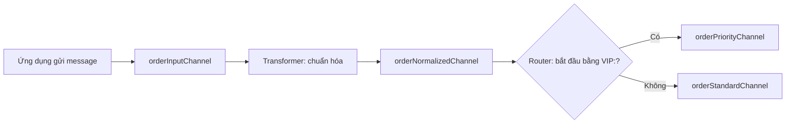
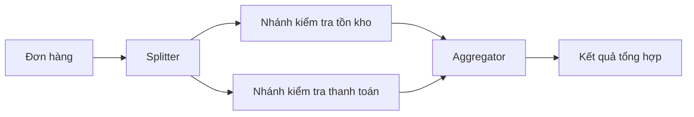

# Message history — Theo dấu thông điệp trong Spring Integration

## 1. Mục tiêu và bối cảnh

Trong module **SPRING_INTEGRATION_CORE**, bạn thiết kế luồng bằng `Message`, `MessageChannel`, endpoint, gateway và Java DSL. Khi một thông điệp đi qua transformer, filter hoặc router, việc xác định đường đi thực tế giúp giải thích vì sao kết quả khác dự kiến.

Bài thuộc chương **System management**, tập trung vào **Message history**: metadata ghi lại những thành phần được theo dõi mà một message đã đi qua. Spring Integration mang thông tin này trong header `history`. [Tài liệu Message History](https://docs.spring.io/spring-integration/reference/6.5/message-history.html).

Sau bài học, bạn có thể:

- Bật history và chọn phạm vi component cần theo dõi.
- Đọc tên, loại và thời điểm của từng mốc.
- Xây dựng ví dụ Java DSL để kiểm tra đường đi qua hai nhánh router.
- Dùng history cùng exception để khoanh vùng lỗi.
- Xử lý việc truyền history khi tự tạo nhánh và lựa chọn cách quan sát phù hợp khi vận hành.

Ví dụ sử dụng Java 17 và API Spring Integration dòng 6.5. Phần giải thích về cơ chế bổ sung history áp dụng cho thay đổi từ 6.3; không dùng giả định của phiên bản trước đó cho ví dụ này.

Kiến thức cần có: bean Spring, cấu trúc message, `DirectChannel`, `QueueChannel`, transformer và router. Chưa cần broker hoặc cơ sở dữ liệu.

## 2. Bài toán: đơn ưu tiên đi nhầm nhánh

Giả sử hệ thống tiếp nhận chuỗi đơn hàng:

```text
"  vip:order-42  "
```

Quy ước nghiệp vụ trong ví dụ:

1. Bỏ khoảng trắng ở hai đầu và chuyển chuỗi thành chữ hoa.
2. Chuỗi bắt đầu bằng `VIP:` đi vào nhánh ưu tiên.
3. Chuỗi còn lại đi vào nhánh thông thường.
4. Chuỗi rỗng sau chuẩn hóa gây lỗi.

Luồng dự kiến:



Khi người vận hành nhận phản ánh “đơn ưu tiên bị xử lý như đơn thường”, những mốc cần biết là đầu vào, sau chuẩn hóa và nhánh được chọn. Ba mốc này cho phép đặt giả thuyết cụ thể: dữ liệu chưa được chuẩn hóa, điều kiện định tuyến sai, hoặc thông điệp đang được xem thuộc một lần gửi khác.

Trong bài, mỗi message có thêm `orderId` do ứng dụng đặt để liên hệ với đơn hàng. Đây là khóa nghiệp vụ của ví dụ, tách biệt với cấu trúc history.

## 3. Dữ liệu trong history có gì?

Header mang giá trị kiểu `MessageHistory`, triển khai `List<Properties>`. Có thể lấy bằng `MessageHistory.read(message)` hoặc đọc header theo kiểu; cần xử lý trường hợp chưa có history. [API MessageHistory 6.5.0](https://docs.spring.io/spring-integration/docs/6.5.0/api/org/springframework/integration/history/MessageHistory.html).

Mỗi entry thường có các thuộc tính sau:

| Thuộc tính | Ý nghĩa | Ví dụ trong bài |
| --- | --- | --- |
| `name` | Tên component được ghi nhận | `orderInputChannel` |
| `type` | Loại component | `channel` |
| `timestamp` | Thời điểm ghi mốc, tính bằng mili giây từ Unix epoch | `1805500000000` |

Các giá trị được đọc từ `Properties` bằng `getProperty()`; riêng timestamp cần chuyển từ chuỗi sang số nếu muốn tính toán. Mã nguồn lấy thời điểm bằng `System.currentTimeMillis()`. [Mã nguồn MessageHistory 6.5.0](https://raw.githubusercontent.com/spring-projects/spring-integration/v6.5.0/spring-integration-core/src/main/java/org/springframework/integration/history/MessageHistory.java).

Bảng sau là dữ liệu minh họa, không phải kết quả đo thực tế:

| Thứ tự | name | type | timestamp |
| --- | --- | --- | --- |
| 1 | `orderInputChannel` | `channel` | `1805500000000` |
| 2 | `orderNormalizedChannel` | `channel` | `1805500000004` |
| 3 | `orderPriorityChannel` | `channel` | `1805500000006` |

Từ bảng, bạn đọc được thứ tự các mốc quan sát. Muốn biết payload tại từng mốc, hãy bổ sung phép quan sát riêng; bảng này không chứa ảnh chụp dữ liệu đơn hàng.

Không nên dựa vào định dạng chuỗi của `history.toString()` để phân tích dữ liệu. Trong mã nguồn 6.5.0, phương thức đó nối các tên bằng dấu phẩy. Khi cần đủ thuộc tính, hãy duyệt các entry. [Triển khai MessageHistory.toString()](https://raw.githubusercontent.com/spring-projects/spring-integration/v6.5.0/spring-integration-core/src/main/java/org/springframework/integration/history/MessageHistory.java).

## 4. Bật và giới hạn phạm vi theo dõi

Cấu hình tối thiểu:

```java
import org.springframework.context.annotation.Configuration;
import org.springframework.integration.config.EnableIntegration;
import org.springframework.integration.config.EnableMessageHistory;

@Configuration
@EnableIntegration
@EnableMessageHistory
class HistoryConfiguration {
}
```

Mặc định annotation chọn mọi Spring Integration component có thể theo dõi. Có thể truyền nhiều mẫu tên:

```java
@EnableMessageHistory({"order*Channel", "*Gateway"})
```

`order*Channel` chọn các tên bắt đầu bằng `order` và kết thúc bằng `Channel`; `*Gateway` chọn các tên kết thúc bằng `Gateway`. Đây là mẫu tên component, không phải điều kiện lọc theo `orderId` hoặc payload. [API EnableMessageHistory](https://docs.spring.io/spring-integration/api/org/springframework/integration/config/EnableMessageHistory.html).

Chỉ đặt một khai báo cấu hình history trong application context theo hướng dẫn tham chiếu. Với ứng dụng dùng XML và đã khai báo namespace Spring Integration, cấu hình tương ứng là:

```xml
<int:message-history tracked-components="order*Channel,*Gateway"/>
```

Hai hình thức trên là các lựa chọn cấu hình; ví dụ Java bên dưới chỉ sử dụng annotation. [Cấu hình Message History](https://docs.spring.io/spring-integration/reference/6.5/message-history.html).

Một bean nghiệp vụ thông thường không tự trở thành một mốc chỉ vì tên khớp mẫu. Bộ cấu hình làm việc với các component hỗ trợ `TrackableComponent`. Vì vậy, hãy chọn tên của channel hoặc integration component thực sự xuất hiện trong luồng. [Mã nguồn MessageHistoryConfigurer](https://raw.githubusercontent.com/spring-projects/spring-integration/v6.5.0/spring-integration-core/src/main/java/org/springframework/integration/history/MessageHistoryConfigurer.java).

## 5. Ví dụ đầy đủ bằng Java DSL

### 5.1. Dependency và cách tổ chức

Ví dụ chỉ cần `spring-integration-core` cùng các dependency bắc cầu của nó. Với dự án Maven độc lập, dependency minh họa được cố định ở 6.5.0 để có mốc API rõ ràng:

```xml
<dependency>
    <groupId>org.springframework.integration</groupId>
    <artifactId>spring-integration-core</artifactId>
    <version>6.5.0</version>
</dependency>
```

Nếu dự án đang quản lý phiên bản bằng Spring Boot hoặc BOM, dùng bộ phiên bản tương thích mà dự án quản lý. Không ghép thêm phiên bản Spring Framework tùy ý để chạy ví dụ.

Mã sau đặt trong một tệp Java tên `MessageHistoryDemo.java`, không khai báo package để dễ thử trong một dự án học tập. Không cần Spring Boot, gateway hoặc poller cho luồng minh họa: ứng dụng gửi trực tiếp vào channel và chủ động nhận từ các queue đầu ra.

### 5.2. Cấu hình và chương trình gửi thử

```java
import java.time.Instant;
import java.util.List;
import java.util.Locale;
import java.util.Properties;

import org.springframework.context.annotation.AnnotationConfigApplicationContext;
import org.springframework.context.annotation.Bean;
import org.springframework.context.annotation.Configuration;
import org.springframework.integration.channel.DirectChannel;
import org.springframework.integration.channel.QueueChannel;
import org.springframework.integration.config.EnableIntegration;
import org.springframework.integration.config.EnableMessageHistory;
import org.springframework.integration.dsl.IntegrationFlow;
import org.springframework.integration.history.MessageHistory;
import org.springframework.integration.support.MessageBuilder;
import org.springframework.messaging.Message;

public class MessageHistoryDemo {

    @Configuration
    @EnableIntegration
    @EnableMessageHistory("order*Channel")
    public static class FlowConfig {

        @Bean
        public DirectChannel orderInputChannel() {
            return new DirectChannel();
        }

        @Bean
        public DirectChannel orderNormalizedChannel() {
            return new DirectChannel();
        }

        @Bean
        public QueueChannel orderPriorityChannel() {
            return new QueueChannel(100);
        }

        @Bean
        public QueueChannel orderStandardChannel() {
            return new QueueChannel(100);
        }

        @Bean
        public IntegrationFlow orderFlow() {
            return IntegrationFlow.from("orderInputChannel")
                    .transform(String.class, payload -> {
                        String normalized =
                                payload.strip().toUpperCase(Locale.ROOT);
                        if (normalized.isEmpty()) {
                            throw new IllegalArgumentException(
                                    "Nội dung đơn hàng không được rỗng");
                        }
                        return normalized;
                    }, endpoint -> endpoint.id("normalizeOrder"))
                    .channel("orderNormalizedChannel")
                    .<String, String>route(
                            payload -> payload.startsWith("VIP:")
                                    ? "priority" : "standard",
                            router -> router
                                    .id("routeOrder")
                                    .channelMapping(
                                            "priority", "orderPriorityChannel")
                                    .channelMapping(
                                            "standard", "orderStandardChannel"))
                    .get();
        }
    }

    public static List<String> historyNames(Message<?> message) {
        MessageHistory history = MessageHistory.read(message);
        if (history == null) {
            return List.of();
        }
        return history.stream()
                .map(entry -> entry.getProperty(MessageHistory.NAME_PROPERTY))
                .toList();
    }

    public static void printHistory(Message<?> message) {
        MessageHistory history = message.getHeaders().get(
                MessageHistory.HEADER_NAME, MessageHistory.class);

        if (history == null) {
            System.out.println("Message chưa có history.");
            return;
        }

        for (Properties entry : history) {
            String name = entry.getProperty(MessageHistory.NAME_PROPERTY);
            String type = entry.getProperty(MessageHistory.TYPE_PROPERTY);
            long timestamp = Long.parseLong(
                    entry.getProperty(MessageHistory.TIMESTAMP_PROPERTY));
            System.out.printf("%s | %s | %s%n",
                    name, type, Instant.ofEpochMilli(timestamp));
        }
    }

    public static void main(String[] args) {
        try (var context =
                new AnnotationConfigApplicationContext(FlowConfig.class)) {
            DirectChannel input =
                    context.getBean("orderInputChannel", DirectChannel.class);
            QueueChannel priority =
                    context.getBean("orderPriorityChannel", QueueChannel.class);
            QueueChannel standard =
                    context.getBean("orderStandardChannel", QueueChannel.class);

            Message<String> request = MessageBuilder
                    .withPayload("  vip:order-42  ")
                    .setHeader("orderId", "ORDER-42")
                    .build();

            if (!input.send(request, 1000)) {
                throw new IllegalStateException("Không gửi được message.");
            }

            Message<?> result = priority.receive(1000);
            if (result == null) {
                throw new IllegalStateException(
                        "Không nhận được message ở nhánh ưu tiên.");
            }
            if (standard.receive(0) != null) {
                throw new IllegalStateException(
                        "Message xuất hiện ở nhánh không mong đợi.");
            }

            System.out.println("Payload: " + result.getPayload());
            System.out.println("orderId: " + result.getHeaders().get("orderId"));
            System.out.println("History: " + historyNames(result));
            printHistory(result);
        }
    }
}
```

DSL dùng `transform()` cho bước đổi payload và `route()` với `channelMapping()` cho hai đích. Đây là các API cấu hình transformer và router của Spring Integration. [Java DSL Transformers](https://docs.spring.io/spring-integration/reference/6.5/dsl/java-transformers.html), [Java DSL Message Routers](https://docs.spring.io/spring-integration/reference/6.5/dsl/java-routers.html).

`DirectChannel` chuyển tiếp xử lý trong luồng gọi; `QueueChannel` giữ message để bên nhận lấy ra. Hai queue đầu ra có dung lượng 100, đủ cho lần gửi thử; chương trình nhận với timeout để không chờ vô hạn. [Message Channel Implementations](https://docs.spring.io/spring-integration/reference/6.5/channel/implementations.html).

Các giá trị mong đợi từ ví dụ:

```text
Payload: VIP:ORDER-42
orderId: ORDER-42
History: [orderInputChannel, orderNormalizedChannel, orderPriorityChannel]
```

Các dòng thời gian do `printHistory()` in ra phụ thuộc lần chạy. Không sao chép một timestamp cố định vào tiêu chí kiểm tra.

### 5.3. Tại sao chỉ chọn channel trong ví dụ?

Hai endpoint được đặt ID `normalizeOrder` và `routeOrder`, nhưng không khớp mẫu `order*Channel`. Bài chủ động quan sát các ranh giới của luồng để kết quả gồm ba tên dễ kiểm tra.

Nếu cần khảo sát endpoint, hãy mở rộng mẫu trong một lần thử riêng và đọc tên component được ghi thực tế. Tránh xây dựng kiểm thử dựa vào toàn bộ tên tự sinh của DSL, vì thay đổi cấu trúc flow có thể làm thay đổi các tên đó.

Một cách mở rộng hợp lý trong bài thực hành là thêm `orderValidatedChannel` sau một bước kiểm tra nghiệp vụ. Khi đó, tên mốc mới mô tả được vị trí của phép kiểm tra.

## 6. Kiểm tra đường đi bằng JUnit

Kiểm thử sau sử dụng JUnit Jupiter trong một dự án đã có dependency kiểm thử. Nó khởi tạo context trực tiếp, dùng queue làm điểm quan sát và không cần broker. Spring Integration cũng cung cấp các module hỗ trợ kiểm thử khi cần mock endpoint hoặc thay thế thành phần của flow. [Testing support](https://docs.spring.io/spring-integration/reference/6.5/testing.html).

```java
import java.util.List;

import org.junit.jupiter.api.Test;
import org.springframework.context.annotation.AnnotationConfigApplicationContext;
import org.springframework.integration.channel.DirectChannel;
import org.springframework.integration.channel.QueueChannel;
import org.springframework.integration.history.MessageHistory;
import org.springframework.integration.support.MessageBuilder;
import org.springframework.messaging.Message;
import org.springframework.messaging.MessagingException;

import static org.junit.jupiter.api.Assertions.*;

class MessageHistoryDemoTest {

    @Test
    void recordsTheSelectedRouteForEachOrder() {
        try (var context = new AnnotationConfigApplicationContext(
                MessageHistoryDemo.FlowConfig.class)) {
            DirectChannel input =
                    context.getBean("orderInputChannel", DirectChannel.class);
            QueueChannel priority =
                    context.getBean("orderPriorityChannel", QueueChannel.class);
            QueueChannel standard =
                    context.getBean("orderStandardChannel", QueueChannel.class);

            assertTrue(input.send(MessageBuilder
                    .withPayload(" vip:order-42 ")
                    .setHeader("orderId", "ORDER-42")
                    .build(), 1000));

            Message<?> vip = priority.receive(1000);
            assertNotNull(vip);
            assertEquals("VIP:ORDER-42", vip.getPayload());
            assertEquals("ORDER-42", vip.getHeaders().get("orderId"));
            assertNotNull(MessageHistory.read(vip));
            assertEquals(List.of(
                    "orderInputChannel",
                    "orderNormalizedChannel",
                    "orderPriorityChannel"),
                    MessageHistoryDemo.historyNames(vip));
            assertNull(standard.receive(0));

            assertTrue(input.send(MessageBuilder
                    .withPayload(" order-43 ")
                    .setHeader("orderId", "ORDER-43")
                    .build(), 1000));

            Message<?> normal = standard.receive(1000);
            assertNotNull(normal);
            assertEquals("ORDER-43", normal.getPayload());
            assertEquals(List.of(
                    "orderInputChannel",
                    "orderNormalizedChannel",
                    "orderStandardChannel"),
                    MessageHistoryDemo.historyNames(normal));
            assertNull(priority.receive(0));
        }
    }

    @Test
    void rejectsBlankInputBeforeEitherOutputQueue() {
        try (var context = new AnnotationConfigApplicationContext(
                MessageHistoryDemo.FlowConfig.class)) {
            DirectChannel input =
                    context.getBean("orderInputChannel", DirectChannel.class);
            QueueChannel priority =
                    context.getBean("orderPriorityChannel", QueueChannel.class);
            QueueChannel standard =
                    context.getBean("orderStandardChannel", QueueChannel.class);

            Message<String> blank =
                    MessageBuilder.withPayload("   ").build();

            assertThrows(MessagingException.class,
                    () -> input.send(blank, 1000));
            assertNull(priority.receive(0));
            assertNull(standard.receive(0));
        }
    }
}
```

Điểm cần kiểm tra là **payload đúng và đích nhận đúng**. History bổ sung bằng chứng về đường đi. Nếu chỉ xác nhận có header history, kiểm thử vẫn có thể bỏ sót một router gửi sai đích.

Khi thêm bước không thuộc phạm vi theo dõi, danh sách ba channel vẫn giữ nguyên. Khi đổi chính sách quan sát hoặc thêm một channel có tên khớp mẫu, hãy cập nhật kỳ vọng tương ứng với thiết kế mới.

## 7. Đọc history mà không suy diễn quá mức

### 7.1. Mốc quan sát và kết quả nghiệp vụ

Trong ví dụ, `orderPriorityChannel` là queue cuối để chương trình lấy kết quả ra. Tên đó xuất hiện chưa chứng minh rằng kho đã dành hàng, thanh toán thành công hoặc email đã được gửi. Những hành động đó chưa tồn tại trong flow.

Nếu sau này thêm consumer xử lý thanh toán, hãy tạo điểm quan sát ở consumer và lưu kết quả nghiệp vụ cần thiết. Không suy ra trạng thái “đã thanh toán” từ tên của một channel đứng trước bước thanh toán.

Tương tự, khi message dừng ở filter hoặc bị chuyển sang discard flow, việc không thấy mốc phía sau cần được giải thích bằng cấu hình và kết quả tại vị trí đó. Hãy xem history cùng sự kiện lỗi hoặc sự kiện từ chối, thay vì coi entry cuối là kết luận duy nhất.

### 7.2. Đọc message tại điểm cần quan sát

Để xem kết quả, ví dụ đọc message nhận từ queue. Không nên kiểm tra biến `request` ban đầu rồi kết luận history không hoạt động: ở lần ghi đầu, framework có thể tạo message mới chứa history. Từ 6.3, các lần ghi tiếp theo bổ sung entry vào container history hiện có. [Cơ chế Message History từ 6.3](https://docs.spring.io/spring-integration/reference/6.5/message-history.html).

Do đó, một tham chiếu đến history cũng không nên được coi là ảnh chụp bất biến tại thời điểm lấy tham chiếu. Nếu cần lưu một sự kiện chẩn đoán, hãy trích xuất các trường thành dữ liệu riêng ngay tại điểm quan sát.

### 7.3. Timestamp không phải thời gian chạy chính xác của handler

Với ba thời điểm minh họa ở trên:

```text
1805500000004 - 1805500000000 = 4 ms
1805500000006 - 1805500000004 = 2 ms
```

Đây là khoảng cách giữa hai mốc được ghi. Trong một thiết kế có queue, executor hoặc tác vụ khác xen giữa, khoảng cách có thể bao gồm chờ đợi và chuyển giao. Đồng hồ hệ thống cũng không phải đồng hồ đơn điệu để đo duration.

Hãy dùng chênh lệch này để chọn nơi khảo sát tiếp. Khi cần latency, tỷ lệ lỗi hoặc phân vị thời gian của handler, dùng phép đo phù hợp; Spring Integration có tích hợp Micrometer với timer và counter cho các component. [Metrics and Management](https://docs.spring.io/spring-integration/reference/6.5/metrics.html).

## 8. History, message ID và khóa liên hệ

Header `id` định danh một message instance; `timestamp` chuẩn của message mô tả thời điểm tạo instance đó. Chúng có thể thay đổi khi message được tạo lại. Cấu trúc header là chỉ đọc, nhưng đối tượng nằm trong giá trị header có thể có tính khả biến. [Message và Message Headers](https://docs.spring.io/spring-integration/reference/6.5/message.html).

Để chẩn đoán một đơn hàng qua nhiều lần gửi, hãy lưu rõ:

| Thông tin | Câu hỏi cần trả lời trong ứng dụng |
| --- | --- |
| `orderId` do ứng dụng quy định | Sự kiện này thuộc đơn hàng nào? |
| `requestId` hoặc mã lần tiếp nhận do ứng dụng quy định | Đây là lần gửi hoặc lần thử nào? |
| Message ID | Đang quan sát message instance nào? |
| History | Các mốc được theo dõi của message đang quan sát là gì? |

Tên `requestId` trong bảng chỉ là đề xuất thiết kế, không phải header do ví dụ tự động tạo.

Nếu một đơn có hai lần gửi, cùng `orderId` chưa đủ để ghép chúng thành cùng một lần xử lý. Khi điều tra, hãy xác định mã lần tiếp nhận trước, sau đó mới so sánh đường đi và lỗi của lần đó.

## 9. Rẽ nhánh, splitter và aggregator

Một luồng thực tế có thể tạo nhiều message con:



Với thiết kế này, cần phân biệt:

- Tiền tố đường đi chung trước khi tách.
- Lịch sử riêng của từng message con sau khi tách.
- Sự kiện tổng hợp và kết quả cuối cùng của nhóm.

Không dùng một danh sách tuyến tính ở đầu ra để mặc nhiên đại diện cho mọi diễn biến của các nhánh song song. Nếu cần điều tra toàn nhóm, hãy lưu mã nhóm, mã phần tử và dữ liệu chẩn đoán tại từng nhánh trước khi tổng hợp.

Các thành phần phân nhánh do framework quản lý, như splitter, router nhiều đích, wire tap và publish-subscribe, có xử lý sao chép history cho các message phát ra trong cơ chế từ 6.3. [Theo dõi history khi phân nhánh](https://docs.spring.io/spring-integration/reference/message-history.html).

### 9.1. Khi ứng dụng tự tạo nhiều nhánh

Nếu tự viết component gửi cùng đầu vào đến nhiều đích, hãy tạo message của từng nhánh và dùng builder hỗ trợ sao chép history:

```java
import org.springframework.integration.support.MessageBuilder;
import org.springframework.messaging.Message;

class BranchMessages {

    static <T> Message<T> forBranch(Message<T> source, String branchName) {
        return MessageBuilder.fromMessage(source)
                .setHeader("branchName", branchName)
                .cloneMessageHistoryIfAny()
                .build();
    }
}
```

Mỗi lần gọi `forBranch(source, ...)` tạo message dành cho một nhánh. Phải gọi riêng cho từng đích; không tạo một bản rồi tiếp tục dùng chung bản đó cho mọi nhánh.

`cloneMessageHistoryIfAny()` sao chép header history nếu có. Đây là API thuộc builder của Spring Integration; chú ý import `org.springframework.integration.support.MessageBuilder` khi dùng đoạn mã này. [API AbstractIntegrationMessageBuilder](https://docs.spring.io/spring-integration/docs/6.5.0/api/org/springframework/integration/support/AbstractIntegrationMessageBuilder.html).

Phép sao chép history không làm payload khả biến trở nên độc lập. Nếu hai nhánh sửa cùng một đối tượng nghiệp vụ, ứng dụng vẫn cần quyết định cách bảo vệ hoặc sao chép đối tượng đó.

### 9.2. Chuẩn bị dữ liệu để điều tra aggregator

Với hai nhánh “tồn kho” và “thanh toán”, có thể thiết kế sự kiện chẩn đoán như sau:

```text
orderId=ORDER-42
groupKey=ORDER-42/REQUEST-7
branchName=inventory
path=[orderInputChannel, inventoryInputChannel, inventoryResultChannel]
outcome=RESERVED
```

Đây là định dạng do ứng dụng đề xuất. Nhánh thanh toán xuất một sự kiện tương tự với `branchName=payment`. Khi aggregator chờ thiếu thành viên, đối chiếu hai sự kiện sẽ hữu ích hơn việc tìm một “history chung” mà thiết kế chưa định nghĩa.

Nếu cần lịch sử tổng hợp của cả nhóm, hãy định nghĩa cấu trúc đầu ra riêng và quy tắc ghép nhánh. Quy tắc đó nên giữ thông tin nhánh và quan hệ nhóm, thay vì chỉ sắp xếp tất cả timestamp thành một chuỗi.

## 10. Chẩn đoán lỗi bằng failed message

### 10.1. Lỗi đồng bộ

Ví dụ chính dùng `DirectChannel` ở đường vào. Nếu transformer ném exception, lệnh gửi nhận lỗi trong cùng chuỗi gọi. Khi thêm queue được poll hoặc executor, lỗi có thể xảy ra sau khi bên gửi đã hoàn thành việc gửi; lúc đó cần cơ chế xử lý lỗi bất đồng bộ phù hợp. [Error Handling](https://docs.spring.io/spring-integration/reference/6.5/error-handling.html).

Để đọc history gần vị trí lỗi, hãy tìm `failedMessage` trong `MessagingException`. API cho phép exception mang message liên quan tới thất bại, nhưng không phải mọi exception đều có giá trị đó. [API MessagingException](https://docs.spring.io/spring-framework/docs/6.2.7/javadoc-api/org/springframework/messaging/MessagingException.html).

Đoạn hỗ trợ sau duyệt chuỗi nguyên nhân:

```java
import org.springframework.messaging.Message;
import org.springframework.messaging.MessagingException;

class FailureDiagnostics {

    static Message<?> findFailedMessage(Throwable failure) {
        Throwable current = failure;
        while (current != null) {
            if (current instanceof MessagingException messagingFailure) {
                Message<?> failed = messagingFailure.getFailedMessage();
                if (failed != null) {
                    return failed;
                }
            }
            current = current.getCause();
        }
        return null;
    }

    static void inspect(Throwable failure) {
        Message<?> failed = findFailedMessage(failure);
        if (failed == null) {
            System.err.println("Không lấy được failed message.");
            return;
        }

        System.err.println("orderId=" + failed.getHeaders().get("orderId"));
        System.err.println("path=" + MessageHistoryDemo.historyNames(failed));
        System.err.println("exception=" + failure.getClass().getSimpleName());
    }
}
```

Trong lần gửi chuỗi trắng của ví dụ, transformer lỗi trước khi chuyển tới `orderNormalizedChannel`. Với phạm vi chỉ theo dõi channel, đường đi dự kiến của failed message dừng ở `orderInputChannel`. Kết hợp điều đó với nguyên nhân “nội dung rỗng” để khoanh vùng bước chuẩn hóa.

Không kết luận transformer đã xử lý thành công chỉ vì thấy một mốc ở trước nó.

### 10.2. Lỗi bất đồng bộ và ErrorMessage

Khi cơ chế error handler của framework công bố lỗi, exception là payload của `ErrorMessage`. Đích nhận lỗi có thể lấy từ header `errorChannel` của request, hoặc channel chung `errorChannel` khi không có đích riêng. Điều này không biến mọi exception từ lệnh gửi đồng bộ thành một message lỗi tự động. [Quy tắc xử lý lỗi](https://docs.spring.io/spring-integration/reference/6.5/error-handling.html).

Trong consumer chuyên nhận `ErrorMessage`, có thể chuyển payload cho hàm trên:

```java
import org.springframework.messaging.support.ErrorMessage;

class ErrorConsumer {

    public void inspect(ErrorMessage errorMessage) {
        FailureDiagnostics.inspect(errorMessage.getPayload());
    }
}
```

Phương thức này cần được nối với error flow khi áp dụng; nó không tự đăng ký consumer.

Hãy tách hai dữ liệu khi điều tra: history của failed message giúp xem đường đi nghiệp vụ trước lỗi; history của message lỗi, nếu có, mô tả đường đi của chính luồng xử lý lỗi. Hai câu hỏi này phục vụ hai bước chẩn đoán khác nhau.

## 11. Lưu ảnh chụp chẩn đoán và truyền qua hệ thống khác

### 11.1. Trích xuất dữ liệu tại ranh giới quan trọng

Để lưu đường đi tại một thời điểm, chuyển các tên sang danh sách độc lập như `historyNames()` trong ví dụ. Nếu cần cả loại và thời gian, sao chép từng giá trị thành record hoặc đối tượng dữ liệu của ứng dụng.

Một bản ghi vận hành có thể gồm:

```text
orderId=ORDER-42
requestId=REQUEST-7
stage=priority-accepted
path=[orderInputChannel, orderNormalizedChannel, orderPriorityChannel]
result=QUEUED
```

`result=QUEUED` do ứng dụng quyết định tại điểm quan sát. Chỉ sử dụng trạng thái `PAID`, `SHIPPED` hoặc tương tự ở nơi đã xác nhận hành động nghiệp vụ tương ứng.

Không sửa các entry của history để “điều chỉnh” đường đi đã quan sát. Khi cần bổ sung thông tin nghiệp vụ, tạo trường hoặc sự kiện riêng để người đọc hiểu được nguồn gốc của dữ liệu.

### 11.2. Qua HTTP hoặc broker

Trong một hệ thống có nhiều tiến trình, hãy kiểm tra cụ thể adapter, header mapper và cơ chế serialization đang dùng trước khi kỳ vọng giữ nguyên history.

Một cách thiết kế là truyền khóa liên hệ gọn như `orderId`, `requestId` và ngữ cảnh tracing được hệ thống thống nhất; giữ các mốc component chi tiết trong hệ thống quan sát nội bộ. Nếu có yêu cầu truyền history, phải định nghĩa schema, giới hạn kích thước và quyền nhận dữ liệu đó.

Tên component cũng có thể tiết lộ cấu trúc xử lý nội bộ. Chọn những trường thực sự cần thiết khi trả dữ liệu chẩn đoán cho hệ thống bên ngoài.

## 12. Chọn công cụ quan sát phù hợp

| Công cụ hoặc dữ liệu | Câu hỏi sử dụng trong hệ thống đơn hàng |
| --- | --- |
| Message history | Message đang quan sát đi qua các mốc nào trong flow? |
| Log có `orderId` và mã lần tiếp nhận | Ở mốc đó, ứng dụng đã đưa ra quyết định gì? |
| Metrics | Nhánh nào có thông lượng, tỷ lệ lỗi hoặc thời gian xử lý bất thường? |
| Distributed tracing | Một lần xử lý liên quan đến những dịch vụ hoặc thao tác từ xa nào? |
| Sự kiện audit do ứng dụng lưu | Hành động nghiệp vụ nào đã được xác nhận và cần tra cứu lâu dài? |
| Message store | Message hoặc nhóm message đang được thành phần đệm lưu giữ ở đâu? |

Message store là một khả năng khác trong Spring Integration, phục vụ các component có nhu cầu lưu đệm như queue, aggregator và delayer. Việc chọn kho lưu trữ bền vững là một quyết định cấu hình riêng. [Message Store](https://docs.spring.io/spring-integration/reference/6.5/message-store.html).

Trong thiết kế đơn hàng của bài, có thể dùng metrics để phát hiện nhánh ưu tiên chậm, tìm request cụ thể qua log, rồi xem history của request đó để xác định các mốc đã đi qua. Nếu cần chứng minh đơn đã được giao, truy vấn sự kiện nghiệp vụ mà hệ thống lưu cho hành động giao hàng.

## 13. Quản lý chi phí khi vận hành

Bắt đầu bằng một nhóm mốc có ý nghĩa: nhận yêu cầu, sau chuẩn hóa, đầu mỗi nhánh quan trọng và trước khi ra ngoài ứng dụng. Đo mức tăng kích thước message và chi phí ghi log với lưu lượng đại diện trước khi mở rộng phạm vi.

Các quyết định cần thực hiện trong ứng dụng:

- Đặt tên component ổn định, phản ánh vai trò của mốc quan sát.
- Chọn mẫu component vừa đủ để trả lời câu hỏi vận hành.
- Giới hạn vòng lặp, số lần thử và lượng dữ liệu chẩn đoán được xuất.
- Tránh ghi toàn bộ payload khi chỉ cần khóa liên hệ và đường đi.
- Quy định thời gian lưu dữ liệu chẩn đoán và người được phép truy cập.

Nếu dùng `IntegrationMBeanExporter`, bộ cấu hình history có thể được quản lý qua JMX. Khi thay mẫu theo dõi lúc chạy, phải dừng `MessageHistoryConfigurer`, cập nhật mẫu rồi khởi động lại. Trong khoảng dừng, các component không ghi thêm history theo cơ chế này. [MessageHistoryConfigurer và lifecycle](https://raw.githubusercontent.com/spring-projects/spring-integration/v6.5.0/spring-integration-core/src/main/java/org/springframework/integration/history/MessageHistoryConfigurer.java).

Thay đổi phạm vi theo dõi chỉ tác động tới các mốc được ghi từ thời điểm áp dụng; không thể dùng nó để khôi phục những mốc đã bỏ qua trước đó. Ghi nhận thời điểm thay cấu hình giúp giải thích vì sao hai request gần nhau có mức chi tiết khác nhau.

## 14. Các tình huống cần khoanh vùng

| Hiện tượng | Hướng kiểm tra |
| --- | --- |
| Không có header history | Kiểm tra cấu hình được nạp, mẫu tên và message tại đúng điểm nhận |
| Thiếu một mốc dự kiến | Đối chiếu tên component thực tế, phạm vi theo dõi và nhánh đã chọn |
| Chỉ thấy các channel | Kiểm tra annotation có đang chỉ chọn mẫu tên channel như ví dụ không |
| History dừng trước một nhánh | Tìm exception, quyết định filter, discard flow hoặc điều kiện router tại vùng đó |
| Queue đầu ra có message nhưng nghiệp vụ chưa hoàn tất | Xác định consumer và bước xác nhận nghiệp vụ phía sau queue |
| Hai lần xử lý cùng đơn có đường đi khác nhau | Phân biệt mã lần tiếp nhận, đầu vào và cấu hình đang có hiệu lực |
| Các nhánh tự viết xuất hiện lẫn mốc | Kiểm tra việc tạo message và sao chép history riêng cho từng nhánh |
| Mốc thời gian chênh lớn | Xem queue, executor, tác vụ xen giữa và phép đo latency tương ứng |
| History không còn sau ranh giới hệ thống | Kiểm tra mapping, serialization và hợp đồng dữ liệu tại adapter |

Mỗi dòng là điểm bắt đầu điều tra. Hãy kiểm tra giả thuyết bằng message, cấu hình và kết quả quan sát được, không sửa router chỉ vì một tên mốc bị thiếu trong phạm vi theo dõi hiện tại.

## 15. Bài thực hành

Thực hiện trong một dự án học tập có Spring Integration và JUnit Jupiter:

1. Chạy ví dụ với hai đầu vào `" vip:order-42 "` và `" order-43 "`. Xác nhận payload đã chuẩn hóa, đúng queue nhận và đúng danh sách ba mốc.
2. Gửi chuỗi trắng, bắt exception ở lệnh gửi và gọi `FailureDiagnostics.inspect()`. Ghi lại nguyên nhân cùng các mốc có mặt trước khi lỗi xảy ra.
3. Thay mẫu thành chỉ `orderPriorityChannel`. So sánh dữ liệu quan sát ở hai nhánh; giải thích vì sao thiếu history ở một nhánh không đồng nghĩa message đã thất lạc.
4. Thêm filter kiểm tra định dạng đơn trước router, đồng thời thiết kế đích nhận message bị từ chối. Đặt channel quan sát rõ ràng cho đích đó và kiểm tra một đầu vào không hợp lệ.
5. Thử hai nhánh tự gửi bằng `BranchMessages.forBranch()`. Thu thập đường đi riêng của từng nhánh cùng khóa liên hệ; xác nhận mốc sau khi tách của nhánh này không bị coi là mốc của nhánh kia.
6. Phác thảo cách lưu hai sự kiện chẩn đoán trước aggregator cho tồn kho và thanh toán. Chỉ ra dữ liệu cần dùng để tìm một thành viên chưa đến.

Kết quả cần đạt là khả năng trả lời bằng bằng chứng: message nào, thuộc lần tiếp nhận nào, đã đi qua mốc nào, và tại đâu cần xem thêm dữ liệu để xác nhận kết quả nghiệp vụ.
