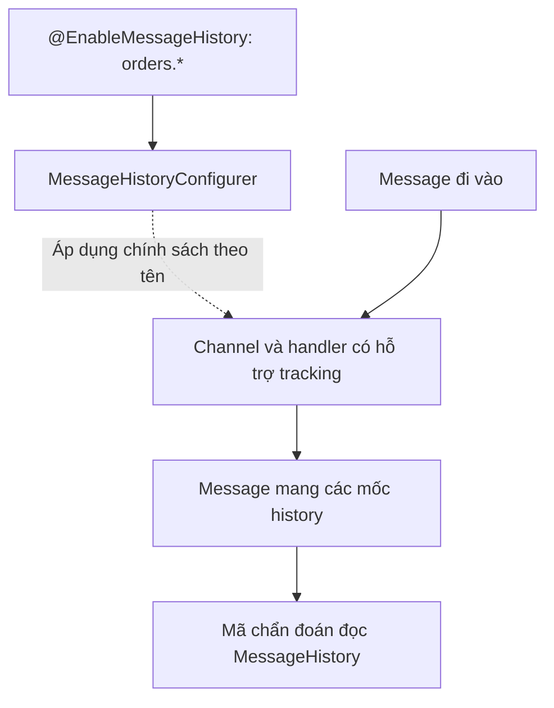
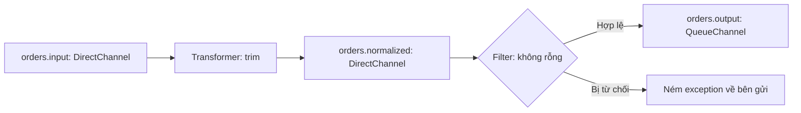

# MessageHistoryConfigurer

## 1. Mục tiêu và tình huống sử dụng

Trong chương **System management** của **SPRING_INTEGRATION_CORE**, `MessageHistoryConfigurer` giúp cấu hình việc ghi lại những component mà một thông điệp đi qua. Bài học áp dụng kiến thức về `Message`, `MessageChannel`, endpoint và Java DSL để trả lời một câu hỏi vận hành cụ thể: **Thông điệp đã đi tới đâu trước khi kết quả khác mong đợi?**

Giả sử hệ thống nhận mã đơn hàng, chuẩn hóa khoảng trắng, lọc dữ liệu rỗng rồi đưa kết quả vào hàng đợi. Khi đơn không xuất hiện ở đầu ra, chỉ nhìn payload không đủ để biết nó chưa vào luồng, bị từ chối ở filter hay dừng tại một bước xử lý.

Sau bài học, bạn có thể:

- Giải thích vai trò của `MessageHistoryConfigurer` và header `history`.
- Bật history bằng Java configuration hoặc XML, chọn phạm vi theo tên component.
- Đọc các mốc hành trình từ thông điệp thực sự nhận ở đầu ra.
- Điều chỉnh phạm vi theo dõi khi ứng dụng đang chạy.
- Dùng history hỗ trợ tìm lỗi, hiểu giới hạn khi rẽ nhánh và xử lý bất đồng bộ.
- Thiết kế phép kiểm tra hành trình mà không phụ thuộc tên bean tự sinh.

Ví dụ chính dùng **Java 17 và Spring Integration 6.5.x**. Dự án cần có `org.springframework.integration:spring-integration-core`; phần minh họa kiểm thử dùng JUnit Jupiter. Hãy để cơ chế quản lý dependency của dự án chọn các phiên bản Spring tương thích. Bài không yêu cầu broker, cơ sở dữ liệu hoặc Spring Boot.

## 2. Phân biệt bộ cấu hình với dữ liệu lịch sử

Có ba thành phần cần phân biệt:

| Thành phần | Trách nhiệm | Khi nào bạn sử dụng? |
| --- | --- | --- |
| `@EnableMessageHistory` | Khai báo bật tính năng và pattern tên component | Khi cấu hình application context |
| `MessageHistoryConfigurer` | Áp dụng chính sách theo dõi, cung cấp điều khiển lifecycle | Khi quản trị phạm vi theo dõi |
| `MessageHistory` | Chứa các mốc đã được ghi trên một thông điệp | Khi chẩn đoán hành trình |

`MessageHistoryConfigurer` thuộc package `org.springframework.integration.history`. Nó có cả vai trò lifecycle và bean post-processor; đây là hạ tầng quản lý, không phải một transformer mà bạn chèn giữa hai channel. Xem [API MessageHistoryConfigurer](https://docs.spring.io/spring-integration/api/org/springframework/integration/history/MessageHistoryConfigurer.html).

Một component muốn tham gia cơ chế này cần hỗ trợ `TrackableComponent`. Interface đó mở rộng `NamedComponent` và cung cấp `setShouldTrack(boolean)`. Vì vậy, việc một POJO có tên bean khớp pattern chưa đủ để mọi lời gọi phương thức của nó tự xuất hiện trong history. Xem [API TrackableComponent](https://docs.spring.io/spring-integration/api/org/springframework/integration/support/management/TrackableComponent.html).

Ở mức triển khai, configurer đối chiếu `getComponentName()` với các pattern rồi đặt cờ theo dõi. Khi khởi động, nó tìm các component thích hợp; khi đang chạy, cơ chế post-processing còn áp dụng chính sách cho bean được khởi tạo sau đó. Xem [mã nguồn MessageHistoryConfigurer 6.5.0](https://raw.githubusercontent.com/spring-projects/spring-integration/v6.5.0/spring-integration-core/src/main/java/org/springframework/integration/history/MessageHistoryConfigurer.java).

Có thể hình dung quan hệ này như sau:



Mũi tên nét đứt là cấu hình. Đường đi của dữ liệu vẫn do channel, endpoint và logic nghiệp vụ quyết định.

## 3. Header history chứa những gì?

Tên header là `history`; trong Java nên dùng hằng `MessageHistory.HEADER_NAME`. Giá trị có kiểu `MessageHistory`, triển khai `List<Properties>`. Mỗi phần tử có các thuộc tính chính sau:

| Thuộc tính | Ý nghĩa | Ví dụ minh họa |
| --- | --- | --- |
| `name` | Tên component tại điểm ghi nhận | `orders.input` |
| `type` | Loại component | `channel` |
| `timestamp` | Mốc thời gian ghi nhận, tính bằng mili giây từ epoch | `1800000000000` |

Có thể đọc bằng `MessageHistory.read(message)` hoặc lấy header với kiểu mong đợi. Kết quả có thể là `null` khi chưa có history. Xem [API MessageHistory](https://docs.spring.io/spring-integration/api/org/springframework/integration/history/MessageHistory.html).

Ví dụ dưới đây là cách trình bày lại các phần tử, không phải cam kết về kết quả `toString()`:

```text
[
  {name=orders.input,      type=channel, timestamp=1800000000000},
  {name=orders.normalized, type=channel, timestamp=1800000000002},
  {name=orders.output,     type=channel, timestamp=1800000000003}
]
```

Để suy luận đúng, hãy tách **điểm đã quan sát được** khỏi **kết quả nghiệp vụ**:

- Có mốc `orders.input`: đã ghi nhận thông điệp tại channel đó.
- Có mốc `orders.output`: thông điệp đã tới điểm theo dõi đầu ra trong ví dụ.
- Chưa có mốc đầu ra: cần tìm thêm lỗi, nhánh discard hoặc trạng thái xử lý.
- Có mốc của handler: chưa đủ chứng minh giao dịch bên ngoài đã commit.

History mặc định không chứa snapshot payload ở từng bước. Nếu cần biết mã đơn trước và sau chuẩn hóa, hãy bổ sung phép quan sát có chủ đích ở những ranh giới đó.

### Timestamp không phải số đo thời gian chạy của handler

Giả sử hai mốc cách nhau 40 ms. Khoảng đó có thể bao gồm chờ lịch thực thi, chờ trong hàng đợi và xử lý trung gian. Nó là gợi ý để khoanh vùng, không đủ để khẳng định một phương thức đã chạy đúng 40 ms.

Hai mốc liên tiếp cũng có thể bằng nhau khi luồng chạy nhanh. Bởi vậy, bài kiểm tra không nên yêu cầu timestamp tăng nghiêm ngặt sau từng bước.

## 4. Bật history và giới hạn theo tên

### 4.1. Java configuration

Cấu hình tổng quát:

```java
import org.springframework.context.annotation.Configuration;
import org.springframework.integration.config.EnableIntegration;
import org.springframework.integration.config.EnableMessageHistory;

@Configuration
@EnableIntegration
@EnableMessageHistory
public class HistoryConfiguration {
}
```

Giá trị mặc định của annotation là `"*"`. Khi cần giới hạn, truyền từng pattern thành một phần tử của mảng:

```java
@EnableMessageHistory({"orders.*", "*Gateway", "billingInput"})
```

Các phần tử là lựa chọn thay thế nhau: component khớp ít nhất một pattern sẽ thuộc phạm vi theo dõi. Annotation nhận `String[]`; nên tránh gộp nhiều pattern vào một chuỗi chứa dấu phẩy. Xem [API EnableMessageHistory](https://docs.spring.io/spring-integration/api/org/springframework/integration/config/EnableMessageHistory.html).

| Pattern | Ý định trong ví dụ |
| --- | --- |
| `orders.*` | Các tên bắt đầu bằng `orders.` |
| `*Gateway` | Các tên kết thúc bằng `Gateway` |
| `billingInput` | Đúng tên `billingInput` |
| `*` | Toàn bộ component có khả năng được theo dõi |

Đây là cơ chế wildcard đơn giản, không phải regular expression. Chẳng hạn, `orders.*` diễn đạt tiền tố `orders.`; không cần viết biểu thức như `^orders\..*$`.

Trong các ví dụ của bài, tên `orders.input`, `orders.normalized` và `orders.output` là các mốc ổn định để quan sát. Chọn tên có ý nghĩa nghiệp vụ sẽ giúp đọc hành trình dễ hơn so với một dãy tên tự sinh.

### 4.2. XML tương đương

Trong một tài liệu Spring XML có khai báo namespace `int` của Spring Integration:

```xml
<int:message-history tracked-components="orders.*,*Gateway,billingInput"/>
```

XML sử dụng danh sách phân cách bằng dấu phẩy. Chọn một nơi cấu hình tập trung cho application context: một `@EnableMessageHistory` hoặc một `<int:message-history/>`. Không đăng ký thêm `new MessageHistoryConfigurer()` bằng `@Bean` để thay thế cơ chế này. Xem [hướng dẫn Message History](https://docs.spring.io/spring-integration/reference/message-history.html).

Các cấu hình trong mục này là những lựa chọn minh họa; không cần ghép tất cả vào cùng một ứng dụng.

## 5. Ví dụ hoàn chỉnh: theo dõi luồng chuẩn hóa mã đơn

### 5.1. Thiết kế luồng

Đầu vào là chuỗi `"  DH-1042  "`. Transformer bỏ khoảng trắng hai đầu; filter từ chối chuỗi rỗng; thông điệp hợp lệ được đưa vào `QueueChannel` đầu ra.



Java DSL biểu diễn các bước bằng `transform`, `filter`, `channel` và kết thúc builder bằng `get()`. Bean `IntegrationFlow` được hạ tầng phân tích để đăng ký các component thực thi. Xem [Java DSL](https://docs.spring.io/spring-integration/reference/dsl.html).

### 5.2. Mã Java

Đặt đoạn sau vào một lớp trong dự án đã có các dependency nêu ở đầu bài:

```java
import java.util.List;
import java.util.Properties;

import org.springframework.context.annotation.AnnotationConfigApplicationContext;
import org.springframework.context.annotation.Bean;
import org.springframework.context.annotation.Configuration;
import org.springframework.integration.channel.DirectChannel;
import org.springframework.integration.channel.QueueChannel;
import org.springframework.integration.config.EnableIntegration;
import org.springframework.integration.config.EnableMessageHistory;
import org.springframework.integration.dsl.IntegrationFlow;
import org.springframework.integration.history.MessageHistory;
import org.springframework.messaging.Message;
import org.springframework.messaging.MessageChannel;
import org.springframework.messaging.support.MessageBuilder;

public class MessageHistoryLesson {

    @Configuration
    @EnableIntegration
    @EnableMessageHistory({"orders.*"})
    public static class OrderFlowConfig {

        @Bean("orders.input")
        public MessageChannel ordersInput() {
            return new DirectChannel();
        }

        @Bean("orders.normalized")
        public MessageChannel ordersNormalized() {
            return new DirectChannel();
        }

        @Bean("orders.output")
        public QueueChannel ordersOutput() {
            return new QueueChannel(10);
        }

        @Bean
        public IntegrationFlow orderFlow() {
            return IntegrationFlow.from("orders.input")
                    .transform(String.class, String::trim,
                            endpoint -> endpoint.id("orders.normalize"))
                    .channel("orders.normalized")
                    .filter(String.class, value -> !value.isBlank(),
                            endpoint -> endpoint
                                    .id("orders.nonBlank")
                                    .throwExceptionOnRejection(true))
                    .channel("orders.output")
                    .get();
        }
    }

    public static List<String> componentNames(Message<?> message) {
        MessageHistory history = MessageHistory.read(message);
        if (history == null) {
            return List.of();
        }
        return history.stream()
                .map(entry -> entry.getProperty(MessageHistory.NAME_PROPERTY))
                .toList();
    }

    public static void printHistory(Message<?> message) {
        MessageHistory history = MessageHistory.read(message);
        if (history == null) {
            System.out.println("Thông điệp chưa có history");
            return;
        }

        for (Properties entry : history) {
            System.out.printf("%s | %s | %s%n",
                    entry.getProperty(MessageHistory.NAME_PROPERTY),
                    entry.getProperty(MessageHistory.TYPE_PROPERTY),
                    entry.getProperty(MessageHistory.TIMESTAMP_PROPERTY));
        }
    }

    public static void main(String[] args) {
        try (var context =
                     new AnnotationConfigApplicationContext(OrderFlowConfig.class)) {
            MessageChannel input =
                    context.getBean("orders.input", MessageChannel.class);
            QueueChannel output =
                    context.getBean("orders.output", QueueChannel.class);

            Message<String> request = MessageBuilder
                    .withPayload("  DH-1042  ")
                    .setHeader("businessRequestId", "REQ-1042")
                    .build();

            if (!input.send(request, 1_000)) {
                throw new IllegalStateException("Không gửi được thông điệp");
            }

            Message<?> result = output.receive(1_000);
            if (result == null) {
                throw new IllegalStateException("Không nhận được kết quả");
            }

            System.out.println("Payload: " + result.getPayload());
            System.out.println("Request: "
                    + result.getHeaders().get("businessRequestId"));
            printHistory(result);
        }
    }
}
```

Khi chạy `main`, payload mong đợi là `DH-1042`; header nghiệp vụ vẫn là `REQ-1042`. Hành trình phải chứa ba channel đã đặt tên, theo thứ tự:

```text
orders.input
orders.normalized
orders.output
```

Đây là **các mốc cần tìm**, không phải toàn bộ danh sách được cam kết. Pattern `orders.*` còn có thể chọn handler mang tên tương ứng với endpoint DSL. Tên bean của endpoint và tên handler là hai khái niệm khác nhau; không nên tự suy ra toàn bộ history chỉ từ các lời gọi `id(...)`.

DSL tạo handler và endpoint bao quanh nó; ví dụ, một bước transform có `MessageTransformingHandler` và hạ tầng endpoint riêng. Xem [DSL Basics](https://docs.spring.io/spring-integration/reference/dsl/java-basics.html).

### 5.3. Vì sao đọc result thay vì request?

Transformer có thể tạo thông điệp đầu ra khác với đối tượng bên gửi tạo ban đầu. Hãy đọc thông điệp nhận ở cuối luồng để quan sát kết quả đã qua các bước xử lý.

`MessageHeaders` bảo vệ cấu trúc map, nhưng đối tượng được đặt làm giá trị header có quy tắc thay đổi riêng. Không được suy luận rằng mọi giá trị header đều bất biến chỉ vì map header không cho phép `put`. Xem [Message và MessageHeaders](https://docs.spring.io/spring-integration/reference/message.html).

Header `businessRequestId` trong ví dụ là định danh nghiệp vụ do ứng dụng đặt. Nó giúp nối các bản ghi cùng một yêu cầu khi message được biến đổi hoặc gửi lại; không nên dùng duy nhất message ID để thay thế khái niệm này.

`QueueChannel` ở đây là nơi giữ kết quả để chương trình gọi `receive`. Ví dụ không đặt consumer phía sau queue, nên không cần khai báo poller. Các bước trước queue chạy trên thread gọi `send`.

## 6. Hiểu đúng thay đổi từ phiên bản 6.3

Trước Spring Integration 6.3, việc ghi một mốc history dựa trên cơ chế tạo bản sao history và message. Từ 6.3, cơ chế chuyển sang **append-only**: sau khi container history được tạo, những lần ghi tiếp theo bổ sung mốc vào container hiện có. Xem [ghi chú phiên bản trong Message History](https://docs.spring.io/spring-integration/reference/message-history.html).

Điều đó không trao quyền sửa tùy ý history cho mã nghiệp vụ. Trong triển khai 6.5.0, các thao tác công khai như `add`, `remove`, `clear` vẫn bị chặn; `toString()` chủ yếu ghép tên component. Muốn xem thời gian và loại component, hãy duyệt các phần tử như `printHistory` ở trên. Xem [mã nguồn MessageHistory 6.5.0](https://raw.githubusercontent.com/spring-projects/spring-integration/v6.5.0/spring-integration-core/src/main/java/org/springframework/integration/history/MessageHistory.java).

Hệ quả khi viết công cụ chẩn đoán: một tham chiếu history được giữ giữa luồng không nhất thiết là ảnh chụp cố định của thời điểm đó. Nếu cần lưu trạng thái quan sát, hãy trích xuất các giá trị thành dữ liệu riêng tại ranh giới thích hợp.

Ví dụ tạo các dòng bất biến để ghi nhận sau khi đã nhận kết quả:

```java
import java.util.List;

import org.springframework.integration.history.MessageHistory;
import org.springframework.messaging.Message;

record HistoryEntry(String name, String type, String timestamp) {
}

final class HistorySnapshot {

    static List<HistoryEntry> capture(Message<?> message) {
        MessageHistory history = MessageHistory.read(message);
        if (history == null) {
            return List.of();
        }

        return history.stream()
                .map(entry -> new HistoryEntry(
                        entry.getProperty(MessageHistory.NAME_PROPERTY),
                        entry.getProperty(MessageHistory.TYPE_PROPERTY),
                        entry.getProperty(MessageHistory.TIMESTAMP_PROPERTY)))
                .toList();
    }
}
```

Đoạn này sao chép các trường cần dùng, không giữ lại các đối tượng `Properties` làm dữ liệu chẩn đoán. Hãy gọi tại điểm mà thông điệp đã hoàn tất nhánh xử lý cần quan sát; sao chép dữ liệu không tự giải quyết một luồng đang bị chia sẻ và cập nhật đồng thời sai cách.

## 7. Thay đổi phạm vi theo dõi khi ứng dụng đang chạy

### 7.1. Trình tự lifecycle

Các API thường dùng gồm:

| API | Mục đích |
| --- | --- |
| `getComponentNamePatternsString()` | Đọc pattern đang cấu hình |
| `isRunning()` | Kiểm tra trạng thái configurer |
| `stop()` | Tắt chính sách theo dõi đang được áp dụng |
| `setComponentNamePatternsString(...)` | Đặt danh sách pattern phân cách bằng dấu phẩy |
| `setComponentNamePatterns(String[])` | Đặt pattern bằng mảng |
| `start()` | Áp dụng lại theo cấu hình hiện tại |

Phải dừng configurer trước khi đổi pattern. Gọi setter khi nó đang chạy sẽ vi phạm điều kiện trạng thái. Xem [API cấu hình và lifecycle](https://docs.spring.io/spring-integration/api/org/springframework/integration/history/MessageHistoryConfigurer.html).

Đoạn dưới dùng trong một phiên chẩn đoán có kiểm soát, khi bạn chủ động muốn bật theo dõi với phạm vi mới:

```java
import org.springframework.context.ApplicationContext;
import org.springframework.integration.history.MessageHistoryConfigurer;

final class HistoryAdministration {

    static void trackOnlyBoundaryChannels(ApplicationContext context) {
        MessageHistoryConfigurer configurer =
                context.getBean(MessageHistoryConfigurer.class);

        configurer.stop();
        configurer.setComponentNamePatternsString(
                "orders.input,orders.output");
        configurer.start();
    }
}
```

Dừng configurer tắt cờ tracking trên các component mà nó đang quản lý; thao tác đó không tương đương dừng toàn bộ các endpoint của luồng. Xem [triển khai stop của configurer](https://raw.githubusercontent.com/spring-projects/spring-integration/v6.5.0/spring-integration-core/src/main/java/org/springframework/integration/history/MessageHistoryConfigurer.java).

Do đó, nếu traffic vẫn đi qua trong cửa sổ `stop → set → start`, một số thông điệp có thể có hành trình thiếu mốc. Nếu cần so sánh trước và sau thay đổi, nên gửi yêu cầu chẩn đoán mới sau khi cấu hình mới đã được áp dụng.

Đổi pattern không xóa các mốc đã nằm trong thông điệp và không bổ sung ngược những bước trước đây chưa được ghi. Khi kết thúc chẩn đoán, khôi phục pattern cùng trạng thái chạy ban đầu theo quy trình quản trị của ứng dụng.

Một thay đổi quản trị nên được thực hiện bởi một đầu mối. Các lời gọi trên không phải giao dịch nguyên tử đối với traffic và cũng không phải cơ chế phân quyền quản trị.

### 7.2. Điều khiển qua JMX

Khi ứng dụng có `IntegrationMBeanExporter` phù hợp, configurer có thể được quản lý qua JMX với dạng ObjectName:

```text
<domain>:name=messageHistoryConfigurer,type=MessageHistoryConfigurer
```

Quy trình vẫn là đọc cấu hình cũ, gọi `stop`, đổi `ComponentNamePatternsString`, rồi gọi `start`. Xem [Message History: quản lý qua MBean](https://docs.spring.io/spring-integration/reference/message-history.html).

Để xuất các component tích hợp, Spring Integration cung cấp `IntegrationMBeanExporter` và `@EnableIntegrationMBeanExport`; domain mặc định của exporter là `org.springframework.integration`. Cấu hình MBeanServer và bộ lọc quản lý quyết định MBean nào thực sự được xuất. Xem [JMX Support — MBean Exporter](https://docs.spring.io/spring-integration/reference/jmx.html#jmx-mbean-exporter).

Pattern trong `@EnableMessageHistory` chọn **component ghi history**. Bộ lọc `managedComponents` của exporter chọn **component được đưa lên JMX**. Khi MBean không xuất hiện, hãy kiểm tra exporter, MBeanServer, domain và phạm vi quản lý trước khi kết luận history chưa được bật.

## 8. Dùng history khi có lỗi

### 8.1. Luồng đồng bộ trong ví dụ

Gửi payload chỉ chứa khoảng trắng:

```java
Message<String> invalid = MessageBuilder.withPayload("   ").build();
input.send(invalid);
```

Transformer tạo chuỗi rỗng. Filter được cấu hình `throwExceptionOnRejection(true)`, nên yêu cầu bị từ chối bằng exception. Với chuỗi `DirectChannel` và cách gửi trực tiếp như ví dụ, bên gọi nhận lỗi; không nên mặc định cho rằng lỗi đó tự được chuyển tới global `errorChannel`.

Ở luồng bất đồng bộ, cơ chế error handling của Spring Integration có thể tạo `ErrorMessage` và chọn error channel từ header hoặc cấu hình mặc định. Đường truyền lỗi tùy điểm thực thi; xem [Error Handling](https://docs.spring.io/spring-integration/reference/error-handling.html).

### 8.2. Đọc thông điệp thất bại

Một `MessagingException` có thể mang `failedMessage`. Có thể đọc history tại đó, đồng thời xử lý trường hợp không có thông điệp:

```java
import org.springframework.messaging.MessagingException;

try {
    input.send(MessageBuilder.withPayload("   ").build());
    throw new IllegalStateException("Đáng lẽ filter phải từ chối");
}
catch (MessagingException exception) {
    var failed = exception.getFailedMessage();
    if (failed != null) {
        MessageHistoryLesson.printHistory(failed);
    }
    System.out.println(exception.getClass().getSimpleName());
}
```

Nếu thông điệp lỗi đang quan sát là một `ErrorMessage`, cần phân biệt:

- Header history của chính `ErrorMessage`: hành trình trên nhánh xử lý lỗi nếu nhánh đó được theo dõi.
- History trên `failedMessage` trong exception: dấu vết gắn với thông điệp thất bại.
- Thông tin `originalMessage`, nếu có: ngữ cảnh bổ sung do cơ chế tạo lỗi cung cấp.

Không phải mọi exception đều chứa đầy đủ những đối tượng này. Trong một chuỗi exception bọc nhiều lớp, có thể cần tìm `MessagingException` thích hợp trong cause chain.

### 8.3. Đọc dấu vết theo một giả thuyết cụ thể

Với ví dụ hiện tại, nếu một yêu cầu có `orders.input` và `orders.normalized` nhưng không có `orders.output`, hãy đối chiếu exception của filter và nội dung đã chuẩn hóa. Đây là giả thuyết chẩn đoán dựa trên cấu hình của ví dụ.

Trong một hệ thống khác, cùng dấu hiệu có thể xuất phát từ router chọn nhánh khác, queue chưa được tiêu thụ hoặc một handler chưa hoàn tất. Không có mốc chỉ có ý nghĩa khi bạn đã biết mốc đó thuộc phạm vi tracking và đã chờ tới điểm quan sát phù hợp.

## 9. Rẽ nhánh, splitter và aggregator

Một luồng nhiều nhánh không có một danh sách tuyến tính duy nhất thể hiện mọi sự kiện của toàn bộ hệ thống.

| Mẫu tích hợp | Câu hỏi nên đặt khi đọc history |
| --- | --- |
| Router | Thông điệp được chọn tới nhánh nào? Nhánh đó có được theo dõi không? |
| Filter | Thông điệp được chấp nhận, chuyển discard channel hay bị ném lỗi? |
| Splitter | Đang đọc phần tử con nào? Nó mang định danh nhóm và số thứ tự nào? |
| Publish-subscribe | Đây là kết quả của subscriber nào? Các nhánh có chạy song song không? |
| Aggregator | Đang xem một phần tử đầu vào hay thông điệp kết quả của nhóm? |

Đừng mặc định history trên kết quả aggregator là bản hợp nhất mọi hành trình của toàn bộ các phần tử đầu vào. Nếu mục tiêu là kiểm toán từng phần tử, thiết kế nơi lưu dấu vết cùng định danh nhóm và định danh phần tử một cách rõ ràng.

Với cơ chế append-only, framework xử lý việc sao chép history ở các điểm phân phối nhiều thông điệp tiêu chuẩn để các nhánh giữ dấu vết riêng. Khi tự viết cơ chế phát nhiều message ngoài các component đó, cần chú ý đến việc sao chép history. Xem [Message History: nhiều nhánh](https://docs.spring.io/spring-integration/reference/message-history.html).

Trong Spring Integration từ 6.3, builder tích hợp có `cloneMessageHistoryIfAny()` để sao chép header history cho message mới. Xem [API AbstractIntegrationMessageBuilder](https://docs.spring.io/spring-integration/api/org/springframework/integration/support/AbstractIntegrationMessageBuilder.html).

Ví dụ cho hai nhánh do mã ứng dụng tự tạo:

```java
import org.springframework.integration.support.MessageBuilder;
import org.springframework.messaging.Message;

Message<?> branchA = MessageBuilder.fromMessage(source)
        .cloneMessageHistoryIfAny()
        .setHeader("diagnosticBranch", "A")
        .build();

Message<?> branchB = MessageBuilder.fromMessage(source)
        .cloneMessageHistoryIfAny()
        .setHeader("diagnosticBranch", "B")
        .build();
```

`source` là thông điệp hiện có tại điểm phân nhánh. Đoạn này minh họa cách xây dựng message cho từng nhánh, chưa bao gồm gửi vào channel.

Chú ý import: đây là `org.springframework.integration.support.MessageBuilder`, có API dành cho history; ví dụ gửi thông điệp ở mục 5 dùng builder phổ thông trong `org.springframework.messaging.support`.

## 10. Kiểm tra hành trình bằng JUnit

Phép kiểm tra sau dùng lại lớp `MessageHistoryLesson.OrderFlowConfig`. Nó xác nhận kết quả nghiệp vụ và các mốc channel quan trọng, cho phép xuất hiện thêm mốc handler giữa chúng:

```java
import static org.junit.jupiter.api.Assertions.*;

import org.junit.jupiter.api.Test;
import org.springframework.context.annotation.AnnotationConfigApplicationContext;
import org.springframework.integration.channel.QueueChannel;
import org.springframework.integration.history.MessageHistory;
import org.springframework.messaging.Message;
import org.springframework.messaging.MessageChannel;
import org.springframework.messaging.support.MessageBuilder;

class MessageHistoryLessonTest {

    @Test
    void recordsNamedChannelsInOrder() {
        try (var context = new AnnotationConfigApplicationContext(
                MessageHistoryLesson.OrderFlowConfig.class)) {

            var input = context.getBean("orders.input", MessageChannel.class);
            var output = context.getBean("orders.output", QueueChannel.class);

            assertTrue(input.send(
                    MessageBuilder.withPayload("  DH-1042  ").build(), 1_000));

            Message<?> result = output.receive(1_000);
            assertNotNull(result);
            assertEquals("DH-1042", result.getPayload());
            assertNotNull(MessageHistory.read(result));

            var names = MessageHistoryLesson.componentNames(result);
            int inputIndex = names.indexOf("orders.input");
            int normalizedIndex = names.indexOf("orders.normalized");
            int outputIndex = names.indexOf("orders.output");

            assertTrue(inputIndex >= 0, names.toString());
            assertTrue(normalizedIndex > inputIndex, names.toString());
            assertTrue(outputIndex > normalizedIndex, names.toString());
        }
    }
}
```

Timeout giúp phát hiện trường hợp không nhận được thông điệp mà không chờ vô hạn. Thứ tự được kiểm tra trên đường đi tuyến tính của chính ví dụ; không áp dụng cách so sánh này như một thứ tự toàn cục giữa các nhánh song song.

Có thể mở rộng thành ba phép kiểm tra hành vi độc lập:

1. **Đổi phạm vi:** dừng configurer, đặt hai tên `orders.input,orders.output`, khởi động lại, gửi message mới. History phải có hai mốc đó và không có `orders.normalized`.
2. **Tắt theo dõi:** gọi `stop()`, gửi message mới hoàn toàn. Payload vẫn được chuẩn hóa nhưng không có history do các component này bổ sung.
3. **Từ chối đầu vào:** gửi chuỗi trắng, xác nhận exception và không có kết quả trên output queue.

Trong phép kiểm tra tắt theo dõi, phải dùng thông điệp mới không mang header history từ trước. Nếu tái sử dụng một thông điệp cũ, sự tồn tại của history không chứng minh tracking còn đang chạy.

Đây là mã minh họa để thực hành trong dự án có dependency tương ứng; nội dung bài học không thay thế kết quả biên dịch và chạy kiểm thử của dự án thực tế.

## 11. Chọn phạm vi và vận hành

Trước khi bật `"*"` cho một luồng có nhiều bước, hãy xác định câu hỏi cần trả lời. Với yêu cầu “đơn đã qua chuẩn hóa chưa?”, ba mốc có tên rõ ràng thường hữu ích hơn một danh sách dài mà người vận hành chưa hiểu.

Có thể áp dụng kế hoạch chẩn đoán sau:

1. Chọn một nhóm component liên quan đến sự cố.
2. Lưu pattern và trạng thái configurer hiện tại.
3. Áp dụng phạm vi mới bằng lifecycle đúng thứ tự.
4. Gửi một số yêu cầu có `businessRequestId` dễ nhận diện.
5. Thu thập kết quả hoặc thông điệp thất bại tại ranh giới đã chọn.
6. Khôi phục cấu hình và đánh giá lại giả thuyết từ các dấu vết thu được.

Chi phí cần quan sát trong chính ứng dụng gồm lượng metadata tăng theo số mốc, thời gian ghi và định dạng log, kích thước thông điệp nếu truyền hoặc lưu toàn bộ headers. Luồng có vòng lặp hoặc gửi lại nhiều lần cần được xem xét riêng vì dấu vết có thể dài hơn dự kiến.

Đừng giả định header Java được giữ nguyên khi đi qua một broker hoặc sang ứng dụng khác. Cần kiểm tra header mapper và cơ chế serialization tại ranh giới đang dùng. Nếu mục tiêu là nối dấu vết giữa nhiều dịch vụ, hãy thiết kế định danh tương quan và tích hợp cơ chế tracing phù hợp.

Bảng sau là cách lựa chọn dữ liệu quan sát cho tình huống vận hành của bài:

| Cần biết | Dữ liệu nên kết hợp |
| --- | --- |
| Một message đã qua các mốc nào trong luồng? | Message history |
| Bước đó xử lý nghiệp vụ gì và vì sao từ chối? | Log có ngữ cảnh và exception |
| Tỷ lệ lỗi hoặc độ trễ của cả hệ thống? | Metrics theo khoảng thời gian |
| Một yêu cầu đi qua nhiều dịch vụ ra sao? | Distributed tracing và định danh tương quan |
| Cần chứng cứ nghiệp vụ được lưu giữ lâu dài? | Kho audit được thiết kế riêng |

History hỗ trợ chẩn đoán nhưng không tự tạo một kho audit bền vững. Nếu ứng dụng không lưu dấu vết, dữ liệu đó chỉ tồn tại cùng các message hoặc bản ghi chẩn đoán được giữ lại.

## 12. Lỗi thường gặp

| Hiện tượng | Khả năng cần kiểm tra | Hướng xử lý |
| --- | --- | --- |
| Không có header history | Chưa bật tính năng, configurer đang dừng hoặc không có component khớp | Kiểm tra cấu hình tập trung, trạng thái và tên thực tế |
| Chỉ thấy vài mốc | Pattern hẹp, tên tự sinh khác dự đoán hoặc đang xem message ở giữa luồng | Quan sát message cuối nhánh, đối chiếu component name |
| Setter báo lỗi trạng thái | Đổi pattern khi configurer đang chạy | Thực hiện `stop → set → start` |
| Tắt tracking nhưng message vẫn có history | Header đã được tạo trước khi tắt | Dùng message mới để kiểm tra |
| History trông ngắn khi in ra | Chỉ dùng `toString()` | Duyệt từng entry để xem đủ các trường |
| Kết quả test phụ thuộc một chuỗi tên dài | Test đang ràng buộc các tên framework tự sinh | Kiểm tra các mốc nghiệp vụ ổn định |
| Hai nhánh tự viết có dấu vết lẫn nhau | Chia sẻ container history khi tự phát nhiều message | Tạo bản sao history cho từng nhánh |
| Không thấy MBean quản lý | Exporter hoặc phạm vi xuất MBean chưa phù hợp | Kiểm tra JMX độc lập với pattern history |
| Không có kết quả và cũng không có exception bên gửi | Có ranh giới bất đồng bộ hoặc đường discard | Kiểm tra consumer, error channel và nhánh bị loại |

Một header history vắng mặt là điểm bắt đầu điều tra. Nó không đủ để kết luận thông điệp chưa từng được xử lý.

## 13. Bài thực hành

Dùng luồng ở mục 5 để thực hiện các bước sau trong môi trường học tập:

1. Gửi ba mã đơn: `" DH-1 "`, `"DH-2"`, `"   "`.
2. Với hai đầu vào hợp lệ, in payload, `businessRequestId` và từng mốc history.
3. Với đầu vào rỗng sau chuẩn hóa, thu exception và đọc `failedMessage` nếu có.
4. Đổi phạm vi tracking để chỉ giữ channel vào và ra; gửi lại bằng message mới.
5. Dừng configurer, gửi thêm một message mới để so sánh dữ liệu và metadata.
6. Khởi động lại configurer, khôi phục pattern ban đầu.

Kết quả cần giải thích được:

- Vì sao tắt history không làm thay đổi phép chuẩn hóa mã đơn?
- Vì sao một filter có thể khiến không có mốc đầu ra?
- Vì sao không được suy ra thời gian xử lý chính xác từ hai timestamp?
- Vì sao tên endpoint đặt trong DSL chưa đủ để đoán toàn bộ danh sách history?
- Vì sao phải dùng message mới khi kiểm tra sự thay đổi cấu hình?

Khi tự mở rộng ví dụ sang router hoặc aggregator, trước hết hãy vẽ ranh giới quan sát và xác định message nào sẽ được đọc. Quyết định đó giúp bạn chọn pattern và phép kiểm tra phù hợp, thay vì thu thập history rồi mới cố đoán ý nghĩa của nó.
