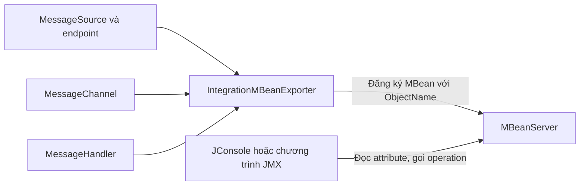
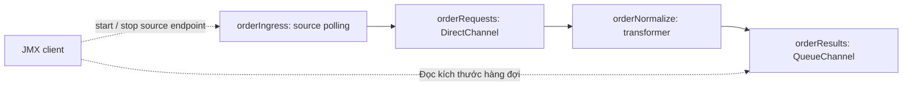

# IntegrationMBeanExporter

## 1. Mục tiêu và tình huống sử dụng

Trong chương **System management** của module **SPRING_INTEGRATION_CORE**, bài học này trình bày cách đưa các thành phần Spring Integration lên JMX bằng `IntegrationMBeanExporter`. Nội dung nối tiếp kiến thức về `Message`, `MessageChannel`, endpoint và Java DSL: khi luồng đã chạy, người vận hành cần nhận diện thành phần, xem trạng thái và thực hiện những thao tác quản trị được công bố.

Giả sử một ứng dụng tiếp nhận đơn hàng theo lịch, chuẩn hóa mã đơn rồi chuyển kết quả sang hàng đợi. Trong giờ bảo trì, bạn muốn tạm dừng đầu vào, kiểm tra hàng đợi và tiếp tục nhận đơn mà vẫn giữ application context hoạt động. JMX cung cấp một giao diện quản trị cho tình huống đó.

Sau bài học, bạn có thể:

- Giải thích quan hệ giữa component, exporter, MBean, `ObjectName` và `MBeanServer`.
- Cấu hình exporter bằng annotation hoặc khai báo bean.
- Chọn các component cần công bố, đặt tên ổn định và xử lý xung đột đăng ký.
- Tìm MBean, đọc thuộc tính và gọi operation bằng API JMX.
- Phân biệt quản trị qua JMX với đo lường qua Micrometer.
- Xây dựng quy trình dừng đầu vào và theo dõi luồng đang xử lý.

Ví dụ dùng API của **Spring Integration 6.5.0**, Java 17 trở lên và Spring Framework tương thích. Đây là mốc API cho bài thực hành, không phải khẳng định về phiên bản mới nhất. Khi dự án đã có Spring Boot hoặc BOM quản lý phiên bản, sử dụng bộ dependency đồng bộ của dự án.

## 2. Exporter làm gì trong kiến trúc JMX?

JMX, viết đầy đủ là Java Management Extensions, tổ chức tài nguyên quản trị thành các **MBean**. Một MBean có thể cung cấp:

- **Attribute**: dữ liệu có thể đọc hoặc ghi theo metadata, chẳng hạn trạng thái đang chạy.
- **Operation**: hành động có thể gọi, chẳng hạn khởi động một endpoint.
- **Notification**: thông báo quản trị nếu chính MBean đó hỗ trợ.

Việc export một component không tự làm cho component phát notification; khả năng này phải được triển khai và cấu hình riêng.

`IntegrationMBeanExporter` thuộc package:

```java
org.springframework.integration.monitor.IntegrationMBeanExporter
```

Nó kế thừa cơ chế export của Spring và bổ sung cách nhận diện, đặt tên, đăng ký các thành phần tích hợp. Để quản trị một luồng, exporter cần nhìn thấy các bean tương ứng trong application context của nó. Chỉ thêm dependency mà chưa cấu hình exporter thì chưa hoàn thành việc công bố tài nguyên.



Đây là đường quản trị. Message nghiệp vụ vẫn đi qua source, channel, transformer, router hoặc các endpoint khác theo cấu hình luồng. Exporter không trở thành một bước xử lý payload.

| Thành phần | Trách nhiệm |
| --- | --- |
| Component Spring Integration | Tiếp nhận, chuyển hoặc xử lý message |
| `IntegrationMBeanExporter` | Công bố tài nguyên quản trị của các component được chọn |
| `MBeanServer` | Lưu registry MBean và thực thi yêu cầu quản trị |
| `ObjectName` | Định danh MBean trong một server |
| JMX client | Khám phá metadata, đọc thuộc tính và gọi thao tác |

Exporter không tự đăng ký chính nó thành MBean. Muốn xem các thuộc tính tổng hợp hoặc gọi thao tác quản trị của exporter từ JMX, phải công bố chính bean exporter bằng một exporter Spring thích hợp. [API IntegrationMBeanExporter 6.5.0](https://docs.spring.io/spring-integration/docs/6.5.0/api/org/springframework/integration/monitor/IntegrationMBeanExporter.html)

## 3. Dependency và cấu hình tối thiểu

### 3.1. Thêm module JMX

Các lớp cấu hình JMX trong ví dụ thuộc module `spring-integration-jmx`. Trong dự án Maven độc lập, dependency minh họa là:

```xml
<dependency>
    <groupId>org.springframework.integration</groupId>
    <artifactId>spring-integration-jmx</artifactId>
    <version>6.5.0</version>
</dependency>
```

Module này kéo theo phần core cần thiết. Nếu dự án khai báo thêm các module Spring Integration khác, giữ chúng cùng một dòng phiên bản.

Tài liệu JMX chính thức cũng mô tả các adapter nhận notification, đọc thuộc tính và gọi operation của MBean. Bài này tập trung vào việc công bố các thành phần của chính ứng dụng. [JMX Support](https://docs.spring.io/spring-integration/reference/6.5/jmx.html)

### 3.2. Dùng annotation

```java
import java.lang.management.ManagementFactory;
import javax.management.MBeanServer;

import org.springframework.context.annotation.Bean;
import org.springframework.context.annotation.Configuration;
import org.springframework.integration.config.EnableIntegration;
import org.springframework.integration.jmx.config.EnableIntegrationMBeanExport;
import org.springframework.jmx.support.RegistrationPolicy;

@Configuration
@EnableIntegration
@EnableIntegrationMBeanExport(
        server = "mbeanServer",
        defaultDomain = "vn.example.orders.integration",
        managedComponents = {"!orderInternal*", "order*"},
        registration = RegistrationPolicy.FAIL_ON_EXISTING)
public class OrderJmxConfig {

    @Bean
    public MBeanServer mbeanServer() {
        return ManagementFactory.getPlatformMBeanServer();
    }
}
```

`mbeanServer` ở đây là tên bean mà annotation tham chiếu. Việc trả về platform MBeanServer giúp mã Java và công cụ quản trị cục bộ cùng hướng tới registry của JVM này.

Các tùy chọn chính:

| Tùy chọn | Ý nghĩa | Cách dùng trong ví dụ |
| --- | --- | --- |
| `server` | Tên bean MBeanServer đích | Dùng server đã khai báo rõ ràng |
| `defaultDomain` | Domain cho ObjectName được exporter tạo | Gom tài nguyên của ứng dụng đơn hàng |
| `managedComponents` | Danh sách pattern chọn component | Chọn nhóm `order*`, loại nhóm nội bộ |
| `registration` | Chính sách khi ObjectName đã tồn tại | Báo lỗi để phát hiện cấu hình trùng |

Annotation tạo bean exporter có tên **`integrationMbeanExporter`**, chú ý chữ hoa và chữ thường. Giá trị mặc định của `managedComponents` là `*`; mặc định đăng ký là `FAIL_ON_EXISTING`. [API EnableIntegrationMBeanExport 6.5.0](https://docs.spring.io/spring-integration/docs/6.5.0/api/org/springframework/integration/jmx/config/EnableIntegrationMBeanExport.html)

Một domain JMX chỉ là không gian tên trong registry. Nó không mở cổng mạng, không quyết định địa chỉ máy chủ và không tự cấu hình kết nối JMX từ xa.

### 3.3. Dùng bean để cấu hình chi tiết hơn

Khi cần thêm các thuộc tính tĩnh vào ObjectName, có thể **thay annotation `@EnableIntegrationMBeanExport`** bằng một bean:

```java
import java.util.Map;
import javax.management.MBeanServer;

import org.springframework.context.annotation.Bean;
import org.springframework.integration.monitor.IntegrationMBeanExporter;
import org.springframework.jmx.support.RegistrationPolicy;

// Đặt method này trong lớp @Configuration có @EnableIntegration.
// Giữ bean mbeanServer và bỏ @EnableIntegrationMBeanExport.
@Bean
public IntegrationMBeanExporter orderIntegrationExporter(
        MBeanServer mbeanServer) {

    IntegrationMBeanExporter exporter = new IntegrationMBeanExporter();
    exporter.setServer(mbeanServer);
    exporter.setDefaultDomain("vn.example.orders.integration");
    exporter.setComponentNamePatterns(
            new String[] {"!orderInternal*", "order*"});
    exporter.setObjectNameStaticProperties(
            Map.of("application", "orderService", "context", "workerA"));
    exporter.setRegistrationPolicy(RegistrationPolicy.FAIL_ON_EXISTING);
    return exporter;
}
```

Các giá trị tĩnh trong ví dụ dùng ký tự đơn giản để tránh vấn đề quoting. Khi cần giá trị chứa dấu phẩy, dấu bằng hoặc ký tự đặc biệt, phải tuân thủ cú pháp `ObjectName`.

Không đồng thời dùng annotation và bean thay thế này cho cùng nhóm component trên cùng server. Hai exporter cùng đăng ký một ObjectName có thể khiến context khởi tạo thất bại.

## 4. Chọn component và thiết kế tên quản trị

### 4.1. Pattern được xét theo thứ tự

Trong:

```java
managedComponents = {"!orderInternal*", "order*"}
```

pattern phủ định được đặt trước pattern cho phép. Khi một tên khớp nhiều pattern, **kết quả khớp đầu tiên quyết định**. Tên không khớp pattern cho phép nào sẽ không được chọn.

| Tên component | Pattern quyết định | Kết quả |
| --- | --- | --- |
| `orderRequests` | `order*` | Được chọn |
| `orderNormalize` | `order*` | Được chọn |
| `orderInternalTrace` | `!orderInternal*` | Bị loại |
| `paymentRequests` | Không có | Bị loại |

Nếu đảo thành `{"order*", "!orderInternal*"}`, tên `orderInternalTrace` đã được chọn ở pattern đầu. Pattern phía sau không đảo ngược kết quả đó.

Pattern là quy tắc chọn tên đơn giản, không phải biểu thức chính quy. Trước khi áp dụng cho một hệ thống có nhiều bean do Java DSL sinh ra, nên in danh sách ObjectName thực tế để kiểm tra phạm vi lựa chọn.

### 4.2. Đặt tên rõ ràng cho endpoint

Tên method `@Bean` giúp tạo tên ổn định cho channel:

```java
@Bean
public QueueChannel orderResults() {
    return new QueueChannel(100);
}
```

Trong Java DSL, đặt ID cho endpoint:

```java
.transform(
        String.class,
        value -> value.trim(),
        endpoint -> endpoint.id("orderNormalize"))
```

`orderNormalize` là ID endpoint; framework còn có thể tạo bean handler và channel hỗ trợ. Không suy ra rằng tên bean handler sinh tự động luôn giống hệt ID này. Khi lựa chọn pattern, một tiền tố thống nhất như `order*` thuận tiện hơn việc dự đoán mọi hậu tố nội bộ.

### 4.3. Đọc ObjectName

Một định danh channel có thể có dạng:

```text
vn.example.orders.integration:type=MessageChannel,name=orderResults
```

Phần trước dấu `:` là domain. Phần sau gồm các cặp khóa và giá trị. Handler thường có thêm khóa `bean` để thể hiện nguồn đặt tên. Các endpoint được công bố riêng có thể nằm dưới loại `ManagedEndpoint`.

Đối với source polling trong bài thực hành, exporter 6.5.0 tạo MBean lifecycle với hậu tố `.adapter`. Đừng mặc định mọi endpoint đều có một MBean `ManagedEndpoint` riêng hoặc mọi MBean handler đều có `start()` và `stop()`; hãy khám phá metadata của tài nguyên được đăng ký. Quy tắc tạo tên có thể được đối chiếu trong [mã nguồn IntegrationMBeanExporter 6.5.0](https://github.com/spring-projects/spring-integration/blob/v6.5.0/spring-integration-jmx/src/main/java/org/springframework/integration/monitor/IntegrationMBeanExporter.java).

Khi so sánh ObjectName, dùng đối tượng `ObjectName` hoặc `getCanonicalName()`. Thứ tự trình bày các khóa không làm thay đổi định danh. Khi query cần cho phép thêm khóa tĩnh, đặt `,*` ở cuối pattern:

```text
vn.example.orders.integration:type=MessageChannel,name=orderResults,*
```

## 5. Thực hành: quản trị luồng đơn hàng qua JMX

### 5.1. Luồng và kết quả mong đợi

Luồng sử dụng một source theo lịch để tạo mã đơn giả lập:



Source được cấu hình `autoStartup(false)`. Nhờ vậy, ví dụ có thể chứng minh rằng một MBean đã đăng ký vẫn tồn tại trong khi endpoint chưa chạy.

Payload tạo ra là `"  don-1  "`. Transformer loại khoảng trắng và đổi chữ hoa, tạo kết quả `"DON-1"`. `DirectChannel` nối source với transformer; `QueueChannel` giữ kết quả để chương trình nhận lại.

### 5.2. Chương trình Java đầy đủ

Đoạn mã dưới đây là nội dung của một lớp Java minh họa. Các thao tác đọc/gọi JMX chạy trong cùng JVM; ví dụ không cần mở JMX từ xa.

```java
import java.lang.management.ManagementFactory;
import java.util.Arrays;
import java.util.Locale;
import java.util.Set;
import java.util.concurrent.atomic.AtomicLong;

import javax.management.MBeanInfo;
import javax.management.MBeanServer;
import javax.management.ObjectName;

import org.springframework.context.annotation.AnnotationConfigApplicationContext;
import org.springframework.context.annotation.Bean;
import org.springframework.context.annotation.Configuration;
import org.springframework.integration.channel.DirectChannel;
import org.springframework.integration.channel.QueueChannel;
import org.springframework.integration.config.EnableIntegration;
import org.springframework.integration.dsl.IntegrationFlow;
import org.springframework.integration.dsl.Pollers;
import org.springframework.integration.jmx.config.EnableIntegrationMBeanExport;
import org.springframework.jmx.support.RegistrationPolicy;
import org.springframework.messaging.Message;

public class IntegrationJmxLesson {

    private static final String DOMAIN = "vn.example.orders.integration";

    @Configuration
    @EnableIntegration
    @EnableIntegrationMBeanExport(
            server = "mbeanServer",
            defaultDomain = DOMAIN,
            managedComponents = {"!orderInternal*", "order*"},
            registration = RegistrationPolicy.FAIL_ON_EXISTING)
    public static class Config {

        @Bean
        public MBeanServer mbeanServer() {
            return ManagementFactory.getPlatformMBeanServer();
        }

        @Bean
        public DirectChannel orderRequests() {
            return new DirectChannel();
        }

        @Bean
        public QueueChannel orderResults() {
            return new QueueChannel(100);
        }

        @Bean
        public IntegrationFlow orderFlow() {
            AtomicLong sequence = new AtomicLong();

            return IntegrationFlow
                    .fromSupplier(
                            () -> "  don-" + sequence.incrementAndGet() + "  ",
                            endpoint -> endpoint
                                    .id("orderIngress")
                                    .autoStartup(false)
                                    .poller(Pollers.fixedDelay(1000)
                                            .maxMessagesPerPoll(1)))
                    .channel(orderRequests())
                    .transform(
                            String.class,
                            value -> value.trim().toUpperCase(Locale.ROOT),
                            endpoint -> endpoint.id("orderNormalize"))
                    .channel(orderResults())
                    .get();
        }
    }

    public static void main(String[] args) throws Exception {
        try (var context =
                     new AnnotationConfigApplicationContext(Config.class)) {

            MBeanServer server =
                    context.getBean("mbeanServer", MBeanServer.class);
            QueueChannel results =
                    context.getBean("orderResults", QueueChannel.class);

            Set<ObjectName> names =
                    server.queryNames(new ObjectName(DOMAIN + ":*"), null);
            names.stream()
                    .map(ObjectName::getCanonicalName)
                    .sorted()
                    .forEach(System.out::println);

            ObjectName ingress = findOne(
                    server,
                    DOMAIN
                            + ":type=ManagedEndpoint,"
                            + "name=orderIngress.adapter,*");

            ObjectName resultChannel = findOne(
                    server,
                    DOMAIN
                            + ":type=MessageChannel,"
                            + "name=orderResults,*");

            describe(server, ingress);
            describe(server, resultChannel);
            requireNoArgOperation(server, ingress, "start");
            requireNoArgOperation(server, ingress, "stop");

            System.out.println(
                    "Running trước start: "
                            + server.getAttribute(ingress, "Running"));

            Message<?> result;
            try {
                server.invoke(
                        ingress, "start", new Object[0], new String[0]);
                result = results.receive(5000);
            }
            finally {
                server.invoke(
                        ingress, "stop", new Object[0], new String[0]);
            }

            if (result == null) {
                throw new IllegalStateException(
                        "Không nhận được đơn hàng trong thời gian chờ");
            }

            System.out.println("Payload: " + result.getPayload());
            System.out.println(
                    "Running sau stop: "
                            + server.getAttribute(ingress, "Running"));
            System.out.println(
                    "QueueSize: "
                            + server.getAttribute(resultChannel, "QueueSize"));
        }
    }

    private static ObjectName findOne(
            MBeanServer server, String pattern) throws Exception {

        Set<ObjectName> names =
                server.queryNames(new ObjectName(pattern), null);
        if (names.size() != 1) {
            throw new IllegalStateException(
                    "Cần đúng một MBean cho " + pattern + ", tìm được: " + names);
        }
        return names.iterator().next();
    }

    private static void describe(
            MBeanServer server, ObjectName name) throws Exception {

        MBeanInfo info = server.getMBeanInfo(name);
        System.out.println("MBean: " + name.getCanonicalName());

        Arrays.stream(info.getAttributes())
                .forEach(attribute -> System.out.println(
                        "  attribute=" + attribute.getName()
                                + ", readable=" + attribute.isReadable()
                                + ", writable=" + attribute.isWritable()));

        Arrays.stream(info.getOperations())
                .forEach(operation -> System.out.println(
                        "  operation=" + operation.getName()
                                + ", params="
                                + operation.getSignature().length));
    }

    private static void requireNoArgOperation(
            MBeanServer server, ObjectName name, String operation)
            throws Exception {

        boolean found = Arrays.stream(
                        server.getMBeanInfo(name).getOperations())
                .anyMatch(candidate ->
                        operation.equals(candidate.getName())
                                && candidate.getSignature().length == 0);

        if (!found) {
            throw new IllegalStateException(
                    "MBean không công bố operation: " + operation);
        }
    }
}
```

### 5.3. Đọc kết quả

Ngoài danh sách MBean và metadata, kết quả chính dự kiến có dạng:

```text
Running trước start: false
Payload: DON-1
Running sau stop: false
QueueSize: 0
```

`QueueSize` là ảnh chụp tại thời điểm đọc. Nếu JVM bị tạm dừng bởi debugger hoặc máy chạy chậm, source có thể phát thêm đơn trước khi nhận lệnh dừng, vì vậy số hàng đợi không bắt buộc luôn bằng 0.

Phân tích thứ tự:

1. Context khởi tạo và đăng ký các MBean phù hợp.
2. Source endpoint vẫn dừng vì `autoStartup(false)`.
3. JMX tìm đúng MBean lifecycle và gọi `start`.
4. Poller lấy dữ liệu từ supplier; message đi qua channel và transformer.
5. Chương trình nhận một kết quả với timeout hữu hạn.
6. Khối `finally` gọi `stop` cho source endpoint.
7. Khi khối `try` ngoài kết thúc, context đóng và tài nguyên được giải phóng.

Endpoint hỗ trợ lifecycle có thể được khởi động bằng lời gọi `start()` sau khi cấu hình không tự khởi động. [API AbstractEndpoint 6.5.0](https://docs.spring.io/spring-integration/docs/6.5.0/api/org/springframework/integration/endpoint/AbstractEndpoint.html)

Đặt `maxMessagesPerPoll(1)` giúp mỗi lần poll của supplier chỉ tạo một message. Một supplier luôn trả dữ liệu kết hợp với cấu hình lấy không giới hạn trong mỗi lần poll có thể tạo tải ngoài dự kiến.

### 5.4. Quan sát bằng công cụ

Có thể dùng JConsole để kết nối JVM chạy ứng dụng và mở cây **MBeans** theo domain đã chọn. Chương trình trên chạy xong sẽ đóng context ngay; nếu muốn quan sát thủ công, đặt breakpoint trước khi context đóng hoặc dùng một ứng dụng chạy lâu hơn với cùng cấu hình.

Trong công cụ quản trị:

1. Tìm domain `vn.example.orders.integration`.
2. Tìm MBean của source endpoint và xem thuộc tính `Running`.
3. Đọc danh sách operation mà công cụ hiển thị.
4. Chỉ gọi `start` hoặc `stop` trên tài nguyên đã xác định đúng.
5. Tìm MBean của `orderResults` để đọc thuộc tính hàng đợi.

Khi context đóng, một cây MBean biến mất là hành vi cleanup dự kiến. Nếu công cụ không thấy domain trong lúc context còn mở, kiểm tra lại JVM và MBeanServer đích trước.

## 6. Làm việc với attribute và operation

### 6.1. Phân biệt getter Java và tên attribute JMX

Getter Java `getQueueSize()` tương ứng với attribute `QueueSize`. Getter boolean `isRunning()` thường được công bố dưới tên `Running`, theo metadata JMX.

```java
Object size = server.getAttribute(resultChannel, "QueueSize");
```

Tên attribute phân biệt chữ hoa và chữ thường. Đừng tự đổi thành `queueSize`, cũng đừng gọi `getQueueSize` như một operation khi metadata chỉ công bố nó là attribute.

Một `QueueChannel` có thể cung cấp kích thước và sức chứa còn lại. `DirectChannel` không có hàng đợi lưu trữ nên không có ý nghĩa tương đương về backlog. [API QueueChannel 6.5.0](https://docs.spring.io/spring-integration/docs/6.5.0/api/org/springframework/integration/channel/QueueChannel.html)

### 6.2. Kiểm tra chữ ký operation

`MBeanServer.invoke` nhận tên operation, mảng đối số và mảng tên kiểu Java. Với thao tác không có tham số:

```java
server.invoke(ingress, "stop", new Object[0], new String[0]);
```

Với thao tác nhận tham số, phải dùng đúng kiểu trong `MBeanOperationInfo`. Ví dụ phương thức Java nhận `long` sử dụng chuỗi chữ ký `"long"`, không tự thay bằng `"java.lang.Long"`.

Đọc metadata trước khi tạo một script quản trị giúp phát hiện trường hợp ứng dụng đã đổi phiên bản hoặc đang dùng một loại endpoint khác.

### 6.3. Hiểu các lỗi thường gặp từ API

| Lỗi hoặc biểu hiện | Điều cần kiểm tra |
| --- | --- |
| `InstanceNotFoundException` | ObjectName, server và vòng đời context |
| `AttributeNotFoundException` | Tên attribute và loại MBean thực tế |
| `ReflectionException` khi invoke | Tên operation, số tham số và chữ ký kiểu |
| `MBeanException` | Ngoại lệ do hành động quản trị bên dưới phát sinh |
| Query trả về nhiều MBean | Thiếu khóa phân biệt context hoặc application |
| Query không trả về MBean | Domain, pattern chọn component và registration log |

Sau khi tìm MBean, nó vẫn có thể bị hủy trước lần đọc tiếp theo. Công cụ vận hành lâu dài nên xử lý được tình huống tài nguyên biến mất khi ứng dụng đang shutdown hoặc thay đổi luồng.

## 7. Công bố chính exporter và dừng có trật tự

### 7.1. Khi cần MBean của exporter

Các thuộc tính tổng hợp như `ChannelCount`, `HandlerCount`, `SourceCount` hoặc `QueuedMessageCount` giúp nhìn toàn cảnh registry mà exporter quản lý. Tên component và số lượng cấu trúc không đồng nghĩa số giao dịch đã thành công.

Để công bố chính exporter một cách tường minh, có thể thêm method sau vào cấu hình dùng annotation ở phần thực hành:

```java
import java.util.Map;
import javax.management.MBeanServer;

import org.springframework.beans.factory.annotation.Qualifier;
import org.springframework.context.annotation.Bean;
import org.springframework.integration.monitor.IntegrationMBeanExporter;
import org.springframework.jmx.export.MBeanExporter;
import org.springframework.jmx.export.annotation.AnnotationJmxAttributeSource;
import org.springframework.jmx.export.assembler.MetadataMBeanInfoAssembler;
import org.springframework.jmx.support.RegistrationPolicy;

@Bean
public MBeanExporter orderManagerExporter(
        MBeanServer mbeanServer,
        @Qualifier("integrationMbeanExporter")
        IntegrationMBeanExporter integrationExporter) {

    MBeanExporter managementExporter = new MBeanExporter();
    managementExporter.setServer(mbeanServer);
    managementExporter.setAutodetect(false);
    managementExporter.setRegistrationPolicy(
            RegistrationPolicy.FAIL_ON_EXISTING);
    managementExporter.setAssembler(
            new MetadataMBeanInfoAssembler(
                    new AnnotationJmxAttributeSource()));
    managementExporter.setBeans(Map.of(
            "vn.example.orders.management:"
                    + "type=IntegrationMBeanExporter,name=orderManager",
            integrationExporter));
    return managementExporter;
}
```

Ở đây một exporter chuyên biệt quản lý component; exporter Spring thông thường chỉ công bố bean quản trị đã chỉ định. Việc đặt assembler theo annotation giúp lấy giao diện quản trị được đánh dấu thay vì công bố tùy tiện mọi public method. Spring hỗ trợ khai báo rõ ánh xạ bean sang ObjectName qua `setBeans`. [Exporting Your Beans to JMX](https://docs.spring.io/spring-framework/reference/integration/jmx/exporting.html)

Nếu hệ thống đã có exporter quản trị chung, tích hợp ánh xạ vào cấu hình hiện hữu và tránh đăng ký chính bean exporter hai lần.

### 7.2. Gọi stopActiveComponents

Khi MBean của exporter đã được công bố như trên:

```java
ObjectName manager = new ObjectName(
        "vn.example.orders.management:"
                + "type=IntegrationMBeanExporter,name=orderManager");

server.invoke(
        manager,
        "stopActiveComponents",
        new Object[] {5000L},
        new String[] {"long"});
```

`5000L` là khoảng thời gian chờ tính bằng millisecond trong quy trình dừng, không phải số message.

Cơ chế orderly shutdown phối hợp chuẩn bị dừng các thành phần có hỗ trợ, ngừng những đầu vào liên quan và dành thời gian cho công việc đang xử lý. Poller được giữ chạy trong quá trình này để hỗ trợ thoát các message đang chờ trong luồng. [Orderly Shutdown](https://docs.spring.io/spring-integration/reference/shutdown.html)

Có thể gọi trực tiếp từ mã quản lý vòng đời:

```java
IntegrationMBeanExporter exporter =
        context.getBean(IntegrationMBeanExporter.class);

exporter.stopActiveComponents(5000L);
```

Cách gọi trực tiếp không yêu cầu exporter tự xuất hiện trong registry JMX.

### 7.3. Giới hạn của dừng có trật tự

Dừng đầu vào tạo cơ hội xử lý nốt phần việc đang chạy. Kết quả còn phụ thuộc thời gian xử lý thực tế, trạng thái tài nguyên ngoài ứng dụng, cơ chế retry, transaction và nơi lưu message.

Ví dụ, một luồng nhận đơn cần gọi dịch vụ vận chuyển đang timeout 30 giây sẽ không thể được kỳ vọng hoàn tất mọi giao dịch trong cửa sổ chờ 5 giây. Cần chọn timeout theo ngân sách vận hành và có phương án xử lý những đơn chưa hoàn thành.

`stopActiveComponents` cũng không phải lệnh thoát JVM. Quy trình triển khai vẫn cần đóng context và kết thúc tiến trình theo cơ chế của môi trường chạy. Không dùng thao tác này như nút tạm dừng toàn cục với giả định rằng có một lệnh resume duy nhất cho mọi component.

## 8. JMX, Micrometer và trạng thái nghiệp vụ

`IntegrationMBeanExporter` giúp tìm tài nguyên và thực hiện quản trị. Hệ thống cần theo dõi tốc độ, phân vị độ trễ, tỷ lệ lỗi hoặc xu hướng backlog theo thời gian nên cấu hình Micrometer và backend lưu trữ tương ứng.

| Nhu cầu | Cách tiếp cận |
| --- | --- |
| Xem endpoint có đang chạy | Attribute lifecycle của MBean phù hợp |
| Dừng một đầu vào đã xác định | Operation được endpoint công bố |
| Xem hàng đợi hiện tại | Attribute của queue channel phù hợp |
| Theo dõi xu hướng hàng đợi nhiều giờ | Gauge được thu thập định kỳ |
| Đo độ trễ và tỷ lệ lỗi | MeterRegistry, metric phù hợp và dashboard |
| Tra cứu kết quả của một đơn cụ thể | Log, trace hoặc dữ liệu nghiệp vụ có mã tương quan |

Spring Integration tích hợp với `MeterRegistry`; việc lọc meter dùng cơ chế như `MeterFilter`. Quy tắc `managedComponents` chọn tài nguyên JMX không thay thế bộ lọc metric. Cấu hình Observation cũng có cơ chế riêng. [Metrics and Management](https://docs.spring.io/spring-integration/reference/6.5/metrics.html)

Tránh thiết kế script dựa trên giả định rằng mọi counter, rate hoặc thuộc tính thời gian trong tài liệu phiên bản cũ vẫn tồn tại trên MBean hiện tại. Hãy lấy `MBeanInfo` của phiên bản đang chạy và dùng hệ thống metric cho số liệu dài hạn.

Ba cách diễn giải cần giữ riêng:

- `Running = true` cho biết lifecycle đang chạy; dịch vụ ngoài ứng dụng vẫn có thể lỗi.
- Gửi thành công vào `QueueChannel` cho biết message đã được chấp nhận vào hàng đợi; xử lý nghiệp vụ phía sau có thể chưa xảy ra.
- Hàng đợi rỗng cho biết không còn phần tử ở chính hàng đợi đó; công việc có thể vẫn đang thực thi ở handler hoặc dịch vụ ngoài.

Giả sử backlog tăng từ 100 lên 300 trong một phút. Chỉ ảnh chụp JMX không đủ kết luận transformer chậm: có thể đầu vào tăng, consumer bị dừng hoặc đích xử lý gặp lỗi. Cần ghép trạng thái lifecycle, tốc độ nhận/xử lý, lỗi và log liên quan trước khi thay đổi luồng.

## 9. Xung đột tên và nhiều application context

ObjectName phải duy nhất trong phạm vi một MBeanServer. Hai context cùng dùng domain và tên channel `orderResults` có thể tranh cùng một định danh dù chúng là hai đối tượng Java khác nhau.

| Chính sách | Hành vi khi tên đã tồn tại | Hệ quả cần hiểu |
| --- | --- | --- |
| `FAIL_ON_EXISTING` | Đăng ký thất bại | Phát hiện cấu hình trùng sớm |
| `IGNORE_EXISTING` | Giữ đăng ký đã có | Client có thể đang nhìn tài nguyên của context khác |
| `REPLACE_EXISTING` | Thay đăng ký đang có | Thay đổi tài nguyên mà client cùng tên đang điều khiển |

Trong bài thực hành dùng `FAIL_ON_EXISTING` để làm lộ vấn đề. Khi cần nhiều context trong cùng JVM, chọn domain riêng hoặc bổ sung khóa tĩnh như `context=workerA`.

Với nhiều JVM khác nhau, registry cũng khác nhau. Một ObjectName trùng giữa hai máy không tự gây xung đột đăng ký; công cụ thu thập vẫn cần phân biệt máy hoặc instance khi tổng hợp dữ liệu.

Nếu có cả Spring Boot JMX, exporter chung và exporter tích hợp, hãy xác định thành phần nào sở hữu từng nhóm MBean. Trước khi đổi registration policy, kiểm tra xem nguyên nhân có phải khai báo hai exporter cho cùng tài nguyên hay không.

Các bean gắn `@IntegrationManagedResource` được thiết kế để công bố qua exporter tích hợp. Không suy ra rằng mọi bean có annotation quản trị đều được exporter thông thường xử lý giống nhau. [API IntegrationManagedResource 6.5.0](https://docs.spring.io/spring-integration/docs/6.5.0/api/org/springframework/integration/support/management/IntegrationManagedResource.html)

## 10. Quy trình vận hành khi cần bảo trì

Với luồng đơn hàng, một quy trình thực tế có thể gồm:

1. Xác định đúng instance, context và MBean của đầu vào cần điều khiển.
2. Ghi nhận trạng thái đang chạy, backlog và lỗi hiện tại.
3. Ngừng hoặc điều tiết nguồn gửi bên ngoài nếu nó vẫn tiếp tục tạo tải.
4. Gọi thao tác dừng phù hợp của đầu vào.
5. Theo dõi các hàng đợi và công việc đang xử lý trong khoảng chờ.
6. Kiểm tra kết quả nghiệp vụ hoặc cơ chế khôi phục trước khi bảo trì.
7. Sau bảo trì, khởi động thành phần cần thiết và xác nhận dữ liệu tiếp tục đi qua luồng.

Với `QueueChannel` có sức chứa 100, consumer dừng trong khi producer còn gửi sẽ làm hàng đợi tăng tới giới hạn. Lời gọi gửi có thể phải chờ hoặc thất bại tùy timeout. Vì thế, thao tác dừng một consumer cần gắn với chính sách tiếp nhận message của hệ thống.

Không dùng việc purge hoặc clear hàng đợi làm phép kiểm tra đọc trạng thái; đó là thao tác thay đổi dữ liệu. Cũng không dùng việc gọi `receive()` trên channel sản xuất để xem thử payload, vì nó lấy message ra khỏi luồng tiêu thụ bình thường.

Quyền ghi attribute và quyền gọi operation là quyền điều khiển ứng dụng. Khi bật kết nối JMX từ xa, cần cấu hình connector, xác thực, phân quyền và bảo vệ đường truyền phù hợp môi trường. Chỉ cấu hình exporter không đồng nghĩa đã thiết lập các phần này.

## 11. Chẩn đoán các tình huống phổ biến

| Tình huống | Hướng kiểm tra |
| --- | --- |
| Không import được annotation JMX | Có `spring-integration-jmx` và phiên bản đồng bộ chưa |
| Context chạy nhưng không thấy MBean | Exporter, MBeanServer đích, domain và pattern |
| Thấy channel nhưng không thấy endpoint cần tìm | ID endpoint, tên sinh bởi DSL và loại MBean thực tế |
| Có MBean nhưng thiếu `start` hoặc `stop` | Đọc MBeanInfo; có thể đang chọn MBean handler hoặc channel |
| Gọi `start` nhưng chưa có kết quả | Poller, lịch chạy, đầu ra, lỗi xử lý và timeout nhận |
| `Running` đúng nhưng backlog vẫn tăng | Tốc độ đầu vào, năng lực xử lý và tài nguyên phía sau |
| Context mới lỗi tên MBean trùng | Domain, khóa tĩnh, context cũ và số exporter |
| MBean biến mất sau khi chạy ví dụ | Context có thể đã đóng và unregister tài nguyên |

Hãy phân biệt **MBean được đăng ký**, **endpoint đang chạy** và **nghiệp vụ có kết quả**. Đó là ba điều kiện khác nhau, cần được xác minh bằng thông tin tương ứng.

## 12. Thực hành mở rộng

Các thao tác dưới đây dành cho môi trường học tập với dữ liệu giả lập:

1. Đổi `managedComponents` thành `{"orderResults"}`. Chạy lại và giải thích vì sao tìm thấy channel kết quả nhưng query lifecycle của source không còn trả về phần tử.
2. Đặt pattern `"!orderIngress*"` trước `"order*"`. Dự đoán thành phần nào bị loại rồi đối chiếu danh sách ObjectName.
3. Chạy source một lúc mà chưa nhận kết quả. Quan sát `QueueSize` và `RemainingCapacity`, sau đó nhận message để xem hai giá trị thay đổi.
4. Thêm khóa tĩnh `context=workerA` bằng cấu hình bean. Giải thích vì sao query kết thúc bằng `,*` vẫn tìm được MBean.
5. Công bố chính exporter bằng ánh xạ tường minh và khám phá operation `stopActiveComponents` từ MBeanInfo trước khi gọi.
6. Đưa ra ba bằng chứng cần thu thập khi `Running = true` nhưng số đơn xử lý thành công giảm.

Khi giải thích kết quả, liên hệ lại từng thành phần của luồng: source tạo message, channel chuyển hoặc lưu message, transformer xử lý payload, endpoint quyết định cách thành phần tham gia vòng đời và exporter cung cấp giao diện quản trị. Cách liên hệ này giúp dùng JMX đúng vị trí trong một ứng dụng Spring Integration.
