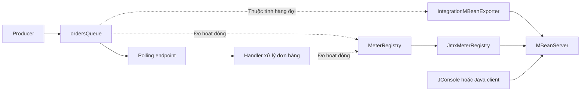

# JMX metrics

## 1. Mục tiêu và phạm vi bài học

Trong chương **System management** của module **SPRING_INTEGRATION_CORE**, JMX giúp quan sát trạng thái vận hành của các thành phần trong luồng thông điệp. Khi một luồng vẫn nhận đầu vào nhưng xử lý chậm, cần biết thông điệp đang nằm trong hàng đợi, consumer đã chạy hay chưa và thao tác nào đang phát sinh lỗi.

Sau bài học, bạn có thể:

- Phân biệt MBean quản trị thành phần với meter thống kê hoạt động xử lý.
- Xuất thành phần Spring Integration vào `MBeanServer` bằng `@EnableIntegrationMBeanExport`.
- Đọc `QueueSize`, `RemainingCapacity` và khám phá metadata của MBean bằng Java hoặc JConsole.
- Đưa metrics Micrometer ra JMX bằng `JmxMeterRegistry`.
- Diễn giải throughput, tỷ lệ lỗi và thời gian xử lý theo đúng ranh giới đo.
- Chẩn đoán tình huống hàng đợi tăng, consumer dừng hoặc số liệu không xuất hiện.

Bạn nên biết `Message`, `MessageChannel`, `QueueChannel`, endpoint, poller và cách khai báo luồng bằng Java DSL. Các kiến thức này cũng là nền tảng để quan sát luồng có gateway, transformer, router, filter hoặc aggregator.

Ví dụ chính chọn **Java 17, Spring Integration 6.5.0 và Micrometer 1.15.0** làm mốc API cụ thể. Đây là mốc minh họa, không phải khẳng định về phiên bản mới nhất. Ví dụ dùng Spring thuần để thể hiện rõ các bean cần thiết; phần sau giải thích cách liên hệ với Spring Boot.

## 2. JMX quan sát điều gì trong một luồng thông điệp?

**JMX — Java Management Extensions** là cơ chế quản trị của nền tảng Java. Một đối tượng được công bố để quản trị gọi là **MBean**. MBean có thể cung cấp thuộc tính để đọc, thao tác để gọi và thông báo để phát sự kiện.

Ví dụ, hàng đợi có thể công bố số thông điệp đang chờ. Một thành phần có vòng đời có thể công bố trạng thái chạy hoặc thao tác quản trị nếu metadata của nó hỗ trợ. Công cụ quản trị truy cập các đối tượng đã đăng ký trong `MBeanServer`.

| Khái niệm | Vai trò | Ví dụ trong bài |
| --- | --- | --- |
| MBean | Đối tượng quản trị được đăng ký | MBean đại diện cho `ordersQueue` |
| Attribute | Thuộc tính do MBean công bố | `QueueSize` |
| Operation | Thao tác do MBean công bố | Chỉ gọi tên thao tác có trong metadata thực tế |
| `MBeanServer` | Nơi đăng ký và truy cập MBean | Platform MBean server của JVM |
| `ObjectName` | Định danh MBean trong một server | `com.example.orders.integration:type=MessageChannel,name=ordersQueue` |
| JMX client | Công cụ hoặc chương trình truy cập server | JConsole, chương trình Java |

Tách luồng nghiệp vụ và luồng quan sát giúp hiểu đường đi của dữ liệu:



Sơ đồ mô tả hai đường xuất dữ liệu. `IntegrationMBeanExporter` đưa giao diện quản trị thành phần ra JMX; `JmxMeterRegistry` đưa meter Micrometer ra JMX. Bật một đường không có nghĩa đường còn lại tự động tồn tại.

## 3. Phân biệt JMX quản trị và metrics hiện đại

### 3.1. Vì sao ví dụ cũ có thể không còn dùng được?

Spring Integration đã loại bỏ bộ **legacy metrics** từ phiên bản **5.4**, sau khi chuyển sang Micrometer. Vì vậy, không lấy ví dụ của các bản 4.x hoặc 5.x cũ rồi mặc định rằng MBean ở bản 6.5 vẫn có `SendCount`, `ErrorCount`, các thống kê trung bình cũ hay những tùy chọn bật thống kê tương ứng. Mốc thay đổi được ghi trong [lịch sử Spring Integration 5.3–5.4](https://docs.spring.io/spring-integration/docs/5.5.11/reference/html/history.html).

| Nhu cầu | Cơ chế nên xác định rõ | Nơi quan sát |
| --- | --- | --- |
| Số thông điệp đang chờ trong `QueueChannel` | Thuộc tính quản trị của channel | MBean của channel |
| Số lần gửi và thời gian của thao tác gửi | Timer Micrometer | `MeterRegistry`; có thể xuất tiếp ra JMX |
| Phân loại kết quả thành công hoặc thất bại | Các meter và tag tại điểm đo | Registry đang sử dụng |
| Điều khiển vòng đời một thành phần | Giao diện quản trị mà thành phần thực sự công bố | Metadata của MBean hoặc API vòng đời phù hợp |
| Thống kê số channel, handler, source | Thuộc tính tổng hợp của exporter khi được xuất riêng | MBean của exporter |
| Theo dõi xu hướng của nhiều instance | Thu thập tập trung có lưu lịch sử | Hệ thống giám sát của ứng dụng |

Không suy ra tập thuộc tính MBean chỉ từ tên lớp hoặc từ một ảnh JConsole cũ. Hãy khám phá MBean đã đăng ký và kiểm tra metadata của chính phiên bản đang chạy.

### 3.2. JMX exporter không tự xuất chính nó

`IntegrationMBeanExporter` có những thuộc tính tổng hợp như số channel và số thông điệp đang xếp hàng, nhưng không tự đăng ký bản thân làm MBean. Muốn xem chúng qua JMX phải cấu hình xuất exporter bằng cơ chế Spring JMX phù hợp. Ví dụ chính của bài chỉ cần MBean của `ordersQueue`, nên không thêm một exporter tổng quát thứ hai. Xem [API IntegrationMBeanExporter 6.5.0](https://docs.spring.io/spring-integration/docs/6.5.0/api/org/springframework/integration/monitor/IntegrationMBeanExporter.html).

## 4. Tình huống thực hành

Một ứng dụng nhận các mã đơn hàng vào `ordersQueue`. Consumer định kỳ lấy thông điệp và gọi handler `ordersProcessor`. Ta chủ động để consumer chưa chạy khi ứng dụng khởi động, rồi gửi ba thông điệp mẫu.

Các câu hỏi cần trả lời:

1. Ba thông điệp đã được đưa vào hàng đợi chưa?
2. Hàng đợi còn chỗ cho bao nhiêu thông điệp?
3. Khi consumer được khởi động, số thông điệp chờ thay đổi thế nào?
4. Nếu handler ném ngoại lệ, thành công của thao tác gửi vào queue có thay đổi thành thất bại hay không?
5. MBean quản trị channel và MBean của meter nằm ở domain nào?

Hàng đợi có dung lượng cố định 100 để trạng thái dễ diễn giải. `QueueChannel` trong ví dụ dùng bộ nhớ của tiến trình; bài thực hành không coi nó là kho lưu thông điệp bền vững.

## 5. Dependency và cấu hình Java hoàn chỉnh

### 5.1. Dependency Maven

Trong một dự án Maven dùng Java 17, thêm các phần sau vào `pom.xml`. Nếu dự án đã có BOM của Spring Boot hoặc cơ chế quản lý phiên bản khác, dùng bộ phiên bản tương thích của dự án thay vì chồng thêm các BOM minh họa.

```xml
<properties>
    <maven.compiler.release>17</maven.compiler.release>
    <project.build.sourceEncoding>UTF-8</project.build.sourceEncoding>
</properties>

<dependencyManagement>
    <dependencies>
        <dependency>
            <groupId>org.springframework.integration</groupId>
            <artifactId>spring-integration-bom</artifactId>
            <version>6.5.0</version>
            <type>pom</type>
            <scope>import</scope>
        </dependency>
        <dependency>
            <groupId>io.micrometer</groupId>
            <artifactId>micrometer-bom</artifactId>
            <version>1.15.0</version>
            <type>pom</type>
            <scope>import</scope>
        </dependency>
    </dependencies>
</dependencyManagement>

<dependencies>
    <dependency>
        <groupId>org.springframework.integration</groupId>
        <artifactId>spring-integration-core</artifactId>
    </dependency>
    <dependency>
        <groupId>org.springframework.integration</groupId>
        <artifactId>spring-integration-jmx</artifactId>
    </dependency>
    <dependency>
        <groupId>io.micrometer</groupId>
        <artifactId>micrometer-registry-jmx</artifactId>
    </dependency>
</dependencies>
```

`spring-integration-jmx` cung cấp phần hỗ trợ JMX của Spring Integration. `micrometer-registry-jmx` xuất dữ liệu Micrometer ra JMX; module này không phải bộ đọc mọi MBean có sẵn trong JVM. Hai chức năng được mô tả trong [JMX Support của Spring Integration](https://docs.spring.io/spring-integration/reference/6.5/jmx.html) và [Micrometer JMX](https://docs.micrometer.io/micrometer/reference/implementations/jmx.html).

### 5.2. Ứng dụng mẫu

Đặt lớp sau trong package `example`. Có thể chạy phương thức `main()` từ IDE với classpath Maven của dự án.

```java
package example;

import java.io.BufferedReader;
import java.io.InputStreamReader;
import java.lang.management.ManagementFactory;
import java.nio.charset.StandardCharsets;

import javax.management.MBeanServer;
import javax.management.ObjectName;

import io.micrometer.core.instrument.Clock;
import io.micrometer.jmx.JmxConfig;
import io.micrometer.jmx.JmxMeterRegistry;

import org.springframework.context.Lifecycle;
import org.springframework.context.annotation.AnnotationConfigApplicationContext;
import org.springframework.context.annotation.Bean;
import org.springframework.context.annotation.Configuration;
import org.springframework.integration.channel.QueueChannel;
import org.springframework.integration.config.EnableIntegration;
import org.springframework.integration.config.EnableIntegrationManagement;
import org.springframework.integration.dsl.IntegrationFlow;
import org.springframework.integration.dsl.Pollers;
import org.springframework.integration.jmx.config.EnableIntegrationMBeanExport;
import org.springframework.messaging.support.GenericMessage;

@Configuration
@EnableIntegration
@EnableIntegrationManagement
@EnableIntegrationMBeanExport(
    server = "mbeanServer",
    defaultDomain = "com.example.orders.integration",
    managedComponents = {"orders*"}
)
public class OrdersJmxDemo {

    @Bean
    public MBeanServer mbeanServer() {
        return ManagementFactory.getPlatformMBeanServer();
    }

    @Bean(destroyMethod = "close")
    public JmxMeterRegistry meterRegistry() {
        JmxConfig config = new JmxConfig() {
            @Override
            public String get(String key) {
                return null; // Dùng mặc định cho các thuộc tính khác.
            }

            @Override
            public String domain() {
                return "com.example.orders.metrics";
            }
        };
        return new JmxMeterRegistry(config, Clock.SYSTEM);
    }

    @Bean
    public QueueChannel ordersQueue() {
        return new QueueChannel(100);
    }

    @Bean
    public IntegrationFlow ordersFlow(QueueChannel ordersQueue) {
        return IntegrationFlow.from(ordersQueue)
            .handle(String.class, (payload, headers) -> {
                if (payload.startsWith("FAIL")) {
                    throw new IllegalStateException("Lỗi xử lý mô phỏng");
                }
                System.out.println("Processed: " + payload);
                return null; // Kết thúc luồng, không phát thông điệp trả lời.
            }, endpoint -> endpoint
                .id("ordersProcessor")
                .autoStartup(false)
                .poller(Pollers.fixedDelay(200).maxMessagesPerPoll(10)))
            .get();
    }

    public static void main(String[] args) throws Exception {
        try (var context = new AnnotationConfigApplicationContext(
                OrdersJmxDemo.class)) {
            QueueChannel queue = context.getBean("ordersQueue", QueueChannel.class);
            Lifecycle processor = context.getBean("ordersProcessor", Lifecycle.class);
            MBeanServer server = context.getBean("mbeanServer", MBeanServer.class);
            JmxMeterRegistry registry = context.getBean(JmxMeterRegistry.class);
            ObjectName queueName = new ObjectName(
                "com.example.orders.integration:type=MessageChannel,name=ordersQueue");

            for (int i = 1; i <= 3; i++) {
                if (!queue.send(new GenericMessage<>("ORDER-" + i), 0)) {
                    throw new IllegalStateException("Không nhận được đơn hàng mẫu");
                }
            }

            System.out.println("PID: " + ProcessHandle.current().pid());
            System.out.println("Lệnh: show, start, stop, send <payload>, meters, quit");
            BufferedReader console = new BufferedReader(
                new InputStreamReader(System.in, StandardCharsets.UTF_8));

            for (String command; (command = console.readLine()) != null;) {
                if (command.equals("quit")) {
                    break;
                }
                if (command.startsWith("send ")) {
                    boolean accepted = queue.send(
                        new GenericMessage<>(command.substring(5).trim()), 0);
                    System.out.println("Accepted by queue: " + accepted);
                    continue;
                }
                switch (command) {
                    case "show" -> System.out.printf(
                        "QueueSize=%s, RemainingCapacity=%s, Running=%s%n",
                        server.getAttribute(queueName, "QueueSize"),
                        server.getAttribute(queueName, "RemainingCapacity"),
                        processor.isRunning());
                    case "start" -> processor.start();
                    case "stop" -> processor.stop();
                    case "meters" -> registry.getMeters().forEach(
                        meter -> System.out.println(meter.getId()));
                    default -> System.out.println("Lệnh không hợp lệ");
                }
            }
        }
    }
}
```

Đóng application context sẽ kết thúc ví dụ và đóng registry. Việc đăng ký, hủy đăng ký MBean của thành phần thuộc vòng đời context; không dùng `start()` hoặc `stop()` của exporter như cách đăng ký lại toàn bộ MBean.

### 5.3. Ý nghĩa từng phần cấu hình

`@EnableIntegrationMBeanExport` chọn server, domain và tập thành phần được xuất. `managedComponents` là bộ lọc xuất MBean, không phải công tắc bật mọi loại metrics. Pattern có thể có tiền tố `!` để loại trừ; khi nhiều pattern khớp thì pattern khớp đầu tiên quyết định. Ví dụ, `{"!ordersDebug*", "orders*"}` loại nhóm debug trước khi nhận những thành phần khác của luồng. Xem [API EnableIntegrationMBeanExport 6.5.0](https://docs.spring.io/spring-integration/docs/6.5.0/api/org/springframework/integration/jmx/config/EnableIntegrationMBeanExport.html).

`@EnableIntegrationManagement` cấu hình phần quản lý của framework. Bean `JmxMeterRegistry` cung cấp nơi nhận các phép đo Micrometer và đưa chúng vào một domain riêng. Constructor trong ví dụ tự khởi động reporter của registry; `close()` dừng reporter khi context đóng. Có thể đối chiếu [mã nguồn JmxMeterRegistry 1.15.0](https://raw.githubusercontent.com/micrometer-metrics/micrometer/v1.15.0/implementations/micrometer-registry-jmx/src/main/java/io/micrometer/jmx/JmxMeterRegistry.java).

`autoStartup(false)` làm consumer cần được khởi động tường minh. Trong chương trình, các lệnh `start`, `stop` và giá trị `Running` gọi **API `Lifecycle` trong Java**. Chúng không minh họa lời gọi operation qua JMX. Không suy ra rằng `Running` là thuộc tính của MBean `ordersQueue`. Hành vi vòng đời này thuộc endpoint, được mô tả trong [API AbstractEndpoint](https://docs.spring.io/spring-integration/docs/6.5.0/api/org/springframework/integration/endpoint/AbstractEndpoint.html).

`maxMessagesPerPoll(10)` giới hạn số thông điệp lấy trong một lượt poll; nó không tạo ra mười worker song song. `fixedDelay(200)` cũng không cam kết cứ đúng 200 ms sẽ xử lý xong một lô khi handler chậm.

## 6. Đọc kết quả thực hành

### 6.1. Khi consumer chưa chạy

Ngay sau khởi động, nhập:

```text
show
```

Trong ví dụ chỉ có ba lần gửi mẫu và consumer chưa chạy, kết quả mong đợi là:

```text
QueueSize=3, RemainingCapacity=97, Running=false
```

`QueueSize` là số thông điệp còn chờ được lấy khỏi queue. Nó không bao gồm thông điệp handler đã lấy ra và đang xử lý. `RemainingCapacity` là số vị trí trống tại thời điểm đọc. Hai thuộc tính này được công bố bằng `@ManagedAttribute` trong [QueueChannelOperations](https://docs.spring.io/spring-integration/docs/6.5.0/api/org/springframework/integration/channel/QueueChannelOperations.html).

### 6.2. Khi bắt đầu xử lý

Nhập:

```text
start
```

Chương trình sẽ in các dòng xử lý `ORDER-1`, `ORDER-2`, `ORDER-3`. Sau khi chúng đã được xử lý, nhập `show` để quan sát queue về 0, dung lượng còn lại về 100 và `Running=true`.

Không dùng ngay một lần đọc sau `start` để khẳng định consumer đã xử lý xong. Poller hoạt động theo lịch, trong khi luồng console vẫn tiếp tục độc lập. Khi producer và consumer cùng chạy, các thuộc tính đọc ở hai thời điểm cũng không tạo thành một snapshot nguyên tử.

### 6.3. Khi handler thất bại

Giữ consumer đang chạy rồi nhập:

```text
send FAIL-ORDER-4
```

Chương trình có thể in `Accepted by queue: true` rồi mới ghi lỗi của handler. Hai kết quả này phù hợp với nhau:

1. Thao tác `QueueChannel.send()` thành công vì thông điệp được nhận vào queue.
2. Poller lấy thông điệp sau đó.
3. Handler ném ngoại lệ khi xử lý payload.
4. Cơ chế lỗi của polling endpoint xử lý ngoại lệ; trong cấu hình mặc định của ví dụ, lỗi được báo qua hạ tầng `errorChannel` và logging tương ứng.

Ví dụ không cấu hình retry, transaction hay đưa lại thông điệp vào queue. Đừng xem việc handler thất bại là bằng chứng thông điệp đã tự quay lại hàng đợi. Trong luồng thực tế cần thiết kế riêng retry, tuyến lỗi hoặc lưu thông điệp thất bại để xử lý lại.

### 6.4. Khi hàng đợi đầy

Dừng consumer bằng `stop`, sau đó gửi đủ thông điệp để đạt dung lượng 100. Vì chương trình gọi `send(message, 0)`, lần gửi tiếp theo sẽ trả về `false` nếu queue vẫn đầy; luồng console không chờ vô hạn.

`false` biểu thị queue không nhận được thông điệp trong giới hạn chờ, dù không nhất thiết có ngoại lệ. Phía producer phải quyết định phản ứng phù hợp: báo từ chối, thử lại theo chính sách hoặc chuyển sang phương tiện lưu khác. Không bỏ qua kết quả boolean rồi tính đơn hàng là đã tiếp nhận.

Constructor có tham số của `QueueChannel` tạo queue với dung lượng chỉ định; API cũng cung cấp constructor mặc định với dung lượng thực tế rất lớn. Xem [QueueChannel 6.5.0](https://docs.spring.io/spring-integration/docs/6.5.0/api/org/springframework/integration/channel/QueueChannel.html).

## 7. Quan sát bằng JConsole và khám phá MBean

### 7.1. Kết nối trong môi trường phát triển

Với ứng dụng mẫu vẫn đang chạy:

1. Mở `jconsole` từ JDK.
2. Chọn tiến trình Java có PID mà chương trình vừa in.
3. Mở tab **MBeans**.
4. Tìm domain `com.example.orders.integration`, rồi tìm MBean `ordersQueue` thuộc loại `MessageChannel`.
5. Quan sát `QueueSize` và `RemainingCapacity` khi gửi thông điệp hoặc thay đổi trạng thái consumer bằng console của ứng dụng.
6. Tìm domain `com.example.orders.metrics` để quan sát những meter đã được registry xuất.

Kết nối local sử dụng khả năng attach của JVM khi môi trường và quyền hệ điều hành cho phép. Thông thường JConsole và ứng dụng cần chạy dưới cùng tài khoản. Việc quan sát local không yêu cầu mở ngay một cổng JMX remote. Tham khảo [hướng dẫn quản trị JMX của JDK 17](https://docs.oracle.com/en/java/javase/17/management/monitoring-and-management-using-jmx-technology.html).

### 7.2. Không đoán tên operation hoặc attribute

Đoạn sau dùng `MBeanServerConnection` để liệt kê MBean trong domain quản trị và in những thuộc tính, thao tác mà chúng thực sự có. Với ví dụ local, có thể dùng biến `server` làm đối số truyền vào phương thức.

```java
import javax.management.MBeanAttributeInfo;
import javax.management.MBeanInfo;
import javax.management.MBeanOperationInfo;
import javax.management.MBeanServerConnection;
import javax.management.ObjectName;

static void inspectIntegrationMBeans(MBeanServerConnection connection)
        throws Exception {
    ObjectName pattern = new ObjectName("com.example.orders.integration:*");
    for (ObjectName name : connection.queryNames(pattern, null)) {
        System.out.println(name.getCanonicalName());
        MBeanInfo info = connection.getMBeanInfo(name);

        for (MBeanAttributeInfo attribute : info.getAttributes()) {
            System.out.printf("  attribute=%s, type=%s, readable=%s%n",
                attribute.getName(), attribute.getType(), attribute.isReadable());
        }
        for (MBeanOperationInfo operation : info.getOperations()) {
            System.out.printf("  operation=%s, parameters=%d%n",
                operation.getName(), operation.getSignature().length);
        }
    }
}
```

`queryNames`, `getMBeanInfo` và `getAttribute` là API JMX chuẩn, dùng được qua giao diện kết nối local hoặc remote. Xem [MBeanServerConnection của JDK 17](https://docs.oracle.com/en/java/javase/17/docs/api/java.management/javax/management/MBeanServerConnection.html).

Các thành phần khác nhau công bố giao diện quản trị khác nhau. Chỉ gọi operation điều khiển khi đã kiểm tra nó tồn tại, xác nhận đúng đối tượng và hiểu tác động lên luồng.

### 7.3. Quy tắc đặt tên

Đối với channel được khai báo rõ tên như ví dụ, một `ObjectName` có thể là:

```text
com.example.orders.integration:type=MessageChannel,name=ordersQueue
```

Handler và source có quy tắc đặt tên riêng; handler có thể gắn với tên endpoint và có thêm khóa `bean`. Các ký tự đặc biệt cũng có thể làm giá trị phải được đặt trong dấu nháy. Không dùng thứ tự hiển thị các khóa trên giao diện làm định danh dạng chuỗi cố định. Hãy dùng `ObjectName` và truy vấn MBean để xử lý tên. Quy tắc thực thi nằm trong [mã nguồn IntegrationMBeanExporter 6.5.0](https://raw.githubusercontent.com/spring-projects/spring-integration/v6.5.0/spring-integration-jmx/src/main/java/org/springframework/integration/monitor/IntegrationMBeanExporter.java).

Trong nhóm phát triển, nên đặt tên channel và endpoint ổn định theo ý nghĩa nghiệp vụ. Một tên như `ordersQueue` giúp đối chiếu số liệu với thiết kế nhanh hơn tên do DSL tự sinh.

## 8. Metrics Micrometer được xuất qua JMX

### 8.1. Chọn đúng meter

Trong cơ chế Micrometer trực tiếp dùng ở ví dụ, những tên sau hữu ích:

| Tên meter | Loại và phạm vi tiêu biểu | Ý nghĩa vận hành |
| --- | --- | --- |
| `spring.integration.send` | Timer; phân biệt `type=channel` hoặc `type=handler` | Số lần và thời gian của thao tác được đo |
| `spring.integration.receive` | Counter của pollable channel hoặc message source | Hoạt động nhận tại thành phần tương ứng |
| `spring.integration.channel.queue.size` | Gauge của `QueueChannel` | Số thông điệp đang chờ |
| `spring.integration.channel.queue.remaining.capacity` | Gauge của `QueueChannel` | Số chỗ còn trống |

Tag của cơ chế này giúp phân biệt `name`, `type`, `result` và `exception` cho những meter tương ứng. Tập meter thực tế có thể chỉ xuất hiện khi thành phần bắt đầu được dùng. Tên/tag chuẩn được mô tả trong [Metrics and Management của Spring Integration 6.5](https://docs.spring.io/spring-integration/reference/6.5/metrics.html).

Nhập `meters` để xem `Meter.Id` thật của registry. Tên handler trong registry có thể khác tên bạn đang nhìn trong cây MBean quản trị, nên cần đối chiếu thay vì giả định chúng giống nhau.

### 8.2. Đọc timer từ registry để đối chiếu

Đây là đoạn bổ sung có thể đặt trong phạm vi đang có biến `registry` của ví dụ:

```java
io.micrometer.core.instrument.Timer successfulSends = registry
    .find("spring.integration.send")
    .tag("type", "channel")
    .tag("name", "ordersQueue")
    .tag("result", "success")
    .timer();

if (successfulSends != null) {
    long count = successfulSends.count();
    double totalMillis = successfulSends.totalTime(
        java.util.concurrent.TimeUnit.MILLISECONDS);
    double meanMillis = count == 0 ? 0.0 : totalMillis / count;
    System.out.printf("count=%d, totalMs=%.3f, meanMs=%.3f%n",
        count, totalMillis, meanMillis);
}
```

Timer chứa cả số sự kiện và tổng thời gian; phải sử dụng đơn vị thời gian tường minh khi tính toán. Không cần tự thêm một counter để đếm lại chính những sự kiện mà timer đã đếm. Những thống kê như histogram và percentile còn phụ thuộc cấu hình và backend. Xem [Micrometer Timers](https://docs.micrometer.io/micrometer/reference/concepts/timers.html).

### 8.3. Tên meter và tên MBean không giống nhau hoàn toàn

Micrometer có mô hình metric nhiều chiều bằng tên và tag. JMX cần ánh xạ chúng sang cấu trúc tên phù hợp với MBean. `JmxMeterRegistry` thực hiện bước ánh xạ này; vì vậy không sao chép nguyên tên `spring.integration.send` rồi giả định nó là toàn bộ `ObjectName`.

Hãy tìm dưới domain `com.example.orders.metrics`, xem tên được registry sinh ra và kiểm tra các thuộc tính thật của meter. Cách ánh xạ tên phân cấp được giải thích trong [Micrometer JMX](https://docs.micrometer.io/micrometer/reference/implementations/jmx.html).

### 8.4. Nếu dự án dùng Micrometer Observation

Spring Integration 6.x còn có cơ chế Observation cho metrics và tracing. Khi bật Observation cho một thành phần, việc thu metrics của thành phần đó được giao cho `ObservationHandler` tương ứng. Những tên như `spring.integration.handler`, `spring.integration.producer` hoặc `spring.integration.gateway` có thể xuất hiện với convention/tag của Observation.

Do đó, một dashboard dựa vào `spring.integration.send` và tag `name` không được xem là tương thích tự động với mọi cấu hình Observation. Kiểm tra registry, convention và tên/tag đang có trước khi viết truy vấn. Ví dụ của bài không bật `observationPatterns`, để giữ ranh giới của cơ chế đo trực tiếp rõ ràng. Xem phần Observation trong [Metrics and Management](https://docs.spring.io/spring-integration/reference/metrics.html).

## 9. Đọc số liệu theo đúng ranh giới xử lý

### 9.1. Counter, gauge và timer trả lời các câu hỏi khác nhau

- **Counter** phản ánh số sự kiện đã được ghi nhận. Muốn có tốc độ phải tính thay đổi theo thời gian hoặc dùng tốc độ mà backend cung cấp.
- **Gauge** phản ánh một trạng thái tại thời điểm đọc, chẳng hạn số thông điệp đang chờ.
- **Timer** phản ánh số lần và thời gian của thao tác đã đo. Cần biết thao tác bắt đầu, kết thúc ở đâu.

Một lần đọc `QueueSize=0` không chứng minh hệ thống không có tải. Có thể consumer xử lý nhanh, producer chưa gửi hoặc thông điệp đang nằm trong handler sau khi đã rời queue.

Ngược lại, `QueueSize=80` chỉ đáng đánh giá trong ngữ cảnh: dung lượng là 100 hay 100.000, số lượng tăng hay giảm và thời gian chờ có vượt yêu cầu nghiệp vụ hay không.

### 9.2. Gửi thành công không luôn là xử lý nghiệp vụ thành công

| Ranh giới | Kết quả thành công thường phản ánh | Điều vẫn cần kiểm tra |
| --- | --- | --- |
| Gửi vào `QueueChannel` | Queue nhận được thông điệp | Handler có xử lý thành công sau đó không |
| Gửi qua `DirectChannel` | Chuỗi gọi đồng bộ đã quay về thành công tại ranh giới đó | Có công việc bất đồng bộ nào được khởi tạo phía sau không |
| Handler transformer | Thao tác của handler hoàn tất theo hợp đồng của nó | Kết quả có được chuyển đến đích nghiệp vụ không |
| Gateway request/reply | Lời gọi hoàn tất theo hợp đồng gateway | Reply biểu thị thành công nghiệp vụ hay chỉ xác nhận tiếp nhận |
| Aggregator | Một lần xử lý tại thành phần được ghi nhận | Nhóm đã đủ điều kiện release chưa, còn nhóm chờ nào không |

Ví dụ `send FAIL-ORDER-4` cho thấy cùng một thông điệp có thể tạo ra một lần gửi queue thành công và một lần xử lý handler thất bại. Không cộng số sự kiện của hai ranh giới rồi gọi đó là hai đơn hàng.

Router, filter và aggregator còn làm số lượng thông điệp giữa các chặng khác nhau theo thiết kế. Filter có thể loại dữ liệu hợp lệ theo quy tắc nghiệp vụ; router có thể phân nhánh; aggregator gom nhiều thông điệp thành một kết quả. Chênh lệch bộ đếm cần được đối chiếu với hành vi luồng trước khi kết luận thất lạc.

### 9.3. Thời gian gửi qua channel có ý nghĩa tùy loại channel

Với queue, thời gian `send()` chủ yếu gắn với việc đưa thông điệp vào hàng đợi, bao gồm thời gian chờ chỗ trống nếu có. Nó không đại diện toàn bộ thời gian chờ trong queue rồi xử lý ở consumer.

Với một chuỗi đồng bộ qua `DirectChannel`, lời gọi gửi có thể bao gồm công việc downstream chạy ngay trên cùng luồng gọi. Khi chuyển một chặng sang queue hoặc executor, ranh giới bất đồng bộ thay đổi ý nghĩa của phép đo. Không so hai biểu đồ latency mà bỏ qua thay đổi này.

Để đo thời gian hoàn tất nghiệp vụ, hãy xác định điểm bắt đầu và điểm xác nhận hoàn tất nghiệp vụ. Với luồng bất đồng bộ, có thể cần timestamp nghiệp vụ, tương quan thông điệp hoặc tracing phù hợp. Một timer của channel riêng lẻ không thay thế phép đo đó.

## 10. Tính throughput, tỷ lệ lỗi và độ đầy hàng đợi

Giả sử chọn đúng một ranh giới, một thành phần và một instance, đồng thời dùng bộ đếm tích lũy không bị reset trong khoảng quan sát:

```text
t0: total = 4500, failed = 10
t1: total = 5100, failed = 16
t1 - t0 = 30 giây
```

Khi đó:

```text
Số lần thực hiện trong khoảng = 5100 - 4500 = 600
Throughput = 600 / 30 = 20 lần/giây
Số lần thất bại trong khoảng = 16 - 10 = 6
Tỷ lệ lỗi trong khoảng = 6 / 600 = 1%
```

Ở đây `total` phải bao gồm cả thành công lẫn thất bại tại **cùng** ranh giới; nếu registry tách meter theo `result`, cần tổng hợp những meter phù hợp. Không chia lỗi trong 30 giây cho tổng từ lúc JVM khởi động.

Nếu count giảm do khởi động lại, thay registry hoặc reset, không diễn giải hiệu âm là throughput âm. Bộ thu thập cần nhận biết vòng đời tiến trình. Với registry có ngữ nghĩa theo cửa sổ, phải dùng đúng ngữ nghĩa thay vì áp công thức hiệu tích lũy một cách máy móc.

Với queue cố định dung lượng 100, có thể tính gần đúng tỷ lệ sử dụng:

```text
QueueSize = 80
RemainingCapacity = 20
Tỷ lệ đầy ≈ 80 / (80 + 20) = 80%
```

Hai giá trị đọc riêng có thể lệch thời điểm khi có tải. Công thức chỉ giúp diễn giải queue có dung lượng cố định; không áp dụng vô điều kiện cho queue có cách báo dung lượng khác.

Một ví dụ xu hướng khác: queue tăng từ 20 lên 80 trong 30 giây nghĩa là lượng tồn tăng ròng khoảng 2 thông điệp/giây. Đây là tín hiệu producer đang tạo tải lớn hơn khả năng lấy khỏi queue trong khoảng đó. Nó chưa chỉ ra nguyên nhân là poller, handler, dịch vụ ngoài hay tài nguyên JVM.

## 11. Quy trình chẩn đoán một luồng chậm

Thực hiện theo thứ tự để thu hẹp phạm vi:

1. **Xác định instance và luồng.** Ghi nhận domain, channel, endpoint, phiên bản ứng dụng và thời gian quan sát.
2. **Kiểm tra tồn đọng.** Đọc queue size theo nhiều thời điểm và so với dung lượng cấu hình.
3. **Kiểm tra consumer.** Xác minh vòng đời và lịch poll bằng API hoặc giao diện quản trị thực tế của endpoint.
4. **Kiểm tra hoạt động tại các chặng.** So số lần nhận, xử lý và kết quả lỗi trong cùng khoảng thời gian.
5. **Kiểm tra thời gian xử lý.** Xác định handler nào chậm và nó chờ mạng, cơ sở dữ liệu, khóa hay tài nguyên khác.
6. **Đối chiếu log lỗi.** Dùng thông tin tương quan trong log/tracing để hiểu lỗi cụ thể; meter tổng hợp không chứa đầy đủ ngữ cảnh thông điệp.
7. **Điều chỉnh có mục tiêu.** Chọn lịch poll, concurrency, chính sách retry hoặc dung lượng queue theo nguyên nhân đã xác định.

| Quan sát | Giả thuyết cần kiểm tra | Bước tiếp theo |
| --- | --- | --- |
| Queue tăng, consumer chưa chạy | Endpoint chưa được start hoặc đã bị dừng | Xác minh `autoStartup`, vòng đời và hành động quản trị gần nhất |
| Queue tăng, consumer đang chạy | Tốc độ xử lý không theo kịp đầu vào | Kiểm tra handler latency, số worker thực tế và dịch vụ downstream |
| Queue đầy, gửi trả về `false` | Backpressure tại điểm nhận | Kiểm tra phản ứng producer và chính sách xử lý từ chối |
| Queue nhỏ nhưng khách hàng chờ lâu | Thời gian nằm ở chặng khác | Đo gateway, handler, dịch vụ ngoài hoặc thời gian nhóm aggregator chờ |
| Số lỗi cao, số lần xử lý cũng cao | Retry hoặc dữ liệu lỗi lặp lại | Đối chiếu số lần thử với số yêu cầu nghiệp vụ duy nhất |
| Queue về 0 nhưng kết quả thiếu | Thông điệp đã được lấy ra hoặc đi nhánh khác | Kiểm tra tuyến lỗi, filter, router và mốc hoàn tất nghiệp vụ |

Tăng dung lượng queue có thể trì hoãn lúc producer bị chặn, đồng thời tăng lượng dữ liệu trong bộ nhớ và thời gian chờ. Nó không tự tăng năng lực handler. Tương tự, tăng số thông điệp mỗi lượt poll không đồng nghĩa tăng xử lý song song.

## 12. Khi áp dụng trong Spring Boot

Spring Boot có tự cấu hình cho JMX và các registry phù hợp. Trong ứng dụng Boot, cần kiểm tra các bean đã được tạo trước khi thêm bean tương tự từ ví dụ Spring thuần.

Một thuộc tính thường gặp là:

```yaml
spring:
  jmx:
    enabled: true
```

Thuộc tính này bật phần hỗ trợ JMX của Spring Boot; không có nghĩa JVM tự mở cổng remote, cũng không có nghĩa mọi meter đã được xuất. Tùy cấu hình của ứng dụng, vẫn cần xác định exporter của Spring Integration và registry đang hoạt động. Xem [Monitoring and Management over JMX của Spring Boot 3.5](https://docs.spring.io/spring-boot/3.5/reference/actuator/jmx.html).

Phân biệt ba nhóm cấu hình khi đọc tài liệu:

- Domain và bộ lọc của `IntegrationMBeanExporter` quản lý MBean thành phần Spring Integration.
- Domain và ánh xạ tên của `JmxMeterRegistry` quản lý meter được xuất ra JMX.
- Cấu hình JMX exposure của Actuator quản lý các management endpoint của Actuator.

Chúng có mục đích khác nhau. Ví dụ, cấu hình exposure của Actuator không thay thế `managedComponents` của exporter tích hợp.

## 13. Kiểm soát chi phí và quyền quản trị

Đặt tên meter và tag theo số lượng hữu hạn như thành phần, loại kết quả hoặc nhóm nghiệp vụ. Không dùng `messageId`, `orderId`, email hay payload làm tag của từng thông điệp: mỗi giá trị khác nhau có thể tạo thêm chuỗi số liệu và MBean, khiến bộ nhớ và cây quản trị tăng không giới hạn theo tải.

Đối với giám sát định kỳ, chọn chu kỳ lấy mẫu phù hợp với tốc độ thay đổi của hệ thống. Đọc quá thường xuyên không giúp biến các thuộc tính rời rạc thành một snapshot giao dịch và có thể làm tăng chi phí quan sát.

Trong môi trường triển khai, JMX cần được xem là một giao diện quản trị vì MBean có thể công bố operation thay đổi trạng thái. Nếu dùng remote JMX, cấu hình xác thực, mã hóa và giới hạn truy cập mạng theo hạ tầng đang dùng. RMI có cấu hình địa chỉ và cổng riêng cần kiểm tra khi đi qua container hoặc firewall; tham khảo [hướng dẫn remote JMX của JDK](https://docs.oracle.com/en/java/javase/17/management/monitoring-and-management-using-jmx-technology.html).

Giữ quyền quan sát và quyền điều khiển phù hợp với vai trò vận hành. Không dùng payload hoặc dữ liệu nhạy cảm làm tên MBean chỉ để tiện tìm kiếm trong JConsole.

## 14. Lỗi thường gặp

| Hiện tượng | Nguyên nhân có thể có | Cách xử lý |
| --- | --- | --- |
| Chỉ thấy MBean JVM, không thấy channel | Exporter chưa có, sai context, sai server hoặc bị pattern loại | Kiểm tra bean exporter, `server`, domain và `managedComponents` |
| Có MBean channel nhưng không có timer/counter qua JMX | Chưa có `JmxMeterRegistry` hoặc đang xem sai domain | Kiểm tra registry và domain metrics |
| Có registry nhưng thiếu một số meter | Thành phần chưa được dùng hoặc meter bị filter | Gửi dữ liệu mẫu và liệt kê `Meter.Id` thực tế |
| Không tìm thấy `SendCount` trên channel | Đang áp dụng tài liệu legacy vào phiên bản hiện đại | Đọc meter Micrometer phù hợp, khám phá lại metadata |
| Không tìm thấy `QueueSize` trên `DirectChannel` | Channel không có hàng đợi cục bộ như `QueueChannel` | Chọn phép đo phù hợp với loại channel |
| Đọc `Running` trên `ordersQueue` thất bại | Nhầm trạng thái endpoint với thuộc tính channel | Kiểm tra đối tượng vòng đời; dùng metadata để tìm đúng giao diện |
| `InstanceAlreadyExistsException` khi khởi động | Nhiều exporter hoặc context đăng ký trùng tên | Làm rõ bên sở hữu đăng ký, tách domain hoặc thiết kế tên duy nhất |
| Chỉ thấy số liệu sau thông điệp đầu tiên | Meter có thể được đăng ký khi bắt đầu sử dụng | Phân biệt chưa có hoạt động với lỗi cấu hình |
| Biểu đồ thời gian thay đổi sau khi thêm queue | Ranh giới đồng bộ/bất đồng bộ đã thay đổi | Xác định lại thao tác mà timer đo |
| JConsole local không thấy tiến trình | Khác tài khoản, môi trường JVM hoặc attach bị hạn chế | Kiểm tra quyền và điều kiện attach của môi trường |

Khi gặp trùng tên, không vội chuyển sang chính sách ghi đè MBean. Trước hết xác định vì sao hai bên cùng đăng ký một định danh; ghi đè có thể khiến người vận hành nhìn nhầm đối tượng mà không nhận ra.

## 15. Bài thực hành củng cố

Thực hiện trên ứng dụng mẫu và ghi lại quan sát của từng bước:

1. Khởi động ứng dụng, chưa chạy consumer. Xác nhận queue có ba phần tử bằng cả lệnh `show` và JConsole.
2. Gửi thêm một đơn hàng hợp lệ. Giải thích vì sao thao tác gửi có thể thành công khi consumer vẫn đang dừng.
3. Khởi động consumer. Quan sát queue giảm và liệt kê meter bằng lệnh `meters`.
4. Gửi payload bắt đầu bằng `FAIL`. Đối chiếu việc queue nhận thành công với lỗi xử lý ở handler.
5. Dừng consumer rồi gửi đến khi queue đầy. Kiểm tra producer nhận được `false` ở lần gửi không còn chỗ.
6. Tìm MBean meter tương ứng với thao tác gửi channel. Đối chiếu nó với MBean quản trị `ordersQueue` để nhận ra hai đường xuất dữ liệu.
7. Dùng `inspectIntegrationMBeans` để liệt kê metadata và xác định thuộc tính nào thực sự có thể đọc.

Kết quả cần giải thích được là **thông điệp đang ở đâu**, **thao tác nào đã hoàn tất** và **số liệu đang đo ranh giới nào**. Khi ba điểm này rõ ràng, JMX trở thành công cụ chẩn đoán hữu ích cho những luồng Spring Integration có nhiều channel, endpoint và mẫu tích hợp phức tạp.
