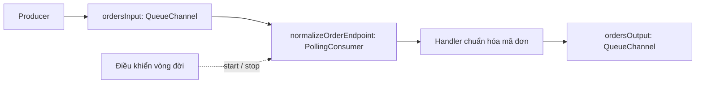
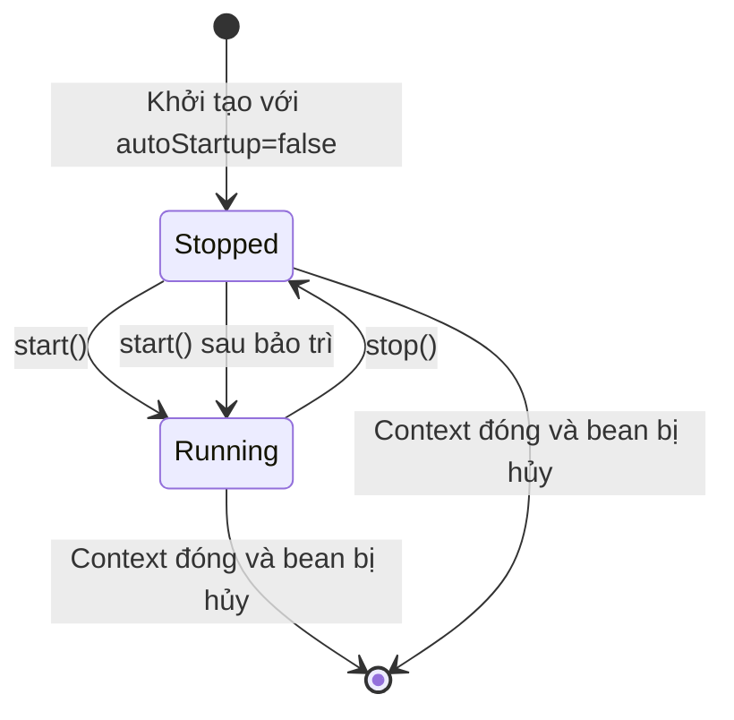

# Endpoint lifecycle control — Điều khiển vòng đời endpoint

## 1. Mục tiêu và bối cảnh

Trong module `SPRING_INTEGRATION_CORE`, chúng ta thiết kế luồng bằng `Message`, `MessageChannel`, endpoint, gateway và Java DSL. Bài thuộc chương **System management**, giải quyết một yêu cầu vận hành: chủ động cho một endpoint bắt đầu hoặc ngừng nhận việc mà vẫn hiểu thông điệp đang nằm ở đâu.

Sau bài này, bạn có thể:

- Phân biệt vòng đời endpoint với vòng đời bean, trạng thái channel và kết quả xử lý nghiệp vụ.
- Cấu hình `autoStartup`, đặt tên endpoint và điều khiển bằng `SmartLifecycle`.
- Dự đoán ảnh hưởng của `stop()` trên luồng đồng bộ và luồng có hàng đợi.
- Sắp xếp khởi động, dừng theo `phase`; quản lý nhiều endpoint theo role hoặc Control Bus.
- Thiết kế thao tác bảo trì có thời hạn, quan sát được backlog và kiểm thử được việc chạy lại.

**Tình huống xuyên suốt:** hệ thống tiếp nhận đơn hàng vào một hàng đợi, chuẩn hóa mã đơn rồi chuyển sang bước kế tiếp. Khi bảo trì dịch vụ xử lý đơn, ta cần giữ đơn chưa xử lý, dừng đúng consumer và chạy lại sau bảo trì. Nếu dừng sai điểm, bên gửi có thể gặp lỗi hoặc hàng đợi tiếp tục tăng ngoài dự kiến.

Ví dụ sử dụng Java 17, Spring Integration dòng 6.5 và Java DSL. Dự án cần `org.springframework.integration:spring-integration-core`, các dependency Spring tương thích do BOM hoặc cấu hình build quản lý; phần kiểm thử dùng JUnit Jupiter. Các ví dụ không cần Spring Boot hay broker bên ngoài. Mã trong bài là tài liệu thực hành, chưa được chạy trong quá trình biên soạn bài học.

## 2. Endpoint là đối tượng nào cần điều khiển?

Một service activator hoặc transformer có thể bao gồm hai đối tượng khác nhau:

1. **Handler** thực hiện công việc: chuyển đổi payload, gọi service, định tuyến hoặc lọc.
2. **Consumer endpoint** nối handler với input channel và quản lý cách nhận thông điệp.



Khi muốn dừng việc lấy đơn từ `ordersInput`, đối tượng cần điều khiển là `normalizeOrderEndpoint`. Gọi trực tiếp phương thức nghiệp vụ trên handler vẫn có thể thực hiện công việc và bỏ qua cơ chế nhận thông điệp của endpoint.

Một bean đã được tạo, inject dependency và đăng ký trong context chưa chắc đã chạy. Ngược lại, endpoint đang chạy chưa chứng minh dịch vụ bên ngoài đang khỏe hoặc đơn hàng đã hoàn tất.

Trong Java DSL, đặt `id` cho endpoint giúp thao tác quản trị không phụ thuộc tên tự sinh. Tên flow, tên channel và tên endpoint là các định danh có vai trò khác nhau; không lấy tên phương thức `@Bean` của flow rồi mặc định đó là consumer cần dừng. Cơ chế đặt tên endpoint được mô tả trong [DSL and Endpoint Configuration](https://docs.spring.io/spring-integration/reference/6.5/dsl/java-endpoints.html).

## 3. Hợp đồng vòng đời: start, stop và autoStartup

Các endpoint dựa trên `AbstractEndpoint` cung cấp khả năng quản lý vòng đời qua `SmartLifecycle`. Các thao tác quan trọng gồm:

| Thành phần | Ý nghĩa |
| --- | --- |
| `start()` | Yêu cầu endpoint bắt đầu hoạt động nhận hoặc phát thông điệp theo loại endpoint. |
| `stop()` | Yêu cầu endpoint dừng hoạt động đó. |
| `isRunning()` | Đọc trạng thái chạy mà endpoint công bố tại thời điểm kiểm tra. |
| `isAutoStartup()` | Cho biết endpoint có được tự khởi động khi context refresh hay không. |
| `getPhase()` | Giá trị dùng để tổ chức thứ tự vòng đời. |
| `stop(Runnable callback)` | Cho cơ chế quản lý vòng đời biết khi thành phần hoàn tất quy trình dừng của nó. |

Mặc định `autoStartup` của `AbstractEndpoint` là `true`. Đặt `false` cho phép bean tồn tại nhưng chờ một lệnh `start()` rõ ràng. Xem [AbstractEndpoint API](https://docs.spring.io/spring-integration/docs/6.5.x/api/org/springframework/integration/endpoint/AbstractEndpoint.html).

Có thể hình dung phần trạng thái liên quan đến bài học như sau:



Đây là mô hình giải thích, không phải toàn bộ các trạng thái nội bộ của framework. Một lệnh khởi động có thể thất bại vì cấu hình hoặc tài nguyên không hợp lệ.

Ba phân biệt cần giữ rõ trong thiết kế:

- `autoStartup(false)` là chính sách khởi động ban đầu, không phải một lệnh dừng endpoint đang chạy.
- `stop()` không xóa bean khỏi context. Việc hủy hoặc gỡ bỏ một flow động là thao tác khác và cần quản lý tài nguyên riêng.
- `isRunning() == false` không phải chứng từ rằng mọi đơn hàng đã commit, mọi lời gọi HTTP đã kết thúc hoặc toàn bộ nhóm aggregator đã được giải phóng.

Không lưu trạng thái bảo trì bằng cách chỉ gọi `stop()` rồi giả định lần khởi động ứng dụng sau sẽ giữ nguyên. Nếu cấu hình vẫn cho tự khởi động, endpoint có thể chạy lại khi context mới được tạo. Trạng thái vận hành dài hạn cần được biểu diễn trong cấu hình hoặc một cơ chế điều phối có lưu trữ.

## 4. Dừng endpoint tác động thế nào đến thông điệp?

### 4.1. Consumer đăng ký trên channel

Với `EventDrivenConsumer`, bắt đầu hoạt động bao gồm đăng ký handler vào `SubscribableChannel`; dừng bao gồm hủy đăng ký. Đây là hành vi có thể đối chiếu trong [mã nguồn EventDrivenConsumer 6.5.0](https://github.com/spring-projects/spring-integration/blob/v6.5.0/spring-integration-core/src/main/java/org/springframework/integration/endpoint/EventDrivenConsumer.java).

Nếu input là `DirectChannel`, chỉ có một consumer và consumer đó đã dừng, lần gửi tiếp theo không có subscriber để nhận. Lời gọi gửi thường dẫn tới `MessageDeliveryException`, có nguyên nhân dispatcher không tìm được subscriber. Channel này không tự giữ thông điệp để chờ consumer chạy lại.

Nếu có consumer khác đang đăng ký cùng `DirectChannel`, thông điệp có thể được giao cho consumer còn lại. Vì vậy, dừng một endpoint không đồng nghĩa chặn mọi công việc của channel đó.

### 4.2. Consumer polling trên hàng đợi

Với `PollingConsumer`, endpoint dùng poller để nhận từ `PollableChannel`. Dừng endpoint là dừng cơ chế polling, không phải xóa nội dung hàng đợi. Cơ chế lịch chạy và hủy task thuộc [AbstractPollingEndpoint](https://github.com/spring-projects/spring-integration/blob/v6.5.0/spring-integration-core/src/main/java/org/springframework/integration/endpoint/AbstractPollingEndpoint.java).

Trong kịch bản đơn hàng, ta chọn `QueueChannel` để bên gửi vẫn có thể đưa đơn vào trong thời gian consumer nghỉ, miễn còn dung lượng. Điều đó chuyển yêu cầu vận hành sang quản lý backlog và giới hạn nhận thêm.

| Kết nối đầu vào | Khi consumer mục tiêu dừng | Cần quan sát |
| --- | --- | --- |
| `DirectChannel`, chỉ một subscriber | Lần gửi mới thiếu nơi nhận; không có bộ đệm mặc định. | Lỗi gửi và phản hồi cho bên gọi. |
| `QueueChannel` | Thông điệp chưa được lấy vẫn ở hàng đợi. | Dung lượng, thời gian chờ và thời gian bảo trì. |
| `ExecutorChannel` | Task đã giao cho executor có thể còn xử lý; dừng consumer không phải thao tác xóa task queue của executor. | Task chờ, task đang chạy và cấu hình dừng executor. |
| `PublishSubscribeChannel` | Các subscriber khác có thể tiếp tục nhận; thiếu subscriber cần được xét theo `minSubscribers`. | Số subscriber và nhánh nào thực sự còn hoạt động. |

Các đặc tính gửi, bộ đệm và luồng thực thi của channel được trình bày trong [Message Channel Implementations](https://docs.spring.io/spring-integration/reference/6.5/channel/implementations.html).

Bảng mô tả tác động trên từng kết nối, không đưa ra bảo đảm giao nhận xuyên suốt hệ thống. Đơn đã được lấy khỏi queue nhưng handler chưa hoàn tất là **in-flight**, khác với đơn còn nằm trong queue. Tại ranh giới gọi `stop()`, một task có thể đang chạy hoặc nhận tín hiệu hủy; cần xét hiện thực endpoint, executor và xử lý interruption.

Một `QueueChannel` trong bộ nhớ chỉ giữ dữ liệu trong vòng đời tiến trình. Nếu bảo trì bao gồm tắt ứng dụng, cần lựa chọn lưu trữ bền vững hoặc broker phù hợp trước khi hứa rằng đơn hàng sẽ được giữ lại.

## 5. Ví dụ Java DSL: consumer chờ lệnh khởi động

### 5.1. Cấu hình luồng đơn hàng

Tạo lớp cấu hình sau trong dự án thực hành:

```java
import java.util.Locale;

import org.springframework.context.annotation.Bean;
import org.springframework.context.annotation.Configuration;
import org.springframework.integration.channel.QueueChannel;
import org.springframework.integration.config.EnableIntegration;
import org.springframework.integration.dsl.IntegrationFlow;
import org.springframework.integration.dsl.Pollers;

@Configuration
@EnableIntegration
public class OrderLifecycleConfig {

    @Bean
    public QueueChannel ordersInput() {
        return new QueueChannel(100);
    }

    @Bean
    public QueueChannel ordersOutput() {
        return new QueueChannel(100);
    }

    @Bean
    public IntegrationFlow orderFlow() {
        return IntegrationFlow.from(ordersInput())
                .transform(String.class,
                        order -> order.trim().toUpperCase(Locale.ROOT),
                        endpoint -> endpoint
                                .id("normalizeOrderEndpoint")
                                .autoStartup(false)
                                .phase(100)
                                .role("orders-processing")
                                .poller(Pollers.fixedDelay(100)
                                        .receiveTimeout(0)
                                        .maxMessagesPerPoll(1)))
                .channel(ordersOutput())
                .get();
    }
}
```

Trong cấu hình này, chúng ta chủ động chọn:

- Input có sức chứa 100 thông điệp để việc dừng consumer không biến thành tăng bộ nhớ vô hạn.
- `normalizeOrderEndpoint` là tên ổn định của consumer cần quản trị.
- `autoStartup(false)` để quan sát được trạng thái trước lệnh khởi động.
- Poller có khoảng nghỉ 100 ms; mỗi lượt lấy tối đa một thông điệp. `receiveTimeout(0)` tránh chờ trong một lần nhận khi queue đang rỗng.
- Output cũng là hàng đợi; bài thực hành sẽ đọc kết quả bằng `receive(timeout)`.

Các giá trị này phục vụ thí nghiệm, chưa phải cấu hình năng lực cho một hệ thống thực tế. Giới hạn một thông điệp mỗi lượt cũng không đồng nghĩa toàn bộ hệ thống chỉ xử lý một thông điệp tại một thời điểm nếu có nhiều consumer hoặc executor khác.

### 5.2. Khởi động, dừng và chạy lại

Đặt lớp chạy minh họa trong cùng package với cấu hình:

```java
import org.springframework.context.SmartLifecycle;
import org.springframework.context.annotation.AnnotationConfigApplicationContext;
import org.springframework.integration.channel.QueueChannel;
import org.springframework.messaging.Message;
import org.springframework.messaging.support.MessageBuilder;

public class OrderLifecycleDemo {

    public static void main(String[] args) {
        try (var context = new AnnotationConfigApplicationContext(
                OrderLifecycleConfig.class)) {

            var input = context.getBean("ordersInput", QueueChannel.class);
            var output = context.getBean("ordersOutput", QueueChannel.class);
            var endpoint = context.getBean(
                    "normalizeOrderEndpoint", SmartLifecycle.class);

            System.out.println("Ban đầu: " + endpoint.isRunning());
            send(input, " order-001 ");
            System.out.println("Đang chờ: " + input.getQueueSize());

            endpoint.start();
            System.out.println("Kết quả 1: " + receivePayload(output));

            endpoint.stop();
            send(input, " order-002 ");
            System.out.println("Sau stop: " + endpoint.isRunning());
            System.out.println("Đang chờ: " + input.getQueueSize());

            endpoint.start();
            System.out.println("Kết quả 2: " + receivePayload(output));
        }
    }

    private static void send(QueueChannel channel, String payload) {
        boolean accepted = channel.send(
                MessageBuilder.withPayload(payload).build(), 200);
        if (!accepted) {
            throw new IllegalStateException("Hàng đợi không nhận thêm đơn");
        }
    }

    private static Object receivePayload(QueueChannel channel) {
        Message<?> message = channel.receive(2_000);
        if (message == null) {
            throw new IllegalStateException("Không nhận được kết quả đúng hạn");
        }
        return message.getPayload();
    }
}
```

Kết quả quan sát dự kiến, bỏ qua log của framework:

```text
Ban đầu: false
Đang chờ: 1
Kết quả 1: ORDER-001
Sau stop: false
Đang chờ: 1
Kết quả 2: ORDER-002
```

Điểm cần kiểm chứng là đơn thứ hai được xử lý sau khi chạy lại. Việc đưa đơn vào input thành công chỉ xác nhận input chấp nhận thông điệp; kết quả nghiệp vụ được xác nhận riêng ở output.

Ví dụ cố ý không dùng `Thread.sleep()` để đoán thời điểm hoàn tất. Lời gọi `receive(2_000)` chờ kết quả với thời hạn cụ thể và báo lỗi nếu điều kiện không đạt. Hai giây là thời hạn thí nghiệm, cần điều chỉnh theo môi trường chạy.

Trong ứng dụng lớn, có thể inject endpoint qua `@Qualifier("normalizeOrderEndpoint") SmartLifecycle endpoint` vào một service quản trị. Tránh lấy tất cả bean `SmartLifecycle` rồi dừng hàng loạt vì danh sách đó có thể chứa cả scheduler hoặc tài nguyên dùng chung.

## 6. Thứ tự phase: downstream sẵn sàng trước upstream

`SmartLifecycle` khởi động từ phase thấp tới cao, dừng theo chiều ngược lại. Các thành phần cùng phase không có thứ tự được bảo đảm; quan hệ `depends-on` rõ ràng được ưu tiên hơn phase. Xem [SmartLifecycle API](https://docs.spring.io/spring-framework/docs/6.2.x/javadoc-api/org/springframework/context/SmartLifecycle.html).

Giả sử mở rộng ví dụ thành ba endpoint có vòng đời độc lập:

```text
Nguồn nhập đơn -> hàng đợi -> chuẩn hóa -> hàng đợi -> gửi đối tác
```

Một phương án gán phase của ứng dụng:

| Endpoint | Phase do ứng dụng chọn | Thứ tự start | Thứ tự stop |
| --- | --- | --- | --- |
| Gửi đối tác, ở cuối luồng | 100 | 1 | 3 |
| Chuẩn hóa đơn | 200 | 2 | 2 |
| Nguồn nhập đơn | 300 | 3 | 1 |

Mục tiêu là chuẩn bị nơi nhận trước khi nguồn bắt đầu sinh thêm đơn. Khi dừng, nguồn đóng trước, còn phía sau có cơ hội tiếp tục công việc.

Đây là thứ tự đề xuất cho sơ đồ trên. Không sao chép các số phase đó cho mọi flow: cần tính cả tài nguyên chung, ranh giới bất đồng bộ và dependency thực sự. Các lớp endpoint có thể có phase mặc định riêng; không suy từ giá trị mặc định của interface rằng mọi endpoint đều cùng một phase.

Phase cũng không tự thực hiện quy trình chờ queue cạn. Nếu hệ thống vừa dừng nguồn vừa dừng consumer ngay sau đó, các đơn còn trong queue vẫn có thể chưa được xử lý. Muốn drain, cần có bước chờ và điều kiện quan sát riêng.

Khi gọi trực tiếp `endpoint.start()` hoặc `endpoint.stop()`, bạn đang thao tác đúng đối tượng đó. Lệnh này không tự tìm toàn bộ upstream, downstream rồi áp dụng bảng thứ tự của bạn. Việc điều phối nhiều endpoint cần do container, role controller hoặc service quản trị thực hiện.

## 7. Dừng có callback và công việc đang chạy

Khi cơ chế dừng của một thành phần có tính bất đồng bộ, `stop(Runnable)` cho phép nhận thông báo hoàn tất vòng đời. Ví dụ đoạn mã trong một phương thức quản trị đã có biến `endpoint` kiểu `SmartLifecycle`:

```java
var stopped = new java.util.concurrent.CountDownLatch(1);
endpoint.stop(stopped::countDown);

boolean completed = stopped.await(
        5, java.util.concurrent.TimeUnit.SECONDS);
if (!completed) {
    throw new IllegalStateException("Endpoint chưa hoàn tất dừng đúng hạn");
}
```

Phương thức chứa đoạn này cần xử lý `InterruptedException`, chẳng hạn khai báo `throws InterruptedException`. Nếu bắt ngoại lệ và chuyển đổi sang lỗi khác, cần khôi phục cờ interrupt khi phù hợp với hợp đồng của ứng dụng.

Không gọi đoạn chờ này ngay trên thread xử lý thông điệp nếu chính thread đó phải hoàn tất để endpoint dừng được. Dùng luồng quản trị riêng giúp tránh việc thao tác điều khiển chờ vào chính nó.

Callback biểu diễn việc hoàn tất dừng theo hợp đồng của thành phần, không tự bổ sung khả năng theo dõi mọi tác vụ nghiệp vụ. Với ứng dụng đơn hàng, hãy đo riêng ít nhất:

- Số đơn còn chờ trong queue.
- Số đơn đã được lấy nhưng chưa hoàn tất.
- Số đơn đang retry hoặc đang chờ phản hồi của đối tác.
- Kết quả commit, lỗi hoặc chuyển sang nơi xử lý thất bại.

Ví dụ, queue có kích thước 0 trong khi một lời gọi thanh toán vẫn đang chờ phản hồi. Nếu chỉ kiểm tra queue, thao tác bảo trì sẽ kết luận quá sớm. Ngược lại, endpoint có thể đang chạy nhưng tất cả thông điệp đều bị router chuyển sang nhánh khác; trạng thái chạy không mô tả lưu lượng nghiệp vụ.

## 8. Điều khiển qua Control Bus

Control Bus đưa lệnh quản trị qua messaging. Trong Spring Integration 6.5, payload lệnh có dạng `beanName.methodName`; phương thức có tham số nhận danh sách qua header `IntegrationMessageHeaderAccessor.CONTROL_BUS_ARGUMENTS`. Không trộn cú pháp từ tài liệu phiên bản khác vào ví dụ này. Xem [Control Bus](https://docs.spring.io/spring-integration/reference/6.5/control-bus.html).

Trong một lớp `@Configuration` được nạp cùng `OrderLifecycleConfig`, thêm bean sau; cần import `Bean` và `IntegrationFlow` như phần trước:

```java
@Bean
public IntegrationFlow operationsFlow() {
    return IntegrationFlow.from("operationsInput")
            .controlBus()
            .get();
}
```

Sau khi context đã nạp cả hai cấu hình, lấy channel và gửi lệnh:

```java
var operations = context.getBean(
        "operationsInput", org.springframework.messaging.MessageChannel.class);

operations.send(
        org.springframework.messaging.support.MessageBuilder
                .withPayload("normalizeOrderEndpoint.stop")
                .build());

operations.send(
        org.springframework.messaging.support.MessageBuilder
                .withPayload("normalizeOrderEndpoint.start")
                .build());
```

Ví dụ truy vấn có giá trị trả về cần một nơi nhận reply:

```java
var replies = new org.springframework.integration.channel.QueueChannel(1);

operations.send(
        org.springframework.messaging.support.MessageBuilder
                .withPayload("normalizeOrderEndpoint.isRunning")
                .setReplyChannel(replies)
                .build());

var reply = replies.receive(1_000);
if (reply == null) {
    throw new IllegalStateException("Thiếu phản hồi truy vấn vòng đời");
}
System.out.println(reply.getPayload());
```

Trong thiết kế vận hành của ví dụ, channel quản trị phải còn hoạt động khi consumer đơn hàng nghỉ. Vì vậy không đặt `operationsFlow` vào cùng nhóm mà lệnh bảo trì sẽ dừng. Nếu nguồn lệnh đến từ HTTP hoặc hệ thống bên ngoài, ánh xạ các thao tác đã cho phép tới endpoint cụ thể, xác thực người gọi và ghi lại kết quả thao tác; không lấy nguyên payload nghiệp vụ làm lệnh quản trị.

Tách biệt một lệnh được gửi thành công, một endpoint đã đổi trạng thái và một quy trình bảo trì hoàn tất. Đây là ba mốc cần có bằng chứng riêng nếu lệnh đi qua một channel bất đồng bộ.

## 9. Quản lý nhiều endpoint theo role

Role gom các endpoint để bắt đầu hoặc dừng theo nhóm. Cấu hình ở mục 5 đã gán `orders-processing`. Với context đang chạy, dùng controller do framework cung cấp:

```java
var roles = context.getBean(
        org.springframework.integration.support.SmartLifecycleRoleController.class);

roles.stopLifecyclesInRole("orders-processing");
System.out.println(roles.getEndpointsRunningStatus("orders-processing"));
roles.startLifecyclesInRole("orders-processing");
```

Có thể kiểm tra nhóm bằng `allEndpointsRunning(role)` hoặc `noEndpointsRunning(role)`. Khi dùng sự kiện bầu leader để quản lý nhóm, đặt `autoStartup(false)` cho endpoint chờ leader. Chi tiết API và sự kiện nằm trong [Endpoint Roles](https://docs.spring.io/spring-integration/reference/6.5/endpoint-roles.html).

Với bài toán đơn hàng, nên đặt tên role theo mục đích thao tác: nhóm tiếp nhận, nhóm xử lý hoặc nhóm gọi đối tác. Nếu dồn toàn bộ chúng vào một nhóm, lệnh dừng nhóm cũng làm mất khả năng xử lý hết đơn đã nhận. Role là công cụ gom thành phần; quy trình drain vẫn do ứng dụng thiết kế.

Một role chỉ có ý nghĩa trên tập endpoint mà controller đang quản lý trong context đó. Muốn dừng việc xử lý trên nhiều instance, cần điều phối tới các instance liên quan. Ví dụ có ba instance cùng lấy đơn từ broker, dừng một instance không chứng minh hai instance còn lại đã dừng.

## 10. Quy trình bảo trì có kiểm soát

Các bước dưới đây là phương án vận hành đề xuất cho một luồng có nguồn tiếp nhận tách khỏi consumer xử lý:

1. **Chọn phạm vi bảo trì.** Xác định endpoint nào cần nghỉ, queue nào sẽ giữ việc và các nhánh downstream cần tiếp tục chạy.
2. **Ngừng nhận thêm khi cần drain.** Dừng nguồn hoặc đóng cổng nhận yêu cầu mới bằng chính sách rõ ràng. Nếu vẫn cho nhận, phải tính đủ dung lượng backlog.
3. **Giữ consumer và các nhánh xử lý kết quả hoạt động.** Cho đơn đã nhận tiếp tục đi qua transformer, router, filter, aggregator và bước gọi đối tác.
4. **Chờ điều kiện hoàn tất với thời hạn.** Kết hợp backlog, in-flight, retry và trạng thái giao dịch thay vì chỉ đọc `isRunning()`.
5. **Dừng endpoint mục tiêu.** Ghi nhận trạng thái sau lệnh và nguyên nhân nếu quá hạn.
6. **Thực hiện bảo trì rồi chuẩn bị downstream.** Kiểm tra tài nguyên mà consumer cần trước khi cho xử lý trở lại.
7. **Khởi động consumer, sau đó mở lại nguồn.** Theo dõi tốc độ xử lý backlog, lỗi phát sinh và độ trễ.

Nếu mục tiêu chỉ là tạm ngừng consumer trong khi tiếp tục tích lũy đơn, bước chờ drain không áp dụng theo cùng cách. Khi đó cần quyết định rõ hạn mức nhận thêm và thời điểm từ chối hoặc trì hoãn yêu cầu.

Một ước lượng phục vụ lập kế hoạch:

```text
Backlog tăng thêm ≈ tốc độ nhận đơn × thời gian consumer nghỉ
```

Giả sử input còn trống, nhận đều 20 đơn/giây và consumer nghỉ 30 giây: lượng tăng dự kiến là 600 đơn. Queue sức chứa 100 của ví dụ không đáp ứng tình huống này. Ước lượng còn chưa tính burst hoặc các đơn vốn đã nằm trong queue.

Sau khi mở lại, nếu hệ thống xử lý được 50 đơn/giây trong khi vẫn nhận 20 đơn/giây, tốc độ giảm backlog khoảng 30 đơn/giây. Một backlog 600 đơn cần khoảng 20 giây trong giả định tốc độ ổn định. Các phép tính này giúp chọn thời hạn quan sát, không thay thế phép đo thực tế.

Spring Integration có cơ chế orderly shutdown qua `IntegrationMBeanExporter.stopActiveComponents(Long)`, với tham số thời gian tính bằng mili giây. Cơ chế này chuẩn bị dừng nguồn và dành khoảng chờ cho thông điệp đang đi qua luồng; poller được giữ hoạt động để hỗ trợ drain. Xem [Orderly Shutdown](https://docs.spring.io/spring-integration/reference/6.5/shutdown.html). Chỉ dùng API đó khi đã cấu hình exporter phù hợp; nó có phạm vi khác với việc dừng một endpoint trong ví dụ.

## 11. Liên hệ gateway, lỗi và các mẫu tích hợp

### Gateway và request–reply

Nếu gateway gửi vào một consumer đã dừng, hành vi phụ thuộc channel. Trên đường đồng bộ, thiếu subscriber có thể làm gửi thất bại. Trên đường có queue, request có thể được chấp nhận trong khi reply đến sau thời hạn bên gọi chờ.

Vì vậy, hợp đồng API cần phân biệt rõ “đã nhận yêu cầu” và “đã xử lý xong”. Nếu client hết hạn chờ rồi gửi lại, cùng một đơn có thể được xử lý nhiều lần. Dùng khóa nghiệp vụ hoặc cơ chế idempotency phù hợp thay vì suy rằng timeout đồng nghĩa chưa có xử lý.

### Transformer, router và filter

Dừng một transformer ở giữa đường đồng bộ có thể làm upstream không gửi tiếp được. Với router nhiều nhánh, cần xác định nhánh nào nghỉ và nhánh nào vẫn tiếp tục. Với filter, không nhận được output có thể là kết quả lọc hợp lệ, không nhất thiết là endpoint đã dừng.

Khi đánh giá drain, hãy dùng số liệu phản ánh điểm hoàn tất nghiệp vụ. Đếm số message ra khỏi một filter mà bỏ qua discard channel có thể gây hiểu sai rằng đơn đã biến mất.

### Aggregator và thông điệp đang chờ nhóm

Một nhóm aggregator chưa đủ điều kiện release có thể tiếp tục nằm trong message store dù không còn task nào đang xử lý. Nếu bảo trì hoặc khởi động lại tiến trình, cần biết store có bền vững hay không và nhóm chưa hoàn tất sẽ được xử lý tiếp bằng cách nào.

Không mặc định việc dừng consumer sẽ xóa nhóm, phát tất cả nhóm hoặc hủy các timeout đã lên lịch. Các hành vi đó thuộc cấu hình và vòng đời của handler cùng tài nguyên liên quan. Quy trình vận hành cần tính riêng các nhóm chưa hoàn tất và tác vụ hẹn giờ nếu chúng có thể tạo output.

### Xử lý lỗi và retry

Trong đường đồng bộ, lỗi thường quay về thread gọi; đường polling hoặc executor có cơ chế báo lỗi riêng tùy cấu hình. Trong thời gian drain, nhánh xử lý lỗi cần còn khả dụng để ghi nhận thất bại.

Dừng endpoint không tự biến một lần xử lý dở dang thành giao dịch có thể phát lại. Chẳng hạn, đơn đã lấy khỏi queue trong bộ nhớ rồi handler ném lỗi không mặc nhiên quay về queue. Muốn bảo đảm phục hồi, cần thiết kế retry, nơi giữ thông điệp lỗi, giao dịch hoặc nguồn có khả năng redelivery tương ứng.

## 12. Kiểm thử hành vi vòng đời

Kiểm thử nên khẳng định cả trạng thái lẫn đường đi của thông điệp. Với `OrderLifecycleConfig`, bài kiểm tra sau bao phủ: chưa tự chạy, xử lý sau start, giữ đơn sau stop và xử lý tiếp sau restart.

```java
import org.junit.jupiter.api.Test;

import org.springframework.context.SmartLifecycle;
import org.springframework.context.annotation.AnnotationConfigApplicationContext;
import org.springframework.integration.channel.QueueChannel;
import org.springframework.messaging.Message;
import org.springframework.messaging.support.MessageBuilder;

import static org.junit.jupiter.api.Assertions.*;

class OrderLifecycleTest {

    @Test
    void retainsQueuedOrderWhileConsumerIsStopped() {
        try (var context = new AnnotationConfigApplicationContext(
                OrderLifecycleConfig.class)) {

            var input = context.getBean("ordersInput", QueueChannel.class);
            var output = context.getBean("ordersOutput", QueueChannel.class);
            var endpoint = context.getBean(
                    "normalizeOrderEndpoint", SmartLifecycle.class);

            assertFalse(endpoint.isRunning());
            assertTrue(input.send(
                    MessageBuilder.withPayload(" order-001 ").build(), 200));
            assertEquals(1, input.getQueueSize());
            assertNull(output.receive(0));

            endpoint.start();
            assertTrue(endpoint.isRunning());
            Message<?> first = output.receive(2_000);
            assertNotNull(first);
            assertEquals("ORDER-001", first.getPayload());

            // Chờ kết quả của đơn đầu trước khi dừng consumer.
            endpoint.stop();
            assertFalse(endpoint.isRunning());

            assertTrue(input.send(
                    MessageBuilder.withPayload(" order-002 ").build(), 200));
            assertEquals(1, input.getQueueSize());
            assertNull(output.receive(200));

            endpoint.start();
            Message<?> second = output.receive(2_000);
            assertNotNull(second);
            assertEquals("ORDER-002", second.getPayload());
            assertEquals(0, input.getQueueSize());
            assertNull(output.receive(0));
        }
    }
}
```

Mẫu này không chứng minh tính bền vững qua việc tắt tiến trình, không kiểm tra giao dịch và không kiểm tra race condition khi đang có nhiều đơn in-flight. Đó là các yêu cầu khác cần thí nghiệm tương ứng.

Để mở rộng thực hành, dùng một handler có latch báo “đã bắt đầu” và latch cho phép “hoàn tất”. Gửi một đơn, đợi tín hiệu bắt đầu rồi yêu cầu dừng từ thread quản trị. Quan sát riêng: trạng thái endpoint, việc task nhận interruption và kết quả xử lý đơn. Cách này tạo đúng tình huống đang xử lý, thay vì gửi thật nhiều đơn và hy vọng dừng trúng thời điểm.

## 13. Lỗi thường gặp và cách chẩn đoán

| Hiện tượng | Giả thuyết cần kiểm tra | Cách xử lý trong kịch bản đơn hàng |
| --- | --- | --- |
| Endpoint vẫn chạy dù vừa sửa cấu hình `autoStartup(false)` trong suy nghĩ | Đang nhầm cấu hình khởi động với lệnh điều khiển runtime. | Gọi `stop()` trên endpoint hiện tại; bảo đảm context mới nhận đúng cấu hình khi khởi động sau. |
| Lấy bean rồi không thấy API vòng đời mong đợi | Đã lấy handler, channel hoặc tên flow thay cho consumer. | Dùng `id` của endpoint và kiểm tra đúng kiểu bean. |
| Gửi vào `DirectChannel` bị lỗi sau bảo trì | Subscriber mục tiêu chưa chạy lại và không còn subscriber khác. | Khởi động downstream trước khi mở nguồn; chọn queue nếu cần tích lũy. |
| `send()` trả về thành công nhưng chưa có kết quả | Request mới nằm trong queue hoặc executor. | Theo dõi output hoặc reply cùng timeout và mã đơn. |
| Queue đầy trong thời gian consumer nghỉ | Nguồn vẫn tiếp tục gửi vượt dung lượng còn lại. | Đặt hạn mức nhận thêm, timeout gửi và phương án xử lý quá tải. |
| Một số đơn vẫn hoàn tất sau lệnh stop | Công việc đã được giao trước khi dừng. | Theo dõi in-flight; thiết kế quy trình chờ thay vì chỉ đọc cờ chạy. |
| Chạy lại endpoint nhưng đơn cũ không xuất hiện | Tiến trình đã mất queue trong bộ nhớ, hoặc đơn đã được lấy rồi lỗi. | Kiểm tra điểm lưu giữ, log lỗi và cơ chế phục hồi trước khi retry. |
| Dừng một instance nhưng hệ thống vẫn xử lý đơn | Instance khác hoặc consumer khác còn hoạt động. | Kiểm tra toàn bộ phạm vi điều phối và nhóm tiêu thụ. |
| Lệnh quản trị không đến nơi sau khi dừng nhóm | Chính flow quản trị đã bị đưa vào nhóm dừng. | Giữ đường điều khiển hoạt động độc lập với nhóm xử lý. |

Với mỗi thao tác vận hành, một bản ghi hữu ích gồm tên endpoint, instance, lệnh, trạng thái trước/sau, thời điểm, người hoặc cơ chế khởi phát, backlog và kết quả. Khi thao tác quá hạn, giữ lại nguyên nhân và trạng thái đang quan sát được; không báo bảo trì thành công chỉ vì đã gửi lệnh.

## 14. Bài tập áp dụng

### Bài tập 1: Thay QueueChannel bằng DirectChannel

Đổi `ordersInput` sang `DirectChannel` và bỏ cấu hình poller của consumer. Giữ `autoStartup(false)`, gửi một đơn trước `start()`, sau `start()` và sau `stop()`.

**Kết quả cần giải thích:** khi chỉ có một consumer, hai lần gửi lúc consumer chưa chạy hoặc đã dừng thiếu subscriber; lần gửi khi consumer chạy được xử lý. Không có backlog input giống ví dụ queue. Bổ sung một consumer khác để quan sát vì sao dừng một endpoint chưa chắc làm mọi lần gửi thất bại.

### Bài tập 2: Bảo trì 30 giây

Giả sử có 10 đơn đang chờ và nguồn nhận 15 đơn/giây. Consumer nghỉ 30 giây, input có dung lượng 200.

**Gợi ý:** backlog dự kiến nếu không giới hạn là `10 + 15 × 30 = 460`. Dung lượng hiện tại không đủ. Đề xuất một chính sách tiếp nhận, cách báo timeout gửi và cách lưu đơn nếu ứng dụng phải khởi động lại. Nêu rõ thay đổi nào là điều khiển vòng đời và thay đổi nào là thiết kế giao nhận.

### Bài tập 3: Drain có aggregator

Mỗi đơn được tách thành ba tác vụ và aggregator chờ đủ ba kết quả. Dừng nguồn khi có hai nhóm mới nhận hai kết quả.

**Gợi ý:** phân biệt queue đã cạn với nhóm đã hoàn tất. Quyết định chờ kết quả còn lại, áp dụng timeout hoặc giữ nhóm để phục hồi sau bảo trì theo yêu cầu nghiệp vụ. Không dùng riêng `noEndpointsRunning(role)` làm điều kiện chứng minh mọi đơn đã hoàn tất.

## 15. Những điều cần ghi nhớ

Điều khiển vòng đời endpoint quyết định thành phần có tiếp tục nhận hoặc phát thông điệp hay không. Vị trí của thông điệp phụ thuộc channel và tài nguyên xung quanh: queue giữ việc chưa lấy, executor có task đã giao, aggregator có nhóm chưa release và gateway có bên gọi đang chờ reply.

Khi thiết kế một thao tác dừng, hãy trả lời được bốn câu: endpoint nào bị tác động, đơn mới đi đâu, công việc đang chạy được theo dõi thế nào và bằng chứng nào cho phép chạy lại. Đặt tên endpoint rõ ràng, chọn thứ tự theo dependency, chờ với thời hạn và kiểm chứng bằng kết quả thông điệp giúp thao tác bảo trì trở thành một hành vi có thể dự đoán và kiểm thử.
