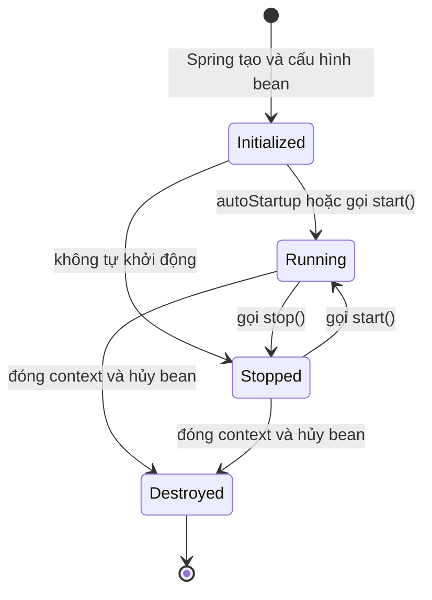

# Start và stop endpoint

Trong chương **System management** của module **SPRING_INTEGRATION_CORE**, việc điều khiển vòng đời endpoint giúp vận hành luồng thông điệp mà không phải khởi động lại toàn bộ ứng dụng. Một tình huống thường gặp là tạm ngừng nhận đơn hàng khi bảo trì dịch vụ kho, giữ lại công việc đang chờ, rồi cho luồng tiếp tục hoạt động.

Bài học tập trung vào endpoint kết nối `MessageChannel` với thành phần xử lý, cách cấu hình bằng Java DSL, gọi `start()` và `stop()`, điều khiển qua Control Bus, và kiểm chứng hành vi của thông điệp khi endpoint dừng. Các ví dụ dùng Java 17 trở lên và API của Spring Integration **6.5.x**. Với ứng dụng Spring Boot, để BOM của Boot quản lý bộ phiên bản Spring tương thích.

## 1. Kết quả cần đạt

Sau bài này, bạn có thể:

- Phân biệt trạng thái của bean, endpoint, handler và toàn bộ luồng.
- Đặt tên endpoint và cấu hình `autoStartup` trong Java DSL hoặc annotation.
- Điều khiển endpoint bằng `Lifecycle` và kiểm tra `isRunning()`.
- Giải thích khác biệt giữa dừng consumer của `QueueChannel` và `DirectChannel`.
- Sắp xếp thứ tự khởi động, dừng và xử lý công việc đang thực thi.
- Viết kiểm thử cho trạng thái ban đầu, khởi động và khởi động lại endpoint.

Kiến thức nền cần có là cấu trúc `Message`, sự khác nhau giữa `SubscribableChannel` và `PollableChannel`, cùng cách khai báo một `IntegrationFlow`.

## 2. Endpoint là đối tượng nào được start và stop?

Xét một luồng đơn giản:

```text
Nguồn đơn hàng
      |
      v
ordersInbox (QueueChannel)
      |
      v
orderWorker (PollingConsumer)
      |
      v
handler xử lý đơn
      |
      v
processedOrders (QueueChannel)
```

Ở đây:

- **Channel** quyết định cách gửi, nhận hoặc lưu tạm thông điệp.
- **Handler** thực hiện nghiệp vụ, chẳng hạn gọi dịch vụ kho, biến đổi dữ liệu hoặc định tuyến.
- **Endpoint** tổ chức việc kết nối handler với channel: đăng ký nhận thông điệp hoặc chủ động polling.
- **IntegrationFlow** mô tả một chuỗi thành phần; một flow có thể chứa nhiều endpoint.

Với các consumer thông thường, Spring Integration dùng `EventDrivenConsumer` cho channel có thể subscribe và `PollingConsumer` cho channel cần polling. Transformer, filter, router hay service activator đều có thể được gắn vào luồng thông qua cơ chế endpoint này. [Tài liệu Message Endpoints](https://docs.spring.io/spring-integration/reference/6.5/endpoint.html)

Điều khiển đúng endpoint quan trọng hơn việc chỉ tìm đúng phương thức nghiệp vụ. Một bean dịch vụ có phương thức `processOrder()` không tự nhiên trở thành đối tượng quản lý vòng đời của consumer đang gọi nó.

| Thành phần được nhìn thấy trong cấu hình | Đối tượng cần quan tâm khi điều khiển |
| --- | --- |
| Handler nhận từ `DirectChannel` | Endpoint đăng ký handler với channel |
| Handler nhận từ `QueueChannel` | Endpoint quản lý polling và gọi handler |
| Inbound adapter đọc nguồn theo lịch | Endpoint của adapter quản lý việc đọc nguồn |
| Inbound adapter dựa trên listener | Endpoint và cơ chế listener tương ứng của adapter |
| Một flow gồm nhiều bước | Từng endpoint cần quản lý hoặc đối tượng quản lý cả flow phù hợp |
| Gateway đưa yêu cầu vào flow | Xác định gateway/adapter và downstream nào cần điều khiển; không suy tên endpoint từ tên phương thức gateway |

Các adapter giao tiếp với hệ thống ngoài còn có chi tiết riêng về listener, kết nối, acknowledge và giao dịch. Các quy tắc trong bài tạo nền tảng, nhưng không thay thế hợp đồng vòng đời của từng adapter.

## 3. Hợp đồng Lifecycle và SmartLifecycle

### 3.1. Các thao tác cơ bản

Giao diện `org.springframework.context.Lifecycle` có ba phương thức quan trọng:

```java
void start();
void stop();
boolean isRunning();
```

Có thể hình dung trạng thái vận hành ổn định như sau:



Sơ đồ lược bỏ các giai đoạn đang khởi động, đang dừng và lỗi. Điểm quan trọng là một endpoint đã được Spring tạo và inject dependency vẫn có thể chưa chạy.

Lớp nền `AbstractEndpoint` hỗ trợ `autoStartup`, mặc định là `true`. Đặt thuộc tính này thành `false` để endpoint chờ một lần khởi động có chủ đích. [API AbstractEndpoint](https://docs.spring.io/spring-integration/docs/6.5.0/api/org/springframework/integration/endpoint/AbstractEndpoint.html)

### 3.2. autoStartup không phải công tắc tắt vĩnh viễn

`autoStartup(false)` điều khiển việc tự khởi động khi context được refresh. Nó không cấm bạn gọi `start()` sau đó.

Ba tình huống cần phân biệt:

| Thao tác | Ý nghĩa |
| --- | --- |
| Cấu hình `autoStartup(false)` | Khi context khởi động, endpoint chưa tự chạy |
| Gọi `stop()` trên endpoint đang chạy | Yêu cầu endpoint dừng theo hợp đồng của nó |
| Gọi `start()` trên endpoint đã dừng | Cho cùng endpoint hoạt động trở lại |

Sau khi endpoint đã được khởi động, thay đổi thuộc tính `autoStartup` không thay thế việc gọi `stop()`. Ngược lại, gọi `stop()` cũng không sửa cấu hình để lần khởi động ứng dụng sau endpoint tiếp tục bị tắt.

### 3.3. SmartLifecycle bổ sung điều gì?

`SmartLifecycle` mở rộng `Lifecycle` với cấu hình tự khởi động, thứ tự `phase` và biến thể `stop(Runnable callback)`. Khi Spring quản lý vòng đời context, phase thấp khởi động trước; phase cao dừng trước. Các bean cùng phase không có thứ tự cố định; quan hệ phụ thuộc khai báo tường minh được ưu tiên. [API SmartLifecycle](https://docs.spring.io/spring-framework/docs/6.2.x/javadoc-api/org/springframework/context/SmartLifecycle.html)

`isRunning()` chỉ phản ánh trạng thái vòng đời được component báo cáo. Ví dụ, worker có thể đang chạy nhưng dịch vụ kho đang lỗi hoặc queue đang tồn đọng. Vì vậy, cần đọc trạng thái này cùng số thông điệp chờ, tác vụ đang thực thi và lỗi nghiệp vụ.

## 4. Ví dụ hoàn chỉnh: giữ đơn hàng khi worker chưa chạy

### 4.1. Chuẩn bị

Ví dụ cần dependency `org.springframework.integration:spring-integration-core` cùng bộ dependency Spring tương thích. Java DSL nằm trong thư viện này, không cần thêm module Java DSL riêng. Kiểm thử ở phần sau dùng JUnit Jupiter.

Hai lớp bên dưới có thể đặt trong cùng một package của ứng dụng hiện có. Chúng dùng Spring Java Configuration thuần để việc quan sát vòng đời không phụ thuộc cơ chế chạy của Spring Boot.

### 4.2. Khai báo channel và consumer

```java
import java.util.Locale;

import org.springframework.beans.factory.annotation.Qualifier;
import org.springframework.context.annotation.Bean;
import org.springframework.context.annotation.Configuration;
import org.springframework.integration.channel.QueueChannel;
import org.springframework.integration.config.EnableIntegration;
import org.springframework.integration.dsl.IntegrationFlow;
import org.springframework.integration.dsl.Pollers;

@Configuration
@EnableIntegration
public class OrderLifecycleConfig {

    @Bean
    public QueueChannel ordersInbox() {
        return new QueueChannel(100);
    }

    @Bean
    public QueueChannel processedOrders() {
        return new QueueChannel(100);
    }

    @Bean
    public IntegrationFlow orderProcessingFlow(
            @Qualifier("ordersInbox") QueueChannel ordersInbox,
            @Qualifier("processedOrders") QueueChannel processedOrders) {

        return IntegrationFlow.from(ordersInbox)
                .handle(
                        String.class,
                        (payload, headers) ->
                                payload.trim().toUpperCase(Locale.ROOT),
                        endpoint -> endpoint
                                .id("orderWorker")
                                .autoStartup(false)
                                .phase(100)
                                .poller(Pollers.fixedDelay(100)
                                        .receiveTimeout(0)
                                        .maxMessagesPerPoll(1)))
                .channel(processedOrders)
                .get();
    }
}
```

Trong cấu hình này:

- `orderProcessingFlow` là tên bean mô tả flow.
- `orderWorker` là ID của endpoint tại bước `handle`; đây là tên dùng khi điều khiển consumer.
- `autoStartup(false)` giữ worker ở trạng thái chưa chạy sau khi context refresh.
- `QueueChannel` ở đầu vào cần một poller; mỗi lần polling nhận tối đa một thông điệp.
- `receiveTimeout(0)` cho phép một lần nhận trả về ngay nếu queue đang rỗng.
- Kết quả khác `null` của handler được gửi tới `processedOrders`.

Trong ví dụ, `fixedDelay(100)` có đơn vị mili giây. Đây là khoảng nghỉ giữa các lượt polling của cấu hình này, không phải thời hạn xử lý đơn hàng. Các lựa chọn `receiveTimeout`, `maxMessagesPerPoll`, executor và error channel là thuộc cấu hình poller. [API PollerSpec](https://docs.spring.io/spring-integration/docs/6.5.0/api/org/springframework/integration/dsl/PollerSpec.html)

Hai channel đều có sức chứa 100 để bài thực hành có giới hạn rõ ràng. Chúng dùng bộ nhớ trong tiến trình; việc stop worker không biến queue thành nơi lưu trữ bền vững.

### 4.3. Điều khiển bằng Lifecycle

```java
import org.springframework.context.Lifecycle;
import org.springframework.context.annotation.AnnotationConfigApplicationContext;
import org.springframework.integration.channel.QueueChannel;
import org.springframework.messaging.Message;
import org.springframework.messaging.support.GenericMessage;

public class OrderLifecycleDemo {

    public static void main(String[] args) {
        try (var context =
                     new AnnotationConfigApplicationContext(
                             OrderLifecycleConfig.class)) {

            Lifecycle worker =
                    context.getBean("orderWorker", Lifecycle.class);
            QueueChannel inbox =
                    context.getBean("ordersInbox", QueueChannel.class);
            QueueChannel results =
                    context.getBean("processedOrders", QueueChannel.class);

            System.out.println("Ban đầu running = " + worker.isRunning());

            boolean accepted =
                    inbox.send(new GenericMessage<>("  ord-001  "), 0);
            if (!accepted) {
                throw new IllegalStateException("Queue đầu vào đã đầy");
            }

            System.out.println("Đang chờ = " + inbox.getQueueSize());

            worker.start();

            Message<?> result = results.receive(3000);
            if (result == null) {
                throw new IllegalStateException("Không nhận kết quả đúng hạn");
            }

            System.out.println("Kết quả = " + result.getPayload());

            worker.stop();
            System.out.println("Sau stop running = " + worker.isRunning());

            worker.start();
            System.out.println("Sau start lại running = " + worker.isRunning());

            worker.stop();
        }
    }
}
```

Với luồng không phát sinh lỗi, các giá trị quan sát chính là:

```text
Ban đầu running = false
Đang chờ = 1
Kết quả = ORD-001
Sau stop running = false
Sau start lại running = true
```

`inbox.send(...)` thành công trước khi worker chạy chứng minh queue đã nhận thông điệp. Nó chưa chứng minh nghiệp vụ đã hoàn thành. Việc nhận `ORD-001` từ channel kết quả mới cho thấy thông điệp đã đi qua handler.

Thời hạn 3 giây là giới hạn chờ của chương trình minh họa. Nó không thiết lập timeout cho một lời gọi mạng bên trong handler. Việc dùng `send(..., 0)` cũng giúp producer nhận biết ngay nếu queue đầy.

### 4.4. Tránh điều khiển nhầm bean

Lệnh sau lấy flow, không lấy riêng consumer:

```java
context.getBean("orderProcessingFlow");
```

Lệnh dùng trong ví dụ lấy endpoint:

```java
Lifecycle worker =
        context.getBean("orderWorker", Lifecycle.class);
```

Đặt ID tường minh trong callback `endpoint -> ...` làm cho tên vận hành ổn định khi thêm hoặc bớt các bước DSL. Không nên dùng tên bean tự sinh có chỉ số thứ tự làm giao diện quản trị lâu dài.

Với các endpoint được tạo qua factory bean, tra cứu tên bean thông thường lấy đối tượng sản phẩm mà Spring cung cấp. Không tự thêm tiền tố `&` vì tiền tố đó yêu cầu lấy chính factory bean.

## 5. Stop làm thay đổi việc nhận thông điệp như thế nào?

### 5.1. Consumer của QueueChannel

Khi `orderWorker` dừng, nó ngừng tổ chức việc nhận công việc mới theo cơ chế polling của endpoint. Các thông điệp vẫn đang nằm trong queue không bị xóa bởi lệnh stop.

Producer vẫn có thể gửi vào `ordersInbox` nếu queue còn chỗ. Khi worker chạy lại, nó tiếp tục nhận các thông điệp đang chờ.

Cần tách hai câu hỏi vận hành:

1. Có tiếp tục cho producer đưa công việc vào hệ thống trong thời gian bảo trì không?
2. Có tiếp tục cho consumer lấy công việc đã xếp hàng ra xử lý không?

Dừng consumer chỉ xử lý câu hỏi thứ hai. Nếu producer vẫn chạy, backlog có thể tăng tới giới hạn sức chứa. Khi đầy, hành vi gửi phụ thuộc timeout mà producer dùng. `QueueChannel` mặc định lưu trong bộ nhớ; muốn tồn tại qua việc tiến trình bị tắt cần cơ chế lưu trữ phù hợp hoặc broker bền vững. [Tài liệu QueueChannel](https://docs.spring.io/spring-integration/reference/6.5/channel/implementations.html#queuechannel)

Nếu có nhiều consumer cùng nhận từ queue, dừng một endpoint không ngăn các consumer còn lại lấy thông điệp.

### 5.2. Consumer của DirectChannel

`EventDrivenConsumer` kết nối handler với một `SubscribableChannel`. Với `DirectChannel`, khởi động endpoint đăng ký handler; dừng endpoint hủy đăng ký đó. [API EventDrivenConsumer](https://docs.spring.io/spring-integration/docs/6.5.0/api/org/springframework/integration/endpoint/EventDrivenConsumer.html)

`DirectChannel` không có hàng đợi để giữ yêu cầu cho lần khởi động sau. Nếu endpoint vừa dừng là subscriber duy nhất, một lần gửi tiếp theo sẽ gặp lỗi dispatch/giao thông điệp thay vì được giữ lại.

Nếu còn subscriber khác, channel vẫn có thể giao thông điệp cho subscriber đó theo cấu hình dispatcher. Vì vậy, không thể suy ra rằng dừng một endpoint đồng nghĩa với đóng channel.

| Tình huống | Consumer đã dừng, chưa xét tác vụ đang chạy |
| --- | --- |
| `QueueChannel` còn chỗ | Producer có thể xếp thêm thông điệp; queue giữ công việc chưa được nhận |
| `QueueChannel` đầy | Producer chờ hoặc nhận kết quả gửi thất bại tùy timeout |
| `DirectChannel` không còn subscriber | Lần gửi mới gặp lỗi giao thông điệp |
| `DirectChannel` còn subscriber khác | Thông điệp có thể được giao cho subscriber còn hoạt động |
| Adapter nhận từ broker | Việc dừng nhận, acknowledge và phát lại tuân theo adapter cùng broker |

Bảng giả định toàn bộ application context vẫn đang hoạt động. Đóng context là thao tác có phạm vi lớn hơn và kéo theo vòng đời của nhiều thành phần khác.

### 5.3. Thông điệp đang xử lý là trường hợp riêng

Một thông điệp đã rời queue hoặc đã được dispatch tới handler là công việc đang xử lý, thường gọi là **in-flight**. Nó không còn thuộc nhóm “đang chờ trong input queue”.

`stop()` không phải cam kết chung rằng:

- Mọi lời gọi HTTP hoặc truy vấn cơ sở dữ liệu đang chạy đều đã kết thúc.
- Giao dịch hiện tại đã rollback.
- Thông điệp đã nhận sẽ tự quay lại queue.
- Mọi executor hoặc tác vụ bất đồng bộ ở downstream đã rỗng.
- Message group của aggregator đã được hoàn tất hoặc xóa.

Cách endpoint dừng poller/listener, xử lý interrupt và chờ tác vụ phụ thuộc loại component. Một bước downstream dùng executor còn có vòng đời và hàng đợi riêng. Nếu nghiệp vụ cần phát lại sau lỗi, phải thiết kế acknowledge, giao dịch, retry và tính idempotent tương ứng.

Đặc biệt, `isRunning() == false` không thay thế bằng chứng rằng hệ thống đã xử lý xong toàn bộ công việc đang thực thi.

## 6. Cấu hình tương đương bằng annotation

Khi ứng dụng dùng annotation, có thể đặt `autoStartup` tại phương thức xử lý và đặt ID endpoint bằng `@EndpointId`.

Ví dụ sau là **phương án thay thế** cho bean `orderProcessingFlow` ở phần 4. Giữ hai channel, bỏ flow đó, rồi đăng ký `OrderHandler` bằng component scan hoặc khai báo bean tường minh. Không đăng ký cả hai cách với cùng ID `orderWorker`.

```java
import java.util.Locale;

import org.springframework.integration.annotation.EndpointId;
import org.springframework.integration.annotation.Poller;
import org.springframework.integration.annotation.ServiceActivator;
import org.springframework.stereotype.Component;

@Component
public class OrderHandler {

    @EndpointId("orderWorker")
    @ServiceActivator(
            inputChannel = "ordersInbox",
            outputChannel = "processedOrders",
            autoStartup = "false",
            poller = @Poller(
                    fixedDelay = "100",
                    maxMessagesPerPoll = "1",
                    receiveTimeout = "0"))
    public String process(String order) {
        return order.trim().toUpperCase(Locale.ROOT);
    }
}
```

`autoStartup` ở annotation là giá trị chuỗi có thể được giải quyết theo cơ chế cấu hình của Spring Integration. ID tùy chỉnh trỏ đến endpoint của phương thức, không đổi tên bean dịch vụ `OrderHandler`. [Tài liệu Annotation Support](https://docs.spring.io/spring-integration/reference/6.5/configuration/annotations.html)

Cách lấy bean để điều khiển vẫn là:

```java
Lifecycle worker =
        context.getBean("orderWorker", Lifecycle.class);
```

Không cần tạo một phương thức `start()` riêng trong bean nghiệp vụ nếu mục tiêu chỉ là bật consumer do Spring Integration quản lý.

## 7. Điều khiển bằng thông điệp qua Control Bus

### 7.1. Khi nào dùng Control Bus?

Gọi trực tiếp `Lifecycle` phù hợp khi mã điều phối và endpoint cùng ở trong application context. Control Bus hữu ích khi muốn thể hiện thao tác quản trị dưới dạng thông điệp, chẳng hạn một tác vụ vận hành gửi yêu cầu khởi động consumer.

Với Spring Integration 6.5.x, `controlBus()` sử dụng `ControlBusCommandRegistry`; payload có dạng `beanName.methodName`. Đối số, nếu có, được đặt trong header `IntegrationMessageHeaderAccessor.CONTROL_BUS_ARGUMENTS`. Bài này dùng các phương thức không có đối số. [Tài liệu Control Bus 6.5](https://docs.spring.io/spring-integration/reference/6.5/control-bus.html)

### 7.2. Thêm một flow quản trị

Đăng ký cấu hình dưới đây cùng `OrderLifecycleConfig` nếu muốn thực hành Control Bus:

```java
import org.springframework.context.annotation.Bean;
import org.springframework.context.annotation.Configuration;
import org.springframework.integration.channel.DirectChannel;
import org.springframework.integration.dsl.IntegrationFlow;

@Configuration
public class EndpointOperationsConfig {

    @Bean
    public DirectChannel operations() {
        return new DirectChannel();
    }

    @Bean
    public IntegrationFlow endpointOperationsFlow(
            DirectChannel operations) {

        return IntegrationFlow.from(operations)
                .controlBus()
                .get();
    }
}
```

Khi dùng context thuần trong ví dụ, truyền cả hai lớp cấu hình vào constructor:

```java
var context = new AnnotationConfigApplicationContext(
        OrderLifecycleConfig.class,
        EndpointOperationsConfig.class);
```

Flow quản trị phải hoạt động để nhận được lệnh. Nếu dừng luôn endpoint nhận lệnh quản trị mà không có đường điều khiển khác, bạn không thể dùng chính đường đó để khởi động nó trở lại.

### 7.3. Gửi lệnh start, stop và truy vấn trạng thái

Trong context có cả hai cấu hình:

```java
import org.springframework.integration.channel.QueueChannel;
import org.springframework.messaging.Message;
import org.springframework.messaging.MessageChannel;
import org.springframework.messaging.support.GenericMessage;
import org.springframework.messaging.support.MessageBuilder;

// Đoạn này nằm trong phương thức đang có biến context.
MessageChannel operations =
        context.getBean("operations", MessageChannel.class);

operations.send(new GenericMessage<>("orderWorker.start"));

QueueChannel replies = new QueueChannel(1);

operations.send(
        MessageBuilder.withPayload("orderWorker.isRunning")
                .setReplyChannel(replies)
                .build());

Message<?> runningReply = replies.receive(1000);
if (runningReply == null) {
    throw new IllegalStateException("Không nhận được trạng thái endpoint");
}

System.out.println(runningReply.getPayload()); // true

operations.send(new GenericMessage<>("orderWorker.stop"));
```

`start` và `stop` không có giá trị trả về để chờ như một kết quả nghiệp vụ. `isRunning` trả về trạng thái nên ví dụ cung cấp `replyChannel`.

Không sao chép máy móc những ví dụ Control Bus đời cũ sử dụng biểu thức SpEL tùy ý. Cần đối chiếu API với đúng phiên bản của dự án, nhất là khi nâng cấp từ các dòng Spring Integration cũ.

Trong hệ thống thực, giới hạn người gửi lệnh và các endpoint được phép điều khiển. Không lấy một chuỗi bất kỳ từ yêu cầu của người dùng cuối rồi chuyển nguyên trạng vào channel quản trị. Khi có nhiều bản sao ứng dụng, lệnh trên một context chỉ thay đổi bản sao nhận được lệnh; cần cơ chế điều phối nếu muốn thay đổi toàn cụm.

## 8. Thứ tự start và stop trong một luồng nhiều endpoint

Giả sử hệ thống có ba tầng:

```text
orderIntake -> ordersInbox -> orderWorker -> kết nối dịch vụ kho
```

Khi khởi động, bạn thường cần kết nối dịch vụ kho sẵn sàng trước, sau đó worker chạy, cuối cùng mới mở đầu vào. Khi tạm dừng nhận đơn để bảo trì, thường cần đóng đầu vào trước và để worker hoàn thành phần việc còn lại.

Có thể chọn phase như một phần của thiết kế vòng đời:

| Thành phần có hỗ trợ vòng đời | Phase minh họa |
| --- | --- |
| Tài nguyên downstream cần sẵn sàng trước | 0 |
| `orderWorker` | 100 |
| `orderIntake` | 200 |

Khi Spring điều khiển khởi động context, thứ tự là phase 0, 100, 200. Khi dừng context, thứ tự đảo lại. Tuy nhiên, phase không kiểm tra sức khỏe dịch vụ ngoài và không bảo đảm một kết nối mạng đang dùng được.

Trong ví dụ phần 4, worker có `autoStartup(false)`. Nó không tự chạy chỉ vì đã được gán phase 100. Mã vận hành vẫn phải quyết định thời điểm gọi `start()`.

Ngoài ra, gọi thủ công:

```java
worker.start();
```

không ra lệnh cho Spring tự khởi động tất cả bean khác theo phase. Khi điều phối thủ công nhiều endpoint, cần gọi theo thứ tự đã thiết kế.

Một quy trình bảo trì có kiểm soát có thể là:

1. Ngăn nguồn nhận công việc mới bằng cách dừng inbound endpoint hoặc đóng đường nhận ở producer.
2. Cho các worker xử lý phần công việc đã được chấp nhận.
3. Quan sát cả backlog và số tác vụ đang thực thi, với thời hạn chờ cụ thể.
4. Khi công việc đã hoàn tất, dừng worker và bảo trì tài nguyên liên quan.
5. Khôi phục tài nguyên downstream, xác minh khả năng phục vụ, rồi khởi động worker.
6. Mở lại đầu vào và kiểm tra kết quả xử lý.

Queue rỗng không đồng nghĩa hệ thống đã hết việc: worker có thể vừa nhận thông điệp cuối cùng và đang gọi dịch vụ kho. Việc chờ hoàn tất phải dựa trên cả trạng thái tác vụ.

Nếu không muốn xử lý hết backlog trước bảo trì, có thể dừng worker sớm và giữ phần còn lại trong nơi lưu trữ phù hợp. Đây là một lựa chọn nghiệp vụ khác, cần xác định rõ yêu cầu độ bền của thông điệp.

## 9. Dừng có chờ và giới hạn của callback

`SmartLifecycle` có phương thức:

```java
void stop(Runnable callback);
```

Callback cho phép một component báo rằng quy trình dừng theo hợp đồng của nó đã hoàn thành. Với một bean tự triển khai `SmartLifecycle`, không được quên gọi callback sau khi hoàn tất việc dừng.

Trong mã điều phối, có thể chờ callback trong một khoảng thời gian hữu hạn:

```java
import java.util.concurrent.CountDownLatch;
import java.util.concurrent.TimeUnit;

import org.springframework.context.SmartLifecycle;

SmartLifecycle worker =
        context.getBean("orderWorker", SmartLifecycle.class);

CountDownLatch stopped = new CountDownLatch(1);
worker.stop(stopped::countDown);

if (!stopped.await(5, TimeUnit.SECONDS)) {
    throw new IllegalStateException("Endpoint chưa báo hoàn tất dừng");
}
```

Đoạn mã phải nằm trong phương thức xử lý hoặc khai báo `InterruptedException`; nếu bắt exception này, cần khôi phục cờ interrupt khi thích hợp.

Việc callback đã được gọi vẫn phải được hiểu trong phạm vi component. Để chứng minh tất cả tác vụ nghiệp vụ downstream đã hoàn thành, cần bằng chứng riêng như bộ đếm tác vụ, future, latch hoặc trạng thái giao dịch. Đừng gán cho callback một bảo đảm lớn hơn hợp đồng của endpoint.

## 10. Một endpoint và toàn bộ flow có phạm vi khác nhau

Trong Java DSL, một flow thường tạo ra nhiều endpoint: transformer, filter, router, handler hoặc bridge. Dừng endpoint tại một bước không tự động dừng toàn bộ các bước khác.

Ví dụ, dừng transformer ở giữa hai `DirectChannel` có thể làm upstream gặp lỗi vì điểm nhận tiếp theo không còn subscriber. Vì vậy, việc chọn điểm dừng phải dựa trên ranh giới nhận công việc và cơ chế lưu đệm.

Với flow đăng ký động, có thể dùng `IntegrationFlowContext` và đối tượng registration để điều khiển cả flow:

```java
import org.springframework.integration.dsl.IntegrationFlow;
import org.springframework.integration.dsl.context.IntegrationFlowContext;

// flowContext là bean IntegrationFlowContext đã được inject.
IntegrationFlow dynamicFlow = IntegrationFlow
        .from("temporaryOrders")
        .handle(String.class, (payload, headers) -> {
            System.out.println("Đã nhận: " + payload);
            return null;
        })
        .get();

IntegrationFlowContext.IntegrationFlowRegistration registration =
        flowContext.registration(dynamicFlow)
                .id("temporaryOrderFlow")
                .autoStartup(false)
                .register();

registration.start();
registration.stop();

// Chỉ thực hiện khi muốn gỡ bỏ đăng ký cùng các bean do nó quản lý.
registration.destroy();
```

`stop()` cho phép giữ đăng ký để chạy lại; `destroy()` gỡ flow và các thành phần phụ thuộc do registration quản lý. Sau destroy, muốn dùng lại phải đăng ký một flow phù hợp. [Tài liệu Dynamic and Runtime Integration Flows](https://docs.spring.io/spring-integration/reference/6.5/dsl/java-runtime-flows.html), [API IntegrationFlowRegistration](https://docs.spring.io/spring-integration/docs/6.5.0/api/org/springframework/integration/dsl/context/IntegrationFlowContext.IntegrationFlowRegistration.html)

Với flow khai báo tĩnh qua `@Bean`, các component được đăng ký trong application context và có vòng đời riêng. `StandardIntegrationFlow` là đối tượng chứa logic quản lý nhiều thành phần; không nên suy trạng thái của từng endpoint chỉ từ tên bean flow. [API StandardIntegrationFlow](https://docs.spring.io/spring-integration/docs/6.5.0/api/org/springframework/integration/dsl/StandardIntegrationFlow.html)

Đối với yêu cầu “tắt một consumer nhận đơn hàng”, ID endpoint như `orderWorker` vẫn là đích điều khiển rõ ràng nhất.

## 11. Kiểm thử vòng đời bằng hành vi quan sát được

### 11.1. Kiểm thử trạng thái ban đầu và start lại

Kiểm thử sau dùng lại `OrderLifecycleConfig` ở phần 4. Mỗi lần chạy tạo context riêng để không chia sẻ trạng thái lifecycle giữa các bài kiểm thử.

```java
import org.junit.jupiter.api.Test;
import org.springframework.context.Lifecycle;
import org.springframework.context.annotation.AnnotationConfigApplicationContext;
import org.springframework.integration.channel.QueueChannel;
import org.springframework.messaging.Message;
import org.springframework.messaging.support.GenericMessage;

import static org.junit.jupiter.api.Assertions.*;

class OrderLifecycleTest {

    @Test
    void shouldStartAndRestartWorker() {
        try (var context =
                     new AnnotationConfigApplicationContext(
                             OrderLifecycleConfig.class)) {

            Lifecycle worker =
                    context.getBean("orderWorker", Lifecycle.class);
            QueueChannel inbox =
                    context.getBean("ordersInbox", QueueChannel.class);
            QueueChannel results =
                    context.getBean("processedOrders", QueueChannel.class);

            // Chưa từng start: không có worker nào nhận từ input queue.
            assertFalse(worker.isRunning());
            assertTrue(inbox.send(new GenericMessage<>("  ord-001  "), 0));
            assertEquals(1, inbox.getQueueSize());
            assertNull(results.receive(0));

            worker.start();

            Message<?> firstResult = results.receive(3000);
            assertNotNull(firstResult);
            assertEquals("ORD-001", firstResult.getPayload());
            assertTrue(worker.isRunning());

            worker.stop();
            assertFalse(worker.isRunning());

            worker.start();
            assertTrue(worker.isRunning());

            assertTrue(inbox.send(new GenericMessage<>("  ord-002  "), 0));
            Message<?> secondResult = results.receive(3000);
            assertNotNull(secondResult);
            assertEquals("ORD-002", secondResult.getPayload());

            worker.stop();
        }
    }
}
```

Kiểm thử xác minh được bốn điều: endpoint không tự chạy, queue giữ thông điệp ban đầu, start cho phép xử lý, và endpoint có thể chạy lại sau stop.

Nó không xác minh ngữ nghĩa xử lý tác vụ đang thực thi khi bị dừng. Không dùng kết quả của kiểm thử này để kết luận rằng mọi HTTP request đang chạy đều được chờ hoàn tất.

### 11.2. Kiểm thử có chủ đích cho công việc đang xử lý

Nếu yêu cầu vận hành liên quan tới tác vụ đang chạy, cần tạo tình huống đó một cách xác định:

1. Dùng một handler kiểm thử báo hiệu đã bắt đầu bằng `CountDownLatch`.
2. Giữ handler ở một điểm chờ được kiểm soát, với thời hạn để tránh treo bài kiểm thử.
3. Gửi thông điệp và chờ tín hiệu handler đã bắt đầu.
4. Gọi stop từ luồng điều phối riêng nếu thao tác dừng có thể chờ handler.
5. Giải phóng handler rồi kiểm tra callback, đầu ra và trạng thái lưu trữ theo đúng hợp đồng cần bảo đảm.

Không gọi stop có thể chặn trên chính luồng duy nhất cần dùng để giải phóng handler. Không thay các tín hiệu đồng bộ bằng một `Thread.sleep` tùy ý: thời gian ngủ không chứng minh endpoint đã nhận thông điệp hay hoàn tất dừng.

Với adapter broker, thêm kiểm thử tích hợp thực sự cho acknowledge, phát lại và giao dịch; kiểm thử queue trong bộ nhớ không đại diện cho các hành vi đó.

## 12. Chẩn đoán những lỗi thường gặp

| Hiện tượng | Nguyên nhân cần kiểm tra | Hướng xử lý |
| --- | --- | --- |
| Lấy bean theo tên nhưng không tìm thấy | Dùng tên flow, tên handler hoặc ID tự sinh không đúng | Đặt ID endpoint tường minh và tra cứu đúng tên |
| Endpoint có `autoStartup(false)` nhưng vẫn chạy | Mã khác, Control Bus hoặc bộ điều phối đã gọi start | Kiểm tra nguồn lệnh quản trị và cấu hình vòng đời |
| Gửi vào `DirectChannel` bị lỗi sau stop | Subscriber nhận thông điệp đã bị hủy đăng ký | Dừng đầu vào trước hoặc thiết kế ranh giới lưu đệm |
| Worker đã dừng nhưng queue tiếp tục tăng | Producer vẫn gửi công việc mới | Điều phối producer hoặc xác định giới hạn tiếp nhận |
| Queue rỗng nhưng vẫn còn yêu cầu tới dịch vụ ngoài | Thông điệp đã được worker nhận và đang xử lý | Quan sát tác vụ đang thực thi, không chỉ queue size |
| Stop một worker nhưng vẫn có đơn được xử lý | Consumer khác hoặc tác vụ đã được dispatch vẫn chạy | Xác định toàn bộ consumer và ranh giới bất đồng bộ |
| Start lại nhưng không có kết quả | Queue rỗng, handler lỗi, downstream không sẵn sàng hoặc đã lấy nhầm endpoint | Kiểm tra trạng thái, đầu vào, error channel và kết quả xử lý |
| Control Bus không trả lời trạng thái | Flow quản trị chưa chạy, sai lệnh hoặc thiếu đường reply | Giữ đường quản trị hoạt động và cấu hình reply channel |
| Lệnh chỉ có tác dụng trên một bản sao | Mỗi tiến trình có application context riêng | Điều phối lệnh tới đúng các bản sao cần thay đổi |

Khi phân tích sự cố, ghép trạng thái `isRunning()` với ít nhất một dấu hiệu hành vi: thông điệp còn trong queue, kết quả đã được phát, số tác vụ đang chạy hoặc lỗi ở `errorChannel`. Riêng lỗi của handler không tự động chứng minh endpoint đã dừng; cơ chế tiếp tục, retry hoặc ngừng nhận phải được thiết kế và kiểm tra theo component.

## 13. Áp dụng vào một luồng xử lý đơn hàng

Với yêu cầu “tạm dừng xử lý khi bảo trì kho và tiếp tục sau đó”, trước khi đưa thao tác start/stop vào công cụ vận hành, cần xác định rõ:

- Endpoint nào nhận công việc mới và endpoint nào xử lý công việc đã nhận.
- Điểm nào có lưu đệm, sức chứa bao nhiêu và dữ liệu có tồn tại khi tiến trình dừng không.
- Điều kiện nào chứng minh công việc đang thực thi đã hoàn tất.
- Worker có được khởi động lại tự động khi kho phục hồi hay cần người vận hành quyết định.
- Khi phát lại đơn hàng, nghiệp vụ tránh tạo giao dịch trùng bằng cơ chế nào.
- Lệnh quản trị tác động tới một tiến trình hay toàn bộ các bản sao.

Trong ví dụ của bài, `orderWorker` là endpoint điều khiển việc nhận từ queue; `ordersInbox` giữ thông điệp đang chờ trong bộ nhớ; `processedOrders` cung cấp bằng chứng đầu ra. Khi thay handler bằng lời gọi dịch vụ kho thực tế, cần bổ sung timeout, chính sách lỗi và khả năng quan sát tương ứng.

Nắm rõ ba yếu tố — đích điều khiển là endpoint nào, thông điệp đang nằm ở đâu, và tiêu chí nào xác nhận đã hoàn tất — giúp bạn dùng `start()` và `stop()` đúng với yêu cầu vận hành của luồng Spring Integration.
