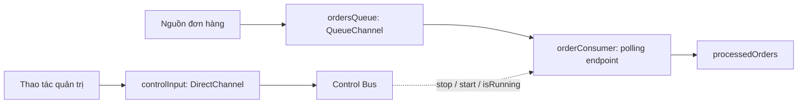
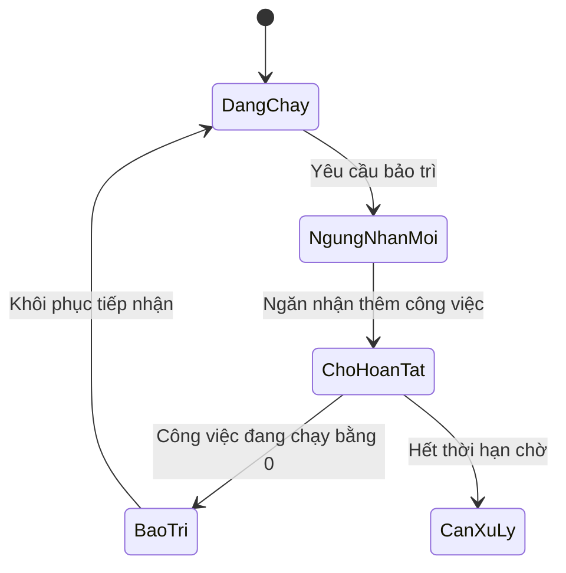

# Pause flow bằng control bus

## Mục tiêu bài học

Trong chương **System management** của **SPRING_INTEGRATION_CORE**, “pause flow” là yêu cầu vận hành: tạm ngừng nhận hoặc xử lý công việc tại một vị trí được chọn, rồi cho phép công việc tiếp tục mà không khởi động lại ứng dụng.

Sau bài học này, bạn có thể:

- Chọn endpoint cần điều khiển dựa trên ranh giới tiếp nhận và xử lý thông điệp.
- Dùng `Message`, `MessageChannel` và Java DSL để tạo một control bus riêng.
- Gửi lệnh dừng, chạy lại và đọc trạng thái của endpoint.
- Phân biệt `stop/start` với `pause/resume` của những thành phần hỗ trợ `Pausable`.
- Thiết kế việc lưu công việc chờ, xử lý lỗi và kiểm tra kết quả vận hành.

Bài giả định bạn đã biết channel, polling consumer, service activator và request–reply. Ví dụ chọn **Spring Integration 6.5.x, Java 17 trở lên** để thống nhất cú pháp; đây là phạm vi của ví dụ, không phải khẳng định phiên bản đang dùng trong dự án.

## 1. Bài toán: tạm dừng xử lý đơn hàng để bảo trì

Một ứng dụng nhận đơn hàng rồi gọi hệ thống kho. Khi hệ thống kho bảo trì, bạn muốn giữ đơn hàng chờ và tạm dừng consumer gọi kho. Sau bảo trì, consumer tiếp tục lấy công việc.

Thiết kế ban đầu:



Có hai luồng thông điệp:

| Luồng | Payload ví dụ | Đích đến |
| --- | --- | --- |
| Nghiệp vụ | `" order-001 "` | Consumer xử lý đơn |
| Quản trị | `"orderConsumer.stop"` | Control bus gọi thao tác trên endpoint |

Control bus dùng cơ chế messaging để quản lý thành phần trong ứng dụng. Với API được chọn trong bài, payload lệnh có dạng `beanName.methodName`; registry xác định thao tác được phép gọi. Các phương thức thuộc lifecycle hoặc được công bố bằng annotation quản trị là những nhóm thao tác phù hợp. Xem [Control Bus của Spring Integration](https://docs.spring.io/spring-integration/reference/6.5/control-bus.html).

Việc tách channel quản trị giúp bạn gửi lệnh chạy lại ngay cả khi consumer nghiệp vụ đang dừng. Nếu lệnh quản trị cũng phải đi qua chính consumer đó, thao tác khôi phục có thể bị mắc kẹt.

## 2. Xác định chính xác điều gì sẽ dừng

### 2.1. Endpoint, handler và flow là các đối tượng khác nhau

Handler chứa logic xử lý. Endpoint kết nối handler với channel và quản lý cách consumer nhận thông điệp. Với channel dạng queue, endpoint sử dụng poller; với channel có subscription, endpoint nhận thông điệp theo cơ chế sự kiện. Xem [Message Endpoints](https://docs.spring.io/spring-integration/reference/6.5/endpoint.html).

Trong Java DSL:

```java
.handle(String.class,
        (payload, headers) -> payload.trim(),
        endpoint -> endpoint.id("orderConsumer"))
```

`orderConsumer` là tên endpoint được đặt chủ động. Đây là tên sẽ xuất hiện trong lệnh `orderConsumer.stop`.

Tên bean khai báo phương thức `@Bean IntegrationFlow orderFlow()` không tự có nghĩa rằng mọi endpoint bên trong đều mang tên `orderFlow`. Một flow có thể chứa transformer, router, filter, aggregator và nhiều consumer. Dừng một endpoint chỉ tác động đến thành phần đó.

Bài này chọn điều khiển endpoint cụ thể để biết rõ phạm vi thay đổi. API `GenericEndpointSpec` cung cấp các cấu hình như `id`, `autoStartup` và `poller`. Xem [GenericEndpointSpec](https://docs.spring.io/spring-integration/docs/6.5.0/api/org/springframework/integration/dsl/GenericEndpointSpec.html).

### 2.2. “Pause” có hai cách triển khai thường gặp

| Khả năng của thành phần | Tạm ngừng bằng | Tiếp tục bằng | Trạng thái cần đọc |
| --- | --- | --- | --- |
| Có lifecycle `start/stop` | `stop` | `start` | `isRunning` |
| Có hỗ trợ `Pausable` | `pause` | `resume` | `isPaused` và trạng thái lifecycle |

Ví dụ chính sử dụng `stop/start` của polling endpoint để đáp ứng yêu cầu tạm dừng công việc. Không giả định mọi endpoint đều có phương thức `pause`.

`Pausable` dành cho thành phần có hỗ trợ riêng việc tạm ngừng; một thành phần đang pause có thể vẫn giữ kết nối bên ngoài. Hành vi cụ thể phụ thuộc adapter. `SourcePollingChannelAdapter` thông thường công bố lifecycle nhưng không triển khai `Pausable` trong API 6.5.0. Xem [Pausable](https://docs.spring.io/spring-integration/docs/6.5.0/api/org/springframework/integration/core/Pausable.html) và [SourcePollingChannelAdapter](https://docs.spring.io/spring-integration/docs/6.5.0/api/org/springframework/integration/endpoint/SourcePollingChannelAdapter.html).

Với một bean thực sự triển khai `Pausable`, ví dụ bean có tên `warehouseInbound`, lệnh có thể là:

```text
warehouseInbound.pause
warehouseInbound.isPaused
warehouseInbound.resume
```

Tên `warehouseInbound` chỉ minh họa một adapter đã được cấu hình riêng. Các lệnh này không áp dụng cho `orderConsumer` trong ví dụ phía dưới.

### 2.3. Cú pháp control bus phụ thuộc phiên bản

| Phiên bản | Cách khai báo đáng chú ý |
| --- | --- |
| 6.3 trở về trước | Ví dụ cũ thường dùng SpEL như `@orderConsumer.stop()` |
| 6.4 | Có API registry `controlBusOnRegistry()`; API SpEL cũ được đánh dấu deprecated |
| 6.5 | `controlBus()` dùng registry; API SpEL cũ đã bị loại bỏ |

Do đó, ví dụ 6.5.x dùng `orderConsumer.stop`, không thêm `@` hoặc `()`. Khi chuyển ví dụ giữa các phiên bản, phải kiểm tra cả DSL lẫn định dạng payload. Xem [thay đổi từ 6.4 sang 6.5](https://docs.spring.io/spring-integration/reference/7.2/changes-6.4-6.5.html) và [API DSL 6.4](https://docs.spring.io/spring-integration/docs/6.4.x/api/org/springframework/integration/dsl/BaseIntegrationFlowDefinition.html).

## 3. Ví dụ Java DSL tự chứa

### 3.1. Chuẩn bị

Ví dụ dùng ứng dụng Spring thuần, không cần web server, broker hay cơ sở dữ liệu. Classpath cần:

- `org.springframework.integration:spring-integration-core` phiên bản 6.5.x.
- Spring Context và các dependency tương thích được quản lý theo dependency management của ứng dụng.

Nếu dùng Spring Boot, sử dụng bộ dependency tương thích do Boot quản lý. Không thay riêng một JAR để cố ghép ví dụ vào một bộ dependency khác phiên bản.

Đặt nội dung dưới đây vào một class `ControlBusPauseLesson` trong môi trường thực hành. Ví dụ có cả cấu hình và `main`; các kiểm tra trong `main` sẽ báo lỗi nếu kết quả không như mong đợi.

### 3.2. Cấu hình channel, endpoint và luồng quản trị

```java
import java.util.Locale;

import org.springframework.context.annotation.AnnotationConfigApplicationContext;
import org.springframework.context.annotation.Bean;
import org.springframework.context.annotation.Configuration;
import org.springframework.integration.channel.DirectChannel;
import org.springframework.integration.channel.QueueChannel;
import org.springframework.integration.config.EnableIntegration;
import org.springframework.integration.core.MessagingTemplate;
import org.springframework.integration.dsl.IntegrationFlow;
import org.springframework.integration.dsl.Pollers;
import org.springframework.messaging.Message;
import org.springframework.messaging.support.GenericMessage;

@Configuration
@EnableIntegration
public class ControlBusPauseLesson {

    @Bean
    public QueueChannel ordersQueue() {
        return new QueueChannel(100);
    }

    @Bean
    public QueueChannel processedOrders() {
        return new QueueChannel(100);
    }

    @Bean
    public QueueChannel businessErrors() {
        return new QueueChannel(20);
    }

    @Bean
    public DirectChannel controlInput() {
        return new DirectChannel();
    }

    @Bean
    public IntegrationFlow orderFlow() {
        return IntegrationFlow.from(ordersQueue())
                .handle(
                        String.class,
                        (payload, headers) ->
                                "PROCESSED: "
                                        + payload.trim().toUpperCase(Locale.ROOT),
                        endpoint -> endpoint
                                .id("orderConsumer")
                                .autoStartup(false)
                                .sendTimeout(1_000)
                                .poller(Pollers.fixedDelay(100)
                                        .receiveTimeout(0)
                                        .maxMessagesPerPoll(1)
                                        .errorChannel("businessErrors")))
                .channel(processedOrders())
                .get();
    }

    @Bean
    public IntegrationFlow controlFlow() {
        return IntegrationFlow.from(controlInput())
                .controlBus()
                .get();
    }

    public static void main(String[] args) {
        try (var context =
                     new AnnotationConfigApplicationContext(
                             ControlBusPauseLesson.class)) {

            QueueChannel input =
                    context.getBean("ordersQueue", QueueChannel.class);
            QueueChannel output =
                    context.getBean("processedOrders", QueueChannel.class);
            QueueChannel errors =
                    context.getBean("businessErrors", QueueChannel.class);
            DirectChannel controlInput =
                    context.getBean("controlInput", DirectChannel.class);

            MessagingTemplate control = new MessagingTemplate(controlInput);
            control.setSendTimeout(1_000);
            control.setReceiveTimeout(2_000);

            // Consumer chưa chạy vì autoStartup(false).
            require(!isRunning(control), "Consumer phải dừng lúc khởi tạo");

            require(
                    input.send(new GenericMessage<>(" order-001 "), 1_000),
                    "Không đưa được đơn vào hàng đợi");

            // Không có consumer nào khác đọc ordersQueue trong ví dụ này.
            require(input.getQueueSize() == 1, "Đơn phải đang chờ trong queue");
            require(output.receive(0) == null, "Chưa được có kết quả xử lý");
            System.out.println("Đơn order-001 đang chờ.");

            command(control, "orderConsumer.start");
            require(isRunning(control), "Consumer phải chạy sau lệnh start");
            expectPayload(output, "PROCESSED: ORDER-001");

            command(control, "orderConsumer.stop");
            require(!isRunning(control), "Consumer phải dừng sau lệnh stop");

            // Chạy lại cùng endpoint, không tạo ApplicationContext mới.
            command(control, "orderConsumer.start");
            require(isRunning(control), "Consumer phải chạy lại");

            require(
                    input.send(new GenericMessage<>(" order-002 "), 1_000),
                    "Không đưa được đơn thứ hai vào hàng đợi");
            expectPayload(output, "PROCESSED: ORDER-002");

            command(control, "orderConsumer.stop");
            require(!isRunning(control), "Consumer phải dừng ở cuối ví dụ");
            require(errors.receive(0) == null, "Ví dụ phát sinh lỗi nghiệp vụ");

            System.out.println("Hoàn tất chu kỳ start -> stop -> start -> stop.");
        }
    }

    private static void command(MessagingTemplate control, String command) {
        // start/stop trả void: gửi một chiều.
        control.send(new GenericMessage<>(command));
    }

    private static boolean isRunning(MessagingTemplate control) {
        // isRunning trả boolean: dùng request-reply.
        Message<?> reply = control.sendAndReceive(
                new GenericMessage<>("orderConsumer.isRunning"));

        if (reply == null || !(reply.getPayload() instanceof Boolean)) {
            throw new IllegalStateException(
                    "Không nhận được trạng thái boolean từ control bus");
        }

        return (Boolean) reply.getPayload();
    }

    private static void expectPayload(QueueChannel output, String expected) {
        Message<?> result = output.receive(3_000);
        require(result != null, "Hết thời gian chờ kết quả");
        require(expected.equals(result.getPayload()), "Payload kết quả sai");
        System.out.println(result.getPayload());
    }

    private static void require(boolean condition, String message) {
        if (!condition) {
            throw new IllegalStateException(message);
        }
    }
}
```

Các dòng nghiệp vụ dự kiến:

```text
Đơn order-001 đang chờ.
PROCESSED: ORDER-001
PROCESSED: ORDER-002
Hoàn tất chu kỳ start -> stop -> start -> stop.
```

Spring có thể in thêm log khởi tạo và lifecycle. Đây là kết quả mong đợi khi người học chạy chương trình, không phải báo cáo rằng ví dụ đã được thực thi trong quá trình soạn bài.

### 3.3. Vì sao cấu hình này phù hợp để quan sát pause?

`autoStartup(false)` tạo trạng thái ban đầu có thể kiểm soát: consumer chưa lấy đơn nào, nhưng control bus vẫn hoạt động. Thuộc tính này chỉ quyết định tự khởi động; nó không khóa endpoint vĩnh viễn và không lưu trạng thái bảo trì qua lần khởi động ứng dụng tiếp theo.

`ordersQueue` giữ đơn chờ, còn endpoint `orderConsumer` quyết định khi nào lấy đơn. Handler trả về payload mới để tạo kết quả gửi đến `processedOrders`. Việc chuyển trạng thái lifecycle không thay thế nội dung nghiệp vụ của handler.

`receiveTimeout(0)` giúp poller không chờ trong một lần receive khi queue rỗng. `maxMessagesPerPoll(1)` giới hạn mỗi lượt poll ở một thông điệp; nó không phải cơ chế cam kết hoàn thành toàn bộ công việc trước khi dừng.

`businessErrors` là nơi nhận lỗi của polling task trong ví dụ. API poller cho phép chỉ định channel lỗi bằng tên bean. Xem [PollerSpec](https://docs.spring.io/spring-integration/docs/6.5.0/api/org/springframework/integration/dsl/PollerSpec.html).

Các queue lỗi và kết quả ở đây chỉ phục vụ bài thực hành với ít thông điệp. Hệ thống thực tế cần consumer cho các queue đó và phải tính đến tình huống chúng đầy.

## 4. Lệnh một chiều và truy vấn trạng thái

### 4.1. Lệnh thay đổi trạng thái không nhất thiết tạo reply

`start` và `stop` trả về `void`. Vì vậy, ví dụ gửi chúng bằng `send`. Không dùng việc “đợi reply rồi hết timeout” để quyết định lệnh `stop` đã thất bại.

`isRunning` trả giá trị nên phù hợp với `sendAndReceive`. `MessagingTemplate` hỗ trợ request–reply trên channel; trong ví dụ, template quản lý đường trả lời để nhận được `Message` chứa boolean. Xem [MessagingTemplate](https://docs.spring.io/spring-integration/docs/6.5.0/api/org/springframework/integration/core/MessagingTemplate.html).

Nếu bạn gửi thẳng một message truy vấn mà không có output channel hoặc đường trả lời phù hợp, control bus có thể gọi được phương thức nhưng không chuyển được kết quả về nơi mong muốn.

### 4.2. Channel quản trị đồng bộ giúp hiểu kết quả gửi

`controlInput` là `DirectChannel` nên thao tác quản trị chạy trên luồng gọi trong cấu hình này. Nếu việc tìm hoặc gọi lệnh ném exception, lỗi trở về người gửi.

Nếu thay bằng channel xử lý bất đồng bộ, việc gửi thành công chỉ cho biết thông điệp đã được nhận ở ranh giới tương ứng. Bạn cần thiết kế phản hồi riêng để biết thao tác đã chạy, còn chờ hay thất bại.

Không diễn giải timeout của template thành việc hủy thao tác. Đặc biệt với kênh đồng bộ, timeout gửi không phải deadline chung có thể ngắt mọi phương thức đang chạy.

### 4.3. Lệnh có tham số

Với API registry, tham số được truyền qua header `IntegrationMessageHeaderAccessor.CONTROL_BUS_ARGUMENTS`. Ví dụ một bean quản trị đã công bố phương thức `setMaintenanceReason(String)` bằng `@ManagedOperation` có thể nhận lệnh như sau:

```java
import java.util.List;

import org.springframework.integration.IntegrationMessageHeaderAccessor;
import org.springframework.messaging.Message;
import org.springframework.messaging.MessageChannel;
import org.springframework.messaging.support.MessageBuilder;

// Giả định maintenanceAdmin đã được đăng ký trong context
// và setMaintenanceReason(String) là thao tác quản trị được phép gọi.
Message<?> request = MessageBuilder
        .withPayload("maintenanceAdmin.setMaintenanceReason")
        .setHeader(
                IntegrationMessageHeaderAccessor.CONTROL_BUS_ARGUMENTS,
                List.of("Bảo trì hệ thống kho"))
        .build();

boolean accepted = controlInput.send(request, 1_000);
```

Đoạn này minh họa quy ước truyền tham số, không phải phần bổ sung bắt buộc cho class thực hành. Không ghép tham số trực tiếp thành một biểu thức Java hoặc SpEL trong payload. Cần kiểm tra kiểu tham số và chữ ký phương thức khi có overload. Registry cung cấp cơ chế tra cứu lệnh theo phương thức và kiểu tham số. Xem [ControlBusCommandRegistry](https://docs.spring.io/spring-integration/docs/6.5.0/api/org/springframework/integration/support/management/ControlBusCommandRegistry.html).

Trong giao diện vận hành, nên ánh xạ thao tác “Tạm dừng xử lý đơn” sang một lệnh đã định trước. Một gateway hoặc service quản trị có thể cung cấp `pauseOrders()`, `resumeOrders()` và `ordersRunning()`, rồi đóng gói message bên trong. Người sử dụng giao diện không cần nhập tên bean hoặc tên phương thức.

## 5. Chọn vị trí tạm dừng theo hành vi mong muốn

### 5.1. Dừng nhận công việc mới và để công việc cũ hoàn tất

Giả sử có chuỗi:

```text
inboundAdapter -> inputQueue -> transformer -> router -> worker
```

Nếu muốn bảo trì toàn bộ nhánh và xử lý hết phần đã nhận, thường nên:

1. Dừng hoặc pause thành phần tiếp nhận đầu vào.
2. Giữ các consumer phía sau hoạt động để xử lý phần đang chờ.
3. Theo dõi queue và công việc đang thực hiện.
4. Khi đạt điều kiện bảo trì, mới dừng các consumer cần thiết.

Đây là quy trình cần thiết kế theo ứng dụng. Nó có cùng mục tiêu kiểm soát công việc đang đi qua hệ thống với orderly shutdown, nhưng một lệnh `endpoint.stop` riêng lẻ không thay thế toàn bộ quy trình. Xem [Orderly Shutdown](https://docs.spring.io/spring-integration/reference/6.5/shutdown.html).

### 5.2. Tiếp tục nhận và giữ công việc chờ

Ví dụ chính chọn dừng consumer phía sau `ordersQueue`. Cách này phù hợp nếu bạn muốn tiếp tục nhận đơn trong một khoảng bảo trì có giới hạn.

Phải tính được dung lượng chờ. Nếu tốc độ đến xấp xỉ 20 đơn/giây và bảo trì kéo dài 5 phút, số đơn mới có thể đạt khoảng 6.000, chưa kể backlog ban đầu. Queue chứa 100 phần tử của bài thực hành không đáp ứng được kịch bản đó.

Công thức ước lượng đơn giản:

```text
số chỗ trống cần có ≈ tốc độ đến × thời gian tạm dừng
                    + phần dự phòng cho biến động
```

Cần thêm giới hạn thời gian gửi, cách từ chối khi quá tải và chính sách retry của nguồn gửi. Retry không giới hạn có thể làm số yêu cầu dồn lên tăng nhanh hơn dự kiến.

### 5.3. Dừng một consumer trên DirectChannel

Một `DirectChannel` không cung cấp nơi giữ backlog. Khi consumer duy nhất ngừng đăng ký nhận, việc gửi mới có thể thất bại vì không còn subscriber. Nếu còn consumer khác, thông điệp có thể đi đến consumer đó thay vì bị “đóng băng”.

`QueueChannel` có thể giữ thông điệp trong phạm vi dung lượng của nó, nhưng mặc định dùng bộ nhớ; muốn giữ qua lần tiến trình bị tắt phải chọn lưu trữ bền vững hoặc broker phù hợp. Xem [các triển khai MessageChannel](https://docs.spring.io/spring-integration/reference/6.5/channel/implementations.html).

Vì vậy, không thay `ordersQueue` trong ví dụ bằng `DirectChannel` rồi giữ nguyên kỳ vọng “đơn nằm chờ khi consumer dừng”.

### 5.4. Flow có aggregator hoặc xử lý bất đồng bộ

Nếu tạm dừng đầu vào của aggregator, các nhóm đã nhận một phần dữ liệu vẫn có thể tồn tại. Timeout và chính sách giải phóng nhóm cần được xét theo cấu hình riêng; việc dừng một endpoint không đồng nghĩa mọi lịch hẹn liên quan đều dừng.

Nếu có executor ở giữa flow, công việc có thể đã rời channel và nằm trong hàng đợi của executor hoặc đang chạy ở worker thread. Theo dõi mỗi `isRunning` của endpoint đầu vào không phản ánh toàn bộ trạng thái đó.

Một vị trí pause phải gắn với câu trả lời cụ thể: bạn đang ngừng tiếp nhận, ngừng lấy việc khỏi queue, hay đợi hết công việc đã nhận?

## 6. Stop không phải cam kết “mọi công việc đã xong”

Khi gửi `orderConsumer.stop`, endpoint được yêu cầu chuyển trạng thái lifecycle. Tuy nhiên, trong hệ thống có nhiều luồng thực thi, thông điệp có thể đã được lấy ra hoặc handler đã bắt đầu chạy trước thời điểm điều khiển.

Không suy ra rằng:

- Mọi side effect đã hoàn tất chỉ vì `isRunning` trả về `false`.
- Lệnh stop hoàn tác được giao dịch đã commit hoặc lời gọi HTTP đã gửi.
- Queue rỗng nghĩa là không còn công việc đang xử lý.
- Một message được retry sau bảo trì sẽ không lặp tác động nghiệp vụ.

Nếu bảo trì yêu cầu không còn lời gọi nào đến kho, cần một quy trình chờ hoàn tất rõ ràng. Có thể dùng số đếm công việc đang chạy, trạng thái transaction, latch trong kiểm thử hoặc tín hiệu hoàn tất từ worker. Đặt thời hạn chờ và quy định cách xử lý khi quá hạn.

Một mô hình trạng thái vận hành hữu ích:



Các trạng thái này do ứng dụng hoặc công cụ vận hành quản lý, không phải các trạng thái mới do control bus tự cung cấp.

Ngoài ra, điều khiển qua application context chỉ tác động đến instance nhận lệnh. Nếu có ba replica cùng xử lý đơn hàng, dừng một replica không tạo chế độ bảo trì cho cả cụm. Cần chỉ rõ instance đích, thu kết quả từ các instance cần điều khiển và xử lý tình huống một instance không phản hồi.

## 7. Lỗi quản trị và lỗi nghiệp vụ

### 7.1. Hai loại lỗi có đường đi khác nhau

| Tình huống | Nơi quan sát trong ví dụ | Cách xử lý |
| --- | --- | --- |
| Sai tên bean, như `orderConsumerTypo.stop` | Exception ở người gửi lệnh | Kiểm tra endpoint ID và lệnh |
| Gọi phương thức không được công bố | Lỗi khi phân giải hoặc gọi lệnh | Kiểm tra registry và khả năng của bean |
| Handler xử lý đơn ném exception | `businessErrors` của poller | Ghi nhận đơn lỗi và áp dụng chính sách xử lý |
| Truy vấn không có reply trong thời hạn | `sendAndReceive` trả không có kết quả hoặc báo lỗi tùy cấu hình | Xác minh đường reply và trạng thái thực tế |
| Queue nhận đơn đầy | `send` trả `false` khi hết timeout | Báo quá tải hoặc retry theo chính sách |

Với xử lý đồng bộ, exception có thể trở về caller. Với xử lý bất đồng bộ, Spring Integration sử dụng thông điệp lỗi và channel lỗi thích hợp. Xem [Error Handling](https://docs.spring.io/spring-integration/reference/6.5/error-handling.html).

Đặt `errorChannel` trên poller nghiệp vụ không tự biến lỗi quản trị đồng bộ thành message trong `businessErrors`. Phải quan sát đúng nơi phát sinh lỗi.

### 7.2. Quyền điều khiển gắn với ý nghĩa nghiệp vụ

Một lệnh hợp lệ vẫn có thể gây gián đoạn nếu người gọi dừng nhầm endpoint. Khi đưa bài thực hành vào hệ thống thực:

- Chỉ công bố các thao tác quản trị cần dùng.
- Xác thực và phân quyền tại điểm nhận yêu cầu quản trị.
- Ánh xạ thao tác sang endpoint đã biết, thay vì nhận payload lệnh tùy ý từ bên ngoài.
- Ghi nhận ai thao tác, lý do, instance đích, thời gian và kết quả quan sát.
- Sắp xếp hoặc khóa các yêu cầu đổi trạng thái xung đột trên cùng endpoint.

Ví dụ, hai người gửi `stop` rồi `start` gần nhau có thể thấy kết quả khác với ý định bảo trì ban đầu. Nhật ký “đã nhận yêu cầu stop” chưa chứng minh trạng thái cuối cùng vẫn là dừng.

Control bus cũng phải có đường khôi phục riêng. Không đưa channel hoặc endpoint quản trị vào tập thành phần bị dừng cho cùng quy trình bảo trì.

## 8. Kiểm tra hành vi khi thực hành

Class `ControlBusPauseLesson` có các kiểm tra cơ bản ngay trong `main`. Khi phát triển hệ thống thực tế, mở rộng kiểm thử theo hành vi quan sát được:

| Kịch bản | Cách kiểm tra | Kết quả cần có |
| --- | --- | --- |
| Consumer chưa khởi động | Đọc `isRunning` sau tạo context | `false` |
| Đơn đến khi consumer chưa chạy | Gửi một đơn, xem queue và kết quả | Đơn chờ; chưa có kết quả |
| Start consumer | Gửi lệnh rồi nhận kết quả với timeout | Có payload đã xử lý |
| Stop consumer | Gửi lệnh rồi đọc trạng thái | Lifecycle đã dừng |
| Chạy lại sau stop | Start rồi gửi đơn tiếp theo | Xử lý được bằng cùng endpoint |
| Lệnh quản trị sai | Gửi tên bean không tồn tại | Lỗi được quan sát ở caller |
| Queue đầy khi bảo trì | Giữ consumer dừng, gửi quá dung lượng với timeout hữu hạn | Bên gửi biết yêu cầu chưa được nhận |
| Đơn đang xử lý lúc có yêu cầu stop | Giữ handler bằng latch, gửi lệnh từ luồng khác | Quan sát được công việc đang chạy theo hành vi của endpoint |
| Nhiều replica | Gửi lệnh có đích và thu trạng thái từng instance | Phân biệt được instance đã dừng và chưa dừng |

Kiểm tra `isRunning` và kiểm tra kết quả nghiệp vụ trả lời hai câu hỏi khác nhau. Cần cả hai nếu muốn xác nhận endpoint đã đổi trạng thái và công việc vẫn tiếp tục đúng sau khôi phục.

Với kịch bản đang xử lý, dùng `CountDownLatch` hoặc công cụ đồng bộ tương tự để biết handler đã bắt đầu. Không dùng một khoảng `Thread.sleep` tùy ý làm bằng chứng rằng công việc chắc chắn đang chạy hoặc đã kết thúc.

Bài thực hành dùng queue kết quả để chờ sự kiện có timeout. Nó không chứng minh các đặc tính như lưu bền vững, exactly-once hay dừng đồng thời nhiều instance.

## 9. Những nhầm lẫn thường gặp

**“Gửi `flow.pause` sẽ tạm dừng mọi thành phần.”**  
Trước hết phải xác định bean đích và khả năng quản trị của nó. Trong bài, lệnh nhắm đến endpoint `orderConsumer` và dùng lifecycle `stop/start`.

**“Endpoint nào cũng hỗ trợ `pause/resume`.”**  
Phải kiểm tra API của adapter hoặc endpoint. Có lifecycle không tự tạo ra khả năng `Pausable`.

**“`autoStartup(false)` khiến control bus không thể start endpoint.”**  
Đây là chính sách khi khởi tạo context. Ví dụ đã chủ động dùng lệnh start để cho endpoint hoạt động sau đó.

**“Filter từ chối mọi message là một cách giữ công việc chờ.”**  
Filter quyết định chấp nhận hoặc loại thông điệp theo cấu hình. Muốn giữ công việc để xử lý sau phải thiết kế nơi chờ và đường tiếp tục phù hợp.

**“Dừng consumer thì hàng đợi sẽ tự bền vững.”**  
Lifecycle và cơ chế lưu trữ là hai quyết định riêng. Queue trong bộ nhớ không bảo vệ công việc trước việc tiến trình bị mất.

**“Lệnh được gửi thành công nghĩa là hệ thống đã sẵn sàng bảo trì.”**  
Cần xác minh trạng thái đích, công việc đang thực hiện và phạm vi instance. Thành công ở một điểm gửi không đủ mô tả toàn bộ flow.

## 10. Bài tập vận dụng

Trong môi trường thực hành, thay handler chuẩn hóa chuỗi bằng thao tác giả lập gọi kho. Giữ tên endpoint cố định và thực hiện các yêu cầu sau:

1. Tạo API nội bộ hoặc service quản trị có ba thao tác: tạm dừng nhận việc từ queue, tiếp tục và xem trạng thái.
2. Đóng gói lệnh control bus bên trong service hoặc gateway để bên gọi không truyền tên bean tùy ý.
3. Giảm dung lượng queue xuống 3, giữ consumer dừng và gửi 4 đơn với timeout hữu hạn. Giải thích đơn nào đã được nhận.
4. Bổ sung theo dõi công việc đang chạy để phân biệt “endpoint dừng” và “đã hết lời gọi kho”.
5. Làm handler ném lỗi cho một đơn cụ thể, quan sát channel lỗi và thiết kế cách xử lý lại đơn đó.
6. Mô tả việc bảo trì khi có hai instance cùng đọc một nguồn đơn hàng dùng chung.

Tiêu chí hoàn thành là bạn chỉ ra được vị trí dừng, nơi lưu công việc chờ, trạng thái nào cần quan sát và cách tiếp tục xử lý. Với từng thao tác, phải giải thích được thông điệp đã nhận trước đó và thông điệp đến trong thời gian bảo trì sẽ đi đâu.

